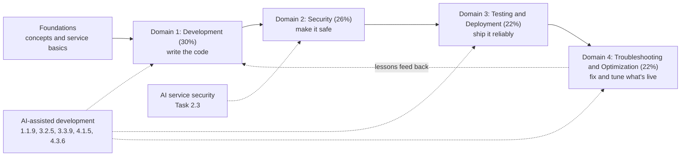

# Foundations

**Foundations** · Start here before the domain folders

This folder holds the material that sits underneath every domain of the AWS Certified Developer - Associate (DVA-C03) exam: the official exam outline, the general software and cloud concepts the skill notes assume, the AWS services that no single skill owns, a glossary, and a map from every in-scope service to the skills that test it. The four domain folders then go skill by skill and link back here for background.

## What's in this folder

| File | What it holds | Use it when |
|---|---|---|
| [exam-guide.md](exam-guide.md) | The official DVA-C03 outline: question format, scoring, domain weights, every task and skill, in-scope services, and DVA-C02 vs DVA-C03 changes | You want to know what's tested and how much it weighs |
| [developer-basics.md](developer-basics.md) | Plain-language primer on APIs, SDKs, SigV4, idempotency, retries, serialization, DynamoDB keys, caching, OAuth and JWT, envelope encryption, CI/CD, observability, and AI concepts, each linked to the skill note that goes deeper | A skill note uses a concept you can't explain yet |
| [aws-service-basics.md](aws-service-basics.md) | Background on EC2, EBS, instance store, EFS, Elastic Load Balancing, Auto Scaling, Route 53, and VPC, with exam tips and traps, plus cross-skill numbers and recent AWS changes | A scenario sits on infrastructure you need to recognize, or you want the must-know numbers in one place |
| [services-in-scope.md](services-in-scope.md) | Every in-scope service mapped to the skill notes where it matters, plus services that skills mention but the list omits, and the out-of-scope list | You want a service checklist, or you need to know whether a service can be a correct answer |
| [glossary.md](glossary.md) | A to Z abbreviations and key terms, each linked to its skill note | You hit an unfamiliar term or acronym |

Abbreviations used on this page (API, SDK, SigV4, JWT, CI/CD, EC2, VPC, and others) are spelled out in the [glossary](glossary.md).

## Suggested reading order

1. **[exam-guide.md](exam-guide.md).** Read it once in full to learn the format, the four domains and their weights (30%, 26%, 22%, 22%), and the out-of-role list. Come back before the exam to check that nothing changed.
2. **[developer-basics.md](developer-basics.md).** Skim it end to end. Mark any concept you can't explain in a sentence and follow its deep-dive link later, when you reach that skill.
3. **[aws-service-basics.md](aws-service-basics.md).** Read the EC2, storage, load balancing, Route 53, and VPC sections once; these come up as scenario background in all four domains. Return to the "Numbers that cut across skills" and "Recent AWS changes" tables during final review.
4. **[services-in-scope.md](services-in-scope.md).** Use it as a checklist at the start (what you already know) and at the end (what you can explain from memory).
5. **[glossary.md](glossary.md).** Keep it open as a reference while working through the domains.

Then start the domains in order:

| Domain | Weight | First task |
|---|---:|---|
| 1. Development with AWS Services | 30% | [Task 1.1: Build application code](../domain-1-development-with-aws-services/task-1.1-build-application-code/README.md) |
| 2. Security | 26% | [Task 2.1: Authentication and authorization](../domain-2-security/task-2.1-authentication-and-authorization/README.md) |
| 3. Testing and Deployment | 22% | [Task 3.1: Prepare deployable artifacts](../domain-3-testing-and-deployment/task-3.1-prepare-deployable-artifacts/README.md) |
| 4. Troubleshooting and Optimization | 22% | [Task 4.1: Root-cause analysis](../domain-4-troubleshooting-and-optimization/task-4.1-root-cause-analysis/README.md) |

Each task folder has a README, one note per skill, `labs.md`, and `practice-questions.md`.

## How the domains build on each other

Domain 2 secures what Domain 1 builds, Domain 3 ships it, and Domain 4 debugs and tunes it. The two AI threads that are new in DVA-C03 have no domain weight of their own; they run through the existing four.

## Sources

- Folder structure from `archive/REORG-MANIFEST.md`. Domain relationship diagram adapted from `archive/dva-c03/README.md`.
