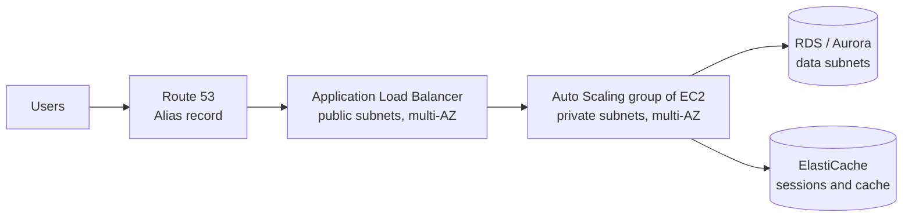

# AWS service basics

**Foundations** · [Folder overview](README.md) · Related: [Developer basics](developer-basics.md) · [Glossary](glossary.md) · [Services in scope](services-in-scope.md)

This note covers background service material that no single DVA-C03 skill owns: Amazon Elastic Compute Cloud (EC2), EC2 storage (Amazon Elastic Block Store (EBS), instance store, Amazon Elastic File System (EFS)), Elastic Load Balancing (ELB) and Auto Scaling, Amazon Route 53, and Amazon Virtual Private Cloud (VPC) basics. The Developer exam asks about these services mostly as the setting for a scenario: a Lambda function inside a VPC, a CodeDeploy rollout to an Auto Scaling group (ASG), a load balancer health check that fails. Each section links to the skill notes that test the service directly.

The last sections collect cross-skill numbers and recent AWS changes that older material and practice questions get wrong.

## Contents

- [Amazon EC2](#amazon-ec2)
- [EC2 storage: EBS, instance store, and EFS](#ec2-storage-ebs-instance-store-and-efs)
- [High availability, load balancing, and Auto Scaling](#high-availability-load-balancing-and-auto-scaling)
- [Amazon Route 53](#amazon-route-53)
- [Amazon VPC basics](#amazon-vpc-basics)
- [Reference architectures](#reference-architectures)
- [Numbers that cut across skills](#numbers-that-cut-across-skills)
- [Recent AWS changes that older material gets wrong](#recent-aws-changes-that-older-material-gets-wrong)

---

## Amazon EC2

EC2 is the core infrastructure as a service (IaaS) offering: you rent virtual machines (instances). Around it sit virtual drives (EBS), load distribution (ELB), and fleet scaling (ASGs). Elastic Beanstalk, Amazon Elastic Container Service (ECS) on EC2, and CodeDeploy EC2 deployments all run on EC2, so the basics carry into Domain 3.

### Launch-time choices

| Choice | Options |
|---|---|
| Operating system | Linux, Windows, macOS |
| Compute and memory | Number of virtual CPUs (vCPUs), amount of RAM, chosen through the instance type |
| Storage | Network-attached (EBS, EFS) or hardware-attached (instance store); sizes in gibibytes (GiB) and tebibytes (TiB) |
| Network | Network speed, public IP address |
| Firewall | One or more security groups |
| Bootstrap script | EC2 user data |
| Permissions | An AWS Identity and Access Management (IAM) role attached through an instance profile ([2.1.3](../domain-2-security/task-2.1-authentication-and-authorization/2.1.3-secure-programmatic-access.md)) |

### User data and instance metadata

- **User data** is a bootstrap script. It runs **once**, at the instance's first start, as the **root** user (no `sudo` needed). Use it to install updates and software or download files.
- **Instance metadata** is data *about* the instance, read from `http://169.254.169.254/latest/meta-data/` (a link-local address reachable only from the instance). User data is at `/latest/user-data/`.
- From metadata you can read the attached **IAM role name and its temporary credentials**, never the policy document.
- **Instance Metadata Service version 2 (IMDSv2)** requires a `PUT` to get a session token, then sends the token in a header on each metadata call. It defends against server-side request forgery (SSRF), and you can enforce IMDSv2-only on an instance. Credential handling is covered in [2.1.3 Secure programmatic access](../domain-2-security/task-2.1-authentication-and-authorization/2.1.3-secure-programmatic-access.md).

**Exam tip:** user data = boot script, runs once, as root. Metadata = facts about the instance. Don't swap them.

**Trap:** IMDS gives the role name and credentials, not the policy.

### Instance types

The name `m5.2xlarge` means class `m`, generation `5`, size `2xlarge`.

| Family | Optimized for | Typical use | Memory hook |
|---|---|---|---|
| General purpose (`t`, `m`) | Balance of compute, memory, networking | Web servers, code repositories; `t2.micro` and `t3.micro` are free-tier sizes | Balanced |
| Compute optimized (`c`) | High-performance CPU | Batch processing, media transcoding, high-performance computing (HPC), scientific modeling, machine learning (ML), game servers | C = compute |
| Memory optimized (`r`, `x`, `z`) | Large data sets in RAM | In-memory databases, distributed caches, real-time big-data processing | R = RAM |
| Storage optimized (`i`, `d`, `h`) | High sequential read and write to local storage | High-frequency online transaction processing (OLTP), NoSQL databases, data warehousing, distributed file systems | I/D = disk |

**Exam tip:** map the keyword to the family. "HPC, batch, compute-intensive" means compute optimized. "In-memory database, cache, large RAM" means memory optimized. "Data warehouse, high local disk I/O" means storage optimized. Right-sizing Lambda and container memory is a Domain 4 topic: see [4.3.2 Memory and compute tuning](../domain-4-troubleshooting-and-optimization/task-4.3-optimize-applications/4.3.2-memory-and-compute-tuning.md).

### Security groups

A security group (SG) is a virtual firewall around an instance's elastic network interface (ENI).

- Rules are **allow only**. There is no deny rule in a security group.
- A rule's source or destination can be an IPv4 or IPv6 range **or another security group**.
- One SG can attach to many instances, and an instance can have several SGs.
- An SG belongs to one Region and one VPC.
- Default: all inbound traffic blocked, all outbound traffic allowed.
- **Stateful:** if inbound traffic is allowed, the response is allowed out automatically, whatever the outbound rules say.
- Traffic blocked by an SG never reaches the instance, so the instance logs show nothing.

**Exam tip (troubleshooting classic):**

| Symptom | Likely cause |
|---|---|
| Connection **times out** | Security group (port not open, source not allowed) or network ACL |
| **Connection refused** | The network path works; the application is down or not listening on that port |

**Exam tip:** to let a group of instances talk to each other, or to let only a load balancer reach an app tier, reference the **security group** in the rule instead of hard-coding IP addresses. The same pattern secures a VPC-attached Lambda function reaching Amazon RDS: see [1.2.1 Lambda VPC access](../domain-1-development-with-aws-services/task-1.2-develop-lambda-functions/1.2.1-lambda-vpc-access.md).

### Ports to know

| Port | Protocol | Use |
|---|---|---|
| 22 | Secure Shell (SSH) | Log in to a Linux instance; SSH File Transfer Protocol (SFTP) also uses 22 |
| 21 | File Transfer Protocol (FTP) | Upload files to a file share |
| 80 | Hypertext Transfer Protocol (HTTP) | Unencrypted websites |
| 443 | HTTP Secure (HTTPS) | Encrypted websites and every AWS application programming interface (API) endpoint |
| 3389 | Remote Desktop Protocol (RDP) | Log in to a Windows instance |
| 3306 / 5432 | MySQL / PostgreSQL | Database security group rules for RDS and Aurora |
| 6379 / 11211 | Redis (Valkey) / Memcached | ElastiCache security group rules |

**Trap:** SFTP runs over SSH on port 22. Plain FTP is 21.

### Connecting to instances

| From | How |
|---|---|
| macOS, Linux, Windows 10 and later | Native `ssh` client |
| Older Windows | PuTTY |
| Any browser | EC2 Instance Connect, or AWS Systems Manager Session Manager |

EC2 Instance Connect pushes a temporary public key to the instance for 60 seconds, so you need no local key file. IAM policies control who can connect. It comes preinstalled on Amazon Linux 2 (2.0.20190618 and later), Amazon Linux 2023 (AL2023, except the minimal Amazon Machine Image (AMI)), and Ubuntu 20.04 and later. Older material says "Amazon Linux 2 only".

**Exam tip:** Instance Connect still uses SSH, so **port 22 must be open** in the security group. Session Manager needs no inbound port at all. Key pairs and keyless access for developers are covered in [2.2.5 Development certificates and SSH keys](../domain-2-security/task-2.2-encrypt-and-protect-sensitive-data/2.2.5-development-certificates-and-ssh-keys.md).

### Purchasing options

| Option | Discount | Commitment | Can AWS take it back? | Best for |
|---|---|---|---|---|
| On-Demand | None | None | No | Short, unpredictable, uninterruptible workloads |
| Reserved Instances (RI) | Up to about 72% (Convertible about 66%) | 1 or 3 years, specific instance attributes | No | Steady-state use such as databases |
| Savings Plans | Up to about 72% (EC2 Instance), about 66% (Compute) | 1 or 3 years, dollars per hour | No | Steady use with flexibility in size, OS, tenancy (Compute plans also cover Fargate and Lambda) |
| Spot Instances | Up to about 90% | None | **Yes**, with a two-minute interruption notice | Fault-tolerant, flexible batch and data jobs |
| Dedicated Hosts | Varies | On-Demand or Reserved | No | Bring-your-own-license (BYOL) per socket or core, compliance, placement control |
| Dedicated Instances | None | None | No | Hardware not shared with other customers, no placement control |
| Capacity Reservations | None (pair with RIs or Savings Plans for a discount) | None; billed at On-Demand rate whether used or not | No | Guaranteed capacity in one Availability Zone (AZ) |

- On-Demand Linux and Windows instances bill per second with a 60-second minimum.
- RIs reserve instance type, Region, tenancy, and OS, and can be Regional or zonal. Payment can be no, partial, or all upfront; more upfront means a bigger discount. Unused RIs can be sold on the Reserved Instance Marketplace.
- EC2 Instance Savings Plans lock you to an instance family and Region (for example M5 in `us-east-1`). Compute Savings Plans don't.

**Exam tip:** RI = commit to a specific instance. Savings Plan = commit to dollars per hour of usage. Dedicated Host gives control and visibility of the physical server; Dedicated Instance only isolates the hardware.

**Trap:** never pick Spot for a critical job or a database.

**Note:** exact discount percentages drift and aren't tested. Know the ranking (Spot cheapest; On-Demand and Dedicated Hosts most expensive) and the use-case mapping.

---

## EC2 storage: EBS, instance store, and EFS

### EBS volumes

- An EBS volume is a **network drive** attached to one instance at a time (exception: Multi-Attach, below).
- Data persists independently of the instance.
- A volume is **locked to one AZ**. To move it to another AZ or Region, take a **snapshot** and restore it there.
- You provision size (GiB) and IOPS (input/output operations per second) and pay for what you provision, used or not. You can grow capacity later.

**Delete on termination:** the root volume is deleted when the instance terminates (attribute enabled by default). Other attached volumes are kept (attribute disabled by default). To keep the root volume, disable the attribute.

### Snapshots and AMIs

- A snapshot is an incremental, point-in-time backup of an EBS volume. Detaching first isn't required but is recommended; avoid snapshots during heavy I/O.
- Snapshots copy across AZs and Regions.
- **EBS Snapshots Archive** is about 75% cheaper; restoring takes 24 to 72 hours.
- **Recycle Bin** retention rules (1 day to 1 year) recover accidentally deleted snapshots.
- **Fast Snapshot Restore (FSR)** fully initializes the volume so there is no first-read latency. It is expensive.
- An **AMI** is a customized instance image (OS, software, configuration). It is Region-specific and can be copied to other Regions. Sources are public AWS AMIs, your own AMIs, and AWS Marketplace AMIs.
- AMI process: launch and customize an instance, stop it for data integrity, build the AMI (this creates EBS snapshots), then launch new instances from it.

**Exam tip:** a pre-baked AMI boots faster than installing everything in user data. Shorter boot time also lets an ASG react faster (see [cooldowns](#scaling-cooldowns-and-instance-refresh)).

### EC2 instance store

- A physical disk on the host. Highest IOPS, lowest latency.
- **Ephemeral:** data is lost when the instance stops or terminates, or the hardware fails.
- Use it for buffers, caches, and scratch data. Backups and replication are your job.

**Exam tip:** "maximum local IOPS, temporary data" means instance store. "Must persist" means EBS or EFS.

### EBS volume types

| Type | Media | Size | Max IOPS | Max throughput | Boot volume? | Use |
|---|---|---|---|---|---|---|
| gp3 | Solid-state drive (SSD) | 1 GiB to 64 TiB | 80,000 (baseline 3,000) | 2,000 mebibytes per second (MiB/s) (baseline 125 MiB/s) | Yes | Default general purpose; IOPS and throughput set independently of size |
| gp2 | SSD | 1 GiB to 16 TiB | 16,000 (3 IOPS per GiB; small volumes burst to 3,000) | 250 MiB/s | Yes | Older general purpose; IOPS tied to size |
| io1 | SSD | 4 GiB to 16 TiB | 64,000 on Nitro (32,000 others); 50 IOPS per GiB | 1,000 MiB/s | Yes | Sustained IOPS for databases |
| io2 Block Express | SSD | 4 GiB to 64 TiB | 256,000; 1,000 IOPS per GiB | 4,000 MiB/s | Yes | Sub-millisecond latency, mission-critical databases |
| st1 | Hard disk drive (HDD) | 125 GiB to 16 TiB | 500 | 500 MiB/s | **No** | Big data, data warehouses, log processing |
| sc1 | HDD | 125 GiB to 16 TiB | 250 | 250 MiB/s | **No** | Cold, rarely accessed, lowest cost |

- gp3 limits rose in September 2025 (from 16 TiB, 16,000 IOPS, and 1,000 MiB/s). Older material and practice questions use the old numbers.
- gp2 reaches its 16,000 IOPS maximum at about 5,334 GiB.

**Exam tip:** "need more IOPS without growing the disk" means gp3. "Highest IOPS, sub-millisecond latency" means io2 Block Express.

**Trap:** only SSD types (gp2, gp3, io1, io2) can be boot volumes. HDD types (st1, sc1) can't.

### EBS Multi-Attach

- io1 and io2 only. Attach one volume to up to **16** instances in the **same AZ**, each with full read and write.
- The application must manage concurrent writes, and you need a cluster-aware file system (not XFS or EXT4).

### Amazon EFS

- Managed Network File System (NFS) storage that **many instances across many AZs** can mount at once. Uses NFSv4.1; access is controlled with a security group.
- **Linux only** (Portable Operating System Interface (POSIX) file system). Not for Windows.
- Scales automatically and bills per use; more expensive per GB than gp2 (about three times), with storage tiers to cut cost.
- Encryption at rest uses AWS Key Management Service (KMS).
- Lambda functions can mount EFS through an access point when attached to the VPC ([1.2.1](../domain-1-development-with-aws-services/task-1.2-develop-lambda-functions/1.2.1-lambda-vpc-access.md), [1.2.2](../domain-1-development-with-aws-services/task-1.2-develop-lambda-functions/1.2.2-lambda-configuration.md)).

| Setting | Options |
|---|---|
| Performance mode (set at creation) | **General Purpose** (default, latency-sensitive: web serving, content management) or **Max I/O** (higher latency, more parallel throughput) |
| Throughput mode | **Elastic** (console default, scales with the workload, best for unpredictable load; Regional file systems reach tens of GiB/s reads and up to about 5 GiB/s writes depending on Region), **Provisioned** (fixed throughput regardless of size), **Bursting** (scales with stored size: 1 TB gives 50 MiB/s baseline with bursts to 100 MiB/s) |
| Storage class | **Standard** (frequent access), **Infrequent Access (EFS IA)** (cheaper storage, per-GB retrieval charge), **Archive** (a few accesses a year, about 50% cheaper than IA); lifecycle policies move files between them |
| Availability | **Regional** (multi-AZ, production) or **One Zone** (single AZ, dev; backups on by default; One Zone IA saves over 90%) |

**Note:** older material gives Elastic throughput as 3 GiB/s reads and 1 GiB/s writes. AWS has raised it since; the current per-Region figures are on the [EFS performance specifications](https://docs.aws.amazon.com/efs/latest/ug/throughput-modes.html) page.

### EBS vs EFS vs instance store

| Dimension | EBS | EFS | Instance store |
|---|---|---|---|
| Type | Network block storage | Network file system (NFS) | Local physical disk |
| Attach scope | One instance (Multi-Attach for io1/io2) | Hundreds of instances | The host instance only |
| AZ scope | One AZ | Across AZs (Regional) | Tied to host |
| OS | Any | Linux only | Any |
| Persistence | Persists | Persists | **Ephemeral** |
| Performance | Up to 256,000 IOPS (io2 Block Express) | Scales automatically | Highest local IOPS |
| Cost | Moderate | High; tiers help | Included with the instance |
| Use case | Single-instance volume, self-managed database | Shared files across a fleet (WordPress uploads) | Cache, scratch, temporary data |

**Exam favorite:** "shared across many instances or AZs" means EFS. "Single instance block volume or database" means EBS. "Maximum local IOPS, temporary" means instance store. Choosing among S3, DynamoDB, RDS, and ElastiCache for application data is [1.3.2 Choosing data stores](../domain-1-development-with-aws-services/task-1.3-use-data-stores/1.3.2-choosing-data-stores.md).

---

## High availability, load balancing, and Auto Scaling

### Scalability vs availability

| Concept | Meaning | Example |
|---|---|---|
| Vertical scaling (scale up/down) | Bigger or smaller instance | `t2.micro` to `t2.large`; common for databases (RDS, ElastiCache); capped by the largest instance size |
| Horizontal scaling (scale out/in, elasticity) | More or fewer instances | ASG behind a load balancer; needs a distributed design |
| High availability (HA) | Survive the loss of an AZ by running in at least two | Passive: RDS Multi-AZ standby. Active: an ASG and load balancer spanning AZs |

**Exam tip:** scalability is about handling load; availability is about surviving failure. Don't confuse them.

### Why a load balancer

A load balancer spreads traffic across targets, exposes one Domain Name System (DNS) name, stops sending traffic to failed targets, runs health checks, terminates Transport Layer Security (TLS) for HTTPS, supports cookie stickiness, and spans AZs. ELB is the managed version: AWS handles upgrades, maintenance, and availability. It integrates with EC2, ASGs, ECS, AWS Certificate Manager (ACM), CloudWatch, Route 53, AWS WAF, and AWS Global Accelerator.

**Health checks** run against a port and a route (commonly `/health`). A response other than HTTP 200 marks the target unhealthy and the load balancer stops routing to it. Designing health check endpoints and container liveness and readiness probes is [4.2.5 Health checks and probes](../domain-4-troubleshooting-and-optimization/task-4.2-observability/4.2.5-health-checks-and-probes.md).

### Load balancer types

| Load balancer | Layer | Protocols | Pick it when |
|---|---|---|---|
| Classic Load Balancer (CLB), 2009 | 4 and 7 | HTTP, HTTPS, TCP, SSL | Legacy only; avoid for new work |
| Application Load Balancer (ALB), 2016 | 7 | HTTP, HTTPS, WebSocket, HTTP/2, gRPC | HTTP routing, microservices, containers, Lambda targets |
| Network Load Balancer (NLB), 2017 | 4 | TCP, TLS, UDP | Extreme performance (millions of requests per second), ultra-low latency, static IP |
| Gateway Load Balancer (GWLB), 2020 | 3 | IP packets over GENEVE, port 6081 | Inline third-party network appliances (firewalls, intrusion detection and prevention) |

Load balancers can be internet-facing (public) or internal (private).

**Security group pattern:** the load balancer SG allows HTTP/HTTPS from `0.0.0.0/0`. The instance SG allows traffic **only from the load balancer's SG**, so instances aren't reachable directly from the internet.

### Application Load Balancer

- Routes to **target groups** by URL path (`/users` vs `/posts`), hostname (`one.example.com`), query string, or headers. Supports redirects such as HTTP to HTTPS.
- Targets: EC2 instances (often in an ASG), ECS tasks (dynamic port mapping), Lambda functions (the HTTP request becomes a JavaScript Object Notation (JSON) event), and private IP addresses.
- Health checks are set per target group.
- Fixed hostname: `XXX.region.elb.amazonaws.com`.
- The connection terminates at the ALB, so the target sees the ALB's IP. The client's details arrive in headers: `X-Forwarded-For` (client IP), `X-Forwarded-Port`, `X-Forwarded-Proto`.
- ALB can authenticate users with Amazon Cognito or an OpenID Connect (OIDC) provider before forwarding ([2.1.1](../domain-2-security/task-2.1-authentication-and-authorization/2.1.1-identity-federation.md)).

**Exam tip:** "app behind the ALB needs the real client IP" means read `X-Forwarded-For`. "Route by path or hostname" means ALB.

### Network Load Balancer

- Layer 4 TCP and UDP. One **static IP per AZ**, and you can assign an Elastic IP, which helps when clients allow-list IP addresses.
- Targets: EC2 instances, private IP addresses, and an ALB. Health checks support TCP, HTTP, and HTTPS.
- NLB fronts API Gateway private integrations through a VPC link ([1.1.4](../domain-1-development-with-aws-services/task-1.1-build-application-code/1.1.4-apis-transformation-and-validation.md)).

**Exam tip:** "static IP or Elastic IP" or "extreme TCP/UDP performance" means NLB. An NLB can sit in front of an ALB.

### Gateway Load Balancer

A transparent network gateway (single entry and exit point) plus a load balancer for a fleet of virtual appliances. Uses GENEVE on port 6081. Targets are EC2 instances and private IPs.

**Exam tip:** "inspect all traffic through third-party firewall appliances" means GWLB.

### Sticky sessions

- Stickiness sends the same client to the same target. Supported on CLB, ALB, and NLB.
- Use case: keep session data on one instance. Cost: load can become uneven. A better long-term fix is external session state (ElastiCache or DynamoDB, see [1.3.2](../domain-1-development-with-aws-services/task-1.3-use-data-stores/1.3.2-choosing-data-stores.md)).

| Cookie | Generated by | Name |
|---|---|---|
| Duration-based | Load balancer | `AWSALB` (ALB), `AWSELB` (CLB) |
| Application-based, application cookie | Load balancer | `AWSALBAPP` |
| Application-based, custom cookie | Your application | Your own name, set per target group |

**Trap:** a custom cookie can't use the reserved names `AWSALB`, `AWSALBAPP`, or `AWSALBTG`.

### Cross-zone load balancing

With cross-zone on, each load balancer node spreads traffic across all registered targets in all AZs. With it off, each node sends only to targets in its own AZ, which can unbalance load when AZs have different target counts.

| Load balancer | Default | Inter-AZ data charge |
|---|---|---|
| ALB | **On** (can be turned off per target group) | None |
| NLB, GWLB | **Off** | Charged if you turn it on |
| CLB | Off when created through the API or the AWS Command Line Interface (CLI), on when created in the console | None |

**Exam favorite:** ALB is on by default and free. NLB and GWLB are off by default and cost money when enabled.

### TLS certificates and SNI

- An SSL/TLS certificate encrypts traffic between the client and the load balancer in transit. Secure Sockets Layer (SSL) is the old name; TLS is what's actually used.
- Load balancers use X.509 certificates, managed in ACM or uploaded. An HTTPS listener needs a default certificate and can hold more for other domains. A security policy controls which TLS versions and ciphers legacy clients can use.
- **Server Name Indication (SNI)** lets the client name the hostname in the TLS handshake so one listener can serve many certificates. It works on ALB, NLB, and CloudFront, **not CLB**.

| Load balancer | Certificates |
|---|---|
| CLB | One certificate; use one CLB per hostname |
| ALB, NLB | Many certificates through SNI |

**Exam tip:** "several HTTPS domains on one load balancer" means ALB or NLB with SNI. Certificate issuance, DNS validation, renewal, and Region rules are [2.2.2 Certificate management](../domain-2-security/task-2.2-encrypt-and-protect-sensitive-data/2.2.2-certificate-management.md); end-to-end encryption choices are [2.2.1](../domain-2-security/task-2.2-encrypt-and-protect-sensitive-data/2.2.1-encryption-at-rest-and-in-transit.md).

### Connection draining (deregistration delay)

- Called connection draining on CLB and **deregistration delay** on ALB and NLB.
- While a target deregisters or turns unhealthy, the load balancer lets in-flight requests finish and sends no new ones.
- Range 1 to 3,600 seconds, default 300. Set 0 to disable. Use a low value when requests are short.

**Exam tip:** "finish serving existing requests before removing an instance" means deregistration delay. It also explains why a CodeDeploy or ECS rolling deployment step pauses for minutes ([3.3.4](../domain-3-testing-and-deployment/task-3.3-deploy-with-ci-cd/3.3.4-codedeploy.md), [3.3.2](../domain-3-testing-and-deployment/task-3.3-deploy-with-ci-cd/3.3.2-container-deployments.md)).

### Auto Scaling groups

- An ASG scales out on load and in when load drops, keeps the instance count between a **minimum** and a **maximum** (with a **desired** capacity), registers new instances with the load balancer, and replaces instances that terminate or fail health checks.
- ASGs are free; you pay for the instances.
- With an ELB attached, the ASG can use the load balancer health check to decide instance health.
- A **launch template** defines the AMI, instance type, user data, EBS volumes, security groups, SSH key pair, IAM role, network and subnets, and load balancer information. Launch configurations are deprecated.

### Scaling policies

| Policy | How it works | Example |
|---|---|---|
| Target tracking | Keep a metric at a target value; simplest | Average ASG CPU at 40% |
| Simple or step scaling | CloudWatch alarm triggers a fixed or stepped change | CPU above 70%: add 2; below 30%: remove 1 |
| Scheduled | Change capacity at known times | Minimum 10 at 5 p.m. on Fridays |
| Predictive | Forecast load with ML and scale ahead of time | Daily traffic cycles |

Good scaling metrics: `CPUUtilization`, `RequestCountPerTarget`, average network in or out, or any custom CloudWatch metric your code emits ([4.2.2 Custom metrics](../domain-4-troubleshooting-and-optimization/task-4.2-observability/4.2.2-custom-metrics.md)). The exam treats EC2 Auto Scaling as a concurrency control in [4.3.1](../domain-4-troubleshooting-and-optimization/task-4.3-optimize-applications/4.3.1-concurrency-controls.md).

### Scaling cooldowns and instance refresh

- After a scaling activity, the ASG waits a **cooldown** (default 300 seconds) before launching or terminating more instances, so metrics can settle.
- A ready-to-use AMI shortens boot time, so new instances serve sooner and you can shorten the cooldown.
- **Instance refresh** replaces every instance after a launch template change (for example a new AMI). You set a minimum healthy percentage and a warm-up time.

**Exam tip:** "roll a new AMI across the whole ASG" means instance refresh. Application deployments to an ASG use CodeDeploy ([3.3.4](../domain-3-testing-and-deployment/task-3.3-deploy-with-ci-cd/3.3.4-codedeploy.md)) or Elastic Beanstalk deployment policies ([3.3.6](../domain-3-testing-and-deployment/task-3.3-deploy-with-ci-cd/3.3.6-deployment-strategies.md)).

---

## Amazon Route 53

### DNS fundamentals

DNS translates hostnames into IP addresses (for example `www.example.com` to `192.0.2.44`) through a hierarchy.

| Term | Meaning |
|---|---|
| Domain registrar | Where you buy a domain (Route 53, GoDaddy, and others) |
| DNS records | A, AAAA, CNAME, NS, and others |
| Zone file | The set of DNS records for a domain |
| Name server | Answers DNS queries (authoritative or non-authoritative) |
| Top-level domain (TLD) | `.com`, `.org`, `.gov` |
| Second-level domain (SLD) | `amazon.com`, `example.com` |
| Fully qualified domain name (FQDN) | The complete name, such as `api.www.example.com.` |

Resolution (simplified): the browser asks a local resolver (often the internet service provider's), which asks a root server, then the TLD server, then the domain's authoritative server, and caches the answer for the record's TTL (time to live).

### Route 53 overview

- A highly available, fully managed, **authoritative** DNS service: you can update the records.
- Also a domain registrar, and it can health-check your resources.
- The only AWS service with a **100% availability** service level agreement (SLA). The name refers to DNS port 53.

### Records and hosted zones

Each record has a name, a type, a value, a routing policy, and a TTL.

| Type | Maps a name to | Notes |
|---|---|---|
| A | IPv4 address | Most common |
| AAAA | IPv6 address | |
| CNAME | Another hostname | Target needs its own A/AAAA record; **not allowed at the zone apex** |
| NS | Name servers for the hosted zone | Controls who answers for the domain |

Also know that CAA, MX, TXT, SOA, SRV, and others exist.

- A **hosted zone** holds the records for a domain and its subdomains. It costs $0.50 per month.
- **Public hosted zone:** answers on the internet (`app1.mypublicdomain.com`).
- **Private hosted zone:** answers only inside the associated VPCs (`app1.company.internal`).

**TTL trade-off:** a high TTL (24 hours) means fewer queries and lower cost but slower changes. A low TTL (60 seconds) means fresher records at more cost. Every record needs a TTL except Alias records.

**Exam tip:** before a migration, lower the TTL in advance so clients pick up the change quickly.

### CNAME vs Alias

| | CNAME | Alias |
|---|---|---|
| Points to | Any hostname | An AWS resource |
| Zone apex (`example.com`) | **No** | **Yes** |
| Cost for queries | Standard | Free |
| Native health check | No | Yes (evaluate target health) |
| TTL | You set it | Set by Route 53 |
| Record type | CNAME | A or AAAA |

Alias targets: ELB load balancers, CloudFront distributions, API Gateway, Elastic Beanstalk environments, S3 website endpoints, VPC interface endpoints, Global Accelerator, and another record in the same hosted zone. Alias records follow IP changes of the target automatically.

**Trap:** an EC2 instance's public DNS name can't be an Alias target.

**Exam tip:** "point the root domain at an ALB, CloudFront, or an S3 website" means an Alias A record. A custom domain for API Gateway ends in an Alias record to the API's domain name: see [3.1.5 API Gateway stages and endpoints](../domain-3-testing-and-deployment/task-3.1-prepare-deployable-artifacts/3.1.5-api-gateway-stages-and-endpoints.md).

### Routing policies

DNS doesn't route traffic. Route 53 only answers queries, and the client then connects.

| Policy | Behavior | Health checks |
|---|---|---|
| Simple | One record, possibly with several values; the client picks one at random. With Alias, one AWS resource | No |
| Weighted | Share of answers = record weight / sum of weights. Weights needn't sum to 100. Weight 0 stops traffic; all 0 means equal | Yes |
| Latency | Answer with the Region of lowest latency to the user | Yes |
| Failover (active-passive) | Primary with a **required** health check; on failure, answer with the secondary | Required on primary |
| Geolocation | By user continent, country, or US state; most specific match wins. Needs a **Default** record | Yes |
| Geoproximity | By location of users and resources, shifted with a **bias** (1 to 99 grows a region, -1 to -99 shrinks it). Non-AWS resources use latitude and longitude | Yes |
| IP-based | By client IP, using Classless Inter-Domain Routing (CIDR) collections you define | Yes |
| Multivalue answer | Returns up to 8 healthy records | Yes |

- Geoproximity used to require Route 53 Traffic Flow. Since January 2024 it is a standard record routing policy; the bias map visualizer is still in Traffic Flow.
- Weighted routing is a DNS-level canary for testing a new version on a slice of users ([3.3.6 Deployment strategies](../domain-3-testing-and-deployment/task-3.3-deploy-with-ci-cd/3.3.6-deployment-strategies.md)).

**Trap:** multivalue answer isn't a substitute for a load balancer. It is client-side distribution.

**Exam tip:** one resource is simple; split by percentage is weighted; lowest latency is latency; active-passive disaster recovery is failover; by country or state is geolocation; shift with bias or coordinates is geoproximity; by client CIDR is IP-based; several healthy IPs is multivalue.

### Health checks

Three kinds:

1. **Endpoint** health checks probe an application, server, or AWS resource.
2. **Calculated** health checks combine up to 255 child checks with OR, AND, or NOT and a minimum number that must pass. Use case: maintenance on part of a site without failing the whole check.
3. **CloudWatch alarm** health checks follow an alarm's state (for example DynamoDB throttles or a custom metric).

Endpoint check details:

- About 15 health checkers around the world probe the endpoint.
- Healthy or unhealthy threshold: 3 consecutive results (default). Interval: 30 seconds, or 10 seconds at higher cost.
- Protocols: HTTP, HTTPS, TCP. Only 2xx and 3xx responses pass. A check can also look for text in the first 5,120 bytes of the response.
- The endpoint is healthy when **more than 18%** of checkers report healthy.
- Allow the Route 53 health checker IP ranges in your security groups and firewalls.
- Health checks drive automated DNS failover and publish CloudWatch metrics.

**Private resources:** standard Route 53 health checkers run outside your VPC and can't reach private IPs. The long-standing answer, and the one the exam material assumes, is a CloudWatch metric and alarm plus a health check that monitors the alarm.

> **New in November 2026.** Route 53 added private endpoint health checks (`EndpointType` `PRIVATE`), which probe endpoints from a health check source inside your VPC. Exam questions written before this launch still expect the CloudWatch alarm pattern. If a question offers only the alarm pattern for a private resource, choose it.

### Registrar vs DNS service

A registrar sells the domain; a DNS service hosts its records. They can differ. To use Route 53 for a domain bought elsewhere, create a public hosted zone in Route 53, then change the **NS records** at the third-party registrar to the Route 53 name servers.

---

## Amazon VPC basics

### Scope for the Developer exam

VPC is tested deeply on the SysOps and Solutions Architect exams. For DVA-C03 you need definitions, the stateful vs stateless contrast, and which endpoint type serves which service, mostly in service of [1.2.1 Lambda VPC access](../domain-1-development-with-aws-services/task-1.2-develop-lambda-functions/1.2.1-lambda-vpc-access.md) and [2.3.2 AI data privacy and private connectivity](../domain-2-security/task-2.3-secure-ai-services/2.3.2-ai-data-privacy-and-private-connectivity.md). The exam guide lists "design AWS network infrastructure" as outside the target role.

### Building blocks

| Component | What it is |
|---|---|
| VPC | A private network for your resources. **Regional** (spans the Region's AZs). Has a CIDR range such as `10.0.0.0/16` |
| Subnet | A partition of the VPC in **one AZ**. Public if its route table has a route to an internet gateway; private otherwise |
| Route table | Rules that send traffic to the internet gateway, NAT gateway, endpoints, peering connections, and between subnets |
| Internet gateway (IGW) | Attached to the VPC; gives public subnets internet access |
| NAT gateway (managed) / NAT instance (self-managed) | Network address translation (NAT) that lets private subnets reach the internet **outbound only**. The NAT gateway sits in a public subnet |

**Exam tip:** a VPC-attached Lambda function has no public IP even in a public subnet. To reach the internet it needs a private subnet with a route to a NAT gateway; to reach S3 or DynamoDB privately it needs a gateway endpoint ([1.2.1](../domain-1-development-with-aws-services/task-1.2-develop-lambda-functions/1.2.1-lambda-vpc-access.md)).

### Security groups vs network ACLs

| Feature | Security group | Network ACL (NACL) |
|---|---|---|
| Level | Instance / ENI | Subnet |
| Rules | Allow only | Allow and deny |
| State | **Stateful**: return traffic allowed automatically | **Stateless**: return traffic needs its own rule (ephemeral ports) |
| Rule targets | IP ranges and other security groups | IP ranges only |
| Evaluation | All rules evaluated together | In number order, lowest first; first match wins |
| Applies to | Resources it is attached to | Every resource in the subnet |

**Exam favorite:** SG is stateful, instance-level, allow-only, and can reference SGs. NACL is stateless, subnet-level, allow and deny, IP-only, with ordered rules.

### VPC Flow Logs

- Record IP traffic metadata for a VPC, a subnet, or an ENI, including interfaces that AWS manages for ELB, ElastiCache, RDS, and Aurora.
- Destinations: S3, CloudWatch Logs, Amazon Data Firehose.
- They show accepted and rejected connections, which helps tell an SG or NACL problem from an application problem. Querying them is part of [4.1.3 Querying logs](../domain-4-troubleshooting-and-optimization/task-4.1-root-cause-analysis/4.1.3-querying-logs.md).

**Exam tip:** "find out why traffic is blocked" means VPC Flow Logs.

### VPC peering

- Connects two VPCs privately over the AWS network, as if they were one network.
- CIDR ranges **must not overlap**.
- **Not transitive:** if A peers with B and B with C, A can't reach C through B. Each pair that must talk needs its own peering connection.

### VPC endpoints and AWS PrivateLink

Endpoints reach AWS services over the AWS private network instead of the internet, from inside your VPC.

| Endpoint type | Mechanism | Services | Cost |
|---|---|---|---|
| Gateway endpoint | A route table entry | **S3 and DynamoDB only** | Free |
| Interface endpoint (AWS PrivateLink) | An ENI with a private IP in your subnet | Most services, including S3, Amazon Bedrock, Secrets Manager, KMS, SQS, API Gateway private APIs | Per hour and per GB |

**Exam favorite:** "private access to S3 or DynamoDB" defaults to a gateway endpoint. "Private access to Bedrock, Secrets Manager, or another API" means an interface endpoint. Endpoint policies and `aws:SourceVpce` conditions are covered in [2.3.2](../domain-2-security/task-2.3-secure-ai-services/2.3.2-ai-data-privacy-and-private-connectivity.md) and [2.1.6 Least privilege permissions](../domain-2-security/task-2.1-authentication-and-authorization/2.1.6-least-privilege-permissions.md). Private API Gateway endpoints are in [3.1.5](../domain-3-testing-and-deployment/task-3.1-prepare-deployable-artifacts/3.1.5-api-gateway-stages-and-endpoints.md).

### Site-to-Site VPN vs Direct Connect

| | Site-to-Site VPN | AWS Direct Connect (DX) |
|---|---|---|
| What | Encrypted tunnel from on premises to AWS | Dedicated physical private connection |
| Path | Public internet | Private network |
| Encryption | Automatic (IPsec) | Private but not encrypted by default |
| Setup time | Minutes | About a month or more |

**Exam tip:** "encrypted connection quickly over the internet" means Site-to-Site VPN. "Dedicated, consistent latency, high throughput, slow to set up" means Direct Connect.

> **Not on the DVA-C03 service list.** Site-to-Site VPN, Direct Connect, and Global Accelerator are not in the in-scope services. Know them only well enough to eliminate them as answers.

### VPC summary

- VPC: Regional private network. Subnet: one AZ.
- Internet gateway: VPC-level internet access. NAT gateway: outbound internet for private subnets.
- NACL: stateless, subnet-level, allow and deny. Security group: stateful, ENI-level, allow only.
- Peering: two VPCs, non-overlapping CIDRs, not transitive.
- Endpoints: private access to AWS services (gateway for S3 and DynamoDB, interface for the rest).
- Flow Logs: traffic records to S3, CloudWatch Logs, or Data Firehose.

---

## Reference architectures

### Three-tier web application

Public subnets hold the load balancer; private subnets hold the application servers; data subnets hold the database and cache.

### LAMP stack on EC2

Linux (EC2 OS), Apache (web server on EC2), MySQL (on RDS), PHP (application on EC2). Add ElastiCache (Redis or Memcached) for caching. The EBS root volume stores local application data and software.

### WordPress on AWS

Multi-AZ web servers mount **EFS** for shared media uploads, with the database on RDS or Aurora.

**Exam tip:** "shared user uploads across a fleet of web servers" means EFS.

---

## Numbers that cut across skills

Quick reference for limits that show up in many scenarios. Each skill note gives the full context; AWS can change these, so confirm against the linked note before relying on one.

| Service | Fact | Full treatment |
|---|---|---|
| Lambda | Timeout max 15 minutes; memory 128 MB to 10,240 MB; `/tmp` up to 10 GB; environment variables 4 KB total; ZIP 50 MB zipped / 250 MB unzipped; container image 10 GB; default concurrency 1,000 per Region (adjustable; new accounts can start lower); synchronous payload 6 MB, asynchronous 1 MB | [1.2.2](../domain-1-development-with-aws-services/task-1.2-develop-lambda-functions/1.2.2-lambda-configuration.md), [1.2.3](../domain-1-development-with-aws-services/task-1.2-develop-lambda-functions/1.2.3-lambda-invocation-lifecycle-and-failures.md), [3.3.1](../domain-3-testing-and-deployment/task-3.3-deploy-with-ci-cd/3.3.1-lambda-packaging.md) |
| API Gateway | Integration timeout 29 seconds by default (Regional and private REST APIs can request more; prefer async patterns for long work); account throttle about 10,000 requests per second; cache TTL default 300 seconds, max 3,600 | [1.1.4](../domain-1-development-with-aws-services/task-1.1-build-application-code/1.1.4-apis-transformation-and-validation.md), [3.1.5](../domain-3-testing-and-deployment/task-3.1-prepare-deployable-artifacts/3.1.5-api-gateway-stages-and-endpoints.md) |
| DynamoDB | Item max 400 KB; 1 WCU = one 1 KB write per second; 1 RCU = one strongly consistent (or two eventually consistent) 4 KB reads per second; transactions up to 100 actions (4 MB aggregate); Streams retention 24 hours; up to 5 LSIs; on-demand can still throttle | [1.3.4](../domain-1-development-with-aws-services/task-1.3-use-data-stores/1.3.4-dynamodb-design-and-operations.md) |
| SQS | Message max 1 MiB (larger payloads via the Extended Client Library and S3); retention 4 days default, 14 max; visibility timeout 30 seconds default (max 12 hours); long polling up to 20 seconds; delay up to 15 minutes; FIFO dedup window 5 minutes | [1.1.1](../domain-1-development-with-aws-services/task-1.1-build-application-code/1.1.1-coupling-and-decoupling.md), [4.3.3](../domain-4-troubleshooting-and-optimization/task-4.3-optimize-applications/4.3.3-messaging-optimization.md) |
| Kinesis Data Streams | Per shard 1 MB/s or 1,000 records/s in, 2 MB/s out; retention 24 hours default, up to 365 days | [1.1.6](../domain-1-development-with-aws-services/task-1.1-build-application-code/1.1.6-streaming-data.md) |
| S3 | 3,500 writes and 5,500 reads per second per prefix; single `PUT` up to 5 GB, multipart required above that; objects up to 50 TB | [1.3.2](../domain-1-development-with-aws-services/task-1.3-use-data-stores/1.3.2-choosing-data-stores.md) |
| KMS | `Encrypt` and `Decrypt` handle up to 4 KB directly; larger data uses envelope encryption with `GenerateDataKey` | [2.2.4](../domain-2-security/task-2.2-encrypt-and-protect-sensitive-data/2.2.4-kms-key-management.md) |
| STS | `AssumeRole` session default 1 hour, up to 12 hours per role setting; role chaining max 1 hour | [2.1.7](../domain-2-security/task-2.1-authentication-and-authorization/2.1.7-assuming-iam-roles.md) |
| CloudTrail | Event history 90 days | [4.1.1](../domain-4-troubleshooting-and-optimization/task-4.1-root-cause-analysis/4.1.1-debugging-code-and-integrations.md) |
| Step Functions | Standard up to 1 year (exactly-once workflow execution); Express up to 5 minutes (asynchronous at-least-once, synchronous at-most-once) | [1.1.2](../domain-1-development-with-aws-services/task-1.1-build-application-code/1.1.2-communication-patterns.md) |
| ELB and ASG | Deregistration delay 1 to 3,600 seconds (default 300); ASG cooldown default 300 seconds | [This note](#connection-draining-deregistration-delay) |

**Exam tip:** the most heavily tested services are Lambda, DynamoDB, API Gateway, IAM and STS, KMS, SQS and SNS, CloudFormation and SAM, CodeDeploy, and X-Ray and CloudWatch. Spend most of your time on the skill notes that cover them.

---

## Recent AWS changes that older material gets wrong

Most course material and older practice questions predate these changes. When a question uses an old number, pick the answer that fits the question's framing, but learn the current value.

| Area | What changed | Skill note |
|---|---|---|
| EC2 Instance Connect | Preinstalled on Amazon Linux 2, AL2023, and Ubuntu 20.04 and later, not only Amazon Linux 2 | [This note](#connecting-to-instances), [2.2.5](../domain-2-security/task-2.2-encrypt-and-protect-sensitive-data/2.2.5-development-certificates-and-ssh-keys.md) |
| EBS gp3 | Up to 64 TiB, 80,000 IOPS, 2,000 MiB/s (September 2025) | [This note](#ebs-volume-types) |
| EFS Elastic throughput | Raised well beyond the 3 GiB/s read, 1 GiB/s write figures in older notes | [This note](#amazon-efs) |
| Route 53 geoproximity | Standard record routing policy since January 2024; Traffic Flow no longer required | [This note](#routing-policies) |
| Route 53 health checks | Private endpoint health checks (November 2026) | [This note](#health-checks) |
| S3 | Maximum object size 50 TB (was 5 TB) | [1.3.2](../domain-1-development-with-aws-services/task-1.3-use-data-stores/1.3.2-choosing-data-stores.md) |
| S3 SSE-C | Disabled by default on new general purpose buckets (April 2026) | [2.2.3](../domain-2-security/task-2.2-encrypt-and-protect-sensitive-data/2.2.3-client-side-vs-server-side-encryption.md) |
| S3 Object Lambda | Closed to new customers (November 2025) | [2.2.6](../domain-2-security/task-2.2-encrypt-and-protect-sensitive-data/2.2.6-sensitive-data-detection-and-masking.md) |
| CloudFormation | `RetainExceptOnCreate` deletion policy; RDS resources default to `Snapshot` | [3.3.3](../domain-3-testing-and-deployment/task-3.3-deploy-with-ci-cd/3.3.3-infrastructure-as-code-deployment.md), [3.3.7](../domain-3-testing-and-deployment/task-3.3-deploy-with-ci-cd/3.3.7-rollback.md) |
| SQS | Messages up to 1 MiB (was 256 KiB); FIFO high-throughput mode | [1.1.1](../domain-1-development-with-aws-services/task-1.1-build-application-code/1.1.1-coupling-and-decoupling.md) |
| Kinesis Data Streams | Records up to 10 MiB per stream (opt-in; default 1 MiB) | [1.1.6](../domain-1-development-with-aws-services/task-1.1-build-application-code/1.1.6-streaming-data.md) |
| X-Ray | SDKs and daemon in maintenance mode (February 2026); OpenTelemetry recommended | [4.1.2](../domain-4-troubleshooting-and-optimization/task-4.1-root-cause-analysis/4.1.2-metrics-logs-and-traces.md), [4.2.4](../domain-4-troubleshooting-and-optimization/task-4.2-observability/4.2.4-distributed-tracing.md) |
| Lambda | Asynchronous payload up to 1 MB (was 256 KB); faster SQS event source scaling and a provisioned mode for event source mappings | [1.2.3](../domain-1-development-with-aws-services/task-1.2-develop-lambda-functions/1.2.3-lambda-invocation-lifecycle-and-failures.md), [1.2.4](../domain-1-development-with-aws-services/task-1.2-develop-lambda-functions/1.2.4-lambda-service-integrations.md) |
| DynamoDB | On-demand 50% cheaper (November 2024); provisioned to on-demand switch up to 4 times per 24 hours; TTL deletes typically within 48 hours | [1.3.4](../domain-1-development-with-aws-services/task-1.3-use-data-stores/1.3.4-dynamodb-design-and-operations.md), [1.3.1](../domain-1-development-with-aws-services/task-1.3-use-data-stores/1.3.1-data-lifecycle-management.md) |
| API Gateway | Integration timeout can exceed 29 seconds for Regional and private REST APIs | [1.1.4](../domain-1-development-with-aws-services/task-1.1-build-application-code/1.1.4-apis-transformation-and-validation.md) |
| CodeCommit | Closed to new customers (July 2024), returned to general availability (November 2025); still not on the DVA-C03 list | [3.1.3](../domain-3-testing-and-deployment/task-3.1-prepare-deployable-artifacts/3.1.3-code-repositories-in-deployment.md) |
| CDK | CLI package is `aws-cdk`; `aws-cdk-lib` is the construct library | [3.2.1](../domain-3-testing-and-deployment/task-3.2-test-applications/3.2.1-testing-with-sam-cdk-and-cloudformation.md) |
| Cognito | User pool feature plans (Lite, Essentials, Plus); Cognito Sync closed to new customers | [2.1.1](../domain-2-security/task-2.1-authentication-and-authorization/2.1.1-identity-federation.md) |
| Step Functions | Variables and JSONata | [1.1.2](../domain-1-development-with-aws-services/task-1.1-build-application-code/1.1.2-communication-patterns.md) |
| Amplify | Gen 1 in maintenance mode; Gen 2 for new projects | [3.2.4](../domain-3-testing-and-deployment/task-3.2-test-applications/3.2.4-isolated-test-environments.md) |
| STS | Role sessions up to 12 hours (1 hour is the default) | [2.1.7](../domain-2-security/task-2.1-authentication-and-authorization/2.1.7-assuming-iam-roles.md) |
| KMS | Configurable automatic rotation (90 to 2,560 days) plus on-demand rotation; higher request quotas | [2.2.4](../domain-2-security/task-2.2-encrypt-and-protect-sensitive-data/2.2.4-kms-key-management.md) |
| ACM | Exportable public certificates (2025, paid) | [2.2.2](../domain-2-security/task-2.2-encrypt-and-protect-sensitive-data/2.2.2-certificate-management.md) |

---

## Quick recall

- User data runs once at first boot as root; metadata at `169.254.169.254` gives the role's credentials, never its policy.
- Timeout means a security group or NACL; connection refused means the application.
- Security groups are stateful and allow-only; NACLs are stateless with ordered allow and deny rules.
- EBS is one AZ, one instance (except io1/io2 Multi-Attach); move it with a snapshot.
- Only SSD volumes boot. gp3 sets IOPS independently of size.
- EFS is shared, multi-AZ, Linux only. Instance store is fast and ephemeral.
- ALB is layer 7 with path and host routing and `X-Forwarded-For`; NLB is layer 4 with static IPs.
- Cross-zone: ALB on and free; NLB and GWLB off and charged.
- SNI gives many certificates on one ALB or NLB; CLB can't do it.
- Deregistration delay default 300 seconds; ASG cooldown default 300 seconds.
- Alias works at the zone apex and is free; CNAME doesn't work at the apex.
- Gateway endpoints serve only S3 and DynamoDB; everything else uses interface endpoints.

## Sources

- Merged from: `archive/aws-dva-notes/Markdown Files/2. EC2 - Basics.md`, `3. EC2 Instance Storage.md`, `4. High Availability & Scalability.md`, `6. Route 53.md`, `7. VPC - Basics.md`, `9. CLI, SDK, IAM Roles & Policies.md` (IMDS section), `0. AWS DVA Index.md` (must-know numbers, recent changes, heaviest-tested services).
- AWS documentation and announcements:
  - [Amazon EBS increases the maximum size and provisioned performance of gp3 volumes](https://aws.amazon.com/about-aws/whats-new/2025/09/amazon-ebs-size-provisioned-performance-gp3-volumes/) (64 TiB, 80,000 IOPS, 2,000 MiB/s)
  - [Amazon EFS performance specifications](https://docs.aws.amazon.com/efs/latest/ug/throughput-modes.html) (Elastic throughput per Region)
  - [Connect to your Linux instance using EC2 Instance Connect](https://docs.aws.amazon.com/AWSEC2/latest/UserGuide/Connect-using-EC2-Instance-Connect.html)
  - [Connecting to AL2023 instances](https://docs.aws.amazon.com/linux/al2023/ug/connecting-to-instances.html) (Instance Connect preinstalled except on the minimal AMI)
  - [How Elastic Load Balancing works](https://docs.aws.amazon.com/elasticloadbalancing/latest/userguide/how-elastic-load-balancing-works.html) (cross-zone load balancing; Classic Load Balancer default depends on whether you create it in the console or through the API or CLI)
  - [Geoproximity routing](https://docs.aws.amazon.com/Route53/latest/DeveloperGuide/routing-policy-geoproximity.html)
  - [How Amazon Route 53 determines whether a health check is healthy](https://docs.aws.amazon.com/Route53/latest/DeveloperGuide/dns-failover-determining-health-of-endpoints.html) (more than 18% of checkers)
  - [Amazon Route 53 now supports health checks for private endpoints](https://aws.amazon.com/about-aws/whats-new/2026/11/route-53-private-endpoint-health-checks/) (November 2026)
  - [DVA-C03 in-scope AWS services](https://docs.aws.amazon.com/aws-certification/latest/developer-associate-03/dva-03-in-scope-services.html)
