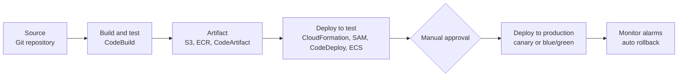

# Developer basics

**Foundations** · [Folder overview](README.md) · Related: [Glossary](glossary.md) · [AWS service basics](aws-service-basics.md) · [Services in scope](services-in-scope.md)

Plain-language explanations of the software, application programming interface (API), data, security, delivery, observability, and artificial intelligence (AI) ideas that the skill notes rely on. Cloud Practitioner basics (what a Region is, what the shared responsibility model is) are left out. Each concept ends with a link to the skill note that covers it in depth for the exam. Abbreviations are spelled out in the [glossary](glossary.md).

## Contents

- [How DVA questions think](#how-dva-questions-think)
- [Software and API concepts](#software-and-api-concepts)
- [Reliability concepts](#reliability-concepts)
- [Data concepts](#data-concepts)
- [Security concepts](#security-concepts)
- [Delivery concepts](#delivery-concepts)
- [Observability and performance concepts](#observability-and-performance-concepts)
- [AI concepts for developers](#ai-concepts-for-developers)

---

## How DVA questions think

The AWS Certified Developer - Associate (DVA-C03) exam asks *what code, configuration, or service feature a developer uses* to make an application work, stay secure, deploy cleanly, and run fast: which Software Development Kit (SDK) call, which Lambda setting, which DynamoDB key design, which header, which deployment configuration, which log tells you why it broke. It doesn't ask you to design networks or administer servers (see the out-of-role list in the [exam guide](exam-guide.md#tasks-outside-the-target-role)).

| Constraint words | Usually means |
|---|---|
| "least operational overhead", "minimal code changes" | A managed feature or setting (Lambda destinations, an Amazon Simple Queue Service (SQS) dead-letter queue (DLQ), API Gateway request validation) over custom code |
| "most secure" | Temporary credentials from roles, least privilege, no secrets in code, encryption with AWS Key Management Service (KMS) |
| "decouple", "asynchronous" | SQS, Amazon Simple Notification Service (SNS), Amazon EventBridge, AWS Step Functions |
| "real time" | Kinesis Data Streams, DynamoDB Streams, WebSocket APIs |
| "without impacting production" | Lambda aliases, API Gateway stages, canary deployments, separate environments |
| "cost-effective" | Pay-per-use and managed options; caching; right-sized memory |

Elimination works well: rule out answers you know are wrong, then pick the one that fits the scenario. If an answer is feasible but complicated, it is probably wrong.

---

## Software and API concepts

### API

An application programming interface is a defined way for programs to call each other. On Amazon Web Services (AWS), every action (create a bucket, put an item) is an API call over Hypertext Transfer Protocol Secure (HTTPS). The console, the AWS Command Line Interface (CLI), and the SDKs all call the same APIs, so anything you can click you can script.

Deep dive: [1.1.5 AWS SDKs and service APIs](../domain-1-development-with-aws-services/task-1.1-build-application-code/1.1.5-aws-sdks-and-service-apis.md).

### REST and HTTP methods

Representational State Transfer (REST) APIs use Hypertext Transfer Protocol (HTTP) methods on resources addressed by uniform resource locators (URLs) such as `/orders/123`.

| Method | Meaning | Naturally idempotent? |
|---|---|---|
| `GET` | Read | Yes |
| `POST` | Create | **No** |
| `PUT` | Replace | Yes |
| `PATCH` | Partial update | Not guaranteed |
| `DELETE` | Remove | Yes |

### HTTP status codes and what they mean on AWS

| Code | Meaning | Typical AWS cause | Retry? |
|---|---|---|---|
| 200 / 201 / 202 | OK / created / accepted | Success; 202 for async APIs | No |
| 400 | Bad request | Validation failure, malformed JSON, `ValidationException` | No; fix the request |
| 401 | Unauthenticated | Missing or invalid token at an API Gateway authorizer | No |
| 403 | Forbidden | AWS Identity and Access Management (IAM) `AccessDenied`, signature problems, missing API key, AWS WAF (web application firewall) block | No |
| 404 | Not found | Wrong resource path, stage, or Region | No |
| 409 | Conflict | Resource already exists or is being modified concurrently | No |
| 413 | Payload too large | Request bigger than a service limit | No |
| 429 | Too many requests | Throttling, `ThrottlingException`, usage plan limit | **Yes**, with backoff |
| 500 | Server error | Unhandled error in your Lambda function or a service fault | Yes, with backoff, if idempotent |
| 502 | Bad gateway | API Gateway got a malformed response from a Lambda proxy integration | Usually no; fix the response format |
| 503 | Service unavailable | Service overloaded; Amazon Simple Storage Service (S3) "Slow Down" | Yes, with backoff |
| 504 | Gateway timeout | Integration took longer than the API Gateway timeout | Fix the latency or go async |

Deep dives: [1.1.3 Resilience, retries, and backoff](../domain-1-development-with-aws-services/task-1.1-build-application-code/1.1.3-resilience-retries-and-backoff.md) and [4.1.1 Debugging code and integrations](../domain-4-troubleshooting-and-optimization/task-4.1-root-cause-analysis/4.1.1-debugging-code-and-integrations.md).

### GraphQL and WebSocket

Graph Query Language (GraphQL) lets clients ask for exactly the fields they need in one query. A WebSocket is a persistent two-way connection so the server can push messages (chat, live updates). API Gateway WebSocket APIs are covered in [1.1.4](../domain-1-development-with-aws-services/task-1.1-build-application-code/1.1.4-apis-transformation-and-validation.md).

> **Not on the DVA-C03 service list.** AWS AppSync (managed GraphQL) is no longer an in-scope service. Know only that it is the AWS GraphQL answer.

### SDK and CLI

An SDK is a library for one programming language (boto3 for Python, AWS SDK for JavaScript v3, AWS SDK for Java 2.x) that builds requests, signs them, retries, paginates, and turns errors into exceptions. The AWS CLI is a command-line tool over the same APIs; it is built on botocore, the core of the Python SDK. Use the SDK from application code and the CLI from a shell or script.

Deep dive: [1.1.5 AWS SDKs and service APIs](../domain-1-development-with-aws-services/task-1.1-build-application-code/1.1.5-aws-sdks-and-service-apis.md).

### Credentials provider chain

An SDK or the CLI finds credentials by searching sources in order and uses the first one that answers: explicit settings in code or on the command line, environment variables (`AWS_ACCESS_KEY_ID`, `AWS_SECRET_ACCESS_KEY`, `AWS_SESSION_TOKEN`), the shared credentials and config files (`~/.aws/credentials`, `~/.aws/config`, including IAM Identity Center profiles), container credentials (Amazon Elastic Container Service (ECS) task role), and finally Amazon Elastic Compute Cloud (EC2) instance profile credentials from instance metadata. In Lambda, the execution role's credentials arrive as environment variables. The practical rule: never hard-code keys, attach a role.

Deep dives: [2.1.3 Secure programmatic access](../domain-2-security/task-2.1-authentication-and-authorization/2.1.3-secure-programmatic-access.md) and [1.1.5](../domain-1-development-with-aws-services/task-1.1-build-application-code/1.1.5-aws-sdks-and-service-apis.md).

### Request signing (SigV4)

Every AWS API request is signed with Signature Version 4 (SigV4). The signer builds a canonical form of the request, hashes it, derives a signing key from the secret access key, the date, the Region, and the service, and computes a Hash-based Message Authentication Code (HMAC). AWS repeats the calculation; a match proves who sent the request and that it wasn't altered. The secret key itself never travels.

- The signature goes in the `Authorization` header (normal SDK calls) or in the query string as `X-Amz-Signature` (this is how S3 presigned URLs work).
- Temporary credentials also need the session token (`X-Amz-Security-Token`).
- A request must reach AWS within about five minutes of its timestamp, so a drifting clock causes signature errors.
- SDKs and the CLI sign for you. You sign by hand only for raw HTTP calls, such as calling an IAM-authorized API Gateway endpoint or Lambda function URL.

Deep dives: [2.1.5 Authenticated requests](../domain-2-security/task-2.1-authentication-and-authorization/2.1.5-authenticated-requests.md) and [2.1.4 Time-limited access](../domain-2-security/task-2.1-authentication-and-authorization/2.1.4-time-limited-access.md).

### Amazon Resource Names

An Amazon Resource Name (ARN) identifies one resource: `arn:partition:service:region:account-id:resource`, for example `arn:aws:dynamodb:us-east-1:123456789012:table/Orders`. IAM policies list ARNs in `Resource`; global services such as IAM leave the Region blank, and S3 bucket ARNs omit both Region and account. Precise ARNs are how you express least privilege ([2.1.6](../domain-2-security/task-2.1-authentication-and-authorization/2.1.6-least-privilege-permissions.md)).

### Pagination and waiters

APIs return large result sets in **pages** with a continuation token (`NextToken`, `Marker`, `ContinuationToken`, or DynamoDB's `LastEvaluatedKey`). Keep calling until no token comes back; SDK **paginators** do this for you. A **waiter** polls until a resource reaches a state (a table becomes `ACTIVE`, a stack finishes). Missing items in results usually means missing pagination.

Deep dive: [1.1.5](../domain-1-development-with-aws-services/task-1.1-build-application-code/1.1.5-aws-sdks-and-service-apis.md).

### Synchronous, asynchronous, and event-driven

- **Synchronous:** the caller waits for the result (API Gateway to Lambda). Simple, but the caller feels every slowdown and failure downstream.
- **Asynchronous:** the caller hands work to a queue or event system and continues; results come later (an S3 event invoking Lambda, a message in SQS).
- **Event-driven:** components react to **events** ("order placed") that others publish, instead of being called directly. Producers don't know who consumes.

Deep dives: [1.1.2 Communication patterns](../domain-1-development-with-aws-services/task-1.1-build-application-code/1.1.2-communication-patterns.md) and [1.1.8 Event-driven applications](../domain-1-development-with-aws-services/task-1.1-build-application-code/1.1.8-event-driven-applications.md).

### Tight and loose coupling

**Tightly coupled** components call each other directly and fail together: if the payment service is slow, checkout is slow. **Loosely coupled** components talk through queues, topics, or event buses, so one can be slow or down without breaking the other, and each scales on its own.

Deep dive: [1.1.1 Coupling and decoupling](../domain-1-development-with-aws-services/task-1.1-build-application-code/1.1.1-coupling-and-decoupling.md).

### Delivery guarantees

| Guarantee | Meaning | AWS examples |
|---|---|---|
| At-most-once | Delivered zero or one time; may be lost | Step Functions Express synchronous workflows |
| At-least-once | Delivered one or more times; duplicates possible | SQS standard, SNS, EventBridge, S3 event notifications, Lambda async invocation, Kinesis, Step Functions Express asynchronous |
| Exactly-once (with conditions) | Effect happens once within a defined scope | Step Functions Standard workflow execution; SQS FIFO deduplicates within a 5-minute window, but consumers still need idempotency |

Because most AWS delivery is at-least-once, your handlers must tolerate duplicates. See [idempotency](#idempotency).

### Serialization

Serialization turns an in-memory object into bytes or a string you can send or store; deserialization turns it back. Most AWS APIs and every Lambda event use JavaScript Object Notation (JSON).

- An API Gateway proxy event's `body` is a **JSON string inside JSON**. Parse it (`json.loads(event["body"])`) before use, and return `body` as a string.
- Kinesis records reach Lambda **base64-encoded**; decode before parsing.
- DynamoDB's low-level API uses typed JSON (`{"S": "text"}`, `{"N": "5"}`); numbers travel as strings. SDK document clients and resource layers convert for you.
- Apache Avro and Protocol Buffers (Protobuf) are compact binary formats with schemas; Apache Parquet and Optimized Row Columnar (ORC) are columnar formats for analytics on S3.

Deep dive: [1.1.7 Serialization and deserialization](../domain-1-development-with-aws-services/task-1.1-build-application-code/1.1.7-serialization-and-deserialization.md).

### Base64

Base64 encodes binary data as text (it grows about 33%). Kinesis payloads in Lambda events, API Gateway binary payloads (with `isBase64Encoded`), and KMS ciphertext in CLI output are base64. Decode before use.

### Environment variables and configuration

Values given to an application at run time (table name, stage, feature flags) instead of hard-coded. Non-secret configuration can live in Lambda environment variables or AWS AppConfig. Secrets belong in AWS Secrets Manager or AWS Systems Manager Parameter Store `SecureString`, fetched and cached at run time, not in plain environment variables.

Deep dives: [1.2.2 Lambda configuration](../domain-1-development-with-aws-services/task-1.2-develop-lambda-functions/1.2.2-lambda-configuration.md), [3.1.4 Environment-specific configuration](../domain-3-testing-and-deployment/task-3.1-prepare-deployable-artifacts/3.1.4-environment-specific-configuration.md), and [2.2.7 Secrets management](../domain-2-security/task-2.2-encrypt-and-protect-sensitive-data/2.2.7-secrets-management.md).

### Dependencies and deployment artifacts

Your code plus its libraries (`requirements.txt`, `package.json`, `pom.xml`) bundled into a **deployment artifact**: a ZIP file, a JAR, or a container image. Lock versions for repeatable builds, and build native dependencies for the target architecture (x86_64 or arm64) and OS.

Deep dives: [3.1.1 Packaging dependencies and configuration](../domain-3-testing-and-deployment/task-3.1-prepare-deployable-artifacts/3.1.1-packaging-dependencies-and-configuration.md) and [3.3.1 Lambda packaging](../domain-3-testing-and-deployment/task-3.3-deploy-with-ci-cd/3.3.1-lambda-packaging.md).

### Containers and images

An **image** packages an application with its runtime and libraries, built from a **Dockerfile**. A **container** is a running image. Images live in a registry (Amazon Elastic Container Registry (ECR)) and are identified by mutable **tags** (`v1.4.2`, `latest`) and immutable **digests** (`sha256:...`). Deploy by digest or by an immutable tag so every environment runs the same bits.

Deep dives: [3.1.2 Container images and ECR](../domain-3-testing-and-deployment/task-3.1-prepare-deployable-artifacts/3.1.2-container-images-and-ecr.md) and [3.3.2 Container deployments](../domain-3-testing-and-deployment/task-3.3-deploy-with-ci-cd/3.3.2-container-deployments.md).

---

## Reliability concepts

### Idempotency

An operation is idempotent if doing it twice has the same effect as doing it once. `PUT /users/42 {"name": "Alice"}` is naturally idempotent; `POST /orders` is not, because each call creates a new order.

You need idempotency because of the *ambiguous failure*: the request reached the server and the work happened, but the response was lost (timeout, reset connection). The caller can't tell "never happened" from "happened, didn't hear back", so it retries. SDKs, Lambda async invocations, SQS redelivery, and Step Functions `Retry` all retry automatically, and none of them know whether your business logic is safe to repeat.

Think of a vending machine that stamps a serial number on each coin. If the same coin serial comes back, the machine shows "already dispensed" instead of vending again. That serial number is the **idempotency key**.

How to implement it:

- The client sends an **idempotency key** (a request ID, order ID, or message ID). The server records it with a DynamoDB **conditional write** (`attribute_not_exists(pk)`) and returns the stored result on a repeat.
- Powertools for AWS Lambda has an idempotency utility that does this with a DynamoDB table.
- Many AWS APIs take a client token for the same purpose (`ClientToken` on EC2 `RunInstances`, `ClientRequestToken` on several APIs, the execution `name` on Step Functions Standard `StartExecution`).

Deep dive: [1.1.3 Resilience, retries, and backoff](../domain-1-development-with-aws-services/task-1.1-build-application-code/1.1.3-resilience-retries-and-backoff.md). DynamoDB condition expressions are in [1.3.4](../domain-1-development-with-aws-services/task-1.3-use-data-stores/1.3.4-dynamodb-design-and-operations.md).

### Retries, exponential backoff, and jitter

On throttling (HTTP 429, `ThrottlingException`, `ProvisionedThroughputExceededException`) or transient 5xx errors, retry after waiting progressively longer (about 1, 2, 4, 8 seconds: **exponential backoff**) plus randomness (**jitter**) so many clients don't retry in lockstep. Bound the retries with a maximum attempt count or a deadline.

- SDKs retry automatically. The `standard` retry mode (the default in most current SDKs) makes 3 total attempts; `adaptive` adds client-side rate limiting. You hand-code backoff only for raw HTTP calls or your own "not ready yet" conditions.
- **Don't retry 4xx client errors** such as validation failures; they will fail again.
- Intermittent throttling: backoff. Constant throttling: request a quota increase or reduce the call rate.

Deep dive: [1.1.3](../domain-1-development-with-aws-services/task-1.1-build-application-code/1.1.3-resilience-retries-and-backoff.md).

### Rate limits vs service quotas

A **rate limit** caps calls per second (S3 supports 3,500 writes and 5,500 reads per second per prefix); handle it with backoff. A **service quota** caps how much you can provision (running On-Demand vCPUs, Lambda concurrency); raise it through Service Quotas. Alerting before you hit a quota is [4.2.3 Alerts and notifications](../domain-4-troubleshooting-and-optimization/task-4.2-observability/4.2.3-alerts-and-notifications.md).

### Timeouts and circuit breakers

Always set timeouts on outbound calls, shorter than the caller's own timeout. A **circuit breaker** counts recent failures to a dependency; past a threshold it "opens" and fails fast or serves a fallback for a cool-down period, then lets a trial request through. It protects your latency and gives the struggling dependency room to recover. Amazon ECS has a deployment circuit breaker that rolls back failing deployments ([3.3.7 Rollback](../domain-3-testing-and-deployment/task-3.3-deploy-with-ci-cd/3.3.7-rollback.md)).

### Graceful degradation

When a dependency fails, keep serving a reduced experience (cached data, default recommendations, "try again later" for one feature) instead of failing the whole request.

Deep dive: [1.1.3](../domain-1-development-with-aws-services/task-1.1-build-application-code/1.1.3-resilience-retries-and-backoff.md).

### Dead-letter queues

A DLQ holds messages or events that failed processing after the allowed retries, so one bad message (a "poison pill") doesn't block or loop forever and you can inspect it later. SQS uses a redrive policy with `maxReceiveCount`; Lambda async invocations can use a DLQ or, preferably, an on-failure destination.

Deep dives: [1.2.3 Lambda invocation lifecycle and failures](../domain-1-development-with-aws-services/task-1.2-develop-lambda-functions/1.2.3-lambda-invocation-lifecycle-and-failures.md) and [4.3.3 Messaging optimization](../domain-4-troubleshooting-and-optimization/task-4.3-optimize-applications/4.3.3-messaging-optimization.md).

---

## Data concepts

### Relational vs NoSQL

**Relational** databases (Amazon Relational Database Service (RDS), Amazon Aurora) store tables, use Structured Query Language (SQL), and support joins and multi-row transactions. **NoSQL** key-value and document stores (DynamoDB) look items up by key at any scale with flexible attributes; you design tables around the queries you will run, not around entities.

Deep dive: [1.3.2 Choosing data stores](../domain-1-development-with-aws-services/task-1.3-use-data-stores/1.3.2-choosing-data-stores.md).

### DynamoDB keys and indexes

| Concept | Meaning |
|---|---|
| Partition key | Hashed to choose the partition that stores the item. Every `Query` needs an exact partition key value |
| Sort key | Optional second part of the primary key; orders items within a partition and supports range conditions (`BETWEEN`, `begins_with`) |
| Simple vs composite primary key | Partition key alone, or partition key plus sort key |
| Cardinality | Number of distinct key values. **High cardinality** (`userId`) spreads load; **low cardinality** (`status`) concentrates it and creates **hot partitions** that throttle |
| Global secondary index (GSI) | A different partition key (and optional sort key); add any time; eventually consistent reads only; own capacity |
| Local secondary index (LSI) | Same partition key, different sort key; create only with the table; supports strongly consistent reads; up to 5 per table |
| `Query` vs `Scan` | `Query` reads one partition key's items; `Scan` reads the whole table or index and filters afterward, so it is slow and costly |

Example: "orders by customer and date range" means partition key `customerId`, sort key `orderDate`, `Query` with `BETWEEN`. "Look up orders by status" means a GSI.

Deep dive: [1.3.4 DynamoDB design and operations](../domain-1-development-with-aws-services/task-1.3-use-data-stores/1.3.4-dynamodb-design-and-operations.md).

### Read consistency

**Eventually consistent** reads may return slightly stale data; they are the default and cost half as much. **Strongly consistent** reads return the latest committed write, cost twice as much, and aren't available on GSIs. S3 gives strong read-after-write consistency for all objects.

Deep dive: [1.3.4](../domain-1-development-with-aws-services/task-1.3-use-data-stores/1.3.4-dynamodb-design-and-operations.md).

### Caching

Caching keeps frequently read data in fast memory or close to users, trading freshness for speed and lower backend load.

| Strategy | How it works | Trade-off |
|---|---|---|
| Lazy loading (cache-aside) | Read the cache; on a miss, read the database and fill the cache | Only requested data is cached; first read is slow; data can go stale until TTL |
| Write-through | Update the cache whenever you write the database | Reduces staleness, but failed or reordered writes and invalidation bugs can still leave stale entries; caches data that may never be read |
| Time to live (TTL) | Entries expire after a set time | Bounds staleness; pair with either strategy |
| Edge caching | CloudFront caches responses near users | Best for static or shared content; invalidate or version on change |

Deep dives: [1.3.3 Caching strategies](../domain-1-development-with-aws-services/task-1.3-use-data-stores/1.3.3-caching-strategies.md) and [4.3.4 Caching for performance](../domain-4-troubleshooting-and-optimization/task-4.3-optimize-applications/4.3.4-caching-for-performance.md) (ElastiCache, DynamoDB Accelerator (DAX), CloudFront).

### TTL and data lifecycle

Time to live means automatic expiry: DynamoDB TTL deletes items after an epoch-seconds timestamp (typically within 48 hours, at no write cost), and cache entries expire after their TTL. **Lifecycle policies** move or delete data as it ages: S3 Lifecycle rules, CloudWatch Logs retention, ECR lifecycle policies.

Deep dive: [1.3.1 Data lifecycle management](../domain-1-development-with-aws-services/task-1.3-use-data-stores/1.3.1-data-lifecycle-management.md).

### Streaming data

A stream is a continuous, ordered flow of records (clicks, Internet of Things (IoT) readings, change events), kept for a retention period so consumers can replay. Records with the same partition key go to the same shard and stay in order. Examples: Kinesis Data Streams, DynamoDB Streams, Amazon Managed Streaming for Apache Kafka (MSK). A queue, by contrast, deletes a message once one consumer processes it.

Deep dive: [1.1.6 Streaming data](../domain-1-development-with-aws-services/task-1.1-build-application-code/1.1.6-streaming-data.md).

---

## Security concepts

### Authentication vs authorization

**Authentication** proves who you are (password, token, access keys). **Authorization** decides what you may do (IAM policies, OAuth scopes, Cognito groups). HTTP 401 is an authentication failure; 403 is an authorization failure.

### Principal, policy, and least privilege

A **principal** is who calls: a user, a role, or a service. A **policy** is a JSON document that allows or denies **actions** on **resources** under optional **conditions**. Everything is denied by default, an explicit `Allow` grants access, and an explicit `Deny` always wins. **Least privilege** means granting only the actions and resources a task needs.

Deep dives: [2.1.6 Least privilege permissions](../domain-2-security/task-2.1-authentication-and-authorization/2.1.6-least-privilege-permissions.md) and [2.1.2 Access controls, tokens, and MFA](../domain-2-security/task-2.1-authentication-and-authorization/2.1.2-access-controls-tokens-and-mfa.md).

### Temporary credentials

Short-lived credentials from AWS Security Token Service (STS): an access key ID (starting `ASIA`), a secret access key, and a **session token**, valid for minutes to hours. Roles hand these out, and SDKs load and refresh them automatically from the environment, instance metadata, container credentials, or an IAM Identity Center (single sign-on, SSO) profile. Long-term IAM user keys start with `AKIA` and should be avoided.

Deep dives: [2.1.7 Assuming IAM roles](../domain-2-security/task-2.1-authentication-and-authorization/2.1.7-assuming-iam-roles.md) and [2.1.3 Secure programmatic access](../domain-2-security/task-2.1-authentication-and-authorization/2.1.3-secure-programmatic-access.md).

### Federation, OAuth 2.0, OIDC, SAML

- **Federation:** let users sign in with an existing identity provider (IdP) such as Google or a corporate directory instead of creating new credentials.
- **Open Authorization (OAuth) 2.0:** an authorization framework that issues **access tokens** carrying **scopes**. The authorization code grant with Proof Key for Code Exchange (PKCE) is the standard flow for browser and mobile apps; the client credentials grant is for machine-to-machine calls.
- **OpenID Connect (OIDC):** an identity layer on OAuth 2.0 that adds an **ID token** describing the user.
- **Security Assertion Markup Language (SAML) 2.0:** XML-based enterprise federation.
- Amazon Cognito user pools sign users in and issue tokens; identity pools exchange tokens for temporary AWS credentials.

Deep dive: [2.1.1 Identity federation](../domain-2-security/task-2.1-authentication-and-authorization/2.1.1-identity-federation.md).

### JWT

A JSON Web Token (JWT) is a signed token in three base64url parts: `header.payload.signature`.

| Part | Holds |
|---|---|
| Header | Signing algorithm (`RS256`) and key ID (`kid`) |
| Payload | Claims: `sub` (user), `iss` (issuer), `aud` or `client_id` (audience), `exp` (expiry), `scope`, `cognito:groups` |
| Signature | Issuer's signature over header and payload |

To validate a JWT: fetch the issuer's public keys from its JSON Web Key Set (JWKS) endpoint, verify the signature with the key matching `kid`, then check `iss`, `aud`, `exp`, and the token type. The payload is only encoded, not encrypted, so never put secrets in it. API Gateway Cognito and JWT authorizers do this validation for you.

| Token | Purpose |
|---|---|
| ID token | Who the user is; for your app |
| Access token | What the caller may do (scopes); send to APIs |
| Refresh token | Get new ID and access tokens without signing in again |

Deep dives: [2.1.1](../domain-2-security/task-2.1-authentication-and-authorization/2.1.1-identity-federation.md) and [2.1.2](../domain-2-security/task-2.1-authentication-and-authorization/2.1.2-access-controls-tokens-and-mfa.md).

### MFA

Multi-factor authentication (MFA) combines something you know (a password) with something you have (an authenticator app code, a passkey, a security key). For CLI calls that a policy protects with MFA, call `sts get-session-token` with the MFA code and use the returned temporary credentials.

Deep dive: [2.1.2](../domain-2-security/task-2.1-authentication-and-authorization/2.1.2-access-controls-tokens-and-mfa.md).

### Encryption at rest and in transit

**At rest:** stored data is encrypted, usually with KMS keys. **In transit:** data moving over the network is protected with Transport Layer Security (TLS), as in HTTPS. **Symmetric** encryption uses one key to encrypt and decrypt (Advanced Encryption Standard (AES), AES-256-GCM). **Asymmetric** encryption uses a public and private key pair (Rivest-Shamir-Adleman (RSA), elliptic curve cryptography (ECC)) for encryption or signing.

Deep dive: [2.2.1 Encryption at rest and in transit](../domain-2-security/task-2.2-encrypt-and-protect-sensitive-data/2.2.1-encryption-at-rest-and-in-transit.md).

### Envelope encryption

KMS encrypts at most 4 KB directly, and every call is a network request. To encrypt anything bigger, you encrypt the data with a local **data key** and protect that data key with a **KMS key**.

```mermaid
sequenceDiagram
    participant App
    participant KMS
    App->>KMS: GenerateDataKey(KeyId)
    KMS-->>App: Plaintext data key + encrypted data key
    App->>App: Encrypt data locally with plaintext key (AES-GCM)
    App->>App: Discard plaintext key; store encrypted key with ciphertext
    Note over App: Later, to decrypt
    App->>KMS: Decrypt(encrypted data key)
    KMS-->>App: Plaintext data key
    App->>App: Decrypt data locally
```

The KMS key never leaves KMS. S3 SSE-KMS, the AWS Encryption SDK, and most AWS services use this pattern under the hood.

Deep dive: [2.2.4 KMS key management](../domain-2-security/task-2.2-encrypt-and-protect-sensitive-data/2.2.4-kms-key-management.md).

### Client-side vs server-side encryption

**Server-side:** the service encrypts after it receives the data (S3 server-side encryption with S3-managed keys (SSE-S3), with KMS keys (SSE-KMS), dual-layer with KMS keys (DSSE-KMS), or with customer-provided keys (SSE-C)). **Client-side:** you encrypt before sending, so the service only ever sees ciphertext (AWS Encryption SDK, Amazon S3 Encryption Client). "AWS must never see plaintext" means client-side.

Deep dive: [2.2.3 Client-side vs server-side encryption](../domain-2-security/task-2.2-encrypt-and-protect-sensitive-data/2.2.3-client-side-vs-server-side-encryption.md).

### Certificates and SSH keys

A **TLS certificate** binds a domain name to a public key and is signed by a certificate authority (CA): a public CA for internet sites, or your own private CA for internal services and mutual TLS (mTLS). A **Secure Shell (SSH) key pair** authenticates SSH logins: you keep the private key, and the server holds the public key. Generate one with `ssh-keygen` or as an EC2 key pair.

Deep dives: [2.2.2 Certificate management](../domain-2-security/task-2.2-encrypt-and-protect-sensitive-data/2.2.2-certificate-management.md) and [2.2.5 Development certificates and SSH keys](../domain-2-security/task-2.2-encrypt-and-protect-sensitive-data/2.2.5-development-certificates-and-ssh-keys.md).

### Hashing and HMAC

**Hashing** (Secure Hash Algorithm 256-bit, SHA-256) produces a one-way fingerprint for integrity checks; you can't recover the input. An **HMAC** is a hash keyed with a secret, proving the message came from someone holding the key. SigV4 and webhook signatures use HMACs.

### Secrets

A secret is any value that grants access: database passwords, API keys, OAuth client secrets. Store it in Secrets Manager (rotation, cross-account sharing) or Parameter Store `SecureString` (cheaper configuration), fetch it at run time with caching, and grant read access through the execution role. Don't put it in code, templates, or plain environment variables.

Deep dive: [2.2.7 Secrets management](../domain-2-security/task-2.2-encrypt-and-protect-sensitive-data/2.2.7-secrets-management.md).

### PII and PHI, masking and redaction

Personally identifiable information (PII) identifies a person; protected health information (PHI) is health data covered by the Health Insurance Portability and Accountability Act (HIPAA). **Masking** hides part of a value (`***-**-1234`); **redaction** removes it; **tokenization** replaces it with a reference that only an authorized system can map back.

Deep dives: [2.2.6 Sensitive data detection and masking](../domain-2-security/task-2.2-encrypt-and-protect-sensitive-data/2.2.6-sensitive-data-detection-and-masking.md) and [2.3.5 AI sensitive data in logs](../domain-2-security/task-2.3-secure-ai-services/2.3.5-ai-sensitive-data-in-logs.md).

---

## Delivery concepts

### CI/CD

**Continuous integration (CI):** every change is built and tested automatically. **Continuous delivery:** every passing change is released to environments automatically, with a manual approval before production. **Continuous deployment:** no manual gate. The DVA-C03 target role *uses* an existing pipeline; designing one is out of scope.



Deep dives: [3.3.5 CodePipeline release promotion](../domain-3-testing-and-deployment/task-3.3-deploy-with-ci-cd/3.3.5-codepipeline-release-promotion.md), [3.3.4 CodeDeploy](../domain-3-testing-and-deployment/task-3.3-deploy-with-ci-cd/3.3.4-codedeploy.md), and [3.1.3 Code repositories in deployment](../domain-3-testing-and-deployment/task-3.1-prepare-deployable-artifacts/3.1.3-code-repositories-in-deployment.md).

### Environments and stages

Separate copies of the application (dev, test, staging, prod) with their own configuration and data, so changes are proven before they reach users. On AWS this shows up as API Gateway stages, Lambda aliases, separate stacks or accounts, container image tags, and Amplify branches.

Deep dives: [3.2.4 Isolated test environments](../domain-3-testing-and-deployment/task-3.2-test-applications/3.2.4-isolated-test-environments.md) and [3.1.5 API Gateway stages and endpoints](../domain-3-testing-and-deployment/task-3.1-prepare-deployable-artifacts/3.1.5-api-gateway-stages-and-endpoints.md).

### Unit, integration, and end-to-end tests

| Test | Scope |
|---|---|
| Unit | One function in isolation, dependencies mocked |
| Integration | Components together with real services |
| End-to-end | A whole user flow |
| Regression | Re-running tests to catch old bugs returning |
| Mock | A fake dependency that returns canned responses (API Gateway mock integrations, local stubs) |

Deep dives: [3.2.1 Testing with SAM, CDK, and CloudFormation](../domain-3-testing-and-deployment/task-3.2-test-applications/3.2.1-testing-with-sam-cdk-and-cloudformation.md), [3.2.2 Mock APIs](../domain-3-testing-and-deployment/task-3.2-test-applications/3.2.2-mock-apis.md), and [3.2.3 Test events and payloads](../domain-3-testing-and-deployment/task-3.2-test-applications/3.2.3-test-events-and-payloads.md).

### Deployment strategies

| Strategy | How it works |
|---|---|
| All at once | Replace everything together; fastest, with downtime risk |
| Rolling | Replace in batches |
| Immutable | Launch new instances, then swap |
| Blue/green | Run two full environments and switch traffic |
| Canary | Send a small percentage first, then the rest |
| Linear | Shift traffic in equal steps over time |

Rollback returns traffic or the version to the last known-good state, ideally triggered automatically by an alarm.

Deep dives: [3.3.6 Deployment strategies](../domain-3-testing-and-deployment/task-3.3-deploy-with-ci-cd/3.3.6-deployment-strategies.md) and [3.3.7 Rollback](../domain-3-testing-and-deployment/task-3.3-deploy-with-ci-cd/3.3.7-rollback.md).

### Infrastructure as code

Infrastructure as code (IaC) defines infrastructure in templates or code (AWS CloudFormation, the AWS Serverless Application Model (SAM), the AWS Cloud Development Kit (CDK)) so environments are repeatable, reviewed, and versioned.

Deep dive: [3.3.3 Infrastructure as code deployment](../domain-3-testing-and-deployment/task-3.3-deploy-with-ci-cd/3.3.3-infrastructure-as-code-deployment.md).

### Source control and semantic versioning

Git tracks **commits** (identified by a SHA hash), **branches** for feature work, **tags** as release labels (`v2.0.1`), and **pull requests** for review before merge. Semantic versioning uses `MAJOR.MINOR.PATCH`: major for breaking changes, minor for new features, patch for bug fixes. Lambda versions and aliases are the AWS-side equivalent of release labels.

Deep dive: [3.3.8 Versions and releases](../domain-3-testing-and-deployment/task-3.3-deploy-with-ci-cd/3.3.8-versions-and-releases.md).

---

## Observability and performance concepts

### Logs, metrics, and traces

| Signal | What it is | AWS tools |
|---|---|---|
| Logs | Timestamped event records; prefer **structured** JSON with request IDs | CloudWatch Logs, Logs Insights |
| Metrics | Numbers over time (latency, errors, queue depth) | CloudWatch metrics, Embedded Metric Format (EMF), alarms |
| Traces | One request's path across services, with timing per hop | AWS X-Ray, AWS Distro for OpenTelemetry (ADOT) |

Together they answer what broke, where, and why. Metrics tell you something is wrong, traces tell you where, and logs tell you why.

Deep dives: [4.1.2 Metrics, logs, and traces](../domain-4-troubleshooting-and-optimization/task-4.1-root-cause-analysis/4.1.2-metrics-logs-and-traces.md), [4.2.1 Structured logging](../domain-4-troubleshooting-and-optimization/task-4.2-observability/4.2.1-structured-logging.md), [4.2.2 Custom metrics](../domain-4-troubleshooting-and-optimization/task-4.2-observability/4.2.2-custom-metrics.md), [4.2.4 Distributed tracing](../domain-4-troubleshooting-and-optimization/task-4.2-observability/4.2.4-distributed-tracing.md), and [4.1.3 Querying logs](../domain-4-troubleshooting-and-optimization/task-4.1-root-cause-analysis/4.1.3-querying-logs.md).

### Correlation ID

A unique ID passed through every service that handles one request, so its logs and traces can be joined. Lambda's request ID, API Gateway's request ID, and the X-Ray trace ID (`X-Amzn-Trace-Id` header) all serve this purpose.

### Health checks, liveness, and readiness

**Liveness:** is the process alive (restart it if not)? **Readiness:** is it ready for traffic (finished loading, database reachable)? Load balancers, Amazon ECS, and Kubernetes use these probes to stop routing to or restart unhealthy targets.

Deep dive: [4.2.5 Health checks and probes](../domain-4-troubleshooting-and-optimization/task-4.2-observability/4.2.5-health-checks-and-probes.md).

### Percentiles

p50, p90, and p99 latency show typical and worst-case user experience better than averages. A p99 of 2 seconds means 1 request in 100 takes 2 seconds or longer, even if the average looks fine.

Deep dive: [4.3.5 Performance bottleneck detection](../domain-4-troubleshooting-and-optimization/task-4.3-optimize-applications/4.3.5-performance-bottleneck-detection.md).

### Concurrency, thread pools, and connection pools

**Concurrency** is how many requests are in flight at once. A **thread pool** limits and reuses worker threads; a **connection pool** reuses database connections instead of opening one per request. In Lambda, each concurrent execution environment handles one request, so a spike can open hundreds of database connections; RDS Proxy pools them.

Deep dive: [4.3.1 Concurrency controls](../domain-4-troubleshooting-and-optimization/task-4.3-optimize-applications/4.3.1-concurrency-controls.md).

### Cold starts

A cold start happens when Lambda must create a new execution environment: download code, start the runtime, run initialization code outside the handler. Later requests reuse the warm environment. Provisioned concurrency and SnapStart reduce cold starts; initializing SDK clients outside the handler reuses them across invocations.

Deep dives: [1.2.2 Lambda configuration](../domain-1-development-with-aws-services/task-1.2-develop-lambda-functions/1.2.2-lambda-configuration.md) and [4.3.2 Memory and compute tuning](../domain-4-troubleshooting-and-optimization/task-4.3-optimize-applications/4.3.2-memory-and-compute-tuning.md).

---

## AI concepts for developers

The exam treats AI as something developers *use* (AI coding tools) and *integrate* (managed AI services), not something they design. Selecting foundation models, engineering prompts, designing retrieval-augmented generation (RAG) architectures, and designing guardrail frameworks are outside the target role.

### Foundation models, LLMs, and tokens

A **foundation model** is a large pre-trained model; a **large language model (LLM)** is a foundation model for text. Input and output are measured in **tokens** (word pieces), and pricing, limits, and latency all depend on token counts.

### Prompts and inference parameters

The **prompt** is the input; a **system prompt** sets behavior rules. Inference parameters shape the output: **temperature** (randomness), **top-p** (sampling breadth), **max tokens** (length cap), and **stop sequences**.

### Streaming responses

The model returns output token by token as it is generated, so a user interface can show text immediately. In Amazon Bedrock: `ConverseStream` or `InvokeModelWithResponseStream`.

Deep dive: [1.1.10 Managed AI service integration](../domain-1-development-with-aws-services/task-1.1-build-application-code/1.1.10-managed-ai-service-integration.md).

### Embeddings and RAG

**Embeddings** are number vectors that represent meaning; similar texts have nearby vectors, which enables semantic search. **RAG** retrieves relevant documents through embeddings and vector search and adds them to the prompt, so the model answers from your data with citations (Bedrock Knowledge Bases).

Deep dive: [1.1.10](../domain-1-development-with-aws-services/task-1.1-build-application-code/1.1.10-managed-ai-service-integration.md).

### AI agents, tools, and human-in-the-loop

An **agent** uses a model to plan and call **tools** (APIs, functions) over several steps. **Tool-use authorization** limits which tools and actions it may call and with whose permissions. **Session isolation** keeps one user's context and data apart from another's. **Human-in-the-loop** requires a person to approve sensitive actions before they run.

Deep dives: [1.1.10](../domain-1-development-with-aws-services/task-1.1-build-application-code/1.1.10-managed-ai-service-integration.md) and [2.3.4 AI agent security](../domain-2-security/task-2.3-secure-ai-services/2.3.4-ai-agent-security.md).

### Guardrails

Policies that filter model inputs and outputs: harmful content categories, **denied topics**, **sensitive information (PII) detection and redaction**, word filters, **prompt attack** detection, and grounding checks. Amazon Bedrock Guardrails applies them to Bedrock calls, and the `ApplyGuardrail` API applies them to any text.

Deep dive: [2.3.3 AI input and output filtering](../domain-2-security/task-2.3-secure-ai-services/2.3.3-ai-input-and-output-filtering.md).

### Prompt injection

An attack where input text, from a user or from a retrieved document, tries to override the model's instructions ("ignore previous instructions and ..."). Mitigate with guardrail prompt attack filters, separating instructions from data, least-privilege tools, and human approval for risky actions.

Deep dives: [2.3.3](../domain-2-security/task-2.3-secure-ai-services/2.3.3-ai-input-and-output-filtering.md) and [2.3.4](../domain-2-security/task-2.3-secure-ai-services/2.3.4-ai-agent-security.md).

### AI data privacy

Requests to managed AI services can stay off the internet through interface virtual private cloud (VPC) endpoints (AWS PrivateLink). Amazon Bedrock doesn't use your prompts and responses to train models or share them with model providers. Invocation logs can contain prompts and PII, so encrypt, mask, restrict, and expire them.

Deep dives: [2.3.2 AI data privacy and private connectivity](../domain-2-security/task-2.3-secure-ai-services/2.3.2-ai-data-privacy-and-private-connectivity.md), [2.3.1 AI service access control](../domain-2-security/task-2.3-secure-ai-services/2.3.1-ai-service-access-control.md), and [2.3.5](../domain-2-security/task-2.3-secure-ai-services/2.3.5-ai-sensitive-data-in-logs.md).

### AI-assisted development

Using AI tools to generate code from specifications (**spec-driven development**), complete code, review it, suggest refactors, scan for security issues, write tests, analyze errors and logs, and suggest optimizations. **Kiro** is the AWS agentic development environment on the exam's service list. The rule that answers most questions: the AI proposes, and a human reviews before anything irreversible happens.

Deep dives: [1.1.9 AI-assisted development tools](../domain-1-development-with-aws-services/task-1.1-build-application-code/1.1.9-ai-assisted-development-tools.md), [3.2.5 AI-assisted testing](../domain-3-testing-and-deployment/task-3.2-test-applications/3.2.5-ai-assisted-testing.md), [3.3.9 AI-assisted deployment](../domain-3-testing-and-deployment/task-3.3-deploy-with-ci-cd/3.3.9-ai-assisted-deployment.md), [4.1.5 AI-assisted error analysis](../domain-4-troubleshooting-and-optimization/task-4.1-root-cause-analysis/4.1.5-ai-assisted-error-analysis.md), and [4.3.6 AI-assisted optimization](../domain-4-troubleshooting-and-optimization/task-4.3-optimize-applications/4.3.6-ai-assisted-optimization.md).

### MCP

The Model Context Protocol (MCP) is an open standard for connecting AI agents and assistants to tools and data sources. Kiro, Bedrock AgentCore Gateway, and Amazon Quick can use MCP servers.

Deep dive: [1.1.9](../domain-1-development-with-aws-services/task-1.1-build-application-code/1.1.9-ai-assisted-development-tools.md).

### Two kinds of "AI" question

| | AI-assisted development | AI service security |
|---|---|---|
| What it's about | A developer uses an AI tool to build, test, deploy, or debug | An application feature built on a model that end users reach |
| Skills | 1.1.9, 3.2.5, 3.3.9, 4.1.5, 4.3.6 | 2.3.1 to 2.3.5 (plus 1.1.10 for the integration itself) |
| Rule of thumb | AI proposes, a human verifies | Least privilege, a private network path, and don't trust model input or output by default |

## Sources

- Merged from: `archive/dva-c03-study-notes/00-developer-basics.md` (primary), `archive/dva-c03-study-notes/05-cheat-sheet.md`, `archive/dva-c03/README.md` (AI topics comparison), `archive/dva-c03/domain-1-development/idempotency-and-retry-patterns.md` (ambiguous failure, vending machine analogy), `archive/aws-dva-notes/Markdown Files/1. IAM & AWS CLI.md` (credentials chain, access key prefixes), `9. CLI, SDK, IAM Roles & Policies.md` (rate limits vs quotas, backoff, SigV4), `29. Exam Review & Tips.md` (elimination strategy).
- Concept details checked against the linked skill notes, which cite AWS documentation for each limit.
