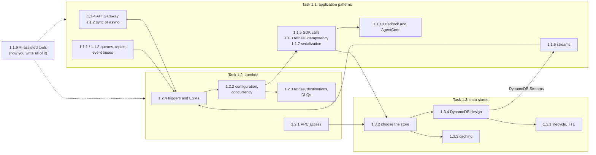
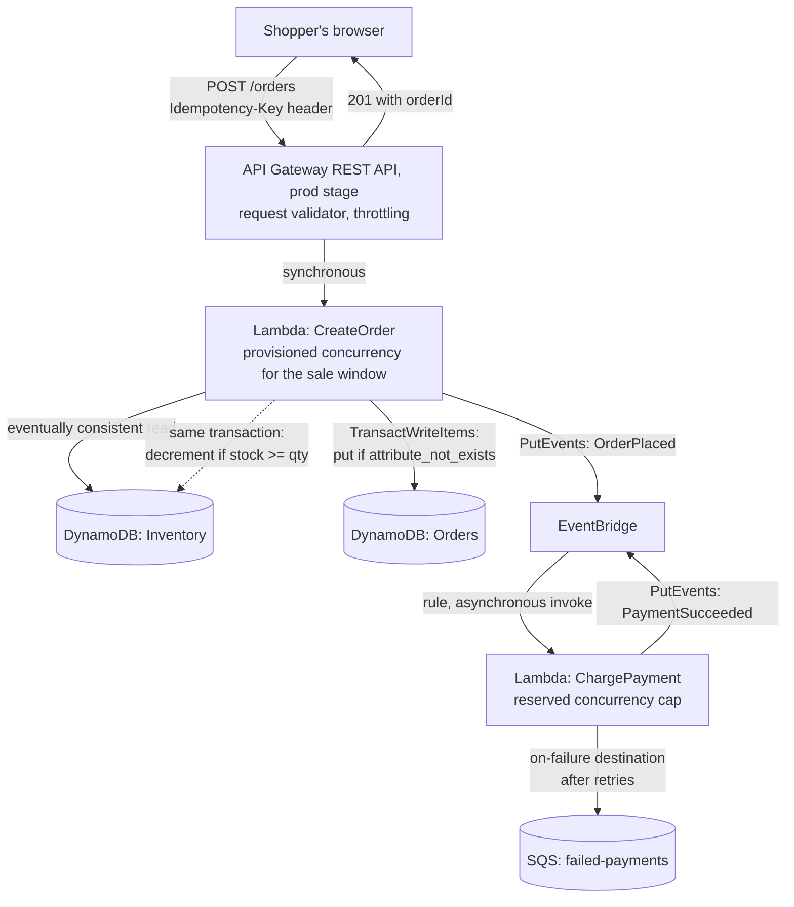
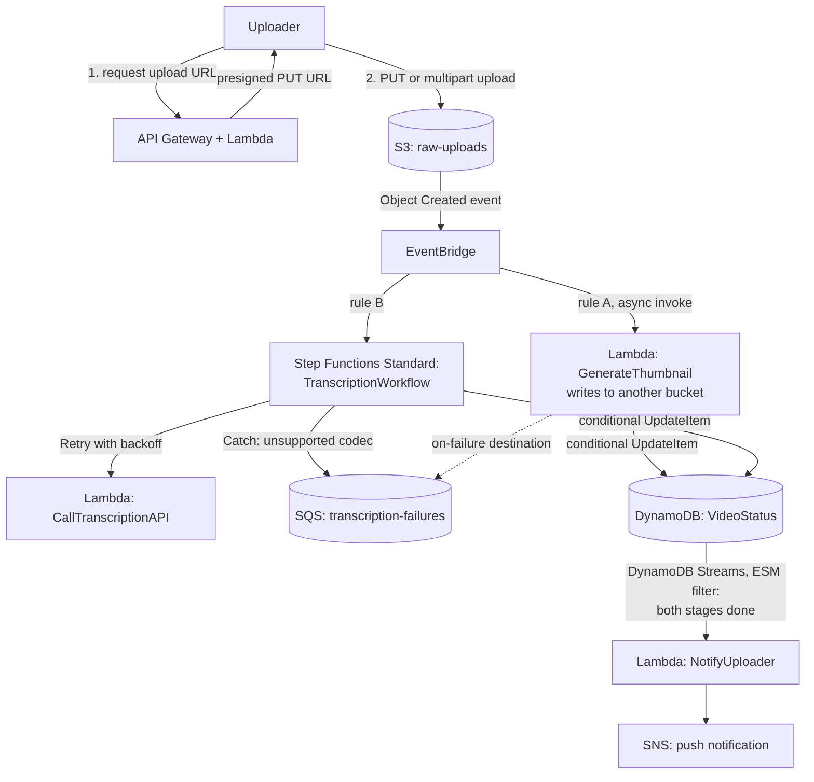
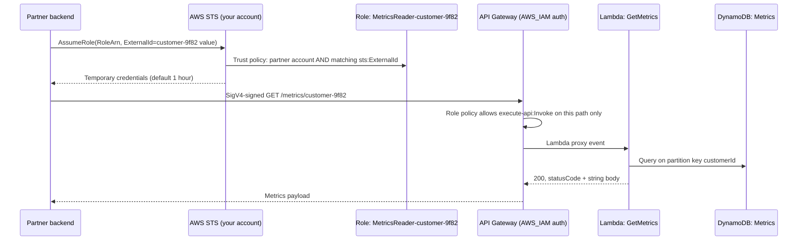

# Domain 1: Development with AWS Services (30%)

**Domain 1** · [Study guide home](../README.md) · Next: [Domain 2: Security](../domain-2-security/README.md)

Domain 1 is the largest domain on the AWS Certified Developer - Associate (DVA-C03) exam, at 30% of scored content. It tests whether the application code you write calls AWS services correctly: what each call does, what it returns, what happens when it fails, and which service fits the shape of the problem. Questions describe a feature or a symptom, such as a slow dependency, a lost event, a `502` from an API, or a throttled table, and ask for the design choice, setting, or line of code that fixes it.

The three tasks stack. [Task 1.1](task-1.1-build-application-code/README.md) covers application patterns that apply to any compute: decoupling, communication styles, retries, application programming interfaces (APIs), AWS Software Development Kit (SDK) calls, streams, serialization, events, and artificial intelligence (AI) tools and services. [Task 1.2](task-1.2-develop-lambda-functions/README.md) applies those patterns to AWS Lambda, where most Domain 1 code runs: network access, configuration, failure handling, and triggers. [Task 1.3](task-1.3-use-data-stores/README.md) covers where the data goes: store selection, caching, lifecycle, and Amazon DynamoDB design. A typical scenario question touches all three at once, for example an Amazon API Gateway request (1.1) handled by a Lambda function (1.2) that writes to DynamoDB (1.3). Domains 2 to 4 secure, ship, and tune the code this domain builds.

## Tasks

| Task | Folder | Skills | Scope |
|---|---|---:|---|
| 1.1 Build application code on AWS | [Task 1.1 overview](task-1.1-build-application-code/README.md) | 10 | Coupling, sync/async/event-driven communication, retries and idempotency, API Gateway, SDKs, streaming, serialization, event-driven designs, AI-assisted development, managed AI services |
| 1.2 Develop AWS Lambda functions | [Task 1.2 overview](task-1.2-develop-lambda-functions/README.md) | 4 | Virtual private cloud (VPC) access, function configuration and concurrency, invocation models and failure handling, service integrations and event source mappings |
| 1.3 Use data stores in application development | [Task 1.3 overview](task-1.3-use-data-stores/README.md) | 4 | Lifecycle rules and Time to Live (TTL), choosing a store, caching strategies, DynamoDB keys, consistency, queries, and indexes |

## Skill map

### Task 1.1: Build application code on AWS

| Skill | Note | Summary |
|---|---|---|
| 1.1.1 | [Coupling and decoupling](task-1.1-build-application-code/1.1.1-coupling-and-decoupling.md) | Spot tight coupling and pick the intermediary by shape: Amazon Simple Queue Service (SQS) to buffer, Amazon Simple Notification Service (SNS) to broadcast, Amazon EventBridge to route, Amazon Kinesis to stream, AWS Step Functions to orchestrate. |
| 1.1.2 | [Communication patterns](task-1.1-build-application-code/1.1.2-communication-patterns.md) | Choose synchronous, asynchronous, or event-driven calls; know each Lambda invocation model, the API Gateway 29-second default integration timeout, the `202` hand-off, and Standard versus Express workflows. |
| 1.1.3 | [Resilience, retries, and backoff](task-1.1-build-application-code/1.1.3-resilience-retries-and-backoff.md) | Retry only retryable errors, with bounded exponential backoff and jitter; make retries safe with idempotency keys; capture failures in dead-letter queues (DLQs), destinations, and `Catch` states; degrade gracefully. |
| 1.1.4 | [APIs, transformation, and validation](task-1.1-build-application-code/1.1.4-apis-transformation-and-validation.md) | REST, HTTP, and WebSocket APIs; integration types; the Lambda proxy response shape; Velocity Template Language (VTL) mapping templates; request validators; throttling and usage plans. |
| 1.1.5 | [AWS SDKs and service APIs](task-1.1-build-application-code/1.1.5-aws-sdks-and-service-apis.md) | Credential provider chain, Region, client reuse, paginators, waiters, batch calls with unprocessed items, error codes, and AWS Command Line Interface (CLI) features. |
| 1.1.6 | [Streaming data](task-1.1-build-application-code/1.1.6-streaming-data.md) | Kinesis Data Streams versus Amazon Data Firehose, shard limits, partition keys, enhanced fan-out, DynamoDB Streams, and consumer lag. |
| 1.1.7 | [Serialization and deserialization](task-1.1-build-application-code/1.1.7-serialization-and-deserialization.md) | JavaScript Object Notation (JSON) strings in event bodies, base64 stream payloads, DynamoDB typed JSON, and the one-line parsing fixes behind many `502` errors. |
| 1.1.8 | [Event-driven applications](task-1.1-build-application-code/1.1.8-event-driven-applications.md) | Amazon Simple Storage Service (S3) Event Notifications, EventBridge rules and patterns, SNS fan-out and filter policies, SQS-driven workers, and idempotent consumers. |
| 1.1.9 | [AI-assisted development tools](task-1.1-build-application-code/1.1.9-ai-assisted-development-tools.md) | Kiro specs, steering, and hooks for code generation, review, refactoring, and security scanning, with a human reviewing every change. |
| 1.1.10 | [Managed AI service integration](task-1.1-build-application-code/1.1.10-managed-ai-service-integration.md) | Calling Amazon Bedrock (`Converse`, streaming, Knowledge Bases, Agents), Amazon Bedrock AgentCore, and Amazon Quick from code, with throttling and timeout handling. |

### Task 1.2: Develop AWS Lambda functions

| Skill | Note | Summary |
|---|---|---|
| 1.2.1 | [Lambda VPC access](task-1.2-develop-lambda-functions/1.2.1-lambda-vpc-access.md) | Attach a function to private subnets, open the database security group to the Lambda security group, reach AWS APIs through a NAT gateway or VPC endpoints, and pool connections with Amazon RDS Proxy. |
| 1.2.2 | [Lambda configuration](task-1.2-develop-lambda-functions/1.2.2-lambda-configuration.md) | Init versus invoke, memory and CPU, timeout (maximum 30 minutes since November 19, 2026), environment variables and secrets, reserved and provisioned concurrency, SnapStart, layers, and extensions. |
| 1.2.3 | [Invocation lifecycle and failures](task-1.2-develop-lambda-functions/1.2.3-lambda-invocation-lifecycle-and-failures.md) | What happens to a failed event under synchronous, asynchronous, and event source mapping (ESM) invocation; destinations versus DLQs; partial batch responses. |
| 1.2.4 | [Lambda service integrations](task-1.2-develop-lambda-functions/1.2.4-lambda-service-integrations.md) | Execution role versus resource-based policy, API Gateway and Application Load Balancer (ALB) events, function URLs, DynamoDB Streams, and ESM batching, filtering, and scaling. |

### Task 1.3: Use data stores in application development

| Skill | Note | Summary |
|---|---|---|
| 1.3.1 | [Data lifecycle management](task-1.3-use-data-stores/1.3.1-data-lifecycle-management.md) | S3 Lifecycle transitions and expirations, storage class minimum durations, DynamoDB TTL, service retention periods, and S3 Object Lock. |
| 1.3.2 | [Choosing data stores](task-1.3-use-data-stores/1.3.2-choosing-data-stores.md) | Map access patterns to DynamoDB, Amazon Relational Database Service (RDS), Amazon Aurora, Amazon ElastiCache, or S3; read replicas versus Multi-AZ (multiple Availability Zones). |
| 1.3.3 | [Caching strategies](task-1.3-use-data-stores/1.3.3-caching-strategies.md) | Pick the cache for each store (DynamoDB Accelerator (DAX), ElastiCache, Amazon CloudFront, API Gateway cache), lazy loading versus write-through, and how TTL bounds staleness. |
| 1.3.4 | [DynamoDB design and operations](task-1.3-use-data-stores/1.3.4-dynamodb-design-and-operations.md) | Partition and sort keys, hot partitions, capacity math, read consistency, `Query` versus `Scan`, conditional writes, transactions, and global and local secondary indexes (GSIs and LSIs). |

## How the tasks connect

Read the diagram left to right as one request or event: Task 1.1 decides how work arrives, Task 1.2 decides how the function receives and survives it, and Task 1.3 decides where the result is stored and how long it lives. The DynamoDB Streams edge closes the loop: a write in Task 1.3 can become the next event in Task 1.1.

## Worked case studies

Each case study spans several tasks. Every design decision links to the skill note that explains it; follow the link for limits, code, and traps.

### Case study 1: a flash-sale order API

**Requirement.** An order API must absorb a traffic spike of about 50 times normal for 10 minutes, never lose an accepted order when the payment provider is briefly down, allow inventory availability checks to be a few hundred milliseconds stale, and never double-charge when a client retries a request.

| Decision | Why | Skill |
|---|---|---|
| API Gateway validates the request body against a model and applies stage throttling | Malformed requests get a `400` without invoking Lambda, and one runaway client cannot use the whole account's Lambda concurrency. | [1.1.4](task-1.1-build-application-code/1.1.4-apis-transformation-and-validation.md) |
| `CreateOrder` only records the order and returns; payment happens later | The shopper waits only for the fast part. Payment runs asynchronously, so a payment outage does not fail checkout, and the request stays well inside the 29-second default integration timeout. | [1.1.2](task-1.1-build-application-code/1.1.2-communication-patterns.md) |
| DynamoDB, not RDS, for orders and inventory | Simple key lookups at bursty scale, with no connection pool to exhaust when Lambda scales out. | [1.3.2](task-1.3-use-data-stores/1.3.2-choosing-data-stores.md) |
| On-demand capacity, pre-warmed before the sale | On-demand removes capacity planning but can still throttle: growing past double the previous peak within 30 minutes, a hot partition, or a table quota. A 50x spike needs pre-warming or a provisioned table scaled up in advance. | [1.3.4](task-1.3-use-data-stores/1.3.4-dynamodb-design-and-operations.md) |
| Eventually consistent read for the availability check | The requirement accepts slight staleness, and an eventually consistent read costs half a strongly consistent one. DAX could cache these reads because DAX serves only eventually consistent reads. | [1.3.4](task-1.3-use-data-stores/1.3.4-dynamodb-design-and-operations.md), [1.3.3](task-1.3-use-data-stores/1.3.3-caching-strategies.md) |
| One `TransactWriteItems` call: put the order with `attribute_not_exists(orderId)` and decrement stock with `stock >= :qty` | The stale availability read cannot oversell, because the write itself checks stock. The order ID comes from the client's idempotency key, so a retried request fails the condition instead of creating a second order. Transactions allow up to 100 actions (4 MB) and accept a `ClientRequestToken` that makes the call idempotent for 10 minutes. | [1.1.3](task-1.1-build-application-code/1.1.3-resilience-retries-and-backoff.md), [1.3.4](task-1.3-use-data-stores/1.3.4-dynamodb-design-and-operations.md) |
| SDK clients created outside the handler, `standard` retry mode | Throttled DynamoDB calls retry with backoff and jitter; warm invocations reuse connections. | [1.1.5](task-1.1-build-application-code/1.1.5-aws-sdks-and-service-apis.md), [1.1.3](task-1.1-build-application-code/1.1.3-resilience-retries-and-backoff.md) |
| Parse `event["body"]` with `json.loads` and return a string `body` | The proxy event body is a string, and a non-string response body produces a `502`. | [1.1.7](task-1.1-build-application-code/1.1.7-serialization-and-deserialization.md), [1.2.4](task-1.2-develop-lambda-functions/1.2.4-lambda-service-integrations.md) |
| `PutEvents` checks `FailedEntryCount` | `PutEvents` can partly fail without raising an error. If the event is lost after the order is written, payment never runs. Retry failed entries, or drive payment from the Orders table's DynamoDB stream so the write and the event cannot diverge. | [1.1.8](task-1.1-build-application-code/1.1.8-event-driven-applications.md), [1.1.6](task-1.1-build-application-code/1.1.6-streaming-data.md) |
| EventBridge invokes `ChargePayment` asynchronously, with an SQS on-failure destination | Lambda retries function errors twice, then sends the event and its error context to the destination for reconciliation instead of dropping it. | [1.2.3](task-1.2-develop-lambda-functions/1.2.3-lambda-invocation-lifecycle-and-failures.md) |
| `ChargePayment` is idempotent on `orderId` | EventBridge and asynchronous Lambda delivery are at least once, so the same `OrderPlaced` event can arrive twice. Pass the order ID as the payment provider's idempotency key. | [1.1.3](task-1.1-build-application-code/1.1.3-resilience-retries-and-backoff.md), [1.1.8](task-1.1-build-application-code/1.1.8-event-driven-applications.md) |
| Provisioned concurrency on the `CreateOrder` alias, scheduled for the sale window | The shopper-facing function is synchronous and latency sensitive, and the spike starts at a known time. Scheduled scaling avoids paying for warm environments all day. | [1.2.2](task-1.2-develop-lambda-functions/1.2.2-lambda-configuration.md) |
| Reserved concurrency on `ChargePayment` | It caps calls to the payment provider and keeps one function from starving the account's default 1,000 concurrent executions. Throttled asynchronous events are retried for up to 6 hours, so the cap delays payments rather than losing them. | [1.2.2](task-1.2-develop-lambda-functions/1.2.2-lambda-configuration.md), [1.2.3](task-1.2-develop-lambda-functions/1.2.3-lambda-invocation-lifecycle-and-failures.md) |

**Beyond Domain 1.** Scope each execution role to its own table actions ([2.1.6](../domain-2-security/task-2.1-authentication-and-authorization/2.1.6-least-privilege-permissions.md)) and encrypt order data at rest ([2.2.1](../domain-2-security/task-2.2-encrypt-and-protect-sensitive-data/2.2.1-encryption-at-rest-and-in-transit.md)). Ship changes before the sale with a canary or blue/green deployment and an alarm-based rollback ([3.3.6](../domain-3-testing-and-deployment/task-3.3-deploy-with-ci-cd/3.3.6-deployment-strategies.md), [3.3.7](../domain-3-testing-and-deployment/task-3.3-deploy-with-ci-cd/3.3.7-rollback.md)). Add tracing and an orders-per-minute custom metric before the sale, not after the first incident ([4.2.4](../domain-4-troubleshooting-and-optimization/task-4.2-observability/4.2.4-distributed-tracing.md), [4.2.2](../domain-4-troubleshooting-and-optimization/task-4.2-observability/4.2.2-custom-metrics.md)).

### Case study 2: a media-processing pipeline with mixed invocation models

**Requirement.** A video platform must generate thumbnails and a transcript for every upload, notify the uploader when both finish, and never silently lose a video when the transcription service has an outage. The upload itself must return in under 2 seconds, however long processing takes.

| Decision | Why | Skill |
|---|---|---|
| The client uploads straight to S3 with a presigned URL, using multipart upload for large files | No processing sits on the upload path, so the 2-second requirement holds by design. Single `PUT` requests top out at 5 GB, and multipart is recommended above 100 MB. | [2.1.4](../domain-2-security/task-2.1-authentication-and-authorization/2.1.4-time-limited-access.md), [1.3.2](task-1.3-use-data-stores/1.3.2-choosing-data-stores.md) |
| S3 sends events to EventBridge, and two rules fan out to two consumers | Thumbnails and transcription are independent work. A third consumer later is a new rule, not a change to existing code. | [1.1.8](task-1.1-build-application-code/1.1.8-event-driven-applications.md), [1.1.1](task-1.1-build-application-code/1.1.1-coupling-and-decoupling.md) |
| Thumbnails are written to a different bucket or prefix than the trigger watches | Writing output where the trigger listens creates a recursive loop. | [1.1.8](task-1.1-build-application-code/1.1.8-event-driven-applications.md) |
| `GenerateThumbnail` has an on-failure destination | EventBridge invokes Lambda asynchronously; after two retries the event goes to the failure queue with error context. | [1.2.3](task-1.2-develop-lambda-functions/1.2.3-lambda-invocation-lifecycle-and-failures.md) |
| A Step Functions Standard workflow runs transcription with `Retry` on transient errors and `Catch` on permanent ones | A brief outage retries with backoff. An unsupported codec routes straight to the failure queue without wasting retries. A Standard workflow can run for up to a year with exactly-once workflow execution. | [1.1.3](task-1.1-build-application-code/1.1.3-resilience-retries-and-backoff.md), [1.1.2](task-1.1-build-application-code/1.1.2-communication-patterns.md) |
| The workflow waits for the transcription job with `.waitForTaskToken` or a polling loop, not inside a Lambda function | A Lambda function can now wait up to 30 minutes, but a waiting function bills for idle time and still fails on longer jobs. A workflow waits without paying for compute. | [1.1.2](task-1.1-build-application-code/1.1.2-communication-patterns.md), [1.2.2](task-1.2-develop-lambda-functions/1.2.2-lambda-configuration.md) |
| Each stage records completion with a conditional `UpdateItem` | Every AWS event path here is at least once. A conditional write keeps a duplicate event from marking a stage done twice or overwriting a later state. | [1.3.4](task-1.3-use-data-stores/1.3.4-dynamodb-design-and-operations.md), [1.1.3](task-1.1-build-application-code/1.1.3-resilience-retries-and-backoff.md) |
| A DynamoDB stream triggers the notification, with ESM filter criteria | Recording status and telling the user fail independently, so a broken notification cannot block the status write. The filter invokes the function only when both stages are complete. | [1.2.4](task-1.2-develop-lambda-functions/1.2.4-lambda-service-integrations.md), [1.1.6](task-1.1-build-application-code/1.1.6-streaming-data.md) |
| An S3 Lifecycle rule moves raw uploads to an S3 Glacier storage class and aborts incomplete multipart uploads | Originals are rarely read after processing, and abandoned multipart parts are billed until they are removed. | [1.3.1](task-1.3-use-data-stores/1.3.1-data-lifecycle-management.md) |

### Case study 3: a partner integration with least-privilege cross-account access

**Requirement.** A software-as-a-service (SaaS) partner calls your read-only `GET /metrics/{customerId}` endpoint on behalf of several shared customers. No one receives a long-lived AWS access key, and the partner must not be able to read one customer's metrics while acting for another.

| Decision | Why | Skill |
|---|---|---|
| The partner calls AWS Security Token Service (STS) `AssumeRole` on a role in your account, one role per shared customer | Temporary credentials replace long-lived keys. They last 1 hour by default, configurable from 1 to 12 hours per role. | [2.1.7](../domain-2-security/task-2.1-authentication-and-authorization/2.1.7-assuming-iam-roles.md) |
| Each role's trust policy requires the partner's account and that customer's `sts:ExternalId` | This is the confused-deputy defense for third-party access: a customer cannot steer the partner into using another customer's role. | [2.1.7](../domain-2-security/task-2.1-authentication-and-authorization/2.1.7-assuming-iam-roles.md) |
| Each role's permissions policy allows `execute-api:Invoke` only on `arn:aws:execute-api:<region>:<account>:<api-id>/prod/GET/metrics/<that customerId>` | The IAM policy, not application code, stops cross-customer reads. | [2.1.6](../domain-2-security/task-2.1-authentication-and-authorization/2.1.6-least-privilege-permissions.md), [2.1.5](../domain-2-security/task-2.1-authentication-and-authorization/2.1.5-authenticated-requests.md) |
| The method uses `AWS_IAM` authorization and the partner signs requests with Signature Version 4 (SigV4) | The caller is already an AWS principal, so no second secret is needed. An API key meters and throttles through a usage plan, but it does not authenticate. | [2.1.2](../domain-2-security/task-2.1-authentication-and-authorization/2.1.2-access-controls-tokens-and-mfa.md), [1.1.4](task-1.1-build-application-code/1.1.4-apis-transformation-and-validation.md), [1.1.5](task-1.1-build-application-code/1.1.5-aws-sdks-and-service-apis.md) |
| A Lambda proxy integration with a read-only execution role that allows only `dynamodb:Query` on the metrics table | API Gateway needs a resource-based policy to invoke the function; the function needs only its execution role to read data. | [1.2.4](task-1.2-develop-lambda-functions/1.2.4-lambda-service-integrations.md), [2.1.6](../domain-2-security/task-2.1-authentication-and-authorization/2.1.6-least-privilege-permissions.md) |
| `customerId` is the table's partition key, so each request is one `Query` | The access pattern is always "metrics for one customer, by time", which is a partition key plus a sort key, never a `Scan`. | [1.3.4](task-1.3-use-data-stores/1.3.4-dynamodb-design-and-operations.md) |
| Large exports return `202` with a job ID, then a presigned S3 download URL | The 29-second default integration timeout makes long synchronous exports fragile. | [1.1.2](task-1.1-build-application-code/1.1.2-communication-patterns.md), [2.1.4](../domain-2-security/task-2.1-authentication-and-authorization/2.1.4-time-limited-access.md) |

### Cross-domain scenarios that start in Domain 1

| Scenario | Domain 1 decisions | Where it continues |
|---|---|---|
| Multi-tenant SaaS support chatbot on Amazon Bedrock | A Lambda function calls `Converse` or `ConverseStream`, retries throttling with backoff, and uses a Knowledge Base with tenant metadata filters ([1.1.10](task-1.1-build-application-code/1.1.10-managed-ai-service-integration.md), [1.1.3](task-1.1-build-application-code/1.1.3-resilience-retries-and-backoff.md)). Long generations stream or return `202` instead of holding a synchronous API open ([1.1.2](task-1.1-build-application-code/1.1.2-communication-patterns.md)). | AI access control, private connectivity, filtering, and agent security in [Task 2.3](../domain-2-security/task-2.3-secure-ai-services/README.md); the full worked case is in [2.3.4](../domain-2-security/task-2.3-secure-ai-services/2.3.4-ai-agent-security.md). Safe logging of prompts is [2.3.5](../domain-2-security/task-2.3-secure-ai-services/2.3.5-ai-sensitive-data-in-logs.md). |
| Regulated health records API reaching an existing private RDS instance | A VPC-attached function with a security group rule to the database and RDS Proxy for connection pooling ([1.2.1](task-1.2-develop-lambda-functions/1.2.1-lambda-vpc-access.md)); the existing relational RDS instance stays, because the workload needs SQL and transactions ([1.3.2](task-1.3-use-data-stores/1.3.2-choosing-data-stores.md)). | Database credentials in Secrets Manager ([2.2.7](../domain-2-security/task-2.2-encrypt-and-protect-sensitive-data/2.2.7-secrets-management.md)), a customer managed AWS Key Management Service (AWS KMS) key ([2.2.4](../domain-2-security/task-2.2-encrypt-and-protect-sensitive-data/2.2.4-kms-key-management.md)), template-based deployment ([3.3.3](../domain-3-testing-and-deployment/task-3.3-deploy-with-ci-cd/3.3.3-infrastructure-as-code-deployment.md)), and an AWS CloudTrail audit trail ([4.1.2](../domain-4-troubleshooting-and-optimization/task-4.1-root-cause-analysis/4.1.2-metrics-logs-and-traces.md)). |
| Clickstream analytics with an AI-generated anomaly summary | Kinesis Data Streams with several independent consumers, using enhanced fan-out when they compete for read throughput; Firehose for the data lake copy ([1.1.6](task-1.1-build-application-code/1.1.6-streaming-data.md)). | Anomaly detection and bottleneck metrics ([4.3.5](../domain-4-troubleshooting-and-optimization/task-4.3-optimize-applications/4.3.5-performance-bottleneck-detection.md)), and AI-proposed causes that a human verifies before acting ([4.1.5](../domain-4-troubleshooting-and-optimization/task-4.1-root-cause-analysis/4.1.5-ai-assisted-error-analysis.md)). |
| A legacy inventory system's first serverless feature | VPC access to the existing database ([1.2.1](task-1.2-develop-lambda-functions/1.2.1-lambda-vpc-access.md)), configuration outside the code ([1.2.2](task-1.2-develop-lambda-functions/1.2.2-lambda-configuration.md)). | Environment-specific configuration so it fits the existing pipeline ([3.1.4](../domain-3-testing-and-deployment/task-3.1-prepare-deployable-artifacts/3.1.4-environment-specific-configuration.md)), and structured logging from day one ([4.2.1](../domain-4-troubleshooting-and-optimization/task-4.2-observability/4.2.1-structured-logging.md)). |
| An AI coding assistant rolled out across an engineering team | Kiro specs, steering, and hooks for generation, review, and scanning, with human review before merge ([1.1.9](task-1.1-build-application-code/1.1.9-ai-assisted-development-tools.md)). | If the same assistant acts as an agent with AWS access, that is an agent-security problem ([2.3.4](../domain-2-security/task-2.3-secure-ai-services/2.3.4-ai-agent-security.md)); AI in tests and pipelines is [3.2.5](../domain-3-testing-and-deployment/task-3.2-test-applications/3.2.5-ai-assisted-testing.md) and [3.3.9](../domain-3-testing-and-deployment/task-3.3-deploy-with-ci-cd/3.3.9-ai-assisted-deployment.md). |

### Short scenarios

| Requirement | Decision | Skill |
|---|---|---|
| Driver location updates every 2 seconds; order per driver matters, an occasional dropped update does not | Kinesis Data Streams with driver ID as the partition key, consumed by a Lambda ESM | [1.1.6](task-1.1-build-application-code/1.1.6-streaming-data.md) |
| Uploaded PDFs must be virus scanned and text extracted before they show as available | S3 event to EventBridge, two independent functions, each writing its own status attribute to one DynamoDB item that the UI reads with `GetItem` | [1.1.8](task-1.1-build-application-code/1.1.8-event-driven-applications.md), [1.3.4](task-1.3-use-data-stores/1.3.4-dynamodb-design-and-operations.md) |
| Monthly invoices join subscriptions with usage line items and must be written atomically | Aurora: SQL joins across a normalized schema plus an ACID (atomicity, consistency, isolation, durability) transaction. DynamoDB transactions handle up to 100 actions but do not do joins. | [1.3.2](task-1.3-use-data-stores/1.3.2-choosing-data-stores.md) |
| A user must see their own new photo immediately; other feeds may lag | Strongly consistent read only on that user's own feed query right after upload; eventual reads everywhere else | [1.3.4](task-1.3-use-data-stores/1.3.4-dynamodb-design-and-operations.md) |
| Five functions share one HTTP client wrapper and logging format | A Lambda layer; bump the layer version when the wrapper changes | [1.2.2](task-1.2-develop-lambda-functions/1.2.2-lambda-configuration.md) |
| A payment function must answer in 200 ms from the first second of a known spike and must not starve other functions | Provisioned concurrency to pre-warm, plus reserved concurrency to cap its share | [1.2.2](task-1.2-develop-lambda-functions/1.2.2-lambda-configuration.md) |
| Three systems consume every page view at their own pace | Kinesis Data Streams, where each consumer reads at its own position; SQS would need one queue per consumer | [1.1.6](task-1.1-build-application-code/1.1.6-streaming-data.md), [1.1.1](task-1.1-build-application-code/1.1.1-coupling-and-decoupling.md) |
| One malformed SQS message makes the whole batch retry | Enable `ReportBatchItemFailures` and return the failed message IDs | [1.2.3](task-1.2-develop-lambda-functions/1.2.3-lambda-invocation-lifecycle-and-failures.md) |
| A working function returns `502` through API Gateway | The response does not match the proxy shape, usually a non-string `body` | [1.1.4](task-1.1-build-application-code/1.1.4-apis-transformation-and-validation.md), [1.1.7](task-1.1-build-application-code/1.1.7-serialization-and-deserialization.md) |

## DVA-C02 vs DVA-C03 changes for this domain

Source: [00-foundations/exam-guide.md](../00-foundations/exam-guide.md), which summarizes the official [DVA-C02 and DVA-C03 comparison](https://docs.aws.amazon.com/aws-certification/latest/developer-associate-03/dva-03-comparison.html).

| Change | DVA-C02 | DVA-C03 | Where to study it |
|---|---|---|---|
| Domain weight | 32% | 30% | This domain |
| AI-assisted code generation, review, completion, refactoring, optimization, and security scanning | Not listed | Added to Task 1.1 | [1.1.9](task-1.1-build-application-code/1.1.9-ai-assisted-development-tools.md) |
| Integration of managed AWS AI services | Not listed | Added to Task 1.1 | [1.1.10](task-1.1-build-application-code/1.1.10-managed-ai-service-integration.md) |
| Data serialization and deserialization | Task 1.3 | Task 1.1 | [1.1.7](task-1.1-build-application-code/1.1.7-serialization-and-deserialization.md) |
| DynamoDB | Four separate skills | One consolidated skill | [1.3.4](task-1.3-use-data-stores/1.3.4-dynamodb-design-and-operations.md) |
| Lambda performance tuning | Task 1.2 | Domain 4, Task 4.3 | [4.3.1](../domain-4-troubleshooting-and-optimization/task-4.3-optimize-applications/4.3.1-concurrency-controls.md), [4.3.2](../domain-4-troubleshooting-and-optimization/task-4.3-optimize-applications/4.3.2-memory-and-compute-tuning.md) |
| Unit testing with AWS Serverless Application Model (AWS SAM) | Task 1.1 | Domain 3, Task 3.2 | [3.2.1](../domain-3-testing-and-deployment/task-3.2-test-applications/3.2.1-testing-with-sam-cdk-and-cloudformation.md) |

The moves change where AWS classifies the material, not whether you need it. Older Domain 1 material also teaches API Gateway stages, which DVA-C03 places in [3.1.5](../domain-3-testing-and-deployment/task-3.1-prepare-deployable-artifacts/3.1.5-api-gateway-stages-and-endpoints.md). The DVA-C03 in-scope service list names Amazon Bedrock, Amazon Bedrock AgentCore, Amazon Quick, and Kiro for the AI skills; Amazon Q Developer, which older AI-assisted material uses, is not on the list.

Some service limits also changed after most study material was written. The skill notes use the current values:

| Topic | Current value | Older material says | Note |
|---|---|---|---|
| Lambda maximum timeout | 30 minutes (since November 19, 2026) | 15 minutes | [1.2.2](task-1.2-develop-lambda-functions/1.2.2-lambda-configuration.md) |
| SQS maximum message size | 1 MiB; use the Extended Client Library with S3 for larger payloads | 256 KB | [1.1.1](task-1.1-build-application-code/1.1.1-coupling-and-decoupling.md) |
| DynamoDB transaction size | 100 actions, 4 MB aggregate | 25 items | [1.3.4](task-1.3-use-data-stores/1.3.4-dynamodb-design-and-operations.md) |
| API Gateway integration timeout | 29 seconds by default; Regional and private REST APIs can request an increase | A hard 29-second limit | [1.1.2](task-1.1-build-application-code/1.1.2-communication-patterns.md), [1.2.4](task-1.2-develop-lambda-functions/1.2.4-lambda-service-integrations.md) |
| DynamoDB on-demand | Can still throttle on hot partitions, fast growth past double the previous peak, or table quotas | Cannot throttle | [1.3.4](task-1.3-use-data-stores/1.3.4-dynamodb-design-and-operations.md) |

## Labs and practice

| Task | Labs | Practice questions |
|---|---|---|
| 1.1 | [3 labs](task-1.1-build-application-code/labs.md): S3 upload triggers Lambda; idempotent writes with a conditional expression; SDK credential resolution | [7 questions](task-1.1-build-application-code/practice-questions.md), multiple choice and multiple response |
| 1.2 | [4 labs](task-1.2-develop-lambda-functions/labs.md): Lambda behind API Gateway writing to DynamoDB; a shared layer; reserved concurrency as a cap; SQS ESM with partial batch responses | [4 questions](task-1.2-develop-lambda-functions/practice-questions.md), scenario-based multiple choice |
| 1.3 | [1 lab](task-1.3-use-data-stores/labs.md): eventually consistent versus strongly consistent DynamoDB reads | [4 questions](task-1.3-use-data-stores/practice-questions.md), multiple choice |
| Total | 8 labs | 15 questions |

The labs run against the Floci local emulator. For the night before the exam, use the [Domain 1 section of the cheat sheet](../exam-prep/cheat-sheet.md#domain-1-development-with-aws-services-30) and its [Domain 1 numbers](../exam-prep/cheat-sheet.md#domain-1-numbers) table.

## Study checklist

- [ ] Task 1.1: work through the [Task 1.1 checklist](task-1.1-build-application-code/README.md#study-checklist), run its labs, and answer its questions without notes.
- [ ] Task 1.2: work through the [Task 1.2 checklist](task-1.2-develop-lambda-functions/README.md#study-checklist), run its labs, and answer its questions without notes.
- [ ] Task 1.3: work through the [Task 1.3 checklist](task-1.3-use-data-stores/README.md#study-checklist), run its labs, and answer its questions without notes.
- [ ] Explain each decision in the three case studies above without opening the linked notes.

## Sources

- Merged from: `archive/dva-c03/domain-1-development/README.md` (flash-sale order API, media-processing pipeline, and third-party integration case studies; use cases and common exam scenarios), `archive/dva-c03/README.md` (cross-domain use cases, what's new versus DVA-C02).
- Exam scope and the DVA-C02 to DVA-C03 comparison: [00-foundations/exam-guide.md](../00-foundations/exam-guide.md).
- Current limits follow the Domain 1 skill notes, which cite the AWS documentation pages that settle each value.
- AWS documentation: [Domain 1: Development with AWS Services](https://docs.aws.amazon.com/aws-certification/latest/developer-associate-03/developer-associate-03-domain1.html), [DVA-C02 and DVA-C03 comparison](https://docs.aws.amazon.com/aws-certification/latest/developer-associate-03/dva-03-comparison.html), [DynamoDB on-demand capacity mode](https://docs.aws.amazon.com/amazondynamodb/latest/developerguide/on-demand-capacity-mode.html).
