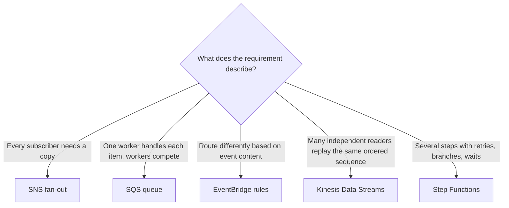
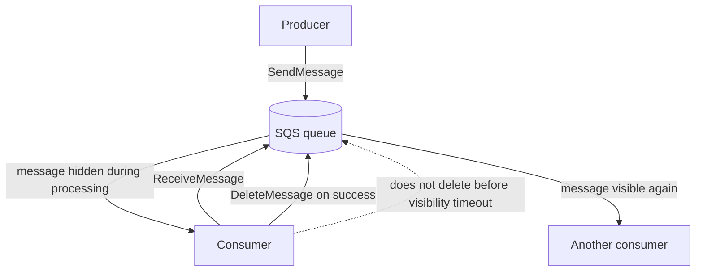

# 1.1.1 Recognize tight and loose coupling, then select AWS services that decouple components

**Domain 1 · Task 1.1 · Skill 1.1.1** · [Task overview](README.md) · Next: [1.1.2 Communication patterns](1.1.2-communication-patterns.md)

## What the exam expects

This skill tests whether you can look at a scenario, spot where components depend on each other too directly, and pick the AWS service that breaks that dependency. Questions rarely say "coupling". They describe symptoms: one slow service makes another time out, a traffic spike takes down a downstream system, or adding a consumer means changing the producer's code. The answer is almost always a queue, a topic, an event bus, a stream, or a workflow placed between the two sides.

You must be able to:

- Recognize tight coupling from scenario wording (synchronous chains, cascading failures, hard-coded endpoints, producer code that lists every consumer).
- Choose between Amazon Simple Queue Service (SQS), Amazon Simple Notification Service (SNS), Amazon EventBridge, Amazon Kinesis Data Streams, and AWS Step Functions by the shape of the requirement.
- Configure SQS correctly as a buffer: visibility timeout, dead-letter queue (DLQ), long polling, delay, message size, and First-In-First-Out (FIFO) settings.
- Combine services when one shape is not enough, for example SNS fan-out into several SQS queues.

## Key terms

| Term | Meaning |
|---|---|
| Tight coupling | Components call each other directly and must be available, fast, and known to each other at the same moment. They fail together. |
| Loose coupling | Components talk through an intermediary (queue, topic, bus, stream) so either side can be slow, down, scaled, or replaced without breaking the other. |
| Producer / consumer | The component that emits a message or event, and the component that processes it. |
| Buffer | A durable store between producer and consumer that absorbs bursts so the consumer works at its own pace. |
| Fan-out | One published message delivered as an independent copy to many subscribers. |
| Competing consumers | Many workers poll one queue; each message is handled by one worker. |
| At-least-once delivery | The service can deliver the same message more than once. Consumers must be idempotent. |
| Visibility timeout | Time an SQS message stays hidden after a consumer receives it. If the consumer does not delete it in time, it reappears. |
| Dead-letter queue (DLQ) | A queue that receives messages that failed processing too many times, for inspection and redrive. |

## Tight versus loose coupling

A tightly coupled system has several kinds of dependency at once:

| Dependency | What it looks like | Failure it causes |
|---|---|---|
| Time | Caller waits on a synchronous call | Downstream latency becomes caller latency; timeouts cascade |
| Availability | Caller fails if the callee is down | One outage spreads across services |
| Capacity | Caller sends at its own rate, callee must keep up | Traffic spikes overwhelm the slowest component |
| Location and identity | Caller hard-codes the callee's endpoint or list of consumers | Adding a consumer means changing and redeploying the producer |
| Data | Several services share one database schema | A schema change breaks every service at once |

Loose coupling removes these one at a time. A queue removes time, availability, and capacity coupling. A topic or event bus removes identity coupling, because the producer publishes once and never learns who subscribes. Separate data stores per service remove data coupling.


*Source: [AWS Lambda Developer Guide, Understanding event-driven architectures](https://docs.aws.amazon.com/lambda/latest/dg/concepts-event-driven-architectures.html). The producer stops calling consumers directly and hands its output to an intermediary, so each side scales, fails, and evolves on its own.*

### Spotting tight coupling in exam wording

- "Service A calls service B synchronously, and when B is slow, A times out and fails" (time and availability coupling).
- "During a flash sale, the backend cannot keep up and requests are lost" (capacity coupling).
- "Adding a new analytics consumer requires changing the order service" (identity coupling).
- "The front end waits while the video is encoded" (time coupling on slow work).

The fix in each case is to put a managed intermediary between the two sides and let the producer return immediately.

## The decoupling toolbox

All of these services are managed, scale independently of your application, and charge by usage rather than idle capacity.

| Service | Model | Delivery | Ordering | Use when |
|---|---|---|---|---|
| SQS standard queue | Queue, consumers pull | At least once, duplicates possible | Best effort | Buffer work, absorb spikes, one consumer per message |
| SQS FIFO queue | Queue, consumers pull | Deduplicates within a 5-minute window; consumers still need idempotency | Strict within a `MessageGroupId` | Ordered processing per entity |
| SNS topic | Publish/subscribe, push | At least once, retries per protocol | Only with FIFO topics | Fan-out: every subscriber gets a copy |
| EventBridge | Event bus with rules, push | At least once, retries with backoff | No (classic bus rules) | Content-based routing, AWS service and SaaS events, schedules |
| Kinesis Data Streams | Stream, consumers pull (or push with enhanced fan-out) | At least once | Per shard (partition key) | Ordered real-time streams, many independent readers, replay |
| Step Functions | Orchestration, stateful | Standard: exactly-once workflow execution | Defined by the workflow | Multi-step processes with retries, branching, waits, approvals |
| Amazon API Gateway in front of a backend | Synchronous facade | n/a | n/a | Hide backend location and implementation behind a stable API |

### Pick by the shape of the requirement

Before naming a service, restate the requirement as one of four messaging shapes. The service usually follows.



A plain-English way to remember them: SNS is a radio broadcast (everyone tuned in gets the signal), SQS is a deli ticket counter (one server per ticket, the ticket is torn up only when service finishes), EventBridge is a mail sorter that reads each letter and routes it by content, and Kinesis is a recorded highway where many observers can rewind and watch the same traffic.

Real architectures often combine shapes. SNS fanning out into several SQS queues is normal, not a sign you chose wrong. Do not route every event through every service "just in case"; each hop adds latency and cost.

### Use API Gateway and load balancers for synchronous decoupling

Not every decoupling answer is asynchronous. API Gateway and Elastic Load Balancing (ELB) remove location coupling: clients call a stable endpoint while the backend moves, scales, or changes implementation. This does not remove time coupling; the client still waits. When the scenario complains about waiting, slowness, or spikes, a synchronous facade alone is not enough. See [1.1.2](1.1.2-communication-patterns.md) for asynchronous API patterns.

## Amazon SQS: the default buffer

SQS is the oldest AWS service and the most common decoupling answer. Producers call `SendMessage`; consumers on Amazon Elastic Compute Cloud (EC2), containers, on-premises servers, or AWS Lambda poll with `ReceiveMessage`, process, then call `DeleteMessage`.



```python
import boto3

sqs = boto3.client("sqs")
QUEUE_URL = "https://sqs.us-east-1.amazonaws.com/123456789012/orders"

sqs.send_message(QueueUrl=QUEUE_URL, MessageBody='{"orderId":"abc"}')

resp = sqs.receive_message(
    QueueUrl=QUEUE_URL,
    MaxNumberOfMessages=10,   # default 1, maximum 10
    WaitTimeSeconds=20,       # long polling
    VisibilityTimeout=60,
)
for m in resp.get("Messages", []):
    process(m["Body"])
    sqs.delete_message(QueueUrl=QUEUE_URL, ReceiptHandle=m["ReceiptHandle"])
```

### Settings and limits

| Setting | Value | Notes |
|---|---|---|
| Retention | Default 4 days; 1 minute to 14 days | Set DLQ retention to 14 days so failures do not expire before you look |
| Maximum message size | 1 MiB (raised from 256 KiB in 2025) | Larger payloads: the Extended Client Library stores the body in Amazon Simple Storage Service (S3) and sends a pointer; payloads up to 2 GB |
| Visibility timeout | Default 30 seconds; 0 seconds to 12 hours | Set longer than processing time; for a Lambda event source mapping, at least 6 times the function timeout |
| Delay | 0 to 15 minutes, per queue or per message (`DelaySeconds`) | Hides a message before first delivery |
| Long polling wait | 1 to 20 seconds (`ReceiveMessageWaitTimeSeconds` on the queue or `WaitTimeSeconds` per call) | 20 seconds is the usual choice |
| Batch size | Up to 10 messages per `SendMessageBatch`, `ReceiveMessage`, `DeleteMessageBatch`, `ChangeMessageVisibilityBatch` | Batching cuts request cost |
| Message attributes | Up to 10 per message | Metadata alongside the body |
| Throughput | Standard: nearly unlimited. FIFO: 300 API calls per second per action, 3,000 messages per second with batching; high-throughput mode goes much higher | FIFO limits are per partition and per API action |

### Visibility timeout

When a consumer receives a message, SQS hides it for the visibility timeout. If processing finishes and the consumer deletes the message, it is gone. If the timeout expires first, the message becomes visible and another consumer can process it again. This is SQS's documented at-least-once contract.


*Source: [Amazon SQS Developer Guide, Visibility timeout](https://docs.aws.amazon.com/AWSSimpleQueueService/latest/SQSDeveloperGuide/sqs-visibility-timeout.html).*

- Too short: duplicate processing while the first consumer is still working.
- Too long: if a consumer crashes, the message waits a long time before anyone retries it.
- A consumer that needs more time calls `ChangeMessageVisibility` to extend the timeout for that message.

### Dead-letter queues and redrive

Set a redrive policy with `maxReceiveCount` on the source queue. After that many failed receives, SQS moves the message to the DLQ, so one poison message stops blocking the rest. The DLQ type must match the source: a FIFO queue needs a FIFO DLQ, a standard queue needs a standard DLQ. After fixing the bug, use DLQ redrive to move messages back to the source queue in batches without custom code. Alarm on the DLQ's `ApproximateNumberOfMessagesVisible`.

### Delay queues compared with visibility timeout

| | Delay queue or message timer | Visibility timeout |
|---|---|---|
| When the message is hidden | Before its first delivery | After a consumer receives it |
| Purpose | Postpone processing (for example "wait 5 minutes before charging") | Give the consumer time to finish and delete |
| Range | 0 to 15 minutes | 0 seconds to 12 hours |

### Long polling

With short polling, `ReceiveMessage` returns immediately even when the queue is empty, which costs a request each time. Long polling waits up to 20 seconds for a message to arrive. It reduces empty responses and API cost, and it lowers latency because messages are returned as soon as they arrive. Long polling is preferred over short polling.

### FIFO queues

- `MessageGroupId` is required. Ordering is strict within a group and there is no ordering across groups.
- Same group ID for every message: strict global order, but only one consumer can work at a time. Different group IDs (for example, customer ID): order per customer, with groups processed in parallel.
- Deduplication within a 5-minute window, either from an explicit `MessageDeduplicationId` or from content-based deduplication (a Secure Hash Algorithm 256-bit, or SHA-256, hash of the body).
- The deduplication window is bounded in time, and a consumer can still crash after doing work but before deleting the message. Keep the consumer idempotent. See [1.1.3](1.1.3-resilience-retries-and-backoff.md#idempotency-making-retries-safe).

| | Standard | FIFO |
|---|---|---|
| Throughput | Nearly unlimited | 300 calls per second per action (3,000 messages per second batched) by default; higher with high-throughput mode |
| Ordering | Best effort | Strict per `MessageGroupId` |
| Duplicates | Possible | Deduplicated within 5 minutes |
| DLQ type | Standard | FIFO |

### Scaling consumers on queue depth

Decoupling lets each tier scale on its own signal. A front-end tier sends messages; a back-end tier (for example, video encoding) runs in an EC2 Auto Scaling group that scales on a CloudWatch alarm over the queue's `ApproximateNumberOfMessagesVisible` (queue backlog). A Lambda event source mapping scales pollers automatically with backlog depth; see [1.2.4](../task-1.2-develop-lambda-functions/1.2.4-lambda-service-integrations.md).

### Security

- In transit: Hypertext Transfer Protocol Secure (HTTPS) endpoints. At rest: server-side encryption with SQS-owned keys (SSE-SQS) or AWS Key Management Service keys (SSE-KMS).
- Identity-based AWS Identity and Access Management (IAM) policies control who can call the SQS application programming interface (API).
- SQS access policies (resource-based) allow cross-account access and let services such as SNS or S3 send to the queue.

```json
{
  "Version": "2012-10-17",
  "Statement": [{
    "Effect": "Allow",
    "Principal": { "Service": "s3.amazonaws.com" },
    "Action": "sqs:SendMessage",
    "Resource": "arn:aws:sqs:us-east-1:444455556666:queue1",
    "Condition": {
      "ArnLike": { "aws:SourceArn": "arn:aws:s3:*:*:bucket1" },
      "StringEquals": { "aws:SourceAccount": "444455556666" }
    }
  }]
}
```

If S3 event notifications or SNS cannot deliver to a queue, the queue's access policy is the first thing to check.

## SNS and EventBridge in a decoupling role

Full feature coverage of SNS filter policies, EventBridge rules, and S3 event notifications lives in [1.1.8 Event-driven applications](1.1.8-event-driven-applications.md). For this skill, know what each removes.

- **SNS** removes identity coupling for broadcast. The publisher calls `Publish` once; the topic delivers a copy to every subscriber (SQS, Lambda, HTTP and HTTPS endpoints, email, text message (SMS), mobile push, Amazon Data Firehose). Adding a subscriber needs no publisher change.
- **SNS plus SQS fan-out** adds durability and independent retries per consumer. Each downstream system gets its own queue, processes at its own pace, and has its own DLQ. The queue's access policy must allow the topic to send. Fan-out works across Regions.
- **S3 to many queues.** S3 allows one notification rule per event type and prefix combination, so to send the same S3 event to several queues, send it to SNS (or EventBridge) and fan out from there.
- **SNS FIFO topics** combine fan-out with ordering and deduplication when subscribed by SQS FIFO queues.
- **EventBridge** removes identity coupling and moves routing logic out of consumers. Producers call `PutEvents`; rules match on event content and invoke targets. A producer never learns which rules exist. An event that matches no rule goes nowhere.


*Source: [Amazon SNS Developer Guide, Fanout scenario](https://docs.aws.amazon.com/sns/latest/dg/sns-common-scenarios.html).*

## Worked scenario: checkout and inventory

**Problem.** A checkout service calls an inventory-reservation service synchronously for every order. During a flash sale, inventory latency spikes, checkout requests time out, and users see failures even though checkout has spare capacity.

**Diagnosis.** Time, availability, and capacity coupling. Checkout's success depends on inventory's instantaneous capacity.

**Fix.** Put an SQS queue between them. Checkout enqueues a reservation request and returns. Inventory consumes at its own pace. A DLQ catches requests that repeatedly fail.

| Alternative | Why it fails |
|---|---|
| Raise checkout's timeout | Checkout still blocks on a degraded dependency; failures arrive later and user latency gets worse |
| Scale the inventory database up | A capacity patch; the next unexpected spike causes the same cascade |
| Call inventory twice in parallel | Doubles load on an already struggling service |

## Worked scenario: one event, three requirements

The same order event must satisfy three different requirements. Each one names a different service.

**A. Five independent systems must each receive every order event, and new subscribers will be added later without code changes.**

```bash
# SNS fan-out: publish once, each subscribed SQS queue holds its own copy
aws sns publish --topic-arn arn:aws:sns:us-east-1:123456789012:order-events \
  --message '{"orderId":"abc-123","status":"placed"}'
```

**B. One worker fleet must process each order once and scale with backlog.**

```bash
# SQS: one queue, competing consumers; scale workers on ApproximateNumberOfMessagesVisible
aws sqs send-message --queue-url https://sqs.us-east-1.amazonaws.com/123456789012/order-processing \
  --message-body '{"orderId":"abc-123","status":"placed"}'
```

**C. High-value orders go to fraud checks, everything else to fulfillment, without every subscriber re-implementing the filter.**

```bash
# EventBridge: content-based routing in a rule
aws events put-rule --name high-value-orders \
  --event-pattern '{"source":["orders"],"detail":{"amount":[{"numeric":[">",1000]}]}}'
aws events put-targets --rule high-value-orders \
  --targets "Id"="1","Arn"="arn:aws:lambda:us-east-1:123456789012:function:FraudCheck"
```

When the wording stresses routing by content, EventBridge beats a blanket SNS fan-out, even though both reach several targets.

## Exam triggers

| Scenario clue | Answer | Why the alternatives are wrong |
|---|---|---|
| "Decouple so a spike on one side doesn't overwhelm the other" | SQS queue between producer and consumer | A direct call or a longer timeout keeps the coupling |
| "Every downstream system needs its own copy; add subscribers later" | SNS topic, usually fanning out to SQS queues | A single SQS queue delivers each message to one consumer |
| "Route by event content, AWS service events, or SaaS partner events" | EventBridge rules | SNS filter policies are simpler; per-consumer filtering in code duplicates logic |
| "Multiple consumers read the same ordered stream at their own pace, with replay" | Kinesis Data Streams | SQS deletes after consumption; SNS does not store messages |
| "Coordinate several steps with retries, branching, and a human approval" | Step Functions | Chaining Lambda calls by hand spreads orchestration through code |
| "Same message processed twice" | Visibility timeout shorter than processing time, message not deleted, or normal at-least-once delivery; make the consumer idempotent | "Switch to exactly-once SQS" does not exist for standard queues |
| "Reduce empty receives and SQS cost" | Long polling (`WaitTimeSeconds` up to 20) | Shorter visibility timeout or more consumers do not reduce empty receives |
| "Delay every message by 5 minutes before processing" | Delay queue or per-message `DelaySeconds` | Visibility timeout applies only after a receive |
| "Payload is 5 MB" | SQS Extended Client Library with S3 | SQS accepts at most 1 MiB per message |
| "Per-customer order, many customers in parallel" | SQS FIFO with `MessageGroupId` = customer ID | One group ID serializes everything; standard queues do not order |
| "Poison message keeps failing" | DLQ with `maxReceiveCount`, then redrive after the fix | Purging loses good messages too |
| "Same S3 event to several queues" | S3 to SNS (or EventBridge), then fan out | S3 permits one rule per event type and prefix |
| "Scale workers on how much work is waiting" | Auto Scaling on `ApproximateNumberOfMessagesVisible` | Scaling on processor use lags the real backlog |

## Common traps

- SQS FIFO deduplicates for 5 minutes only. It is not a blanket "exactly-once processing" guarantee; consumers still need idempotency.
- The SQS maximum message size is 1 MiB. Older questions say 256 KB; for anything larger, use the Extended Client Library with S3.
- A consumer that forgets `DeleteMessage` reprocesses every message after the visibility timeout.
- Delay queues and visibility timeouts both hide messages, at different times. Do not swap them.
- A FIFO queue's DLQ must also be FIFO.
- SNS does not persist messages for later reading. If a subscriber needs durability or replay, put SQS behind SNS, or use Kinesis.
- API Gateway in front of a backend hides location but keeps the caller waiting. It does not fix a spike or a slow dependency by itself.
- An SNS or S3 delivery failure to SQS is usually a missing statement in the queue's access policy, not an IAM role problem.
- All of SQS standard, SNS, EventBridge, and Kinesis are at-least-once. Idempotent consumers are a requirement for all of them.

## Quick recall

- Tight coupling = direct calls that fail together. Loose coupling = an intermediary between producer and consumer.
- Buffer = SQS. Broadcast = SNS. Route by content = EventBridge. Ordered replayable stream = Kinesis. Multi-step workflow = Step Functions.
- SQS: retention 4 days default, 14 max; visibility 30 seconds default, 12 hours max; delay up to 15 minutes; long poll up to 20 seconds; 10 messages per batch; 1 MiB per message.
- Lambda event source mapping on SQS: visibility timeout at least 6 times the function timeout.
- FIFO: `MessageGroupId` for order, deduplication ID or content-based deduplication, 5-minute window.
- DLQ: `maxReceiveCount`, same type as source, redrive after the fix.
- SNS plus SQS fan-out gives each consumer durable, independent processing.
- Resource policies on SQS and SNS let other services and accounts write to them.

## Related skills

- [1.1.2 Communication patterns](1.1.2-communication-patterns.md): choosing synchronous, asynchronous, or event-driven communication once components are decoupled.
- [1.1.3 Resilience, retries, and backoff](1.1.3-resilience-retries-and-backoff.md): idempotent consumers and retry handling on top of at-least-once delivery.
- [1.1.6 Streaming data](1.1.6-streaming-data.md): Kinesis Data Streams in depth.
- [1.1.8 Event-driven applications](1.1.8-event-driven-applications.md): SNS filter policies, EventBridge rules, and S3 Event Notifications in full.
- [1.2.4 Lambda service integrations](../task-1.2-develop-lambda-functions/1.2.4-lambda-service-integrations.md): Lambda event source mappings that poll SQS.
- [4.3.3 Messaging optimization](../../domain-4-troubleshooting-and-optimization/task-4.3-optimize-applications/4.3.3-messaging-optimization.md): tuning SQS and SNS for cost and throughput.

## Sources

- Merged from: `archive/dva-c03-study-notes/01-development-with-aws-services.md` (decoupling table, SQS section), `archive/dva-c03-study-notes/00-developer-basics.md` (coupling definitions), `archive/dva-c03/domain-1-development/MASTER-CHUNK.md` (SQS, SNS, EventBridge, messaging patterns overview), `archive/dva-c03/domain-1-development/README.md` (decoupling scenarios, SNS/SQS/EventBridge worked scenario), `archive/aws-dva-notes/Markdown Files/16. Messaging - SQS, SNS & Kinesis.md`, `archive/aws-dva-notes/Markdown Files/31. Exam Day Cheat Sheet.md`, `archive/dva-c03/practice-questions/domain-1-questions.md` and `archive/dva-c03/exam-bank/bank-1.md` (traps only).
- AWS documentation: [Amazon SQS message quotas](https://docs.aws.amazon.com/AWSSimpleQueueService/latest/SQSDeveloperGuide/quotas-messages.html) (1 MiB message size, 2 GB with the Extended Client Library, retention, visibility, FIFO throughput)
- AWS documentation: [Amazon SQS visibility timeout](https://docs.aws.amazon.com/AWSSimpleQueueService/latest/SQSDeveloperGuide/sqs-visibility-timeout.html)
- AWS documentation: [Creating and configuring an Amazon SQS event source mapping](https://docs.aws.amazon.com/lambda/latest/dg/services-sqs-configure.html) (visibility timeout at least 6 times the function timeout)
- AWS documentation: [Understanding event-driven architectures](https://docs.aws.amazon.com/lambda/latest/dg/concepts-event-driven-architectures.html)
- AWS documentation: [Amazon SNS fanout scenario](https://docs.aws.amazon.com/sns/latest/dg/sns-common-scenarios.html)
