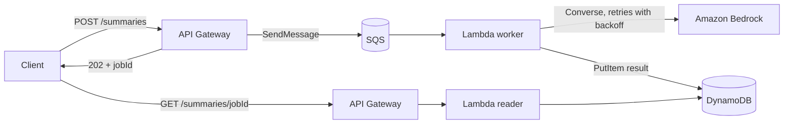
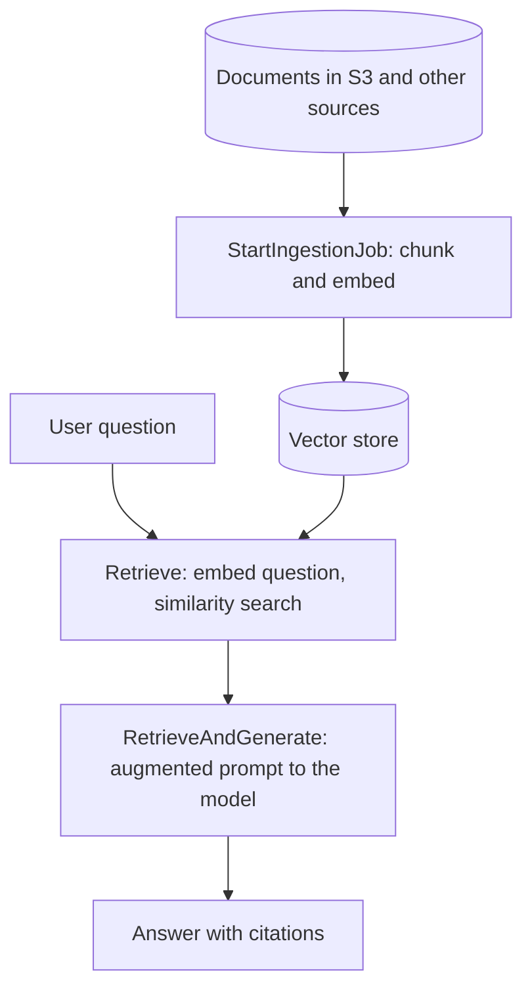

# 1.1.10 Integrate managed AWS AI services into applications

**Domain 1 · Task 1.1 · Skill 1.1.10** · [Task overview](README.md) · Previous: [1.1.9 AI-assisted development tools](1.1.9-ai-assisted-development-tools.md) · Next: [1.2.1 Lambda VPC access](../task-1.2-develop-lambda-functions/1.2.1-lambda-vpc-access.md)

## What the exam expects

This skill is new in DVA-C03. It tests whether you can call managed artificial intelligence (AI) services from application code the way you call any other AWS application programming interface (API): with the right software development kit (SDK) client and operation, least-privilege AWS Identity and Access Management (IAM), retries for throttling, timeouts that fit generation time, and an architecture that does not block a synchronous API on a slow model. The in-scope services are **Amazon Bedrock**, **Amazon Bedrock AgentCore**, and **Amazon Quick**. The exam guide lists choosing foundation models, prompt engineering, designing retrieval-augmented generation (RAG) architectures, and designing AI safety frameworks as outside the target role, so expect "which API or feature" questions, not model or prompt design.

You must be able to:

- Call a model with the `bedrock-runtime` client: `Converse`, `ConverseStream`, `InvokeModel`, `InvokeModelWithResponseStream`.
- Use tool use (function calling) through the `Converse` API.
- Ground answers in company documents with Bedrock Knowledge Bases (`Retrieve`, `RetrieveAndGenerate`).
- Let a model take actions through Bedrock Agents action groups or AgentCore Gateway tools, with human confirmation for risky actions.
- Deploy and invoke an agent on AgentCore Runtime and know what each AgentCore service provides.
- Choose on-demand, cross-Region inference, Provisioned Throughput, or batch inference, and handle `ThrottlingException`.
- Fit model calls into Amazon API Gateway, AWS Lambda, Amazon Simple Queue Service (SQS), AWS Step Functions, and streaming patterns.
- Recognize Amazon Quick and how developers connect data and actions to it.

## Key terms

| Term | Meaning |
|---|---|
| Foundation model (FM) | A large pre-trained model (Amazon Nova, Anthropic Claude, Meta Llama, Mistral, and others) you call through Bedrock. A large language model (LLM) is a foundation model for text. |
| Token | A word piece. Input and output are measured, limited, and billed in tokens. |
| Inference parameters | `maxTokens`, `temperature` (randomness), `topP`, `stopSequences`. |
| System prompt | Instructions that set the model's behavior for a conversation. |
| Tool use | The model asks your code to run a named function with JavaScript Object Notation (JSON) arguments, then continues with the result. |
| RAG | Retrieval-augmented generation: retrieve relevant passages and add them to the prompt so answers come from your data. |
| Embedding | A vector of numbers that represents meaning. Similar text has nearby vectors. Used for semantic search in RAG. |
| Knowledge base | Bedrock's managed RAG: ingestion, chunking, embedding, vector storage, retrieval, and citations. |
| Agent | A model that plans and calls tools over several steps to finish a task. |
| Inference profile | A Bedrock resource that routes requests for a model across Regions (cross-Region inference) or tags usage for cost tracking (application inference profile). |
| MCP | Model Context Protocol, an open standard for exposing tools and data to agents. |

## Service map

| Need | Service and feature | Client and main operation |
|---|---|---|
| Generate, summarize, classify, extract from text or images | Bedrock model inference | `bedrock-runtime`: `Converse`, `InvokeModel` |
| Show output as it is generated | Bedrock streaming | `ConverseStream`, `InvokeModelWithResponseStream` |
| Same code across several model providers, with tool use | `Converse` API | `bedrock-runtime`: `Converse` |
| Answer from company documents with citations | Bedrock Knowledge Bases | `bedrock-agent-runtime`: `RetrieveAndGenerate` or `Retrieve` |
| Managed agent that calls your APIs or Lambda functions | Bedrock Agents | `bedrock-agent-runtime`: `InvokeAgent` |
| Deploy your own agent code (any framework, any model) with session isolation, managed tools, identity, memory, and tracing | Bedrock AgentCore | `bedrock-agentcore`: `InvokeAgentRuntime` |
| Turn existing APIs and Lambda functions into agent tools | AgentCore Gateway | MCP endpoint |
| Filter prompts and responses | Bedrock Guardrails | `guardrailConfig` on calls, or `ApplyGuardrail` |
| Process millions of prompts cheaply, not interactively | Bedrock batch inference | `bedrock`: `CreateModelInvocationJob` |
| AI workspace for business users over company data | Amazon Quick | Console, connectors, MCP and OpenAPI actions |

Bedrock separates control and data planes into different clients:

| Client | Plane | Examples |
|---|---|---|
| `bedrock` | Control | List models, guardrails, logging configuration, batch jobs, Provisioned Throughput |
| `bedrock-runtime` | Data | `Converse`, `ConverseStream`, `InvokeModel`, `ApplyGuardrail` |
| `bedrock-agent` | Control | Create knowledge bases, data sources, agents, action groups; `StartIngestionJob` |
| `bedrock-agent-runtime` | Data | `Retrieve`, `RetrieveAndGenerate`, `InvokeAgent` |
| `bedrock-agentcore-control`, `bedrock-agentcore` | Control, data | Create runtimes and gateways; `InvokeAgentRuntime` |

Private connectivity uses an interface virtual private cloud (VPC) endpoint for each runtime endpoint you call (`bedrock-runtime`, `bedrock-agent-runtime`). See [2.3.2](../../domain-2-security/task-2.3-secure-ai-services/2.3.2-ai-data-privacy-and-private-connectivity.md).

## Calling models with Bedrock

### Converse

AWS recommends `Converse` for new code. One request format works across models and supports multi-turn messages, system prompts, images and documents, tool use, and guardrails.

```python
import boto3
from botocore.config import Config

bedrock = boto3.client(
    "bedrock-runtime",
    config=Config(
        retries={"max_attempts": 6, "mode": "adaptive"},  # backoff on ThrottlingException
        read_timeout=120,                                 # generation can outlast the 60 s default
    ),
)

MODEL_ID = "amazon.nova-pro-v1:0"   # or an inference profile ID, e.g. "us.amazon.nova-pro-v1:0"

resp = bedrock.converse(
    modelId=MODEL_ID,
    system=[{"text": "You summarize support tickets in three bullet points."}],
    messages=[{"role": "user", "content": [{"text": ticket_text}]}],
    inferenceConfig={"maxTokens": 400, "temperature": 0.2},
    guardrailConfig={"guardrailIdentifier": "gr-abc123", "guardrailVersion": "1"},
)

summary = resp["output"]["message"]["content"][0]["text"]
stop = resp["stopReason"]          # end_turn, max_tokens, tool_use, guardrail_intervened, ...
usage = resp["usage"]              # inputTokens, outputTokens, totalTokens
```

Response fields worth knowing: `stopReason` (`end_turn`, `tool_use`, `max_tokens`, `stop_sequence`, `guardrail_intervened`, `content_filtered`, `model_context_window_exceeded`, and others), `usage` token counts (including cache read and write tokens when prompt caching is used), and `metrics.latencyMs`. A `max_tokens` stop means the answer was cut off; raise `maxTokens` or ask for shorter output. Parameters that `Converse` does not model go in `additionalModelRequestFields`.

### InvokeModel

`InvokeModel` sends the provider's own JSON body, so the code changes when you change model families. Use it when you need a model-specific feature or a non-chat model such as an embedding model.

```python
import json

resp = bedrock.invoke_model(
    modelId="amazon.titan-embed-text-v2:0",
    body=json.dumps({"inputText": "refund policy for damaged items"}),
    contentType="application/json",
    accept="application/json",
)
vector = json.loads(resp["body"].read())["embedding"]   # body is a stream of bytes
```

### Streaming

`ConverseStream` and `InvokeModelWithResponseStream` return events as tokens are produced, which shortens time to first token in chat interfaces.

```python
resp = bedrock.converse_stream(
    modelId=MODEL_ID,
    messages=[{"role": "user", "content": [{"text": question}]}],
    inferenceConfig={"maxTokens": 800},
)
for event in resp["stream"]:
    if "contentBlockDelta" in event:
        send_to_client(event["contentBlockDelta"]["delta"].get("text", ""))
    elif "messageStop" in event:
        stop_reason = event["messageStop"]["stopReason"]
    elif "metadata" in event:
        usage = event["metadata"]["usage"]
```

### Tool use with Converse

You describe tools with a JSON Schema. When the model wants one, it stops with `stopReason` `tool_use`; your code runs the function, returns a `toolResult`, and calls `Converse` again.

```python
tool_config = {"tools": [{"toolSpec": {
    "name": "get_order_status",
    "description": "Look up the status of an order by its ID.",
    "inputSchema": {"json": {
        "type": "object",
        "properties": {"orderId": {"type": "string"}},
        "required": ["orderId"],
    }},
}}]}

messages = [{"role": "user", "content": [{"text": "Where is order o-123?"}]}]
resp = bedrock.converse(modelId=MODEL_ID, messages=messages, toolConfig=tool_config)

while resp["stopReason"] == "tool_use":
    assistant_msg = resp["output"]["message"]
    messages.append(assistant_msg)
    results = []
    for block in assistant_msg["content"]:
        if "toolUse" in block:
            tu = block["toolUse"]
            output = get_order_status(**tu["input"])          # your code, your IAM permissions
            results.append({"toolResult": {"toolUseId": tu["toolUseId"],
                                           "content": [{"json": output}]}})
    messages.append({"role": "user", "content": results})
    resp = bedrock.converse(modelId=MODEL_ID, messages=messages, toolConfig=tool_config)

answer = resp["output"]["message"]["content"][0]["text"]
```

The model never calls your API itself. Your code decides whether to run the tool, which is where you validate inputs and ask a human before sensitive actions. See [2.3.4](../../domain-2-security/task-2.3-secure-ai-services/2.3.4-ai-agent-security.md).

### Access, quotas, and errors

- **Permissions:** `bedrock:InvokeModel` (it also authorizes `Converse`) and `bedrock:InvokeModelWithResponseStream` (also for `ConverseStream`), scoped to the model or inference profile Amazon Resource Name (ARN). Give them to the Lambda execution role, Amazon Elastic Container Service (ECS) task role, or instance profile; never use access keys in code. Details in [2.3.1](../../domain-2-security/task-2.3-secure-ai-services/2.3.1-ai-service-access-control.md).
- **Model access:** in commercial Regions most serverless models are enabled on first use. The first call to a model sold through AWS Marketplace needs `aws-marketplace:Subscribe` (plus `Unsubscribe` and `ViewSubscriptions`), and Anthropic models earlier than Claude Opus 4.7 need a one-time first-use form. Older material describes a "request model access" page; that page now applies to AWS GovCloud (US).
- **Quotas:** on-demand inference has per-model requests-per-minute and tokens-per-minute quotas per Region.

| Error | HTTP | Meaning | Fix |
|---|---|---|---|
| `ThrottlingException` | 429 | Request or token quota exceeded | Exponential backoff with jitter, cross-Region inference profile, quota increase, batch for offline work |
| `ModelNotReadyException` | 429 | Model not ready to serve; the SDK retries automatically | Retry |
| `AccessDeniedException` | 403 | IAM denies the action or model, or model access prerequisites are missing | Fix the role policy or Marketplace and first-use prerequisites |
| `ValidationException` | 400 | Bad request: wrong body for the model, too many tokens, unsupported parameter | Fix the request; do not retry |
| `ModelTimeoutException` | 408 | Processing took too long | Smaller input, streaming, or async |
| `ModelErrorException` | 424 | The model failed processing the request | Retry carefully, check input |
| `ResourceNotFoundException` | 404 | Wrong model ID or Region | Check ID, Region, and inference profile |

### Throughput and cost options

| Option | What it is | Use when |
|---|---|---|
| On-demand | Pay per input and output token | Default for most apps |
| Cross-Region inference profile | Bedrock routes requests across Regions in a geography (`us.`, `eu.`, `apac.` prefixes) or globally (`global.`) for more throughput | Throttling at peak on one Region |
| Application inference profile | A tagged profile for cost allocation and tracking per application | Chargeback by team or app |
| Provisioned Throughput | Reserved model units billed by time | Predictable high volume; required for some custom models |
| Batch inference | Asynchronous job over JSON Lines (JSONL) input in Amazon Simple Storage Service (S3), output to S3, lower cost than on-demand | Classify or summarize a large backlog overnight |
| Prompt caching | Reuse a long, repeated prompt prefix across calls | Long system prompts or documents repeated in many requests |
| Latency-optimized inference | Faster inference for supported models | Latency-sensitive chat |

## Integration patterns

| Pattern | Flow | Watch for |
|---|---|---|
| Synchronous API | API Gateway, Lambda, `Converse`, response | API Gateway's integration timeout is 29 seconds by default (Regional and private REST (representational state transfer) APIs can request more). Long generations need streaming or async |
| Streaming chat | Lambda response streaming (function URL (uniform resource locator), `InvokeWithResponseStream`, or API Gateway REST proxy with response streaming) or an API Gateway WebSocket API pushing chunks | Function URLs do not stream inside a VPC; buffered Lambda responses cap at 6 MB, streamed at 200 MB |
| Asynchronous job | API returns 202 with a job ID, message to SQS, worker Lambda calls Bedrock, writes result to DynamoDB or S3, client polls or gets a notification | Visibility timeout longer than the worker's timeout; idempotent workers |
| Workflow | Step Functions calls Bedrock directly with its optimized `bedrock:invokeModel` integration, plus Lambda steps, retries, and human approval | Step Functions state payload limit of 256 KiB; pass S3 references |
| Event-driven enrichment | S3 upload event, Lambda, Bedrock summarizes or extracts fields, DynamoDB | Asynchronous Lambda retries; idempotency |
| Bulk offline | Write JSONL to S3, `CreateModelInvocationJob`, process output | Not for interactive latency |



Practical rules:

- Create the `bedrock-runtime` client outside the Lambda handler so connections are reused.
- Raise the SDK `read_timeout` and the Lambda timeout for long generations, and keep the caller's timeout longer than the work. The Lambda quotas page currently lists a maximum function timeout of 1,800 seconds; API Gateway's 29-second default still applies to synchronous APIs in front of it.
- Log request IDs, model ID, token counts, latency, and `stopReason`. Do not log raw prompts or responses that may contain personally identifiable information (PII); see [2.3.5](../../domain-2-security/task-2.3-secure-ai-services/2.3.5-ai-sensitive-data-in-logs.md).
- Lambda functions in a VPC need an interface VPC endpoint (or a network address translation (NAT) gateway) to reach Bedrock. See [1.2.1](../task-1.2-develop-lambda-functions/1.2.1-lambda-vpc-access.md).
- Treat model output as untrusted input: validate JSON it returns, and never execute it or pass it to a database query without checks. See [2.3.3](../../domain-2-security/task-2.3-secure-ai-services/2.3.3-ai-input-and-output-filtering.md).

## Bedrock Knowledge Bases (managed RAG)



- **Data sources:** S3 and other connectors. After documents change, run an **ingestion job** (sync) so the vector store reflects them.
- **Vector stores:** Amazon OpenSearch Serverless, Aurora PostgreSQL with pgvector, Amazon S3 Vectors, and others.
- **`Retrieve`** returns relevant chunks with scores and source locations; your code builds the prompt.
- **`RetrieveAndGenerate`** retrieves and calls the model in one step, returning the answer and **citations**.
- **Metadata filters** limit retrieval to documents a user may see, for example a tenant ID.

```python
agent_rt = boto3.client("bedrock-agent-runtime")

resp = agent_rt.retrieve_and_generate(
    input={"text": "How many days do customers have to return damaged items?"},
    retrieveAndGenerateConfiguration={
        "type": "KNOWLEDGE_BASE",
        "knowledgeBaseConfiguration": {
            "knowledgeBaseId": "KB12345678",
            "modelArn": "arn:aws:bedrock:us-east-1::foundation-model/amazon.nova-pro-v1:0",
        },
    },
)
print(resp["output"]["text"])
for c in resp["citations"]:
    for ref in c["retrievedReferences"]:
        print(ref["location"])
```

RAG reduces hallucination for knowledge the model was never trained on and keeps your documents out of model training. Designing chunking strategies and retrieval architectures is outside the target role; calling the APIs is in it.

## Bedrock Agents

A Bedrock agent combines a model, instructions, **action groups**, optional knowledge bases, and memory. You invoke it through an **alias** that points at a version.

- **Action groups** describe operations with an OpenAPI schema or a function schema. Each is fulfilled by a **Lambda function**, or by **return of control**: the agent returns the action name and parameters to your application, which validates, runs, and sends back the result.
- **User confirmation** makes the agent ask the user before running an action.
- **Sessions:** pass a `sessionId` to keep conversation state across calls.

```python
resp = agent_rt.invoke_agent(
    agentId="AGENT12345",
    agentAliasId="PRODALIAS1",
    sessionId=session_id,              # one per user conversation
    inputText="Cancel order o-123",
)
text = ""
for event in resp["completion"]:      # event stream
    if "chunk" in event:
        text += event["chunk"]["bytes"].decode()
```

Other Bedrock features you may see named: **Guardrails** ([2.3.3](../../domain-2-security/task-2.3-secure-ai-services/2.3.3-ai-input-and-output-filtering.md)), **Prompt management** (versioned prompt templates), **Flows** (visual workflows linking prompts, knowledge bases, and Lambda), **model evaluation**, and **custom models** (fine-tuning, continued pre-training, distillation, imported models). Customizing models is outside the developer role.

## Amazon Bedrock AgentCore

AgentCore is a set of services for building, deploying, and operating agents in production with any framework (LangGraph, CrewAI, LlamaIndex, Strands Agents, OpenAI Agents SDK, Google Agent Development Kit (ADK), or custom code) and any model, in or outside Bedrock. Each service works alone or with the others.


*Source: [What is Amazon Bedrock AgentCore?](https://docs.aws.amazon.com/bedrock-agentcore/latest/devguide/what-is-bedrock-agentcore.html)*

| Service | What it gives a developer | Exam cue |
|---|---|---|
| Runtime | Serverless hosting for agents and tools with fast cold starts, long-running sessions, and **session isolation** (each session in its own microVM); supports MCP and agent-to-agent (A2A) protocols | "Deploy an agent at scale; one user's session must not see another's" |
| Gateway | Converts APIs, Lambda functions, and OpenAPI specs into **MCP tools**, and connects existing MCP servers | "Expose our order API to agents without rewriting it" |
| Identity | Inbound authentication with existing identity providers (Amazon Cognito, Okta, Microsoft Entra ID, Auth0) and outbound credentials such as OAuth (Open Authorization) tokens so agents call tools on behalf of a user | "Agent must act with the user's permissions" |
| Memory | Short-term memory for multi-turn conversations and long-term memory across sessions | "Remember user preferences between sessions" |
| Code Interpreter | Isolated sandbox for agent-written code (Python, JavaScript, TypeScript) | "Run generated code safely" |
| Browser | Managed cloud browser for agents to navigate sites and fill forms | "Agent must use a web application" |
| Observability | Traces and metrics of each agent step, in OpenTelemetry format, viewable in CloudWatch | "Debug which tool call failed" |
| Policy | Deterministic rules (Cedar-compatible) that Gateway checks on every tool call before it runs | "Tool calls must follow business rules" |
| Evaluations | Automated quality assessment of agent sessions and traces | "Measure agent quality before release" |
| Harness | A managed agent loop: define model, prompt, and tools in one API call | "Run an agent without writing the loop" |

AWS documentation also lists Payments, Registry, and Optimization services. Know they exist; the exam focus is Runtime, Gateway, Identity, Memory, built-in tools, Observability, and Policy.

Invoking an agent deployed on AgentCore Runtime (the caller needs `bedrock-agentcore:InvokeAgentRuntime`):

```python
import json, uuid
import boto3

agentcore = boto3.client("bedrock-agentcore")

resp = agentcore.invoke_agent_runtime(
    agentRuntimeArn="arn:aws:bedrock-agentcore:us-east-1:111122223333:runtime/orders_agent-AbCdEf1234",
    runtimeSessionId=str(uuid.uuid4()),          # reuse the same ID to continue a session
    payload=json.dumps({"prompt": "What is the status of order o-123?"}),
)
print(resp["response"].read().decode())
```

### Bedrock Agents or AgentCore

| | Bedrock Agents | AgentCore |
|---|---|---|
| You write | Configuration: instructions, action group schemas, Lambda handlers | Your own agent code in any framework |
| Models | Bedrock models | Any model, in or outside Bedrock |
| Tools | Action groups (Lambda or return of control), knowledge bases | Gateway (MCP tools from APIs and Lambda), Code Interpreter, Browser, any MCP server |
| Hosting | Fully managed by Bedrock | Runtime with per-session microVM isolation |
| Pick when | A managed agent over your APIs with minimal code | Production agents built with open-source frameworks, needing isolation, identity propagation, memory, and tracing |

> **Not on the DVA-C03 service list.** Strands Agents is an open-source agent framework listed as out of scope; it may appear only as an example framework that AgentCore can host.

## Amazon Quick

Amazon Quick (AWS documentation now calls it **AWS Quick**; it evolved from Amazon QuickSight) is a managed AI service for business users. People chat with AI agents that work over connected data and applications.

| Feature | What it does |
|---|---|
| Quick Sight | Dashboards and business intelligence (BI); Quick Sight alone is out of scope for DVA-C03 |
| Quick Flows | Business users automate routine tasks without code |
| Quick Automate | Power users orchestrate end-to-end business processes |
| Quick Index | Connects documents and data sources so answers are grounded in company information |
| Quick Research | In-depth research across the web and your data, delivered as a cited report |
| Apps | Build web apps by describing them in natural language |

Where developers come in: connecting Quick to systems through knowledge bases, action connectors, extensions, and structured data connections, with open standards such as **MCP** and **OpenAPI**. An internal API exposed as an MCP server or OpenAPI action becomes something business users' agents can call, so it needs the same authentication, least privilege, and input validation as any other client. Organizations provision Quick with IAM Identity Center or IAM federation. Quick is not the answer for building AI features into your own application; that is Bedrock or AgentCore.

> **Not on the DVA-C03 service list.** Task-specific AI services such as Amazon Comprehend (text analysis, PII detection), Amazon Textract (document extraction), Amazon Transcribe (speech to text), and Amazon Translate are not on the in-scope list, and Amazon Rekognition, Amazon Polly, and Amazon SageMaker AI are explicitly out of scope. If one appears as an option, the DVA-C03 answer for generative features is usually Bedrock. The same IAM, private connectivity, and logging rules apply to all of them.

## Security in one table

The security of AI services is Task 2.3. When integrating, apply these defaults:

| Concern | Default | Detail |
|---|---|---|
| Who can call which model | IAM `bedrock:InvokeModel` scoped to model ARNs; service control policy (SCP) deny to block models | [2.3.1](../../domain-2-security/task-2.3-secure-ai-services/2.3.1-ai-service-access-control.md) |
| Private traffic, no training on your data | Interface VPC endpoints with endpoint policies; Bedrock does not use prompts or responses to train models | [2.3.2](../../domain-2-security/task-2.3-secure-ai-services/2.3.2-ai-data-privacy-and-private-connectivity.md) |
| Harmful content, PII, prompt injection | Bedrock Guardrails on input and output, `ApplyGuardrail` for any text | [2.3.3](../../domain-2-security/task-2.3-secure-ai-services/2.3.3-ai-input-and-output-filtering.md) |
| Agent actions | Least-privilege tool roles, AgentCore Policy, user confirmation or return of control, session isolation | [2.3.4](../../domain-2-security/task-2.3-secure-ai-services/2.3.4-ai-agent-security.md) |
| Prompts in logs | Model invocation logging is off by default; CloudWatch Logs data protection policies to mask PII | [2.3.5](../../domain-2-security/task-2.3-secure-ai-services/2.3.5-ai-sensitive-data-in-logs.md) |

## Exam triggers

| Scenario clue | Answer | Why the alternatives are wrong |
|---|---|---|
| One code path that works across several models, with tool use | `Converse` API | `InvokeModel` needs a different body per provider |
| Show tokens as they are generated | `ConverseStream` (or `InvokeModelWithResponseStream`) with Lambda response streaming or a WebSocket API | A buffered response waits for the whole answer |
| Answer questions over company documents in S3 with citations | Bedrock Knowledge Base, `RetrieveAndGenerate` | A raw model call has no access to the documents; fine-tuning is outside the role and does not give citations |
| New documents uploaded but answers do not include them | Run an ingestion (sync) job on the data source | Changing the model does not re-index documents |
| Model must call our order API | `Converse` tool use, a Bedrock Agents action group, or AgentCore Gateway | Letting the model call the API directly is not how any of these work |
| Agent must get the user's approval before issuing a refund | User confirmation or return of control (or Step Functions `.waitForTaskToken`) | A system prompt asking the model to be careful is not a control |
| Deploy a LangGraph agent with per-session isolation, managed tool access, and tracing | AgentCore Runtime, Gateway, Observability | Bedrock Agents does not host your framework code; a shared Amazon Elastic Compute Cloud (EC2) process does not isolate sessions |
| Agent must call a software as a service (SaaS) API using the signed-in user's OAuth token | AgentCore Identity | Storing one shared API key gives every user the same rights |
| Agent needs to run code it writes | AgentCore Code Interpreter | Running it inside your Lambda function risks your environment |
| Intermittent `ThrottlingException` from Bedrock at peak | Exponential backoff with jitter, cross-Region inference profile, quota increase | Raising Lambda memory does not raise model quotas |
| Classify a million documents overnight at the lowest cost | Batch inference | On-demand calls cost more and hit quotas |
| Synchronous API Gateway call to Bedrock returns 504 on long answers | Streaming or the asynchronous job pattern (202 plus polling) | Raising only the Lambda timeout does not change the 29-second integration default |
| `AccessDeniedException` calling a model | Execution role lacks `bedrock:InvokeModel` on that ARN, or Marketplace and first-use prerequisites are missing | Access keys in code are never the fix |
| Answer is cut off mid-sentence | `stopReason` is `max_tokens`; raise `maxTokens` | Temperature does not control length |
| Business users need an AI assistant over company data and apps, no custom code | Amazon Quick | Building a Bedrock app is more work than the requirement asks |

## Common traps

- `bedrock` is the control plane; inference uses `bedrock-runtime`. Knowledge base queries and agents use `bedrock-agent-runtime`.
- `bedrock:InvokeModel` covers `Converse`; streaming needs `bedrock:InvokeModelWithResponseStream`.
- Denying `aws-marketplace:Subscribe` alone does not block a model. Deny `bedrock:InvokeModel`.
- The SDK default read timeout can be shorter than a long generation. Raise `read_timeout`.
- `InvokeModel` returns `body` as a byte stream; read and parse it.
- Knowledge bases do not update themselves when S3 changes; sync the data source.
- Model output is untrusted input. Validate JSON and never execute it blindly.
- API Gateway's default 29-second integration timeout is not a hard limit for Regional and private REST APIs, but long AI work still belongs in streaming or asynchronous patterns.
- Amazon Quick is for business users; Quick Sight by itself is out of scope.
- Choosing models, writing prompts, and designing RAG pipelines are outside the exam's target role; focus on calling, securing, and operating.

## Quick recall

- Runtime APIs: `Converse`, `ConverseStream`, `InvokeModel`, `InvokeModelWithResponseStream`, `ApplyGuardrail`.
- `Converse` is model-agnostic and supports tool use; `stopReason` `tool_use` means run the tool and call again.
- Knowledge Bases: `RetrieveAndGenerate` (answer plus citations) or `Retrieve` (chunks only); sync after changes.
- Bedrock Agents: action groups with Lambda or return of control; user confirmation; `InvokeAgent` with `sessionId`.
- AgentCore: Runtime (session isolation), Gateway (MCP tools), Identity (OAuth on behalf of users), Memory, Code Interpreter, Browser, Observability, Policy.
- Throttling: backoff with jitter, cross-Region inference profiles, quota increase, batch inference.
- Synchronous API Gateway: 29 seconds by default; use streaming or 202 plus polling.
- Amazon Quick: business-user AI workspace; developers connect data and actions through connectors, MCP, and OpenAPI.

## Related skills

- [1.1.2 Communication patterns](1.1.2-communication-patterns.md): asynchronous request and response for slow work.
- [1.1.3 Resilience, retries, and backoff](1.1.3-resilience-retries-and-backoff.md): handling throttling and graceful degradation when a model is unavailable.
- [1.1.5 AWS SDKs and service APIs](1.1.5-aws-sdks-and-service-apis.md): client configuration, retries, and timeouts.
- [1.1.7 Serialization and deserialization](1.1.7-serialization-and-deserialization.md): `InvokeModel` bodies and streamed bytes.
- [1.1.9 AI-assisted development tools](1.1.9-ai-assisted-development-tools.md): Kiro and where Amazon Quick fits.
- [1.2.1 Lambda VPC access](../task-1.2-develop-lambda-functions/1.2.1-lambda-vpc-access.md): reaching Bedrock from a VPC function.
- [2.3.1 AI service access control](../../domain-2-security/task-2.3-secure-ai-services/2.3.1-ai-service-access-control.md) through [2.3.5 Sensitive data in AI logs](../../domain-2-security/task-2.3-secure-ai-services/2.3.5-ai-sensitive-data-in-logs.md): securing everything in this note.
- [4.2.4 Distributed tracing](../../domain-4-troubleshooting-and-optimization/task-4.2-observability/4.2.4-distributed-tracing.md): tracing model and agent calls.

## Sources

- Merged from: `archive/dva-c03-study-notes/01-development-with-aws-services.md` (skill 1.1.10), `archive/aws-dva-notes/Markdown Files/30. AI Services & Security (DVA-C03).md` (sections 1 to 3, 6, 8, 11), `archive/dva-c03-study-notes/00-developer-basics.md` (AI concepts), `archive/dva-c03-study-notes/05-cheat-sheet.md`, `archive/dva-c03/domain-1-development/MASTER-CHUNK.md` (Amazon Bedrock), `archive/dva-c03/domain-2-security/MASTER-CHUNK.md` (AI services overview, Bedrock), `archive/dva-c03/domain-2-security/ai-service-security-risks.md` (AgentCore isolation), practice questions in `archive/dva-c03/practice-questions/`.
- Official outline: `00-foundations/exam-guide.md`, [DVA-C03 in-scope services](https://docs.aws.amazon.com/aws-certification/latest/developer-associate-03/dva-03-in-scope-services.html), [out-of-scope services](https://docs.aws.amazon.com/aws-certification/latest/developer-associate-03/dva-03-out-of-scope-services.html)
- AWS documentation: [Converse API reference](https://docs.aws.amazon.com/bedrock/latest/APIReference/API_runtime_Converse.html)
- AWS documentation: [Access Amazon Bedrock foundation models](https://docs.aws.amazon.com/bedrock/latest/userguide/model-access.html)
- AWS documentation: [What is Amazon Bedrock AgentCore?](https://docs.aws.amazon.com/bedrock-agentcore/latest/devguide/what-is-bedrock-agentcore.html)
- AWS documentation: [InvokeAgentRuntime API reference](https://docs.aws.amazon.com/bedrock-agentcore/latest/APIReference/API_InvokeAgentRuntime.html)
- AWS documentation: [What is AWS Quick?](https://docs.aws.amazon.com/quick/latest/userguide/what-is.html)
- AWS documentation: [Lambda response streaming](https://docs.aws.amazon.com/lambda/latest/dg/configuration-response-streaming.html)
- AWS documentation: [Lambda quotas](https://docs.aws.amazon.com/lambda/latest/dg/gettingstarted-limits.html)
