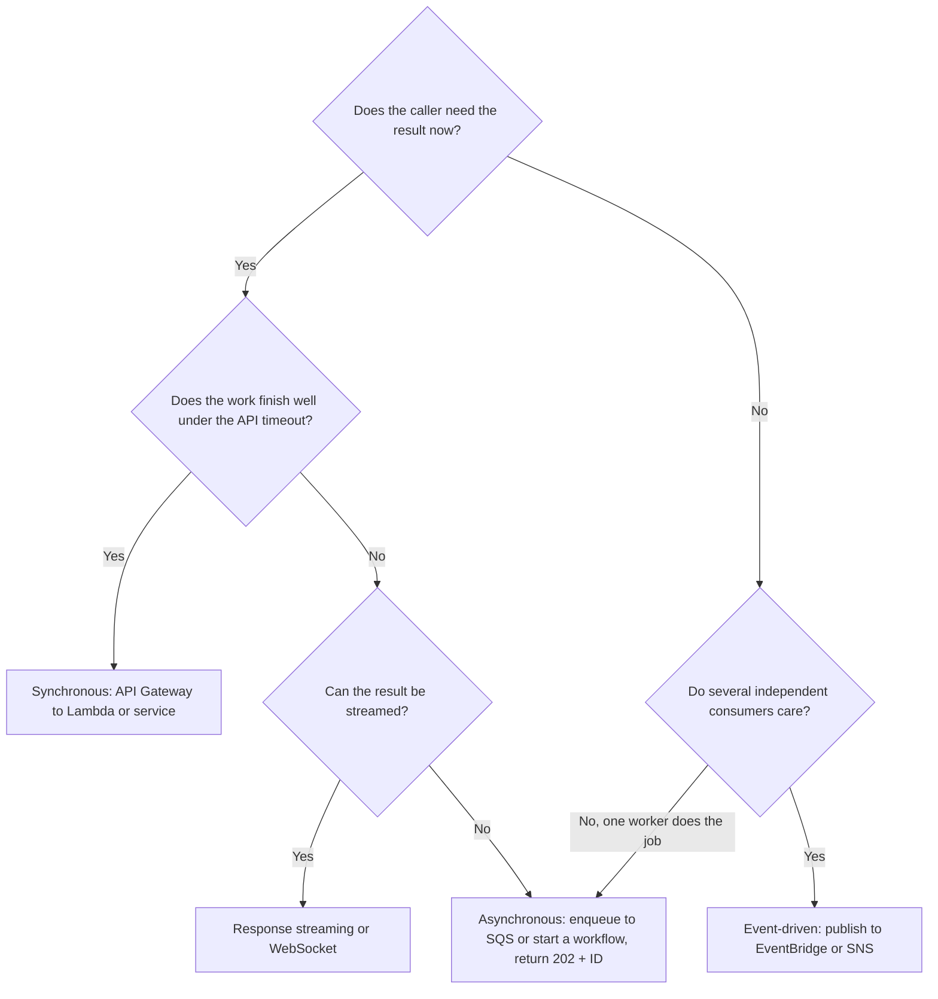
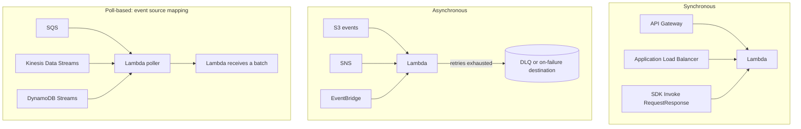
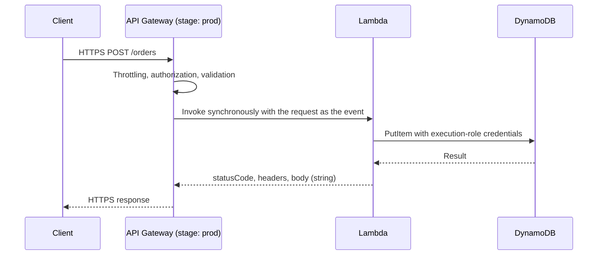
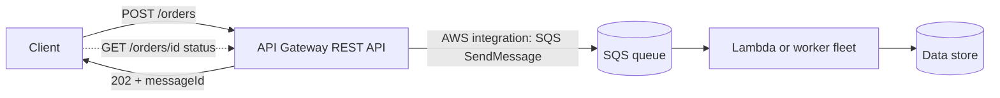
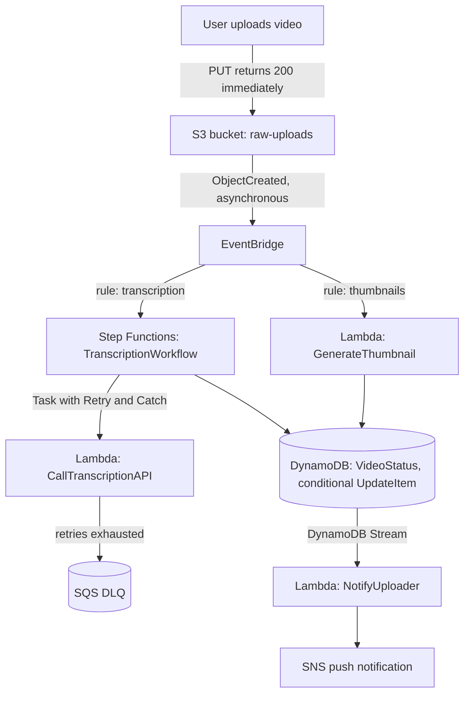

# 1.1.2 Choose synchronous, asynchronous, or event-driven communication

**Domain 1 · Task 1.1 · Skill 1.1.2** · [Task overview](README.md) · Previous: [1.1.1 Coupling and decoupling](1.1.1-coupling-and-decoupling.md) · Next: [1.1.3 Resilience, retries, and backoff](1.1.3-resilience-retries-and-backoff.md)

## What the exam expects

This skill tests whether you can match a communication style to a requirement. The deciding questions are: does the caller need the result now, how long does the work take, how bursty is the traffic, and who needs to know that something happened. The exam frames this around Amazon API Gateway, the managed application programming interface (API) service (usually synchronous), Amazon Simple Queue Service (SQS, asynchronous), and Amazon EventBridge (event-driven), plus AWS Step Functions for orchestration.

You must be able to:

- Decide between a synchronous request/response, an asynchronous hand-off, and an event-driven publish.
- Recognize which invocation model a service uses with AWS Lambda and what that means for errors.
- Build the common patterns: API Gateway to Lambda, API Gateway to SQS returning `202`, API Gateway to Step Functions, WebSocket push, and EventBridge choreography.
- Choose orchestration (Step Functions) or choreography (EventBridge, Amazon Simple Notification Service or SNS), and Standard or Express workflows.

## Key terms

| Term | Meaning |
|---|---|
| Synchronous | The caller waits for the result on the same connection. Errors return to the caller. |
| Asynchronous | The caller hands work to a queue or service and continues. Results arrive later, through polling, a callback, or a notification. |
| Event-driven | Components publish facts ("order placed") and other components react. The publisher does not know who reacts. |
| Request/response | Synchronous exchange: one request, one response. |
| `202 Accepted` | Hypertext Transfer Protocol (HTTP) status meaning "received, processing later". The usual response for an asynchronous API. |
| Choreography | Each service reacts to events on its own; no central coordinator. |
| Orchestration | A central coordinator (Step Functions) calls each step in order and handles failures. |
| Task token | A Step Functions token that pauses a workflow until an external party calls back with it. |

## Three styles side by side

| | Synchronous | Asynchronous | Event-driven |
|---|---|---|---|
| Caller waits | Yes | No | No |
| Typical AWS shape | API Gateway or Application Load Balancer to Lambda; AWS Software Development Kit (SDK) `Invoke` with `RequestResponse` | API Gateway to SQS; Lambda `Invoke` with `Event`; Step Functions `StartExecution` | `PutEvents` to EventBridge; `Publish` to SNS; Amazon Simple Storage Service (S3) Event Notifications |
| Who handles failure | The caller (it sees the error) | The service or queue (retries, dead-letter queue or DLQ) | The bus and each target (retry policy, DLQ) |
| Coupling | Time and availability coupled | Time decoupled | Time and identity decoupled |
| Good for | Fast reads, validation, anything the user must see now | Slow, bursty, or unreliable work | Many independent reactions to one fact |
| Watch for | API Gateway integration timeout (29 seconds by default) | Clients need a way to get the result | Consumers must be idempotent; events with no matching rule vanish |

A plain-English check: synchronous is a phone call (the caller is on the line and knows immediately if you do not answer). Asynchronous is a voicemail (the caller hangs up; if you never call back, someone else has to notice). Event-driven is a public announcement (whoever cares acts on it, and the speaker never learns who listened).

### Decision rule



If the work is fast and the client must see the answer, use a synchronous API. If it is slow, bursty, or the client does not need the result now, accept the request, enqueue it or start a workflow, and return `202` with an identifier. The client then polls a status endpoint or receives a push (WebSocket message or notification).

## Lambda invocation models

Which model a trigger uses decides who retries and where failures go. [1.2.3](../task-1.2-develop-lambda-functions/1.2.3-lambda-invocation-lifecycle-and-failures.md) covers retries, destinations, and DLQs in depth.



| Model | Sources | Error behavior |
|---|---|---|
| Synchronous | API Gateway, Application Load Balancer, SDK `Invoke` with `RequestResponse`, function URLs | Error returns to the caller. Lambda does not retry. API Gateway does not retry a 5xx from Lambda. |
| Asynchronous | S3, SNS, EventBridge, SDK `Invoke` with `Event` | Lambda queues the event and retries function errors twice by default, then sends it to a DLQ or on-failure destination if configured; otherwise it is discarded. |
| Poll-based (event source mapping) | SQS, Kinesis Data Streams, DynamoDB Streams, Amazon Managed Streaming for Apache Kafka (MSK) | Lambda polls and invokes with a batch. Failed batches retry according to the source (SQS visibility timeout, stream retry settings). |

## Patterns with API Gateway, SQS, and EventBridge

### Pattern 1: synchronous API Gateway to Lambda

The common request path. The client calls API Gateway, which invokes Lambda synchronously and returns its response.



Constraints: the backend must answer within the integration timeout (29 seconds by default; Regional and private Representational State Transfer (REST) APIs can request an increase), or the client gets `504`. The Lambda proxy response must have `statusCode` and a string `body`, or the client gets `502`. See [1.1.4](1.1.4-apis-transformation-and-validation.md).

### Pattern 2: asynchronous API Gateway to SQS (no Lambda in the request path)

An API Gateway REST API with an AWS service integration calls SQS `SendMessage` directly, using a mapping template to build the request. The client gets `200` or `202` with the message ID immediately. Workers consume the queue at their own pace.



Use it when the scenario says "absorb spikes", "the client doesn't need the result immediately", or "write to SQS without a Lambda function". It cuts cost and latency because no function runs in the request path.

### Pattern 3: API Gateway to Step Functions

| Need | Integration |
|---|---|
| Start a long workflow and return an execution Amazon Resource Name (ARN) right away | `StartExecution` (Standard or Express, asynchronous) |
| Return the workflow's result in the API response, workflow under 5 minutes | `StartSyncExecution` on a synchronous Express workflow |

### Pattern 4: push results back with WebSocket APIs

When the server must push updates (job finished, chat message, live price), use an API Gateway WebSocket API. The backend stores each `connectionId` (often in DynamoDB) and sends messages with a SigV4-signed `POST` to the `@connections/{connectionId}` callback URL. Details are in [1.1.4](1.1.4-apis-transformation-and-validation.md#websocket-apis).

### Pattern 5: stream a long response

For generative artificial intelligence (AI) and other slow responses, API Gateway REST APIs support response streaming for Lambda proxy and HTTP proxy integrations, for up to 15 minutes. Lambda function URLs with `RESPONSE_STREAM` are the other option. Streaming keeps a synchronous user experience without hitting the 29-second wait for a complete response.

### Pattern 6: event-driven choreography with EventBridge

The order service publishes `OrderPlaced` with `PutEvents`. Rules on the bus match on content and invoke independent targets: inventory, shipping, notifications, analytics. Adding a consumer means adding a rule, with no producer change.

```python
import json, boto3

events = boto3.client("events")
resp = events.put_events(Entries=[{
    "Source": "com.example.orders",
    "DetailType": "OrderPlaced",
    "Detail": json.dumps({"orderId": "abc-123", "amount": 1500, "region": "eu"}),
    "EventBusName": "orders",
}])
if resp["FailedEntryCount"]:
    # PutEvents can partially fail: retry only the failed entries
    ...
```

`PutEvents` takes up to 10 entries per call and can partially fail; check `FailedEntryCount` and retry the failed entries. Related EventBridge features:

- **EventBridge Pipes**: point-to-point source to filter to enrichment to target with no glue code (for example, SQS to a Lambda enrichment step to Step Functions).
- **EventBridge Scheduler**: one-time or recurring invocations of many AWS targets, replacing cron servers.
- **Archive and replay**: re-run past events after a bug fix.

> **New in September 2026.** EventBridge relaunched the custom event bus. The new Custom Event Bus routes with subscribers (with optional ordered delivery and retention) instead of rules and targets. Existing buses now show as "Custom Event Bus - Classic". Most exam material describes the classic rules-and-targets model, which remains available. See [Retry policies and dead-letter queues](https://docs.aws.amazon.com/eventbridge/latest/userguide/eb-custom-bus-retry.html).

Rule targets, filter syntax, S3 Event Notifications, and SNS filter policies are covered in [1.1.8](1.1.8-event-driven-applications.md).

## Choreography or orchestration

| | Choreography (EventBridge, SNS) | Orchestration (Step Functions) |
|---|---|---|
| Control | Each service reacts on its own | A state machine calls each step |
| Visibility | Flow is spread across rules and consumers | Visual workflow and execution history |
| Error handling | Per consumer (retry policy, DLQ) | Declared per state (`Retry`, `Catch`) |
| Adding a step | Add a consumer; producer unchanged | Change the state machine |
| Best for | Independent reactions to one fact | Ordered steps that depend on each other, compensation, approvals |

Choose orchestration when steps must happen in order, earlier steps must be undone if a later one fails (the saga pattern), or a human or external system must approve before continuing.

## AWS Step Functions for developers

Step Functions runs state machines written in Amazon States Language (ASL), a JavaScript Object Notation (JSON) format. You start one with `StartExecution` from the SDK, API Gateway, or an EventBridge rule.

| State | Purpose |
|---|---|
| Task | Do work: invoke Lambda, call an AWS SDK integration (200+ services, no Lambda glue), run an Amazon Elastic Container Service (ECS) task, publish to SNS or SQS, start another workflow |
| Choice | Branch on a value, with a default branch |
| Parallel | Run branches at the same time |
| Map | Iterate over an array; Distributed Map handles millions of items |
| Wait | Pause for a duration or until a timestamp |
| Pass | Pass or inject data without work |
| Succeed / Fail | End the execution |

### Service integration patterns

| Pattern | Resource suffix | Behavior |
|---|---|---|
| Request/response | none | Call the service and move on immediately |
| Run a job | `.sync` | Wait for the job (for example an ECS task or AWS Batch job) to finish |
| Wait for callback | `.waitForTaskToken` | Pause until someone calls `SendTaskSuccess` or `SendTaskFailure` with the task token |

```json
"CheckCredit": {
  "Type": "Task",
  "Resource": "arn:aws:states:::sqs:sendMessage.waitForTaskToken",
  "Parameters": {
    "QueueUrl": "https://sqs.us-east-1.amazonaws.com/123456789012/MyQueue",
    "MessageBody": { "Input.$": "$", "TaskToken.$": "$$.Task.Token" }
  },
  "Next": "CheckCreditResult"
}
```

A worker reads the message, does the work (or waits for a human), and calls `SendTaskSuccess` with the token. **Activities** are the pull alternative: workers on Amazon Elastic Compute Cloud (EC2) or on-premises call `GetActivityTask`, then report back, sending `SendTaskHeartbeat` within `HeartbeatSeconds` for long tasks.

Data between states is shaped with JSONPath fields (`InputPath`, `Parameters`, `ResultSelector`, `ResultPath`, `OutputPath`) or, since November 2024, with JSONata (`Arguments`, `Output`) and variables (`Assign`). Most exam material uses JSONPath. `Retry` and `Catch` are covered in [1.1.3](1.1.3-resilience-retries-and-backoff.md#step-functions-retry-and-catch).

### Standard or Express

| | Standard (default) | Express |
|---|---|---|
| Maximum duration | 1 year | 5 minutes |
| Execution semantics | Exactly-once workflow execution | Asynchronous: at-least-once. Synchronous: at-most-once |
| Start rate | Over 2,000 per second | Over 100,000 per second |
| History | 90 days in the console, or CloudWatch | CloudWatch Logs only |
| Pricing | Per state transition | Per execution, duration, and memory |
| Use for | Long-running, non-idempotent work such as payments; human approval | High-volume, short event processing, IoT ingestion, mobile backends |

| | Asynchronous Express | Synchronous Express |
|---|---|---|
| Caller | Does not wait; read results from CloudWatch Logs | Waits for the result |
| Semantics | At-least-once, so steps must be idempotent | At-most-once |
| Typical caller | EventBridge, messaging | API Gateway or Lambda needing an immediate answer |

## Worked case study: media pipeline with mixed models

**Requirement.** A video platform must create thumbnails and transcripts for each upload, notify the uploader when done, never lose a video to a transient transcription outage, and keep the upload response under 2 seconds.



Why each choice:

- **Synchronous only for the upload itself.** `PutObject` is fast; everything after it is asynchronous, so the 2-second target holds no matter how long processing takes.
- **EventBridge fans the one upload event out** to two independent consumers without either knowing about the other.
- **Step Functions orchestrates transcription** because it needs differentiated handling: retry transient API errors with backoff, send definitive failures (unsupported codec) to the DLQ.
- **Conditional `UpdateItem`** records each stage so a duplicate EventBridge delivery does not double-count a stage.
- **A DynamoDB Stream triggers the notification**, so a notification bug cannot stop the status record from being written.

## Exam triggers

| Scenario clue | Answer | Why the alternatives are wrong |
|---|---|---|
| "Client needs an immediate answer; work takes under a second" | Synchronous API Gateway to Lambda | Queues add latency and need a separate result path |
| "Work takes minutes; clients get 504 after 29 seconds" | Accept, enqueue to SQS or start Step Functions, return 202 and an ID; or raise the timeout on a Regional or private REST API | Raising Lambda's timeout does not change API Gateway's integration timeout |
| "Write requests to SQS without a Lambda function" | API Gateway AWS service integration with a mapping template | Lambda proxy needs code in the request path |
| "Several services must react to OrderPlaced; add more later" | EventBridge (or SNS) publish | Direct synchronous calls couple the producer to every consumer |
| "Coordinate Lambda functions with retries and a manual approval step" | Step Functions with `.waitForTaskToken` | Hand-written orchestration code spreads state across functions |
| "Workers on premises poll for work" | Step Functions activity | Task tokens push to a service; activities are pulled |
| "API Gateway must return the workflow result; under 5 minutes" | Synchronous Express workflow (`StartSyncExecution`) | Standard and asynchronous Express return only an execution ARN |
| "Payment step must run exactly once; workflow can last days" | Standard workflow | Express is at-least-once (async) and capped at 5 minutes |
| "High-volume, short event processing, lowest cost" | Express workflow | Standard bills per state transition |
| "Server must push updates to browsers" | API Gateway WebSocket API with `@connections` | REST and HTTP APIs are request/response only |
| "Show generated tokens as they arrive" | Response streaming (API Gateway REST streaming or Lambda function URL) or WebSocket | Buffering the full response hits timeouts and feels slow |

## Common traps

- The API Gateway integration timeout is 29 seconds by default. Regional and private REST APIs can request an increase (which may lower the account throttle quota); edge-optimized APIs cannot. Prefer asynchronous patterns for long work.
- Synchronous Lambda invocations are not retried by Lambda. Retrying is the caller's job.
- Asynchronous invocations retry, then drop the event unless a DLQ or on-failure destination is configured.
- Step Functions Standard gives exactly-once workflow execution; asynchronous Express is at-least-once and synchronous Express is at-most-once. Do not mix these up.
- An EventBridge event that matches no rule is silently dropped. There is no default target.
- `PutEvents` and other batch APIs can partially succeed. Check `FailedEntryCount`.
- "Asynchronous" does not mean "unreliable". With a queue or DLQ it is more durable than a synchronous chain.

## Quick recall

- Need the result now and fast: synchronous. Slow or bursty: asynchronous with 202. Many independent reactions: event-driven.
- Synchronous Lambda sources: API Gateway, Application Load Balancer, `RequestResponse`. Asynchronous: S3, SNS, EventBridge, `Event`. Poll-based: SQS, Kinesis, DynamoDB Streams.
- API Gateway integration timeout: 29 seconds default; payload 10 MB; streaming up to 15 minutes.
- API Gateway can call SQS, Step Functions, and other AWS APIs directly with an AWS integration.
- Choreography = EventBridge or SNS. Orchestration = Step Functions.
- `.sync` waits for a job; `.waitForTaskToken` waits for a callback; activities are polled.
- Standard: 1 year, exactly-once. Express: 5 minutes, at-least-once (async) or at-most-once (sync).

## Related skills

- [1.1.1 Coupling and decoupling](1.1.1-coupling-and-decoupling.md): which intermediary service to choose.
- [1.1.3 Resilience, retries, and backoff](1.1.3-resilience-retries-and-backoff.md): `Retry` and `Catch`, idempotency, and DLQs.
- [1.1.4 APIs, transformation, and validation](1.1.4-apis-transformation-and-validation.md): API Gateway integration types and response formats.
- [1.1.8 Event-driven applications](1.1.8-event-driven-applications.md): EventBridge rules, SNS, and S3 Event Notifications.
- [1.2.3 Lambda invocation lifecycle and failures](../task-1.2-develop-lambda-functions/1.2.3-lambda-invocation-lifecycle-and-failures.md): retries, destinations, and DLQs per invocation model.
- [1.2.4 Lambda service integrations](../task-1.2-develop-lambda-functions/1.2.4-lambda-service-integrations.md): event source mappings and triggers.

## Sources

- Merged from: `archive/dva-c03-study-notes/01-development-with-aws-services.md` (sync versus async decision, EventBridge, Step Functions), `archive/dva-c03-study-notes/00-developer-basics.md`, `archive/dva-c03/domain-1-development/README.md` (request flow, Lambda invocation models, media-pipeline case study, analogy bank), `archive/dva-c03/domain-1-development/MASTER-CHUNK.md` (Step Functions, API Gateway, EventBridge), `archive/aws-dva-notes/Markdown Files/16. Messaging - SQS, SNS & Kinesis.md` (communication patterns), `archive/aws-dva-notes/Markdown Files/20. Serverless - API Gateway.md` (integrations, timeouts, WebSocket), `archive/aws-dva-notes/Markdown Files/25. Other Serverless - Step Functions & AppSync.md` (states, task tokens, activities, Standard and Express), `archive/aws-dva-notes/Markdown Files/31. Exam Day Cheat Sheet.md`.
- AWS documentation: [Quotas for configuring and running a REST API in API Gateway](https://docs.aws.amazon.com/apigateway/latest/developerguide/api-gateway-execution-service-limits-table.html) (29-second integration timeout, increase for Regional and private APIs, 10 MB payload)
- AWS documentation: [Stream the integration response for your proxy integrations in API Gateway](https://docs.aws.amazon.com/apigateway/latest/developerguide/response-transfer-mode.html) (streaming up to 15 minutes)
- AWS documentation: [How Lambda handles errors and retries with asynchronous invocation](https://docs.aws.amazon.com/lambda/latest/dg/invocation-async-error-handling.html)
- AWS documentation: [EventBridge retry policies and dead-letter queues](https://docs.aws.amazon.com/eventbridge/latest/userguide/eb-custom-bus-retry.html) (new Custom Event Bus and Classic bus)
- AWS documentation: [What is AWS Step Functions?](https://docs.aws.amazon.com/step-functions/latest/dg/welcome.html)
