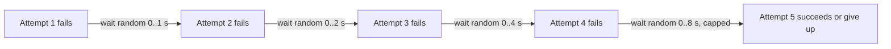
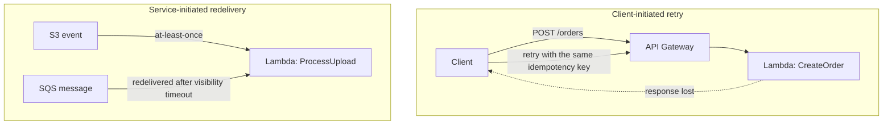
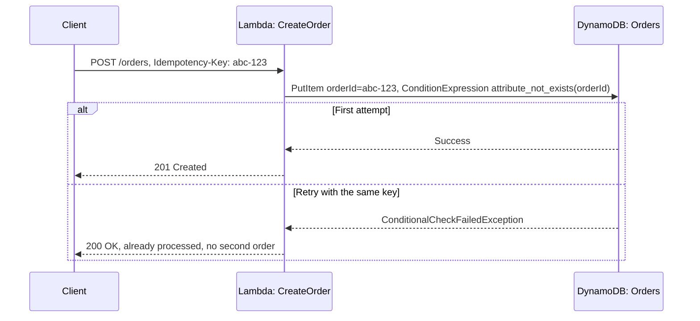
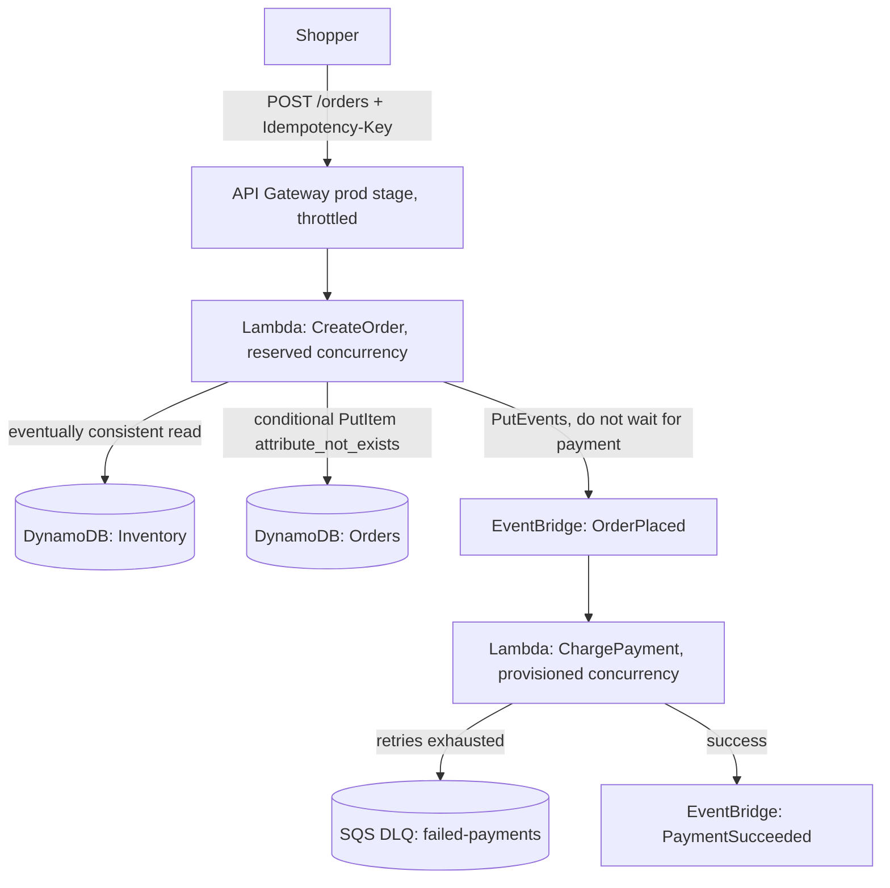

# 1.1.3 Build resilient applications with bounded retries, exponential backoff, failure handling, and graceful degradation

**Domain 1 · Task 1.1 · Skill 1.1.3** · [Task overview](README.md) · Previous: [1.1.2 Communication patterns](1.1.2-communication-patterns.md) · Next: [1.1.4 APIs, transformation, and validation](1.1.4-apis-transformation-and-validation.md)

## What the exam expects

This skill tests what your code does when a call fails. Expect scenarios about intermittent throttling, flaky third-party application programming interfaces (APIs), duplicate messages, failed events that disappear, and features that should keep working when a dependency is down. The right answer is usually a configuration or library feature, such as an AWS Software Development Kit (SDK) retry mode, a dead-letter queue, or a Step Functions `Retry` block, rather than custom code, and never "just add capacity" when the problem is retry behavior.

You must be able to:

- Tell retryable errors (throttling, 5xx, timeouts) from errors that must not be retried (4xx validation and permission errors).
- Configure SDK retries and write bounded exponential backoff with jitter for calls the SDK does not cover.
- Make retried operations safe with idempotency keys and conditional writes.
- Capture failures with dead-letter queues (DLQs), Lambda destinations, and Step Functions `Retry` and `Catch`.
- Keep an application partly working with timeouts, circuit breakers, fallbacks, and feature flags.

## Key terms

| Term | Meaning |
|---|---|
| Transient error | A failure likely to succeed on retry: throttling, timeouts, 500/502/503/504. |
| Permanent error | A failure that retrying cannot fix: malformed input (400), access denied (403), not found (404). |
| Exponential backoff | Wait longer after each failed attempt, for example 1, 2, 4, 8 seconds, up to a cap. |
| Jitter | Randomness added to each wait so many clients do not retry at the same moment. |
| Bounded retries | A maximum number of attempts and a maximum total time, so retries end. |
| Thundering herd | Many clients that failed together retry together and recreate the overload. |
| Idempotency | Doing an operation twice has the same effect as doing it once. |
| Idempotency key | A client-generated ID sent with a request and reused on every retry of that same request. |
| Circuit breaker | Stop calling a failing dependency for a period, then probe before resuming. |
| Graceful degradation | Serve a reduced experience (cached data, defaults, a feature turned off) instead of failing entirely. |
| Bulkhead | Isolate resources (concurrency, queues, connection pools) so one failing part cannot drain the rest. |

## Which errors to retry

| Retry | Do not retry |
|---|---|
| `ThrottlingException`, `TooManyRequestsException` (429) | `ValidationException`, 400 Bad Request |
| `ProvisionedThroughputExceededException` (DynamoDB, Kinesis) | `AccessDeniedException`, 403 |
| `SlowDown` (Amazon Simple Storage Service, or S3, returns 503), `RequestLimitExceeded` (Amazon Elastic Compute Cloud, or EC2) | `ResourceNotFoundException`, 404 |
| 500, 502, 503, 504, connection resets, read timeouts | `ConditionalCheckFailedException` (it is an answer, not a fault) |

A 4xx error means the request itself is wrong. Retrying sends the same wrong request again.

### Rate limits compared with service quotas

| | API rate limit | Service quota |
|---|---|---|
| What it caps | Calls per second (for example, S3 supports 3,500 PUT and 5,500 GET requests per second per prefix) | How much you can provision (for example, running On-Demand vCPUs) |
| Intermittent errors | Exponential backoff with jitter | n/a |
| Consistent errors | Request a throttling limit increase, batch calls, spread keys | Request a quota increase in Service Quotas or through AWS Support |

## Retries in the AWS SDKs

Every AWS SDK retries transient and throttling errors automatically with exponential backoff and jitter. You tune it rather than rewrite it. In boto3 (Python):

| Mode | Behavior |
|---|---|
| `legacy` | Older handler. Default 5 total attempts. Limited error list. |
| `standard` (default) | Default 3 total attempts (4 for DynamoDB and DynamoDB Streams clients). Retries an expanded list of throttling and transient errors plus 500, 502, 503, 504. Backoff with base 2, up to 20 seconds. Includes circuit-breaking to stop retries during outages. |
| `adaptive` | Everything in `standard` plus client-side rate limiting with a token bucket that slows the client's request rate as throttling responses arrive. AWS marks it experimental. |

```python
import boto3
from botocore.config import Config

config = Config(
    retries={"total_max_attempts": 8, "mode": "adaptive"},  # total includes the first call
    connect_timeout=2,   # seconds to establish the connection
    read_timeout=5,      # seconds to wait for a response
)
ddb = boto3.client("dynamodb", config=config)
```

`max_attempts` means different things in different places. In `~/.aws/config` or `AWS_MAX_ATTEMPTS` it counts the first request. In a `Config` object it counts retries only. `total_max_attempts` in a `Config` object always counts the first request. The AWS Command Line Interface (CLI) reads the same `retry_mode` and `max_attempts` settings.

Exam angle: "intermittent `ProvisionedThroughputExceededException` under load, and the app should back off with increasing delay" is a client retry configuration fix. Raising table capacity is a separate lever and is the usual distractor.

## Exponential backoff with jitter, by hand

You write your own backoff when the SDK's retry handler does not apply: a raw Hypertext Transfer Protocol (HTTP) call to a third-party API, an application-level "not ready yet" condition, or retrying the failed entries of a batch call.



Without jitter, a thousand clients that failed at the same instant retry at the same 1, 2, 4 second marks and recreate the spike. Full jitter picks a random delay between zero and the exponential value.

```python
import random, time

RETRYABLE = {"ThrottlingException", "TooManyRequestsException", "ServiceUnavailable"}

def call_with_backoff(fn, max_attempts=6, base=0.5, cap=20.0, deadline_s=25.0):
    start = time.monotonic()
    for attempt in range(max_attempts):
        try:
            return fn()
        except TransientError:                       # your classification of retryable errors
            if attempt == max_attempts - 1:
                raise                                 # bounded: give up after max_attempts
            delay = random.uniform(0, min(cap, base * 2 ** attempt))   # full jitter
            if time.monotonic() - start + delay > deadline_s:
                raise                                 # bounded: stay inside the caller's timeout
            time.sleep(delay)
```

Two bounds matter: a maximum number of attempts, and a total time budget shorter than whatever is waiting on you. A Lambda function behind API Gateway has 29 seconds by default, so retries inside it must finish well before that. Use `context.get_remaining_time_in_millis()` to decide whether another attempt fits.

## Timeouts and circuit breakers

- Set connect and read timeouts on every outbound call. SDK defaults (60 seconds in boto3) are often longer than your caller is willing to wait.
- Keep each layer's timeout shorter than the layer above it: SDK call timeout below the Lambda timeout, Lambda timeout below the API Gateway integration timeout.
- A circuit breaker counts recent failures to a dependency. After a threshold it "opens" and fails fast (or serves a fallback) for a cool-down period, then lets a trial request through. It protects both your latency and the struggling dependency. The SDK `standard` mode has a built-in form for AWS calls; for third-party APIs you implement it or use a library.

## Idempotency: making retries safe

Every distributed call has an ambiguous failure: the server did the work but the response never reached the client. The client cannot tell "never happened" from "happened, reply lost", so the safe move is to retry. That is only safe if the operation is idempotent. AWS adds its own retries on top: SDK retries, Lambda asynchronous retries, Amazon Simple Queue Service (SQS) redelivery after a visibility timeout, at-least-once delivery from Amazon Simple Notification Service (SNS), EventBridge, S3 Event Notifications, and streams. None of that machinery knows whether your business logic is idempotent.



Both paths produce the same symptom, "this operation may run more than once", and need the same fix.

Operations that are naturally idempotent (`PUT` of a full resource, `DELETE` by ID, a read) do not need a key. `POST /orders` does.

### Idempotency key plus conditional write

The client generates a universally unique identifier (UUID) once per logical action and sends it on every retry. The server makes "have I seen this key?" and "record this key" one atomic step. A `GetItem` followed by a `PutItem` is not atomic; two concurrent retries can both pass the check.



```python
import json, boto3
from botocore.exceptions import ClientError

ddb = boto3.client("dynamodb")

def handler(event, context):
    body = json.loads(event["body"])
    key = (event.get("headers") or {}).get("Idempotency-Key")
    if not key:
        return {"statusCode": 400, "body": json.dumps({"error": "Idempotency-Key header required"})}
    try:
        ddb.put_item(
            TableName="Orders",
            Item={"orderId": {"S": key}, "item": {"S": body["item"]}},
            ConditionExpression="attribute_not_exists(orderId)",
        )
        return {"statusCode": 201, "body": json.dumps({"status": "created", "orderId": key})}
    except ClientError as e:
        if e.response["Error"]["Code"] == "ConditionalCheckFailedException":
            return {"statusCode": 200, "body": json.dumps({"status": "already processed", "orderId": key})}
        raise
```

`ConditionalCheckFailedException` tells you the key was used, not what the original response was. A fuller version stores the original response with the key and replays it, so every retry gets an identical answer:

```python
def handler(event, context):
    body = json.loads(event["body"])
    key = event["headers"]["Idempotency-Key"]

    existing = ddb.get_item(TableName="IdempotencyRecords", Key={"key": {"S": key}}).get("Item")
    if existing:
        return json.loads(existing["response"]["S"])       # replay the original response

    order_id = create_order(body)                           # the real side effect
    response = {"statusCode": 201, "body": json.dumps({"orderId": order_id})}
    try:
        ddb.put_item(
            TableName="IdempotencyRecords",
            Item={"key": {"S": key}, "response": {"S": json.dumps(response)}},
            ConditionExpression="attribute_not_exists(#k)",
            ExpressionAttributeNames={"#k": "key"},
        )
    except ClientError as e:
        if e.response["Error"]["Code"] != "ConditionalCheckFailedException":
            raise
        existing = ddb.get_item(TableName="IdempotencyRecords", Key={"key": {"S": key}})["Item"]
        return json.loads(existing["response"]["S"])       # lost a race: return the winner's response
    return response
```

This sketch still runs `create_order` before the record exists, so a concurrent duplicate could run it twice. Production implementations write an "in progress" record first with a condition, then complete it. Powertools for AWS Lambda ships an idempotency utility that does this with a DynamoDB table and a decorator; prefer it over hand-rolled code. Add a time to live (TTL) attribute so old idempotency records expire.

### Idempotency the platform already gives you

| Service | Mechanism | What it guarantees |
|---|---|---|
| DynamoDB `PutItem` / `UpdateItem` | `ConditionExpression` such as `attribute_not_exists(pk)` | Atomic check-and-write |
| DynamoDB `TransactWriteItems` | `ClientRequestToken` | A retried transaction with the same token within 10 minutes is not applied twice |
| SQS First-In-First-Out (FIFO) | `MessageDeduplicationId` or content-based deduplication | Duplicates within a 5-minute window are dropped at the queue; consumers still need idempotency |
| Step Functions Standard | `name` on `StartExecution` | Same name and same input as a running execution returns the original response; a different input, or a closed execution, returns `ExecutionAlreadyExists`. Names can be reused 90 days after the execution closes. Express workflows are not idempotent on name. |
| EC2 and many create APIs | `ClientToken` | Retried create calls return the same resource |
| S3 `PutObject` | `If-None-Match: *` conditional write | Create only if the key does not exist |
| Lambda | None for invocations | Use Powertools for AWS Lambda idempotency in the function |
| API Gateway | None | An `Idempotency-Key` header is your own convention |

## Partial batch failures

Batch APIs do not raise an exception when some items fail. They return the failures, and your code must retry those items with backoff.

| API | Field to check |
|---|---|
| DynamoDB `BatchWriteItem` / `BatchGetItem` | `UnprocessedItems` / `UnprocessedKeys` |
| Kinesis `PutRecords` | `FailedRecordCount` and per-record `ErrorCode` |
| EventBridge `PutEvents` | `FailedEntryCount` and per-entry `ErrorCode` |
| SQS `SendMessageBatch`, `DeleteMessageBatch` | `Failed` list |
| Firehose `PutRecordBatch` | `FailedPutCount` |
| Lambda SQS or stream event source mapping | Return `batchItemFailures` with `ReportBatchItemFailures` enabled; see [1.2.3](../task-1.2-develop-lambda-functions/1.2.3-lambda-invocation-lifecycle-and-failures.md) |

## Failure handling: never lose the event

Retries end eventually. Configure where the failure goes when they do.

| Where the failure happens | Built-in retry | Where to capture it |
|---|---|---|
| SQS consumer | Message reappears after the visibility timeout | Redrive policy with `maxReceiveCount` to an SQS DLQ |
| Lambda asynchronous invocation (S3, SNS, EventBridge) | 2 retries by default for function errors (about 1 minute, then 2 minutes apart); throttles and system errors retried for up to 6 hours | On-failure destination (SQS, SNS, Lambda, EventBridge, S3) with request and error context, or a DLQ (SQS or SNS) |
| EventBridge rule target (classic bus) | Retries for 24 hours and up to 185 times with exponential backoff and jitter, by default | Per-target retry policy and SQS DLQ |
| EventBridge Custom Event Bus subscriber (launched September 2026) | Default 5 attempts or 300 seconds | `OnFailureConfiguration` SQS queue; set `MaxEventAgeInSeconds` to 86,400 to keep a day of retries |
| SNS subscription | Retries per protocol delivery policy | Subscription DLQ (SQS) |
| Kinesis or DynamoDB Streams event source mapping | Retries until success or record expiry by default | Bisect on error, maximum retry attempts, maximum record age, on-failure destination |
| Step Functions state | `Retry` block | `Catch` block to a fallback state |

Lambda destinations are preferred over DLQs for asynchronous invocations: they carry more context and also support on-success routing. Even without errors, a Lambda asynchronous function can receive the same event more than once, so handlers must tolerate duplicates.

## Step Functions Retry and Catch

Declare retries in the state machine instead of in function code.

| Field | Meaning |
|---|---|
| `ErrorEquals` | Error names this rule matches, evaluated top to bottom |
| `IntervalSeconds` | First retry delay |
| `BackoffRate` | Multiplier for each subsequent delay |
| `MaxAttempts` | Default 3; 0 means never retry |
| `MaxDelaySeconds`, `JitterStrategy` | Cap the delay and add jitter (`FULL`) |
| `Catch` with `Next` | State to go to after retries are exhausted |
| `ResultPath` in `Catch` | Where to put the error; `"$.error"` keeps the original input and adds the error |

Predefined errors: `States.ALL` (any error, must be last in the list), `States.Timeout` (exceeded `TimeoutSeconds` or missed a heartbeat), `States.TaskFailed`, `States.Permissions`. Lambda also surfaces errors such as `Lambda.ServiceException` and your own exception names.

```json
{
  "StartAt": "ChargePayment",
  "States": {
    "ChargePayment": {
      "Type": "Task",
      "Resource": "arn:aws:lambda:us-east-1:123456789012:function:ChargePayment",
      "Retry": [
        { "ErrorEquals": ["PaymentDeclinedError"], "MaxAttempts": 0 },
        {
          "ErrorEquals": ["States.Timeout", "Lambda.ServiceException"],
          "IntervalSeconds": 2, "MaxAttempts": 3, "BackoffRate": 2.0, "JitterStrategy": "FULL"
        }
      ],
      "Catch": [
        { "ErrorEquals": ["States.ALL"], "ResultPath": "$.error", "Next": "ManualReview" }
      ],
      "Next": "OrderConfirmed"
    },
    "ManualReview": { "Type": "Succeed" },
    "OrderConfirmed": { "Type": "Succeed" }
  }
}
```

Infrastructure failures (`States.Timeout`, `Lambda.ServiceException`) are retried with backoff. A business failure (`PaymentDeclinedError`) is a definitive answer, so `MaxAttempts: 0` sends it straight to `Catch`. Differentiated rules, not one blanket retry, are what the exam tests. Because the charge has side effects, the `ChargePayment` function should still be idempotent: a timeout does not prove the charge failed.

## Graceful degradation

When a dependency fails, serve less instead of nothing.

| Technique | Example |
|---|---|
| Fallback to cached or static data | Serve the last good recommendations from Amazon ElastiCache; CloudFront serves a stale object with `stale-if-error` |
| Default response | Return a generic "popular items" list when personalization times out |
| Feature flags | Turn off a non-critical feature in AWS AppConfig without redeploying |
| Accept now, process later | Enqueue the write to SQS and confirm receipt when the database is slow |
| Load shedding | API Gateway stage, method, or usage-plan throttling returns 429 instead of collapsing the backend |
| Bulkheads | Lambda reserved concurrency per function; separate queues per workload; bounded connection pools |
| Managed high availability | Lambda, DynamoDB, SQS, and S3 run across multiple Availability Zones by default; Amazon Relational Database Service (RDS) Proxy shortens database failover for clients |

## Worked case study: a flash-sale order API

**Requirement.** Absorb a 50x spike for 10 minutes, never lose an accepted order when payment is briefly down, tolerate slightly stale inventory reads, and never double-charge when a client retries.



| Choice | Resilience reason |
|---|---|
| Idempotency key plus conditional write | Client retries never create a second order or charge |
| EventBridge between order and payment | A payment outage does not fail the customer's request; the order is recorded first |
| DLQ on the payment consumer | Payments that exhaust retries are kept for reconciliation instead of vanishing |
| API Gateway stage throttling | A runaway client gets 429s instead of consuming all Lambda concurrency |
| Reserved concurrency on `CreateOrder` | Bulkhead: the spike cannot starve other functions in the account |
| Provisioned concurrency on `ChargePayment` | Removes cold starts for a known, scheduled spike |
| DynamoDB on-demand capacity | No capacity planning for the spike, though it can still throttle on hot partitions or growth far beyond the previous peak, so keep SDK retries on |

## Exam triggers

| Scenario clue | Answer | Why the alternatives are wrong |
|---|---|---|
| "Intermittent `ThrottlingException` or 503 SlowDown" | Exponential backoff with jitter (SDK retries; tune mode and attempts) | Immediate retries worsen throttling; capacity increases do not change retry behavior |
| "Throttling is constant, not intermittent" | Request a limit increase, batch, spread keys | Backoff alone only delays failure |
| "Calls to a third-party HTTP API fail under load" | Hand-written bounded backoff with jitter, timeouts, circuit breaker | The AWS SDK retry handler does not cover non-AWS endpoints |
| "Client may resend POST; must not double-charge" | Idempotency key plus DynamoDB conditional write | SQS FIFO deduplication or longer timeouts do not protect the API path |
| "Retried DynamoDB transaction must not apply twice" | `ClientRequestToken` on `TransactWriteItems` | A separate key table is unnecessary |
| "Workflow started twice with the same business key" | Step Functions Standard `StartExecution` with a deterministic `name` | Express workflows do not deduplicate on name |
| "Asynchronous Lambda failures disappear" | On-failure destination or DLQ | Without one, events are discarded after retries |
| "Retry transient errors, send business failures to review, no code changes" | Step Functions `Retry` with specific `ErrorEquals` plus `Catch` | One `States.ALL` retry retries declines too |
| "Keep the original input and add the error" | `ResultPath: "$.error"` in `Catch` | Default `ResultPath` replaces the input with the error |
| "Keep the page working when recommendations are down" | Graceful degradation: cached or default response | Failing the whole request couples the page to a non-critical service |
| "Turn a feature off quickly without redeploying" | AppConfig feature flag | Environment variable changes need a new version or deployment |
| "`BatchWriteItem` returns success but items are missing" | Retry `UnprocessedItems` with backoff | Batch calls do not raise on partial failure |

## Common traps

- Do not retry 4xx client errors; they fail the same way every time.
- Retries must be bounded by attempts and by time, and fit inside the caller's timeout.
- Backoff without jitter still synchronizes clients.
- "Increase provisioned capacity" is not the answer to a retry-configuration question.
- DynamoDB on-demand removes capacity planning but can still throttle (hot partitions, traffic far beyond the previous peak, table quotas).
- SQS FIFO deduplicates for 5 minutes. It does not make a non-idempotent consumer safe.
- Step Functions Standard is exactly-once workflow execution; asynchronous Express is at-least-once; synchronous Express is at-most-once. Individual task calls can still be retried, so side-effecting tasks need idempotency.
- `States.ALL` must be the last entry in a `Retry` or `Catch` list.
- A Lambda timeout or API timeout does not prove the side effect did not happen.
- Older material says the SDK "adaptive" mode simply backs off faster. It adds client-side rate limiting on top of standard retries, and AWS labels it experimental.

## Quick recall

- Retry throttling, 5xx, and timeouts. Do not retry 4xx.
- SDK `standard` mode: 3 attempts by default (DynamoDB 4), exponential backoff with jitter, capped at 20 seconds. `adaptive` adds client-side rate limiting.
- Full jitter: `random(0, min(cap, base * 2^attempt))`.
- Set connect and read timeouts shorter than the caller's timeout.
- Idempotency = client key + `attribute_not_exists` conditional write; Powertools for AWS Lambda has a utility.
- Platform idempotency: `ClientRequestToken` (10 minutes), SQS FIFO deduplication (5 minutes), Step Functions Standard execution `name`.
- Lambda asynchronous invocations: 2 retries, up to 6 hours event age, then destination or DLQ.
- EventBridge classic targets: 24 hours and 185 attempts by default, then a target DLQ.
- Step Functions: `Retry` (`IntervalSeconds`, `BackoffRate`, `MaxAttempts` default 3), then `Catch`; `ResultPath: "$.error"`.
- Degrade gracefully: cache, defaults, AppConfig flags, throttling, bulkheads.

## Related skills

- [1.1.1 Coupling and decoupling](1.1.1-coupling-and-decoupling.md): queues as buffers that absorb failures.
- [1.1.5 AWS SDKs and service APIs](1.1.5-aws-sdks-and-service-apis.md): SDK clients, error handling, and batch operations.
- [1.2.3 Lambda invocation lifecycle and failures](../task-1.2-develop-lambda-functions/1.2.3-lambda-invocation-lifecycle-and-failures.md): destinations, DLQs, and partial batch responses in depth.
- [1.3.4 DynamoDB design and operations](../task-1.3-use-data-stores/1.3.4-dynamodb-design-and-operations.md): condition expressions and transactions.
- [3.1.4 Environment-specific configuration](../../domain-3-testing-and-deployment/task-3.1-prepare-deployable-artifacts/3.1.4-environment-specific-configuration.md): AppConfig feature flags.
- [4.3.1 Concurrency controls](../../domain-4-troubleshooting-and-optimization/task-4.3-optimize-applications/4.3.1-concurrency-controls.md): reserved and provisioned concurrency as bulkheads.

## Sources

- Merged from: `archive/dva-c03/domain-1-development/idempotency-and-retry-patterns.md` (idempotency mechanics, code, backoff, Step Functions scenario, service table), `archive/dva-c03-study-notes/01-development-with-aws-services.md` (fault tolerance section, gotchas), `archive/dva-c03-study-notes/00-developer-basics.md`, `archive/dva-c03/domain-1-development/README.md` (flash-sale case study, SDK retries), `archive/aws-dva-notes/Markdown Files/9. CLI, SDK, IAM Roles & Policies.md` (exponential backoff, rate limits and quotas), `archive/aws-dva-notes/Markdown Files/25. Other Serverless - Step Functions & AppSync.md` (Retry and Catch), `archive/aws-dva-notes/Markdown Files/28. Other Services.md` (AppConfig), `archive/aws-dva-notes/Markdown Files/31. Exam Day Cheat Sheet.md`, `archive/dva-c03/exam-bank/bank-1.md` (traps only).
- AWS documentation: [Boto3 retries](https://docs.aws.amazon.com/boto3/latest/guide/retries.html) (modes, default attempts, adaptive mode, `max_attempts` and `total_max_attempts`)
- AWS documentation: [StartExecution](https://docs.aws.amazon.com/step-functions/latest/apireference/API_StartExecution.html) (Standard idempotency rules, 90-day name reuse, Express not idempotent)
- AWS documentation: [How Lambda handles errors and retries with asynchronous invocation](https://docs.aws.amazon.com/lambda/latest/dg/invocation-async-error-handling.html)
- AWS documentation: [EventBridge retry policies and dead-letter queues](https://docs.aws.amazon.com/eventbridge/latest/userguide/eb-custom-bus-retry.html) (Custom Event Bus defaults and the Classic bus 24 hours and 185 attempts)
- AWS documentation: [Using dead-letter queues to process undelivered events in EventBridge](https://docs.aws.amazon.com/eventbridge/latest/userguide/rule-dlq.html)
- AWS documentation: [Amazon SQS visibility timeout](https://docs.aws.amazon.com/AWSSimpleQueueService/latest/SQSDeveloperGuide/sqs-visibility-timeout.html)
