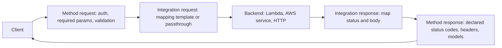

# 1.1.4 Create and maintain APIs, including request and response transformations and input validation

**Domain 1 · Task 1.1 · Skill 1.1.4** · [Task overview](README.md) · Previous: [1.1.3 Resilience, retries, and backoff](1.1.3-resilience-retries-and-backoff.md) · Next: [1.1.5 AWS SDKs and service APIs](1.1.5-aws-sdks-and-service-apis.md)

## What the exam expects

This skill is mostly Amazon API Gateway. Questions ask which application programming interface (API) type to build, which integration type fits, how to reshape a request or response without changing the backend, how to reject bad input before it costs a Lambda invocation, and why a working function still returns `502` to clients. Maintaining an API adds deployments, throttling, usage plans, and versioning.

You must be able to:

- Choose a Representational State Transfer (REST) API, HTTP API, or WebSocket API, and an endpoint type.
- Choose an integration type: Lambda proxy, Lambda or AWS service with mapping templates, HTTP proxy, HTTP, or mock.
- Return the exact Lambda proxy response shape and set Cross-Origin Resource Sharing (CORS) headers.
- Write Velocity Template Language (VTL) mapping templates and HTTP API parameter mappings.
- Validate requests with request validators and JavaScript Object Notation (JSON) Schema models, and customize the error responses.
- Maintain an API: deploy to stages, throttle, meter with usage plans and API keys, and version.

## Key terms

| Term | Meaning |
|---|---|
| Resource and method | A path (`/orders/{id}`) and an HTTP verb on it (`GET`). |
| Method request / method response | The client-facing contract: required parameters, models, status codes. |
| Integration request / integration response | The backend-facing side: how API Gateway calls the backend and maps its reply. |
| Proxy integration | API Gateway passes the whole request through and returns the backend's response as-is. No mapping templates. |
| Mapping template | A VTL script that rewrites a request or response body (REST APIs). |
| Model | A JSON Schema (draft 4) describing a request or response body. |
| Request validator | A setting that tells API Gateway to check required parameters, the body, or both. |
| Gateway response | The response API Gateway itself sends for errors such as a failed validation or missing authentication. |
| Stage | A named, deployed snapshot of an API (`dev`, `prod`) with its own settings and URL. |
| Usage plan / API key | Per-client throttling and quota limits, identified by a key in the `x-api-key` header. |

## Choose an API type

| | REST API | HTTP API | WebSocket API |
|---|---|---|---|
| Model | Request/response | Request/response | Persistent two-way connection |
| Cost and latency | Higher | Lower and cheaper | Per message and connection minute |
| Request validation and models | Yes | No (validate in code) | Route-level models |
| VTL mapping templates | Yes | No; parameter mapping instead | Yes |
| Usage plans and API keys | Yes | No | No |
| Caching | Yes | No | No |
| Resource policies | Yes | No | No |
| AWS WAF (web application firewall) | Yes | No | No |
| Authorizers | AWS Identity and Access Management (IAM), Amazon Cognito user pools, Lambda | IAM, Lambda, native JSON Web Token (JWT) authorizers (OpenID Connect and OAuth 2.0, including Cognito) | IAM, Lambda |
| CORS | Configure `OPTIONS` (or return headers from a proxy backend) | Built-in CORS configuration | n/a |
| Integration timeout | 29 seconds default; Regional and private can request more | 30 seconds maximum | 29 seconds |

Rule of thumb: an HTTP API for the cheapest, simplest Lambda or HTTP proxy with JWT auth. A REST API when the scenario mentions request validation, mapping templates, usage plans, API keys, caching, resource policies, AWS WAF, private endpoints, or canary releases. A WebSocket API when the server must push.

### Endpoint types (REST APIs)

| Type | For | How |
|---|---|---|
| Edge-optimized (default) | Clients worldwide | Routed through CloudFront points of presence; the API still lives in one Region |
| Regional | Clients in the same Region, or your own CloudFront distribution | Direct Regional endpoint |
| Private | Callers inside your virtual private cloud (VPC) only | Interface VPC endpoint plus a resource policy |

Custom domain names, certificates, and stage URLs are covered in [3.1.5](../../domain-3-testing-and-deployment/task-3.1-prepare-deployable-artifacts/3.1.5-api-gateway-stages-and-endpoints.md).

## How a REST API request flows



Validation and authorization happen at the method request, before the backend is called. Transformations happen in the integration request and integration response. Proxy integrations skip both mapping steps.


*Source: [What is Amazon API Gateway?](https://docs.aws.amazon.com/apigateway/latest/developerguide/welcome.html). API Gateway is not Lambda-only: integrations can target any AWS service API, an Application Load Balancer, or any HTTP endpoint.*

## Integration types

| Type | Behavior | Mapping templates | Typical use |
|---|---|---|---|
| `AWS_PROXY` (Lambda proxy) | Whole request becomes the Lambda event; the function builds the response | No | Most serverless APIs |
| `AWS` (Lambda custom or any AWS service) | You map the request to the service's API and map its response back | Yes | API Gateway to Amazon Simple Queue Service (SQS), DynamoDB, Kinesis, Step Functions with no Lambda |
| `HTTP_PROXY` | Request forwarded to an HTTP backend; response returned unchanged | No (headers can be added) | Front an Application Load Balancer (ALB), Elastic Beanstalk, or on-premises API |
| `HTTP` | HTTP backend with request and response mapping | Yes | Reshape for a legacy backend, JSON to Extensible Markup Language (XML) |
| `MOCK` | API Gateway answers without a backend | Response mapping only | Prototypes, contract tests, CORS preflight; see [3.2.2](../../domain-3-testing-and-deployment/task-3.2-test-applications/3.2.2-mock-apis.md) |

Private backends in a VPC (an internal Network Load Balancer or ALB) are reached through a VPC link.

## Lambda proxy integration contract

The event contains the method, path, `headers`, `multiValueHeaders`, `queryStringParameters`, `pathParameters`, `stageVariables`, `requestContext` (request ID, identity, authorizer claims), `body` as a **string**, and `isBase64Encoded`. The function must return:

```json
{
  "isBase64Encoded": false,
  "statusCode": 200,
  "headers": { "Content-Type": "application/json", "Access-Control-Allow-Origin": "https://www.example.com" },
  "multiValueHeaders": { "Set-Cookie": ["a=1", "b=2"] },
  "body": "{\"orderId\": \"abc-123\"}"
}
```

`headers` and `multiValueHeaders` are optional. `body` must be a string. If the output has a different format, API Gateway returns `502 Bad Gateway` to the client while the function's logs show success.

```python
import json

def handler(event, context):
    payload = json.loads(event.get("body") or "{}")          # body arrives as a string
    if "item" not in payload:
        return {"statusCode": 400, "body": json.dumps({"error": "item is required"})}
    result = {"orderId": "abc-123", "item": payload["item"]}
    return {
        "statusCode": 201,
        "headers": {"Content-Type": "application/json", "Access-Control-Allow-Origin": "*"},
        "body": json.dumps(result),                            # must be a string
    }
```

Binary responses: base64-encode the body, set `isBase64Encoded: true`, and add the content type (or `*/*`) to the API's binary media types. Serialization details are in [1.1.7](1.1.7-serialization-and-deserialization.md).

### Worked scenario: a 502 with clean logs

A function behind a Lambda proxy integration completes without errors, yet every client receives `502`. Isolate the layer before changing anything.

```bash
# 1. Invoke the function directly and inspect the returned payload
aws lambda invoke --function-name OrdersHandler \
  --payload '{"queryStringParameters":{"userId":"u1"}}' \
  --cli-binary-format raw-in-base64-out out.json && cat out.json
# {"statusCode": 200, "body": {"orderId": "abc-123", "item": "widget"}}   <- body is an object
```

The fix is `"body": json.dumps(result)`. Re-invoke directly to confirm the body is now a string, then call the stage URL end to end:

```bash
curl -s -o /dev/null -w "%{http_code}\n" \
  "https://abc123.execute-api.us-east-1.amazonaws.com/prod/orders?userId=u1"
# 200
```

Invoking the function directly first separates a function bug from an API Gateway contract bug. More debugging technique is in [4.1.1](../../domain-4-troubleshooting-and-optimization/task-4.1-root-cause-analysis/4.1.1-debugging-code-and-integrations.md).

## Request and response transformations

### REST API mapping templates (VTL)

Mapping templates are attached per content type to the integration request or integration response of non-proxy (`AWS`, `HTTP`) integrations. They can rename and move parameters, reshape or filter the body, add values from context or stage variables, and convert between JSON and XML.

| VTL expression | Returns |
|---|---|
| `$input.body` | Raw request body |
| `$input.json('$.field')` | A JSONPath value as JSON |
| `$input.path('$.field')` | A JSONPath value as an object you can loop over |
| `$input.params('name')` | A path, query string, or header parameter by name |
| `$context.requestId`, `$context.identity.sourceIp`, `$context.authorizer.claims.sub` | Request context |
| `$stageVariables.name` | Stage variable value |
| `$util.escapeJavaScript()`, `$util.urlEncode()`, `$util.base64Encode()`, `$util.parseJson()` | Helper functions |

Rename query string parameters for a backend:

```velocity
## GET /path?name=foo&other=bar  ->  {"my_variable": "foo", "other_variable": "bar"}
{
  "my_variable": "$input.params('name')",
  "other_variable": "$input.params('other')"
}
```

Filter a backend response down to the fields the client needs:

```velocity
#set($items = $input.path('$.Items'))
{
  "orders": [
#foreach($i in $items)
    { "id": "$i.orderId.S", "status": "$i.status.S" }#if($foreach.hasNext),#end
#end
  ]
}
```

Write to SQS with no Lambda (AWS service integration, `POST` to the queue path, `Content-Type: application/x-www-form-urlencoded` set on the integration request):

```velocity
Action=SendMessage&MessageBody=$util.urlEncode($input.body)
```

**JSON client, SOAP (Simple Object Access Protocol) or XML backend.** Extract values from the request with `$input`, build the SOAP envelope in the integration request template, call the backend, then convert the XML reply to JSON in the integration response template. The backend stays unchanged.

**Integration response mapping.** Map backend results to method responses with a selection pattern: a regular expression matched against the HTTP status (HTTP integrations) or the Lambda error message (Lambda custom integrations). For example, an error message matching `.*NotFound.*` maps to a `404` method response with its own template.

**Passthrough behavior** controls payloads whose `Content-Type` has no template:

| Setting | No templates defined | Templates exist but none match |
|---|---|---|
| `WHEN_NO_MATCH` | Pass through | Pass through unchanged |
| `WHEN_NO_TEMPLATES` (recommended) | Pass through | Reject with `415 Unsupported Media Type` |
| `NEVER` | Reject with `415` | Reject with `415` |

Limits: 300 KB per mapping template and 1,000 iterations in a `#foreach` loop.

### HTTP API parameter mapping

HTTP APIs do not support VTL. Parameter mapping can append, overwrite, or remove headers, query strings, and the request path on the way in, and headers and status codes on the way out, using values such as `$request.header.name`, `$request.querystring.name`, `$context.requestId`, and static strings. Body reshaping on an HTTP API needs backend code.

## Input validation

### Request validators and models (REST APIs)

API Gateway can validate a request before calling the integration. On failure it returns `400` immediately, writes the result to CloudWatch Logs, and the backend never runs, so you pay for no Lambda invocation.

| Check | What it verifies |
|---|---|
| Request parameters | Required path, query string, and header parameters are present and not blank. It checks existence only, not type or format. |
| Request body | The body matches the JSON Schema draft 4 model configured for the request's content type. If no model matches the content type, the body is not validated. Use the `$default` content type to apply one model to all. |

Validators: body only, parameters only, or both. You attach a validator to a method and mark parameters as required in the method request.

```json
{
  "$schema": "http://json-schema.org/draft-04/schema#",
  "title": "CreateOrder",
  "type": "object",
  "required": ["item", "quantity"],
  "properties": {
    "item": { "type": "string", "minLength": 1 },
    "quantity": { "type": "integer", "minimum": 1, "maximum": 100 },
    "email": { "type": "string", "pattern": "^[^@]+@[^@]+$" }
  },
  "additionalProperties": false
}
```

Define validators in an OpenAPI definition with API Gateway extensions:

```yaml
x-amazon-apigateway-request-validators:
  all:
    validateRequestBody: true
    validateRequestParameters: true
  params-only:
    validateRequestBody: false
    validateRequestParameters: true
x-amazon-apigateway-request-validator: params-only   # API-wide default
paths:
  /orders:
    post:
      x-amazon-apigateway-request-validator: all      # per-method override
```

Models also drive generated client SDKs and can be used in mapping templates.

### Customize error responses with gateway responses

Gateway responses control what API Gateway itself returns for errors such as `BAD_REQUEST_BODY`, `MISSING_AUTHENTICATION_TOKEN`, `ACCESS_DENIED`, `THROTTLED`, `DEFAULT_4XX`, and `DEFAULT_5XX`. Common uses:

- Add `Access-Control-Allow-Origin` to `DEFAULT_4XX` and `DEFAULT_5XX` so browsers can read error bodies.
- Return the validation detail with `$context.error.validationErrorString` in the `BAD_REQUEST_BODY` template.

### Validation in code

Gateway validation is a first filter. Business rules (the item exists, the user may order it, stock is available) still belong in the backend. On HTTP APIs, all body validation is in code.

## CORS

A browser calling an API on another origin sends a preflight `OPTIONS` request. The response must include `Access-Control-Allow-Origin`, `Access-Control-Allow-Methods`, and `Access-Control-Allow-Headers`.

- REST API with non-proxy integrations: "Enable CORS" adds a mock `OPTIONS` method and the response headers.
- REST API with a Lambda or HTTP proxy integration: the backend must return `Access-Control-Allow-Origin` on the actual responses. Enabling CORS in the console only covers `OPTIONS`.
- HTTP API: configure CORS on the API and API Gateway answers preflight requests.
- Add CORS headers to gateway responses too, or browser clients see opaque errors on `4XX` and `5XX`.

## Maintain an API

### Deployments, stages, and versions

- Changes in API Gateway are not live until you create a deployment to a stage. "I changed the API but clients see the old behavior" means nobody deployed.
- Each stage has its own settings (throttling, logging, caching, stage variables) and keeps a deployment history for rollback.
- Breaking change: publish a new version on a new stage or base path (`/v1`, `/v2`) and keep the old one running for existing clients.
- Stage variables (`${stageVariables.lambdaAlias}`) point one API definition at different Lambda aliases or HTTP endpoints per stage. API Gateway needs permission to invoke each alias.
- Canary releases send a percentage of a stage's traffic to a new deployment with separate metrics and logs.

Stages and endpoints are covered in [3.1.5](../../domain-3-testing-and-deployment/task-3.1-prepare-deployable-artifacts/3.1.5-api-gateway-stages-and-endpoints.md); canary strategy in [3.3.6](../../domain-3-testing-and-deployment/task-3.3-deploy-with-ci-cd/3.3.6-deployment-strategies.md).

### Define APIs as code

Import and export OpenAPI 3.0 (or Swagger 2.0) definitions in YAML (YAML Ain't Markup Language) or JSON, with `x-amazon-apigateway-*` extensions for integrations, validators, and authorizers. API Gateway can also generate client SDKs (JavaScript, Android, iOS, Java, Ruby) from a stage. AWS Serverless Application Model (AWS SAM) and AWS CloudFormation can embed the same OpenAPI definition.

### Throttling, usage plans, and API keys

- Account default: 10,000 requests per second per Region with a burst of 5,000 (token bucket). Throttled requests get `429 Too Many Requests`, which clients should retry with backoff.
- Set stage-level and method-level throttles so one noisy API cannot consume the account limit.
- Usage plans give each client its own throttle and quota (requests per day, week, or month). Order of setup: create the API and mark methods as requiring an API key, deploy to a stage; create or import API keys; create the usage plan; associate the stage and the keys with the plan.
- Clients send the key in the `x-api-key` header. A key that is not associated with a usage plan gets `403`.
- API keys identify and meter callers. They are not authentication; pair them with IAM, Cognito, or a Lambda authorizer.

### Caching (REST APIs)

Stage-level cache, 0.5 GB to 237 GB, default time to live (TTL) 300 seconds (0 to 3,600), overridable per method, with optional encryption. Clients can bypass with `Cache-Control: max-age=0` if allowed by `execute-api:InvalidateCache`; require authorization or any client can flush entries. Caching strategy is in [4.3.4](../../domain-4-troubleshooting-and-optimization/task-4.3-optimize-applications/4.3.4-caching-for-performance.md).

### Authorization at a glance

| Option | Use when |
|---|---|
| IAM (SigV4) | Callers are AWS principals (services, roles, other accounts with a resource policy) |
| Cognito user pool authorizer (REST) or JWT authorizer (HTTP) | Your app's own users, including social sign-in |
| Lambda authorizer | Third-party tokens or custom logic; returns an IAM policy that API Gateway caches |
| Resource policy (REST) | Allow or deny by account, source Internet Protocol (IP) address, or VPC endpoint |

Details are in [2.1.1](../../domain-2-security/task-2.1-authentication-and-authorization/2.1.1-identity-federation.md) and [2.1.5](../../domain-2-security/task-2.1-authentication-and-authorization/2.1.5-authenticated-requests.md).

### Errors and metrics to recognize

| Code | Usual cause |
|---|---|
| 400 | Failed request validation |
| 403 | Missing or invalid auth, AWS WAF block, resource policy deny, API key not in a usage plan |
| 415 | Unsupported content type under `WHEN_NO_TEMPLATES` or `NEVER` passthrough |
| 429 | Throttled or usage plan quota exceeded |
| 502 | Malformed Lambda proxy response |
| 504 | Integration timeout (29 seconds by default) |

`Latency` is total time in API Gateway, including `IntegrationLatency` (time waiting for the backend). High `Latency` with low `IntegrationLatency` points at API Gateway work such as authorizers or mapping. Monitoring is covered in Domain 4.

### Response streaming and payload limits

REST API payloads are capped at 10 MB. For Lambda proxy and HTTP proxy integrations, response streaming sends the response progressively for up to 15 minutes, which also avoids the wait for a complete response within 29 seconds. Idle timeouts still apply: 5 minutes for Regional and private endpoints, 30 seconds for edge-optimized.

## WebSocket APIs

- Clients connect to `wss://{api-id}.execute-api.{region}.amazonaws.com/{stage}`. The `$connect` route runs (often a Lambda function that stores the `connectionId` in DynamoDB); `$disconnect` runs when the connection closes.
- Messages are routed by a route selection expression such as `$request.body.action`. A message `{"action": "join", ...}` goes to the `join` route; no match goes to `$default`.
- The backend pushes to a client with a SigV4-signed request to `https://{api-id}.execute-api.{region}.amazonaws.com/{stage}/@connections/{connectionId}`: `POST` sends a message, `GET` returns connection status, `DELETE` disconnects.

## Exam triggers

| Scenario clue | Answer | Why the alternatives are wrong |
|---|---|---|
| "Reject requests missing required fields before Lambda runs" | Request validator with a JSON Schema model | Validating in Lambda still pays for the invocation |
| "Legacy XML or SOAP backend, JSON clients, no new compute" | Non-proxy integration with VTL mapping templates | Lambda proxy has no mapping templates; CORS and usage plans do not transform |
| "Rename or reshape request fields without changing the backend" | Integration request mapping template | Changing the backend contradicts the requirement |
| "Function logs success; clients get 502" | Return `statusCode` and a string `body` | IAM problems show as 403 or 500, not 502 after success |
| "Browser CORS error with Lambda proxy" | Return `Access-Control-Allow-Origin` from the function, plus `OPTIONS` | Console "Enable CORS" alone covers only preflight |
| "Write requests to SQS or DynamoDB without Lambda" | AWS service integration with a mapping template | Lambda in the path adds cost and latency |
| "Cheapest Lambda proxy API with JWT auth" | HTTP API | REST costs more for features not used |
| "Need usage plans, caching, validation, or resource policies" | REST API | HTTP APIs lack these |
| "Changed the API, clients see old behavior" | Create a deployment to the stage | Clearing the cache does not publish changes |
| "Charge customers per tier with per-client limits" | Usage plans plus API keys (`x-api-key`) | Stage throttling applies to every caller equally |
| "New API key gets 403" | Associate the key with a usage plan (`CreateUsagePlanKey`) | Rotating the key does not add it to a plan |
| "Error responses lack CORS headers" | Add headers to gateway responses `DEFAULT_4XX` and `DEFAULT_5XX` | Function headers do not apply to errors API Gateway generates |
| "Server pushes live updates to browsers" | WebSocket API and `@connections` | REST and HTTP APIs cannot push |
| "Stream a long model response to the client" | REST API response streaming or a Lambda function URL with `RESPONSE_STREAM` | Buffered responses wait for completion and hit timeouts |

## Common traps

- Lambda proxy `body` must be a string. An object, or a missing `statusCode`, returns 502.
- With proxy integrations, mapping templates do not apply and CORS headers must come from the backend.
- Request parameter validation checks presence only. Type and format checks need a body model.
- A body model is skipped if the request's content type has no model and no `$default` model.
- HTTP APIs have no request validation, no VTL, no usage plans, no caching.
- API keys are not authentication.
- The integration timeout is 29 seconds by default; Regional and private REST APIs can request an increase, edge-optimized cannot. Long work should be asynchronous or streamed.
- Unauthorized cache invalidation is possible unless you require authorization for `Cache-Control: max-age=0`.
- Edits are not live until deployed to a stage.

## Quick recall

- Integration types: `AWS_PROXY`, `AWS`, `HTTP_PROXY`, `HTTP`, `MOCK`. Mapping templates only on `AWS` and `HTTP`.
- Lambda proxy response: `statusCode`, optional `headers` and `multiValueHeaders`, string `body`, `isBase64Encoded`.
- VTL: `$input.json`, `$input.path`, `$input.params`, `$context`, `$stageVariables`, `$util`.
- Validators: parameters (presence) and body (JSON Schema draft 4); failure returns 400 without calling the backend.
- Passthrough `WHEN_NO_TEMPLATES` rejects unmapped content types with 415 when templates exist.
- Gateway responses customize API Gateway's own errors.
- 10,000 requests per second, 5,000 burst, 429 when throttled; payload 10 MB; integration timeout 29 seconds by default.
- Usage plan setup order: API and stage, keys, plan, associate. Key goes in `x-api-key`.
- WebSocket: `$connect`, `$disconnect`, `$default`, route selection expression, `@connections` POST, GET, DELETE.

## Related skills

- [1.1.2 Communication patterns](1.1.2-communication-patterns.md): synchronous and asynchronous API patterns.
- [1.1.7 Serialization and deserialization](1.1.7-serialization-and-deserialization.md): JSON strings, base64, and binary payloads in proxy events.
- [1.2.4 Lambda service integrations](../task-1.2-develop-lambda-functions/1.2.4-lambda-service-integrations.md): invoking Lambda from API Gateway and resource-based permissions.
- [2.1.5 Authenticated requests](../../domain-2-security/task-2.1-authentication-and-authorization/2.1.5-authenticated-requests.md): IAM, Cognito, and Lambda authorizers.
- [3.1.5 API Gateway stages and endpoints](../../domain-3-testing-and-deployment/task-3.1-prepare-deployable-artifacts/3.1.5-api-gateway-stages-and-endpoints.md): stages, stage variables, custom domains.
- [3.2.2 Mock APIs](../../domain-3-testing-and-deployment/task-3.2-test-applications/3.2.2-mock-apis.md): `MOCK` integrations for testing.
- [4.3.4 Caching for performance](../../domain-4-troubleshooting-and-optimization/task-4.3-optimize-applications/4.3.4-caching-for-performance.md): API Gateway caching in depth.

## Sources

- Merged from: `archive/dva-c03-study-notes/01-development-with-aws-services.md` (API Gateway section, gotchas), `archive/aws-dva-notes/Markdown Files/20. Serverless - API Gateway.md` (integrations, mapping templates, validation, caching, usage plans, errors, CORS, HTTP versus REST, WebSocket), `archive/dva-c03/domain-1-development/MASTER-CHUNK.md` (API Gateway), `archive/dva-c03/domain-1-development/README.md` (502 debugging scenario, API Gateway image), `archive/aws-dva-notes/Markdown Files/31. Exam Day Cheat Sheet.md` (request flow, 403 for keys without a usage plan), `archive/dva-c03-study-notes/05-cheat-sheet.md`, `archive/dva-c03/exam-bank/bank-1.md` (traps only).
- AWS documentation: [Lambda proxy integrations in API Gateway](https://docs.aws.amazon.com/apigateway/latest/developerguide/set-up-lambda-proxy-integrations.html) (event and output format, 502 on other formats, CORS header requirement)
- AWS documentation: [Request validation for REST APIs in API Gateway](https://docs.aws.amazon.com/apigateway/latest/developerguide/api-gateway-method-request-validation.html) (400 response, presence-only parameter checks, JSON Schema draft 4, `$default`)
- AWS documentation: [Method request behavior for payloads without mapping templates](https://docs.aws.amazon.com/apigateway/latest/developerguide/integration-passthrough-behaviors.html) (passthrough options and 415)
- AWS documentation: [Quotas for configuring and running a REST API in API Gateway](https://docs.aws.amazon.com/apigateway/latest/developerguide/api-gateway-execution-service-limits-table.html) (29-second timeout and increase, 10 MB payload, 300 KB templates, cache TTL)
- AWS documentation: [Quotas for configuring and running an HTTP API](https://docs.aws.amazon.com/apigateway/latest/developerguide/http-api-quotas.html)
- AWS documentation: [Stream the integration response for your proxy integrations](https://docs.aws.amazon.com/apigateway/latest/developerguide/response-transfer-mode.html)
- AWS documentation: [Throttle requests to your REST APIs](https://docs.aws.amazon.com/apigateway/latest/developerguide/api-gateway-request-throttling.html)
