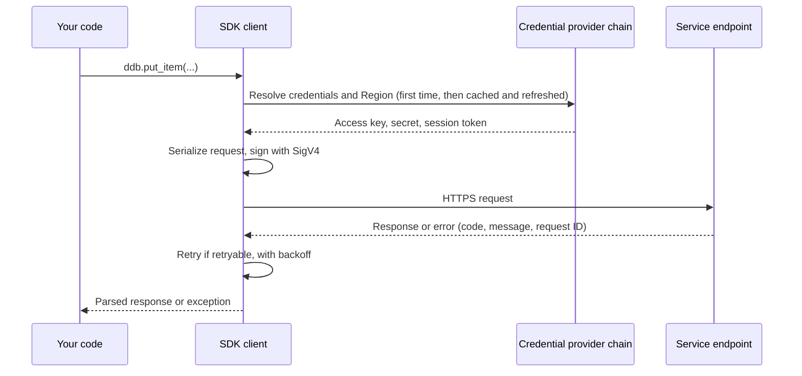
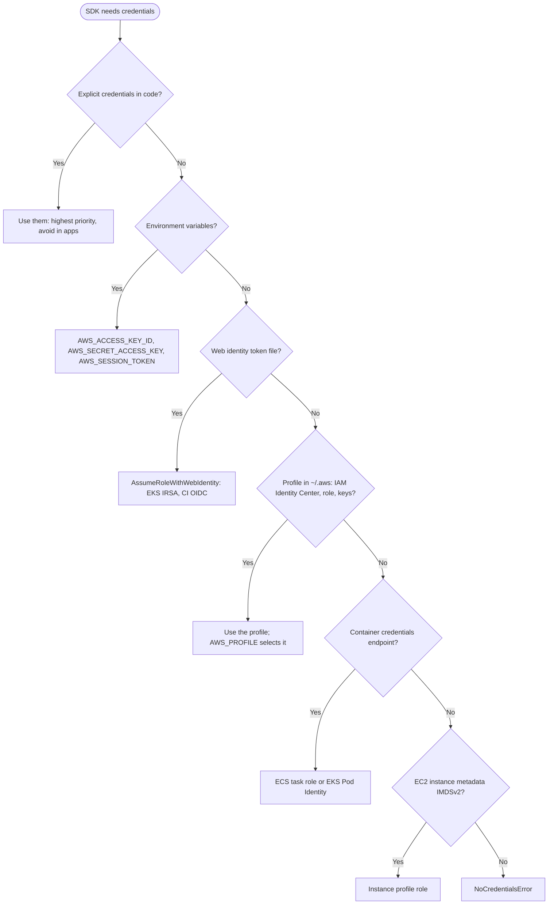

# 1.1.5 Call AWS services from application code through service APIs and AWS SDKs

**Domain 1 · Task 1.1 · Skill 1.1.5** · [Task overview](README.md) · Previous: [1.1.4 APIs, transformation, and validation](1.1.4-apis-transformation-and-validation.md) · Next: [1.1.6 Streaming data](1.1.6-streaming-data.md)

## What the exam expects

Every AWS action is a call to a service application programming interface (API) over Hypertext Transfer Protocol Secure (HTTPS). The console, the AWS Command Line Interface (CLI), and the AWS Software Development Kits (SDKs) all call the same service APIs. This skill tests whether you know what an SDK call does, what it returns, and what happens when it fails: where credentials and the Region come from, how to read every page of a result, how to wait for a resource, how to batch and handle partial failures, and how to handle service errors. The exam is SDK-agnostic; examples here use boto3 (Python) with notes for other SDKs.

You must be able to:

- Explain how an SDK finds credentials and a Region with no explicit configuration, and why hard-coded keys are always wrong.
- Use clients, higher-level abstractions, paginators, waiters, and batch operations correctly.
- Handle service errors by code, retry what is retryable, and treat partial batch failures.
- Reuse clients across Lambda invocations and set timeouts.
- Use CLI features that developers rely on: profiles, `--query`, `--output`, pagination flags, `--dry-run`, `--debug`, AWS CloudShell.

## Key terms

| Term | Meaning |
|---|---|
| Service API | The HTTPS operations a service exposes, such as `PutItem` or `SendMessage`. |
| SDK | A language library (boto3, AWS SDK for JavaScript v3, AWS SDK for Java 2.x, and others) that builds, signs, sends, retries, and parses API calls. |
| Client | A low-level SDK object with one method per API operation. |
| Credential provider chain | The ordered list of places an SDK checks for credentials; the first source that returns credentials wins. |
| Signature Version 4 (SigV4) | The signing process that proves the caller's identity and the request's integrity. SDKs and the CLI sign for you. |
| Paginator | An SDK helper that follows continuation tokens until all pages are read. |
| Waiter | An SDK helper that polls until a resource reaches a state, such as "bucket exists" or "table active". |
| Request ID | The ID AWS returns with every response; include it in logs and support cases. |

## How an SDK call works



Signing details matter only when you call a raw HTTPS endpoint yourself (for example, an API Gateway endpoint that uses AWS Identity and Access Management (IAM) authorization), where you must sign with SigV4. The signature goes in the `Authorization` header, or in the query string (`X-Amz-Signature`) for presigned URLs. See [2.1.5](../../domain-2-security/task-2.1-authentication-and-authorization/2.1.5-authenticated-requests.md).

## Credentials and Region

### The credential provider chain

The SDK checks sources in a fixed order and stops at the first that returns credentials. That is why the same `boto3.client("s3")` call works unchanged on a laptop, in AWS CodeBuild, in Lambda, and on Amazon Elastic Compute Cloud (EC2), each time with different credentials.



boto3's documented order is: parameters passed to `boto3.client()`, parameters passed to a `Session`, environment variables, assume-role provider, assume-role-with-web-identity provider, AWS IAM Identity Center provider, shared credentials file (`~/.aws/credentials`), console login session, AWS config file (`~/.aws/config`), legacy Boto2 config, container credential provider, and finally the EC2 instance metadata service. Other SDKs and the CLI follow the same shape: explicit settings, then environment variables, then shared files and profiles, then container credentials, then instance metadata. For the exam, know the shape and that the first match wins.

| Compute environment | Where credentials come from | What to configure |
|---|---|---|
| Lambda | Execution role. Lambda calls AWS Security Token Service (STS) for you and injects the three environment variables before your handler runs. | The function's execution role policy |
| Amazon Elastic Container Service (ECS) / AWS Fargate | Task role through the container credentials endpoint (`AWS_CONTAINER_CREDENTIALS_RELATIVE_URI`) | The task role (not the task execution role, which pulls images and writes logs) |
| Amazon Elastic Kubernetes Service (EKS) | IAM roles for service accounts (web identity token) or EKS Pod Identity | Service account or pod identity association |
| EC2 | Instance profile through the instance metadata service, version 2 (IMDSv2) | Instance profile role; require IMDSv2 |
| Developer laptop | `aws configure sso` profile with IAM Identity Center, or `aws login` console credentials | Short-lived profile credentials; no long-term keys |
| Continuous integration (CI) system outside AWS | OpenID Connect (OIDC) federation to a role | Role trust policy for the CI provider |

You can confirm which source fired:

```python
import boto3

creds = boto3.Session().get_credentials()
print(creds.method)   # "env", "shared-credentials-file", "sso", "container-role", "iam-role", "assume-role-with-web-identity"
```

**"Works on my machine" pattern.** A script that scans a DynamoDB table works locally and fails in Fargate with `AccessDenied ... assumed-role/AppTaskRole ... not authorized to perform: dynamodb:Scan`. Locally, `creds.method` is `shared-credentials-file` (the developer's identity). In Fargate it is `container-role` (the task role). The fix is adding `dynamodb:Scan` to the task role's policy. The code was never the problem.

Never hard-code access keys in code, a Dockerfile `ENV`, or committed config. On this exam that option is always wrong. Secure programmatic access, role assumption, and IMDSv2 details live in [2.1.3](../../domain-2-security/task-2.1-authentication-and-authorization/2.1.3-secure-programmatic-access.md) and [2.1.7](../../domain-2-security/task-2.1-authentication-and-authorization/2.1.7-assuming-iam-roles.md).

### Region resolution

The Region comes from client configuration, then `AWS_REGION` or `AWS_DEFAULT_REGION`, then the profile's `region` setting. Lambda sets `AWS_REGION` automatically. Outside AWS compute, if nothing sets a Region, boto3 raises `NoRegionError`; set one explicitly rather than relying on a default. A client calls one Region's endpoint; to work across Regions, create one client per Region.

## Using the SDK well

### Clients and higher-level abstractions

| Layer | Example | Notes |
|---|---|---|
| Low-level client | `boto3.client("dynamodb")`, `new DynamoDBClient({})` (JavaScript v3) | One method per API operation; DynamoDB values in typed JavaScript Object Notation (JSON) such as `{"S": "abc"}` |
| Higher-level abstraction | `boto3.resource("dynamodb").Table("Orders")`, `DynamoDBDocumentClient` (JavaScript v3), DynamoDB Enhanced Client (Java 2.x) | Converts native types; Python returns numbers as `Decimal` |
| Transfer helpers | Amazon Simple Storage Service (S3) Transfer Manager (`upload_file`, `download_file`) | Multipart and parallel transfers for large objects |
| Presigners | `generate_presigned_url` | Time-limited S3 URLs signed with the caller's credentials; see [2.1.4](../../domain-2-security/task-2.1-authentication-and-authorization/2.1.4-time-limited-access.md) |

Code written for the resource or document client does not work unchanged against the low-level client, because value shapes differ. See [1.1.7](1.1.7-serialization-and-deserialization.md).

The AWS SDK for JavaScript v3 is modular (one package per service, for example `@aws-sdk/client-s3`) and uses command objects: `await client.send(new PutObjectCommand({...}))`.

### Create clients once, outside the Lambda handler

```python
import boto3
from botocore.config import Config

# Init phase: runs once per execution environment, reused on warm invocations
ddb = boto3.client("dynamodb", config=Config(connect_timeout=2, read_timeout=5,
                                             retries={"mode": "standard"}))

def handler(event, context):
    return ddb.get_item(TableName="Orders", Key={"orderId": {"S": event["orderId"]}})
```

Creating the client inside the handler repeats credential resolution and Transport Layer Security (TLS) setup on every invocation and adds latency.

### Pagination

List, query, and scan operations return a page plus a continuation token (`NextToken`, `Marker`, `ContinuationToken`, or `LastEvaluatedKey`). S3 `ListObjectsV2` returns at most 1,000 keys per call. DynamoDB `Query` and `Scan` return at most 1 MB per call. Reading only the first page is the most common bug in sample code.

```python
s3 = boto3.client("s3")
keys = []
for page in s3.get_paginator("list_objects_v2").paginate(Bucket="my-bucket", Prefix="logs/"):
    keys.extend(o["Key"] for o in page.get("Contents", []))
```

JavaScript v3 has `paginateListObjectsV2(...)` async iterators. Symptom wording: "a Scan returns only some of the matching items" means the code ignores `LastEvaluatedKey`, not that DynamoDB is broken.

### Waiters

```python
s3.create_bucket(Bucket="my-new-bucket")
s3.get_waiter("bucket_exists").wait(Bucket="my-new-bucket")

ec2 = boto3.client("ec2")
ec2.get_waiter("instance_running").wait(InstanceIds=["i-0123456789abcdef0"])
```

Use a waiter instead of a hand-written `sleep` loop when code must wait for a resource to be ready: a DynamoDB table `ACTIVE`, an EC2 instance running, a CloudFormation stack complete.

### Batch operations and partial failures

| Operation | Per-call limit | Partial failure field |
|---|---|---|
| DynamoDB `BatchWriteItem` | 25 put or delete requests, 16 MB | `UnprocessedItems` |
| DynamoDB `BatchGetItem` | 100 items, 16 MB | `UnprocessedKeys` |
| Amazon Simple Queue Service (SQS) `SendMessageBatch`, `DeleteMessageBatch` | 10 messages | `Failed` |
| Amazon Simple Notification Service (SNS) `PublishBatch` | 10 messages | `Failed` |
| Kinesis `PutRecords` | 500 records, 5 MB | `FailedRecordCount` |
| EventBridge `PutEvents` | 10 entries | `FailedEntryCount` |
| Firehose `PutRecordBatch` | 500 records | `FailedPutCount` |

Batch calls return HTTP 200 even when some items fail. Check the failure field and retry only the failed items with exponential backoff. DynamoDB transactions (`TransactWriteItems`) are all-or-nothing and accept up to 100 actions (4 MB aggregate); see [1.3.4](../task-1.3-use-data-stores/1.3.4-dynamodb-design-and-operations.md).

### Error handling

```python
from botocore.exceptions import ClientError

try:
    ddb.put_item(TableName="Orders", Item=item,
                 ConditionExpression="attribute_not_exists(orderId)")
except ClientError as e:
    code = e.response["Error"]["Code"]
    request_id = e.response["ResponseMetadata"]["RequestId"]
    if code == "ConditionalCheckFailedException":
        ...                                   # expected business outcome: already exists
    elif code in ("ProvisionedThroughputExceededException", "ThrottlingException"):
        raise                                 # SDK retries already ran out; surface or queue it
    elif code == "AccessDeniedException":
        log.error("missing permission", extra={"request_id": request_id})
        raise
    else:
        raise
```

| Error code | Meaning | Action |
|---|---|---|
| `AccessDenied`, `AccessDeniedException`, `UnauthorizedOperation` | The resolved identity lacks permission | Fix the role policy; do not retry |
| `ExpiredToken`, `ExpiredTokenException` | Temporary credentials expired | Refresh through the provider chain |
| `ValidationException`, `InvalidParameterValue` | Request is malformed | Fix the request |
| `ResourceNotFoundException`, `NoSuchKey`, `NoSuchBucket` | Wrong name, Region, or account | Check the target and the client's Region |
| `ConditionalCheckFailedException` | A condition was false | Treat as a business result |
| `ThrottlingException`, `ProvisionedThroughputExceededException`, `TooManyRequestsException`, `SlowDown` | Rate limited | SDK retries with backoff; reduce rate, batch, spread keys, or raise limits |

Log the request ID with errors. Retry configuration is in [1.1.3](1.1.3-resilience-retries-and-backoff.md#retries-in-the-aws-sdks).

### Endpoint and client configuration

- Timeouts: `connect_timeout` and `read_timeout` in boto3 (60 seconds each by default) should be shorter than the caller's timeout.
- Endpoints: the SDK uses virtual private cloud (VPC) endpoints transparently through private Domain Name System (DNS) names; you can also set `endpoint_url` for local emulators or Federal Information Processing Standards (FIPS) and dual-stack endpoints.
- Connection reuse: keep-alive is on by default; reuse one client per service.
- Observability: SDK calls can be traced with AWS X-Ray or OpenTelemetry instrumentation; see [4.2.4](../../domain-4-troubleshooting-and-optimization/task-4.2-observability/4.2.4-distributed-tracing.md).

## The AWS CLI and AWS CloudShell

The CLI runs on botocore, the same core library as boto3, and uses the same credential chain, retry settings, and config files.

| Feature | Example | Use |
|---|---|---|
| Profiles | `aws s3 ls --profile dev`, `AWS_PROFILE=dev` | Switch accounts or roles |
| IAM Identity Center login | `aws configure sso`, `aws sso login` | Short-lived developer credentials |
| Filter output | `--query 'Reservations[].Instances[].InstanceId'` | JMESPath expression applied on the client |
| Output format | `--output json`, `table`, `text`, `yaml` | Scripting or reading |
| Pagination | `--max-items 100 --starting-token <token>`, `--page-size 50`, `--no-paginate` | The CLI paginates automatically; `--page-size` makes smaller calls to avoid timeouts |
| Permission check | `aws ec2 run-instances ... --dry-run` | Tests permission without making the change (EC2 operations) |
| Troubleshooting | `--debug` | Shows credential source, signed request, and raw response |
| Input format | `--cli-binary-format raw-in-base64-out` | Pass raw JSON payloads to `lambda invoke` in CLI v2 |
| Calls protected by multi-factor authentication (MFA) | `aws sts get-session-token --serial-number ... --token-code ...` | Get temporary credentials that satisfy an MFA condition; see [2.1.2](../../domain-2-security/task-2.1-authentication-and-authorization/2.1.2-access-controls-tokens-and-mfa.md) |

**AWS CloudShell** is a browser-based shell in the console, already authenticated as your console identity, with the CLI and common tools preinstalled and 1 GB of persistent home-directory storage per Region. It can run inside a VPC. Use it for quick API calls without installing or configuring anything locally.

## Exam triggers

| Scenario clue | Answer | Why the alternatives are wrong |
|---|---|---|
| "App on EC2 must not store access keys" | Instance profile role; the SDK gets it from the instance metadata service | Keys in code or env files are long-term secrets |
| "Code works locally, AccessDenied in Lambda or ECS" | Fix the execution or task role policy | The code and the developer's own permissions are not used in AWS |
| "NoCredentialsError in a local Docker container" | Pass credentials into the container (env vars or mounted profile) | No chain source exists inside the container |
| "Local development with single sign-on" | `aws configure sso` profile | Creating IAM user keys adds long-term secrets |
| "Wait until a resource is ready before continuing" | SDK waiter | Fixed sleeps are slow or too short |
| "List more than 1,000 S3 objects" or "Scan returns only part of the table" | Paginator, or follow the continuation token | Raising limits does not remove paging |
| "Write thousands of items efficiently" | `BatchWriteItem` and retry `UnprocessedItems` | Single `PutItem` calls add round trips; ignoring unprocessed items loses data |
| "Lambda latency high on every invocation" | Create SDK clients outside the handler | Per-invocation clients repeat setup |
| "Show only instance IDs from a CLI call" | `--query` with JMESPath | Piping through custom parsers is unnecessary |
| "Test whether you have permission without launching" | `--dry-run` | Launching and terminating costs money |
| "Run CLI commands in the browser without local setup" | AWS CloudShell | A bastion host needs provisioning and keys |

## Common traps

- Hard-coded access keys, in code or in a Dockerfile `ENV`, are always the wrong answer.
- Environment variables override the shared credentials file. An unexpected `AWS_ACCESS_KEY_ID` can mask the profile you meant to use.
- Lambda gets credentials from its execution role as environment variables; your code never calls `AssumeRole` for that.
- ECS task role (your app's permissions) and task execution role (image pull and log delivery) are different roles.
- Do not assume a default Region. Set one, or the SDK fails with a missing-Region error outside AWS compute.
- Batch APIs return success with partial failures inside the response.
- A paginated API's first page is not the whole result.
- Older notes say the SDK or CLI "defaults to us-east-1"; current SDKs require a Region to be configured.

## Quick recall

- Console, CLI, and SDKs all call the same signed HTTPS APIs.
- Credential chain shape: explicit, environment variables, web identity, profiles and IAM Identity Center, container role, instance metadata. First match wins.
- Lambda: execution role credentials as env vars. ECS: task role through the container endpoint. EC2: instance profile through IMDSv2.
- `creds.method` in boto3 shows which source fired.
- Create clients outside the Lambda handler; set connect and read timeouts.
- Paginators for lists; waiters for readiness; batch calls with retries of unprocessed items.
- `BatchWriteItem` 25, `BatchGetItem` 100, `PutRecords` 500, `PutEvents` 10, SQS batches 10.
- Handle `ClientError` by `Error.Code`; log the request ID.
- CLI: `--profile`, `--query`, `--output`, `--max-items`, `--page-size`, `--dry-run`, `--debug`; CloudShell for a preauthenticated browser shell.

## Related skills

- [1.1.3 Resilience, retries, and backoff](1.1.3-resilience-retries-and-backoff.md): SDK retry modes and handling throttling.
- [1.1.7 Serialization and deserialization](1.1.7-serialization-and-deserialization.md): DynamoDB typed JSON versus document clients, base64 payloads.
- [1.3.4 DynamoDB design and operations](../task-1.3-use-data-stores/1.3.4-dynamodb-design-and-operations.md): Query, Scan, batch, and transaction APIs.
- [2.1.3 Secure programmatic access](../../domain-2-security/task-2.1-authentication-and-authorization/2.1.3-secure-programmatic-access.md): credential sources, IMDSv2, avoiding long-term keys.
- [2.1.5 Authenticated requests](../../domain-2-security/task-2.1-authentication-and-authorization/2.1.5-authenticated-requests.md): SigV4 signing.
- [2.1.7 Assuming IAM roles](../../domain-2-security/task-2.1-authentication-and-authorization/2.1.7-assuming-iam-roles.md): `AssumeRole` and temporary credentials.

## Sources

- Merged from: `archive/dva-c03/domain-1-development/aws-sdk-credential-resolution-chain.md` (chain, Lambda mechanism, cross-SDK table, troubleshooting scenario), `archive/dva-c03-study-notes/01-development-with-aws-services.md` (SDK section), `archive/dva-c03/domain-1-development/README.md` (retries, pagination, batching), `archive/aws-dva-notes/Markdown Files/9. CLI, SDK, IAM Roles & Policies.md` (SDK overview, SigV4, limits), `archive/aws-dva-notes/Markdown Files/1. IAM & AWS CLI.md` (CLI, credential order, CloudShell), `archive/aws-dva-notes/Markdown Files/31. Exam Day Cheat Sheet.md` (CLI pagination, dry-run), `archive/dva-c03-study-notes/05-cheat-sheet.md`.
- AWS documentation: [Boto3 credentials](https://docs.aws.amazon.com/boto3/latest/guide/credentials.html) (documented provider order)
- AWS documentation: [Boto3 retries](https://docs.aws.amazon.com/boto3/latest/guide/retries.html)
