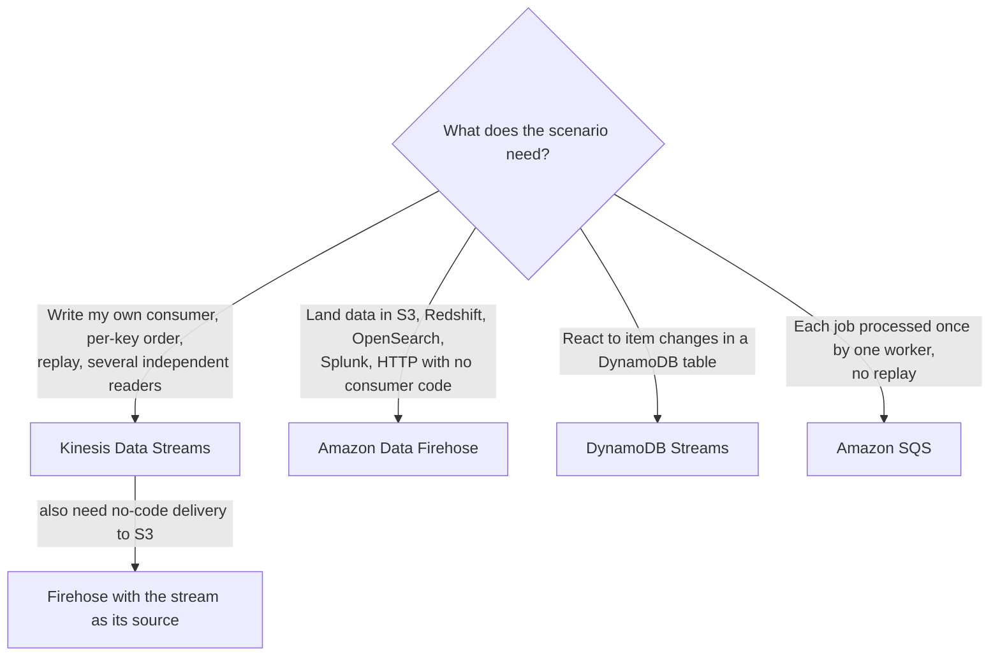

# 1.1.6 Process and manage streaming data with AWS services

**Domain 1 · Task 1.1 · Skill 1.1.6** · [Task overview](README.md) · Previous: [1.1.5 AWS SDKs and service APIs](1.1.5-aws-sdks-and-service-apis.md) · Next: [1.1.7 Serialization and deserialization](1.1.7-serialization-and-deserialization.md)

## What the exam expects

This skill tests whether you can pick the right streaming service and write producer and consumer code that respects its limits. Most questions turn on one distinction: Amazon Kinesis Data Streams (KDS) when you write the consumer and need ordering, replay, or several independent readers; Amazon Data Firehose when the data only has to land in a destination with no consumer code. The rest is shard math, partition keys, partial failures, and consumer lag.

You must be able to:

- Choose between Kinesis Data Streams, Data Firehose, DynamoDB Streams, and Amazon Simple Queue Service (SQS) from scenario wording.
- Design partition keys so per-key ordering holds and no shard runs hot.
- Write producers that retry only the failed records of a `PutRecords` batch.
- Configure consumers: Kinesis Client Library (KCL), Lambda event source mappings, and enhanced fan-out.
- Diagnose `ProvisionedThroughputExceededException` and a growing `IteratorAgeMilliseconds`.
- Transform records in flight with a Firehose Lambda function and return the right result format.

## Key terms

| Term | Meaning |
|---|---|
| Stream | An ordered, durable, replayable log of records. Consumers read at their own position; reading does not delete records. |
| Shard | The unit of capacity in a Kinesis data stream. Each shard is an ordered sequence of records. |
| Partition key | String the producer sends with each record. Kinesis hashes it to choose the shard. Same key, same shard, same order. |
| Sequence number | Unique, increasing ID Kinesis assigns to each record within a shard. |
| Shard iterator | Pointer to a position in a shard used by `GetRecords`. Expires 5 minutes after it is returned. |
| KPL / KCL | Kinesis Producer Library (batching, aggregation, retries) and Kinesis Client Library (shard leases and checkpoints for consumers). |
| Enhanced fan-out (EFO) | A registered consumer that gets its own 2 MB/s per shard, pushed over a Hypertext Transfer Protocol version 2 (HTTP/2) connection with `SubscribeToShard`. |
| Iterator age | `GetRecords.IteratorAgeMilliseconds`: how far behind the newest record a consumer is. The main consumer-lag metric. |
| Event source mapping (ESM) | Lambda resource that polls a stream or queue and invokes your function with batches. |
| Buffering hints | Firehose size and time thresholds that decide when a batch is written to the destination. |

## Which streaming service



| | Kinesis Data Streams | Amazon Data Firehose | DynamoDB Streams | SQS |
|---|---|---|---|---|
| Purpose | Collect and process streams with your own code | Load streams into destinations | Change log of one table | Work queue |
| Consumer code | You write it (KCL, Lambda ESM, or a software development kit (SDK)) | None, fully managed | Lambda ESM or KCL adapter | You write it |
| Latency | Real time (sub-second) | Near real time (buffered) | Real time | Seconds |
| Retention and replay | 24 hours default, up to 365 days; replay by position | No storage, no replay | 24 hours | Up to 14 days; deleted after processing, no replay |
| Ordering | Per shard (per partition key) | Not a design goal | Per item key | First-in, first-out (FIFO) queues only |
| Capacity | On-demand or provisioned shards | Automatic | Managed by DynamoDB | Automatic |
| Multiple readers of the same data | Yes | No | Up to 2 readers per shard recommended | No; each message goes to one consumer |

Former names still appear in questions: Data Firehose was "Kinesis Data Firehose", and Amazon Managed Service for Apache Flink was "Kinesis Data Analytics".

## Kinesis Data Streams


*Source: [Kinesis Data Streams key concepts](https://docs.aws.amazon.com/streams/latest/dev/key-concepts.html). Several consumer applications read the same records at their own pace. That is the main difference from SQS.*

### Capacity modes and limits

| | Provisioned | On-demand |
|---|---|---|
| Capacity | You choose the shard count and reshard (split or merge) yourself | No capacity planning; Kinesis manages shards |
| Write per shard | 1 MB/s or 1,000 records/s | Same per-shard limits apply underneath |
| Read per shard | 2 MB/s, 5 `GetRecords` calls/s, shared by all standard consumers | Same |
| Stream throughput | Sum of shards | New streams start at 4 MB/s write and 8 MB/s read; scale automatically to double the peak write throughput seen in the previous 30 days |
| Billing | Per shard-hour plus PUT payload units | Per GB written and read (plus a per-stream charge in On-demand Standard) |
| Fits | Predictable traffic, fine-grained shard control | Unpredictable or spiky traffic |

Other numbers to know:

- **Retention:** 24 hours by default, up to 365 days. Records cannot be deleted before they expire.
- **Record size:** default maximum 1 MiB per record. You can raise it per stream up to 10 MiB with `UpdateMaxRecordSize`. Per-shard throughput does not change, and AWS designs this for occasional large records, not sustained ones. Older material says 1 MB is a hard maximum.
- **`PutRecords`:** up to 500 records per request and up to 10 MiB per request including partition keys. Older material says 5 MB per request.
- **`GetRecords`:** up to 10,000 records or 10 MB per call. After a 10 MB call, calls in the next 5 seconds throw an exception.
- **Registered consumers (EFO):** up to 20 per stream, or 50 in the account-level On-demand Advantage mode.
- **On-demand throttling:** if write traffic more than doubles the previous peak within 15 minutes, writes can throttle until Kinesis scales. Retry throttled requests.
- **Encryption:** at rest with AWS Key Management Service (KMS), in transit with HTTPS.

Sizing a provisioned stream: `shards = ceiling(max(write_KiB_per_s / 1024, read_KiB_per_s / 2048))`, where read throughput is write throughput times the number of standard consumers.

### Producers

- `PutRecord` writes one record. `PutRecords` writes a batch and can **partially fail**: the call succeeds, `FailedRecordCount` is greater than zero, and failed entries carry an `ErrorCode` (`ProvisionedThroughputExceededException` or `InternalFailure`). Your code must resend only those entries.
- The KPL batches and aggregates records and retries for you. The Kinesis Agent tails log files and sends them.
- Choose a **high-cardinality partition key** (customer ID, device ID, order ID). A low-cardinality key such as a country code or a constant sends most traffic to one shard. The same "spread your keys" rule applies to DynamoDB partition keys in [1.3.4](../task-1.3-use-data-stores/1.3.4-dynamodb-design-and-operations.md).

```python
import json, random, time
import boto3

kinesis = boto3.client("kinesis")

def put_all(events, stream="orders"):
    entries = [
        {"Data": json.dumps(e).encode(), "PartitionKey": e["customerId"]}  # per-customer ordering
        for e in events
    ]
    for attempt in range(6):
        resp = kinesis.put_records(StreamName=stream, Records=entries)
        if resp["FailedRecordCount"] == 0:
            return
        # Keep only the entries whose result carries an ErrorCode, then back off with jitter
        entries = [e for e, r in zip(entries, resp["Records"]) if "ErrorCode" in r]
        time.sleep(min(2 ** attempt * 0.1, 5) + random.random() * 0.1)
    raise RuntimeError(f"{len(entries)} records still failing after retries")
```

Pass raw bytes in `Data`. The SDK base64-encodes the blob on the wire, so encoding it yourself produces double-encoded data. See [1.1.7](1.1.7-serialization-and-deserialization.md).

### Consumers

| Consumer type | How it reads | Throughput | Use when |
|---|---|---|---|
| Standard (shared) | Polls with `GetRecords` | 2 MB/s per shard shared by all standard consumers, 5 reads/s per shard | One or two consumers, cost matters |
| Enhanced fan-out | `SubscribeToShard` pushes records | 2 MB/s per shard **per consumer**, lower latency than polling | Many consumers, or consumers starving each other |
| KCL application | Workers take **leases** on shards and **checkpoint** progress in a DynamoDB table | Either mode | Custom consumer fleets on Amazon Elastic Compute Cloud (EC2), Amazon Elastic Container Service (ECS), or Amazon Elastic Kubernetes Service (EKS) |
| Lambda ESM | Lambda polls each shard and invokes the function with batches | Either mode (register an EFO consumer for the ESM if needed) | Serverless processing |

KCL details that show up as traps:

- KCL creates a **DynamoDB lease table** per application name. Throttling on that table slows the consumer, and the consumer's AWS Identity and Access Management (IAM) role needs DynamoDB permissions as well as Kinesis permissions.
- Each shard is leased to one worker at a time. More workers than shards leaves workers idle.

### Lambda as a stream consumer

The full event source mapping treatment lives in [1.2.3](../task-1.2-develop-lambda-functions/1.2.3-lambda-invocation-lifecycle-and-failures.md) and [1.2.4](../task-1.2-develop-lambda-functions/1.2.4-lambda-service-integrations.md). The stream-specific points:

- Lambda reads each shard **in order** and invokes the function synchronously with a batch. Processed records stay in the stream for other consumers.
- **Starting position:** `TRIM_HORIZON` (oldest), `LATEST` (new records only), or `AT_TIMESTAMP`.
- **Batching:** batch size and a batching window (up to 5 minutes) for low-traffic streams.
- **Parallelization factor:** up to 10 concurrent batches per shard. Ordering still holds per partition key.
- **Errors block the shard.** By default a failed batch is retried until it succeeds or the records expire, and that shard makes no progress meanwhile. Fix with `BisectBatchOnFunctionError`, `MaximumRetryAttempts`, `MaximumRecordAgeInSeconds`, an on-failure destination (SQS, an Amazon Simple Notification Service (SNS) topic, or an Amazon Simple Storage Service (S3) bucket), and `ReportBatchItemFailures`.
- **Tumbling windows** (up to 15 minutes) let a function carry aggregation state across invocations for one shard.
- **Event filtering** on the ESM drops records that do not match a pattern before your function runs.
- Record `data` arrives **base64-encoded** inside the event.

```python
import base64, json

def handler(event, context):
    for record in event["Records"]:
        try:
            payload = json.loads(base64.b64decode(record["kinesis"]["data"]))
            process(payload)
        except Exception:
            # With ReportBatchItemFailures, Lambda retries from this sequence number onward.
            # Returning the first failure keeps later records for the same shard in order.
            return {"batchItemFailures": [{"itemIdentifier": record["kinesis"]["sequenceNumber"]}]}
    return {"batchItemFailures": []}
```

Records larger than the 6 MB synchronous Lambda payload (possible once a stream allows records up to 10 MiB) cannot be delivered to the function. AWS routes them to the ESM's on-failure destination, so configure one.

### Errors and lag

| Symptom | Likely cause | Fix |
|---|---|---|
| `ProvisionedThroughputExceededException` on writes | Too few shards, or a hot partition key | More shards or on-demand mode, a better-distributed key, retry with exponential backoff and jitter |
| `ProvisionedThroughputExceededException` on reads | Too many standard consumers on a shard, or more than 5 `GetRecords` calls/s | Enhanced fan-out, fewer polling consumers, back off |
| `IteratorAgeMilliseconds` keeps growing | Consumer slower than producers, or a poison record blocking a shard | More shards, parallelization factor, EFO, faster code; bisect and max retries for poison records |
| Data unreadable in Lambda | Forgot to base64-decode | `base64.b64decode(record["kinesis"]["data"])` |
| Duplicate records downstream | Producer retries and at-least-once delivery | Idempotent consumers keyed on a business ID, see [1.1.3](1.1.3-resilience-retries-and-backoff.md) |
| Hot shard in on-demand mode | One partition key exceeds 1 MB/s or 1,000 records/s | On-demand splits shards evenly but does not isolate a hot key; change the key or use provisioned mode with targeted splits |

## Amazon Data Firehose

Firehose is managed delivery. You point it at a destination, and it buffers, optionally transforms, converts, compresses, and writes the data with no consumer application.


*Source: [What is Amazon Data Firehose](https://docs.aws.amazon.com/firehose/latest/dev/what-is-this-service.html). The backup bucket keeps the original records, so a bug in a transformation function does not lose data.*

- **Sources:** Direct PUT (`PutRecord`, `PutRecordBatch` with up to 500 records), a Kinesis data stream, CloudWatch Logs subscription filters, AWS IoT, SNS subscriptions, and others.
- **Destinations:** Amazon S3, Amazon Redshift (staged through S3 with a `COPY`), Amazon OpenSearch Service, Splunk, Snowflake, Apache Iceberg tables, custom HTTP endpoints, and third-party partners.
- **Buffering:** delivers when the size or time hint is reached, whichever comes first. Smaller buffers mean lower latency and more, smaller files.
- **Transformation:** Firehose invokes a Lambda function with a batch of records. The buffer sent to the function must fit the 6 MB synchronous payload limit.
- **Format conversion:** JavaScript Object Notation (JSON) to Apache Parquet or Optimized Row Columnar (ORC) (columnar formats that cut Athena scan cost), plus gzip or Snappy compression.
- **Dynamic partitioning:** route records to S3 prefixes based on fields in the data, for example `year=/month=/customer=`.
- **Backup:** all records or only failed ones to an S3 bucket.

### Firehose transformation contract

Each output record must carry the input `recordId`, a `result` of `Ok`, `Dropped`, or `ProcessingFailed`, and base64-encoded `data`. Any other shape fails with "Invalid output structure". `ProcessingFailed` records go to the error output prefix in S3.

```python
import base64, json, datetime

def handler(event, context):
    output = []
    for r in event["records"]:
        doc = json.loads(base64.b64decode(r["data"]))
        if doc.get("type") == "heartbeat":
            output.append({"recordId": r["recordId"], "result": "Dropped", "data": r["data"]})
            continue
        doc["ingestedAt"] = datetime.datetime.utcnow().isoformat() + "Z"
        line = (json.dumps(doc) + "\n").encode()          # newline-delimited JSON for Athena
        output.append({"recordId": r["recordId"], "result": "Ok",
                       "data": base64.b64encode(line).decode()})
    return {"records": output}
```

### Kinesis Data Streams plus Firehose

Firehose can use a Kinesis data stream as its source. One ingestion point then serves real-time custom consumers and a no-code archive to S3. Feeding the producer into two separate pipelines doubles cost and producer complexity for no benefit.

## DynamoDB Streams

- An ordered, item-level change log of a table (insert, modify, remove), kept for **24 hours**.
- **Stream view types:** `KEYS_ONLY`, `NEW_IMAGE`, `OLD_IMAGE`, `NEW_AND_OLD_IMAGES`. You need `OLD_IMAGE` or `NEW_AND_OLD_IMAGES` to see the value before a change.
- **Not retroactive:** changes made before you enabled the stream are not in it.
- Shards are created and managed by DynamoDB.
- Consumed by a Lambda ESM (execution role needs stream read permissions, for example the `AWSLambdaDynamoDBExecutionRole` managed policy) or a KCL application through the DynamoDB Streams Kinesis Adapter.
- Records use DynamoDB typed JSON (`{"S": "..."}`), so deserialize them. See [1.1.7](1.1.7-serialization-and-deserialization.md).
- Time to live (TTL) deletions appear in the stream with `userIdentity.principalId` of `dynamodb.amazonaws.com`, which lets you archive expired items. See [1.3.1](../task-1.3-use-data-stores/1.3.1-data-lifecycle-management.md).
- **Kinesis Data Streams for DynamoDB** sends table changes to a Kinesis stream instead, for longer retention and more consumers.

Common pipelines:

| Goal | Pipeline |
|---|---|
| Send a welcome email when a user signs up | Table, stream, Lambda (filter on `INSERT`), SNS or Amazon Simple Email Service (SES) |
| Full-text search over DynamoDB data | Table, stream, Lambda, OpenSearch; the app searches OpenSearch and reads full items from DynamoDB |
| Analytics and archive | Table, Kinesis Data Streams for DynamoDB, Firehose, S3 or Redshift |
| Derived or aggregate tables | Table, stream, Lambda writing to a second table |

## Querying and searching streamed data

- **Amazon OpenSearch Service:** full-text and partial-match search, log analytics. Fed by Firehose (near real time) or a Lambda consumer (real time).
- **Amazon Athena:** serverless Structured Query Language (SQL) over data that Firehose landed in S3. Pay per data scanned, so Parquet, compression, and partitioned prefixes cut cost.

> **Not on the DVA-C03 service list.** Amazon Managed Streaming for Apache Kafka (MSK) and Amazon Managed Service for Apache Flink are absent from the in-scope list. Recognize them as distractors. MSK is managed Apache Kafka (topics and partitions instead of streams and shards), the answer when a company "already uses Kafka". Managed Service for Apache Flink runs stream-processing applications that read from Kinesis Data Streams or MSK. It does not read from Firehose.

## Worked scenario: clickstream with three consumers

A media site emits page-view events. A dashboard needs them within a second, a fraud model must see each user's events in order, and the data lake needs every event in S3 as Parquet.

1. Producers call `PutRecords` on a Kinesis data stream with `userId` as the partition key, retrying failed entries.
2. The dashboard and the fraud model are two **enhanced fan-out** consumers, so neither slows the other.
3. A **Firehose** stream reads the same Kinesis stream, converts to Parquet, and writes to S3 with dynamic partitioning by date.
4. Alarms on `IteratorAgeMilliseconds` for each consumer and on `WriteProvisionedThroughputExceeded` for the stream.

Why not SQS: each message goes to one consumer, so three readers would need three queues fed separately, with no replay and no per-key ordering in standard queues.

## Exam triggers

| Scenario clue | Answer | Why the alternatives are wrong |
|---|---|---|
| Real-time, ordered per customer, several independent consumers, replay | Kinesis Data Streams with `customerId` partition key | SQS deletes messages after processing and has no replay; SNS keeps nothing |
| Deliver clickstream or logs to S3, Redshift, or OpenSearch with the least code | Data Firehose | A Kinesis consumer app is code you do not need to write |
| Also convert to Parquet and partition by a field | Firehose format conversion and dynamic partitioning | A custom Lambda pipeline duplicates built-in features |
| React to item changes in a DynamoDB table | DynamoDB Streams with a Lambda ESM | Polling the table with `Scan` is slow and costly |
| Need the item's value before the update | Stream view type `OLD_IMAGE` or `NEW_AND_OLD_IMAGES` | `NEW_IMAGE` and `KEYS_ONLY` do not include it |
| Many consumers on one stream are throttled on reads | Enhanced fan-out | More shards helps writes but standard consumers still share 2 MB/s per shard |
| Traffic unpredictable, team does not want to manage shards | On-demand capacity mode | Provisioned mode needs manual resharding |
| `PutRecords` returns 200 but some records are missing | Check `FailedRecordCount` and resend failed entries | The call does not throw on partial failure |
| `ProvisionedThroughputExceededException` on one shard while others are idle | Hot partition key; use a higher-cardinality key | Adding shards does not help if one key carries the load |
| Consumer falling behind | `IteratorAgeMilliseconds` rising; add shards, parallelization factor, or EFO | Raising Lambda memory alone rarely fixes a blocked shard |
| One bad record blocks the shard | Bisect batch, max retry attempts, max record age, on-failure destination | Default ESM retries until the record expires |
| Records in Lambda look like gibberish | Base64-decode `kinesis.data` | The data is not encrypted at that point |
| Existing Kafka workload, managed on AWS | MSK (not on the service list) | Kinesis would require rewriting producers and consumers |

## Common traps

- Firehose has no replay and no multiple-consumer read application programming interface (API). Anything that needs replay or several readers needs Kinesis Data Streams.
- Firehose is near real time because of buffering. "Sub-second" points to Kinesis Data Streams.
- `PutRecords` and `PutRecordBatch` report partial failures in the response body, not as exceptions.
- More shards do not fix a hot partition key. Neither does on-demand mode once a single key exceeds a shard's limits.
- A KCL consumer that cannot write to its DynamoDB lease table stalls. Check its IAM role and the table's capacity.
- DynamoDB Streams keep data for 24 hours only and are not retroactive.
- Base64 is encoding, not encryption. Kinesis data at rest is encrypted with KMS if you enable server-side encryption.
- A Firehose transformation function must return every `recordId` with a valid `result`. Missing records or other result values fail the batch.
- Raising a stream's maximum record size does not raise per-shard throughput, and downstream consumers such as Lambda (6 MB) may not accept the larger records.

## Quick recall

- Shard: 1 MB/s or 1,000 records/s in, 2 MB/s out, 5 `GetRecords` calls/s.
- On-demand: starts at 4 MB/s write, scales to double the 30-day peak.
- Retention 24 hours default, up to 365 days. DynamoDB Streams: 24 hours.
- `PutRecords`: 500 records, 10 MiB per request; retry entries with `ErrorCode`.
- Record size: 1 MiB default, up to 10 MiB per stream with `UpdateMaxRecordSize`.
- Enhanced fan-out: dedicated 2 MB/s per shard per consumer, up to 20 consumers per stream (50 with On-demand Advantage).
- Lambda ESM on streams: in order per shard, parallelization factor up to 10, errors block the shard.
- Firehose: buffered, managed, no replay; transformation returns `recordId`, `result`, base64 `data`.
- KCL checkpoints in a DynamoDB lease table.
- Consumer lag metric: `IteratorAgeMilliseconds`.

## Related skills

- [1.1.1 Coupling and decoupling](1.1.1-coupling-and-decoupling.md): when a stream is the right decoupler compared with a queue or topic.
- [1.1.3 Resilience, retries, and backoff](1.1.3-resilience-retries-and-backoff.md): backoff with jitter and idempotent consumers for at-least-once streams.
- [1.1.7 Serialization and deserialization](1.1.7-serialization-and-deserialization.md): base64 record data and DynamoDB typed JSON in stream records.
- [1.1.8 Event-driven applications](1.1.8-event-driven-applications.md): events versus streams, and DynamoDB Streams in event-driven designs.
- [1.2.3 Lambda invocation lifecycle and failures](../task-1.2-develop-lambda-functions/1.2.3-lambda-invocation-lifecycle-and-failures.md): ESM retries, bisect, and on-failure destinations.
- [1.2.4 Lambda service integrations](../task-1.2-develop-lambda-functions/1.2.4-lambda-service-integrations.md): ESM configuration and permissions.
- [1.3.1 Data lifecycle management](../task-1.3-use-data-stores/1.3.1-data-lifecycle-management.md): stream retention periods and TTL deletes in DynamoDB Streams.
- [1.3.4 DynamoDB design and operations](../task-1.3-use-data-stores/1.3.4-dynamodb-design-and-operations.md): the same high-cardinality key rule.
- [4.3.3 Messaging optimization](../../domain-4-troubleshooting-and-optimization/task-4.3-optimize-applications/4.3.3-messaging-optimization.md): tuning throughput and delivery patterns.

## Sources

- Merged from: `archive/dva-c03-study-notes/01-development-with-aws-services.md` (skill 1.1.6), `archive/dva-c03-study-notes/00-developer-basics.md`, `archive/dva-c03-study-notes/05-cheat-sheet.md`, `archive/dva-c03/domain-1-development/README.md`, `archive/dva-c03/domain-1-development/MASTER-CHUNK.md` (Data Firehose, Kinesis family, messaging patterns), `archive/dva-c03/domain-1-development/lambda-event-source-mapping-deep-dive.md`, `archive/aws-dva-notes/Markdown Files/16. Messaging - SQS, SNS & Kinesis.md`, `archive/aws-dva-notes/Markdown Files/18. Serverless - Lambda.md`, `archive/aws-dva-notes/Markdown Files/19. Serverless - DynamoDB.md`, `archive/aws-dva-notes/Markdown Files/28. Other Services.md`, traps from `archive/dva-c03/exam-bank/bank-1.md` and `archive/dva-c03/practice-questions/`.
- AWS documentation: [Kinesis Data Streams quotas and limits](https://docs.aws.amazon.com/streams/latest/dev/service-sizes-and-limits.html)
- AWS documentation: [Handle large records](https://docs.aws.amazon.com/streams/latest/dev/large-records.html)
- AWS documentation: [Choose the right mode to stream in](https://docs.aws.amazon.com/streams/latest/dev/how-do-i-size-a-stream.html)
- AWS documentation: [Kinesis Data Streams key concepts](https://docs.aws.amazon.com/streams/latest/dev/key-concepts.html)
- AWS documentation: [What is Amazon Data Firehose](https://docs.aws.amazon.com/firehose/latest/dev/what-is-this-service.html)
- AWS documentation: [Handle failure in data transformation](https://docs.aws.amazon.com/firehose/latest/dev/data-transformation-failure-handling.html)
- AWS documentation: [Lambda quotas](https://docs.aws.amazon.com/lambda/latest/dg/gettingstarted-limits.html)
