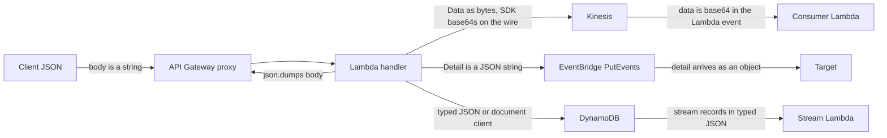

# 1.1.7 Serialize and deserialize data exchanged between application code and AWS services

**Domain 1 · Task 1.1 · Skill 1.1.7** · [Task overview](README.md) · Previous: [1.1.6 Streaming data](1.1.6-streaming-data.md) · Next: [1.1.8 Event-driven applications](1.1.8-event-driven-applications.md)

## What the exam expects

This skill tests whether you know the exact shape of the data each AWS service hands your code and expects back. The questions are usually "the function fails to parse its input" or "the caller gets a 502" with a code snippet, and the fix is one line: parse a JavaScript Object Notation (JSON) string, base64-decode a payload, unwrap an envelope, or convert DynamoDB's typed format. DVA-C02 listed this skill under Task 1.3 (data stores); DVA-C03 moved it to Task 1.1, so expect it across services, not only DynamoDB.

You must be able to:

- Tell when a field is a JSON object and when it is a JSON string that needs a second parse.
- Recognize base64-encoded payloads (Kinesis, Firehose, Amazon API Gateway binary bodies) and decode or encode them.
- Return exactly the response shape a service requires, such as the API Gateway Lambda proxy response.
- Convert between DynamoDB typed JSON and native types, and handle Python's `Decimal`.
- Unwrap nested envelopes such as Amazon Simple Storage Service (S3) to Amazon Simple Notification Service (SNS) to Amazon Simple Queue Service (SQS).
- Choose date, number, and binary formats that services accept, for example epoch seconds for DynamoDB time to live (TTL).

## Key terms

| Term | Meaning |
|---|---|
| Serialize | Convert an in-memory object to a transmittable format, usually a JSON string or bytes. |
| Deserialize | Parse that format back into an object (`json.loads`, `JSON.parse`). |
| JSON | JavaScript Object Notation. The format of almost every AWS API request, response, and event. |
| Base64 | An encoding that represents binary data as ASCII text. It is reversible by anyone and gives no confidentiality. |
| Envelope | Metadata wrapper a service puts around your payload, for example SNS's `Type`, `MessageId`, `Message` fields. |
| DynamoDB typed JSON | The low-level wire format where each value is wrapped with a type descriptor, such as `{"S": "abc"}`. |
| Marshall / unmarshall | Convert native values to and from DynamoDB typed JSON. Document clients do this for you. |
| Schema | A definition of fields and types (JSON Schema, Avro, Protobuf) used to validate or generate code for a payload. |

## Where serialization happens



### Format by service

| Service and direction | What your code sees or sends | What to do |
|---|---|---|
| API Gateway Lambda proxy, request | `event["body"]` is a **string** (or `None`); `queryStringParameters` and `pathParameters` can be `None` | `json.loads(event["body"] or "{}")`; guard with `.get(...) or {}` |
| API Gateway Lambda proxy, binary request | `isBase64Encoded: true`, body is base64 text | `base64.b64decode(event["body"])` |
| API Gateway Lambda proxy, response | Must be `{"statusCode": 200, "headers": {...}, "body": "string", "isBase64Encoded": false}` | `json.dumps(...)` the body. A dict body or a missing `statusCode` gives the client a **502** |
| API Gateway REST (representational state transfer) API, non-proxy | Mapping templates written in Velocity Template Language (VTL) reshape JSON and Extensible Markup Language (XML) | See [1.1.4](1.1.4-apis-transformation-and-validation.md) |
| SQS message | `Body` is a **string** (max 1 MiB); message attributes have types `String`, `Number`, `Binary` | `json.loads(record["body"])` |
| SNS to SQS or HTTP (Hypertext Transfer Protocol) endpoints | The body is the SNS **envelope** JSON; your payload is the string in `Message` | Parse twice, or enable **raw message delivery** |
| SNS to Lambda | `event["Records"][0]["Sns"]["Message"]` is a string | `json.loads(...)` |
| EventBridge `PutEvents` | `Detail` is a **JSON string** | `json.dumps(detail)` before sending |
| EventBridge to a target | `detail` arrives as a JSON **object** inside the event | Read fields directly |
| Kinesis producer (AWS software development kit, SDK) | `Data` is a blob (bytes) | Pass bytes; the SDK base64-encodes on the wire. Do not encode twice |
| Kinesis to Lambda | `record["kinesis"]["data"]` is base64 | `base64.b64decode(...)` then parse |
| Firehose transformation | Input `data` is base64; output must be base64 `data` with `recordId` and `result` | Decode, transform, re-encode. See [1.1.6](1.1.6-streaming-data.md) |
| DynamoDB low-level client | Typed JSON: `{"S": ...}`, `{"N": "42"}` | Use a document client, or a serializer and deserializer |
| DynamoDB Streams to Lambda | `NewImage` and `OldImage` in typed JSON | `TypeDeserializer` (Python) or `unmarshall` (JavaScript v3) |
| S3 event | Object `key` is **URL-encoded** (spaces become `+`) | `urllib.parse.unquote_plus(key)` |
| Step Functions | State input and output are JSON, up to 256 KiB per state | Store large payloads in S3 and pass a reference; `States.StringToJson` and `States.JsonToString` convert inside the workflow |
| AWS Key Management Service (KMS) `Encrypt` | `CiphertextBlob` is bytes; the AWS command line interface (CLI) shows it base64-encoded | Store bytes or base64 text, decode before `Decrypt` |
| Bedrock `InvokeModel` | `body` is a model-specific JSON string; response `body` is a stream of bytes | `json.dumps` the request, `json.loads(resp["body"].read())`. See [1.1.10](1.1.10-managed-ai-service-integration.md) |

## API Gateway proxy: the most tested case

The proxy integration passes the whole HTTP request to Lambda as an event and passes your return value back untouched. API Gateway does not serialize anything for you.

```python
import base64, json

def handler(event, context):
    qsp = event.get("queryStringParameters") or {}        # None when there is no query string
    raw = event.get("body") or "{}"
    if event.get("isBase64Encoded"):
        raw = base64.b64decode(raw).decode("utf-8")
    try:
        body = json.loads(raw)
    except json.JSONDecodeError:
        return {"statusCode": 400, "headers": {"Content-Type": "application/json"},
                "body": json.dumps({"error": "body must be valid JSON"})}

    result = {"orderId": body.get("orderId"), "verbose": qsp.get("verbose") == "true"}
    return {
        "statusCode": 200,
        "headers": {"Content-Type": "application/json"},
        "body": json.dumps(result),                        # must be a string, not a dict
    }
```

Failure shapes that map to exam answers:

| Code bug | What the client sees |
|---|---|
| `"body": {"ok": True}` (dict) | 502 Bad Gateway, "Malformed Lambda proxy response" |
| Missing `statusCode` | 502 |
| `json.loads(event)` instead of `json.loads(event["body"])` | Function error, 502 |
| `event["queryStringParameters"]["id"]` with no query string | `TypeError` on `None`, 502 |
| Returning binary without base64 and `isBase64Encoded: true` | Corrupted file at the client |

For binary responses (images, PDFs), the REST API also needs the content type listed under **binary media types**.

## DynamoDB typed JSON and document clients

The low-level API wraps every value with a type descriptor. Numbers travel as strings to keep precision.

| Descriptor | Type | Example |
|---|---|---|
| `S` | String | `{"S": "alice"}` |
| `N` | Number (sent as a string) | `{"N": "42.5"}` |
| `B` | Binary (base64 in JSON) | `{"B": "aGVsbG8="}` |
| `BOOL` | Boolean | `{"BOOL": true}` |
| `NULL` | Null | `{"NULL": true}` |
| `M` | Map | `{"M": {"city": {"S": "Austin"}}}` |
| `L` | List | `{"L": [{"S": "a"}, {"N": "1"}]}` |
| `SS`, `NS`, `BS` | String, number, binary sets | `{"SS": ["red", "blue"]}` |

| API style | Python (boto3) | JavaScript v3 | Format |
|---|---|---|---|
| Low-level client | `boto3.client("dynamodb")` | `DynamoDBClient` | Typed JSON in and out |
| Document client | `boto3.resource("dynamodb").Table(...)` | `DynamoDBDocumentClient` from `@aws-sdk/lib-dynamodb` | Native types; SDK marshalls |
| Manual conversion | `TypeSerializer`, `TypeDeserializer` | `marshall`, `unmarshall` from `@aws-sdk/util-dynamodb` | Converts either way |

Code written for one style fails against the other. A typed-JSON item passed to `Table.put_item` stores nested maps literally, and a native dict passed to `client.put_item` is rejected.

Python-specific trap: the boto3 document client returns numbers as `decimal.Decimal` and rejects `float` on write ("Float types are not supported. Use Decimal types instead"). `json.dumps` cannot serialize `Decimal` either.

```python
import json
from decimal import Decimal
from boto3.dynamodb.types import TypeDeserializer

deser = TypeDeserializer()

class DecimalEncoder(json.JSONEncoder):
    def default(self, o):
        if isinstance(o, Decimal):
            return int(o) if o == o.to_integral_value() else float(o)
        return super().default(o)

# Writing: parse incoming JSON floats as Decimal so the document client accepts them
item = json.loads('{"orderId": "o-1", "total": 19.99}', parse_float=Decimal)

# Reading a DynamoDB Streams record (typed JSON) into native Python
def handler(event, context):
    for rec in event["Records"]:
        if rec["eventName"] == "INSERT":
            new = {k: deser.deserialize(v) for k, v in rec["dynamodb"]["NewImage"].items()}
            print(json.dumps(new, cls=DecimalEncoder))
```

## Envelopes: unwrap every layer

S3 publishing to SNS, which delivers to SQS, which triggers Lambda, nests three formats:

```python
import json, urllib.parse

def handler(event, context):                     # SQS event
    for record in event["Records"]:
        envelope = json.loads(record["body"])    # SNS envelope (skip if raw delivery is on)
        s3_event = json.loads(envelope["Message"])
        if s3_event.get("Event") == "s3:TestEvent":
            continue                             # S3 sends a test message when you configure the notification
        for r in s3_event["Records"]:
            bucket = r["s3"]["bucket"]["name"]
            key = urllib.parse.unquote_plus(r["s3"]["object"]["key"])   # "my file.jpg" arrives as "my+file.jpg"
            process(bucket, key)
```

With SNS **raw message delivery** enabled on the SQS subscription, the SQS body is the original message and the second `json.loads` goes away. S3 notification messages can be up to 64 KB, so an SQS queue receiving them directly needs a `MaximumMessageSize` of at least that.

## Base64 in practice

| Where | Direction | Note |
|---|---|---|
| Kinesis records in Lambda events | Decode | `base64.b64decode(record["kinesis"]["data"])` |
| Firehose transformation input and output | Decode, then encode | Output `data` must be base64 text |
| API Gateway binary bodies | Decode request, encode response | Set `isBase64Encoded` correctly |
| DynamoDB `B` attributes in typed JSON | SDK handles it | Bytes in your code |
| KMS ciphertext | CLI output and many SDK examples show base64 | Decode before calling `Decrypt` |
| Kinesis producer `Data` | SDK encodes for you | Pass bytes |

Base64 is not encryption. An answer that "base64-encodes a password to protect it" is wrong; use AWS Secrets Manager, see [2.2.7](../../domain-2-security/task-2.2-encrypt-and-protect-sensitive-data/2.2.7-secrets-management.md).

## Dates, numbers, and schemas

- **Dates:** use International Organization for Standardization (ISO) 8601 strings (`2026-12-30T09:00:00Z`) for readability and sorting, or epoch seconds as numbers. DynamoDB **TTL requires a Number attribute holding epoch seconds**. An ISO string or epoch milliseconds silently never expires. See [1.3.1](../task-1.3-use-data-stores/1.3.1-data-lifecycle-management.md).
- **Numbers:** JSON has one number type. Large integers can lose precision in JavaScript (`Number.MAX_SAFE_INTEGER`), which is one reason DynamoDB sends numbers as strings. EventBridge `PutEvents` accepts integers within the 64-bit signed range.
- **Nesting:** EventBridge processes nested JSON up to 1,000 levels deep.
- **Schemas:**
  - API Gateway **models** are JSON Schema documents used by request validators, see [1.1.4](1.1.4-apis-transformation-and-validation.md).
  - EventBridge **schema registry** discovers event schemas and generates code bindings (Java, Python, TypeScript, Go) so you deserialize events into typed objects, see [1.1.8](1.1.8-event-driven-applications.md).
  - **Avro** and **Protobuf** are compact binary formats with schemas, common with Kafka. Columnar **Parquet** and **ORC** (Optimized Row Columnar) are what Firehose converts JSON into for Athena.
- **Size limits push you to references:** Step Functions 256 KiB per state, SQS 1 MiB per message, SNS 256 KiB by default (1 MiB with the topic's `MaximumMessageSize`), EventBridge `PutEvents` under 1 MB total per request, Lambda 6 MB synchronous and 1 MB asynchronous payloads. Above those, store the payload in S3 and send a pointer (the claim-check pattern, or the SQS and SNS Extended Client Libraries).

## Worked scenario: a handler reviewed by an AI assistant

A first draft that an artificial intelligence (AI) assistant or a human reviewer should flag (see [1.1.9](1.1.9-ai-assisted-development-tools.md)):

```python
def handler(event, context):
    user_id = event["queryStringParameters"]["userId"]
    resp = ddb.query(TableName="Orders",
                     KeyConditionExpression="userId = :u",
                     ExpressionAttributeValues={":u": {"S": user_id}})
    return {"statusCode": 200, "body": resp["Items"]}
```

Three defects: `queryStringParameters` can be `None`; `body` is a list, not a string, so API Gateway returns 502; and `resp["Items"]` is typed JSON that the client would receive as `{"S": ...}` wrappers. The fix is a `.get(...) or {}` guard with a 400 response, `TypeDeserializer` or a document client for the items, and `json.dumps(items, cls=DecimalEncoder)` for the body.

## Exam triggers

| Scenario clue | Answer | Why the alternatives are wrong |
|---|---|---|
| Lambda behind API Gateway fails parsing input | `event["body"]` is a JSON string; `json.loads` it | The event itself is already a dict; the body inside is not |
| Function logs show success, client gets 502 | Return `statusCode` and a **string** `body` in the proxy shape | Raising the timeout or memory changes nothing |
| Kinesis data unreadable in Lambda | Base64-decode `kinesis.data` | It is not encrypted; KMS decryption is not the step |
| Consumer of SNS-to-SQS gets an unwanted JSON wrapper | Enable raw message delivery, or parse `Message` | Changing queue type does not remove the envelope |
| Code using the DynamoDB client sees `{"S": "..."}` everywhere | Use a document client or unmarshall | Typed JSON is the correct low-level format, not corruption |
| Python write to DynamoDB fails on a float | Use `Decimal` (`parse_float=Decimal`) | Casting to string changes the attribute type |
| TTL never deletes items | Attribute must be a Number in epoch **seconds** | ISO strings and milliseconds are ignored or far in the future |
| S3-triggered function cannot find the object for keys with spaces | URL-decode the key with `unquote_plus` | The object exists; the key in the event is encoded |
| EventBridge `PutEvents` rejects the entry or rules never match | `Detail` must be a JSON string of an object | Passing a dict fails validation in most SDKs |
| Step Functions fails with `States.DataLimitExceeded` | Put the payload in S3 and pass the key | Payload limits are fixed at 256 KiB |
| "Protect the password by base64-encoding it" | Wrong; use Secrets Manager or Parameter Store `SecureString` | Base64 is reversible by anyone |

## Common traps

- A REST API Lambda proxy integration does not serialize your return value. Your code owns `json.dumps`. HTTP APIs using payload format 2.0 are more forgiving: if the function returns valid JSON without `statusCode`, API Gateway assumes a 200 and builds the response. Exam questions about 502s from a dict body describe REST APIs or payload format 1.0.
- `json.dumps` on a value that is already a JSON string produces escaped double encoding (`"{\"a\":1}"`).
- SNS wraps messages unless raw message delivery is on; SQS consumers then need two parses.
- `isBase64Encoded` only controls whether the proxy body is treated as base64 binary. It does not transform JSON.
- The boto3 document client returns `Decimal`; JavaScript v3 `DynamoDBDocumentClient` needs `@aws-sdk/lib-dynamodb` and returns native numbers.
- S3 event keys are URL-encoded; S3 also sends an `s3:TestEvent` message when you first configure a notification, which a strict parser rejects.
- Do not base64-encode Kinesis `Data` before calling the SDK.

## Quick recall

- API Gateway proxy: request `body` is a string; response needs `statusCode` and a string `body`.
- SQS `Body`, SNS `Message`, and EventBridge `PutEvents` `Detail` are strings; EventBridge target `detail` is an object.
- Kinesis data in Lambda and Firehose transformation data are base64.
- DynamoDB typed JSON: `S`, `N` (as string), `B`, `BOOL`, `NULL`, `M`, `L`, `SS`, `NS`, `BS`.
- boto3 document client uses `Decimal`; use `parse_float=Decimal` and a custom encoder.
- DynamoDB TTL: Number, epoch seconds.
- S3 event keys: `unquote_plus`.
- Step Functions state payload limit: 256 KiB; use S3 references.
- Base64 is encoding, not encryption.

## Related skills

- [1.1.4 APIs, transformation, and validation](1.1.4-apis-transformation-and-validation.md): mapping templates, models, and request validators.
- [1.1.5 AWS SDKs and service APIs](1.1.5-aws-sdks-and-service-apis.md): low-level clients versus document clients.
- [1.1.6 Streaming data](1.1.6-streaming-data.md): Kinesis and Firehose record formats.
- [1.1.8 Event-driven applications](1.1.8-event-driven-applications.md): event envelopes and the schema registry.
- [1.3.4 DynamoDB design and operations](../task-1.3-use-data-stores/1.3.4-dynamodb-design-and-operations.md): attribute types and item design.
- [3.2.3 Test events and payloads](../../domain-3-testing-and-deployment/task-3.2-test-applications/3.2.3-test-events-and-payloads.md): building realistic JSON events for tests.
- [4.1.1 Debugging code and integrations](../../domain-4-troubleshooting-and-optimization/task-4.1-root-cause-analysis/4.1.1-debugging-code-and-integrations.md): diagnosing 502s and parse errors.

## Sources

- Merged from: `archive/dva-c03-study-notes/01-development-with-aws-services.md` (skill 1.1.7), `archive/dva-c03-study-notes/00-developer-basics.md` (serialization, base64), `archive/dva-c03-study-notes/05-cheat-sheet.md`, `archive/dva-c03/domain-1-development/README.md` (serialization and streaming section, worked 502 scenario), `archive/dva-c03/domain-1-development/ai-assisted-development.md` (before and after handler), `archive/aws-dva-notes/Markdown Files/16. Messaging - SQS, SNS & Kinesis.md`, `archive/aws-dva-notes/Markdown Files/18. Serverless - Lambda.md`, `archive/aws-dva-notes/Markdown Files/19. Serverless - DynamoDB.md`, `archive/aws-dva-notes/Markdown Files/20. Serverless - API Gateway.md`, traps from `archive/dva-c03/exam-bank/bank-1.md` and `archive/dva-c03/practice-questions/`.
- AWS documentation: [PutEvents API reference](https://docs.aws.amazon.com/eventbridge/latest/APIReference/API_PutEvents.html)
- AWS documentation: [Event notification types and destinations (S3)](https://docs.aws.amazon.com/AmazonS3/latest/userguide/notification-how-to-event-types-and-destinations.html)
- AWS documentation: [Amazon SNS service quotas](https://docs.aws.amazon.com/general/latest/gr/sns.html)
- AWS documentation: [Step Functions service quotas](https://docs.aws.amazon.com/step-functions/latest/dg/limits-overview.html)
- AWS documentation: [Lambda quotas](https://docs.aws.amazon.com/lambda/latest/dg/gettingstarted-limits.html)
- AWS documentation: [Handle large records (Kinesis)](https://docs.aws.amazon.com/streams/latest/dev/large-records.html)
