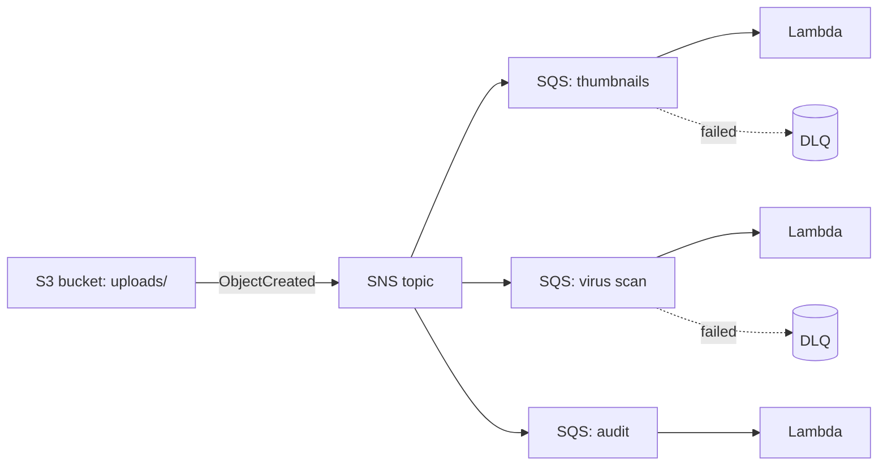
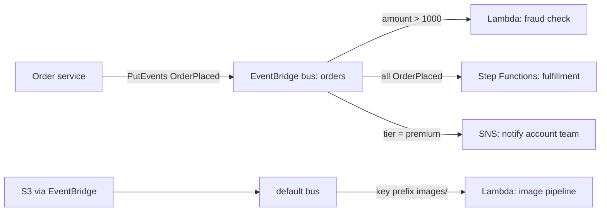
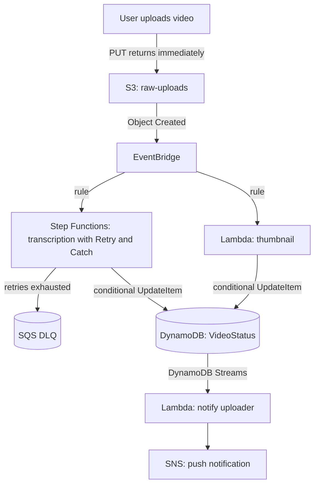

# 1.1.8 Implement event-driven applications with EventBridge, S3 Event Notifications, SQS, and SNS

**Domain 1 · Task 1.1 · Skill 1.1.8** · [Task overview](README.md) · Previous: [1.1.7 Serialization and deserialization](1.1.7-serialization-and-deserialization.md) · Next: [1.1.9 AI-assisted development tools](1.1.9-ai-assisted-development-tools.md)

## What the exam expects

This skill tests whether you can wire services so that components react to events instead of calling each other, and configure each piece correctly: Amazon Simple Storage Service (S3) event notifications and their permissions, EventBridge rules and event patterns, Amazon Simple Notification Service (SNS) topics with filter policies, and Amazon Simple Queue Service (SQS) queues as durable buffers. [1.1.1](1.1.1-coupling-and-decoupling.md) explains why to decouple and covers SQS settings in depth; [1.1.2](1.1.2-communication-patterns.md) covers choosing synchronous, asynchronous, or event-driven communication. This note covers how to build the event-driven version.

You must be able to:

- Configure S3 Event Notifications with prefix and suffix filters, the right destination, and the destination's resource-based policy.
- Know when to send S3 events through EventBridge instead (advanced filters, several targets, first-in, first-out (FIFO) targets, archive and replay).
- Write EventBridge event patterns, attach targets, reshape input, and replay archived events.
- Publish to SNS and use subscription filter policies, raw message delivery, FIFO topics, and fan-out to SQS.
- Make consumers idempotent and avoid recursive triggers.
- Pick the pattern: fan-out, content-based routing, scheduled events, change data capture, or orchestration.

## Key terms

| Term | Meaning |
|---|---|
| Event | A record that something happened ("object created", "order placed"). The producer does not know who reacts. |
| Event bus | EventBridge router that receives events and matches them against rules. Every account has a `default` bus for AWS service events. |
| Rule | EventBridge object that matches events with an event pattern (or runs on a schedule) and sends them to up to 5 targets. |
| Event pattern | JavaScript Object Notation (JSON) that an event must match: exact values, prefixes, numeric ranges, `exists`, `anything-but`, and more. |
| Target | Service that receives a matched event: Lambda, SQS, SNS, Step Functions, Kinesis, API (application programming interface) destinations, and many others. |
| Topic | SNS publish point. Every subscription gets its own copy of each message unless a filter policy excludes it. |
| Filter policy | JSON on an SNS subscription that selects which messages it receives, by message attributes or message body. |
| Fan-out | One event delivered independently to many consumers. |
| Choreography | Services react to each other's events with no central controller. |
| Orchestration | A coordinator (Step Functions) calls each step and tracks state. |
| Idempotent consumer | Processing the same event twice has the same effect as once. Required because these services deliver at least once. |

## Choosing the event router

| Need | Use | Notes |
|---|---|---|
| React to an S3 upload with one function, simple prefix or suffix filter | S3 Event Notification to Lambda | Cheapest and simplest |
| Buffer S3 events so a consumer can work at its own pace | S3 Event Notification to SQS | Lambda reads the queue with an event source mapping |
| Same S3 event to several consumers | S3 to SNS to several SQS queues, or S3 to EventBridge | S3 allows only one configuration per event type and overlapping prefix |
| Filter S3 events on object size, metadata, or complex key patterns; send to Step Functions, Kinesis, or an SQS FIFO queue; archive and replay | S3 to EventBridge | S3 notifications cannot target FIFO queues or FIFO topics directly |
| Every subscriber gets a copy, with optional attribute or body filters | SNS topic | Push; no storage, so pair with SQS for durability |
| Route by event content to different services, software as a service (SaaS) partner events, cross-account buses, schedules | EventBridge | Up to 5 targets per rule, many rules per bus |
| Ordered fan-out with deduplication | SNS FIFO topic to SQS FIFO queues | Throughput limits like SQS FIFO |
| Point-to-point work queue, one worker per message | SQS | See [1.1.1](1.1.1-coupling-and-decoupling.md) |
| React to database item changes | DynamoDB Streams to Lambda | See [1.1.6](1.1.6-streaming-data.md) |
| Multi-step process with retries, branches, and approvals | Step Functions, often started by an EventBridge rule | See [1.1.2](1.1.2-communication-patterns.md) |

All four core services (S3 notifications, EventBridge, SNS, SQS standard) deliver **at least once** and do not guarantee order. Consumers must be idempotent.

## S3 Event Notifications

### Event types and destinations

- **Event types:** `s3:ObjectCreated:*` (or `Put`, `Post`, `Copy`, `CompleteMultipartUpload`), `s3:ObjectRemoved:*` (`Delete`, `DeleteMarkerCreated`), `s3:ObjectRestore:*`, `s3:Replication:*`, `s3:LifecycleExpiration:*`, `s3:LifecycleTransition`, `s3:IntelligentTiering`, `s3:ObjectTagging:*`, and `s3:TestEvent`.
- **Destinations:** SNS standard topics, SQS standard queues, Lambda functions, and EventBridge. Each notification configuration has one destination. SQS FIFO queues and SNS FIFO topics are not supported directly; route through EventBridge.
- **Region:** SNS, SQS, and Lambda destinations must be in the same Region as the bucket.
- **Filters:** object key prefix and suffix (for example prefix `uploads/`, suffix `.jpg`). Two configurations cannot use the same event type with overlapping prefix and suffix filters.
- **Delivery:** usually within seconds, occasionally a minute or longer. Events are not ordered; the `sequencer` field orders events for the same key. Two simultaneous writes to the same key in an unversioned bucket can produce one notification; enable versioning if every write must produce an event.
- **Size:** a notification message can be up to 64 KB.
- **Lifecycle deletes** do not raise `s3:ObjectRemoved`. Use `s3:LifecycleExpiration:*` for those.

### Permissions

S3 needs permission on the **destination**, not an AWS Identity and Access Management (IAM) role on the bucket.

| Destination | Grant |
|---|---|
| Lambda | Function resource-based policy: `lambda:InvokeFunction` for principal `s3.amazonaws.com`, with `aws:SourceArn` (the bucket's Amazon Resource Name, or ARN) and `aws:SourceAccount` conditions |
| SQS | Queue access policy: `sqs:SendMessage` for `s3.amazonaws.com` with the same conditions |
| SNS | Topic access policy: `sns:Publish` for `s3.amazonaws.com` with the same conditions |
| EventBridge | Turn on "Send notifications to Amazon EventBridge" for the bucket. No destination policy. |

If the destination uses server-side encryption with an AWS Key Management Service key (SSE-KMS), the key policy must also let S3 use it. Missing permissions usually fail when you save the configuration, because S3 sends an `s3:TestEvent`.

### S3 to EventBridge

When enabled, **all** bucket events go to the default bus with `source` `aws.s3` and `detail-type` values such as `Object Created` and `Object Deleted`. Rules then filter on any field:

```json
{
  "source": ["aws.s3"],
  "detail-type": ["Object Created"],
  "detail": {
    "bucket": { "name": ["uploads-bucket"] },
    "object": {
      "key":  [{ "prefix": "images/" }],
      "size": [{ "numeric": [">", 0, "<=", 52428800] }]
    }
  }
}
```

### Thumbnail generator without a loop

```python
import os, urllib.parse
import boto3

s3 = boto3.client("s3")
OUTPUT_BUCKET = os.environ["OUTPUT_BUCKET"]     # a different bucket, or a prefix the trigger does not watch

def handler(event, context):                    # direct S3 notification, asynchronous invocation
    for rec in event["Records"]:
        bucket = rec["s3"]["bucket"]["name"]
        key = urllib.parse.unquote_plus(rec["s3"]["object"]["key"])
        obj = s3.get_object(Bucket=bucket, Key=key)
        thumb = make_thumbnail(obj["Body"].read())
        s3.put_object(Bucket=OUTPUT_BUCKET, Key=f"thumbnails/{key}", Body=thumb,
                      ContentType="image/jpeg")
```

Writing the output into the same bucket and prefix that triggers the function creates a loop that runs until you stop it. Use a second bucket, or filter the trigger to an input prefix such as `uploads/` and write to `thumbnails/`.

Direct S3-to-Lambda invocations are **asynchronous**: Lambda retries twice and then drops the event unless you configure an on-failure destination or a dead-letter queue. See [1.2.3](../task-1.2-develop-lambda-functions/1.2.3-lambda-invocation-lifecycle-and-failures.md).

## Amazon EventBridge


*Source: [Amazon EventBridge rules](https://docs.aws.amazon.com/eventbridge/latest/userguide/eb-rules.html). An event that matches no rule goes nowhere. There is no default catch-all target.*

### Event structure

```json
{
  "version": "0",
  "id": "6a7e8feb-b491-4cf7-a9f1-bf3703467718",
  "detail-type": "OrderPlaced",
  "source": "com.example.orders",
  "account": "111122223333",
  "time": "2026-12-01T12:00:00Z",
  "region": "us-east-1",
  "resources": [],
  "detail": { "orderId": "o-123", "amount": 1250, "tier": "premium" }
}
```

### Publishing custom events

```python
import json
import boto3

events = boto3.client("events")

resp = events.put_events(Entries=[{
    "EventBusName": "orders",
    "Source": "com.example.orders",
    "DetailType": "OrderPlaced",
    "Detail": json.dumps({"orderId": "o-123", "amount": 1250, "tier": "premium"}),  # a JSON string
}])
if resp["FailedEntryCount"]:
    failed = [e for e in resp["Entries"] if "ErrorCode" in e]
    # retry only the failed entries with backoff; the call itself did not raise
```

`PutEvents` takes up to 10 entries per request, with a total request size under 1 MB. Like `PutRecords` in Kinesis, it reports partial failure in the response.

### Rules, patterns, and targets

| Pattern feature | Example |
|---|---|
| Exact match (OR within an array) | `"tier": ["premium", "gold"]` |
| Prefix, suffix | `"key": [{"prefix": "images/"}]`, `[{"suffix": ".png"}]` |
| Anything but | `"status": [{"anything-but": ["test"]}]` |
| Numeric range | `"amount": [{"numeric": [">", 1000]}]` |
| Exists | `"couponCode": [{"exists": true}]` |
| Equals ignore case | `"country": [{"equals-ignore-case": "us"}]` |
| Wildcard | `"key": [{"wildcard": "uploads/*/raw/*"}]` |
| OR across fields | `"$or": [{"amount": [{"numeric": [">", 1000]}]}, {"tier": ["premium"]}]` |

```python
events.put_rule(
    Name="high-value-orders",
    EventBusName="orders",
    EventPattern=json.dumps({
        "source": ["com.example.orders"],
        "detail-type": ["OrderPlaced"],
        "detail": {"amount": [{"numeric": [">", 1000]}]},
    }),
)
events.put_targets(
    Rule="high-value-orders",
    EventBusName="orders",
    Targets=[{
        "Id": "fraud-check",
        "Arn": "arn:aws:lambda:us-east-1:111122223333:function:FraudCheck",
        "RetryPolicy": {"MaximumRetryAttempts": 20, "MaximumEventAgeInSeconds": 3600},
        "DeadLetterConfig": {"Arn": "arn:aws:sqs:us-east-1:111122223333:fraud-check-dlq"},
    }],
)
```

The Lambda function also needs a resource-based policy allowing `events.amazonaws.com` to invoke it. For SQS and SNS targets, the queue or topic policy must allow EventBridge.

Rule features to know:

- **Up to 5 targets per rule.** Add more rules for more targets, or target an SNS topic.
- **Retries and dead-letter queue (DLQ):** EventBridge retries failed deliveries for up to 24 hours and 185 attempts by default. Set `RetryPolicy` lower if you want faster failure, and attach an SQS dead-letter queue per target.
- **Input transformer:** `InputPathsMap` extracts fields and `InputTemplate` builds the payload the target receives, so targets get only what they need without glue code.
- **Archive and replay:** archive events (all or by pattern) with a retention period, then replay a time range to a bus, for example after fixing a consumer bug.
- **Schema registry:** discovers schemas for events on a bus and generates code bindings so your code works with typed objects. See [1.1.7](1.1.7-serialization-and-deserialization.md).
- **Partner and cross-account buses:** SaaS partners publish to partner event sources; a rule can target a bus in another account, governed by the receiving bus's resource policy.
- **API destinations:** call external HTTP (Hypertext Transfer Protocol) APIs as targets, with a connection that stores the authorization (API key, basic, or OAuth 2.0 client credentials) in AWS Secrets Manager.
- **Scheduled rules** with cron or rate expressions still exist, but **EventBridge Scheduler** is the newer option for one-time and recurring schedules with time zones and flexible windows, and can call a wide range of AWS APIs directly.

**EventBridge Pipes** connect one source to one target point to point: source (SQS, Kinesis, DynamoDB Streams, Amazon Managed Streaming for Apache Kafka (MSK), Amazon MQ), optional filter, optional enrichment (Lambda, Step Functions Express, API Gateway, API destination), then target. Use Pipes when you would otherwise write a Lambda function only to read a queue and forward to another service.

> **Current AWS documentation** now separates a newer "Custom Event Bus" (subscribers, up to 100 entries per publish request) from "Custom Event Bus - Classic", the rules-and-targets model described here. Study material and the archive sources describe the classic model, which is what this note covers.

## Amazon SNS


*Source: [Amazon SNS fanout scenario](https://docs.aws.amazon.com/sns/latest/dg/sns-common-scenarios.html). One publish, several durable copies. New consumers subscribe without changing the publisher.*

- **Publish:** `Publish` to a topic ARN, or `PublishBatch` with up to 10 messages. Subscriptions per standard topic: up to 12,500,000. Topics per account: 100,000 standard.
- **Protocols:** SQS, Lambda, HTTP and HTTPS, email, SMS (text messages), mobile push, and Data Firehose.
- **Message size:** 256 KiB by default; raise a topic's `MaximumMessageSize` up to 1 MiB. Above that, use the SNS Extended Client Library, which stores the payload in S3 (up to 2 GB).
- **Durability:** SNS does not store messages for later reading. Pair it with SQS when consumers must not lose messages while they are down.
- **Security:** IAM policies for publishers, a topic access policy for other accounts and services (S3, CloudWatch alarms, EventBridge), KMS encryption at rest.

### Filter policies

A subscription with no filter policy gets every message. A filter policy selects messages by **message attributes** (default) or by **message body** (set `FilterPolicyScope` to `MessageBody`).

```json
{
  "order_type": ["premium"],
  "amount": [{ "numeric": [">=", 100] }],
  "region": [{ "anything-but": ["test"] }]
}
```

```python
import json
import boto3

sns = boto3.client("sns")
sns.publish(
    TopicArn="arn:aws:sns:us-east-1:111122223333:orders",
    Message=json.dumps({"orderId": "o-123"}),
    MessageAttributes={
        "order_type": {"DataType": "String", "StringValue": "premium"},
        "amount": {"DataType": "Number", "StringValue": "250"},
    },
)
```

Use one topic with filter policies rather than one topic per message type.

### Other SNS features

- **Raw message delivery** for SQS, HTTP, and Firehose subscriptions removes the JSON envelope so consumers get the original body.
- **FIFO topics** keep order per message group and deduplicate (by deduplication ID or content). Subscribers can be SQS FIFO or standard queues. Use SNS FIFO to SQS FIFO for "fan-out with order and deduplication".
- **Subscription dead-letter queue:** an SQS queue that receives messages SNS could not deliver after its retry policy.
- **Message data protection:** detect and mask sensitive data such as personally identifiable information (PII) in messages. See [2.2.6](../../domain-2-security/task-2.2-encrypt-and-protect-sensitive-data/2.2.6-sensitive-data-detection-and-masking.md).
- **Fan-out to SQS needs a queue policy** that allows the topic (`sns.amazonaws.com` with `aws:SourceArn` equal to the topic ARN) to call `sqs:SendMessage`. SNS can deliver to queues in other Regions.

### SNS compared with EventBridge

| | SNS | EventBridge |
|---|---|---|
| Model | Topic, push to every subscription | Bus, rules match events and send to targets |
| Filtering | Filter policy per subscription on attributes or body | Rich event patterns on any event field |
| Fan-out scale | Up to 12.5 million subscriptions per topic | Up to 5 targets per rule, many rules |
| Sources | Your code and many AWS services | AWS services, your code, SaaS partners, other accounts |
| Extras | SMS, email, mobile push, FIFO topics | Archive and replay, schema registry, input transformer, Pipes, Scheduler, API destinations |
| Pick when | Simple, high-fan-out pub/sub or notifications to people | Content-based routing across services, accounts, or SaaS |

## SQS in an event-driven design

SQS is the durable buffer between an event source and a consumer that must not be overwhelmed. Settings (visibility timeout, DLQ, long polling, FIFO) are covered in [1.1.1](1.1.1-coupling-and-decoupling.md). Points specific to event-driven wiring:

- S3, SNS, and EventBridge can all send to SQS, and each needs permission in the **queue's access policy**.
- A Lambda event source mapping polls the queue. Put the DLQ on the **queue's redrive policy**, not on the function, and use `ReportBatchItemFailures` so one bad message does not retry the whole batch. See [1.2.3](../task-1.2-develop-lambda-functions/1.2.3-lambda-invocation-lifecycle-and-failures.md).
- The SQS-to-Lambda path lets you cap consumer concurrency (the event source mapping, or ESM, maximum concurrency) to protect a downstream database.

## Patterns

### Fan-out with independent retries



Each queue gives its consumer its own retries, DLQ, and pace. Adding a fourth consumer means one new subscription and no producer change.

### Content-based routing



### Media pipeline with mixed invocation models



Why each choice: the upload response stays fast because all processing is asynchronous; EventBridge fans one event to two unrelated jobs; Step Functions expresses retry and catch for the flaky transcription API; conditional writes make duplicate deliveries harmless; and the stream decouples "record status" from "notify user" so a notification bug cannot block the status write.

### Transactional outbox

A service that writes to its database and then publishes an event can fail between the two steps, losing the event, or publish an event for a write that rolled back. Write the business item and an event record in one DynamoDB transaction (or write only the item), and let DynamoDB Streams publish the event. The stream only contains committed changes.

### Choreography or orchestration

Choreography (services react to EventBridge events) keeps services independent but makes the end-to-end flow hard to see. Orchestration (Step Functions calls each step) gives one place for retries, timeouts, compensation, and human approval. Exam wording such as "coordinate several Lambda functions with retries and a manual approval step" points to Step Functions. See [1.1.2](1.1.2-communication-patterns.md).

### Idempotency

At-least-once delivery means duplicates. Record a processed event ID (EventBridge `id`, SQS `messageId`, S3 `sequencer` plus key, or a business key) with a DynamoDB conditional write (`attribute_not_exists`), or use the Powertools for AWS Lambda idempotency utility. See [1.1.3](1.1.3-resilience-retries-and-backoff.md).

## Exam triggers

| Scenario clue | Answer | Why the alternatives are wrong |
|---|---|---|
| Generate thumbnails when images are uploaded | S3 event notification (prefix `uploads/`) to Lambda, output to another bucket or prefix | Polling the bucket on a schedule adds delay and cost |
| S3 cannot invoke the function, or saving the notification fails | Add the Lambda resource-based policy for `s3.amazonaws.com` (or the queue or topic policy) | An IAM role on the bucket is not how S3 gets permission |
| Same upload event must reach several independent consumers | S3 to SNS to several SQS queues, or S3 to EventBridge | A second S3 configuration with the same event type and overlapping prefix is rejected |
| Filter S3 events by object size or send them to an SQS FIFO queue | Enable EventBridge on the bucket and write a rule | S3 notification filters are prefix and suffix only; FIFO destinations are unsupported |
| Route events by content to different services without code | EventBridge rules with event patterns | SNS without filters sends everything to every subscriber |
| Each subscriber should receive only some of a topic's messages | SNS subscription filter policy | Separate topics per message type add publisher complexity |
| SQS subscriber gets an SNS JSON wrapper it does not want | Raw message delivery | Changing to a FIFO queue does not remove the envelope |
| Fan-out that preserves order and removes duplicates | SNS FIFO topic to SQS FIFO queues | Standard topics and queues give no ordering |
| Reprocess last week's events after a bug fix | EventBridge archive and replay | SNS and S3 notifications keep no history |
| React to a SaaS provider's events | EventBridge partner event source | Polling the provider's API is code you do not need |
| Run a job every night or once at a specific time | EventBridge Scheduler (or a scheduled rule) | A long-running Amazon Elastic Compute Cloud (EC2) cron host is unnecessary |
| Events for one rule must reach more than 5 targets | Target an SNS topic, or add rules | The 5-targets-per-rule quota is not adjustable |
| Messages processed twice | Idempotent consumer with a conditional write | No standard service here guarantees exactly-once delivery |
| Function keeps re-triggering itself | Output written to the triggering bucket or prefix; separate them | Raising concurrency makes the loop worse |
| Event published but no target invoked | Event pattern does not match (check `source`, `detail-type`, field types) or target permission missing | EventBridge drops unmatched events silently |
| Read from SQS, enrich, send to Step Functions without writing glue code | EventBridge Pipes | A custom Lambda poller is more code to own |

## Common traps

- S3 notifications go to SNS standard, SQS standard, Lambda, or EventBridge. FIFO queues and topics need EventBridge in between.
- S3 notification permissions live on the destination's resource-based policy.
- S3 event keys are URL-encoded (uniform resource locator encoding), and S3 sends an `s3:TestEvent` when you configure a notification.
- Lifecycle expirations do not emit `s3:ObjectRemoved` events.
- EventBridge `Detail` is a JSON string when publishing; `PutEvents` returns `FailedEntryCount` instead of throwing.
- EventBridge rules allow 5 targets. SNS topics allow millions of subscriptions.
- SNS keeps no messages. If a subscriber is down long enough for retries to run out, the message is gone unless a subscription DLQ is set; put SQS behind SNS for durability.
- For SQS-triggered Lambda, the DLQ belongs on the queue. A Lambda async DLQ does nothing for event source mappings.
- SNS's default message limit is 256 KiB even though SQS now allows 1 MiB; raise the topic's `MaximumMessageSize` or use the Extended Client Library.
- None of these services are exactly-once. SQS FIFO deduplicates within a 5-minute window, and consumers still need idempotency.

## Quick recall

- S3 notification destinations: SNS, SQS, Lambda (same Region, standard only) and EventBridge (all events).
- S3 filters: prefix and suffix. EventBridge filters: any field, numeric, exists, anything-but, wildcard.
- EventBridge: up to 5 targets per rule; retries up to 24 hours by default; per-target DLQ; archive and replay.
- `PutEvents`: up to 10 entries and under 1 MB per request; check `FailedEntryCount`.
- SNS: 256 KiB default message (1 MiB configurable), `PublishBatch` 10, filter policies on attributes or body, raw delivery.
- SNS FIFO to SQS FIFO: ordered, deduplicated fan-out.
- Fan-out with durability and independent retries: SNS to SQS queues.
- Avoid recursion: never write output where the trigger listens.
- Everything is at least once: idempotent consumers.

## Related skills

- [1.1.1 Coupling and decoupling](1.1.1-coupling-and-decoupling.md): SQS configuration and choosing the decoupling service.
- [1.1.2 Communication patterns](1.1.2-communication-patterns.md): synchronous versus asynchronous, Step Functions orchestration.
- [1.1.3 Resilience, retries, and backoff](1.1.3-resilience-retries-and-backoff.md): idempotency, DLQs, and retry policies.
- [1.1.6 Streaming data](1.1.6-streaming-data.md): DynamoDB Streams and Kinesis as change and event sources.
- [1.1.7 Serialization and deserialization](1.1.7-serialization-and-deserialization.md): envelopes and URL-encoded keys.
- [1.2.3 Lambda invocation lifecycle and failures](../task-1.2-develop-lambda-functions/1.2.3-lambda-invocation-lifecycle-and-failures.md): asynchronous retries, destinations, DLQs.
- [1.2.4 Lambda service integrations](../task-1.2-develop-lambda-functions/1.2.4-lambda-service-integrations.md): resource-based policies for S3, SNS, and EventBridge triggers.
- [4.2.3 Alerts and notifications](../../domain-4-troubleshooting-and-optimization/task-4.2-observability/4.2.3-alerts-and-notifications.md): EventBridge and SNS for operational alerts.
- [4.3.3 Messaging optimization](../../domain-4-troubleshooting-and-optimization/task-4.3-optimize-applications/4.3.3-messaging-optimization.md): batching, fan-out, and delivery tuning.

## Sources

- Merged from: `archive/dva-c03-study-notes/01-development-with-aws-services.md` (skills 1.1.1, 1.1.2, 1.1.8 sections on SNS, EventBridge, event-driven patterns), `archive/dva-c03-study-notes/05-cheat-sheet.md`, `archive/dva-c03/domain-1-development/README.md` (S3 upload fan-out, media-processing case study), `archive/dva-c03/domain-1-development/MASTER-CHUNK.md` (EventBridge, S3, SNS, messaging patterns overview), `archive/aws-dva-notes/Markdown Files/10. S3 Advanced.md`, `archive/aws-dva-notes/Markdown Files/16. Messaging - SQS, SNS & Kinesis.md`, `archive/aws-dva-notes/Markdown Files/18. Serverless - Lambda.md`, `archive/aws-dva-notes/Markdown Files/30. AI Services & Security (DVA-C03).md` (section 10), traps from `archive/dva-c03/practice-questions/domain-1-questions.md`.
- AWS documentation: [Event notification types and destinations (S3)](https://docs.aws.amazon.com/AmazonS3/latest/userguide/notification-how-to-event-types-and-destinations.html)
- AWS documentation: [Amazon EventBridge rules](https://docs.aws.amazon.com/eventbridge/latest/userguide/eb-rules.html)
- AWS documentation: [Amazon EventBridge quotas](https://docs.aws.amazon.com/eventbridge/latest/userguide/eb-quota.html)
- AWS documentation: [PutEvents API reference](https://docs.aws.amazon.com/eventbridge/latest/APIReference/API_PutEvents.html)
- AWS documentation: [Amazon SNS service quotas](https://docs.aws.amazon.com/general/latest/gr/sns.html)
- AWS documentation: [Amazon SNS fanout scenario](https://docs.aws.amazon.com/sns/latest/dg/sns-common-scenarios.html)
