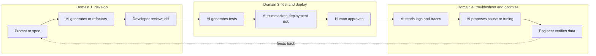
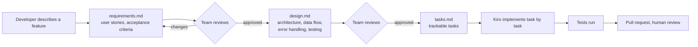

# 1.1.9 Use AI-assisted tools for code generation, review, completion, refactoring, optimization, and security scanning

**Domain 1 · Task 1.1 · Skill 1.1.9** · [Task overview](README.md) · Previous: [1.1.8 Event-driven applications](1.1.8-event-driven-applications.md) · Next: [1.1.10 Managed AI service integration](1.1.10-managed-ai-service-integration.md)

## What the exam expects

This skill is new in the AWS Certified Developer - Associate (DVA-C03) exam. It tests whether you can use an artificial intelligence (AI) coding tool inside a normal development workflow and know where human judgment must stay. The official in-scope list names **Kiro** as the AI development tool. Questions describe a capability (generate code from requirements, enforce team conventions, run a scan whenever a file changes, review a pull request) and ask which feature or practice fits. Wrong answers usually let AI output reach production with no review, or send secrets to the tool.

You must be able to:

- Map a scenario to a capability: generation, completion, review, refactoring, optimization, or security scanning.
- Recognize Kiro's building blocks: specs, steering, hooks, Model Context Protocol (MCP) servers, custom agents, and headless mode.
- Apply responsible use: review every change, run tests and scanners, keep secrets and sensitive data out of prompts, scope generated AWS Identity and Access Management (IAM) policies to least privilege.
- Tell the same AI pattern apart when it reappears in testing (3.2.5), deployment (3.3.9), troubleshooting (4.1.5), and optimization (4.3.6).

## Key terms

| Term | Meaning |
|---|---|
| Agentic IDE | An integrated development environment (IDE) where an AI agent plans and edits code, runs commands, and calls tools, not only suggests text. |
| Spec-driven development | Write requirements, then a design, then a task list, and generate code task by task against them. |
| Spec | Kiro's set of three files: `requirements.md` (or `bugfix.md`), `design.md`, and `tasks.md`. |
| Steering | Markdown files in `.kiro/steering/` that give the agent persistent project rules: standards, stack, structure. |
| Hook | An automation that runs a shell command or an agent prompt when an event happens, such as a file save or a tool call. |
| MCP | Model Context Protocol: an open standard for connecting AI agents to external tools and data sources. |
| Headless mode | Running the Kiro command line interface (CLI) non-interactively, for example in a continuous integration (CI) pipeline, authenticated with an application programming interface (API) key. |
| Code completion | Inline suggestions as you type. |
| Security scanning | Finding vulnerabilities, hard-coded secrets, injection risks, and overly broad permissions in code. |
| Hallucination | Confident output that is wrong, such as an API that does not exist or a root cause that the data does not support. |

## What AI tools do in the development lifecycle

| Capability | What it looks like | Exam skill | What a human still checks |
|---|---|---|---|
| Code generation | Function, handler, or infrastructure as code (IaC) from a prompt or spec | 1.1.9 | Logic, event shapes, error handling, IAM scope |
| Code completion | Inline suggestions while typing | 1.1.9 | That the suggestion matches the actual API and data |
| Refactoring | Highlight code, ask for a change, review the diff | 1.1.9 | The diff does not change behavior beyond the request |
| Code review | Comments on a pull request: bugs, style, insecure patterns | 1.1.9 | False positives; final accept or reject |
| Optimization | Suggests a faster algorithm, connection reuse, batching, or memory change | 1.1.9, [4.3.6](../../domain-4-troubleshooting-and-optimization/task-4.3-optimize-applications/4.3.6-ai-assisted-optimization.md) | Confirm against real metrics before changing production |
| Security scanning | Flags hard-coded secrets, Structured Query Language (SQL) injection, `Resource: "*"` | 1.1.9, Domain 2 | Each finding is a human decision |
| Test generation | Unit tests, edge cases, mock events | [3.2.5](../../domain-3-testing-and-deployment/task-3.2-test-applications/3.2.5-ai-assisted-testing.md) | Business-specific edge cases the tool cannot know |
| Deployment support | Summarize a CloudFormation diff for an approver, validate after deploy | [3.3.9](../../domain-3-testing-and-deployment/task-3.3-deploy-with-ci-cd/3.3.9-ai-assisted-deployment.md) | The approval itself stays human |
| Error analysis | Summarize logs and traces into a likely cause | [4.1.5](../../domain-4-troubleshooting-and-optimization/task-4.1-root-cause-analysis/4.1.5-ai-assisted-error-analysis.md) | Verify against raw logs, metrics, and traces |
| Codebase questions | "Where is reconciliation implemented?" | General | Read the code before changing it |



The shape is the same at every stage: **AI proposes, a human verifies, the human stays accountable.**

## Kiro

Kiro is AWS's agentic AI development environment. One agent runs behind several surfaces: the Kiro IDE, an extension for Visual Studio Code (VS Code), the Kiro CLI, Kiro Web (sandboxed cloud sessions that end in a pull request), and mobile. Project configuration lives in `.kiro/` in the repository, so specs, steering, and hooks travel with the code.

| Kiro feature | What it does | Exam cue |
|---|---|---|
| Specs | Turn a feature request into reviewed requirements, design, and tasks before code | "Requirements and design reviewed before any code is generated" |
| Bugfix specs | Root-cause analysis with current, expected, and unchanged behavior before the fix | "Fix the bug and prevent regressions" |
| Steering | Persistent project rules the agent always follows | "AI-generated code must follow team conventions" |
| Hooks | Run a command or agent prompt on events such as file save, tool use, or task completion | "Run a check automatically whenever files change" |
| MCP servers | Connect the agent to external tools and APIs (documentation, ticketing, AWS APIs) | "Give the assistant access to an internal tool" |
| Powers and skills | Reusable packages of instructions and tools that load on demand | "Package expertise for reuse" |
| Custom agents and sub-agents | Specialized agents with their own prompts and tool permissions; delegate parallel work | "A read-only reviewer agent" |
| Permissions | Control which tools and commands the agent may run | Least privilege for the agent |
| `.kiroignore` | Keeps sensitive files away from the agent | "Do not expose secrets to the assistant" |
| Checkpoints and rewind | Undo agent changes or fork a conversation | Recover from a bad edit |
| Headless CLI | Set `KIRO_API_KEY` and run prompts in CI: reviews, test generation, build-failure triage | "Run the AI step inside the pipeline" |

### Specs



- Feature specs offer requirements-first or design-first workflows. **Quick Spec** generates all three files without approval gates for well-understood work.
- When you run all tasks, Kiro builds a dependency graph from `tasks.md` and runs independent tasks in parallel waves.
- The spec makes the human checkpoint structural. You review the plan before code exists, instead of reviewing a large diff afterward.

### Steering

- Workspace steering in `.kiro/steering/` applies to one project; global steering in `~/.kiro/steering/` applies everywhere. Workspace rules win when they conflict.
- Kiro can generate three foundation files: `product.md` (purpose, users), `tech.md` (frameworks, libraries, constraints), and `structure.md` (layout, naming, imports).
- Add your own, for example `api-standards.md` stating "every Lambda handler returns the API Gateway proxy shape and logs structured JavaScript Object Notation (JSON)".
- Teams can distribute global steering through device management or a shared repository.

### Hooks

Hooks are JSON files in `.kiro/hooks/`. Each has a trigger (for example `PostFileSave`, `PreToolUse`, `PostToolUse`, `Stop`), an optional matcher (a file-path regular expression, or a tool selector), and an action that runs a shell command or injects an agent prompt.

```json
{
  "version": "v1",
  "hooks": [{
    "name": "Security scan Python on save",
    "trigger": "PostFileSave",
    "matcher": "\\.py$",
    "action": { "type": "command", "command": "bandit -q -r src && pytest -q" },
    "timeout": 120
  }]
}
```

Typical uses: run linters, type checks, tests, or a security scanner after each edit; generate a test file when a new source file appears; block a dangerous tool call with a `PreToolUse` hook unless preconditions hold; update docs after a change.

### Headless mode in CI

With `KIRO_API_KEY` set, the Kiro CLI skips browser login and runs non-interactively. A CodeBuild or GitHub Actions step can ask Kiro to review the pull request diff, generate missing tests, or explain a failed build. Give that CI agent read-only tool permissions when it only reviews, and keep any merge or deploy decision with a human or an existing approval gate.

### Data handling

Kiro's authentication documentation says AWS may use certain content from Kiro Free Tier users and individual subscribers (social login or AWS Builder ID) for service improvement, so check which sign-in method and settings your organization uses. Whatever the plan, keep credentials, customer personally identifiable information (PII), and proprietary data you are not allowed to share out of prompts, and use `.kiroignore` for sensitive files. Data-use commitments for Bedrock are covered in [2.3.2](../../domain-2-security/task-2.3-secure-ai-services/2.3.2-ai-data-privacy-and-private-connectivity.md).

> **Not on the DVA-C03 service list.** Amazon Q Developer (inline chat, code suggestions, security scans, and the `q` CLI in IDEs) was the AI developer tool in DVA-C02 material. DVA-C03 names Kiro instead. AWS stopped new Q Developer sign-ups on May 15, 2026 and ends support for the Q Developer IDE plugins and paid subscriptions on April 30, 2027, pointing customers to Kiro. Q Developer inside the AWS Management Console is not part of that end of support. If an older question names Q Developer, map it to the same capability and apply the same review rules.

### Amazon Quick in this skill

Amazon Quick (called "AWS Quick" in current AWS documentation, and the successor to Amazon QuickSight) is on the in-scope list next to Kiro, but it is an AI workspace for business users: chat agents over company data, research reports, automated flows, dashboards, and app building. It is not a coding assistant. Developers meet it when they connect data sources and actions to it. See [1.1.10](1.1.10-managed-ai-service-integration.md). Amazon Quick Sight on its own is listed as out of scope.

## Responsible use

| Rule | Why | Exam signal |
|---|---|---|
| Review every generated change before merge | Generated code compiles and still misses requirements or edge cases | Any option that auto-merges or auto-deploys AI output is wrong |
| Keep tests and scanners in CI | Faster code needs the same quality gates | "Ensure AI-generated code meets standards" means tests plus scans plus review |
| Scope generated IAM policies | Assistants often produce `"Action": "dynamodb:*", "Resource": "*"` to make a demo work | Least privilege is still your job, see [2.1.6](../../domain-2-security/task-2.1-authentication-and-authorization/2.1.6-least-privilege-permissions.md) |
| Never paste secrets or PII into prompts | Prompts can be stored or logged; stack traces can hold connection strings | Scrub before pasting; use `.kiroignore` |
| Encode standards in steering, not in each prompt | Consistent output across the team | "Enforce conventions" means steering |
| Give agents least-privilege tool permissions | An agent that can run any command can do damage | Read-only reviewer agents in CI |
| Verify AI analysis against data | A summary can latch onto the most frequent error, not the first one | "Trust the raw data over the AI summary" |
| Check licenses and provenance of generated code | Suggestions can resemble public open-source code | License review before merge |

### Worked example: generated handler and policy

A developer asks for "a Lambda function that returns a user's orders from DynamoDB". The assistant produces a working handler and this policy:

```json
{ "Effect": "Allow", "Action": "dynamodb:*", "Resource": "*" }
```

The shipped version is scoped to what the code calls:

```json
{
  "Effect": "Allow",
  "Action": "dynamodb:Query",
  "Resource": "arn:aws:dynamodb:us-east-1:111122223333:table/Orders"
}
```

The handler review also catches serialization defects (a dict `body`, an unguarded `queryStringParameters`), worked through in [1.1.7](1.1.7-serialization-and-deserialization.md).

### Worked example: generated tests

The assistant writes tests for the happy path and the empty-result case. The developer adds a test for a malformed request with no `pathParameters`, which the team decided after a past incident must return a 400. The AI cannot derive that rule from the code. This is the pattern for [3.2.5](../../domain-3-testing-and-deployment/task-3.2-test-applications/3.2.5-ai-assisted-testing.md): AI covers obvious cases fast, humans add business-specific ones.

### Failure modes to recognize

- **Prompt to production with no review:** a pipeline auto-commits an AI fix for a failing test; the fix deletes the assertion.
- **Context leakage:** a stack trace pasted into chat contains a database connection string with a password.
- **Over-broad IAM:** generated `dynamodb:*` on `*` ships unchanged.
- **Confident wrong root cause:** the summary blames a downstream timeout; the trace shows a cold start pushing the request past API Gateway's 29-second default timeout.

## Exam triggers

| Scenario clue | Answer | Why the alternatives are wrong |
|---|---|---|
| Generate code from written requirements with a reviewable design and task list | Kiro specs | Inline completion has no requirements or design stage |
| Lock requirements and design before any code is generated | Spec-driven workflow with review gates | Reviewing a diff afterward is not "before code" |
| AI-generated code must follow team conventions every time | Steering files | Repeating rules in each prompt is inconsistent |
| Run tests, a linter, or a security scan whenever a file is saved | Kiro hook on file save | A manual reminder is not automatic |
| Block an agent from running a risky command unless a check passes | `PreToolUse` hook, agent permissions | Trusting the model's judgment alone is not a control |
| Connect the assistant to an internal ticketing system | MCP server | Copying data into prompts by hand does not scale and leaks data |
| Run an AI code review on each pull request in CI | Kiro CLI in headless mode with an API key and read-only permissions | Interactive login cannot run in a pipeline |
| Keep secret files away from the assistant | `.kiroignore` | Asking the agent not to read them is not enforcement |
| AI suggests a fix; what next | Review the diff, run tests and scans, then merge through the normal process | Auto-merge or auto-deploy is always wrong |
| Developer wants to paste a stack trace with credentials into chat | Remove the credentials first | No tool is the right place for a live secret |
| Generated IAM policy uses `*` | Scope actions and resources to what the code calls | `*` violates least privilege regardless of who wrote it |
| Question names Amazon Q Developer | Map to the capability; same review rules | Q Developer is not on the DVA-C03 list |

## Common traps

- AI tools assist. They do not replace code review, tests, approval gates, or least privilege.
- An AI review comment is a finding, not a verdict. Static checks produce false positives.
- Steering is guidance the agent follows; hooks and permissions are automation and enforcement. Pick hooks or permissions when the scenario says "automatically" or "must be blocked".
- A spec is reviewed before implementation; a pull request review happens after.
- Generated code that calls AWS still needs correct AWS software development kit (SDK) usage, retries, pagination, and serialization.
- Do not choose Amazon Quick for coding tasks. It is a business-user AI workspace.
- The exam does not test prompt engineering or model selection; those are listed as out of the target role.

## Quick recall

- Kiro: AWS's agentic IDE and CLI, with Web and VS Code surfaces; configuration in `.kiro/`.
- Specs: `requirements.md` or `bugfix.md`, `design.md`, `tasks.md`.
- Steering: `.kiro/steering/` (workspace) and `~/.kiro/steering/` (global); workspace wins.
- Hooks: `.kiro/hooks/*.json`, triggers such as `PostFileSave` and `PreToolUse`, command or agent actions.
- MCP connects the agent to tools and data.
- Headless mode: `KIRO_API_KEY`, for CI reviews and test generation.
- `.kiroignore` keeps sensitive files out.
- AI proposes, human verifies, human is accountable.
- Q Developer: DVA-C02 era, not on the DVA-C03 list; IDE plugins end support April 30, 2027.

## Related skills

- [1.1.7 Serialization and deserialization](1.1.7-serialization-and-deserialization.md): the handler defects an AI review should catch.
- [1.1.10 Managed AI service integration](1.1.10-managed-ai-service-integration.md): Bedrock, AgentCore, and Amazon Quick as services your code calls.
- [2.1.6 Least-privilege permissions](../../domain-2-security/task-2.1-authentication-and-authorization/2.1.6-least-privilege-permissions.md): scoping generated IAM policies.
- [2.2.7 Secrets management](../../domain-2-security/task-2.2-encrypt-and-protect-sensitive-data/2.2.7-secrets-management.md): where secrets belong instead of code or prompts.
- [2.3.2 AI data privacy and private connectivity](../../domain-2-security/task-2.3-secure-ai-services/2.3.2-ai-data-privacy-and-private-connectivity.md): data-use commitments for AI services.
- [3.2.5 AI-assisted testing](../../domain-3-testing-and-deployment/task-3.2-test-applications/3.2.5-ai-assisted-testing.md): test generation and coverage gaps.
- [3.3.9 AI-assisted deployment](../../domain-3-testing-and-deployment/task-3.3-deploy-with-ci-cd/3.3.9-ai-assisted-deployment.md): approvals and post-deployment validation.
- [4.1.5 AI-assisted error analysis](../../domain-4-troubleshooting-and-optimization/task-4.1-root-cause-analysis/4.1.5-ai-assisted-error-analysis.md): verifying AI root-cause summaries.
- [4.3.6 AI-assisted optimization](../../domain-4-troubleshooting-and-optimization/task-4.3-optimize-applications/4.3.6-ai-assisted-optimization.md): bottleneck and waste detection.

## Sources

- Merged from: `archive/dva-c03-study-notes/01-development-with-aws-services.md` (skill 1.1.9), `archive/dva-c03-study-notes/00-developer-basics.md` (AI-assisted development, MCP), `archive/dva-c03-study-notes/05-cheat-sheet.md`, `archive/dva-c03/domain-1-development/ai-assisted-development.md`, `archive/dva-c03/domain-1-development/README.md`, `archive/dva-c03/domain-1-development/MASTER-CHUNK.md` (Amazon Q section, used only for the not-on-list block), `archive/aws-dva-notes/Markdown Files/30. AI Services & Security (DVA-C03).md` (section 8), `archive/aws-dva-notes/Markdown Files/29. Exam Review & Tips.md`.
- Official outline: `00-foundations/exam-guide.md` and [DVA-C03 in-scope services](https://docs.aws.amazon.com/aws-certification/latest/developer-associate-03/dva-03-in-scope-services.html), [out-of-scope services](https://docs.aws.amazon.com/aws-certification/latest/developer-associate-03/dva-03-out-of-scope-services.html)
- Kiro documentation: [Kiro docs overview](https://kiro.dev/docs/), [Specs](https://kiro.dev/docs/specs/), [Steering](https://kiro.dev/docs/steering/), [Hooks](https://kiro.dev/docs/hooks/), [Headless mode](https://kiro.dev/docs/cli/headless/), [Authentication and data use](https://kiro.dev/docs/getting-started/authentication/)
- AWS documentation: [Amazon Q Developer IDE plugin end of support](https://docs.aws.amazon.com/amazonq/latest/qdeveloper-ug/q-developer-ide-end-of-support.html)
- AWS blog: [Amazon Q Developer end-of-support announcement](https://aws.amazon.com/blogs/devops/amazon-q-developer-end-of-support-announcement/) (sign-up cutoff, end-of-support date, and the console exception)
- AWS documentation: [What is AWS Quick?](https://docs.aws.amazon.com/quick/latest/userguide/what-is.html)
