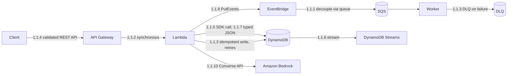

# Task 1.1: Build application code on AWS

**Domain 1 · Task 1.1** · [Domain overview](../README.md)

Task 1.1 is the largest task in the largest domain (Domain 1 is 30% of scored content). It tests whether your application code uses AWS services well: decoupled components, the right communication style, retries that end and do not duplicate work, well-formed and validated application programming interfaces (APIs), correct AWS Software Development Kit (SDK) calls, streaming data, serialization, event-driven designs, artificial intelligence (AI)-assisted development tools, and managed AI services. Task 1.2 narrows the same ideas to AWS Lambda configuration and failure handling, and Task 1.3 to data stores. Most later domains assume you can already do what this task describes.

Abbreviations used on this page: Representational State Transfer (REST), Hypertext Transfer Protocol (HTTP), Amazon Simple Queue Service (SQS), Amazon Simple Notification Service (SNS), dead-letter queue (DLQ), First-In-First-Out (FIFO), Velocity Template Language (VTL), Cross-Origin Resource Sharing (CORS), AWS Command Line Interface (CLI), JavaScript Object Notation (JSON), Amazon Simple Storage Service (S3), Amazon Elastic Container Service (ECS), Amazon Elastic Compute Cloud (EC2).

## Skills

| Skill | Note | Covers |
|---|---|---|
| 1.1.1 | [Coupling and decoupling](1.1.1-coupling-and-decoupling.md) | Tight versus loose coupling; choosing Amazon SQS, Amazon SNS, Amazon EventBridge, Kinesis, or Step Functions; SQS visibility timeout, DLQs, long polling, FIFO |
| 1.1.2 | [Communication patterns](1.1.2-communication-patterns.md) | Synchronous, asynchronous, and event-driven styles; Lambda invocation models; API Gateway to SQS and Step Functions; choreography versus orchestration; Standard versus Express workflows |
| 1.1.3 | [Resilience, retries, and backoff](1.1.3-resilience-retries-and-backoff.md) | Which errors to retry, SDK retry modes, backoff with jitter, timeouts and circuit breakers, idempotency, DLQs and destinations, Step Functions `Retry` and `Catch`, graceful degradation |
| 1.1.4 | [APIs, transformation, and validation](1.1.4-apis-transformation-and-validation.md) | REST, HTTP, and WebSocket APIs; integration types; Lambda proxy contract; VTL mapping templates; request validators and models; CORS; usage plans and throttling |
| 1.1.5 | [AWS SDKs and service APIs](1.1.5-aws-sdks-and-service-apis.md) | Credential provider chain, Region, clients, paginators, waiters, batch partial failures, error codes, CLI features, CloudShell |
| 1.1.6 | [Streaming data](1.1.6-streaming-data.md) | Kinesis Data Streams, Amazon Data Firehose, DynamoDB Streams, and stream consumers |
| 1.1.7 | [Serialization and deserialization](1.1.7-serialization-and-deserialization.md) | JSON bodies in Lambda events, DynamoDB typed JSON, base64 payloads, schemas |
| 1.1.8 | [Event-driven applications](1.1.8-event-driven-applications.md) | EventBridge rules, S3 Event Notifications, SNS fan-out and filtering, SQS-driven processing |
| 1.1.9 | [AI-assisted development tools](1.1.9-ai-assisted-development-tools.md) | Kiro specs, steering, and hooks; code generation, review, refactoring, and security scanning |
| 1.1.10 | [Managed AI service integration](1.1.10-managed-ai-service-integration.md) | Amazon Bedrock APIs, Knowledge Bases, Agents, Amazon Bedrock AgentCore, Amazon Quick |

## How the skills fit together

Most Task 1.1 questions describe one application and test one decision inside it. This request path touches several skills at once:

Use this table to find the skill a scenario is testing:

| If the question is about... | Skill |
|---|---|
| One service failing or slowing another; adding consumers without changing the producer | 1.1.1 |
| Whether the caller waits; 29-second timeouts; returning `202`; orchestration versus choreography | 1.1.2 |
| Throttling, retries, duplicates, lost events, degraded but working features | 1.1.3 |
| `502` or `400` from API Gateway, mapping templates, validation, API keys, CORS | 1.1.4 |
| Credentials, Region, pagination, waiters, batch calls, SDK error codes, CLI flags | 1.1.5 |
| Ordered real-time records, shards, consumers falling behind | 1.1.6 |
| `json.loads(event["body"])`, base64 data, DynamoDB `{"S": ...}` values | 1.1.7 |
| S3 uploads triggering work, event patterns, SNS filter policies | 1.1.8 |
| Generating, reviewing, or scanning code with AI tools | 1.1.9 |
| Calling foundation models, retrieval-augmented generation, agents | 1.1.10 |

## Study checklist

- [ ] 1.1.1 Identify tight coupling in a scenario and pick the decoupling service by shape (fan-out, competing consumers, content routing, ordered stream, workflow); configure SQS visibility timeout, DLQ, long polling, delay, and FIFO groups.
- [ ] 1.1.2 Choose synchronous, asynchronous, or event-driven communication; name the invocation model of each Lambda trigger; pick Standard or Express workflows and the right Step Functions integration pattern.
- [ ] 1.1.3 Configure SDK retries, write bounded backoff with jitter, implement an idempotency key with a conditional write, and route failures to DLQs, destinations, or `Catch` states.
- [ ] 1.1.4 Pick REST, HTTP, or WebSocket APIs; return a correct Lambda proxy response; write a VTL mapping template; validate requests with a model; set up usage plans in the right order.
- [ ] 1.1.5 Trace the credential provider chain in Lambda, ECS, EC2, and locally; use paginators, waiters, and batch calls with retries of unprocessed items; handle SDK errors by code.
- [ ] 1.1.6 Design partition keys for Kinesis, choose Data Streams or Firehose, and tune Lambda stream consumers.
- [ ] 1.1.7 Parse and produce JSON strings, base64 payloads, and DynamoDB typed JSON correctly.
- [ ] 1.1.8 Build S3, EventBridge, SNS, and SQS event-driven flows with filters and fan-out.
- [ ] 1.1.9 Use AI-assisted tools for generation, review, refactoring, and security scanning, and review their output.
- [ ] 1.1.10 Call Amazon Bedrock and related managed AI services from application code.

## Labs and practice

- [Labs](labs.md): Lab 1, an S3 upload triggers a Lambda function (event-driven processing). Lab 2, idempotent writes with a DynamoDB conditional expression. Lab 3, SDK credential resolution made visible. All run against the Floci local emulator.
- [Practice questions](practice-questions.md): 7 multiple-choice and multiple-response questions with answers, explanations, and skill tags.
