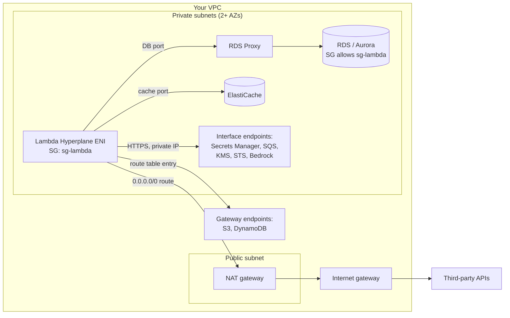

# 1.2.1 Give Lambda functions access to private resources inside a VPC

**Domain 1 · Task 1.2 · Skill 1.2.1** · [Task overview](README.md) · Previous: [1.1.10 Managed AI service integration](../task-1.1-build-application-code/1.1.10-managed-ai-service-integration.md) · Next: [1.2.2 Lambda configuration](1.2.2-lambda-configuration.md)

## What the exam expects

This skill tests whether you know what changes when an AWS Lambda function is attached to your own virtual private cloud (VPC): what it can reach, what it loses, and which network pieces (security groups, NAT gateways, VPC endpoints) fill the gaps. Most questions describe a symptom, such as a timeout, a refused database connection, or a failed call to S3, and ask for the missing piece.

You must be able to:

- Attach a function to private subnets and security groups, with the right execution role permissions.
- Open the path from the function to a private database, cache, or internal load balancer with security group rules.
- Restore outbound access from a VPC-attached function with a NAT gateway (internet) or VPC endpoints (AWS services).
- Protect a relational database from Lambda connection storms with Amazon Relational Database Service (RDS) Proxy.
- Mount Amazon Elastic File System (EFS) from a function.
- Diagnose the common failures: timeouts, security group gaps, IP exhaustion, and missing permissions.

## Key terms

| Term | Meaning |
|---|---|
| VPC | Virtual private cloud. Your isolated network in AWS, split into subnets. |
| Private subnet | A subnet whose route table has no route to an internet gateway. |
| Security group (SG) | Stateful firewall attached to a network interface. Rules can reference other security groups. |
| ENI | Elastic network interface. A virtual network card with a private IP address in a subnet. |
| Hyperplane ENI | The managed ENI Lambda creates for a VPC-attached function. Shared by every function that uses the same subnet and security group combination. |
| NAT gateway | Network address translation gateway. Sits in a public subnet and gives private subnets outbound-only internet access. |
| IGW | Internet gateway. Gives a public subnet a route to the internet. |
| Gateway endpoint | A VPC endpoint implemented as a route table entry. Only for Amazon S3 and Amazon DynamoDB. No hourly charge. |
| Interface endpoint | A VPC endpoint implemented as an ENI with a private IP (AWS PrivateLink). Available for most AWS services. Charged per hour and per GB. |
| RDS Proxy | A managed database proxy that pools and reuses connections to Amazon RDS and Aurora. |
| EFS access point | An application-specific entry point into an EFS file system. Required for Lambda mounts. |

## Default networking versus VPC attachment

Every Lambda function runs inside a VPC that the Lambda service owns and manages. You never see it. By default, that is all the networking a function has:

| | Not attached to your VPC (default) | Attached to your VPC |
|---|---|---|
| Public internet (third-party APIs) | Yes | No, unless a route to a NAT gateway exists |
| Public AWS endpoints (S3, DynamoDB, SQS, Secrets Manager) | Yes | No, unless a NAT gateway or a VPC endpoint exists |
| Private resources in your VPC (RDS, ElastiCache, internal Application Load Balancer (ALB), EC2) | No | Yes, if security groups allow it |
| Public IP address | Not applicable | Never, even in a public subnet |
| CloudWatch Logs output | Yes | Yes. Lambda ships logs through its own infrastructure, so logs work without a NAT or endpoint |

Rule of thumb: attach a function to a VPC only when it must reach something private. A function that only calls public AWS APIs gains nothing from VPC attachment and takes on extra networking to manage.

## Attaching a function to a VPC

You give the function a list of subnets and security groups. Lambda then creates Hyperplane ENIs in those subnets.

- Choose **private subnets**, and pick subnets in at least two Availability Zones (AZs) for high availability.
- Choose one or more **security groups** for the function. Other resources refer to these groups in their inbound rules.
- Lambda creates a Hyperplane ENI the first time a given subnet and security group combination is used. Other functions with the same combination share it. Each Hyperplane ENI supports up to 65,000 connections or ports, and Lambda adds ENIs when needed.
- ENIs are created at configuration time, not per invocation. Since late 2019, VPC attachment adds little cold-start latency. Older material that says "VPC functions have slow cold starts because of ENI creation" is out of date.

```bash
aws lambda update-function-configuration --function-name orders-api \
  --vpc-config SubnetIds=subnet-0a1b2c3d,subnet-4e5f6a7b,SecurityGroupIds=sg-0123456789abcdef0

# Detach from the VPC: pass empty lists
aws lambda update-function-configuration --function-name orders-api \
  --vpc-config SubnetIds=[],SecurityGroupIds=[]
```

```yaml
# AWS SAM: VpcConfig passes straight through to AWS::Lambda::Function
OrdersFunction:
  Type: AWS::Serverless::Function
  Properties:
    Handler: app.handler
    Runtime: python3.12
    VpcConfig:
      SubnetIds: [!Ref PrivateSubnetA, !Ref PrivateSubnetB]
      SecurityGroupIds: [!Ref LambdaSecurityGroup]
    Policies:
      - AWSLambdaVPCAccessExecutionRole
```

### Function lifecycle with a VPC

- A new VPC-attached function stays in the `Pending` state until its Hyperplane ENI is ready, which can take several minutes. You cannot invoke it until it becomes `Active`.
- If a VPC-attached function sits idle for 14 days, Lambda reclaims the unused ENI and sets the function to `Inactive`. The next invocation fails and the function returns to `Pending` while the ENI is recreated.
- When you remove a VPC configuration, Lambda can take up to 20 minutes to delete the ENI. It uses the execution role to do so. If you delete the role first, the ENI is orphaned and you must delete it yourself.
- Lambda cannot attach directly to a VPC with dedicated instance tenancy. Peer it to a default-tenancy VPC instead.

## Permissions

Two different identities need permissions.

| Who | Permissions | Why |
|---|---|---|
| The function's **execution role** | `ec2:CreateNetworkInterface`, `ec2:DescribeNetworkInterfaces`, `ec2:DescribeSubnets`, `ec2:DeleteNetworkInterface`, `ec2:AssignPrivateIpAddresses`, `ec2:UnassignPrivateIpAddresses` on `"Resource": "*"`. The AWS managed policy `AWSLambdaVPCAccessExecutionRole` contains them. | Lambda uses the role to create and delete the Hyperplane ENIs. |
| The **developer or pipeline** configuring the function | `ec2:DescribeSecurityGroups`, `ec2:DescribeSubnets`, `ec2:DescribeVpcs`, `ec2:GetSecurityGroupsForVpc` | Lambda checks the network resources using the caller's identity. |

The role needs these permissions only to manage ENIs. Invocations keep working if you later remove them. Because the role's permissions are also available to your code, AWS suggests a deny statement that blocks these EC2 calls from the function code while still letting the Lambda service manage ENIs:

```json
{
  "Effect": "Deny",
  "Action": [
    "ec2:CreateNetworkInterface", "ec2:DeleteNetworkInterface",
    "ec2:DescribeNetworkInterfaces", "ec2:DescribeSubnets",
    "ec2:DetachNetworkInterface", "ec2:AssignPrivateIpAddresses",
    "ec2:UnassignPrivateIpAddresses"
  ],
  "Resource": "*",
  "Condition": {
    "ArnEquals": { "lambda:SourceFunctionArn": "arn:aws:lambda:us-west-2:123456789012:function:my_function" }
  }
}
```

Administrators can also enforce VPC settings with the AWS Identity and Access Management (IAM) condition keys `lambda:VpcIds`, `lambda:SubnetIds`, and `lambda:SecurityGroupIds` on `CreateFunction` and `UpdateFunctionConfiguration`, for example to require that every function is VPC-attached.

## Reaching private resources and the outside world



| The function needs to reach | Add this | Notes |
|---|---|---|
| RDS or Aurora in a private subnet | Database SG inbound rule from the Lambda SG on the database port. Add RDS Proxy for connection pooling. | Reference the Lambda security group, not IP ranges. |
| ElastiCache, internal ALB, EC2 | SG inbound rule from the Lambda SG on the service port | Same pattern as RDS. |
| S3 or DynamoDB | Gateway VPC endpoint on the private subnets' route tables (free), or a NAT gateway | Gateway endpoint is the cheapest private path. S3 also offers interface endpoints. |
| SQS, SNS, Secrets Manager, AWS Key Management Service (KMS), AWS Security Token Service (STS), Amazon Bedrock, other AWS APIs | Interface VPC endpoint in the function's subnets, or a NAT gateway | Endpoint keeps traffic off the internet. Enable private DNS so the AWS SDK's default endpoint resolves to the private IP. |
| A third-party HTTPS API on the internet | NAT gateway in a public subnet, plus a `0.0.0.0/0` route to it from the private subnets' route table | The Lambda SG must also allow outbound traffic (the default SG rule does). |
| Outbound IPv6 | Dual-stack subnets and `Ipv6AllowedForDualStack=true` | Optional. All selected subnets need both IPv4 and IPv6 CIDR blocks. |

> **Trap: public subnets do not help Lambda.** Placing a VPC-attached function in a public subnet does not give it a public IP or internet access. The fix is always a private subnet with a route to a NAT gateway.

For private connectivity to Amazon Bedrock specifically (interface endpoint for `bedrock-runtime`), see [2.3.2 AI data privacy and private connectivity](../../domain-2-security/task-2.3-secure-ai-services/2.3.2-ai-data-privacy-and-private-connectivity.md).

## RDS Proxy: protecting a database from Lambda scale-out

Lambda scales by adding execution environments, and each environment opens its own database connections. A spike to hundreds of concurrent invocations can exhaust a relational database's `max_connections`. RDS Proxy sits between Lambda and RDS or Aurora, keeps a pool of database connections, and multiplexes many client connections over them. It also shortens failover time, and it can use IAM authentication and Secrets Manager for credentials.

Other levers that limit connection pressure:

- Open the connection outside the handler so warm invocations reuse it (see [1.2.2 Lambda configuration](1.2.2-lambda-configuration.md#the-execution-environment-and-init-code)).
- Cap concurrency with reserved concurrency, or with maximum concurrency on an SQS event source mapping (see [1.2.4](1.2.4-lambda-service-integrations.md#scaling-and-ordering-by-source)).
- Connection pool and thread pool tuning in general is covered in [4.3.1 Concurrency controls](../../domain-4-troubleshooting-and-optimization/task-4.3-optimize-applications/4.3.1-concurrency-controls.md).

## Mounting Amazon EFS

Lambda can mount an EFS file system only when the function is attached to the VPC that holds the EFS mount targets.

- The function must use an **EFS access point**, mounted at a local path under `/mnt/...` during initialization.
- The function's security group must be allowed by the mount target's security group on NFS port 2049.
- Each execution environment holds its own connection, so watch EFS connection and burst limits at high concurrency.
- Use EFS for large or shared, writable files across many invocations. For scratch space inside one environment, `/tmp` is faster (see [1.2.2](1.2.2-lambda-configuration.md#storage-options-compared)).

## Troubleshooting VPC-attached functions

| Symptom | Likely cause | Fix |
|---|---|---|
| Function times out when calling S3, DynamoDB, SQS, or any AWS API | No NAT gateway and no VPC endpoint. The SDK call never leaves the VPC. | Add a gateway endpoint (S3, DynamoDB) or interface endpoint, or a NAT gateway |
| Function times out calling a third-party API | No route to a NAT gateway, or function placed in a public subnet | Private subnet with a `0.0.0.0/0` route to a NAT gateway in a public subnet |
| Connection to RDS or ElastiCache refused or times out | Database SG does not allow inbound from the Lambda SG on the right port | Add the inbound rule that references the Lambda SG |
| "Too many connections" on RDS during traffic spikes | Each execution environment opens its own connections | RDS Proxy, connection reuse outside the handler, concurrency caps |
| Function stuck in `Pending`, or ENI creation errors | Execution role lacks EC2 ENI permissions, or the subnets have run out of free IP addresses | Attach `AWSLambdaVPCAccessExecutionRole`; use larger subnets or more subnets |
| First invocation after two idle weeks fails | ENI reclaimed and function `Inactive` | Expected behavior. Retry, and do not depend on ENI persistence |
| Function URL response streaming fails in a VPC | Function URLs do not support response streaming inside a VPC | Use `InvokeWithResponseStream` through an interface endpoint for Lambda |

## Exam triggers

| Scenario clue | Answer | Why the alternatives are wrong |
|---|---|---|
| "Lambda must query an RDS instance in a private subnet" | Attach the function to the VPC (private subnets, SG), allow the Lambda SG in the RDS SG, consider RDS Proxy | Making RDS public is a security regression; IAM permissions alone do not create a network path |
| "VPC-attached Lambda can't reach S3" (no internet needed) | S3 gateway VPC endpoint | NAT works but costs more; an internet gateway route alone does nothing for Lambda; Elastic IPs cannot be attached to Lambda ENIs |
| "VPC-attached Lambda must call a third-party API" | NAT gateway in a public subnet, route from the private subnet | Public subnet placement does not give a public IP; VPC endpoints only reach AWS services |
| "Lambda must read Secrets Manager without internet access" | Interface VPC endpoint for Secrets Manager | Gateway endpoints exist only for S3 and DynamoDB |
| "Lambda floods the database with connections" | RDS Proxy | Bigger instance only delays the problem; opening a new connection per invocation makes it worse |
| "Function only calls DynamoDB and public APIs; should it be in a VPC?" | No. Leave it outside the VPC | VPC attachment adds networking work with no benefit here |
| "Share large files across many concurrent invocations" | EFS through an access point (function in the VPC) | `/tmp` is per environment; layers are read-only |

## Common traps

- Believing a VPC function keeps its default internet access. It does not. Attaching to a VPC replaces the default path with the VPC's routing.
- Believing a public subnet fixes internet access. Lambda ENIs never get public IPs.
- Using an interface endpoint name for S3 or DynamoDB when the question stresses "lowest cost". Gateway endpoints are free.
- Forgetting the security group rule on the target (database) side. The Lambda SG is the source.
- Forgetting the execution role ENI permissions. The function cannot become `Active` without them.
- Blaming VPC attachment for every cold start. Hyperplane ENIs removed most of that penalty. Check `Init Duration` in the `REPORT` log line first.
- Choosing a single subnet. Use at least two AZs.

## Quick recall

- Default Lambda: internet and public AWS APIs yes, your private VPC resources no.
- VPC Lambda: private resources yes, internet and AWS APIs only through NAT or endpoints.
- Public subnet never gives Lambda a public IP.
- Execution role needs `AWSLambdaVPCAccessExecutionRole` (ENI create, describe, delete).
- Hyperplane ENIs are shared per subnet and security group combination and created at configuration time.
- Gateway endpoints: S3 and DynamoDB only, free. Interface endpoints: most services, hourly charge.
- Database SG must allow inbound from the Lambda SG.
- RDS Proxy pools connections for Lambda and shortens failover.
- EFS needs VPC attachment and an access point.
- CloudWatch Logs works from a VPC function without a NAT or endpoint.

## Related skills

- [1.2.2 Lambda configuration](1.2.2-lambda-configuration.md): init code and connection reuse, storage options.
- [1.3.2 Choosing data stores](../task-1.3-use-data-stores/1.3.2-choosing-data-stores.md): which private stores a function typically reaches.
- [2.1.6 Least-privilege permissions](../../domain-2-security/task-2.1-authentication-and-authorization/2.1.6-least-privilege-permissions.md): scoping the execution role and the source-function deny policy.
- [2.2.7 Secrets management](../../domain-2-security/task-2.2-encrypt-and-protect-sensitive-data/2.2.7-secrets-management.md): reaching Secrets Manager privately and caching database credentials.
- [2.3.2 AI data privacy and private connectivity](../../domain-2-security/task-2.3-secure-ai-services/2.3.2-ai-data-privacy-and-private-connectivity.md): interface endpoints for Amazon Bedrock.
- [4.3.1 Concurrency controls](../../domain-4-troubleshooting-and-optimization/task-4.3-optimize-applications/4.3.1-concurrency-controls.md): connection pools and concurrency caps.

## Sources

- Merged from: `archive/dva-c03-study-notes/01-development-with-aws-services.md` (skill 1.2.1 section), `archive/aws-dva-notes/Markdown Files/18. Serverless - Lambda.md` (section 12, Lambda in a VPC; section 14, EFS), `archive/aws-dva-notes/Markdown Files/7. VPC - Basics.md` (NAT gateway, VPC endpoints), `archive/aws-dva-notes/Markdown Files/5. RDS, Aurora, & ElastiCache.md` (RDS Proxy), `archive/aws-dva-notes/Markdown Files/31. Exam Day Cheat Sheet.md`, `archive/dva-c03/domain-1-development/README.md` (use case 6, common exam scenarios), `archive/dva-c03/domain-1-development/MASTER-CHUNK.md` (Lambda section), `archive/dva-c03/domain-4-troubleshooting-optimization/lambda-cold-start-diagnosis.md` (VPC cold-start note), `archive/dva-c03/exam-bank/bank-1.md` (S3 gateway endpoint scenario), `archive/dva-c03/practice-questions/full-exams/exam-2-answer-key.md` (RDS Proxy scenario).
- AWS documentation: [Giving Lambda functions access to resources in an Amazon VPC](https://docs.aws.amazon.com/lambda/latest/dg/configuration-vpc.html) (permissions, Hyperplane ENIs, 14-day idle behavior, public subnet note, condition keys)
- AWS documentation: [Lambda quotas](https://docs.aws.amazon.com/lambda/latest/dg/gettingstarted-limits.html) (ENIs per VPC)
- AWS documentation: [Response streaming for Lambda functions](https://docs.aws.amazon.com/lambda/latest/dg/configuration-response-streaming.html) (VPC compatibility)
