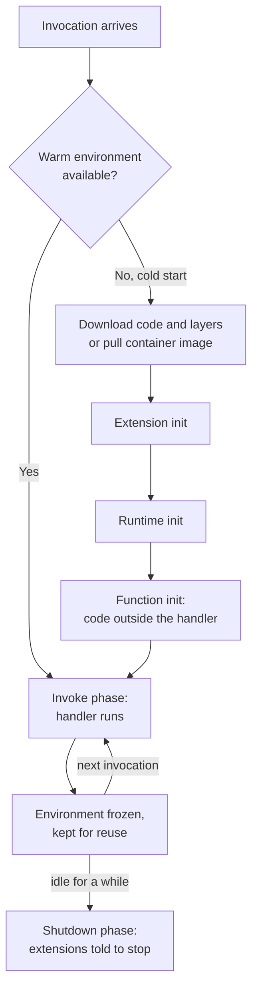

# 1.2.2 Configure environment variables, memory, concurrency, timeouts, runtimes, handlers, layers, and extensions

**Domain 1 · Task 1.2 · Skill 1.2.2** · [Task overview](README.md) · Previous: [1.2.1 Lambda VPC access](1.2.1-lambda-vpc-access.md) · Next: [1.2.3 Invocation lifecycle and failures](1.2.3-lambda-invocation-lifecycle-and-failures.md)

## What the exam expects

This skill covers every setting on an AWS Lambda function and the execution model behind them. Questions usually name a symptom (cold starts, timeouts, a slow CPU-bound function, one function starving others, duplicated dependencies) and ask which setting fixes it. Many wrong answers swap two similar knobs, such as reserved and provisioned concurrency, or memory and timeout.

You must be able to:

- Explain the execution environment lifecycle and put initialization code outside the handler.
- Choose a runtime, architecture, and handler, and use the event and context objects.
- Size memory (which also sets CPU), timeout, and ephemeral storage.
- Use environment variables for configuration and keep real secrets in a managed secret store.
- Pick between unreserved, reserved, and provisioned concurrency, and SnapStart.
- Share code with layers and add tooling with extensions.
- Know the hard limits that turn a scenario away from Lambda.

## Key terms

| Term | Meaning |
|---|---|
| Execution environment | The isolated micro virtual machine that runs one function instance. Handles one invocation at a time and is reused for later invocations. |
| Cold start | An invocation that has to create a new execution environment and run the `Init` phase first. |
| Handler | The function Lambda calls for each invocation, named in the `Handler` setting. |
| Init code | Code outside the handler. Runs once per execution environment. |
| Runtime | The language environment (managed runtime, OS-only runtime, or custom runtime). |
| Reserved concurrency | A per-function setting that both guarantees and caps concurrent executions. |
| Provisioned concurrency | Pre-initialized execution environments for a version or alias. Removes cold starts up to the configured count. Billed while configured. |
| SnapStart | Lambda snapshots an initialized environment when you publish a version and restores new environments from it. |
| Layer | A versioned .zip archive of libraries, a custom runtime, or data, extracted to `/opt`. |
| Extension | A companion process or in-process hook that runs in the execution environment alongside the function. |
| Alias | A named, mutable pointer to a published version, such as `prod`. |

> **Naming note.** Current AWS documentation calls standard Lambda functions "Lambda Event Functions" to tell them apart from newer Lambda compute options (Web Functions, Managed Instances, MicroVMs, durable functions). The exam guide and these notes say "Lambda function". The newer options are outside DVA-C03 scope.

## The execution environment and init code




*Source: [AWS Lambda Developer Guide, Lambda execution environment](https://docs.aws.amazon.com/lambda/latest/dg/lambda-runtime-environment.html). Init runs once per new environment. Every warm Invoke after it reuses whatever Init created.*

The lifecycle phases:

| Phase | What happens |
|---|---|
| `Init` | Lambda creates the environment, downloads code and layers, starts extensions (`Extension init`), starts the runtime (`Runtime init`), and runs your code outside the handler (`Function init`). Runs on the first invocation, or ahead of time with provisioned concurrency. With SnapStart it runs when you publish a version. |
| `Restore` | SnapStart only. Lambda resumes a new environment from the snapshot and runs any after-restore runtime hooks (10-second limit). |
| `Invoke` | Lambda calls the handler with the event. |
| `Shutdown` | After a period without invocations, Lambda stops the runtime, sends extensions a `Shutdown` event, and removes the environment. |

What this means for code:

- Create AWS software development kit (SDK) clients, HTTP clients, and database connections **outside the handler**. Warm invocations reuse them and skip the connection and Transport Layer Security (TLS) setup.
- Module-scope variables and files in `/tmp` survive while the environment is frozen between invocations. They make a good per-environment cache (a lookup table, a downloaded model). They are not shared across environments and may vanish at any time.
- A connection opened during Init can be closed by the remote side while the environment is frozen. The first invocation after a long idle period can hit a stale connection. Validate the connection or reconnect on error instead of assuming it stays open.
- Put per-request work (the uploaded file, the order being processed) inside the handler.

```python
import os
import boto3

# Init phase: runs once per execution environment, reused by warm invocations
dynamodb = boto3.resource("dynamodb")
table = dynamodb.Table(os.environ["TABLE_NAME"])

def lambda_handler(event, context):
    # Invoke phase: runs on every invocation
    return table.get_item(Key={"id": event["id"]}).get("Item")
```

Cold-start diagnosis (the `Init Duration` field in the `REPORT` log line) and cost trade-offs between mitigations are covered in [4.3.1 Concurrency controls](../../domain-4-troubleshooting-and-optimization/task-4.3-optimize-applications/4.3.1-concurrency-controls.md) and [4.3.2 Memory and compute tuning](../../domain-4-troubleshooting-and-optimization/task-4.3-optimize-applications/4.3.2-memory-and-compute-tuning.md).

## Runtimes and architectures

| Option | What it is | When to use it |
|---|---|---|
| Managed runtime | AWS-maintained Node.js, Python, Java, .NET, and Ruby runtimes | Default choice. AWS patches the runtime. |
| OS-only runtime (`provided.al2023`) | Amazon Linux with no language runtime | Compiled languages such as Go and Rust, or a custom runtime |
| Custom runtime | Your own `bootstrap` executable that implements the **Lambda Runtime API** (an HTTP loop: get `/runtime/invocation/next`, post to `/runtime/invocation/{id}/response`) | A language AWS does not provide. Ship the `bootstrap` in the package or a layer. |
| Container image | Image up to 10 GB from Amazon Elastic Container Registry (ECR) that implements the Runtime API (AWS base images or the runtime interface client) | Large or complex dependencies. Packaging details are in [3.3.1 Lambda packaging](../../domain-3-testing-and-deployment/task-3.3-deploy-with-ci-cd/3.3.1-lambda-packaging.md). |

- Architecture is `x86_64` or `arm64` (AWS Graviton). Arm64 is priced about 20% lower per GB-second, and code without native x86 dependencies usually runs unchanged.
- To run an arbitrary Docker image that does not implement the Runtime API, use Amazon ECS or AWS Fargate instead.

## Handlers, the event object, and the context object

| Runtime | Handler setting | Signature |
|---|---|---|
| Python | `app.lambda_handler` (file `app.py`, function `lambda_handler`) | `def lambda_handler(event, context)` |
| Node.js | `index.handler` | `export const handler = async (event, context) => {...}` |
| Java | `com.example.Handler::handleRequest` | `package.Class::method` |

- **Event object:** a JSON document from the invoking service (API Gateway request, S3 notification, SQS batch). The runtime converts it to a native type, such as a `dict` in Python. Shapes per source are in [1.2.4](1.2.4-lambda-service-integrations.md).
- **Context object:** information about the invocation, function, and environment, passed by Lambda.

```python
def lambda_handler(event, context):
    print("Source:", event.get("source"))
    print("Request ID:", context.aws_request_id)
    print("Function:", context.function_name, context.memory_limit_in_mb, "MB")
    print("Log stream:", context.log_stream_name)
    print("Time left (ms):", context.get_remaining_time_in_millis())
    return {"statusCode": 200}
```

`get_remaining_time_in_millis()` lets long-running code stop cleanly, checkpoint, or hand off work before the timeout.

## Memory and CPU

- Memory: **128 MB to 10,240 MB** in 1 MB steps.
- CPU scales in proportion to memory. At **1,769 MB** a function has the equivalent of one virtual CPU (vCPU). The maximum is 6 vCPUs at 10,240 MB, and code needs multiple threads or processes to use more than one.
- There is **no separate CPU setting**. A slow CPU-bound function is fixed by raising memory. Older material says 1,792 MB for one vCPU; current documentation says 1,769 MB.
- More memory often lowers total cost for CPU-bound work, because duration drops faster than the price per millisecond rises. Tuning tools (AWS Lambda Power Tuning, AWS Compute Optimizer) are in [4.3.2](../../domain-4-troubleshooting-and-optimization/task-4.3-optimize-applications/4.3.2-memory-and-compute-tuning.md).

## Timeout

- Default **3 seconds**, configurable in 1-second steps.
- **Maximum: 1,800 seconds (30 minutes)** as of November 19, 2026, for synchronous, asynchronous, and event source mapping invocations. Before that the maximum was **900 seconds (15 minutes)** from 2018 onward. Almost every study source and practice question uses 15 minutes. If an exam answer depends on the maximum, read the scenario's numbers carefully; "a 20-minute job" was a classic "not Lambda" clue under the old limit and fits under the new one.
- A synchronous caller may stop waiting sooner than the function timeout. API Gateway's integration timeout is 29 seconds by default (see [1.2.4](1.2.4-lambda-service-integrations.md#amazon-api-gateway)).
- For an SQS-triggered function, raise the queue's visibility timeout before raising the function timeout (see [1.2.3](1.2.3-lambda-invocation-lifecycle-and-failures.md#sqs-failures)).
- "Function times out at 3 seconds" in a scenario means the default timeout was never changed.

## Ephemeral storage (`/tmp`)

- **512 MB to 10,240 MB**, set with `EphemeralStorage.Size`. Independent of memory.
- Persists across warm invocations of the same environment. Treat it as scratch space or a cache, never as durable storage.
- To encrypt files you write there, generate AWS Key Management Service (KMS) data keys yourself.

```bash
aws lambda update-function-configuration --function-name video-assembler \
  --memory-size 3008 --timeout 600 --ephemeral-storage Size=6144
```

## Environment variables

- Key/value **strings**, **4 KB total** per function. Change behavior without changing code: table names, bucket names, feature flags, log level, the ARN of a secret.
- Lambda sets reserved variables such as `AWS_REGION`, `AWS_LAMBDA_FUNCTION_NAME`, `_HANDLER`, and the tracing variables `_X_AMZN_TRACE_ID`, `AWS_XRAY_CONTEXT_MISSING`, and `AWS_XRAY_DAEMON_ADDRESS`. You cannot override reserved names.
- Variables are part of a published version's immutable configuration, so each version keeps its own values.

### Encryption: two separate layers

| Layer | On by default? | Protects against | What your code sees |
|---|---|---|---|
| Encryption at rest | Always on. Uses the AWS managed key `aws/lambda` or a customer managed key (`KMSKeyArn`). | Anyone without AWS API access to the function | Plaintext in `os.environ` |
| Encryption helpers (in transit) | Opt-in, in the console. Encrypts chosen values client-side with a customer managed key. | People who can call `lambda:GetFunctionConfiguration` but should not see the value | Ciphertext. Code must call `kms:Decrypt`. |

A scenario where "a teammate with read-only console access can see a password under environment variables" points at the missing encryption helpers, or better, at moving the value out of environment variables.

### Secrets: store a reference, not the secret

Environment variables suit non-secret configuration. Real secrets (database passwords, API keys) belong in AWS Secrets Manager or AWS Systems Manager Parameter Store, because those add rotation, audit of each read in AWS CloudTrail, and no exposure in templates or build logs. The environment variable holds only the secret's name or ARN, and the function reads the value at runtime with caching.

The **AWS Parameters and Secrets Lambda Extension** caches values in the execution environment and serves them on a local HTTP port, so warm invocations avoid repeated API calls:

```python
import json, os, urllib.request

SECRET_ARN = os.environ["DB_SECRET_ARN"]   # a pointer, not the password

def get_db_password():
    req = urllib.request.Request(
        f"http://localhost:2773/secretsmanager/get?secretId={SECRET_ARN}",
        headers={"X-Aws-Parameters-Secrets-Token": os.environ["AWS_SESSION_TOKEN"]},
    )
    with urllib.request.urlopen(req) as resp:
        secret = json.loads(resp.read())
    return json.loads(secret["SecretString"])["password"]
```

Trade-off: environment variables add no cold-start latency. A Secrets Manager or Parameter Store lookup adds one network call on the first invocation of each new environment, then the cache absorbs it. The function's AWS Identity and Access Management (IAM) execution role needs `secretsmanager:GetSecretValue` (and `kms:Decrypt` for a customer managed key). Full coverage is in [2.2.7 Secrets management](../../domain-2-security/task-2.2-encrypt-and-protect-sensitive-data/2.2.7-secrets-management.md), and per-environment configuration with AWS AppConfig and Parameter Store is in [3.1.4](../../domain-3-testing-and-deployment/task-3.1-prepare-deployable-artifacts/3.1.4-environment-specific-configuration.md).

## Concurrency

Concurrency is the number of invocations running at the same moment. Estimate it as **requests per second × average duration in seconds**. For example, 200 requests per second at 0.5 seconds each needs about 100 concurrent executions.

- **Account limit:** 1,000 concurrent executions per Region by default, shared by all functions. It can be raised to tens of thousands through Service Quotas. New accounts may start lower.
- **Scaling rate:** each function can add up to **1,000 execution environments every 10 seconds**.
- **Throttling:** an invocation above the available concurrency is throttled. Synchronous callers get `TooManyRequestsException` (HTTP 429). Asynchronous events are retried for up to 6 hours. Details per invocation type are in [1.2.3](1.2.3-lambda-invocation-lifecycle-and-failures.md#throttling-by-invocation-type).

| Knob | What it does | Cost | Typical use |
|---|---|---|---|
| Unreserved concurrency | Shared account pool. Default for every function. | None | Fine until one busy function starves the rest |
| **Reserved concurrency** | Carves a fixed amount out of the pool for one function. It is a guarantee and a hard cap at the same time. Setting it to 0 stops all invocations. | None | Keep one noisy function from starving others; protect a downstream database by capping connections; guarantee capacity for a critical function |
| **Provisioned concurrency** | Keeps a number of environments initialized and ready on a **published version or alias** (not `$LATEST`). Invocations up to that number skip cold starts. Traffic above it spills over to on-demand environments, with cold starts, up to reserved or account limits. | Billed for the whole time it is configured, plus invocations | Latency-sensitive APIs with predictable peaks |
| **SnapStart** | Snapshots the initialized environment at publish time; new environments restore from it | No ongoing charge for Java; check pricing for Python and .NET | Slow-initializing Java, Python, or .NET functions |

Reserved concurrency arithmetic: with a 1,000 limit, reserving 150 on each of five functions leaves 250 for every other function in the account, and each of the five can never exceed 150 even if the rest of the pool is idle.

**Provisioned concurrency scaling.** Application Auto Scaling can manage provisioned concurrency on an alias, either with **scheduled scaling** (raise it before a known daily peak, lower it afterward) or **target tracking** on utilization. This avoids paying for peak capacity all day.

```bash
# Cap a function (reserved)
aws lambda put-function-concurrency --function-name create-order \
  --reserved-concurrent-executions 20

# Pre-warm 5 environments on the prod alias (provisioned)
aws lambda put-provisioned-concurrency-config --function-name create-order \
  --qualifier prod --provisioned-concurrent-executions 5
```

**SnapStart details:**

- Supported on Java 11 and later, Python 3.12 and later, and .NET 8 and later managed runtimes (zip and container images built on AWS base images).
- Works only on published versions and aliases that point to them, never `$LATEST`.
- Not compatible with provisioned concurrency, Amazon Elastic File System (EFS), or ephemeral storage above 512 MB.
- Because many environments start from one snapshot, anything that must be unique (random seeds, unique IDs, temporary credentials, open connections) must be refreshed after restore. Use runtime hooks (before-checkpoint and after-restore).

A cold-start scenario that names Java and a cost constraint points to SnapStart first. A strict "no cold starts at all" requirement points to provisioned concurrency. Reserved concurrency never pre-warms anything.

Deeper concurrency and connection-pool tuning is in [4.3.1 Concurrency controls](../../domain-4-troubleshooting-and-optimization/task-4.3-optimize-applications/4.3.1-concurrency-controls.md).

## Layers

A layer is a .zip archive that Lambda extracts into `/opt` in the execution environment. Runtimes look for libraries in language-specific subfolders, for example `python/` for Python.

- Up to **5 layers** per function. The unzipped function plus all layers must stay within **250 MB**.
- Each publish creates a new, **immutable layer version** with its own ARN (`...:layer:shared-utils:4`). A function references one exact version, so teams pin a known-good version and upgrade on purpose. Publishing a new version never changes functions already using an old one.
- Layers can be shared with other accounts or publicly through layer permissions.
- Uses: shared libraries across functions, custom runtimes, large dependencies kept out of every function package (faster deploys, smaller packages).
- **Not for container image functions.** Build dependencies into the image instead.

```bash
LAYER_ARN=$(aws lambda publish-layer-version --layer-name order-helpers \
  --zip-file fileb://layer.zip --compatible-runtimes python3.12 \
  --query LayerVersionArn --output text)

aws lambda update-function-configuration --function-name func_a --layers "$LAYER_ARN"
```

### Storage options compared

| | `/tmp` | Layers | Amazon S3 | Amazon EFS |
|---|---|---|---|---|
| Max size | 10,240 MB | 5 layers, 250 MB total with code | Elastic | Elastic |
| Persistence | Ephemeral | Durable | Durable | Durable |
| Content | Dynamic | Static, immutable | Dynamic | Dynamic |
| Storage type | File system | Archive | Object | File system |
| Shared across environments | No | Yes | Yes | Yes |
| Access speed | Fastest | Fastest | Fast | Very fast |
| Pricing | Included | Included | Storage, requests, transfer | Storage, transfer, throughput |
| Permissions | Function only | IAM | IAM | IAM and NFS |

Scratch space for one environment is `/tmp`. Reusable libraries are layers. Durable objects go to S3. Shared, writable files across many invocations go to EFS (VPC required, see [1.2.1](1.2.1-lambda-vpc-access.md#mounting-amazon-efs)).

## Extensions

Extensions plug monitoring, security, and governance tools into the execution environment.

| Type | How it runs | Examples |
|---|---|---|
| Internal extension | Inside the runtime process, through wrapper scripts or language mechanisms such as `JAVA_TOOL_OPTIONS` | In-process instrumentation agents |
| External extension | A separate process started from `/opt/extensions/`, usually delivered as a layer. Registers with the **Extensions API**, receives lifecycle events, and can keep running after the handler returns. Can be written in a different language. | AWS Parameters and Secrets Lambda Extension, observability agents, log shippers using the **Telemetry API** |

- Extensions share the function's CPU, memory, and storage, and their size counts toward the 250 MB limit.
- Every extension must finish initializing before the first invocation, so a heavy extension lengthens cold starts.
- Time an extension spends after the handler returns is billed and shows up in the `PostRuntimeExtensionsDuration` metric.
- An unused extension is pure cold-start overhead. Remove it.

## Versions and aliases

- You edit `$LATEST`, which is mutable. **Publishing** creates an immutable version (code plus configuration) with its own ARN, such as `my-function:3`.
- An **alias** (`dev`, `prod`) points to one version and can split traffic between two versions with weights (for example 95% to version 1 and 5% to version 2). Aliases cannot point to other aliases.
- Point triggers, API Gateway integrations, destinations, and provisioned concurrency at aliases so deployments do not require changing them.

```bash
aws lambda publish-version --function-name my-function
aws lambda update-alias --function-name my-function --name prod \
  --function-version 2 --routing-config '{"AdditionalVersionWeights": {"3": 0.05}}'
```

Release management, traffic shifting with AWS CodeDeploy, and test environments built from aliases are covered in [3.3.8 Versions and releases](../../domain-3-testing-and-deployment/task-3.3-deploy-with-ci-cd/3.3.8-versions-and-releases.md), [3.3.6 Deployment strategies](../../domain-3-testing-and-deployment/task-3.3-deploy-with-ci-cd/3.3.6-deployment-strategies.md), and [3.2.4 Isolated test environments](../../domain-3-testing-and-deployment/task-3.2-test-applications/3.2.4-isolated-test-environments.md).

## Other function settings

- **Logging configuration:** JSON or plain-text log format, separate application and system log levels, and a custom CloudWatch log group. JSON logs are easier to query (see [4.2.1 Structured logging](../../domain-4-troubleshooting-and-optimization/task-4.2-observability/4.2.1-structured-logging.md)).
- **Tracing:** active tracing with AWS X-Ray runs the X-Ray daemon for you; the execution role needs `AWSXRayDaemonWriteAccess` (see [4.2.4 Distributed tracing](../../domain-4-troubleshooting-and-optimization/task-4.2-observability/4.2.4-distributed-tracing.md)).
- **Recursive loop detection:** on by default and free. If a function is invoked about 16 times in the same chain of requests through SQS, S3, SNS, EventBridge custom buses, or Lambda itself, Lambda stops the next invocation and notifies you. Loops that pass through other services, such as DynamoDB, are not detected. Never write output back to the resource that triggers the function, and do not use a trigger source as its destination.
- **Code signing:** a code signing configuration lets only code signed by approved AWS Signer profiles deploy.
- **Execution role:** the IAM role the function assumes. One role per function is the best practice. Its trust policy must allow `lambda.amazonaws.com`, or `CreateFunction` fails with `InvalidParameterValueException`. The developer creating the function needs `iam:PassRole`. Role versus resource-based policy is covered in [1.2.4](1.2.4-lambda-service-integrations.md#permissions-execution-role-versus-resource-based-policy).

## Limits to remember

| Setting | Limit |
|---|---|
| Memory | 128 MB to 10,240 MB (1 MB steps) |
| Timeout | Default 3 s. Maximum 1,800 s (30 min) since November 2026; 900 s (15 min) in older material |
| Environment variables | 4 KB total |
| `/tmp` | 512 MB to 10,240 MB |
| Layers | 5 per function |
| Deployment package | 50 MB zipped (direct upload), 250 MB unzipped including layers, 10 GB container image |
| Concurrency | 1,000 per Region (soft) |
| Scaling rate | 1,000 environments per 10 seconds per function |
| Invocation payload | 6 MB synchronous request and response, 200 MB streamed response, 1 MB asynchronous |
| Resource-based policy | 20 KB |

Asynchronous payloads were 256 KB until October 2025. Older questions use 256 KB.

A job longer than the maximum timeout, or one that needs to run continuously, belongs on Amazon ECS, AWS Fargate, or AWS Batch, or should be split into steps with AWS Step Functions. A package over 250 MB unzipped needs a container image.

## Pricing in brief

- Requests: first 1 million per month free, then $0.20 per million.
- Duration: billed per millisecond in GB-seconds. First 400,000 GB-seconds per month free, then about $0.0000166667 per GB-second on x86.
- Provisioned concurrency is billed for configured time whether or not it is used. Extensions' extra duration is billed too.

## Best practices

- Initialize SDK clients, connections, and static data outside the handler.
- Keep configuration in environment variables and secrets in Secrets Manager or Parameter Store.
- Keep packages small. Move shared code to layers. Remove unused extensions.
- Never let a function trigger itself.
- Know the limits before choosing Lambda.

## Exam triggers

| Scenario clue | Answer | Why the alternatives are wrong |
|---|---|---|
| "Cold starts hurt p99 latency on a latency-sensitive API" | Provisioned concurrency on an alias | Reserved concurrency only caps or guarantees capacity; it does not pre-initialize |
| "Known daily or nightly spike; avoid paying for warm capacity all day" | Application Auto Scaling scheduled scaling of provisioned concurrency | Static provisioned concurrency wastes money; reserved concurrency does not pre-warm |
| "Java function cold starts are slow; minimize cost" | SnapStart on a published version | Provisioned concurrency works but has an ongoing cost |
| "One busy function throttles the other functions in the account" | Reserved concurrency on the busy function (or on the critical ones) | Raising the account quota alone does not isolate functions |
| "Never open more than N connections to a legacy database" | Reserved concurrency of N on the caller | Provisioned concurrency raises warm capacity; it does not cap |
| "Temporarily stop a function from running" | Reserved concurrency 0 | Deleting the trigger is slower to undo |
| "CPU-bound function is slow" | Increase memory | There is no CPU setting; a longer timeout only lets it run longer |
| "Function always fails at 3 seconds" | Increase the timeout | Default timeout is 3 seconds |
| "Several functions share the same SDK or utility code" | A layer, pinned by version ARN | Copying code causes version drift; downloading from S3 on every cold start adds latency |
| "Language with no managed runtime" | Custom runtime with a `bootstrap` that implements the Runtime API | Lambda does not transpile languages |
| "Needs 6 GB of scratch space" | `EphemeralStorage` up to 10,240 MB | `/tmp` size is not tied to memory; EFS is unnecessary for scratch space |
| "Read-only console users can see the DB password in environment variables" | Move it to Secrets Manager (or at least use encryption helpers) | At-rest encryption already applies and does not hide values from console readers |
| "Reuse a downloaded lookup table across invocations" | Load it during init into a module variable or `/tmp` | Environment variables cannot hold data loaded at runtime |
| "Intermittent 'connection closed' after idle periods" | Validate or reconnect connections created during init | The environment was frozen and the remote side closed the idle connection |

## Common traps

- Reserved concurrency does not prevent cold starts. Provisioned concurrency and SnapStart do.
- Provisioned concurrency applies to a version or alias, not `$LATEST`. Traffic above the provisioned amount still cold-starts.
- SnapStart cannot be combined with provisioned concurrency, EFS, or `/tmp` above 512 MB.
- Reserved concurrency reduces what is left for every other function.
- Memory is the only way to add CPU.
- A layer update does not reach a function until the function's configuration references the new version ARN.
- Container image functions cannot use layers.
- Environment variables are limited to 4 KB in total, not per variable.
- Storing passwords in KMS-encrypted environment variables is acceptable only as a fallback. The best-practice answer is Secrets Manager or Parameter Store with caching.
- The maximum timeout changed from 15 to 30 minutes in November 2026. Expect older questions to use 15.

## Quick recall

- Init code outside the handler runs once per environment; warm invocations reuse it.
- Memory 128 MB to 10,240 MB; 1,769 MB is about one vCPU; up to 6 vCPUs.
- Timeout default 3 s; maximum 30 min now, 15 min in older material.
- `/tmp` 512 MB to 10,240 MB, independent of memory.
- Environment variables 4 KB total; secrets go in Secrets Manager or Parameter Store with the extension cache.
- Account concurrency 1,000 per Region; 1,000 new environments per 10 seconds per function.
- Reserved = cap and guarantee, free. Provisioned = pre-warmed, billed, version or alias.
- SnapStart: Java 11+, Python 3.12+, .NET 8+, published versions only.
- Layers: 5 max, 250 MB total unzipped, extracted to `/opt`, immutable versions.
- External extensions live in `/opt/extensions` and use the Extensions API.
- Payloads: 6 MB sync, 1 MB async, 200 MB streamed.

## Related skills

- [1.2.1 Lambda VPC access](1.2.1-lambda-vpc-access.md): VPC settings, EFS mounts.
- [1.2.3 Invocation lifecycle and failures](1.2.3-lambda-invocation-lifecycle-and-failures.md): what throttling and errors do per invocation type.
- [2.2.7 Secrets management](../../domain-2-security/task-2.2-encrypt-and-protect-sensitive-data/2.2.7-secrets-management.md): full treatment of secrets, rotation, and the extension.
- [3.1.4 Environment-specific configuration](../../domain-3-testing-and-deployment/task-3.1-prepare-deployable-artifacts/3.1.4-environment-specific-configuration.md): AppConfig and Parameter Store per environment.
- [3.3.1 Lambda packaging](../../domain-3-testing-and-deployment/task-3.3-deploy-with-ci-cd/3.3.1-lambda-packaging.md): zip, container image, and layer packaging.
- [3.3.8 Versions and releases](../../domain-3-testing-and-deployment/task-3.3-deploy-with-ci-cd/3.3.8-versions-and-releases.md): versions, aliases, and traffic shifting.
- [4.3.1 Concurrency controls](../../domain-4-troubleshooting-and-optimization/task-4.3-optimize-applications/4.3.1-concurrency-controls.md): cold-start diagnosis and concurrency tuning.
- [4.3.2 Memory and compute tuning](../../domain-4-troubleshooting-and-optimization/task-4.3-optimize-applications/4.3.2-memory-and-compute-tuning.md): memory sizing for cost and speed.

## Sources

- Merged from: `archive/dva-c03-study-notes/01-development-with-aws-services.md` (skill 1.2.2 section, gotchas), `archive/aws-dva-notes/Markdown Files/18. Serverless - Lambda.md` (sections 2, 3, 7, 10, 13 to 17, 19, 20), `archive/aws-dva-notes/Markdown Files/31. Exam Day Cheat Sheet.md`, `archive/dva-c03/domain-1-development/MASTER-CHUNK.md` (Lambda section), `archive/dva-c03/domain-1-development/README.md` (Lambda concurrency, use cases 7 and 8, analogy bank), `archive/dva-c03/domain-2-security/securing-lambda-environment-variables-and-secrets.md` (encryption layers, extension pattern), `archive/dva-c03/domain-4-troubleshooting-optimization/lambda-cold-start-diagnosis.md` (cold-start timeline, SnapStart, runtime table), `archive/dva-c03/exam-bank/bank-1.md`, `bank-2.md`, `bank-3.md` (ephemeral storage, reserved concurrency arithmetic, layer versions, custom runtime, init reuse, frozen connections, scheduled provisioned concurrency).
- AWS documentation: [Lambda quotas](https://docs.aws.amazon.com/lambda/latest/dg/gettingstarted-limits.html) (memory, 1,769 MB vCPU note, timeout, payloads, scaling rate, layers)
- AWS documentation: [Configure Lambda function timeout](https://docs.aws.amazon.com/lambda/latest/dg/configuration-timeout.html) (1,800-second maximum)
- AWS What's New: [AWS Lambda now supports a 30-minute timeout for on-demand Event Functions](https://aws.amazon.com/about-aws/whats-new/2026/11/aws-lambda-30-minute-ondemand-event-functions/) (November 2026 change from 15 minutes)
- AWS documentation: [Improving startup performance with Lambda SnapStart](https://docs.aws.amazon.com/lambda/latest/dg/snapstart.html) (supported runtimes and limitations)
- AWS documentation: [Augment Lambda functions using Lambda extensions](https://docs.aws.amazon.com/lambda/latest/dg/lambda-extensions.html) (internal versus external, lifecycle phases)
- AWS documentation: [Use Lambda recursive loop detection to prevent infinite loops](https://docs.aws.amazon.com/lambda/latest/dg/invocation-recursion.html)
- AWS documentation: [Working with Lambda environment variables](https://docs.aws.amazon.com/lambda/latest/dg/configuration-envvars.html)
