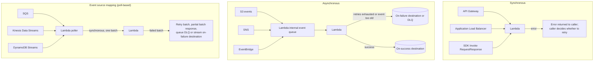
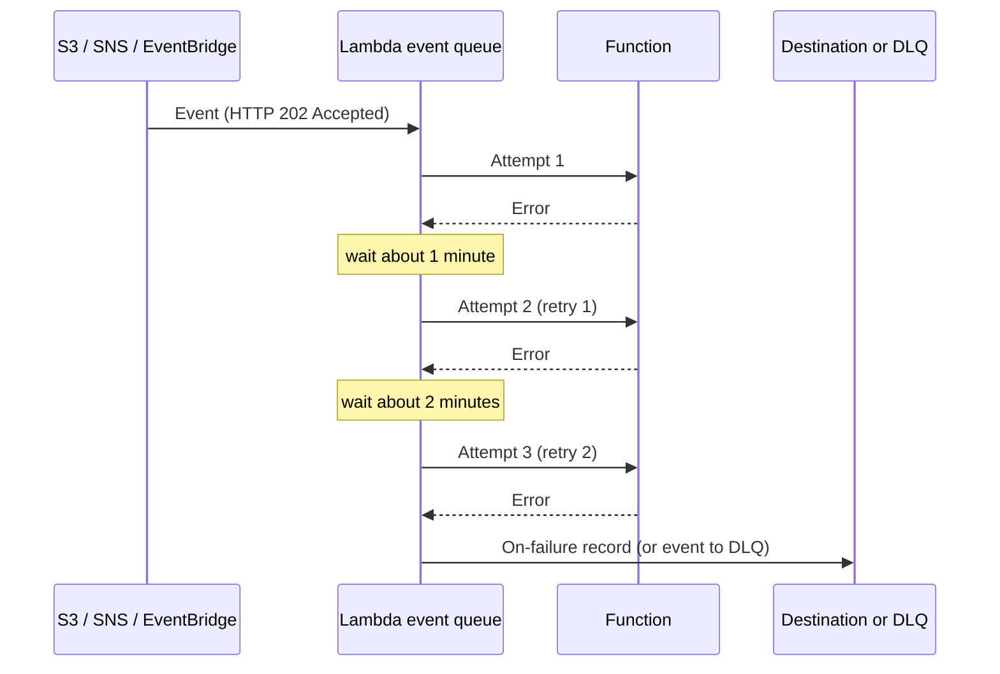
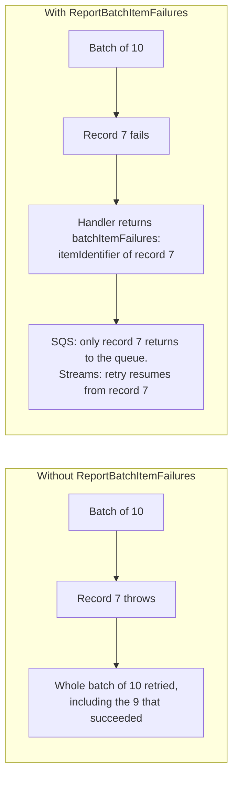
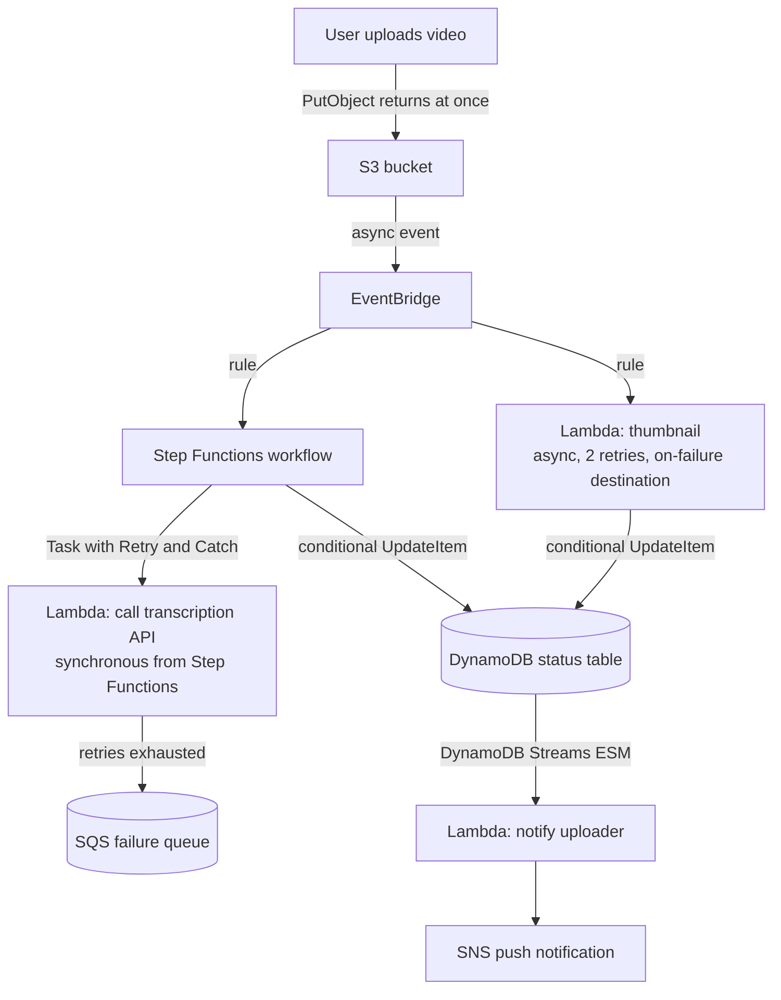

# 1.2.3 Handle invocation lifecycles and failures with destinations, retries, and dead-letter queues

**Domain 1 · Task 1.2 · Skill 1.2.3** · [Task overview](README.md) · Previous: [1.2.2 Lambda configuration](1.2.2-lambda-configuration.md) · Next: [1.2.4 Lambda service integrations](1.2.4-lambda-service-integrations.md)

## What the exam expects

AWS Lambda has three invocation models, and each one retries and reports failures differently. This skill tests whether you can tell which model a trigger uses, predict what happens to a failed event, and configure the right safety net: caller retries, asynchronous retry settings, destinations, dead-letter queues (DLQs), or event source mapping error controls such as partial batch responses.

You must be able to:

- Classify a trigger as synchronous, asynchronous, or event source mapping (poll-based).
- Describe the retry behavior of each model and of throttled invocations.
- Configure on-success and on-failure destinations, and know when a DLQ is still the answer.
- Stop a bad record from blocking a stream with retry limits, record age, bisection, and an on-failure destination.
- Implement partial batch responses for SQS, Kinesis, and DynamoDB Streams, including the configuration flag.
- Size the SQS visibility timeout and redrive policy for a Lambda consumer.
- Write idempotent handlers, because asynchronous and poll-based processing is at-least-once.

## Key terms

| Term | Meaning |
|---|---|
| Synchronous invocation | `InvocationType=RequestResponse`. The caller waits for the result and handles errors. |
| Asynchronous invocation | `InvocationType=Event`. Lambda queues the event internally, returns HTTP 202, and retries on its own. |
| Event source mapping (ESM) | A Lambda resource that polls a queue or stream and invokes the function synchronously with batches. |
| Destination | A target that receives a record of an invocation result: on success or on failure for async, on failure for ESMs. |
| Dead-letter queue (DLQ) | An SQS queue or SNS topic that receives failed events. For async Lambda it is set on the function; for SQS triggers it is set on the source queue. |
| Partial batch response | Returning `batchItemFailures` so only failed items are retried. Enabled with `FunctionResponseTypes: [ReportBatchItemFailures]`. |
| Poison pill | A record that fails every time and blocks or repeats processing until handled. |
| Idempotency | Processing the same event twice gives the same result as processing it once. |
| `IteratorAge` | CloudWatch metric showing how far a stream consumer lags behind the newest record. |

## Three invocation models



| Model | Typical sources | Who retries | Where failures go |
|---|---|---|---|
| **Synchronous** (`RequestResponse`) | API Gateway, Application Load Balancer (ALB), function URLs, Amazon Cognito triggers, AWS Step Functions tasks, SDK and CLI `Invoke`, Amazon CloudFront (Lambda@Edge) | Nobody inside Lambda. The caller decides. API Gateway does not retry a failed Lambda call. | Error returned to the caller |
| **Asynchronous** (`Event`) | Amazon S3, Amazon SNS, Amazon EventBridge, CloudWatch Logs subscriptions, Amazon SES, AWS CloudFormation custom resources, AWS Config, AWS IoT, AWS CodePipeline, SDK with `InvocationType=Event` | Lambda: 2 retries by default (configurable 0 to 2); event kept up to 6 hours (configurable) | On-failure destination (SQS, SNS, Lambda, EventBridge, S3) or DLQ (SQS, SNS) |
| **Event source mapping** | Amazon SQS, Kinesis Data Streams, DynamoDB Streams, Amazon MSK and self-managed Apache Kafka, Amazon MQ, Amazon DocumentDB | Lambda poller. Streams: retry the batch until success, expiry, or configured limits. SQS: message reappears after the visibility timeout. | Streams and Kafka: on-failure destination (SQS, SNS, S3, Kafka). SQS: the source queue's DLQ. |

An analogy helps under exam pressure. A synchronous call is a phone call: if you do not answer, the caller knows at once and decides what to do. An asynchronous invocation is a voicemail: the caller hung up, so something else (a destination or DLQ) has to notice when the message is never handled.

An event source mapping invokes the function synchronously from Lambda's point of view, because the poller waits for the result. The producer that wrote to the queue or stream never waits. Do not confuse that with the asynchronous model.

## Synchronous invocations

- The result or error goes straight back to the caller, and **error handling is client-side**: retries with exponential backoff and jitter, timeouts, and fallbacks (see [1.1.3 Resilience, retries, and backoff](../task-1.1-build-application-code/1.1.3-resilience-retries-and-backoff.md)).
- AWS software development kits (SDKs) retry some errors automatically, such as throttling (`TooManyRequestsException`) and service errors. Your code decides what to do with function errors.
- Payload limit: 6 MB request and 6 MB response (200 MB for streamed responses).
- If the caller has its own timeout (API Gateway: 29 seconds by default), the caller can give up while the function keeps running.

## Asynchronous invocations



- **Function errors** (unhandled exceptions, runtime errors, timeouts): Lambda runs the function **two more times**, about 1 minute after the first failure and about 2 minutes after the second. Three attempts in total.
- **Throttles (429) and system errors (5xx):** Lambda returns the event to the queue and keeps retrying for **up to 6 hours** by default, with intervals growing from 1 second to a maximum of 5 minutes.
- **Configurable:** `MaximumRetryAttempts` (0 to 2) and `MaximumEventAgeInSeconds` (60 seconds to 6 hours). Set them on the function, a version, or an alias.
- **Duplicates happen** even without errors, because the internal queue is eventually consistent. Retries also show up as repeated log entries. The handler must be idempotent.
- If the queue grows long, events can age out before they are processed. Without a DLQ or on-failure destination, a discarded event is **gone**.
- Setting reserved concurrency to 0 on an asynchronously invoked function sends new events straight to the DLQ or on-failure destination, without retries.
- Payload limit: 1 MB (256 KB in material written before October 2025).

```bash
aws lambda put-function-event-invoke-config --function-name image-processor \
  --maximum-retry-attempts 1 --maximum-event-age-in-seconds 3600 \
  --destination-config '{
    "OnSuccess": {"Destination": "arn:aws:sqs:us-east-1:123456789012:processed"},
    "OnFailure": {"Destination": "arn:aws:sqs:us-east-1:123456789012:failed"}
  }'
```

`put-function-event-invoke-config` replaces the whole configuration. Use `update-function-event-invoke-config` to change one setting.

## Throttling by invocation type

| Invocation type | What happens when concurrency runs out |
|---|---|
| Synchronous | Caller receives `TooManyRequestsException` (HTTP 429) and must retry with backoff |
| Asynchronous | Lambda keeps the event and retries for up to 6 hours, then sends it to the DLQ or on-failure destination |
| SQS event source mapping | Lambda backs off and reduces ESM concurrency; messages return to the queue when the visibility timeout expires and may reach the DLQ after `maxReceiveCount` |
| Stream event source mapping | Lambda retries until the records expire or exceed `MaximumRecordAgeInSeconds`; the shard waits |

Concurrency settings themselves are in [1.2.2](1.2.2-lambda-configuration.md#concurrency).

## Destinations versus dead-letter queues

| | Dead-letter queue | Destinations |
|---|---|---|
| Captures | Failures only | Success and failure (async); failure only (ESM) |
| Targets for async invocations | SQS, SNS | SQS, SNS, Lambda, EventBridge, S3 (on failure only) |
| Targets for stream and Kafka ESMs | Not applicable | SQS, SNS, S3, Kafka topic (on failure) |
| Payload | The original event only | An invocation record: request, response or error details, and metadata |
| Configured on | The function (async) or the source queue (SQS) | The function, version, or alias (async); the ESM (streams, Kafka) |

AWS recommends destinations over DLQs for new designs, and you can use both. Details that come up:

- The execution role needs permission to write to the destination: `sqs:SendMessage`, `sns:Publish`, `lambda:InvokeFunction`, `events:PutEvents`, or `s3:PutObject` plus `s3:ListBucket` (plus `kms:GenerateDataKey` for a bucket encrypted with an AWS Key Management Service (KMS) key).
- FIFO queues and FIFO topics are not supported as destinations. Delivery problems show up in the `DestinationDeliveryFailures` metric.
- SNS messages are capped at 256 KB. An async event near 1 MB plus metadata can exceed that, so use SQS or S3 for large payloads.
- EventBridge destination records arrive with `source` set to `lambda` and a `detail-type` of "Lambda Function Invocation Result - Success" or "- Failure", so a rule can route them.
- Never point a destination at a resource that also triggers the function. That creates a loop.

> **Trap: "send successful results somewhere too."** Only destinations capture successes. A DLQ never does.

> **Trap: "the Lambda DLQ isn't catching failed SQS messages."** A function-level DLQ applies only to asynchronous invocations. For an SQS trigger, configure the DLQ (redrive policy) on the source queue.

## Event source mapping failures

### Stream failures (Kinesis Data Streams and DynamoDB Streams)

By default, a function error makes Lambda **retry the entire batch until it succeeds or the records expire**. To preserve order, Lambda stops reading that shard while it retries, so one poison pill blocks everything behind it. With default settings this can last up to a week (or the stream's retention period), and `IteratorAge` climbs the whole time.

| Setting | Effect |
|---|---|
| `MaximumRetryAttempts` | Caps retries of a failing batch (default -1, unlimited) |
| `MaximumRecordAgeInSeconds` | Discards records older than this instead of retrying them (default -1, unlimited) |
| `BisectBatchOnFunctionError` | On error, splits the batch in two and retries each half. Isolates a bad record and helps when a batch times out. Splitting does not use up the retry quota. |
| On-failure destination | Receives a record of each discarded batch (SQS, SNS, S3, or Kafka). Without one, discarded records are lost. |
| `ReportBatchItemFailures` | Partial batch response; see below |

```bash
aws lambda update-event-source-mapping --uuid f89f8514-cdd9-4602-9e1f-01a5b77d449b \
  --maximum-retry-attempts 2 \
  --maximum-record-age-in-seconds 3600 \
  --bisect-batch-on-function-error \
  --destination-config '{"OnFailure": {"Destination": "arn:aws:sqs:us-east-1:123456789012:stream-failures"}}'
```

An error before invocation (throttling, for example) is retried until the records expire or exceed `MaximumRecordAgeInSeconds`. `MaximumRetryAttempts` and bisection apply to function errors.

### SQS failures

- By default, if any message in a batch fails, **the whole batch returns to the queue** and becomes visible again after the **visibility timeout**, including messages that succeeded.
- **Visibility timeout:** set it to at least **6 times the function timeout**, plus `MaximumBatchingWindowInSeconds` if you use a batching window. The margin lets Lambda retry when it is throttled. Lambda rejects an ESM whose function timeout exceeds the queue's visibility timeout. It does not recheck when you later raise the function timeout, so raise the visibility timeout first. If the visibility timeout is too short, a message can reappear while still being processed, and a second invocation processes it concurrently.
- **DLQ on the source queue:** a redrive policy moves a message to a DLQ after `maxReceiveCount` receives. AWS recommends at least 5 so Lambda has a few chances to retry.
- SQS ESMs have **no on-failure destination**. The queue's DLQ fills that role.
- On a function error, Lambda backs off and reduces the concurrency of the SQS ESM. On throttling, it retries until the visibility timeout passes.
- Failed messages return individually and may be regrouped differently in later batches.
- Standard queues can deliver a message twice even without errors. FIFO queues deduplicate within a 5-minute window but consumers still need idempotency.
- Lambda deletes messages from the queue after successful processing.

## Partial batch response



Partial batch response needs **both halves**:

1. The ESM has `FunctionResponseTypes: [ReportBatchItemFailures]`. It is **off by default**. Without it, Lambda ignores the returned list.
2. The handler catches per-record errors and returns `{"batchItemFailures": [{"itemIdentifier": "<id>"}]}`, where the identifier is the SQS `messageId` or the stream record's `sequenceNumber`.

Behavior by source:

| | SQS | Kinesis and DynamoDB Streams |
|---|---|---|
| Identifier | `messageId` | Sequence number (`kinesis.sequenceNumber` or `dynamodb.SequenceNumber`) |
| What is retried | Only the listed messages become visible again | Lambda checkpoints at the **lowest** listed sequence number and retries every record from there |
| Ordering guidance | For FIFO queues, stop at the first failure and return that message plus every unprocessed message after it | Return the first failed record and stop |
| Treated as complete success | Empty or null `batchItemFailures` | Empty or null `batchItemFailures` |
| Treated as complete failure | Handler throws an exception | Handler throws, or returns an empty, null, or badly named `itemIdentifier` |

With `ReportBatchItemFailures` on, an SQS ESM does not scale down polling when invocations fail. With both bisection and partial batch response on a stream, Lambda splits the batch at the returned sequence number and retries only the remaining records.

```python
# SQS handler: report each failed message, keep processing the rest
def sqs_handler(event, context):
    failures = []
    for record in event["Records"]:
        try:
            process(record["body"])
        except Exception:
            failures.append({"itemIdentifier": record["messageId"]})
    return {"batchItemFailures": failures}


# Kinesis or DynamoDB Streams handler: stop at the first failure to keep order
def stream_handler(event, context):
    for record in event["Records"]:
        if "kinesis" in record:
            seq = record["kinesis"]["sequenceNumber"]
        else:  # DynamoDB Streams uses a capitalized key
            seq = record["dynamodb"]["SequenceNumber"]
        try:
            process(record)
        except Exception:
            return {"batchItemFailures": [{"itemIdentifier": seq}]}
    return {"batchItemFailures": []}
```

```yaml
# AWS SAM: the configuration half
Resources:
  OrderConsumer:
    Type: AWS::Serverless::Function
    Properties:
      Handler: app.sqs_handler
      Runtime: python3.12
      Events:
        Orders:
          Type: SQS
          Properties:
            Queue: !GetAtt OrdersQueue.Arn
            BatchSize: 10
            FunctionResponseTypes:
              - ReportBatchItemFailures
```

The Batch Processor utility in Powertools for AWS Lambda (Python, Java, TypeScript, .NET) implements this logic for you.

`BisectBatchOnFunctionError` and `ReportBatchItemFailures` solve related problems. Bisection narrows down which half holds the bad record over several retries, which helps when you cannot report per-item failures. Partial batch response names the failed record in one pass. Prefer partial batch response when the handler can track per-record results.

## Error types

| Error | Example | Shows up as |
|---|---|---|
| Function error | Unhandled exception in your code or the runtime | `FunctionError` header and an error object in the response; `Errors` metric |
| Timeout | Function runs past its timeout | `Task timed out after X seconds` in the logs; counts as a function error |
| Throttling | No concurrency available | `TooManyRequestsException` (429); `Throttles` metric |
| Permissions | Caller lacks `lambda:InvokeFunction`, or the role cannot reach a resource | `AccessDeniedException`, either from Lambda or from the downstream service |
| Payload too large | Over 6 MB synchronous or 1 MB asynchronous | `RequestTooLargeException` (HTTP 413) |
| Recursive loop | About 16 invocations in one chain through SQS, SNS, S3, or EventBridge | Invocation stopped; `RecursiveInvocationException` returned to an SQS ESM |
| Destination delivery | FIFO destination, missing permission, oversized record | `DestinationDeliveryFailures` metric |

Reading these errors in logs and traces is covered in [4.1.1 Debugging code and integrations](../../domain-4-troubleshooting-and-optimization/task-4.1-root-cause-analysis/4.1.1-debugging-code-and-integrations.md).

## Idempotency is required

Asynchronous invocations and event source mappings deliver **at least once**. Retries rerun whole batches, async queues can deliver duplicates, and a short SQS visibility timeout can run the same message twice at once. Every side effect needs protection:

- Use an idempotency key (request ID, `messageId`, S3 object key plus version ID, an order ID) and a DynamoDB conditional write such as `attribute_not_exists(pk)` to record that the work is done.
- The Idempotency utility in Powertools for AWS Lambda wraps this pattern.
- The full pattern, with code, is in [1.1.3 Resilience, retries, and backoff](../task-1.1-build-application-code/1.1.3-resilience-retries-and-backoff.md).

## Worked scenario: one upload, three invocation models

A video platform must create thumbnails and a transcript for every upload, notify the uploader when both are done, keep the upload response under 2 seconds, and never lose a video during a transcription outage.



- The upload returns fast because all processing happens afterward through asynchronous events.
- The thumbnail function is invoked asynchronously by EventBridge, so Lambda retries it and an on-failure destination catches what still fails.
- Step Functions invokes the transcription function synchronously and owns the retry policy: retry transient errors with backoff, send permanent errors (unsupported codec) to the failure queue without wasting retries.
- Conditional updates in DynamoDB make duplicate EventBridge deliveries harmless.
- A DynamoDB Streams event source mapping triggers notifications, so a notification bug cannot stop status records from being written. Its failures are handled with stream settings (retry limits, on-failure destination).

## Exam triggers

| Scenario clue | Answer | Why the alternatives are wrong |
|---|---|---|
| "Async Lambda keeps failing and events disappear" | Add an on-failure destination or DLQ | Async retries twice and then drops the event if nothing is configured |
| "Keep failed S3-triggered events for analysis with error details" | On-failure destination | A DLQ holds only the event, without the error |
| "Send successful results to another queue automatically" | On-success destination | DLQs capture failures only; writing the code yourself is extra work |
| "One bad Kinesis record blocks the shard; IteratorAge grows" | `MaximumRetryAttempts`, `MaximumRecordAgeInSeconds`, `BisectBatchOnFunctionError`, on-failure destination | Adding shards or memory does not get past a poison pill |
| "One malformed SQS message causes the whole batch to retry" | `ReportBatchItemFailures` on the ESM plus a `batchItemFailures` response | A function DLQ does not apply to SQS triggers; a smaller batch only reduces the damage |
| "Handler returns batchItemFailures but the whole batch still retries" | Enable `FunctionResponseTypes: ReportBatchItemFailures` on the ESM | The response is ignored without the flag |
| "Lambda processes the same SQS message twice at the same time" | Raise the queue's visibility timeout to at least 6 times the function timeout; make the handler idempotent | Raising the function timeout makes it worse |
| "Failed SQS messages should go to a DLQ after a few tries" | Redrive policy on the source queue, `maxReceiveCount` at least 5 | The Lambda function DLQ setting is for async invocations |
| "Drop stale stream records automatically but keep a record of them" | `MaximumRecordAgeInSeconds` plus an on-failure destination | Discarding without a destination loses data silently |
| "Lambda behind API Gateway fails; should API Gateway retry it?" | The client retries with backoff | API Gateway does not retry Lambda errors |
| "Retry fewer times and discard events older than one hour (async)" | `MaximumRetryAttempts` and `MaximumEventAgeInSeconds` | These settings exist only for async invocations |

## Common traps

- Function DLQs apply only to asynchronous invocations. SQS triggers use the queue's redrive policy. Stream ESMs use on-failure destinations.
- Async retries happen twice by default, not three times. Three is the total number of attempts.
- Throttled async events are retried for up to 6 hours, which is different from the two retries for function errors.
- Partial batch response is off by default and needs both the ESM flag and the handler response.
- For streams, partial batch response restarts from the lowest failed sequence number. Records after it can be processed again.
- SQS FIFO queues and SNS FIFO topics cannot be destinations. Use standard queues and topics.
- SQS ESMs do not have on-failure destinations.
- "Exactly once" is never the right description of async or ESM processing. Plan for duplicates.
- Visibility timeout guidance is at least six times the function timeout, not "equal to" it.
- Stream records are not removed when processed; other consumers can still read them.

## Quick recall

- Sync: caller retries. Async: Lambda retries 2 times (1 min, then 2 min), keeps events up to 6 hours. ESM: poller retries batches.
- Async knobs: `MaximumRetryAttempts` 0 to 2, `MaximumEventAgeInSeconds` 60 s to 6 h.
- Async destinations: SQS, SNS, Lambda, EventBridge, and S3 (on failure only).
- Stream ESM on-failure destinations: SQS, SNS, S3, Kafka.
- DLQ = failures only, event only. Destinations = success and failure, with context.
- Stream knobs: max retries, max record age, bisect on error, on-failure destination.
- SQS: visibility timeout at least 6 times the function timeout; DLQ on the queue with `maxReceiveCount` at least 5.
- Partial batch response: `ReportBatchItemFailures` plus `{"batchItemFailures": [{"itemIdentifier": ...}]}`.
- Idempotency is mandatory for async and poll-based processing.

## Related skills

- [1.1.3 Resilience, retries, and backoff](../task-1.1-build-application-code/1.1.3-resilience-retries-and-backoff.md): client-side retries and the idempotency pattern.
- [1.2.2 Lambda configuration](1.2.2-lambda-configuration.md): timeouts, concurrency, and recursive loop detection.
- [1.2.4 Lambda service integrations](1.2.4-lambda-service-integrations.md): event source mapping mechanics, batching, scaling, and filtering.
- [4.1.1 Debugging code and integrations](../../domain-4-troubleshooting-and-optimization/task-4.1-root-cause-analysis/4.1.1-debugging-code-and-integrations.md): diagnosing these failures from logs.
- [4.3.3 Messaging optimization](../../domain-4-troubleshooting-and-optimization/task-4.3-optimize-applications/4.3.3-messaging-optimization.md): SQS and SNS delivery tuning.

## Sources

- Merged from: `archive/dva-c03-study-notes/01-development-with-aws-services.md` (skill 1.2.3 section and invocation table, gotchas), `archive/aws-dva-notes/Markdown Files/18. Serverless - Lambda.md` (sections 4 to 6, 8, 15), `archive/dva-c03/domain-1-development/lambda-event-source-mapping-deep-dive.md` (partial batch response, visibility timeout math, failure settings, scenarios), `archive/dva-c03/domain-1-development/README.md` (three invocation models, event-driven fan-out, case study 2, analogy bank), `archive/dva-c03/domain-1-development/MASTER-CHUNK.md` (Lambda section), `archive/dva-c03/domain-1-development/idempotency-and-retry-patterns.md`, `archive/aws-dva-notes/Markdown Files/31. Exam Day Cheat Sheet.md`, `archive/dva-c03/exam-bank/bank-1.md` (on-success and on-failure destination scenario).
- AWS documentation: [How Lambda handles errors and retries with asynchronous invocation](https://docs.aws.amazon.com/lambda/latest/dg/invocation-async-error-handling.html)
- AWS documentation: [Configuring error handling settings for Lambda asynchronous invocations](https://docs.aws.amazon.com/lambda/latest/dg/invocation-async-configuring.html)
- AWS documentation: [Capturing records of Lambda asynchronous invocations](https://docs.aws.amazon.com/lambda/latest/dg/invocation-async-retain-records.html) (destination types including S3, FIFO not supported, SNS size note)
- AWS documentation: [Retain discarded batch records for a Kinesis Data Streams event source](https://docs.aws.amazon.com/lambda/latest/dg/kinesis-on-failure-destination.html) (SQS, SNS, S3, Kafka destinations; one-week blocking note)
- AWS documentation: [Creating and configuring an Amazon SQS event source mapping](https://docs.aws.amazon.com/lambda/latest/dg/services-sqs-configure.html) (six times visibility timeout, `maxReceiveCount` at least 5)
- AWS documentation: [Handling errors for an SQS event source in Lambda](https://docs.aws.amazon.com/lambda/latest/dg/services-sqs-errorhandling.html) (partial batch response, FIFO guidance)
- AWS documentation: [Configuring partial batch response with Kinesis Data Streams and Lambda](https://docs.aws.amazon.com/lambda/latest/dg/services-kinesis-batchfailurereporting.html) (lowest sequence number checkpoint, success and failure conditions)
