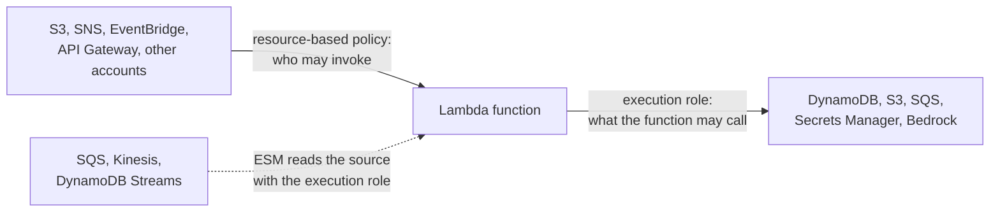
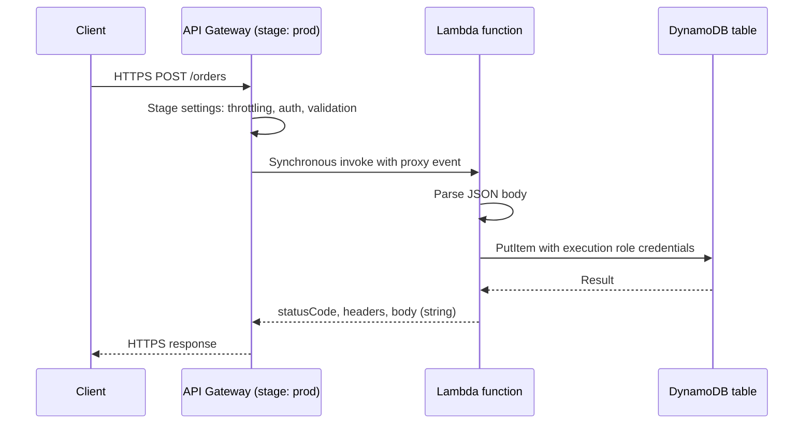
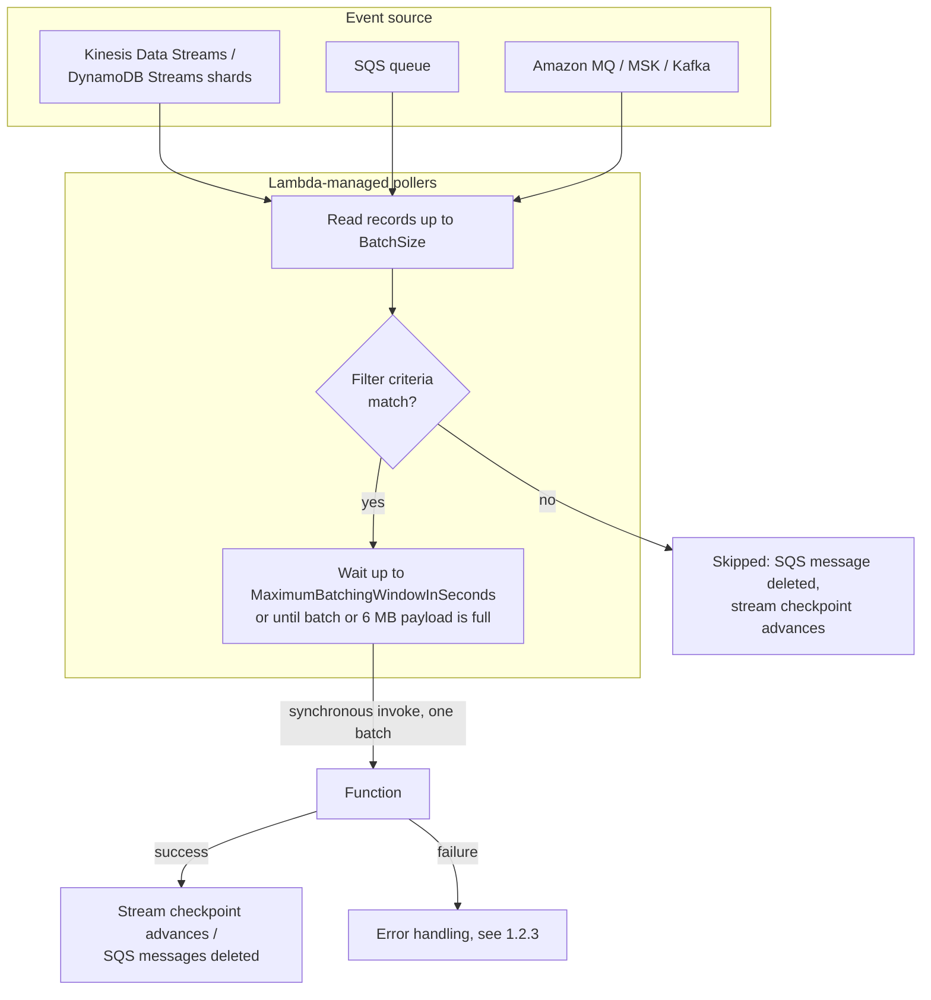

# 1.2.4 Integrate Lambda with services such as API Gateway and DynamoDB through code, event source mappings, triggers, and destinations

**Domain 1 · Task 1.2 · Skill 1.2.4** · [Task overview](README.md) · Previous: [1.2.3 Invocation lifecycle and failures](1.2.3-lambda-invocation-lifecycle-and-failures.md) · Next: [1.3.1 Data lifecycle management](../task-1.3-use-data-stores/1.3.1-data-lifecycle-management.md)

## What the exam expects

AWS Lambda rarely runs alone. This skill tests how other services reach a function and how the function reaches them: which permission each direction needs, what the event looks like, what the function must return, and how event source mappings (ESMs) poll queues and streams. Amazon API Gateway and Amazon DynamoDB are named in the exam guide and show up most.

You must be able to:

- Grant the right permission for each direction: the execution role for what the function calls, a resource-based policy for who may invoke it.
- Read an API Gateway proxy event and return a response API Gateway accepts.
- Choose between API Gateway, an Application Load Balancer (ALB), and a function URL for HTTP access.
- Read and write DynamoDB from a handler and consume DynamoDB Streams through an ESM.
- Configure an ESM: batch size, batching window, starting position, filtering, scaling, and ordering.
- Invoke a function from code synchronously, asynchronously, or as a dry run.
- Recognize the other common triggers: S3, SNS, EventBridge, Step Functions, Amazon Cognito, CloudWatch Logs, CloudFront.

## Key terms

| Term | Meaning |
|---|---|
| Trigger | A service configured to invoke a function, through a push (sync or async) or an ESM |
| Execution role | The AWS Identity and Access Management (IAM) role the function assumes. Controls what the function can call. |
| Resource-based policy | The function's own policy. Controls which principals (services, accounts) may invoke it. |
| Proxy integration (`AWS_PROXY`) | API Gateway passes the whole HTTP request to Lambda and expects a specific response shape |
| Lambda authorizer | A function API Gateway calls first to allow or deny a request, returning an IAM policy |
| Function URL | A dedicated HTTPS endpoint for one function or alias |
| Event source mapping (ESM) | A Lambda-managed poller that reads batches from a queue or stream and invokes the function |
| Batching window | `MaximumBatchingWindowInSeconds`. How long an ESM waits to fill a batch. |
| `ParallelizationFactor` | Number of concurrent batches per Kinesis or DynamoDB Streams shard (1 to 10) |
| Filter criteria | JSON patterns on an ESM. Records that do not match never invoke the function. |
| Stream view type | What a DynamoDB stream record contains: `KEYS_ONLY`, `NEW_IMAGE`, `OLD_IMAGE`, `NEW_AND_OLD_IMAGES` |

## How services reach Lambda

| Service | Invocation model | Permission that lets it invoke | Event or integration notes |
|---|---|---|---|
| API Gateway (REST, HTTP, WebSocket APIs) | Synchronous | Resource-based policy for `apigateway.amazonaws.com` | Proxy event; 29-second default integration timeout |
| Application Load Balancer | Synchronous | Resource-based policy for Elastic Load Balancing | Function registered in a target group |
| Function URL | Synchronous | Auth type `AWS_IAM` or `NONE` plus resource-based policy | No API Gateway needed |
| AWS SDK or AWS Command Line Interface (CLI) `Invoke` | Sync, async, or dry run | Caller's IAM `lambda:InvokeFunction` (or resource policy for other accounts) | `InvocationType` chooses the model |
| Amazon S3 event notifications | Asynchronous | Resource-based policy for `s3.amazonaws.com` | `Records[].s3.bucket.name`, `object.key` |
| Amazon SNS | Asynchronous | Resource-based policy for `sns.amazonaws.com` | Subscription per function |
| Amazon EventBridge rules | Asynchronous | Resource-based policy for `events.amazonaws.com` | Event pattern or schedule |
| EventBridge Scheduler | Asynchronous | An IAM execution role that Scheduler assumes | One-time or recurring schedules |
| AWS Step Functions | Synchronous (Task state) | State machine role | Step Functions owns retries with `Retry` and `Catch` |
| Amazon Cognito user pool triggers | Synchronous | Resource-based policy for Cognito | Pre sign-up, post confirmation, pre token generation, and others |
| CloudWatch Logs subscription filter | Asynchronous | Resource-based policy for CloudWatch Logs | Compressed, base64-encoded log batches |
| Amazon CloudFront (Lambda@Edge) | Synchronous | Replicated function version | Author in `us-east-1` |
| Amazon Data Firehose transformation | Synchronous | Firehose role | Transform records before delivery |
| AWS CodePipeline invoke action | Asynchronous | Pipeline role | Function must call `PutJobSuccessResult` or `PutJobFailureResult` |
| SQS, Kinesis, DynamoDB Streams, Amazon MSK, self-managed Kafka, Amazon MQ, Amazon DocumentDB | Event source mapping (Lambda polls, then invokes synchronously) | **Execution role** reads the source | Batches in `Records`; see the ESM section |

## Permissions: execution role versus resource-based policy



| Direction | Mechanism | Symptom when missing |
|---|---|---|
| Inbound push: a service or another account invokes the function | Resource-based policy (`lambda:AddPermission`) granting `lambda:InvokeFunction` | "S3 (or SNS, EventBridge, API Gateway) can't trigger the function" |
| Outbound: the function calls AWS services | Execution role policies | `AccessDeniedException` from DynamoDB or S3, not a Lambda error |
| Poll-based: an ESM reads a queue or stream | Execution role (for example `sqs:ReceiveMessage`, `sqs:DeleteMessage`, `kinesis:GetRecords`, `dynamodb:GetRecords`) | ESM creation fails or the ESM is disabled with a permissions error |

```bash
# Allow one S3 bucket in one account to invoke the function
aws lambda add-permission --function-name thumbnailer \
  --statement-id s3-invoke --action lambda:InvokeFunction \
  --principal s3.amazonaws.com \
  --source-arn arn:aws:s3:::my-upload-bucket --source-account 123456789012

# Allow an API Gateway API to invoke a specific alias
aws lambda add-permission --function-name orders-api:prod \
  --statement-id apigw-prod --action lambda:InvokeFunction \
  --principal apigateway.amazonaws.com \
  --source-arn "arn:aws:execute-api:us-east-1:123456789012:a1b2c3d4e5/*/POST/orders"
```

AWS managed policies for common execution role needs:

| Policy | Grants |
|---|---|
| `AWSLambdaBasicExecutionRole` | Write logs to CloudWatch Logs |
| `AWSLambdaKinesisExecutionRole` | Read Kinesis Data Streams |
| `AWSLambdaDynamoDBExecutionRole` | Read DynamoDB Streams |
| `AWSLambdaSQSQueueExecutionRole` | Read and delete SQS messages |
| `AWSLambdaVPCAccessExecutionRole` | Manage VPC network interfaces |
| `AWSXRayDaemonWriteAccess` | Send traces to AWS X-Ray |

Within one account, a principal can invoke a function if its identity policy allows it **or** the function's resource-based policy allows it. Across accounts, both sides must allow it. Least-privilege design for these policies is in [2.1.6](../../domain-2-security/task-2.1-authentication-and-authorization/2.1.6-least-privilege-permissions.md).

## Amazon API Gateway

The most tested request shape in Domain 1 is a REST API in front of a function in front of a DynamoDB table.



1. The client calls API Gateway, which handles TLS, throttling, authorization, validation, and routing.
2. The stage (`dev`, `prod`) carries its own settings and stage variables (see [3.1.5 API Gateway stages and endpoints](../../domain-3-testing-and-deployment/task-3.1-prepare-deployable-artifacts/3.1.5-api-gateway-stages-and-endpoints.md)).
3. API Gateway invokes the function synchronously and waits.
4. The function's execution role, not the caller's identity, authorizes the DynamoDB call.
5. The function returns the proxy response shape, and API Gateway turns it into HTTP.

### Proxy integration: event and response

With `AWS_PROXY`, the request arrives as event fields: `httpMethod`, `path`, `headers`, `queryStringParameters`, `pathParameters`, `stageVariables`, `body` (a string), `isBase64Encoded`, and `requestContext` (including authorizer claims). The function must return:

```json
{
  "statusCode": 200,
  "headers": { "Content-Type": "application/json", "Access-Control-Allow-Origin": "https://app.example.com" },
  "body": "{\"orderId\": \"abc-123\"}",
  "isBase64Encoded": false
}
```

```python
import json, os, uuid
import boto3

table = boto3.resource("dynamodb").Table(os.environ["TABLE_NAME"])   # init once

def handler(event, context):
    body = json.loads(event.get("body") or "{}")
    if "item" not in body:
        return {"statusCode": 400, "body": json.dumps({"error": "item is required"})}
    order_id = str(uuid.uuid4())
    table.put_item(Item={"orderId": order_id, "item": body["item"]})
    return {
        "statusCode": 201,
        "headers": {"Content-Type": "application/json"},
        "body": json.dumps({"orderId": order_id}),   # body must be a string
    }
```

| HTTP status from API Gateway | Usual cause with Lambda |
|---|---|
| 502 Bad Gateway | The function returned the wrong shape: `body` not a string, missing `statusCode`, or an unhandled exception |
| 504 Gateway Timeout | The function ran past the integration timeout, 29 seconds by default. Regional and private REST APIs can request a higher limit; prefer an asynchronous pattern for long work (accept the request, queue the job with SQS or Step Functions, let the client poll or get notified). |
| 429 Too Many Requests | API Gateway throttling (stage or usage plan) |
| 403 Forbidden | Authorizer denied, missing API key, or resource policy |

> **Cross-origin resource sharing (CORS) with proxy integrations.** Enabling CORS in the console only handles the preflight `OPTIONS` call. With a proxy integration, the function itself must return `Access-Control-Allow-Origin` (and related headers) on every response.

### Worked scenario: a 502 with clean logs

A function behind API Gateway returns 502 to clients, but CloudWatch Logs show it finished without an exception. Peel the stack one layer at a time:

```bash
# 1. Invoke the function directly and inspect the returned payload
aws lambda invoke --function-name OrdersHandler \
  --payload '{"queryStringParameters":{"userId":"u1"}}' \
  --cli-binary-format raw-in-base64-out out.json && cat out.json
# {"statusCode": 200, "body": {"orderId": "abc-123", "item": "widget"}}
```

`body` is an object, not a string. API Gateway cannot build an HTTP response from it and returns 502, while the function logs a clean success. The fix is `"body": json.dumps(result)`. Re-invoke directly to confirm, then call the stage URL. Testing the function directly first shows whether the defect is in the function or in API Gateway's handling of it. More debugging technique is in [4.1.1](../../domain-4-troubleshooting-and-optimization/task-4.1-root-cause-analysis/4.1.1-debugging-code-and-integrations.md).

### Stage variables and aliases

An integration URI such as `arn:aws:lambda:us-east-1:123456789012:function:orders-api:${stageVariables.lambdaAlias}` lets the `dev` stage call the `dev` alias and the `prod` stage call `prod`. Each alias needs its own resource-based policy statement allowing API Gateway. Shifting traffic then happens on the alias weights, with no API change. Stage variables reach the function in the `stageVariables` event field with a proxy integration.

### Lambda authorizers

- **TOKEN** authorizer: receives one header, usually a bearer token such as a JSON Web Token (JWT) or OAuth token.
- **REQUEST** authorizer: receives headers, query strings, stage variables, and context.
- The authorizer returns a principal ID and an IAM policy (plus optional context). API Gateway caches the result for a configurable time to live (TTL), so it does not run on every request.
- Use it for third-party tokens or custom authorization logic. For your own users in a Cognito user pool, a Cognito authorizer needs no code. For AWS callers, use IAM authorization with Signature Version 4.

```json
{
  "principalId": "user123",
  "policyDocument": {
    "Version": "2012-10-17",
    "Statement": [{
      "Action": "execute-api:Invoke",
      "Effect": "Allow",
      "Resource": "arn:aws:execute-api:us-east-1:123456789012:a1b2c3d4e5/prod/GET/orders"
    }]
  },
  "context": { "tenantId": "t-42" }
}
```

### Choosing the API Gateway flavor

| Need | Choose |
|---|---|
| Cheapest, simplest Lambda proxy API, JWT authorizers | HTTP API |
| Usage plans, API keys, caching, request validation, mapping templates, resource policies | REST API |
| Server push and two-way messages (chat) | WebSocket API, with `$connect`, `$disconnect`, and message route functions storing connection IDs in DynamoDB |

Non-proxy integrations with mapping templates, request validation, and models are in [1.1.4 APIs, transformation, and validation](../task-1.1-build-application-code/1.1.4-apis-transformation-and-validation.md). API Gateway can also stream Lambda responses through a proxy integration that uses `InvokeWithResponseStream`.

## Application Load Balancer

- Register the function in a target group. The ALB converts HTTP to a JSON event (`requestContext.elb`, `httpMethod`, `path`, `queryStringParameters`, `headers`, `body`, `isBase64Encoded`) and converts the function's JSON back to HTTP.
- With **multi-value headers** enabled on the target group, repeated headers and query strings arrive as arrays: `?name=foo&name=bar` becomes `"multiValueQueryStringParameters": {"name": ["foo", "bar"]}`.
- The response needs `statusCode`, `statusDescription`, `headers`, `body`, and `isBase64Encoded`.
- The function's resource-based policy must allow Elastic Load Balancing to invoke it.

```json
{
  "statusCode": 200,
  "statusDescription": "200 OK",
  "isBase64Encoded": false,
  "headers": { "Content-Type": "text/html" },
  "body": "<h1>Hello from Lambda!</h1>"
}
```

## Function URLs

- A dedicated HTTPS endpoint, `https://<url-id>.lambda-url.<region>.on.aws`, that never changes. Dual-stack (IPv4 and IPv6).
- Attach it to an **alias or `$LATEST`**, not to another specific version.
- **Auth type `AWS_IAM`:** callers sign requests and need `lambda:InvokeFunctionUrl`. Same account: identity policy or resource policy. Cross-account: both.
- **Auth type `NONE`:** public. The resource-based policy must still grant public access.
- Supports CORS settings and response streaming (up to 200 MB). Throttle with reserved concurrency.
- Public internet only. Lambda supports AWS PrivateLink, but function URLs do not. Function URLs also cannot stream responses inside a VPC.
- Compared with API Gateway, function URLs have no usage plans, API keys, request validation, authorizers, or native custom domains. Pick a function URL for "the simplest HTTPS endpoint for one function", such as a webhook receiver.

## Amazon DynamoDB from code

- Create the client or `Table` resource during init and reuse it.
- The execution role needs only the actions used (`dynamodb:PutItem`, `dynamodb:Query`) on the table and index ARNs.
- Use conditional writes (`attribute_not_exists(pk)`) for idempotency, because retries and duplicate events are normal in Lambda.
- Key design, consistency, queries, and indexes are in [1.3.4 DynamoDB design and operations](../task-1.3-use-data-stores/1.3.4-dynamodb-design-and-operations.md).

## DynamoDB Streams triggers

A DynamoDB stream is an ordered log of item-level changes. Lambda reads it through an ESM and invokes the function synchronously with batches.

- Retention is **24 hours**. Streams are made of shards that DynamoDB manages for you.
- Not retroactive: changes made before the stream was enabled are not in it.
- The stream view type decides the content: `KEYS_ONLY`, `NEW_IMAGE`, `OLD_IMAGE`, or `NEW_AND_OLD_IMAGES`. "Need the previous value" means `OLD_IMAGE` or `NEW_AND_OLD_IMAGES`.
- The execution role needs `AWSLambdaDynamoDBExecutionRole` (or equivalent `dynamodb:GetRecords`, `GetShardIterator`, `DescribeStream`, `ListStreams`).
- TTL deletions appear in the stream with `userIdentity` of `dynamodb.amazonaws.com`, useful for archiving expired items.
- Typical uses: send a welcome email on new users, update derived tables or aggregates, index into Amazon OpenSearch Service, replicate or archive.

```python
def handler(event, context):
    for record in event["Records"]:
        name = record["eventName"]              # INSERT, MODIFY, or REMOVE
        keys = record["dynamodb"]["Keys"]
        new = record["dynamodb"].get("NewImage")  # present for NEW_IMAGE views
        old = record["dynamodb"].get("OldImage")  # present for OLD_IMAGE views
        if name == "MODIFY" and new and new.get("status", {}).get("S") == "SHIPPED":
            notify_customer(keys, new)
```

Stream items use DynamoDB's typed JSON (`{"S": "SHIPPED"}`), not plain values. Deserialization is covered in [1.1.7](../task-1.1-build-application-code/1.1.7-serialization-and-deserialization.md).

Instead of filtering in code as above, filter on the ESM so non-matching changes never invoke the function (see [Filtering events](#filtering-events)).

## Event source mappings in depth

### What an ESM is and why it exists

An ESM is a Lambda resource that polls a queue or stream on your function's behalf and invokes the function **synchronously** with a batch of records when it has enough to send. Without it, you would run your own consumer: track shard iterators or receipt handles, reconnect, scale workers with load, and checkpoint progress. With an ESM you configure batch size, batching window, and error handling, and Lambda's poller fleet does the rest.

Think of a courier who checks a sorting facility (the queue or stream) on a schedule, bundles whatever mail has piled up (a batch), and delivers the bundle to your office (the function) in one trip. You tell the courier how big a bundle to wait for, how long to wait before leaving with a smaller one, and what to do if you refuse the bundle.

Use an ESM when a scenario says "process records from a stream" or "consume a queue" without the application making its own polling calls. Do not use one for:

- A request that must return a result to a caller immediately. That is a synchronous invocation (API Gateway, ALB, function URL, `Invoke`).
- Consumers that need full manual checkpoint control, custom consumer-group behavior, or a source Lambda does not support. Run the Kinesis Client Library or a Kafka client on Amazon ECS, AWS Fargate, or EC2.
- Records that each take a very long time. A batch must finish within the function timeout, and a slow batch holds up its shard.

If the scenario says "the application polls SQS with the SDK", that is your own `ReceiveMessage` and `DeleteMessage` loop, not an ESM.

### How it works



1. Lambda's pollers check the source continuously and scale with the shard count, partition count, or queue depth.
2. A batch builds until it reaches `BatchSize`, the batching window expires, or the payload reaches 6 MB, whichever comes first. A short window gives lower latency and more invocations; a long window gives fewer, larger, cheaper invocations.
3. The poller invokes the function synchronously with the batch in `Records`.
4. On success, the poller advances the stream checkpoint or deletes the SQS messages.
5. On failure, behavior depends on the source and on whether partial batch response is enabled. That is covered in full in [1.2.3](1.2.3-lambda-invocation-lifecycle-and-failures.md#event-source-mapping-failures).

### Configuration settings

| Setting | SQS | Kinesis and DynamoDB Streams |
|---|---|---|
| `BatchSize` | Default 10. Up to 10,000 for standard queues (needs a batching window of at least 1 second above 10). FIFO: 10 (10,000 in provisioned mode). | Default 100, up to 10,000 |
| `MaximumBatchingWindowInSeconds` | 0 to 300 seconds (FIFO only in provisioned mode) | 0 to 300 seconds |
| `StartingPosition` | Not applicable | `TRIM_HORIZON` (oldest), `LATEST`, or `AT_TIMESTAMP` (Kinesis) |
| `ParallelizationFactor` | Not applicable | 1 to 10 concurrent batches per shard |
| `ScalingConfig.MaximumConcurrency` | 2 to 1,000 concurrent invocations for this ESM | Not applicable |
| Provisioned mode | Minimum and maximum event pollers for faster scaling | Not covered here |
| `FilterCriteria` | Yes | Yes |
| `FunctionResponseTypes: [ReportBatchItemFailures]` | Yes | Yes |
| Error controls | Queue visibility timeout and redrive policy | `MaximumRetryAttempts`, `MaximumRecordAgeInSeconds`, `BisectBatchOnFunctionError`, on-failure destination |

```bash
QUEUE_ARN=arn:aws:sqs:us-east-1:123456789012:orders
aws lambda create-event-source-mapping --function-name order-consumer \
  --event-source-arn "$QUEUE_ARN" \
  --batch-size 100 --maximum-batching-window-in-seconds 5 \
  --scaling-config '{"MaximumConcurrency": 50}' \
  --function-response-types ReportBatchItemFailures

aws lambda create-event-source-mapping --function-name clickstream \
  --event-source-arn arn:aws:kinesis:us-east-1:123456789012:stream/clicks \
  --starting-position LATEST --batch-size 500 --parallelization-factor 4
```

### Scaling and ordering by source


*Source: [Amazon Kinesis Data Streams Developer Guide, key concepts](https://docs.aws.amazon.com/streams/latest/dev/key-concepts.html). Producers write into shards. An ESM is one more consumer on the right side of this diagram, except that Lambda runs the polling and shard iterator management for you, with a poller per shard.*

| Source | Unit of concurrency | How it scales | Ordering |
|---|---|---|---|
| Kinesis Data Streams | One batch per shard at a time by default | Add shards, or raise `ParallelizationFactor` (up to 10 concurrent batches per shard, so 100 shards at factor 2 allows about 200 concurrent invocations) | In order per partition key, including when `ParallelizationFactor` is above 1 |
| DynamoDB Streams | One batch per shard | Shards follow the table's partitions automatically; `ParallelizationFactor` also applies | In order per item key |
| SQS standard (default mode) | Pollers scale with queue depth | Starts at 5 concurrent invocations, adds up to 300 per minute, up to 1,250 concurrent invocations per ESM. Cap it with `MaximumConcurrency` (2 to 1,000). | None |
| SQS standard or FIFO (provisioned mode) | Event pollers you size (minimum 2 to 200, maximum 2 to 2,000) | About 3 times faster scaling, adds up to 1,000 concurrency per minute, up to 100,000 concurrent invocations. Extra cost. Cannot be combined with `MaximumConcurrency`. | As for the queue type |
| SQS FIFO | Message groups | Concurrency is the lower of the number of active message group IDs and `MaximumConcurrency` | In order within a message group ID |
| Amazon MSK, self-managed Kafka | Partitions | Add partitions | In order per partition |

Older material says SQS ESMs scale by 60 instances per minute up to 1,000 batches. Current documentation gives 300 per minute up to 1,250, plus provisioned mode.

Scaling levers to keep apart:

- **More throughput from a Kinesis stream whose function is not throttled or failing:** raise `ParallelizationFactor` first. Resharding is a bigger, slower change. Both are valid; read which one the scenario asks for.
- **An SQS consumer overwhelms a database:** set `MaximumConcurrency` on the ESM (or reserved concurrency on the function). If you use both, keep reserved concurrency at or above the total `MaximumConcurrency` of all SQS ESMs on the function, or Lambda throttles messages. With reserved concurrency, allow at least 5.
- **Strict order at scale:** Kinesis or DynamoDB Streams with a partition key per entity, or SQS FIFO with a deliberate `MessageGroupId` (for example, per customer). Standard SQS never guarantees order.

### Kinesis consumer types

- **Standard iterator:** Lambda polls each shard about once per second and shares the shard's read throughput with other consumers.
- **Enhanced fan-out (EFO):** register a stream consumer to get a dedicated per-shard connection pushed over HTTP/2. Use it when several consumers read the same stream or latency must be minimal. EFO adds cost.

Kinesis stream design (shards, partition keys, the Kinesis Client Library) is in [1.1.6 Streaming data](../task-1.1-build-application-code/1.1.6-streaming-data.md).

### Filtering events

Filter criteria are JSON patterns, similar to EventBridge patterns, evaluated by the poller before invocation. Records that do not match never invoke the function and cost nothing to process. Non-matching SQS messages are deleted from the queue; non-matching stream records are skipped. Up to 5 filters per ESM by default, combined with OR.

```bash
# Only invoke for MODIFY events where the new status is SHIPPED
aws lambda create-event-source-mapping --function-name ship-notifier \
  --event-source-arn arn:aws:dynamodb:us-east-1:123456789012:table/Orders/stream/2026-11-01T00:00:00.000 \
  --starting-position LATEST \
  --filter-criteria '{"Filters":[{"Pattern":"{\"eventName\":[\"MODIFY\"],\"dynamodb\":{\"NewImage\":{\"status\":{\"S\":[\"SHIPPED\"]}}}}"}]}'
```

For SQS, a pattern on `body` works only when the message body is valid JSON.

### Monitoring ESMs

- `IteratorAge` (streams): how far behind the newest record the consumer is. A rising value means the consumer is falling behind or a poison pill is blocking a shard.
- `ConcurrentExecutions`, `Throttles`, and `Errors` show scaling limits and failures.
- For SQS, watch `ApproximateAgeOfOldestMessage` and `ApproximateNumberOfMessagesVisible` on the queue.
- Lambda does not wait for extensions to finish before sending the next stream batch, so concurrency can briefly read higher than the shard count.

## Amazon S3 triggers

- S3 event notifications (`s3:ObjectCreated:*`, `s3:ObjectRemoved:*`, `s3:ObjectRestore:*`, `s3:Replication:*`) invoke a function **asynchronously**, with optional prefix and suffix filters such as `*.jpg`.
- Delivery usually takes seconds, occasionally a minute or more, and is at least once.
- Two simultaneous writes to the same key in a non-versioned bucket can produce a single notification. Enable versioning to get one notification per successful write.
- For fan-out, retries with buffering, or richer filtering, send the event to SNS, SQS, or EventBridge first.
- Never write the output back to the same prefix that triggers the function. That creates a loop.
- Common pattern: upload to S3, function processes the object and writes metadata to DynamoDB.

> **Availability change.** S3 Object Lambda (transform objects on `GET` through an Object Lambda access point) has been available only to existing customers since November 7, 2025. Older material uses it for per-caller masking; for new designs, transform or mask in application code.

Event-driven design across S3, SNS, SQS, and EventBridge is in [1.1.8 Event-driven applications](../task-1.1-build-application-code/1.1.8-event-driven-applications.md).

## Other common integrations

- **SNS:** each subscribed function receives an asynchronous invocation. SNS to SQS to Lambda adds buffering and lets the ESM control concurrency.
- **EventBridge:** rules with event patterns or cron and rate schedules (for example, every hour) invoke functions asynchronously. EventBridge Scheduler handles one-time and recurring schedules and invokes through an IAM role.
- **Step Functions:** a Task state invokes a function synchronously; the state machine's `Retry` and `Catch` define error handling. `.waitForTaskToken` pauses until a callback.
- **Cognito user pool triggers:** synchronous functions that customize sign-up, confirmation, authentication, and token generation (for example, pre sign-up validation). See [2.1.1 Identity federation](../../domain-2-security/task-2.1-authentication-and-authorization/2.1.1-identity-federation.md).
- **CloudWatch Logs subscription filters:** stream log events to a function for processing.
- **Amazon Data Firehose:** a transformation function converts records (for example CSV to JSON) before delivery.
- **AWS CodePipeline:** an invoke action runs a function, which must report back with `PutJobSuccessResult` or `PutJobFailureResult`.
- **Destinations:** a function's result can flow to SQS, SNS, Lambda, EventBridge, or S3 without extra code. See [1.2.3](1.2.3-lambda-invocation-lifecycle-and-failures.md#destinations-versus-dead-letter-queues).

### CloudFront Functions versus Lambda@Edge

| | CloudFront Functions | Lambda@Edge |
|---|---|---|
| Runtime | JavaScript | Node.js, Python |
| Scale | Millions of requests per second | Thousands of requests per second |
| Triggers | Viewer request and viewer response only | Viewer and origin, request and response |
| Max execution time | Under 1 ms | 30 seconds |
| Memory | 2 MB | Same as Lambda quotas |
| Package size | 10 KB | 50 MB compressed |
| Network, file system, request body access | No | Yes |
| Pricing | About one sixth of Lambda@Edge | Per request and duration |

Use CloudFront Functions for simple, high-volume header changes, URL rewrites and redirects, cache key normalization, and JWT checks. Use Lambda@Edge when you need origin triggers, network calls, the AWS SDK, third-party libraries, or the request body. Lambda@Edge functions are authored in `us-east-1` and replicated by CloudFront. Older material quotes 5 to 10 seconds and 1 MB to 50 MB for Lambda@Edge viewer versus origin triggers; the current quota table lists 30 seconds and 50 MB. Edge caching is covered in [4.3.4 Caching for performance](../../domain-4-troubleshooting-and-optimization/task-4.3-optimize-applications/4.3.4-caching-for-performance.md).

## Invoking Lambda from code

| `InvocationType` | Behavior | Response |
|---|---|---|
| `RequestResponse` (default) | Synchronous; waits for the result | HTTP 200 with the payload. A function error still returns 200 with a `FunctionError` field. |
| `Event` | Asynchronous; queued with Lambda's retries and destinations | HTTP 202, no payload |
| `DryRun` | Checks that the caller may invoke the function; does not run it | HTTP 204 |

Use `Qualifier` (or an ARN suffix) to target a version or alias.

```python
import json
import boto3

lam = boto3.client("lambda")

resp = lam.invoke(
    FunctionName="orders-api",
    Qualifier="prod",
    InvocationType="RequestResponse",
    Payload=json.dumps({"orderId": "abc-123"}),
)
result = json.loads(resp["Payload"].read())
if "FunctionError" in resp:          # Handled or Unhandled
    raise RuntimeError(result)

lam.invoke(FunctionName="thumbnailer", InvocationType="Event",
           Payload=json.dumps({"key": "uploads/cat.jpg"}))   # returns 202 at once
```

General SDK practice (credentials, retries, pagination) is in [1.1.5 AWS SDKs and service APIs](../task-1.1-build-application-code/1.1.5-aws-sdks-and-service-apis.md).

## Exam triggers

| Scenario clue | Answer | Why the alternatives are wrong |
|---|---|---|
| "S3 can't trigger the function" | Add a resource-based policy for `s3.amazonaws.com` | The execution role governs outbound calls, not who may invoke |
| "Function can't read from the SQS queue" or "can't write to DynamoDB" | Add permissions to the execution role | A resource-based policy does not grant outbound access |
| "API returns 502 though the function logs success" | Return `statusCode` and a string `body` | Raising timeout or memory does not fix the response shape |
| "API returns 504 after 29 seconds" | Make it asynchronous (SQS or Step Functions plus polling or notification), or request a higher integration timeout for a Regional or private REST API | Raising the function timeout alone does not change API Gateway's limit |
| "Browser gets CORS errors with a Lambda proxy" | Return `Access-Control-Allow-Origin` from the function | Console CORS settings cover only the preflight |
| "Validate a third-party OAuth or JWT token with custom logic" | Lambda authorizer (TOKEN, or REQUEST for headers plus query strings) | Cognito authorizers validate only Cognito tokens; IAM auth is for AWS principals |
| "Simplest HTTPS endpoint for one function, no API Gateway features" | Function URL | API Gateway adds cost and setup not required here |
| "dev and prod stages must call different function versions" | Stage variable in the integration URI pointing to aliases, plus a permission per alias | Separate APIs per environment duplicate configuration |
| "React to item changes in a DynamoDB table" | DynamoDB Streams plus an ESM | Scanning the table on a schedule is slow and expensive |
| "Need the item's previous value in the trigger" | Stream view type `OLD_IMAGE` or `NEW_AND_OLD_IMAGES` | `NEW_IMAGE` and `KEYS_ONLY` do not include it |
| "Function wakes up for every stream change but only cares about a few" | ESM filter criteria | Filtering inside the handler still pays for the invocation |
| "Kinesis throughput capped at one batch per shard" | Raise `ParallelizationFactor` (or add shards) | Memory and timeout do not add concurrency per shard |
| "SQS-triggered function overwhelms the database" | ESM `MaximumConcurrency` (or reserved concurrency) | Smaller batches still scale out; provisioned concurrency adds capacity |
| "Per-customer ordering, parallel across customers" | SQS FIFO with `MessageGroupId` per customer, or Kinesis with customer ID as partition key | SQS standard has no ordering |
| "Invoke another function and don't wait" | `Invoke` with `InvocationType=Event` | `RequestResponse` blocks the caller |
| "Check permissions without running the function" | `InvocationType=DryRun` | A real invoke has side effects |
| "Header rewrite at the edge, millions of requests per second" | CloudFront Functions | Lambda@Edge is slower and costs more for simple logic |

## Common traps

- Mixing up the two permission types: execution role for outbound and ESM reads, resource-based policy for inbound pushes.
- Returning an object instead of a string in a proxy `body`, which causes 502.
- Treating 29 seconds as a hard, unchangeable limit for every API. It is the default; Regional and private REST APIs can request more.
- Pointing triggers at `$LATEST` or a version number instead of an alias, so every deployment needs trigger changes.
- Forgetting the per-alias permission when API Gateway calls `function:${stageVariables.alias}`.
- Expecting function URLs to work over PrivateLink or to attach to a specific version.
- Believing an ESM is asynchronous because the producer does not wait. Lambda invokes the function synchronously with each batch.
- Assuming `ParallelizationFactor` breaks ordering. Order is still kept per partition key.
- Setting `MaximumConcurrency` higher than the function's reserved concurrency, which causes throttling.
- Forgetting S3 versioning when every write must produce a notification.

## Quick recall

- Execution role = what the function can call (and what an ESM can read). Resource-based policy = who can invoke the function.
- Proxy response: `statusCode`, `headers`, `body` as a string. Wrong shape means 502.
- API Gateway integration timeout: 29 seconds by default, raisable for Regional and private REST APIs.
- Lambda authorizer returns an IAM policy plus principal ID; results are cached.
- Function URL: `AWS_IAM` or `NONE`, alias or `$LATEST`, public internet only.
- DynamoDB Streams: 24-hour retention, four view types, read through an ESM.
- ESM batch window up to 300 seconds; batch payload up to 6 MB.
- SQS ESM: up to 1,250 concurrent by default, `MaximumConcurrency` 2 to 1,000, provisioned mode for more.
- Kinesis: one batch per shard, `ParallelizationFactor` up to 10, order kept per partition key.
- Filter criteria drop non-matching records before invocation.
- `InvocationType`: `RequestResponse` (200), `Event` (202), `DryRun` (204).

## Related skills

- [1.1.4 APIs, transformation, and validation](../task-1.1-build-application-code/1.1.4-apis-transformation-and-validation.md): mapping templates, validation, and non-proxy integrations.
- [1.1.6 Streaming data](../task-1.1-build-application-code/1.1.6-streaming-data.md): Kinesis shards, partition keys, and other consumers.
- [1.1.8 Event-driven applications](../task-1.1-build-application-code/1.1.8-event-driven-applications.md): S3, SNS, SQS, and EventBridge patterns.
- [1.2.3 Invocation lifecycle and failures](1.2.3-lambda-invocation-lifecycle-and-failures.md): ESM error handling, partial batch responses, and destinations.
- [1.3.4 DynamoDB design and operations](../task-1.3-use-data-stores/1.3.4-dynamodb-design-and-operations.md): table design behind the handler code.
- [2.1.6 Least-privilege permissions](../../domain-2-security/task-2.1-authentication-and-authorization/2.1.6-least-privilege-permissions.md): scoping execution roles and resource-based policies.
- [3.1.5 API Gateway stages and endpoints](../../domain-3-testing-and-deployment/task-3.1-prepare-deployable-artifacts/3.1.5-api-gateway-stages-and-endpoints.md): stages, stage variables, and URLs.
- [4.1.1 Debugging code and integrations](../../domain-4-troubleshooting-and-optimization/task-4.1-root-cause-analysis/4.1.1-debugging-code-and-integrations.md): tracing integration failures.

## Sources

- Merged from: `archive/dva-c03-study-notes/01-development-with-aws-services.md` (skill 1.2.4 section, skill 1.2.3 ESM settings and filtering, gotchas), `archive/dva-c03/domain-1-development/lambda-event-source-mapping-deep-dive.md` (definition, analogy, when to use, how it works, scaling table, scenarios), `archive/aws-dva-notes/Markdown Files/18. Serverless - Lambda.md` (sections 4 to 6, 9, 11, 18), `archive/aws-dva-notes/Markdown Files/19. Serverless - DynamoDB.md` (DynamoDB Streams), `archive/aws-dva-notes/Markdown Files/20. Serverless - API Gateway.md` (integration types, proxy response, stage variables and aliases, Lambda authorizers, 502 and 504), `archive/aws-dva-notes/Markdown Files/31. Exam Day Cheat Sheet.md`, `archive/dva-c03/domain-1-development/README.md` (request flow, 502 debugging scenario, use cases 1 and 9), `archive/dva-c03/domain-1-development/MASTER-CHUNK.md` (Lambda and API Gateway sections), `archive/dva-c03/exam-bank/bank-1.md` (function URL scenario), `archive/dva-c03/exam-bank/bank-2.md` (ESM filter criteria scenario).
- AWS documentation: [Configuring scaling behavior for SQS event source mappings](https://docs.aws.amazon.com/lambda/latest/dg/services-sqs-scaling.html) (300 per minute, 1,250 maximum, provisioned mode, maximum concurrency 2 to 1,000, FIFO cap)
- AWS documentation: [Creating and configuring an Amazon SQS event source mapping](https://docs.aws.amazon.com/lambda/latest/dg/services-sqs-configure.html) (batch sizes, batch window, provisioned mode pollers)
- AWS documentation: [Using Lambda with Kinesis Data Streams](https://docs.aws.amazon.com/lambda/latest/dg/with-kinesis.html) (polling, enhanced fan-out, `ParallelizationFactor`, ordering per partition key, 5-minute batching window)
- AWS documentation: [Creating and managing Lambda function URLs](https://docs.aws.amazon.com/lambda/latest/dg/urls-configuration.html) (endpoint format, no PrivateLink, alias or `$LATEST`)
- AWS documentation: [Response streaming for Lambda functions](https://docs.aws.amazon.com/lambda/latest/dg/configuration-response-streaming.html) (200 MB, API Gateway streaming, Node.js managed runtime)
- AWS documentation: [Quotas on Lambda@Edge](https://docs.aws.amazon.com/AmazonCloudFront/latest/DeveloperGuide/cloudfront-limits.html#limits-lambda-at-edge) (30-second timeout, 50 MB package)
- AWS documentation: [Transforming objects with S3 Object Lambda](https://docs.aws.amazon.com/lambda/latest/dg/services-s3-object-lambda.html) (availability change, November 7, 2025)
