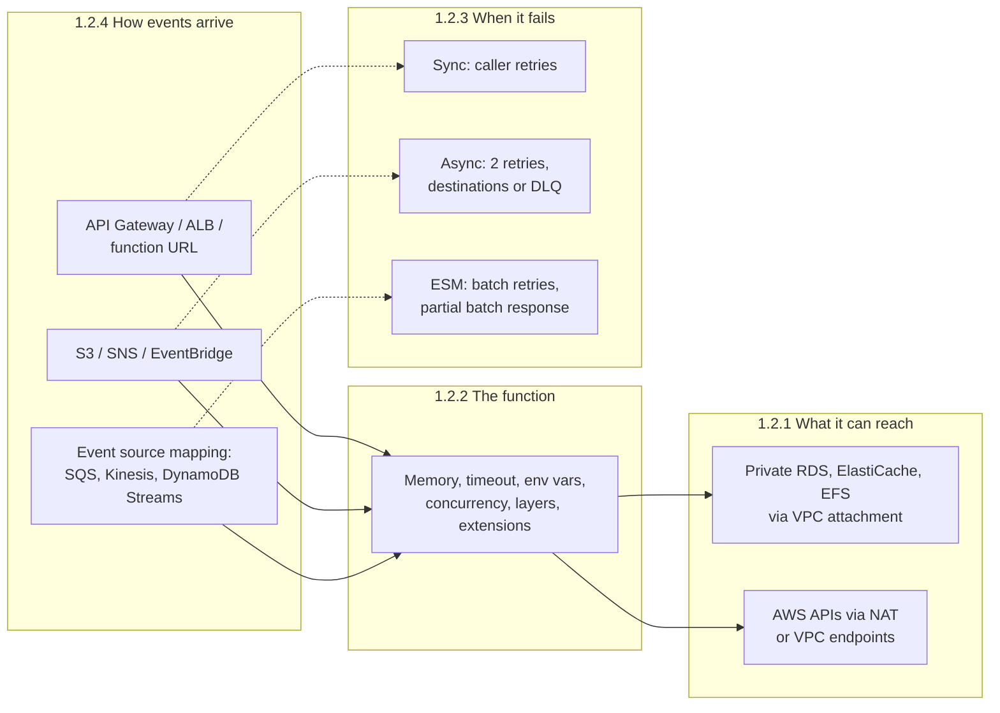

# Task 1.2: Develop AWS Lambda functions

**Domain 1 · Task 1.2** · [Domain overview](../README.md)

This task covers AWS Lambda from the developer's side: how a function reaches private resources in a virtual private cloud (VPC), how you configure it (memory, timeout, environment variables, concurrency, runtimes, handlers, layers, extensions), what happens to each invocation and its failures, and how API Gateway, DynamoDB, queues, and streams connect to it. Lambda is where most Domain 1 code runs, so this task links the application patterns in [Task 1.1](../task-1.1-build-application-code/README.md) to the data stores in [Task 1.3](../task-1.3-use-data-stores/README.md). Its concurrency and memory topics come back in Domain 4 as optimization questions, and its versions, aliases, and packaging come back in Domain 3.

> **DVA-C02 vs DVA-C03.** Lambda performance tuning sat in Task 1.2 on DVA-C02 and moved to Domain 4, Task 4.3 on DVA-C03. This task keeps the settings themselves (memory, concurrency, SnapStart); tuning them for cost and speed is in [4.3.1](../../domain-4-troubleshooting-and-optimization/task-4.3-optimize-applications/4.3.1-concurrency-controls.md) and [4.3.2](../../domain-4-troubleshooting-and-optimization/task-4.3-optimize-applications/4.3.2-memory-and-compute-tuning.md).

## Skills

| Skill | Note | Covers |
|---|---|---|
| 1.2.1 | [Lambda VPC access](1.2.1-lambda-vpc-access.md) | VPC attachment, Hyperplane elastic network interfaces (ENIs), security groups, NAT gateways and VPC endpoints, Amazon Relational Database Service (RDS) Proxy, Amazon Elastic File System (EFS) mounts, troubleshooting |
| 1.2.2 | [Lambda configuration](1.2.2-lambda-configuration.md) | Execution environment lifecycle, runtimes, handlers, memory and CPU, timeout, `/tmp`, environment variables and secrets, reserved and provisioned concurrency, SnapStart, layers, extensions, limits |
| 1.2.3 | [Invocation lifecycle and failures](1.2.3-lambda-invocation-lifecycle-and-failures.md) | Synchronous, asynchronous, and event source mapping models; retries; throttling; destinations versus dead-letter queues (DLQs); stream and SQS failure handling; partial batch responses; idempotency |
| 1.2.4 | [Lambda service integrations](1.2.4-lambda-service-integrations.md) | Execution role versus resource-based policy, API Gateway proxy and authorizers, Application Load Balancer (ALB), function URLs, DynamoDB and DynamoDB Streams, event source mappings in depth, S3 and other triggers, invoking from code |

## How the skills fit together

Use this table to route a scenario to the right note:

| The question is about | Go to |
|---|---|
| A function that cannot reach a database, S3, or a third-party API | [1.2.1](1.2.1-lambda-vpc-access.md) |
| Cold starts, timeouts, slow CPU, throttling one function to protect others, shared libraries, secrets in config | [1.2.2](1.2.2-lambda-configuration.md) |
| Lost events, retries, a poison pill in a batch, DLQ versus destination | [1.2.3](1.2.3-lambda-invocation-lifecycle-and-failures.md) |
| Permissions to invoke, API Gateway response shapes, stream or queue triggers, batching, filtering, scaling | [1.2.4](1.2.4-lambda-service-integrations.md) |

## Study checklist

- [ ] 1.2.1 Attach a function to private subnets, open the database security group to the Lambda security group, and choose a NAT gateway or VPC endpoint for outbound calls.
- [ ] 1.2.1 Explain why a public subnet does not give a function internet access, and when to add RDS Proxy.
- [ ] 1.2.2 Explain what runs during `Init` versus `Invoke`, and why clients belong outside the handler.
- [ ] 1.2.2 State the memory, timeout, `/tmp`, environment variable, layer, package, and payload limits.
- [ ] 1.2.2 Pick reserved concurrency, provisioned concurrency, or SnapStart for a given scenario.
- [ ] 1.2.2 Keep secrets in Secrets Manager or Parameter Store and read them through the caching extension.
- [ ] 1.2.3 Describe what happens to a failed event under synchronous, asynchronous, and event source mapping invocations.
- [ ] 1.2.3 Configure on-success and on-failure destinations, and place an SQS DLQ on the source queue.
- [ ] 1.2.3 Implement partial batch responses, including the `ReportBatchItemFailures` flag.
- [ ] 1.2.4 Write a handler that reads an API Gateway proxy event and returns a valid response.
- [ ] 1.2.4 Choose between the execution role and a resource-based policy for a permission error.
- [ ] 1.2.4 Configure an event source mapping's batch size, window, filters, and concurrency, and explain ordering per source.

## Labs and practice

- [Labs](labs.md):
  - Lab 1: Lambda behind API Gateway writing to DynamoDB, the core Domain 1 request flow.
  - Lab 2: one layer shared by two functions.
  - Lab 3: reserved concurrency as a cap that protects a downstream system.
  - Lab 4: an SQS event source mapping with partial batch responses and a poison-pill message.
- [Practice questions](practice-questions.md): 4 scenario-based multiple-choice questions (one choose-two), each with the answer, an explanation, and why the other options are wrong.
