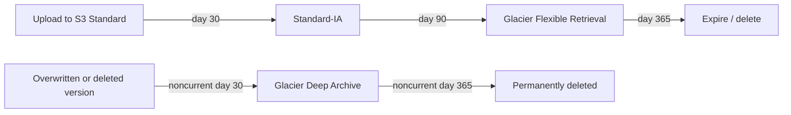
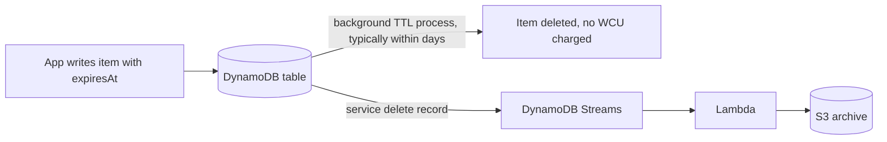

# 1.3.1 Manage data lifecycles with S3 Lifecycle rules, TTL settings, and retention periods

**Domain 1 · Task 1.3 · Skill 1.3.1** · [Task overview](README.md) · Previous: [1.2.4 Lambda service integrations](../task-1.2-develop-lambda-functions/1.2.4-lambda-service-integrations.md) · Next: [1.3.2 Choosing data stores](1.3.2-choosing-data-stores.md)

## What the exam expects

This skill tests whether you can make data move to cheaper storage or disappear on schedule without writing cleanup code. Questions describe an aging or expiring data set (logs, uploads, sessions, old object versions) and ask which built-in mechanism handles it at the lowest cost and effort. The three main tools are Amazon Simple Storage Service (S3) Lifecycle rules, Amazon DynamoDB Time to Live (TTL), and per-service retention settings.

You must be able to:

- Write or read an S3 Lifecycle rule that transitions objects between storage classes and expires them, including noncurrent versions and incomplete multipart uploads.
- Pick the S3 storage class that matches an access frequency and retrieval-time requirement, and account for minimum storage durations and minimum object sizes.
- Enable DynamoDB TTL correctly (Number attribute, Unix epoch seconds) and handle the delay between expiry and deletion.
- Know the default and maximum retention for logs, queues, streams, backups, and caches, and which ones you must change from the default.

## Key terms

| Term | Meaning |
|---|---|
| Lifecycle configuration | A set of rules on an S3 bucket that tells S3 to transition or expire objects automatically. |
| Transition action | Moves objects to another storage class after a number of days. |
| Expiration action | Deletes objects (or noncurrent versions, or expired delete markers) after a number of days. |
| Noncurrent version | An older version of an object in a versioning-enabled bucket after it has been overwritten or deleted. |
| Delete marker | The placeholder S3 creates when you delete an object in a versioned bucket without naming a version ID. |
| Time to Live (TTL) | A per-item or per-key expiry timestamp after which the service deletes the data. |
| Unix epoch time | Seconds elapsed since 1970-01-01 00:00:00 UTC. DynamoDB TTL requires this format, in seconds. |
| Retention period | How long a service keeps data before deleting it (log groups, queues, streams, backups). |
| Minimum storage duration | The number of days S3 bills an object in a class, even if you delete or move it earlier. |
| S3 Object Lock | Write-once-read-many (WORM) protection that prevents deletion or overwrite of object versions for a retention period. |

## S3 Lifecycle rules

A lifecycle configuration is a list of rules. Each rule has a filter that selects objects and one or more actions.

**Filters:**

- Key prefix, for example `logs/` or `mp3/`.
- Object tags, for example `Department=Finance`.
- Object size, with `ObjectSizeGreaterThan` and `ObjectSizeLessThan`.
- A combination of these with `And`.

**Actions:**

| Action | What it does | Typical use |
|---|---|---|
| `Transitions` | Moves current versions to another class after N days | Logs to Standard-Infrequent Access (Standard-IA) after 30 days, to Glacier after 90 |
| `Expiration` (`Days` or `Date`) | Deletes current versions. In a versioned bucket this adds a delete marker instead | Delete access logs after 365 days |
| `NoncurrentVersionTransitions` | Moves older versions to another class N days after they become noncurrent | Cheap recovery window for overwritten files |
| `NoncurrentVersionExpiration` | Permanently deletes older versions N days after they become noncurrent | Stop versioning costs from growing forever |
| `ExpiredObjectDeleteMarker` | Removes delete markers that no longer have any versions behind them | Clean up after versions expire |
| `AbortIncompleteMultipartUpload` | Deletes the parts of uploads that never completed after N days | Stop paying for orphaned parts |

### Supported transitions

S3 transitions follow a one-way "waterfall" from warmer to colder classes.


*Source: [Transitioning objects using Amazon S3 Lifecycle](https://docs.aws.amazon.com/AmazonS3/latest/userguide/lifecycle-transition-general-considerations.html). Lifecycle rules move objects down the waterfall, never back up.*

- From Standard you can transition to any colder class.
- Glacier Flexible Retrieval can transition only to Glacier Deep Archive.
- Glacier Deep Archive is the end of the line. To move an object out, restore a temporary copy and then copy it to a new class.
- Objects in Glacier Flexible Retrieval and Deep Archive are not available in real time. You call `RestoreObject` first, and the restored copy lasts only as long as you requested.
- Encrypted objects stay encrypted through transitions.

### Constraints that change cost

- **Small objects.** Since September 2024, lifecycle rules by default do not transition objects smaller than 128 KB to any class, because the per-object transition request can cost more than the storage saved. Add an object size filter to override this.
- **Minimum storage duration.** Standard-IA and One Zone-IA bill at least 30 days, Glacier Instant Retrieval and Glacier Flexible Retrieval 90 days, Glacier Deep Archive 180 days. Deleting, overwriting, or transitioning early still charges the remainder.
- **Minimum billable size.** Standard-IA, One Zone-IA, and Glacier Instant Retrieval bill each object as at least 128 KB. Glacier Flexible Retrieval and Deep Archive add 40 KB of metadata per archived object.
- **Ordering within a rule.** One rule cannot schedule a transition into a class before that class's minimum duration has passed. For example, Glacier Instant Retrieval at day 4 means Deep Archive cannot come before day 94.
- Lifecycle rules generally require objects to be at least 30 days old before transitioning from Standard to Standard-IA or One Zone-IA (verify).

### Storage classes for lifecycle targets

| Class | Access pattern | Retrieval | Availability (designed) | Availability Zones | Min duration | Min billable size |
|---|---|---|---|---|---|---|
| S3 Standard | Frequent | Milliseconds | 99.99% | 3 or more | None | None |
| S3 Intelligent-Tiering | Unknown or changing | Milliseconds (optional archive tiers need restore) | 99.9% | 3 or more | None | None (objects under 128 KB stay in Frequent Access and are not monitored) |
| S3 Standard-IA | About once a month, must be fast | Milliseconds, per-GB retrieval fee | 99.9% | 3 or more | 30 days | 128 KB |
| S3 One Zone-IA | Infrequent and re-creatable | Milliseconds, per-GB retrieval fee | 99.5% | 1 | 30 days | 128 KB |
| S3 Glacier Instant Retrieval | About once a quarter, must be fast | Milliseconds | 99.9% | 3 or more | 90 days | 128 KB |
| S3 Glacier Flexible Retrieval | About once a year | Expedited 1 to 5 minutes, Standard 3 to 5 hours, Bulk 5 to 12 hours (free) | 99.99% after restore | 3 or more | 90 days | 40 KB metadata overhead |
| S3 Glacier Deep Archive | Less than once a year | Standard 12 hours, Bulk 48 hours | 99.99% after restore | 3 or more | 180 days | 40 KB metadata overhead |

All classes are designed for 99.999999999% (11 nines) durability. Availability is what changes between classes.

**Intelligent-Tiering** charges a small monitoring fee per object and has no retrieval fees. It moves objects to Infrequent Access after 30 days without access and to Archive Instant Access after 90 days. The optional Archive Access tier (90 days or more) and Deep Archive Access tier (180 days or more) require a restore before reading.

**S3 Storage Class Analysis** watches access patterns and recommends when to transition from Standard to Standard-IA. It does not cover One Zone-IA or Glacier classes. Reports update daily and take 24 to 48 hours to show data. Use it before writing lifecycle rules.

> **DVA-C02 vs DVA-C03.** DVA-C03 adds Amazon S3 Glacier to the in-scope service list, so expect storage-class and retrieval-time questions tied to lifecycle rules.

### Example lifecycle configuration

```json
{
  "Rules": [
    {
      "ID": "app-logs",
      "Status": "Enabled",
      "Filter": { "Prefix": "logs/" },
      "Transitions": [
        { "Days": 30, "StorageClass": "STANDARD_IA" },
        { "Days": 90, "StorageClass": "GLACIER" }
      ],
      "Expiration": { "Days": 365 }
    },
    {
      "ID": "old-versions-and-orphaned-uploads",
      "Status": "Enabled",
      "Filter": {},
      "NoncurrentVersionTransitions": [
        { "NoncurrentDays": 30, "StorageClass": "DEEP_ARCHIVE" }
      ],
      "NoncurrentVersionExpiration": { "NoncurrentDays": 365 },
      "AbortIncompleteMultipartUpload": { "DaysAfterInitiation": 7 }
    }
  ]
}
```

```bash
aws s3api put-bucket-lifecycle-configuration \
  --bucket my-app-bucket \
  --lifecycle-configuration file://lifecycle.json

aws s3api get-bucket-lifecycle-configuration --bucket my-app-bucket
```

### Versioning and lifecycle together

Versioning protects against accidental overwrite and delete. A plain `DeleteObject` in a versioned bucket only adds a delete marker, so the previous version is still recoverable. Without lifecycle rules, every version is kept and billed forever. Pair versioning with `NoncurrentVersionTransitions` and `NoncurrentVersionExpiration` to keep a recovery window at low cost.

Notes:

- Objects that existed before versioning was enabled have version ID `null`.
- Suspending versioning does not delete existing versions.
- Versioning is required for S3 Replication and S3 Object Lock.

### Worked scenarios

**Scenario 1: thumbnails and source images.** An application creates thumbnails from uploaded profile photos. Thumbnails can be re-created and are kept 60 days. Source images must be immediately retrievable for 60 days, after which a wait of up to 6 hours is acceptable.

- Source images: S3 Standard, lifecycle transition to Glacier Flexible Retrieval after 60 days (Standard retrieval takes 3 to 5 hours).
- Thumbnails: S3 One Zone-IA because they are re-creatable, lifecycle expiration after 60 days.

**Scenario 2: recover deleted objects.** Deleted objects must be recoverable immediately for 30 days (rarely needed), then within 48 hours for up to 365 days.

- Enable versioning so a delete only adds a delete marker.
- Transition noncurrent versions to Standard-IA for the first 30 days.
- Then transition noncurrent versions to Glacier Deep Archive, whose 48-hour Bulk retrieval fits the requirement.
- Expire noncurrent versions after 365 days.



## DynamoDB Time to Live (TTL)

TTL lets each item carry its own expiry time. DynamoDB deletes expired items in the background without consuming write capacity units (WCUs).

**How to set it up:**

1. Enable TTL on the table and name the attribute that holds the expiry time, for example `expiresAt`.
2. On each write, set that attribute to a Number holding Unix epoch time in seconds.
3. Items whose TTL attribute is missing, or is not a Number, are ignored by TTL.

```bash
aws dynamodb update-time-to-live \
  --table-name Sessions \
  --time-to-live-specification "Enabled=true, AttributeName=expiresAt"
```

```python
import time
import boto3

table = boto3.resource("dynamodb").Table("Sessions")

# Expire this session 24 hours after creation
table.put_item(Item={
    "sessionId": "s-123",
    "userId": "u-42",
    "expiresAt": int(time.time()) + 24 * 60 * 60,  # Number, epoch seconds
})
```

**Behavior to remember:**

- Deletion is not instant. AWS documents that expired items are typically deleted within a few days of expiry. Older course material says "within 48 hours"; use the current wording.
- Until the background process deletes them, expired items still appear in `GetItem`, `Query`, and `Scan` results. Filter them out when that matters.
- You can still update an expired item before it is deleted. Moving the TTL into the future, or removing the attribute, cancels the expiry. Use a condition expression so you do not resurrect an item that was just deleted.
- TTL deletes are removed from local secondary indexes (LSIs) and global secondary indexes (GSIs) like any other delete.
- TTL deletes appear in DynamoDB Streams as service deletions, with `userIdentity` set to the DynamoDB service (`dynamodb.amazonaws.com`). A Lambda function on the stream can archive expired items to S3 or tell them apart from user deletes.
- In global tables, the TTL delete in the original Region is free, but the replicated delete in each other Region consumes replicated write capacity. Global tables in multi-Region strong consistency (MRSC) mode do not support TTL.

```python
from boto3.dynamodb.conditions import Key, Attr
import time

now = int(time.time())
resp = table.query(
    KeyConditionExpression=Key("userId").eq("u-42"),
    FilterExpression=Attr("expiresAt").gt(now),  # hide expired-but-not-yet-deleted items
)
```

The query above still consumes read capacity for the expired items it filters out, because filter expressions run after the read. See [1.3.4](1.3.4-dynamodb-design-and-operations.md) for why.



**Common TTL uses:** session data, temporary tokens, idempotency keys, rate-limit windows, and data that a regulation says you must not keep.

## Cache TTL and eviction (ElastiCache)

Amazon ElastiCache keys expire with a TTL set per key, for example `SET key value EX 300` or `EXPIRE key 300`. When memory fills, the eviction policy (for example `allkeys-lru` or `volatile-lru`) removes keys. TTL is the main lever for cache freshness, so [1.3.3 Caching strategies](1.3.3-caching-strategies.md) covers it in full.

## Retention periods across services

Many services keep data for a fixed or configurable period. Know the defaults, because some keep data forever and others drop it silently.

| Service | Retention | Default | Exam angle |
|---|---|---|---|
| Amazon CloudWatch Logs | Never expire, or 1 day to 10 years, per log group | Never expire | "Log storage cost keeps growing" means set a retention policy on the log group |
| Amazon Kinesis Data Streams | 24 hours to 365 days | 24 hours | Raise retention to allow replay after a consumer bug |
| Amazon Simple Queue Service (SQS) | 1 minute to 14 days | 4 days | Set dead-letter queue retention to 14 days so failed messages do not expire before you inspect them |
| DynamoDB Streams | 24 hours | Fixed | Consumers must keep up; records older than 24 hours are gone |
| Amazon Relational Database Service (RDS) automated backups | 0 to 35 days (0 disables automated backups) | Set per instance | Point-in-time restore only works within the retention window |
| AWS CloudTrail event history | 90 days | Fixed | For longer, create a trail that delivers to S3 and query with Athena |
| AWS Step Functions Standard workflows | Execution history for 90 days | Fixed | Export history if you need it longer |
| Amazon Elastic Container Registry (ECR) | Lifecycle policies expire images by age or count | No policy | "Old images pile up" means add an ECR lifecycle policy |
| S3 Object Lock | Retention period per object version, or legal hold with no end date | Off | WORM compliance storage |

### S3 Object Lock

Object Lock prevents an object version from being deleted or overwritten for a retention period. It requires versioning.

- **Governance mode:** users with special permission can override or shorten the lock.
- **Compliance mode:** no one, including the root user, can delete the version until retention expires.
- **Legal hold:** blocks deletion with no expiry date until someone removes the hold.

Object Lock controls retention and deletion only. It has nothing to do with encryption keys, access control by prefix, or transfer speed, which is how it appears as a distractor.

## Exam triggers

| Scenario clue | Answer | Why the alternatives are wrong |
|---|---|---|
| Delete session records 24 hours after creation automatically, at no extra cost | DynamoDB TTL with an epoch-seconds Number attribute | A scheduled Scan plus `DeleteItem` costs read and write capacity and needs code |
| Move logs to cheaper storage after 30 days and delete after 1 year | S3 Lifecycle transition plus expiration | Manual copy jobs or Lambda cron add code; Intelligent-Tiering does not delete |
| Access pattern is unknown or changes over time | S3 Intelligent-Tiering | Standard-IA charges retrieval fees and a 30-day minimum if the guess is wrong |
| Incomplete multipart uploads are adding storage cost | `AbortIncompleteMultipartUpload` lifecycle action | Versioning or expiration of current objects does not touch orphaned parts |
| Old object versions keep growing the bill | `NoncurrentVersionExpiration` (and transitions) | Suspending versioning does not delete existing versions |
| Recover deleted objects for a period | Versioning plus noncurrent-version lifecycle rules | Object Lock prevents deletes but does not give a cheap recovery tier |
| Archive with retrieval in under 12 hours vs. 48 hours is fine | Glacier Flexible Retrieval vs. Glacier Deep Archive | Glacier Instant Retrieval costs more than needed when hours are acceptable |
| Data is re-creatable and infrequently accessed | S3 One Zone-IA | Standard-IA pays for multi-Availability Zone resilience the data does not need |
| CloudWatch Logs cost grows forever | Set log group retention | Log groups never expire by default |
| Expired DynamoDB items still show up in queries | Add a filter on the TTL attribute | TTL deletion runs in the background, typically within a few days |
| Analyze access patterns before writing lifecycle rules | S3 Storage Class Analysis | It covers Standard to Standard-IA only, not Glacier |
| Data must not be deleted or changed for 7 years, even by admins | S3 Object Lock in compliance mode | Governance mode can be overridden; bucket policies can be changed |

## Common traps

- TTL is not instant. Expired items can be returned until the background process deletes them.
- The TTL attribute must be a Number in epoch seconds. A string date or milliseconds value is ignored or expires at the wrong time.
- S3 Lifecycle rules apply to S3 objects only. They do nothing for DynamoDB items, and DynamoDB billing mode has no built-in expiry.
- An `Expiration` action in a versioned bucket adds a delete marker. Old versions stay and keep costing money until a noncurrent-version rule removes them.
- Transitioning to Standard-IA or Glacier before the minimum storage duration still bills the full minimum.
- Objects under 128 KB do not transition by default, and small objects in IA classes are billed as 128 KB.
- You cannot transition up the waterfall, and Deep Archive cannot transition anywhere. Restore and copy instead.
- CloudWatch Logs default retention is "never expire".
- DynamoDB Streams retention is a fixed 24 hours; Kinesis Data Streams retention is configurable up to 365 days.
- Object Lock is about retention and immutability, not encryption or access control.

## Quick recall

- S3 Lifecycle actions: transition, expiration, noncurrent-version transition and expiration, expired delete marker cleanup, abort incomplete multipart uploads.
- Filters: prefix, tags, object size.
- Minimum durations: IA classes 30 days, Glacier Instant and Flexible 90 days, Deep Archive 180 days.
- Objects under 128 KB do not transition by default (since September 2024).
- Glacier Flexible: 1 to 5 minutes, 3 to 5 hours, 5 to 12 hours. Deep Archive: 12 or 48 hours.
- DynamoDB TTL: Number attribute, epoch seconds, no WCU cost, typically deleted within a few days, filter expired items in reads.
- TTL deletes show up in DynamoDB Streams as service deletions.
- CloudWatch Logs: never expire by default, 1 day to 10 years.
- SQS 1 minute to 14 days (default 4). Kinesis 24 hours to 365 days. DynamoDB Streams 24 hours. RDS backups 0 to 35 days.
- Object Lock: governance (overridable), compliance (nobody), legal hold (no end date). Requires versioning.

## Related skills

- [1.3.2 Choosing data stores](1.3.2-choosing-data-stores.md): pick S3 or DynamoDB first, then manage its lifecycle.
- [1.3.3 Caching strategies](1.3.3-caching-strategies.md): cache TTL and eviction policies in depth.
- [1.3.4 DynamoDB design and operations](1.3.4-dynamodb-design-and-operations.md): filter expressions and their capacity cost.
- [1.1.6 Streaming data](../task-1.1-build-application-code/1.1.6-streaming-data.md): Kinesis and DynamoDB Streams retention and replay.
- [1.2.4 Lambda service integrations](../task-1.2-develop-lambda-functions/1.2.4-lambda-service-integrations.md): process TTL delete records from DynamoDB Streams with an event source mapping.
- [3.1.2 Container images and ECR](../../domain-3-testing-and-deployment/task-3.1-prepare-deployable-artifacts/3.1.2-container-images-and-ecr.md): ECR lifecycle policies.
- [4.1.3 Querying logs](../../domain-4-troubleshooting-and-optimization/task-4.1-root-cause-analysis/4.1.3-querying-logs.md): CloudWatch Logs groups whose retention you set here.

## Sources

- Merged from: `archive/dva-c03-study-notes/01-development-with-aws-services.md` (skill 1.3.1), `archive/dva-c03-study-notes/00-developer-basics.md` (TTL and data lifecycle), `archive/aws-dva-notes/Markdown Files/8. S3 Introduction.md` (versioning, storage classes), `archive/aws-dva-notes/Markdown Files/10. S3 Advanced.md` (lifecycle rules, scenarios, Storage Class Analysis), `archive/aws-dva-notes/Markdown Files/19. Serverless - DynamoDB.md` (TTL), `archive/aws-dva-notes/Markdown Files/5. RDS, Aurora, & ElastiCache.md` (cache TTL), `archive/aws-dva-notes/Markdown Files/16. Messaging - SQS, SNS & Kinesis.md` and `17. Monitoring, Troubleshooting & Audit.md` (retention), `archive/aws-dva-notes/Markdown Files/29. Exam Review & Tips.md` (S3 Glacier added in C03), `archive/dva-c03/exam-bank/` (TTL and Object Lock distractors)
- AWS documentation: [Using time to live (TTL) in DynamoDB](https://docs.aws.amazon.com/amazondynamodb/latest/developerguide/howitworks-ttl.html)
- AWS documentation: [Transitioning objects using Amazon S3 Lifecycle](https://docs.aws.amazon.com/AmazonS3/latest/userguide/lifecycle-transition-general-considerations.html)
- AWS documentation: [Understanding and managing Amazon S3 storage classes](https://docs.aws.amazon.com/AmazonS3/latest/userguide/storage-class-intro.html)
- AWS documentation: [How DynamoDB global tables work](https://docs.aws.amazon.com/amazondynamodb/latest/developerguide/V2globaltables_HowItWorks.html) (TTL with global tables)
