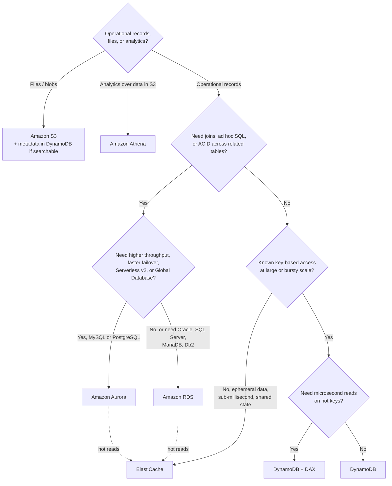
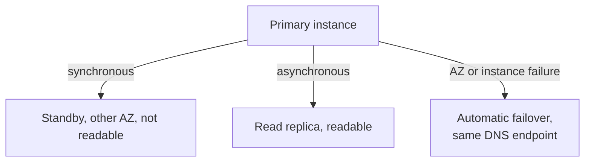
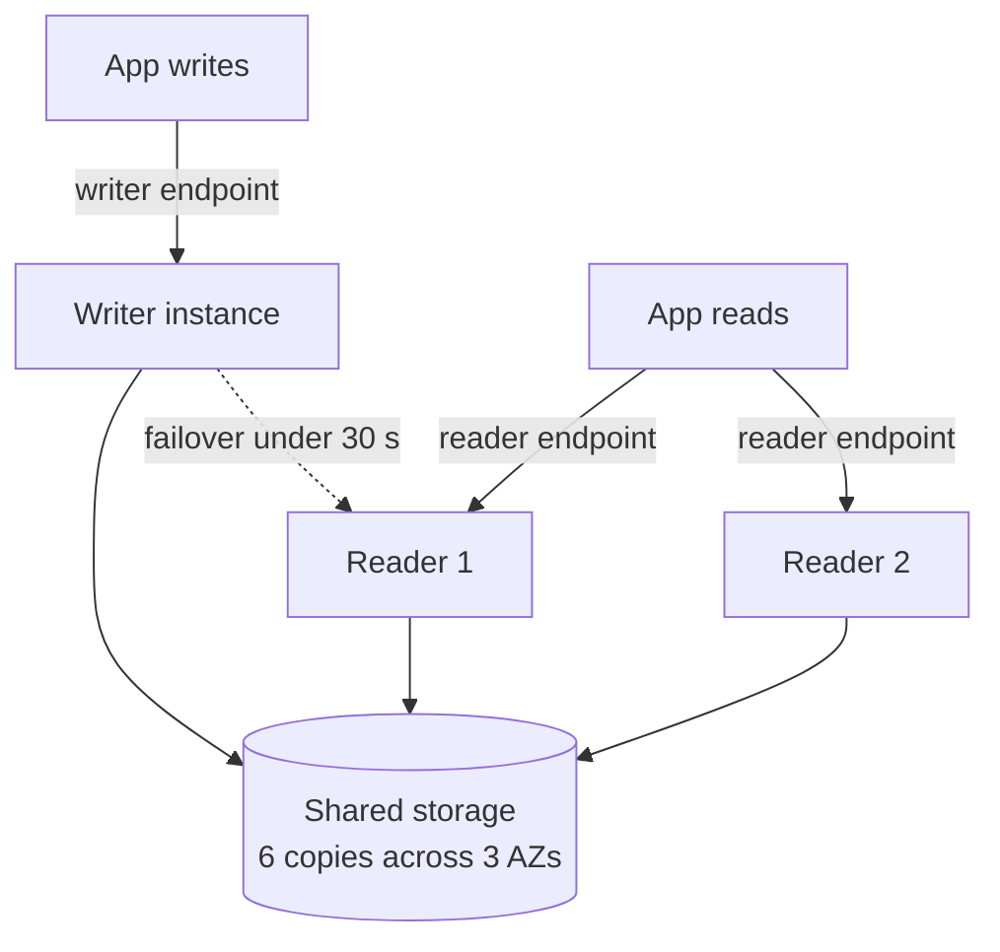

# 1.3.2 Select ElastiCache, DynamoDB, S3, RDS, or another suitable store based on access patterns

**Domain 1 · Task 1.3 · Skill 1.3.2** · [Task overview](README.md) · Previous: [1.3.1 Data lifecycle management](1.3.1-data-lifecycle-management.md) · Next: [1.3.3 Caching strategies](1.3.3-caching-strategies.md)

## What the exam expects

Data store questions give you requirements, not a service name. You translate phrases such as "needs joins", "single-digit millisecond key lookups at any scale", "storing files", or "sub-millisecond session reads" into the one store that fits. Distractors are usually stores that could technically hold the data but fit the access pattern poorly.

You must be able to:

- Classify a workload: relational vs. key-value, records vs. files, operational vs. analytical, durable store vs. cache.
- Choose among Amazon DynamoDB, Amazon Relational Database Service (RDS), Amazon Aurora, Amazon ElastiCache, and Amazon Simple Storage Service (S3), plus Amazon Elastic File System (EFS), Amazon Elastic Block Store (EBS), Amazon OpenSearch Service, and Amazon Athena where they fit.
- Recognize combinations, such as S3 for the object plus DynamoDB for its metadata.
- Know the RDS and Aurora features a developer configures: read replicas, Multi-Availability Zone (Multi-AZ) deployments, endpoints, RDS Proxy.

## Key terms

| Term | Meaning |
|---|---|
| Access pattern | The specific reads and writes an application performs, for example "get order by ID" or "orders for a customer in a date range". |
| Relational database | Tables with a fixed schema, Structured Query Language (SQL), joins, and ACID transactions. RDS and Aurora. |
| NoSQL key-value / document store | Items fetched by key with a flexible schema and horizontal scale. DynamoDB. |
| ACID | Atomicity, consistency, isolation, durability: the guarantees of a database transaction. |
| OLTP / OLAP | Online transaction processing (many small reads and writes) vs. online analytical processing (large scans and aggregations). |
| Polyglot persistence | Using several purpose-built stores in one system, each for the part of the workload it handles best. |
| Read replica | An asynchronously updated, read-only copy of a database used to scale reads. |
| Multi-AZ | A synchronously replicated standby in another Availability Zone (AZ) used for automatic failover. |

## Access pattern to data store

| Access pattern | Store |
|---|---|
| Key-value lookups at large or bursty scale, single-digit millisecond latency, serverless, flexible schema | DynamoDB |
| Relational data, joins, ad hoc SQL, transactions across tables | RDS or Aurora |
| Sub-millisecond reads, sessions, leaderboards, counters, pub/sub, rate limiting | ElastiCache (Valkey or Redis OSS) |
| Simple distributed cache, multi-threaded, no persistence or replication needed | ElastiCache (Memcached) |
| Files and objects: media, static assets, backups, data lake, large payloads | S3 |
| Long-term archive | S3 Glacier storage classes |
| Shared Portable Operating System Interface (POSIX) file system mounted by many instances, containers, or Lambda functions | Amazon EFS |
| Block storage attached to one Amazon Elastic Compute Cloud (EC2) instance | Amazon EBS |
| Full-text search and log analytics | Amazon OpenSearch Service |
| SQL queries over files already in S3, no servers | Amazon Athena |

Common combinations:

- **S3 object plus DynamoDB metadata.** DynamoDB items max out at 400 KB, so store the object in S3 and keep its key, size, owner, and dates in DynamoDB.
- **S3 metadata index.** S3 cannot search object metadata or tags. An S3 event invokes Lambda, which writes the metadata to DynamoDB so you can query by date, customer, or attribute.
- **RDS or Aurora plus ElastiCache** to absorb repeated reads.
- **DynamoDB plus DAX** (DynamoDB Accelerator) for microsecond reads on hot keys.

## Decision tree



Read the scenario for the workload shape before the service names. If two stores seem plausible, look for the tie-breaker: "MySQL or PostgreSQL compatible" means Aurora, "joins" means relational, "files" means S3, "microseconds in front of DynamoDB" means DAX.

## Relational vs. NoSQL

| | Relational (RDS, Aurora) | NoSQL (DynamoDB) |
|---|---|---|
| Query language | SQL | API calls (`GetItem`, `Query`), or PartiQL |
| Schema | Strict, defined up front | Only key attributes required; other attributes vary per item |
| Joins and aggregations | Yes (`JOIN`, `SUM`, `AVG`) | No joins, no aggregations; each query reads data stored together |
| Scaling | Vertical (bigger instance) plus read replicas for reads | Horizontal, by partition |
| Design approach | Normalize data, then write any query | List access patterns first, then design keys and indexes |
| Connections | Connection-based; pools can be exhausted by bursts of Lambda functions | HTTPS API calls; no connection pool ceiling |

Neither model is better in general. NoSQL needs the access patterns known in advance. If requirements are still shifting, a relational database tolerates new queries more easily.

## DynamoDB in one paragraph

DynamoDB is a fully managed, serverless key-value and document database replicated across multiple AZs. It serves millions of requests per second with consistent single-digit millisecond latency, scales with on-demand or provisioned capacity, integrates with AWS Identity and Access Management (IAM), and emits change events through DynamoDB Streams. Choose it when access is by a known key at large or unpredictable scale. Avoid it for joins, ad hoc reporting, or scan-heavy analytics. Key design, consistency, queries, and indexes are covered in [1.3.4](1.3.4-dynamodb-design-and-operations.md).

## Amazon RDS

RDS is a managed relational database for PostgreSQL, MySQL, MariaDB, Oracle, Microsoft SQL Server, and IBM Db2, plus Aurora. AWS handles provisioning, operating system (OS) patching, backups, and failover. You still write ordinary SQL.

What RDS gives you over a database you run on EC2:

- Automated provisioning and patching, with maintenance windows.
- Continuous backups and point-in-time restore to a timestamp within the backup retention period.
- Read replicas for read scaling and Multi-AZ for availability.
- Monitoring dashboards.
- Storage backed by EBS, with storage auto scaling.
- You cannot connect to an RDS instance over Secure Shell (SSH). The exception is RDS Custom (Oracle and SQL Server), which allows OS access.

**Storage auto scaling** raises allocated storage when free storage is below 10% for at least 5 minutes and at least 6 hours have passed since the last storage change, up to a maximum threshold you set.

### Read replicas vs. Multi-AZ

| | Read replica | Multi-AZ standby |
|---|---|---|
| Replication | Asynchronous, so reads are eventually consistent | Synchronous |
| Purpose | Scale reads (reporting, analytics) | High availability and disaster recovery |
| Readable | Yes, `SELECT` only | No, the standby is passive |
| Failover | Manual promotion to a standalone database | Automatic; the same Domain Name System (DNS) endpoint points to the new primary |
| Location | Same AZ, cross-AZ, or cross-Region | Another AZ in the same Region |
| Count | Up to 15 | One standby |
| Network cost | Free within a Region; cross-Region replication is charged | Included |
| Application change | Must use the replica's endpoint for reads | None; reconnect after failover |



Converting a Single-AZ instance to Multi-AZ needs no downtime: RDS takes a snapshot, restores it in another AZ, and starts synchronous replication. A read replica can also be configured as Multi-AZ.


*Source: [Amazon RDS User Guide: Multi-AZ deployments](https://docs.aws.amazon.com/AmazonRDS/latest/UserGuide/Concepts.MultiAZ.html). Synchronous replication to the standby is what makes automatic failover safe without data loss.*

### RDS Proxy

RDS Proxy is a fully managed, Multi-AZ connection pool in front of RDS and Aurora. Lambda functions that each open a database connection can exhaust the database's connection limit during a burst ("too many connections"). RDS Proxy pools and reuses connections, cuts failover time (AWS cites up to 66%), can enforce IAM authentication, reads database credentials from AWS Secrets Manager, and is reachable only from inside the virtual private cloud (VPC). Most applications need no code change. RDS Proxy is a connection pool, not a cache. Concurrency tuning is in [4.3.1](../../domain-4-troubleshooting-and-optimization/task-4.3-optimize-applications/4.3.1-concurrency-controls.md) and the VPC setup is in [1.2.1](../task-1.2-develop-lambda-functions/1.2.1-lambda-vpc-access.md).

### RDS and Aurora security in brief

- Encryption at rest with AWS Key Management Service (KMS) is chosen at launch. If the primary is unencrypted, its replicas cannot be encrypted. To encrypt an existing database, snapshot it and restore the snapshot as encrypted.
- In-transit encryption uses Transport Layer Security (TLS); clients use the AWS root certificates.
- IAM database authentication lets applications connect with an IAM role instead of a password.
- Security groups control network access. Audit logs can go to CloudWatch Logs.

Details are in [2.2.1](../../domain-2-security/task-2.2-encrypt-and-protect-sensitive-data/2.2.1-encryption-at-rest-and-in-transit.md) and [2.2.7](../../domain-2-security/task-2.2-encrypt-and-protect-sensitive-data/2.2.7-secrets-management.md).

## Amazon Aurora

Aurora is an AWS-built relational engine compatible with MySQL and PostgreSQL, so existing drivers and SQL work unchanged. Compute is separated from a shared, distributed storage layer.

- **Storage:** six copies across three AZs. Writes need 4 of 6 copies, reads need 3 of 6. Storage is self-healing and grows automatically in 10 GB increments up to 128 TiB (256 TiB on the newest engine versions) (verify).
- **Replicas:** up to 15 Aurora replicas with replica lag usually under 10 ms. Adding a replica is fast because it attaches to the same storage rather than copying data.
- **Failover:** automatic, typically under 30 seconds, by promoting a replica.
- **Performance and price:** AWS cites about 5x MySQL and 3x PostgreSQL throughput on RDS, at roughly 20% higher cost.
- **Endpoints:** the **writer endpoint** always points to the current primary and survives failover. The **reader endpoint** load-balances connections across replicas. Point writes at the writer endpoint and reads at the reader endpoint; never hard-code an instance address.
- **Aurora Serverless v2** scales capacity automatically between a minimum and maximum. Use it for unpredictable relational load where manual instance resizing would always lag.
- **Aurora Global Database** replicates to other Regions with typically sub-second lag, for low-latency reads elsewhere and Regional disaster recovery, with one write Region.
- **Backtrack** rewinds an Aurora MySQL database in place to an earlier time without restoring a backup.
- Aurora supports only MySQL- and PostgreSQL-compatible engines. Oracle or SQL Server needs RDS.




*Source: [Amazon Aurora User Guide: Aurora DB clusters](https://docs.aws.amazon.com/AmazonRDS/latest/AuroraUserGuide/Aurora.Overview.html). Every instance attaches to the same storage volume, which is why failover and new replicas are fast.*

```sql
-- Aurora PostgreSQL uses the same SQL as PostgreSQL
BEGIN;
INSERT INTO invoices (customer_id, total) VALUES (42, 199.99);
INSERT INTO invoice_items (invoice_id, product, amount)
  VALUES (currval('invoices_id_seq'), 'widget', 199.99);
COMMIT;
```

## Amazon ElastiCache

ElastiCache is a managed in-memory store running Valkey, Redis OSS, or Memcached. It serves microsecond to sub-millisecond reads, reduces load on the primary database for read-heavy workloads, and lets applications stay stateless by holding shared session data. The application must call the cache itself, so adopting it means code changes. It is not a system of record: keys can be evicted or lost. Engine differences and caching strategies are in [1.3.3](1.3.3-caching-strategies.md).

Choose ElastiCache when the scenario says sessions shared across instances, leaderboards (sorted sets), counters and rate limits (`INCR` with expiry), pub/sub, or caching expensive query results.

> **Not on the DVA-C03 service list.** Amazon MemoryDB is a Redis-compatible, durable, Multi-AZ in-memory database (a primary store, not a cache). If a question needs Redis speed with durability as the system of record, MemoryDB is the name, but ElastiCache is what the exam lists.

## Amazon S3 as a data store

S3 stores objects (files) in buckets. Choose it for files, blobs, media, backups, static websites, and data lakes, not for indexed queries or transactions.

- **Object size:** a single `PUT` uploads up to 5 GB. Multipart upload is recommended above 100 MB, required above 5 GB, and supports objects up to 50 TB. Older material says 5 TB. Parts upload independently, in parallel, and failed parts can be retried alone.
- **Consistency:** strong read-after-write consistency for all `PUT` and `DELETE` operations since December 2020. A read right after a write returns the new data.
- **Performance:** at least 3,500 `PUT`/`COPY`/`POST`/`DELETE` and 5,500 `GET`/`HEAD` requests per second per prefix, with no limit on prefixes. Spreading keys across more prefixes raises total throughput. Latency is around 100 to 200 ms for the first byte, so S3 is a poor fit for many tiny, frequent reads.
- **Byte-range fetches** download parts of an object in parallel or read only a header.
- **Transfer Acceleration** routes uploads through edge locations for distant clients and works with multipart upload.
- **Metadata:** user-defined metadata keys start with `x-amz-meta-`, and objects can have up to 10 tags. Neither can be searched directly; index them in DynamoDB.
- **Durability** is 11 nines in every storage class. Lifecycle management is in [1.3.1](1.3.1-data-lifecycle-management.md); presigned URLs are in [2.1.4](../../domain-2-security/task-2.1-authentication-and-authorization/2.1.4-time-limited-access.md).

```python
import boto3

s3 = boto3.client("s3")
ddb = boto3.resource("dynamodb").Table("Photos")

# Large object in S3, searchable metadata in DynamoDB
s3.upload_file("photo.jpg", "uploads-bucket", "users/u-42/photo.jpg")  # multipart automatically when large
ddb.put_item(Item={
    "userId": "u-42",
    "uploadedAt": "2026-11-19T10:00:00Z",
    "s3Key": "users/u-42/photo.jpg",
    "sizeBytes": 3_482_112,
})
```


*Source: [Amazon S3 User Guide: data consistency model](https://docs.aws.amazon.com/AmazonS3/latest/userguide/Welcome.html). S3 is strongly consistent; DynamoDB reads are eventually consistent unless you ask otherwise.*

## Session state: where to keep it

| Option | Fit for shared session state |
|---|---|
| ElastiCache | In-memory, sub-millisecond, shared by all instances; you manage a cluster or use serverless |
| DynamoDB with TTL | Serverless key-value store; TTL removes expired sessions |
| EFS | Network file system; must be mounted, poor fit for key lookups |
| EBS or instance store | Local to one instance, not shared |
| S3 | Higher latency, not meant for many small, frequently changing objects |

## Other in-scope stores

- **Amazon EFS:** managed Network File System (NFS) file system shared across EC2 instances, containers, and Lambda functions in a VPC. Use it when several compute resources need the same files with POSIX semantics.
- **Amazon EBS:** block volume for one EC2 instance (multi-attach aside). It backs RDS storage.
- **Amazon OpenSearch Service:** full-text search, log analytics, and search over data streamed from DynamoDB or other sources.
- **Amazon Athena:** serverless SQL over files in S3. Use for occasional analytical queries without loading data into a database.

> **Not on the DVA-C03 service list.** Other purpose-built databases appear in architecture material: Amazon DocumentDB (MongoDB compatible, chosen when an application already uses MongoDB drivers), Amazon Neptune (graph traversal such as friend networks or fraud rings), and Amazon Redshift (data warehouse for large historical aggregation). On DVA-C03, the listed answers are DynamoDB, RDS, Aurora, ElastiCache, S3, EFS, EBS, OpenSearch Service, and Athena.

## Pricing shape

| Store | Billing model | Implication |
|---|---|---|
| DynamoDB on-demand | Per request | Good for unpredictable or spiky traffic; zero cost at zero traffic |
| DynamoDB provisioned | Per hour of provisioned capacity | Cheaper for steady, well-used throughput |
| S3 | Per GB-month by class, per request, per GB transferred out | Storage class is the largest cost lever |
| RDS | Per instance-hour plus storage and I/O; Multi-AZ about doubles compute | You pay while idle |
| Aurora | Per instance-hour or per Aurora capacity unit (ACU) hour (Serverless v2), plus storage used and I/O | Storage grows and bills by use |
| ElastiCache | Per node-hour (or serverless usage) | Pay for cluster capacity whether or not it is busy |

## Worked scenarios

1. **Flash-sale checkout.** A sudden 50x spike for 10 minutes, simple lookups by order ID, inventory reads may be slightly stale. Choose DynamoDB on-demand with eventually consistent inventory reads and a conditional write for idempotency. RDS would hit a connection-pool ceiling when thousands of Lambda functions start at once.
2. **Monthly invoicing.** Join a subscription row with every usage line item and write the invoice header and lines atomically. Choose Aurora (or RDS). DynamoDB transactions exist (up to 100 actions, 4 MB) but there are no SQL joins across a normalized schema.
3. **Photo sharing.** Image bytes go to S3; metadata (owner, timestamps, S3 key) goes to DynamoDB.
4. **Hot leaderboard keys on DynamoDB.** The same few top-player items are read constantly. Add DAX for microsecond reads, or use ElastiCache sorted sets if the leaderboard is computed.
5. **Reporting slows down checkout.** Send reports to an RDS read replica or Aurora reader endpoint, or query exported data in S3 with Athena.
6. **Session store shared across an Auto Scaling group.** ElastiCache, or DynamoDB with TTL for a serverless option.
7. **Legacy application needs Oracle.** RDS for Oracle; Aurora does not support it.
8. **Unpredictable relational traffic.** Aurora Serverless v2.

## When not to force a fit

- Do not denormalize a relational workload into DynamoDB and stitch joins together in application code. If the requirement is relational, RDS or Aurora was the right call.
- Do not keep a bursty key-value workload on RDS "because it is already there". Connection limits become the bottleneck.
- Do not pick DynamoDB while access patterns are still unknown. Late changes mean new indexes or a redesign.
- Do not run heavy analytics on the OLTP database. Use a replica, Athena, or export.
- Do not store large binary objects in any database. Store them in S3 and keep a reference.
- Do not treat a cache as the system of record.

## Exam triggers

| Scenario clue | Answer | Why the alternatives are wrong |
|---|---|---|
| Joins across normalized tables, referential integrity, ACID across tables | RDS or Aurora | DynamoDB has no joins; S3 has no transactions |
| Unbounded or bursty scale, simple key lookups, predictable low latency | DynamoDB | RDS needs scaling work and has connection limits |
| Storing files, images, videos, backups | S3 | Databases can hold binary data but at higher cost and with size limits |
| Item larger than 400 KB | S3 object plus DynamoDB pointer | DynamoDB rejects items over 400 KB |
| Search S3 objects by metadata or upload date | Index metadata in DynamoDB via S3 event and Lambda | S3 cannot query metadata or tags |
| Shared sessions, sub-millisecond reads | ElastiCache | S3 latency is too high; EBS is not shared |
| Leaderboard or ranking | ElastiCache (Redis OSS or Valkey) sorted sets | Computing ranks with DynamoDB scans is slow and expensive |
| Requires Oracle or SQL Server | RDS | Aurora is MySQL- and PostgreSQL-compatible only |
| Higher throughput and faster failover than RDS on MySQL or PostgreSQL | Aurora | Rebuilding on DynamoDB changes the data model |
| Scale reads for reporting | Read replica or Aurora reader endpoint | Multi-AZ standby is not readable |
| Survive an AZ failure automatically with no code change | RDS Multi-AZ | Read replicas need manual promotion and a new endpoint |
| Lambda functions exhaust database connections | RDS Proxy | Bigger instances only raise the ceiling; caching does not pool connections |
| Low-latency reads in another Region for Aurora | Aurora Global Database | Cross-Region read replicas of RDS have higher lag |
| Shared file system for containers or Lambda | EFS | S3 is not a mounted POSIX file system; EBS attaches to one instance |
| Ad hoc SQL over logs already in S3 | Athena | Loading into RDS adds cost and operations |
| Full-text search | OpenSearch Service | DynamoDB `contains` filters still scan |

## Common traps

- "DynamoDB can do transactions, so it can replace RDS." Transactions exist, but there are still no joins or ad hoc queries.
- Read replicas are asynchronous and readable; Multi-AZ standbys are synchronous and not readable. Do not swap them.
- RDS Proxy pools connections. It is not a cache and does not speed up queries.
- ElastiCache is not durable storage. Data loss on eviction is a design error.
- S3 is strongly consistent. Do not choose a design that waits for "eventual consistency" on S3.
- Single `PUT` tops out at 5 GB. Larger files need multipart upload.
- To encrypt an existing unencrypted RDS database, snapshot and restore as encrypted. You cannot toggle encryption in place.
- Aurora's writer and reader endpoints survive failover. Instance endpoints do not.

## Quick recall

- Joins or ACID across tables: RDS or Aurora. Key lookups at scale: DynamoDB. Files: S3. Sub-millisecond shared state: ElastiCache.
- DynamoDB item max 400 KB; store larger objects in S3 with a pointer.
- RDS engines: PostgreSQL, MySQL, MariaDB, Oracle, SQL Server, Db2. Aurora: MySQL and PostgreSQL only.
- Read replicas: up to 15, asynchronous, readable. Multi-AZ: synchronous standby, automatic failover, same endpoint.
- Aurora: 6 copies in 3 AZs, up to 15 replicas, failover under 30 s, writer and reader endpoints, Serverless v2, Global Database.
- RDS Proxy: connection pooling for Lambda, IAM auth, Secrets Manager, VPC only.
- S3: 5 GB single `PUT`, multipart above 100 MB recommended, objects up to 50 TB, strong read-after-write consistency, 3,500 writes and 5,500 reads per second per prefix.
- S3 metadata and tags are not searchable; index them in DynamoDB.

## Related skills

- [1.3.3 Caching strategies](1.3.3-caching-strategies.md): which cache goes in front of each store.
- [1.3.4 DynamoDB design and operations](1.3.4-dynamodb-design-and-operations.md): once DynamoDB is chosen, how to model it.
- [1.3.1 Data lifecycle management](1.3.1-data-lifecycle-management.md): S3 storage classes and lifecycle rules.
- [1.1.8 Event-driven applications](../task-1.1-build-application-code/1.1.8-event-driven-applications.md): S3 event notifications that feed a metadata index.
- [1.2.1 Lambda VPC access](../task-1.2-develop-lambda-functions/1.2.1-lambda-vpc-access.md): reaching RDS, Aurora, ElastiCache, and RDS Proxy in private subnets.
- [2.1.4 Time-limited access](../../domain-2-security/task-2.1-authentication-and-authorization/2.1.4-time-limited-access.md): S3 presigned URLs for direct uploads and downloads.
- [2.2.7 Secrets management](../../domain-2-security/task-2.2-encrypt-and-protect-sensitive-data/2.2.7-secrets-management.md): database credentials in Secrets Manager.
- [4.3.1 Concurrency controls](../../domain-4-troubleshooting-and-optimization/task-4.3-optimize-applications/4.3.1-concurrency-controls.md): connection pools and RDS Proxy.

## Sources

- Merged from: `archive/dva-c03-study-notes/01-development-with-aws-services.md` (skill 1.3.2), `archive/dva-c03-study-notes/00-developer-basics.md` (relational vs NoSQL), `archive/dva-c03/domain-1-development/MASTER-CHUNK.md` (sections 10 Aurora, 20 RDS, 21 S3, 25 Database Selection Guide), `archive/dva-c03/domain-1-development/README.md` (decision tree, flash-sale case study, use cases), `archive/dva-c03/domain-4-troubleshooting-optimization/MASTER-CHUNK.md` (section 14 Database Selection Guide, polyglot persistence), `archive/aws-dva-notes/Markdown Files/5. RDS, Aurora, & ElastiCache.md`, `8. S3 Introduction.md`, `10. S3 Advanced.md` (performance, metadata), `19. Serverless - DynamoDB.md` (sections 1, 20), `archive/dva-c03/exam-bank/` (read replica, Global Database, RDS Proxy scenarios)
- AWS documentation: [Uploading objects (Amazon S3)](https://docs.aws.amazon.com/AmazonS3/latest/userguide/upload-objects.html) (5 GB single PUT, 50 TB multipart maximum)
- AWS documentation: [Amazon DynamoDB Transactions: How it works](https://docs.aws.amazon.com/amazondynamodb/latest/developerguide/transaction-apis.html) (100 actions, 4 MB)
- AWS documentation: [Multi-AZ deployments (Amazon RDS)](https://docs.aws.amazon.com/AmazonRDS/latest/UserGuide/Concepts.MultiAZ.html)
- AWS documentation: [Aurora DB clusters](https://docs.aws.amazon.com/AmazonRDS/latest/AuroraUserGuide/Aurora.Overview.html)
