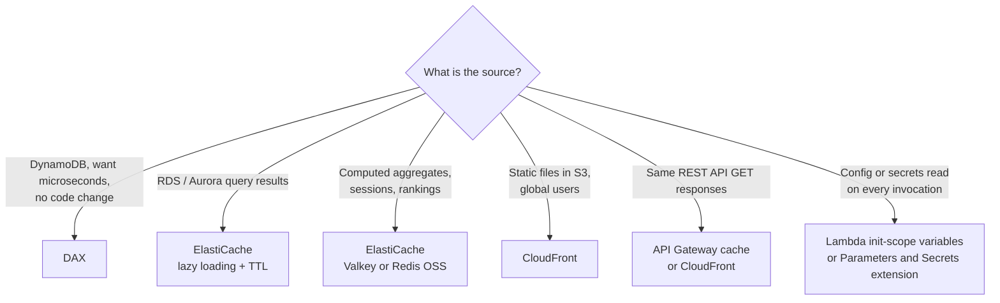
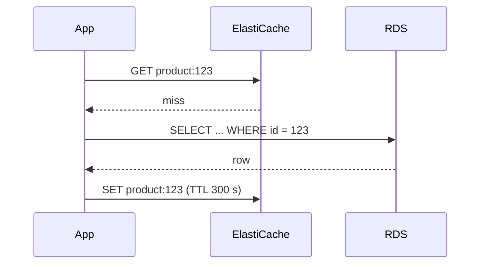

# 1.3.3 Choose a caching approach that fits the selected data store and freshness requirements

**Domain 1 · Task 1.3 · Skill 1.3.3** · [Task overview](README.md) · Previous: [1.3.2 Choosing data stores](1.3.2-choosing-data-stores.md) · Next: [1.3.4 DynamoDB design and operations](1.3.4-dynamodb-design-and-operations.md)

## What the exam expects

Once a data store is chosen, you decide what sits in front of it and how stale the cached data is allowed to be. Questions pair a store (DynamoDB, Amazon Relational Database Service [RDS], Amazon Simple Storage Service [S3], an application programming interface [API]) with a requirement such as "microseconds with no code change", "reduce load from repeated Structured Query Language (SQL) queries", or "data must reflect writes immediately", and ask for the cache and the population strategy.

You must be able to:

- Match each store to its usual cache: DynamoDB Accelerator (DAX) for DynamoDB, Amazon ElastiCache for RDS, Aurora, and computed results, Amazon CloudFront for S3 and static content, API Gateway caching for representational state transfer (REST) API responses.
- Choose lazy loading (cache-aside), write-through, or both, and set a Time to Live (TTL).
- Predict where stale reads come from and how each strategy limits them.
- Choose between the Valkey or Redis OSS and Memcached engines.

Implementation and tuning (hit ratios, CloudFront cache policies, metrics) belong to [4.3.4 Caching for performance](../../domain-4-troubleshooting-and-optimization/task-4.3-optimize-applications/4.3.4-caching-for-performance.md). This note focuses on the choice.

## Key terms

| Term | Meaning |
|---|---|
| Cache hit / miss | The requested key was / was not found in the cache. |
| Lazy loading (cache-aside) | The application reads the cache first and fills it from the database only on a miss. |
| Write-through | The application updates the cache every time it writes to the database. |
| TTL | Time after which a cached key expires and the next read goes to the source. |
| Eviction | The cache removes a key: explicitly, because memory is full (for example least recently used, LRU), or because its TTL expired. |
| Invalidation | Deleting or overwriting a cached key when the underlying data changes. |
| Item cache / query cache | DAX's two caches: one for `GetItem`/`BatchGetItem` results, one for `Query`/`Scan` results. |
| Staleness window | How long a cached value can differ from the source of truth. |

## Which cache for which store

| Data store or content | Cache | Notes |
|---|---|---|
| DynamoDB | DAX | API-compatible client swap, microsecond reads, item and query caches, eventually consistent reads only. Use ElastiCache for computed or aggregated results instead |
| RDS or Aurora | ElastiCache | Application code implements lazy loading or write-through. Aurora replicas scale reads but are not a cache. RDS Proxy pools connections and is not a cache |
| S3 and static content | CloudFront | Edge cache close to users |
| REST API responses | API Gateway stage cache, or CloudFront | API Gateway caching applies to REST APIs: 0.5 to 237 GB, TTL default 300 s, maximum 3,600 s |
| Computed results, sessions, leaderboards | ElastiCache (Valkey or Redis OSS) | Works with any source |
| Inside a Lambda function | Variables in the init scope, `/tmp`, Parameters and Secrets Lambda extension | Per execution environment; lost on cold start |



## Population strategies

### Lazy loading (cache-aside)

The application checks the cache. On a hit it returns the cached value. On a miss it reads the database, writes the result to the cache with a TTL, and returns it.



```python
import json
import redis

r = redis.Redis(host="my-cluster.xxxxx.cache.amazonaws.com", port=6379)

def get_product(product_id):
    key = f"product:{product_id}"
    cached = r.get(key)
    if cached is not None:
        return json.loads(cached)               # cache hit
    product = fetch_from_rds(product_id)        # cache miss: query the database
    r.setex(key, 300, json.dumps(product))      # store for 5 minutes
    return product
```

| Pros | Cons |
|---|---|
| Only data that is actually requested is cached, so the cache stays small | A miss costs three round trips (cache read, database read, cache write), so first reads are slow |
| A cache node failure is not fatal; the application falls back to the database with higher latency | Data can be stale: the database changes but the cached copy stays until its TTL expires or it is invalidated |

### Write-through

Every write goes to the database and then to the cache, so reads find current data.

```python
def update_product(product_id, fields):
    product = write_to_rds(product_id, fields)   # 1. write the source of truth
    r.setex(f"product:{product_id}", 3600, json.dumps(product))  # 2. update the cache
    return product
```

| Pros | Cons |
|---|---|
| Cached data reflects successful writes, so reads are fresh and fast | Write penalty: every write makes two calls |
| | Missing data: items not written since the cache started are not cached. Combine with lazy loading |
| | Cache churn: much of the written data may never be read. Add a TTL to clear it out |

Write-through reduces staleness but does not guarantee it. If the database write succeeds and the cache write fails, two writers update the cache in a different order than the database, or an invalidation is missed, the cache can still hold an old value. Treat the database as the source of truth, keep a TTL as a safety net, and handle cache-write failures by deleting the key.

### Combining strategies and invalidation

Most production designs combine the two: write-through (or delete-on-write) keeps hot keys fresh, lazy loading fills everything else, and a TTL on every key bounds how long any mistake can last.

- **Delete on write** is a simple alternative to write-through: after updating the database, delete the cache key so the next read reloads it.
- **TTL** is the pragmatic default for invalidation. Short TTLs mean fresher data and more misses; long TTLs mean fewer misses and more staleness.
- With pure write-through on data that changes only through your code, a TTL is optional, but it still limits churn and recovers from missed writes.

### Choosing by freshness requirement

| Requirement | Approach |
|---|---|
| Some staleness is fine; minimize memory and code | Lazy loading with a TTL |
| Reads should reflect writes as soon as possible | Write-through or delete-on-write, plus a TTL safety net |
| Read your own write must always be correct | Read the source of truth for that request (for DynamoDB, a strongly consistent read, which bypasses DAX) |
| Read once, rarely repeated | Do not cache; it only adds a staleness window |
| Reference data that changes rarely | Long TTL, or cache in the Lambda init scope |

## Evictions and TTL

Keys leave the cache in three ways:

1. You delete them explicitly.
2. Memory is full, and the eviction policy removes keys, for example `allkeys-lru` (any key, least recently used) or `volatile-lru` (only keys that have a TTL).
3. Their TTL expires.

TTLs can range from seconds (rate-limit windows) to hours or days (leaderboards, comment threads, activity streams). Set them with `SET key value EX seconds` or `EXPIRE key seconds`.

Rising `Evictions` together with rising `CacheMisses` and a falling hit rate means memory pressure: the working set no longer fits. Scale up (larger nodes) or out (more shards), or reduce TTLs and cached data. Switching engines does not help, because Memcached evicts under memory pressure too.

## ElastiCache engines

| Feature | Valkey / Redis OSS | Memcached |
|---|---|---|
| High availability | Multi-Availability Zone (Multi-AZ) with automatic failover | No replication |
| Read scaling | Read replicas; cluster mode shards data | Multi-node sharding |
| Persistence | Durable options (append-only file) | In memory only |
| Backup and restore | Yes | Serverless only |
| Data types | Strings, hashes, lists, sets, sorted sets, streams, pub/sub | Simple key-value strings |
| Threading | Mostly single-threaded command execution | Multi-threaded, uses multiple cores |

Choose Valkey or Redis OSS when the scenario needs failover, replication, durability, backups, sorted sets (leaderboards), `INCR` counters and rate limits, or pub/sub. Choose Memcached for a simple, multi-threaded, horizontally sharded cache where losing data on node failure is acceptable.


*Source: [Amazon ElastiCache User Guide](https://docs.aws.amazon.com/AmazonElastiCache/latest/dg/WhatIs.html). Replicas within each shard give read scaling and failover.*

Typical ElastiCache architectures:

- **Database cache:** lazy loading in front of RDS or Aurora, with an invalidation strategy.
- **Session store:** the application writes the user's session to ElastiCache, so any instance can serve the next request and the application tier stays stateless.
- **Leaderboard:** `ZADD` and `ZREVRANGE` on a sorted set give atomic score updates and rankings.
- **Rate limiter:** `INCR` on a per-user key with `EXPIRE` for the window.

> **Not on the DVA-C03 service list.** Amazon MemoryDB is Redis-compatible and durable, with a Multi-AZ transaction log, so it can be a primary database. ElastiCache is a cache alongside a separate source of truth.

## DynamoDB Accelerator (DAX)

DAX is a fully managed, highly available, in-memory cache for DynamoDB.

- **Microsecond latency** for cached reads, compared with single-digit milliseconds from DynamoDB.
- **API-compatible:** swap the DynamoDB client for the DAX client; application logic does not change.
- **Two caches:** the item cache holds `GetItem` and `BatchGetItem` results; the query cache holds `Query` and `Scan` results.
- **Write-through:** writes go through DAX to DynamoDB, and DAX updates its item cache.
- **Eventually consistent reads only.** A strongly consistent read (`ConsistentRead=true`) passes through to DynamoDB and is not cached.
- **Default TTL 5 minutes**, configurable in the cluster parameter group.
- **Cluster:** up to 11 nodes (1 primary plus up to 10 read replicas). Use at least 3 nodes in different Availability Zones (AZs) for production; 1 or 2 nodes are not fault tolerant. Older material says "up to 10 nodes".
- **Network:** runs in your virtual private cloud (VPC), reached on Transmission Control Protocol (TCP) port 8111; a cluster serves only DynamoDB tables in its own Region.
- **Security:** encryption at rest with AWS Key Management Service (KMS), AWS Identity and Access Management (IAM), AWS CloudTrail.
- Solves the hot-key read problem. Not useful for write-heavy tables or reads that rarely repeat.

```python
# Before: boto3 DynamoDB client. After: DAX client with the same calls.
# pip install amazon-dax-client
from amazondax import AmazonDaxClient

dax = AmazonDaxClient(endpoint_url="dax://my-cluster.l6fzcv.dax-clusters.us-east-1.amazonaws.com")
item = dax.get_item(TableName="Products", Key={"productId": {"S": "p-1"}})
```

### DAX vs. ElastiCache

| | DAX | ElastiCache |
|---|---|---|
| Works with | DynamoDB only | Any data source |
| Caches | Individual items, `Query` and `Scan` results | Whatever your code stores: aggregates, rendered pages, sessions |
| Code change | Client swap only | Application implements cache logic |
| Consistency | Eventually consistent reads; strong reads bypass the cache | Whatever your strategy and TTL give you |

## Other caches in brief

- **CloudFront** caches S3 objects and API responses at edge locations, with TTLs from cache policies and invalidations or versioned file names to refresh content. See [4.3.4](../../domain-4-troubleshooting-and-optimization/task-4.3-optimize-applications/4.3.4-caching-for-performance.md).
- **API Gateway caching** (REST APIs only) caches responses per stage, with per-method overrides and cache keys from request parameters. Clients can bypass it with `Cache-Control: max-age=0` only if you allow and authorize invalidation.
- **Lambda in-function caching:** values stored in global variables outside the handler, or in `/tmp`, survive across warm invocations of the same execution environment. The Parameters and Secrets Lambda extension caches Parameter Store and Secrets Manager values locally.

## Exam triggers

| Scenario clue | Answer | Why the alternatives are wrong |
|---|---|---|
| DynamoDB reads need microseconds with no code changes | DAX | ElastiCache needs application cache logic |
| Same few DynamoDB items read constantly (hot keys) | DAX | Raising read capacity treats the symptom and costs more |
| Cache results of expensive SQL queries on RDS | ElastiCache with lazy loading | DAX works only with DynamoDB; read replicas still run the query |
| Cache the result of an aggregation computed from DynamoDB | ElastiCache | DAX caches items and query results, not your computed values |
| Data in the cache must reflect writes immediately | Write-through (plus TTL) | Lazy loading leaves stale data until TTL expiry |
| Only cache what is requested; some staleness is acceptable | Lazy loading | Write-through caches data that may never be read |
| Leaderboard | ElastiCache sorted sets | Memcached has no sorted sets |
| Cache needs failover and persistence | Valkey or Redis OSS | Memcached has no replication or persistence |
| Simple cache, multi-threaded, sharded | Memcached | Redis features are not needed |
| Global users fetch the same static files | CloudFront | ElastiCache is regional and in a VPC |
| Same REST API GET responses repeatedly | API Gateway caching or CloudFront | Lambda-side caching still invokes the function |
| Strongly consistent read through DAX | Goes to DynamoDB, not cached | DAX caches only eventually consistent reads |
| Evictions and misses both rising | Memory pressure; scale the cluster or trim data | Changing engine version or engine type does not stop evictions |

## Common traps

- DAX caches eventually consistent reads only. It does not make strong reads faster.
- DAX is DynamoDB-only. For RDS or computed values, the answer is ElastiCache.
- RDS Proxy and Aurora replicas are not caches.
- Write-through reduces staleness but does not make it impossible. Failed or reordered cache writes and missed invalidations still leave stale entries.
- Lazy loading's first read is slow (three round trips) and can be stale.
- A cache is not a system of record. If losing a key on eviction loses data, the design is wrong.
- API Gateway caching exists for REST APIs, not HTTP APIs.
- Lambda in-memory caches are per execution environment and disappear on cold starts.

## Quick recall

- DynamoDB: DAX. RDS or Aurora: ElastiCache. S3 or static: CloudFront. REST API responses: API Gateway cache.
- Lazy loading: cache on miss, three trips on a miss, may be stale, survives node failure.
- Write-through: update cache on write, fresher, write penalty, caches unread data, combine with lazy loading and TTL.
- TTL on every key bounds staleness.
- Evictions: explicit delete, LRU when memory is full, TTL expiry.
- Redis OSS/Valkey: high availability, replicas, persistence, sorted sets. Memcached: multi-threaded, sharded, no HA.
- DAX: microseconds, API-compatible, item and query caches, eventually consistent only, default TTL 5 minutes, up to 11 nodes, 3 for production, port 8111.
- API Gateway cache: REST only, TTL default 300 s, maximum 3,600 s.

## Related skills

- [4.3.4 Caching for performance](../../domain-4-troubleshooting-and-optimization/task-4.3-optimize-applications/4.3.4-caching-for-performance.md): implementing and tuning ElastiCache, DAX, and CloudFront.
- [1.3.2 Choosing data stores](1.3.2-choosing-data-stores.md): pick the store first; the cache follows from it.
- [1.3.4 DynamoDB design and operations](1.3.4-dynamodb-design-and-operations.md): read consistency and hot partitions, which DAX addresses.
- [1.3.1 Data lifecycle management](1.3.1-data-lifecycle-management.md): TTL across services.
- [1.1.3 Resilience, retries, and backoff](../task-1.1-build-application-code/1.1.3-resilience-retries-and-backoff.md): serving cached data as graceful degradation when a dependency fails.
- [1.2.2 Lambda configuration](../task-1.2-develop-lambda-functions/1.2.2-lambda-configuration.md): init-scope reuse and extensions.
- [4.3.5 Performance bottleneck detection](../../domain-4-troubleshooting-and-optimization/task-4.3-optimize-applications/4.3.5-performance-bottleneck-detection.md): cache hit and miss metrics.

## Sources

- Merged from: `archive/dva-c03-study-notes/01-development-with-aws-services.md` (skill 1.3.3), `archive/dva-c03-study-notes/04-troubleshooting-optimization.md` (skill 4.3.4 caching details), `archive/dva-c03-study-notes/00-developer-basics.md` (caching), `archive/aws-dva-notes/Markdown Files/5. RDS, Aurora, & ElastiCache.md` (sections 10 to 14), `archive/aws-dva-notes/Markdown Files/19. Serverless - DynamoDB.md` (section 15 DAX), `archive/dva-c03/domain-1-development/MASTER-CHUNK.md` (section 15 ElastiCache, section 25 Database Selection Guide), `archive/aws-dva-notes/Markdown Files/31. Exam Day Cheat Sheet.md`, `archive/dva-c03/exam-bank/` (eviction and DAX scenarios)
- AWS documentation: [DAX cluster components](https://docs.aws.amazon.com/amazondynamodb/latest/developerguide/DAX.concepts.cluster.html) (11 nodes, 3-node production recommendation, port 8111, same-Region tables)
- AWS documentation: [What is Amazon ElastiCache?](https://docs.aws.amazon.com/AmazonElastiCache/latest/dg/WhatIs.html)
