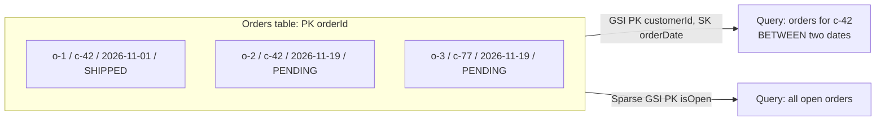

# 1.3.4 Configure DynamoDB partition keys, consistency, queries, scans, attributes, and indexes

**Domain 1 · Task 1.3 · Skill 1.3.4** · [Task overview](README.md) · Previous: [1.3.3 Caching strategies](1.3.3-caching-strategies.md) · Next: [2.1.1 Identity federation](../../domain-2-security/task-2.1-authentication-and-authorization/2.1.1-identity-federation.md)

## What the exam expects

This is the most heavily tested data-store skill. Amazon DynamoDB questions give an access pattern or a symptom (throttling, missing items, stale reads, high cost) and ask for the key design, read option, API call, expression, or index that fixes it. Capacity unit math appears almost every time.

You must be able to:

- Choose a high-cardinality partition key and a sort key that supports range queries, and fix hot partitions.
- Calculate read capacity units (RCUs) and write capacity units (WCUs) for strong, eventual, and transactional operations.
- Choose eventually or strongly consistent reads and know where strong reads are not available.
- Use `Query` instead of `Scan`, paginate with `LastEvaluatedKey`, and know what filter and projection expressions do and do not save.
- Write conditional updates, atomic counters, optimistic locking, batch calls, and transactions.
- Add a global secondary index (GSI) or local secondary index (LSI) for a new access pattern and know their limits.

> **DVA-C02 vs DVA-C03.** DVA-C02 spread DynamoDB across four skills. DVA-C03 consolidates them into this one skill. AWS states the consolidation does not reduce emphasis.

## Key terms

| Term | Meaning |
|---|---|
| Table / item / attribute | A table holds items (rows); each item is a set of attributes (columns) that can differ per item. |
| Partition key (hash key) | The attribute DynamoDB hashes to decide which partition stores an item. |
| Sort key (range key) | An optional second key attribute that orders items within a partition key value. |
| Composite primary key | Partition key plus sort key; the pair must be unique. |
| Cardinality | The number of distinct values an attribute has. |
| Hot partition / hot key | One partition key value receiving a disproportionate share of traffic. |
| RCU / WCU | Read and write capacity units in provisioned mode. On-demand uses read and write request units (RRU / WRU) with the same sizing. |
| Eventually consistent read | Default read that may not reflect a write from the last moment. |
| Strongly consistent read | A read (`ConsistentRead=true`) that returns all writes acknowledged before it. |
| GSI | Global secondary index: a different partition key (and optional sort key), its own throughput, eventually consistent. |
| LSI | Local secondary index: same partition key, different sort key, created with the table. |
| Projection | The attributes copied into an index: `KEYS_ONLY`, `INCLUDE`, or `ALL`. |
| `LastEvaluatedKey` | Returned when a `Query` or `Scan` page ends before all results; pass it as `ExclusiveStartKey` to continue. |

## Tables, items, and attributes

- A table needs a primary key, chosen at creation and not changeable later.
- A table can hold an unlimited number of items. Each item can be up to **400 KB**, counting attribute names and values.
- Only the key attributes are required. Other attributes can be added at any time and can differ between items.
- Data types:
  - **Scalar:** String (`S`), Number (`N`), Binary (`B`), Boolean (`BOOL`), Null (`NULL`).
  - **Document:** List (`L`), Map (`M`).
  - **Set:** String Set (`SS`), Number Set (`NS`), Binary Set (`BS`).
- Key attributes must be scalar: String, Number, or Binary.

The low-level client wraps every value with its type, for example `{"S": "abc"}` or `{"N": "42"}`. The higher-level resource or document client converts native types for you. Code written for one does not work with the other without conversion. Serialization is covered in [1.1.7](../task-1.1-build-application-code/1.1.7-serialization-and-deserialization.md).

## Primary keys and partition design

| Option | Structure | Uniqueness | Example |
|---|---|---|---|
| Partition key only | One attribute | Each value is unique per item | `userId` in a Users table |
| Partition key plus sort key | Two attributes | The pair must be unique; items with the same partition key are stored together, ordered by sort key | `customerId` plus `orderDate` in an Orders table |

DynamoDB hashes the partition key to choose a partition. Every item with the same partition key lives in the same partition.


*Source: [Amazon DynamoDB Developer Guide: Partitions and data distribution](https://docs.aws.amazon.com/amazondynamodb/latest/developerguide/HowItWorks.Partitions.html).*

**Choosing the partition key:**

- Pick an attribute with many distinct values that are accessed evenly, such as `userId`, `orderId`, `deviceId`, or `movieId`.
- Avoid low-cardinality attributes such as `status`, `country`, `language`, or a date. For a movie table, `movieId` is a good key; `movieLanguage` is a bad one because there are few values and most traffic goes to one of them.
- Each partition supports up to **3,000 RCUs and 1,000 WCUs**. A hot key throttles at that limit even when the table total looks fine.

**Partition count (classic formula):** partitions by capacity = RCUs / 3,000 + WCUs / 1,000; partitions by size = total size / 10 GB; total = the larger of the two, rounded up. Capacity is spread evenly across partitions. This formula comes from course material; AWS now manages partitions automatically (verify).

**Write sharding** spreads a hot key across several partition key values:

- **Random suffix:** write to `Candidate_A#1` through `Candidate_A#20`, then read all 20 and combine.
- **Calculated suffix:** derive the suffix from another attribute (for example a hash of `voterId`) so a reader can compute which shard holds a given item.

A voting application keyed on `candidateId` with two candidates puts all writes on two partitions. Sharding to `candidateId#0..N` fixes it.

The same idea of even key distribution applies to Kinesis partition keys and Amazon Simple Storage Service (S3) prefixes. See [1.1.6](../task-1.1-build-application-code/1.1.6-streaming-data.md).

## Capacity modes

| | On-demand (default) | Provisioned |
|---|---|---|
| Capacity | Scales automatically with traffic | You set RCUs and WCUs, optionally with auto scaling |
| Planning | None | Plan ahead |
| Billing | Per request (RRU and WRU) | Per hour of provisioned capacity |
| Best for | Unknown, unpredictable, or spiky traffic; new tables | Steady, predictable, well-utilized traffic |
| Throttling | Possible, see below | When consumed capacity exceeds provisioned plus burst capacity |

**On-demand can still throttle.** It removes capacity planning but not every limit:

- A new on-demand table can sustain up to 4,000 writes and 12,000 reads per second at first.
- It instantly handles up to double the previous traffic peak. Growing past double the previous peak within 30 minutes can throttle; pre-warm the table or spread growth over at least 30 minutes.
- A single hot partition is still limited per partition.
- Account table-level throughput quotas (40,000 read and write units by default) and any maximum throughput you configure on the table cap traffic.

**Switching modes:** provisioned to on-demand up to four times in a rolling 24-hour window; on-demand to provisioned at any time. Older material says "once every 24 hours".

**Cost:** AWS cut on-demand prices by 50% in November 2024 and now recommends on-demand for most workloads. Older material calls on-demand "2.5 times more expensive". Provisioned with auto scaling is still cheaper for steady, high utilization. Compare using consumed-capacity metrics before switching.

**Provisioned mode details:** burst capacity lets you exceed provisioned throughput briefly. Once it is used, requests fail with `ProvisionedThroughputExceededException`. The AWS SDK (software development kit) retries with exponential backoff automatically.

## Read consistency

| | Eventually consistent (default) | Strongly consistent |
|---|---|---|
| Returns | Usually the latest data; may miss a write from the last moment | Every write acknowledged before the read |
| How | Default | `ConsistentRead=true` on `GetItem`, `BatchGetItem`, `Query`, `Scan` |
| Cost | 0.5 RCU per 4 KB | 1 RCU per 4 KB (double) |
| Available on GSIs | Yes | No, GSIs are eventually consistent only |
| Available on LSIs | Yes | Yes |
| Through DAX | Cached | Passed through to DynamoDB, not cached |

**Global tables.** The default mode, multi-Region eventual consistency (MREC), replicates asynchronously, typically within a second. A strongly consistent read there returns the latest version only if the item was last written in the same Region. Multi-Region strong consistency (MRSC) must be chosen at creation, runs in exactly three Regions, and makes strongly consistent reads return the latest version in any Region, at higher latency. MRSC does not support TTL, LSIs, or transactions.

**Choose per access pattern.** A user who just uploaded a photo needs a strongly consistent read of their own feed; everyone else's feed can be eventually consistent. Inventory checks that tolerate a few hundred milliseconds of staleness should not pay for strong reads.

After a transaction completes, eventually consistent reads may still return the old state briefly. Use strongly consistent reads, or `TransactGetItems`, when you must see the result immediately.

## Capacity unit math

**Writes:** 1 WCU = one write per second of an item up to 1 KB. Round item size up to the next 1 KB.

`WCU = writes per second x ceil(item size / 1 KB)`

**Reads:** 1 RCU = one strongly consistent read per second, or two eventually consistent reads per second, of an item up to 4 KB. Round item size up to the next 4 KB.

- Strong: `RCU = reads per second x ceil(item size / 4 KB)`
- Eventual: `RCU = (reads per second / 2) x ceil(item size / 4 KB)`
- Transactional reads and writes: multiply by 2 (prepare and commit).

| Scenario | Calculation | Result |
|---|---|---|
| 10 writes/s, 2 KB | 10 x 2 | 20 WCU |
| 6 writes/s, 4.5 KB | 6 x 5 (4.5 rounds up to 5) | 30 WCU |
| 120 writes per minute, 2 KB | (120 / 60) x 2 | 4 WCU |
| 50 writes/s, 2.5 KB | 50 x 3 | 150 WCU |
| 10 strong reads/s, 4 KB | 10 x 1 | 10 RCU |
| 10 strong reads/s, 6 KB | 10 x 2 (6 rounds up to 8) | 20 RCU |
| 16 eventual reads/s, 12 KB | (16 / 2) x 3 | 24 RCU |
| 80 eventual reads/s, 6 KB | (80 / 2) x 2 | 80 RCU |
| 3 transactional writes/s, 5 KB | 3 x 5 x 2 | 30 WCU |
| 5 transactional reads/s, 5 KB | 5 x 2 x 2 (5 rounds up to 8) | 20 RCU |

Checklist: convert per minute to per second first, round writes to 1 KB and reads to 4 KB, halve for eventual, double for transactional.

## Writing data

- **`PutItem`** creates an item or replaces the whole existing item with the same key. Attributes you leave out are gone.
- **`UpdateItem`** changes only named attributes, or creates the item if it does not exist. Update expressions:
  - `SET` assigns values, including `SET n = n + :inc` and `list_append`.
  - `REMOVE` deletes attributes.
  - `ADD` increments a number or adds to a set.
  - `DELETE` removes elements from a set.
- **Atomic counters:** `UpdateItem` with `SET views = views + :one` increments without reading first. It is not idempotent; a retried request increments twice.
- **`DeleteItem`** deletes one item, optionally with a condition.

### Conditional writes

`PutItem`, `UpdateItem`, `DeleteItem`, and `TransactWriteItems` accept a `ConditionExpression`. If the condition is false the write fails with `ConditionalCheckFailedException`. Conditions add no performance cost.

Condition functions and operators: `attribute_exists`, `attribute_not_exists`, `attribute_type`, `begins_with`, `contains`, `size`, comparison operators, `BETWEEN`, `IN`. Filter expressions filter read results; condition expressions guard writes.

```bash
# Create only if this key does not already exist
aws dynamodb put-item \
  --table-name Users \
  --item '{"userId":{"S":"7791a3d6"},"firstName":{"S":"John"}}' \
  --condition-expression "attribute_not_exists(userId)"
```

For a composite key, the common form is `attribute_not_exists(pk) AND attribute_not_exists(sk)`. Because the condition is evaluated against the one item with that exact partition and sort key, `attribute_not_exists(pk)` alone has the same effect.

**Idempotent create:** `attribute_not_exists` on the key turns a retried `PutItem` into a safe failure that the application treats as "already done". See [1.1.3](../task-1.1-build-application-code/1.1.3-resilience-retries-and-backoff.md) for the full idempotency pattern.

### Optimistic locking

Each item carries a version number. An update succeeds only if the version is still the one the client read.

```bash
aws dynamodb update-item \
  --table-name Users \
  --key '{"userId":{"S":"7791a3d6"}}' \
  --update-expression "SET firstName = :n, version = :newv" \
  --condition-expression "version = :expected" \
  --expression-attribute-values '{":n":{"S":"Lisa"},":newv":{"N":"2"},":expected":{"N":"1"}}'
```

Two clients read version 1. The first update succeeds and sets version 2. The second fails with `ConditionalCheckFailedException`, re-reads, and retries. The same technique enforces valid state transitions, for example `SET #s = :shipped` with `ConditionExpression: #s = :pending`.

### Write types

| Type | Two concurrent requests | Result |
|---|---|---|
| Concurrent writes | `value = 1`, `value = 2` | The later write overwrites the first |
| Atomic writes | `value + 1`, `value + 2` | Both apply; value increases by 3 |
| Conditional writes | `value = X if value = 0` twice | The first succeeds, the second fails |
| Batch writes | Many puts or deletes at once | Each item succeeds or fails independently |

## Reading data

### `GetItem`

Reads one item by its full primary key. Eventually consistent by default. `ProjectionExpression` returns only listed attributes (it reduces network size, not RCUs).

### `Query`

`Query` reads items that share one partition key value.

- **`KeyConditionExpression`:** the partition key is required and must use `=`. The sort key is optional and supports `=`, `<`, `<=`, `>`, `>=`, `BETWEEN`, and `begins_with`.
- **`FilterExpression`:** applied after items are read, before they are returned. It can use only non-key attributes. You pay RCUs for everything read, including filtered-out items.
- Returns up to `Limit` items or **1 MB** per call, whichever comes first. Paginate with `LastEvaluatedKey`.
- `ScanIndexForward=false` returns results in descending sort key order (for example newest first).
- Works on the table, an LSI, or a GSI.

```bash
aws dynamodb query \
  --table-name UserGames \
  --key-condition-expression "userId = :uid AND gameId > :g" \
  --filter-expression "#r = :win" \
  --expression-attribute-names '{"#r":"result"}' \
  --expression-attribute-values '{":uid":{"S":"7791a3d6"},":g":{"N":"1000"},":win":{"S":"Win"}}'
```

### `Scan`

`Scan` reads every item in the table or index, 1 MB per call, then applies any filter.

- Expensive and slow on large tables. Filter and projection expressions do not reduce RCUs.
- Reduce impact with `Limit`, smaller pages, and pauses between pages.
- **Parallel scan** splits the table into `TotalSegments`, each worker scanning one `Segment`. Faster, but consumes capacity faster.
- For analytics, export the table to S3 (no RCUs consumed) instead of scanning.
- A slow, costly scan is a signal to redesign keys or add an index so you can `Query`.

### Pagination

A single `Query` or `Scan` returns at most 1 MB. If more data matches, the response includes `LastEvaluatedKey`. Code that ignores it silently misses items.

```python
import boto3
from boto3.dynamodb.conditions import Key

table = boto3.resource("dynamodb").Table("Orders")

items, kwargs = [], {"KeyConditionExpression": Key("customerId").eq("c-42")}
while True:
    page = table.query(**kwargs)
    items.extend(page["Items"])
    if "LastEvaluatedKey" not in page:
        break
    kwargs["ExclusiveStartKey"] = page["LastEvaluatedKey"]
```

```python
# Low-level client: a paginator follows LastEvaluatedKey for you
client = boto3.client("dynamodb")
for page in client.get_paginator("query").paginate(
    TableName="Orders",
    KeyConditionExpression="customerId = :c",
    ExpressionAttributeValues={":c": {"S": "c-42"}},
):
    process(page["Items"])
```

**AWS Command Line Interface (CLI) pagination options** (shared by DynamoDB, S3, and other commands):

- `--page-size`: the CLI still retrieves everything but in smaller API calls (default 1,000 items per call), which avoids timeouts.
- `--max-items`: show at most N items and return a `NextToken`.
- `--starting-token`: pass the previous `NextToken` to get the next set.

```bash
aws dynamodb scan --table-name Users --max-items 25
aws dynamodb scan --table-name Users --max-items 25 --starting-token <NextToken>
```

### Expression helpers

- **`ProjectionExpression`:** return only some attributes, for example `"userId, email"`.
- **`ExpressionAttributeNames`:** placeholders such as `#n` for attribute names that are reserved words (`name`, `status`, `date`, `year`) or contain special characters. A reserved word used directly causes `ValidationException`.
- **`ExpressionAttributeValues`:** placeholders such as `:v` for values.

## Batch operations

Batch calls reduce round trips and run in parallel, but **each item succeeds or fails independently**.

| | `BatchWriteItem` | `BatchGetItem` |
|---|---|---|
| Limit | Up to 25 put or delete requests, 16 MB total, 400 KB per item | Up to 100 items, 16 MB total |
| Supports | `PutRequest` and `DeleteRequest` only; no updates, no conditions | One or more tables |
| Partial failure | `UnprocessedItems` | `UnprocessedKeys` |
| Fix | Retry unprocessed entries with exponential backoff, or add capacity | Same |

```python
def batch_write_with_retry(client, request_items, max_attempts=8):
    import random, time
    attempt = 0
    while request_items and attempt < max_attempts:
        resp = client.batch_write_item(RequestItems=request_items)
        request_items = resp.get("UnprocessedItems", {})
        if request_items:
            time.sleep(min(2 ** attempt * 0.05, 5) * random.random())  # backoff with jitter
            attempt += 1
    if request_items:
        raise RuntimeError("Items still unprocessed after retries")
```

The SDK's high-level `batch_writer()` in boto3 handles chunking into 25 and resends unprocessed items.

## Transactions

`TransactWriteItems` and `TransactGetItems` group actions into a single all-or-nothing operation.

- Up to **100 actions** on up to 100 distinct items, across one or more tables in the same account and Region, with an aggregate size of **4 MB**. Older material says 25 items; that limit was raised.
- Write actions: `Put`, `Update`, `Delete`, `ConditionCheck`. One transaction cannot target the same item twice.
- Provide atomicity, consistency, isolation, and durability (ACID) guarantees with serializable isolation against other single-item operations.
- Cost 2x the capacity of the equivalent non-transactional operations.
- Pass `ClientRequestToken` to make `TransactWriteItems` idempotent. The token is valid for 10 minutes; reusing it with different parameters returns `IdempotentParameterMismatch`.
- A conflicting concurrent transaction, a failed condition, or insufficient capacity fails the whole transaction with `TransactionCanceledException`.
- Transactions cannot be run against indexes. Changes propagate to GSIs and streams afterward, so stream consumers should not assume transaction atomicity.
- Use cases: bank transfers (debit, credit, and a ledger entry together), order placement with stock decrement, game item trades.

```python
client.transact_write_items(
    ClientRequestToken="order-7781",  # idempotent retry for 10 minutes
    TransactItems=[
        {"Put": {
            "TableName": "Orders",
            "Item": {"orderId": {"S": "o-7781"}, "sku": {"S": "widget"}},
            "ConditionExpression": "attribute_not_exists(orderId)",
        }},
        {"Update": {
            "TableName": "Inventory",
            "Key": {"sku": {"S": "widget"}},
            "UpdateExpression": "SET stockCount = stockCount - :one",
            "ConditionExpression": "stockCount >= :one",
            "ExpressionAttributeValues": {":one": {"N": "1"}},
        }},
    ],
)
```

`BatchWriteItem` can partially succeed; `TransactWriteItems` cannot. If the requirement says "fail the entire operation and leave both tables unchanged", it is a transaction.

## PartiQL

PartiQL is a Structured Query Language (SQL)-compatible language for DynamoDB that supports `SELECT`, `INSERT`, `UPDATE`, and `DELETE`, including batches. Run it from the console, NoSQL Workbench, the CLI, or SDKs (`ExecuteStatement`, `BatchExecuteStatement`).

```sql
SELECT * FROM "Users" WHERE "userId" = '7791a3d6'
```

PartiQL does not add joins or change the cost model. A `SELECT` whose `WHERE` clause does not include the partition key with equality becomes a full table scan.

## Secondary indexes

### Local secondary index (LSI)

- Same partition key as the table, different sort key (one scalar attribute).
- Up to **5** per table.
- **Must be defined when the table is created.** You cannot add one later.
- Uses the table's capacity.
- Supports strongly consistent reads.
- Limits each partition key value (table items plus LSI entries) to **10 GB**.
- Example: table `userId` plus `gameId`; LSI `userId` plus `gameTimestamp` to list a user's games by time.

### Global secondary index (GSI)

- Any partition key and optional sort key, from any scalar attributes.
- Up to **20** per table by default.
- Can be added or removed at any time.
- Has its own throughput settings in provisioned mode.
- **Eventually consistent only.**
- Example: table keyed by `orderId`; GSI with `customerId` plus `orderDate` to list a customer's orders by date.

| | LSI | GSI |
|---|---|---|
| Partition key | Same as table | Different |
| Sort key | Different | Optional, any attribute |
| When created | Only at table creation | Any time |
| Maximum per table | 5 | 20 (default quota) |
| Capacity | Shares the table's | Its own |
| Consistency | Strong or eventual | Eventual only |
| Size limit | 10 GB per partition key value | None per key |

**Projections:** `KEYS_ONLY` (table and index keys), `INCLUDE` (keys plus listed attributes), `ALL` (every attribute). Querying an attribute not projected into a GSI requires a separate read from the table. Larger projections cost more storage and write capacity.

**Index throttling:** if writes to a GSI are throttled because its capacity is too low, writes to the base table are throttled too, even when the table has spare WCUs. LSIs share table capacity and have no separate throttling concern.

**Sparse indexes:** only items that have the index key attribute appear in a GSI. Set `isOpen = "Y"` on open orders and remove it when closed; a GSI on `isOpen` then lists only open orders without scanning closed ones.



## Single-table design

Single-table design stores several entity types in one table with generic, overloaded keys, so related items share a partition and come back in one `Query`.

| PK (partition key) | SK (sort key) | Attributes |
|---|---|---|
| `CUSTOMER#123` | `PROFILE` | name, email |
| `CUSTOMER#123` | `ORDER#2026-11-19#o-2` | total, status |
| `CUSTOMER#123` | `ORDER#2026-11-01#o-1` | total, status |
| `PRODUCT#widget` | `PRODUCT` | price, stock |

`Query PK = CUSTOMER#123 AND begins_with(SK, "ORDER#")` returns a customer's orders by date. GSIs with overloaded keys (`GSI1PK`, `GSI1SK`) serve other access patterns.

Trade-off: it is fast and cheap for known access patterns, but it demands full access-pattern analysis up front. DynamoDB has no join to fall back on when a new query appears.

## DynamoDB Streams in brief

DynamoDB Streams records item-level changes (insert, modify, remove) in order per item, kept for **24 hours**, and is not retroactive. Choose the view type for what consumers need:

| View type | Record contains |
|---|---|
| `KEYS_ONLY` | Key attributes only |
| `NEW_IMAGE` | The item after the change |
| `OLD_IMAGE` | The item before the change |
| `NEW_AND_OLD_IMAGES` | Both |

"Need the previous value when an item changes" means `OLD_IMAGE` or `NEW_AND_OLD_IMAGES`. Lambda reads the stream through an event source mapping (execution role with stream read permissions, for example `AWSLambdaDynamoDBExecutionRole`) and can filter events such as `eventName = MODIFY`. Use cases include welcome emails, derived tables, OpenSearch indexing, and archiving. Consumers and failure handling are in [1.1.6](../task-1.1-build-application-code/1.1.6-streaming-data.md) and [1.2.4](../task-1.2-develop-lambda-functions/1.2.4-lambda-service-integrations.md).

## Other features a developer configures

- **Point-in-time recovery (PITR)** and on-demand backups, with no performance impact.
- **Global tables:** multi-Region, multi-active replication (see consistency above).
- **Export to S3** for analytics without consuming RCUs.
- **Table classes:** Standard and Standard-Infrequent Access (lower storage cost for rarely read tables).
- **Deletion protection** on tables.
- **DynamoDB Local** to develop and test without the cloud service.
- **Encryption** at rest with AWS Key Management Service (KMS) and in transit with Transport Layer Security (TLS); **virtual private cloud (VPC) gateway endpoints** for private access.
- **CloudWatch Contributor Insights** to find hot keys.
- **AWS Database Migration Service (DMS)** can migrate data into DynamoDB.

### Fine-grained access control

Web and mobile users sign in through Amazon Cognito (or another identity provider), receive temporary credentials from a Cognito identity pool, and call DynamoDB directly. An AWS Identity and Access Management (IAM) condition limits each user to their own items:

```json
{
  "Effect": "Allow",
  "Action": ["dynamodb:GetItem", "dynamodb:PutItem", "dynamodb:Query"],
  "Resource": "arn:aws:dynamodb:us-east-1:123456789012:table/UserData",
  "Condition": {
    "ForAllValues:StringEquals": {
      "dynamodb:LeadingKeys": ["${cognito-identity.amazonaws.com:sub}"]
    }
  }
}
```

`dynamodb:LeadingKeys` restricts row-level access by partition key; `dynamodb:Attributes` restricts which attributes are visible. This only works if the partition key is the user or tenant ID, which is a key-design decision. Policy details are in [2.1.6](../../domain-2-security/task-2.1-authentication-and-authorization/2.1.6-least-privilege-permissions.md) and federation in [2.1.1](../../domain-2-security/task-2.1-authentication-and-authorization/2.1.1-identity-federation.md).

## Table operations

| Task | Best option | Avoid |
|---|---|---|
| Delete all items | Delete and re-create the table | `Scan` plus `DeleteItem` (slow, consumes RCUs and WCUs) |
| Copy a table | AWS Backup restore, or an AWS Glue job | Custom `Scan` plus `BatchWriteItem` code unless you need transformation |
| Analytics | Export to S3, then query with Athena | Repeated scans of the live table |

## Common errors

| Error | Likely cause | Fix |
|---|---|---|
| `ProvisionedThroughputExceededException` | Hot partition, low provisioned capacity, or a throttled GSI | Better keys or write sharding, auto scaling or on-demand, backoff, check GSI capacity |
| `ThrottlingException` | Request rate above a service or account limit | Backoff with jitter (SDK default); spread growth; request a quota increase |
| `ConditionalCheckFailedException` | Condition expression false | Expected for idempotent creates and optimistic locking; re-read and retry or treat as done |
| `TransactionCanceledException` | Condition failure, conflict with another transaction, or capacity | Inspect cancellation reasons, retry |
| `ValidationException` | Reserved word without `ExpressionAttributeNames`, wrong key type, missing key attribute, item over 400 KB | Fix the request |
| `ItemCollectionSizeLimitExceededException` | LSI item collection over 10 GB | Redesign keys or use a GSI |

Monitoring for these errors is in [4.1.1](../../domain-4-troubleshooting-and-optimization/task-4.1-root-cause-analysis/4.1.1-debugging-code-and-integrations.md).

## Worked scenario: designing for access patterns

Requirements: get an order by ID; list a customer's orders in a date range, newest first; list all pending orders; prevent duplicate orders on client retries.

1. Base table: partition key `orderId`. `GetItem` serves lookups by ID.
2. GSI: `customerId` plus `orderDate`. `Query` with `BETWEEN` and `ScanIndexForward=false`.
3. Sparse GSI on `pendingFlag`, set only while an order is pending.
4. `PutItem` with `attribute_not_exists(orderId)` for idempotent creation.
5. Eventually consistent reads for the lists; a strongly consistent `GetItem` on the base table when the customer views the order they just placed (GSIs cannot give strong reads).

## Exam triggers

| Scenario clue | Answer | Why the alternatives are wrong |
|---|---|---|
| Query orders by customer and date range | PK `customerId`, SK `orderDate`, `Query` with `BETWEEN` | `Scan` with a filter reads the whole table |
| Look up users by email instead of `userId` on an existing table | GSI on `email` | An LSI cannot be added later and must share the partition key |
| Strongly consistent query on an alternate sort key | LSI (defined at table creation) | GSIs are eventually consistent only |
| Read must reflect the write just made | `ConsistentRead=true` on the base table or LSI | Sleeping before the read is not a guarantee; GSIs and DAX do not help |
| One key is throttled while total capacity looks fine | Hot partition; redesign the key or shard writes | Raising table capacity does not lift the per-partition limit |
| Few partition key values with heavy writes | Write sharding with a suffix | On-demand does not remove per-partition limits |
| Base table writes throttled although table WCUs are fine | Under-provisioned GSI | Table capacity is not the bottleneck |
| Prevent overwriting an existing item | `attribute_not_exists(pk)` condition | `PutItem` replaces silently |
| Two users updating the same item | Optimistic locking with a version attribute | Last write wins otherwise |
| Change one attribute without touching others | `UpdateItem` | `PutItem` replaces the whole item |
| Increment a counter safely under concurrency | `UpdateItem` with `SET n = n + :inc` (atomic counter) | Read-modify-write loses updates |
| Query or scan returns only part of the data | Follow `LastEvaluatedKey` or use a paginator | Consistency settings and retries have nothing to do with it |
| `FilterExpression` added but RCUs did not drop | Filters apply after the read; redesign keys or add an index | Projection expressions do not cut RCUs either |
| Scan is slow and expensive | Redesign for `Query` or a GSI; parallel scan only for bulk jobs | Bigger capacity hides the cost |
| `BatchWriteItem` returns `UnprocessedItems` | Retry those items with exponential backoff | The batch did not fail as a whole |
| Update many items in a batch | Individual `UpdateItem` calls or a transaction | `BatchWriteItem` cannot update |
| Several writes across tables must all succeed or none | `TransactWriteItems` (up to 100 actions, 4 MB) | `BatchWriteItem` allows partial success |
| Notify another system with old and new values on change | DynamoDB Streams with `NEW_AND_OLD_IMAGES` | Polling with scans is slow and costly |
| Mobile users may access only their own items | Cognito identity pool plus `dynamodb:LeadingKeys` | Application-side filtering does not stop direct API calls |
| Item larger than 400 KB | Store in S3, keep a pointer in DynamoDB | Compression only delays the limit |
| Delete all items quickly and cheaply | Drop and re-create the table | Scan plus delete is slow and costs capacity |
| CLI scan times out on a big table | `--page-size` | `--max-items` limits output, not call size |
| Attribute named `status` causes `ValidationException` | `ExpressionAttributeNames` (`#s`) | It is a reserved word |
| Traffic doubled past its previous peak within minutes on an on-demand table and requests throttle | Pre-warm or spread growth over 30 minutes; check table maximums | On-demand still has scaling rules and quotas |

## Common traps

- `FilterExpression` and `ProjectionExpression` do not reduce RCUs.
- GSIs are eventually consistent only. LSIs must be created with the table.
- Strongly consistent reads cost double and are not cached by DAX.
- A `Query` or `Scan` page stops at 1 MB. Missing items usually mean missing pagination.
- `PutItem` replaces the whole item.
- `BatchWriteItem` has no updates and no conditions, and it can partially fail.
- Transactions allow up to 100 actions and 4 MB, cost 2x, and cannot target the same item twice. "25 items" is outdated.
- On-demand mode can throttle: past double the previous peak within 30 minutes, on hot partitions, or at table quotas.
- A throttled GSI throttles base table writes.
- Atomic counters are not idempotent; a retried increment counts twice.
- PartiQL `SELECT` without the partition key in the `WHERE` clause is a scan.
- Global tables in the default mode do not give cross-Region strong consistency.

## Quick recall

- Item max 400 KB. Query and Scan pages max 1 MB.
- Partition limits: 3,000 RCUs and 1,000 WCUs per partition.
- 1 WCU = 1 KB write/s. 1 RCU = one strong (or two eventual) 4 KB reads/s. Transactions x2.
- Eventual read is the default and costs half.
- `Query`: partition key `=`, optional sort key condition; filter after read.
- `BatchWriteItem` 25 items, 16 MB; `BatchGetItem` 100 items, 16 MB; retry unprocessed entries.
- Transactions: 100 actions, 4 MB, `ClientRequestToken` valid 10 minutes.
- LSI: same PK, 5 max, at creation only, strong reads, 10 GB per key. GSI: any key, 20 default, any time, own capacity, eventual only.
- Conditional write: `attribute_not_exists(pk)`; optimistic locking: version attribute.
- Streams: 24 hours; view types `KEYS_ONLY`, `NEW_IMAGE`, `OLD_IMAGE`, `NEW_AND_OLD_IMAGES`.
- Provisioned to on-demand switch: up to 4 times per rolling 24 hours.

## Related skills

- [1.3.2 Choosing data stores](1.3.2-choosing-data-stores.md): when DynamoDB is the right store at all.
- [1.3.3 Caching strategies](1.3.3-caching-strategies.md): DAX and ElastiCache in front of DynamoDB.
- [1.3.1 Data lifecycle management](1.3.1-data-lifecycle-management.md): DynamoDB TTL.
- [1.1.3 Resilience, retries, and backoff](../task-1.1-build-application-code/1.1.3-resilience-retries-and-backoff.md): backoff on throttling and idempotent writes.
- [1.1.5 AWS SDKs and service APIs](../task-1.1-build-application-code/1.1.5-aws-sdks-and-service-apis.md): paginators, retry configuration, error handling.
- [1.1.7 Serialization and deserialization](../task-1.1-build-application-code/1.1.7-serialization-and-deserialization.md): DynamoDB attribute-value format vs. document clients.
- [1.2.4 Lambda service integrations](../task-1.2-develop-lambda-functions/1.2.4-lambda-service-integrations.md): DynamoDB Streams event source mappings and event filtering.
- [2.1.6 Least-privilege permissions](../../domain-2-security/task-2.1-authentication-and-authorization/2.1.6-least-privilege-permissions.md): `dynamodb:LeadingKeys` and `dynamodb:Attributes` conditions.
- [4.3.5 Performance bottleneck detection](../../domain-4-troubleshooting-and-optimization/task-4.3-optimize-applications/4.3.5-performance-bottleneck-detection.md): throttle metrics and Contributor Insights for hot keys.

## Sources

- Merged from: `archive/dva-c03-study-notes/01-development-with-aws-services.md` (skill 1.3.4, gotchas), `archive/dva-c03-study-notes/00-developer-basics.md` (partition key, read consistency), `archive/dva-c03-study-notes/04-troubleshooting-optimization.md` (DynamoDB errors and metrics), `archive/dva-c03-study-notes/05-cheat-sheet.md` (limits), `archive/aws-dva-notes/Markdown Files/19. Serverless - DynamoDB.md` (all sections), `archive/aws-dva-notes/Markdown Files/29. Exam Review & Tips.md` (DynamoDB skill consolidation), `archive/dva-c03/domain-1-development/MASTER-CHUNK.md` (section 14 DynamoDB), `archive/dva-c03/domain-1-development/README.md` (SDK pagination and batching, consistency use cases), `archive/dva-c03/exam-bank/` (write sharding, transactions, GSI, sparse index, single-table design scenarios)
- AWS documentation: [DynamoDB on-demand capacity mode](https://docs.aws.amazon.com/amazondynamodb/latest/developerguide/on-demand-capacity-mode.html) (throttling conditions, initial throughput, mode switching)
- AWS documentation: [Amazon DynamoDB Transactions: How it works](https://docs.aws.amazon.com/amazondynamodb/latest/developerguide/transaction-apis.html) (100 actions, 4 MB, client token, isolation)
- AWS documentation: [How DynamoDB global tables work](https://docs.aws.amazon.com/amazondynamodb/latest/developerguide/V2globaltables_HowItWorks.html) (MREC and MRSC consistency)
- AWS documentation: [Partitions and data distribution](https://docs.aws.amazon.com/amazondynamodb/latest/developerguide/HowItWorks.Partitions.html)
