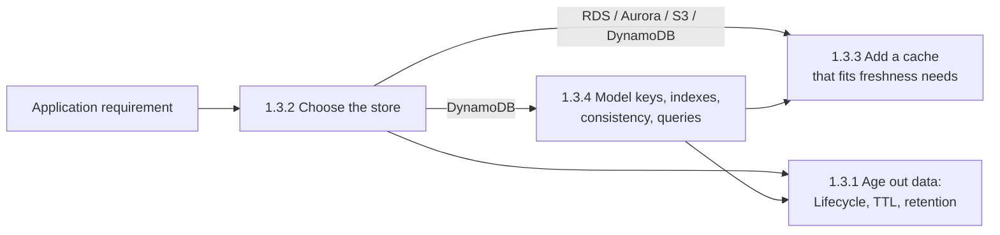

# Task 1.3: Use data stores in application development

**Domain 1 · Task 1.3** · [Domain overview](../README.md)

This task covers the data decisions an application developer makes: which store fits an access pattern, which cache goes in front of it and how fresh the cached data stays, how data ages out through lifecycle rules, Time to Live (TTL), and retention settings, and how to model and query Amazon DynamoDB. It builds on Task 1.1, where software development kit (SDK) calls, retries, pagination, and streams are introduced, and on Task 1.2, where Lambda functions read and write these stores. Domain 4 returns to the same services for caching performance and throttling diagnosis.

> **DVA-C02 vs DVA-C03.** Data serialization moved out of this task into [1.1.7](../task-1.1-build-application-code/1.1.7-serialization-and-deserialization.md). DynamoDB, previously four separate skills, is now one consolidated skill, [1.3.4](1.3.4-dynamodb-design-and-operations.md).

## Skills

| Skill | Note | Covers |
|---|---|---|
| 1.3.1 | [Data lifecycle management](1.3.1-data-lifecycle-management.md) | S3 Lifecycle transitions and expirations, storage classes, versioning, DynamoDB TTL, cache TTL, retention periods, S3 Object Lock |
| 1.3.2 | [Choosing data stores](1.3.2-choosing-data-stores.md) | Access pattern to store mapping, relational vs. NoSQL, Amazon Relational Database Service (RDS), Aurora, ElastiCache, S3, Amazon Elastic File System (EFS), OpenSearch Service, Athena, read replicas vs. Multi-Availability Zone (Multi-AZ), RDS Proxy |
| 1.3.3 | [Caching strategies](1.3.3-caching-strategies.md) | Cache per store, lazy loading vs. write-through, TTL and eviction, Valkey/Redis OSS vs. Memcached, DynamoDB Accelerator (DAX) |
| 1.3.4 | [DynamoDB design and operations](1.3.4-dynamodb-design-and-operations.md) | Keys and hot partitions, capacity modes and math, consistency, Query vs. Scan, pagination, conditional writes, batches, transactions, global and local secondary indexes (GSIs and LSIs), single-table design |

## How the skills fit together

| Requirement in the question | Skill to apply | Typical answer |
|---|---|---|
| "Needs joins" or "ACID (atomicity, consistency, isolation, durability) across tables" | 1.3.2 | RDS or Aurora |
| "Files" or "items over 400 KB" | 1.3.2 | S3, with metadata in DynamoDB |
| "Microseconds in front of DynamoDB, no code change" | 1.3.3 | DAX |
| "Reduce load from repeated Structured Query Language (SQL) queries" | 1.3.3 | ElastiCache with lazy loading |
| "Query by customer and date range" | 1.3.4 | Partition key plus sort key, or a GSI |
| "Throttled on one key" | 1.3.4 | Better partition key or write sharding |
| "Delete after N hours, no cost" | 1.3.1 | DynamoDB TTL |
| "Move to cheaper storage after N days" | 1.3.1 | S3 Lifecycle rule |

## Study checklist

- [ ] 1.3.1 Write an S3 Lifecycle rule with transitions, expiration, noncurrent-version actions, and abort-incomplete-multipart-upload; pick storage classes by retrieval time and minimum duration; enable DynamoDB TTL and filter expired items.
- [ ] 1.3.2 Map access patterns to DynamoDB, RDS, Aurora, ElastiCache, or S3; explain read replicas vs. Multi-AZ and when RDS Proxy is needed.
- [ ] 1.3.3 Choose the cache for each store; compare lazy loading and write-through; explain where stale reads come from and why DAX serves only eventually consistent reads.
- [ ] 1.3.4 Design partition and sort keys, calculate read and write capacity units (RCUs and WCUs), choose read consistency, paginate queries, use conditional writes and transactions, and pick a GSI or LSI.

## Labs and practice

- [Labs](labs.md): Lab 1 compares eventually consistent and strongly consistent DynamoDB reads against a local emulator.
- [Practice questions](practice-questions.md): 4 multiple-choice questions with answers and explanations, covering pagination, read consistency, multipart upload, and relational vs. DynamoDB selection.
