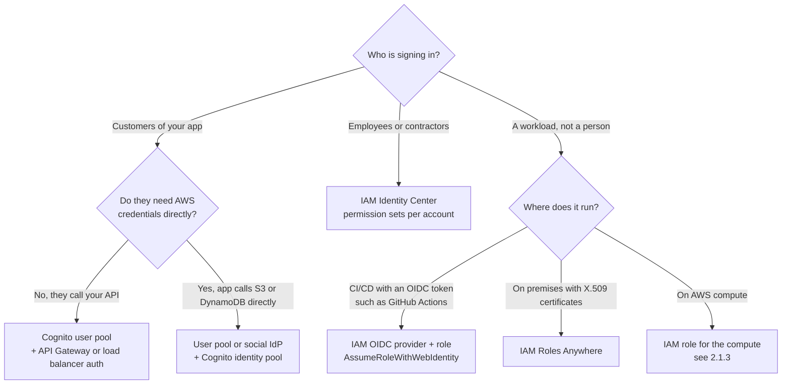
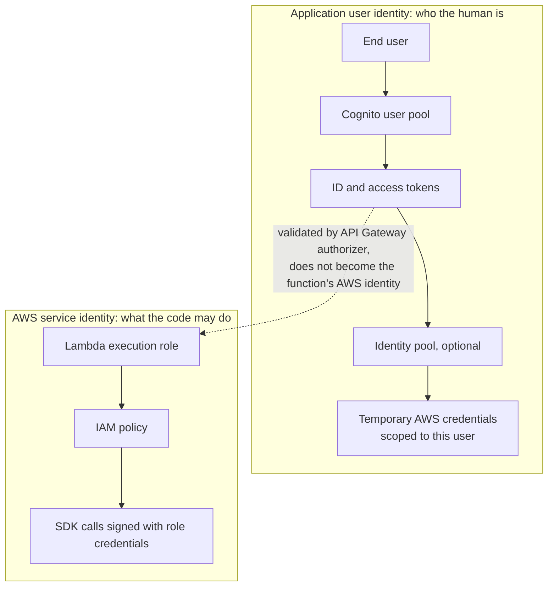
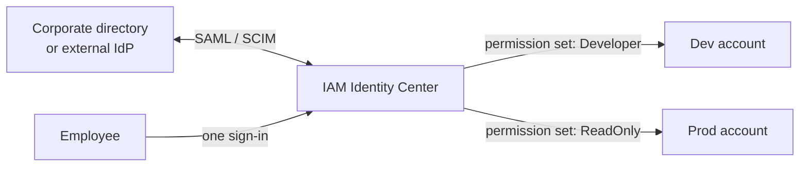

# 2.1.1 Implement identity federation for application users or workforce identities

**Domain 2 · Task 2.1 · Skill 2.1.1** · [Task overview](README.md) · Previous: [1.3.4 DynamoDB design and operations](../../domain-1-development-with-aws-services/task-1.3-use-data-stores/1.3.4-dynamodb-design-and-operations.md) · Next: [2.1.2 Access controls, tokens, and MFA](2.1.2-access-controls-tokens-and-mfa.md)

## What the exam expects

Federation means trusting an identity that someone else verified instead of creating a separate AWS Identity and Access Management (IAM) identity for every person or workload. The exam gives you a scenario ("mobile users sign in with Google", "employees need access to 40 accounts", "a GitHub Actions continuous integration and delivery (CI/CD) pipeline needs AWS access without keys") and expects you to pick the right broker: Amazon Cognito for application users, AWS IAM Identity Center for the workforce, or an IAM identity provider for workloads.

You must be able to:

- Tell a Cognito user pool (authentication, issues JSON Web Tokens) from a Cognito identity pool (exchanges a token for temporary AWS credentials).
- Choose the right Cognito feature: social, SAML, or OIDC federation, managed login, OAuth 2.0 flows, groups, and Lambda triggers.
- Validate Cognito tokens correctly and know which token goes where.
- Map federated users to IAM roles, including guest access and per-user resource scoping.
- Pick IAM Identity Center for workforce single sign-on, and IAM OIDC or SAML providers or IAM Roles Anywhere for workloads.

## Key terms

| Term | Meaning |
|---|---|
| Identity provider (IdP) | The system that authenticates a user and issues an assertion or token (Google, Okta, Microsoft Entra ID, a Cognito user pool). |
| Federation | AWS or your app trusts an external IdP's verdict instead of storing its own password for that user. |
| SAML 2.0 | Security Assertion Markup Language. XML-based enterprise federation standard. The IdP sends a signed assertion. |
| OIDC | OpenID Connect. Identity layer on top of OAuth 2.0. The IdP issues a signed JSON Web Token (JWT) called an ID token. |
| OAuth 2.0 | Authorization framework that issues access tokens with scopes. Defines grant types such as authorization code and client credentials. |
| JWT | JSON Web Token. Base64url-encoded header, payload (claims), and signature. |
| User pool | Cognito user directory and OIDC IdP for your app. Signs users in and issues ID, access, and refresh tokens. |
| Identity pool | Cognito federated identities. Exchanges a trusted token for temporary AWS credentials through AWS Security Token Service (STS). |
| IAM Identity Center | Workforce single sign-on (SSO) across AWS accounts and business apps. Formerly AWS SSO. |
| Permission set | An Identity Center template that becomes an IAM role in each assigned account. |
| Developer-authenticated identities | Identity pool option where your own backend vouches for the user. |

## Pick the broker by whose identity it is



| Situation | Use | Not |
|---|---|---|
| "Hundreds of thousands of mobile users", "sign up", "social login" | Cognito user pool | IAM users (one per person does not scale and is for AWS access, not app access) |
| App users must upload straight to S3 or write to DynamoDB | Cognito identity pool | Embedding access keys in the app |
| Workforce access to many AWS accounts from the corporate directory | IAM Identity Center | Cognito (no concept of AWS account access) or per-account IAM users |
| Pipeline in GitHub, GitLab, or another OIDC-capable CI system | IAM OIDC identity provider + role | Storing an access key as a CI secret |
| Servers outside AWS that already have certificates from your certificate authority (CA) | IAM Roles Anywhere | Long-term access keys on the server |

## Cognito user pools: authentication for your app

A user pool is a serverless user directory and, from your app's point of view, an OIDC identity provider. Sign-in returns JWTs.

Features:

- Sign-up and sign-in with username, email, or phone, password policies, account recovery, and email or phone verification.
- Multi-factor authentication (MFA): time-based one-time password (TOTP) apps, SMS text messages, or email codes. See [2.1.2](2.1.2-access-controls-tokens-and-mfa.md#mfa-in-cognito-user-pools).
- Federation with social IdPs (Google, Facebook, Apple, Login with Amazon), SAML 2.0, and OIDC IdPs. Federated users get user pool tokens, so your app handles one token format.
- Managed login (the newer hosted user interface, or UI) or the classic hosted UI, with OAuth 2.0 endpoints such as `/oauth2/authorize`, `/oauth2/token`, and `/oauth2/userInfo`.
- Groups, custom attributes, and Lambda triggers.
- Threat protection (formerly advanced security): compromised-credential detection and adaptive authentication.

### Feature plans

Since November 2024 user pools come in three feature plans. Essentials is the default for new pools.

| Plan | Adds |
|---|---|
| Lite | Basic sign-in, federation, Lambda triggers, classic hosted UI |
| Essentials (default) | Managed login, passwordless sign-in (passkeys, email, SMS), access token customization, password reuse prevention |
| Plus | Threat protection: adaptive authentication, compromised-credential detection, user activity logging and export |

The exam rarely asks for plan names, but if a scenario needs adaptive MFA on a new pool, it implies the Plus plan.

### App clients and OAuth 2.0 flows

An app client is the configuration your app uses to talk to the pool: client ID, optional client secret, allowed auth flows, allowed OAuth scopes, and callback and sign-out URLs.

| Flow | Use it for |
|---|---|
| Authorization code grant with PKCE (Proof Key for Code Exchange) | Browser and mobile apps signing in through managed login. Recommended for public clients. |
| Client credentials grant | Machine-to-machine (M2M) calls. Requires a confidential client (client secret), a resource server, and custom scopes. Issues only an access token. |
| SDK flows such as `USER_PASSWORD_AUTH` or `USER_SRP_AUTH` (`InitiateAuth`) | Custom sign-in screens that call the Cognito API directly. Tokens carry only the `aws.cognito.signin.user.admin` scope. |

A resource server is your API registered in the pool. Custom scopes such as `orders/read` go into the access token's `scope` claim, and your API authorizes by checking them.

### Tokens

| Token | Contains | Use it for | Default lifetime |
|---|---|---|---|
| ID token | Identity claims: `sub`, `email`, `cognito:username`, `cognito:groups`, custom attributes | Proving who the user is to your app; an API Gateway Cognito authorizer without scopes | 60 minutes (5 minutes to 1 day) |
| Access token | `scope`, `client_id`, `cognito:groups`, `token_use: access` | Calling APIs that check scopes (resource servers) | 60 minutes (5 minutes to 1 day) |
| Refresh token | Opaque to your app | Getting new ID and access tokens without re-entering credentials | 30 days (60 minutes to 10 years) |

The `sub` claim is the user's stable unique ID in the pool. Example ID token payload:

```json
{
  "sub": "aaaaaaaa-bbbb-cccc-dddd-eeeeeeeeeeee",
  "email_verified": true,
  "iss": "https://cognito-idp.us-east-1.amazonaws.com/us-east-1_example",
  "cognito:username": "janedoe",
  "cognito:groups": ["premium"],
  "email": "jane@example.com",
  "token_use": "id",
  "aud": "1example23456789",
  "exp": 1700000000,
  "iat": 1699996400
}
```

### Validating a token in your own backend

Never trust a JWT just because it decodes. Verify it:

1. Download the pool's public keys from `https://cognito-idp.<region>.amazonaws.com/<userPoolId>/.well-known/jwks.json` (the JSON Web Key Set, JWKS) and cache them.
2. Match the token's `kid` header to a key and verify the signature.
3. Check `exp` (not expired), `iss` (your pool), `aud` for ID tokens or `client_id` for access tokens (your app client), and `token_use` (`id` or `access`, whichever your API expects).

```javascript
// npm install aws-jwt-verify  (AWS-maintained library)
import { CognitoJwtVerifier } from "aws-jwt-verify";

const verifier = CognitoJwtVerifier.create({
  userPoolId: "us-east-1_example",
  tokenUse: "access",          // or "id"
  clientId: "1example23456789",
});

export async function handler(event) {
  const token = event.headers.authorization?.replace("Bearer ", "");
  try {
    const claims = await verifier.verify(token);   // checks signature, exp, iss, client_id, token_use
    return { statusCode: 200, body: `hello ${claims.sub}` };
  } catch {
    return { statusCode: 401, body: "invalid token" };
  }
}
```

API Gateway Cognito and JWT authorizers do this verification for you. See [2.1.2](2.1.2-access-controls-tokens-and-mfa.md#api-gateway-authorization-options).

### Lambda triggers

Cognito invokes these synchronously during its flows.

| Flow | Trigger | Typical use |
|---|---|---|
| Sign-up | Pre sign-up | Accept or reject sign-up (for example, allow only `@company.com` emails), auto-confirm users |
| Sign-up | Post confirmation | Welcome message, create the user's profile row in DynamoDB |
| Sign-up | Migrate user | Move users from a legacy directory the first time they sign in or reset a password |
| Sign-in | Pre authentication | Custom checks that accept or deny the sign-in |
| Sign-in | Post authentication | Event logging and analytics |
| Sign-in | Custom auth challenge (define, create, verify) | Passwordless or CAPTCHA-style custom challenges |
| Tokens | Pre token generation | Add, change, or suppress claims and scopes (for example, a computed `tenantId`). Access token customization needs the Essentials or Plus plan. |
| Messages | Custom message | Localize or brand verification and MFA messages |

### Groups and roles

User pool groups can carry an IAM role and a precedence number. If a user belongs to several groups, the ID token lists all their roles in `cognito:roles` and puts the role from the group with the lowest precedence value in `cognito:preferred_role`. An identity pool set to "choose role from token" uses that preferred role. Roles are never merged.

### Other user pool integrations

- **Application Load Balancer (ALB):** an HTTPS listener rule with `authenticate-cognito` or `authenticate-oidc` signs users in before forwarding to targets, so the app needs no auth code. `OnUnauthenticatedRequest` can be `authenticate` (default), `deny`, or `allow`. Add the IdP callback URLs such as `https://<alb-dns>/oauth2/idpresponse`.
- **Custom domain for managed login:** needs an AWS Certificate Manager (ACM) certificate in `us-east-1`, whatever Region the pool is in. See [2.2.2](../task-2.2-encrypt-and-protect-sensitive-data/2.2.2-certificate-management.md).
- **Amplify Auth** in front-end code wraps these flows.

## Cognito identity pools: AWS credentials for app users

An identity pool takes a trusted token and returns temporary AWS credentials for an IAM role. Your client then calls AWS services directly with requests signed by Signature Version 4 (SigV4).

Accepted identity sources:

- Cognito user pools.
- Social IdPs: Login with Amazon, Facebook, Google, Apple.
- OIDC and SAML 2.0 IdPs.
- Developer-authenticated identities (your own login backend).
- No identity at all: unauthenticated (guest) access, if enabled.


*Source: [AWS documentation, Identity pools](https://docs.aws.amazon.com/cognito/latest/developerguide/identity-pools.html). User pool, identity pool, and STS are three separate pieces cooperating.*

### Role selection

- **Default roles:** one authenticated role and one unauthenticated (guest) role.
- **Choose role from token:** use `cognito:preferred_role` from a user pool token.
- **Rules-based mapping:** map claim values (for example, `custom:tier = gold`) to roles.
- **Attributes for access control:** map token claims to principal tags, then write one attribute-based access control (ABAC) policy that compares `aws:PrincipalTag/...` with resource tags.

Each role's trust policy must trust Cognito and pin the identity pool:

```json
{
  "Version": "2012-10-17",
  "Statement": [{
    "Effect": "Allow",
    "Principal": { "Federated": "cognito-identity.amazonaws.com" },
    "Action": ["sts:AssumeRoleWithWebIdentity", "sts:TagSession"],
    "Condition": {
      "StringEquals": { "cognito-identity.amazonaws.com:aud": "us-east-1:11111111-2222-3333-4444-555555555555" },
      "ForAnyValue:StringLike": { "cognito-identity.amazonaws.com:amr": "authenticated" }
    }
  }]
}
```

### Enhanced and basic flows

- **Enhanced (simplified) flow, recommended:** `GetId` then `GetCredentialsForIdentity`. Cognito calls STS for you.
- **Basic (classic) flow:** `GetId`, `GetOpenIdToken`, then your client calls STS `AssumeRoleWithWebIdentity` itself.

Either way the credentials come from `AssumeRoleWithWebIdentity` against the role's trust policy.

### Per-user scoping with policy variables

One role serves every user. The policy variable `${cognito-identity.amazonaws.com:sub}` resolves to the caller's identity ID (the identity pool ID, not the user pool `sub`), so each user reaches only their own data.

Guest role reading one public asset:

```json
{
  "Version": "2012-10-17",
  "Statement": [{
    "Effect": "Allow",
    "Action": ["s3:GetObject"],
    "Resource": ["arn:aws:s3:::mybucket/assets/my_picture.jpg"]
  }]
}
```

Authenticated role, each user limited to their own S3 prefix:

```json
{
  "Version": "2012-10-17",
  "Statement": [{
    "Effect": "Allow",
    "Action": ["s3:GetObject", "s3:PutObject"],
    "Resource": ["arn:aws:s3:::mybucket/${cognito-identity.amazonaws.com:sub}/*"]
  }]
}
```

The DynamoDB version (`dynamodb:LeadingKeys`) is in [2.1.2](2.1.2-access-controls-tokens-and-mfa.md#fine-grained-conditions).

## User pool vs identity pool

| | User pool | Identity pool |
|---|---|---|
| Job | Authentication: who is this user | Authorization to AWS: which IAM role do they get |
| Output | JWTs (ID, access, refresh) | Temporary AWS credentials (access key, secret key, session token) |
| Sign-in sources | Its own users plus social, SAML, OIDC federation | User pools, social, SAML, OIDC, developer-authenticated |
| Guest users | No | Yes (unauthenticated role) |
| Extras | Managed login, Lambda triggers, MFA, threat protection | Role mapping, policy variables, ABAC |
| Typical consumer | API Gateway, ALB, your backend | S3, DynamoDB, other AWS APIs called from the client |

They combine: sign in to the user pool, exchange the ID token at the identity pool, call AWS directly.

### Two identity chains that never merge



If a user calls your API and your Lambda function calls DynamoDB, the function uses its execution role. The user's token never becomes AWS credentials. Only add an identity pool when the client itself must call AWS.

## IAM Identity Center: workforce federation

IAM Identity Center gives employees one sign-in to many AWS accounts in an AWS Organization, plus business applications.

- **Identity source:** the built-in Identity Center directory, Active Directory (AD), through AWS Managed Microsoft AD or AD Connector, or an external SAML 2.0 IdP such as Okta or Microsoft Entra ID, with SCIM (System for Cross-domain Identity Management) for user provisioning.
- **Permission sets:** reusable permission templates. Assigning one to a user or group in an account creates an IAM role there.
- **Short-lived credentials:** console sessions and CLI credentials through `aws configure sso` and `aws sso login`. No IAM users, no long-term keys. See [2.1.3](2.1.3-secure-programmatic-access.md#cli-and-sdk-credential-sources).
- **Offboarding:** disable the user once at the source and access stops everywhere.



### Cognito vs IAM Identity Center

| | Cognito | IAM Identity Center |
|---|---|---|
| Users | Your product's customers | Your organization's workforce |
| Plugs into | Your application (sign-up forms, social buttons) | Your corporate directory |
| Grants | App tokens, optionally AWS credentials scoped by your policies | Console and CLI access to AWS accounts through permission sets |
| Self sign-up | Yes | No |

### AWS Directory Service options

When the identity source is Microsoft Active Directory (AD):

| Option | What it is | Users live | On-premises link |
|---|---|---|---|
| AWS Managed Microsoft AD | A real AD in AWS | In AWS | Trust relationship with on-premises AD |
| AD Connector | A proxy (directory gateway) | On premises | Forwards every authentication request; caches nothing |
| Simple AD | AD-compatible standalone directory | In AWS | Cannot join or trust on-premises AD |

## Federation directly into IAM

You can also register an IdP in IAM and let its tokens or assertions assume a role. Use this for workloads and for single-account cases that do not justify Identity Center.

| Provider type | STS call | Typical use |
|---|---|---|
| OIDC provider | `AssumeRoleWithWebIdentity` | GitHub Actions, GitLab, Amazon Elastic Kubernetes Service (Amazon EKS) service accounts through IAM roles for service accounts (IRSA), other OIDC issuers |
| SAML 2.0 provider | `AssumeRoleWithSAML` | Enterprise IdP straight into IAM roles, without Identity Center |

Both calls are unsigned: the caller has no AWS credentials yet, so the external token or assertion is the proof.

### Keyless CI/CD with GitHub Actions OIDC

1. Create an IAM OIDC identity provider for `https://token.actions.githubusercontent.com` with audience `sts.amazonaws.com`.
2. Create a deployment role whose trust policy pins the repository and branch.
3. The workflow requests an OIDC token and exchanges it for role credentials. No AWS secret is stored in GitHub.

```json
{
  "Version": "2012-10-17",
  "Statement": [{
    "Effect": "Allow",
    "Principal": { "Federated": "arn:aws:iam::111122223333:oidc-provider/token.actions.githubusercontent.com" },
    "Action": "sts:AssumeRoleWithWebIdentity",
    "Condition": {
      "StringEquals": {
        "token.actions.githubusercontent.com:aud": "sts.amazonaws.com",
        "token.actions.githubusercontent.com:sub": "repo:my-org/my-repo:ref:refs/heads/main"
      }
    }
  }]
}
```

Without the `sub` condition, any repository on GitHub could assume the role. Always pin it.

### IAM Roles Anywhere

For servers and containers outside AWS. You register your CA as a trust anchor and create a profile that lists roles. The workload presents its X.509 certificate through the `aws_signing_helper` credential process and receives temporary credentials. This replaces the old advice of keeping access keys on on-premises servers.

> **Not on the DVA-C03 service list.** Cognito Sync stored user preferences and game state per identity pool identity and synced them across devices. It is closed to new customers. AWS points new apps to AWS AppSync (real-time sync with GraphQL) or DynamoDB (simple key-value user data). Older questions may still name Cognito Sync; it requires an identity pool.

## Worked scenarios

**Fitness app, direct writes.** A mobile app's users sign up with email or Google and write workout records straight to DynamoDB without a backend. Use a user pool (with Google federation) for sign-in and an identity pool to exchange the ID token for credentials of an authenticated role. Scope the role with `dynamodb:LeadingKeys = ${cognito-identity.amazonaws.com:sub}`. The client never embeds an access key.

**Company-domain sign-up.** Only `@example.com` addresses may register. Add a pre sign-up trigger that rejects other domains. Identity pool role mapping cannot do this because identity pools do not run during sign-up.

**Tenant claim in tokens.** The API needs a `tenantId` claim computed from a lookup. Use a pre token generation trigger. Custom attributes alone are static, and identity pool role mapping does not change token contents.

**Contractor offboarding.** A contractor could reach 12 accounts through Identity Center. Disabling their single Identity Center user cuts access to all 12. Per-account IAM users would need 12 cleanups.

## Exam triggers

| Scenario clue | Answer | Why the alternatives are wrong |
|---|---|---|
| Users sign in with Google and call our REST API | User pool with Google federation + API Gateway Cognito authorizer | An identity pool gives AWS credentials, which the API call does not need |
| Mobile app uploads to each user's own S3 folder | Identity pool + `${cognito-identity.amazonaws.com:sub}` in the resource Amazon Resource Name (ARN) | User pool tokens are not AWS credentials; IAM users per app user do not scale |
| Guests can browse a catalog without signing in | Identity pool unauthenticated role with read-only permissions | User pools have no guest concept |
| Add a custom claim to tokens | Pre token generation trigger | Identity pool rules map roles, they do not edit tokens |
| Migrate users from a legacy auth system as they log in | Migrate user trigger | Bulk CSV import forces password resets |
| Require login in front of an existing app on an ALB without code changes | ALB `authenticate-cognito` or `authenticate-oidc` rule on an HTTPS listener | HTTP listeners cannot use authenticate actions |
| Employees need SSO to many AWS accounts | IAM Identity Center with permission sets | Cognito is for app customers; per-account IAM users are unmanageable |
| GitHub Actions deploys without stored AWS keys | IAM OIDC provider + role trust pinned to repo and branch | An access key in a CI secret is still a long-term credential |
| On-premises server needs AWS access, certificates already issued by our CA | IAM Roles Anywhere | Access keys on the server are long-lived and leak-prone |
| User in two groups with different roles | Role from the group with the lowest precedence value | Cognito never merges roles |

## Common traps

- A user pool alone never issues AWS credentials. If the client calls AWS directly, you need an identity pool (or another `AssumeRoleWith*` path).
- The identity pool policy variable `${cognito-identity.amazonaws.com:sub}` is the identity ID, not the user pool `sub` claim.
- Federating Google into a user pool and federating Google into an identity pool are both valid. Choose the user pool when you also need your own tokens, groups, triggers, or an API Gateway authorizer.
- API Gateway Cognito authorizers accept the ID token, or the access token when the method has OAuth scopes. "Only the access token works" is wrong.
- The Cognito custom domain certificate must be in `us-east-1`.
- Adaptive authentication and compromised-credential detection are threat protection features (Plus plan on new pools), not default behavior.
- `AssumeRoleWithWebIdentity` and `AssumeRoleWithSAML` need no AWS credentials. Everything else in STS does.
- AD Connector does not copy users into AWS. Simple AD cannot connect to on-premises AD.

## Quick recall

- User pool = sign-in + JWTs. Identity pool = temporary AWS credentials.
- ID and access tokens default to 60 minutes (5 minutes to 1 day). Refresh token defaults to 30 days (60 minutes to 10 years).
- Validate JWTs with the pool's JWKS: signature, `exp`, `iss`, `aud` or `client_id`, `token_use`.
- Authorization code + PKCE for apps; client credentials + custom scopes for M2M.
- Pre sign-up filters registrations; pre token generation edits claims; migrate user moves legacy users.
- Identity pool roles trust `cognito-identity.amazonaws.com` with `sts:AssumeRoleWithWebIdentity` and pin `aud` to the pool ID.
- Lowest group precedence wins `cognito:preferred_role`.
- Workforce = IAM Identity Center. App customers = Cognito. Workloads = OIDC or SAML provider, Roles Anywhere, or compute roles.
- Pin GitHub OIDC trust with the `sub` claim.

## Related skills

- [2.1.2 Access controls, tokens, and MFA](2.1.2-access-controls-tokens-and-mfa.md): API Gateway authorizers that consume Cognito tokens, `LeadingKeys`, Cognito MFA.
- [2.1.3 Secure programmatic access](2.1.3-secure-programmatic-access.md): Identity Center CLI profiles and compute roles.
- [2.1.6 Least privilege permissions](2.1.6-least-privilege-permissions.md): writing the policies attached to federated roles.
- [2.1.7 Assuming IAM roles](2.1.7-assuming-iam-roles.md): the STS calls underneath every federation path.
- [1.1.4 APIs, transformation, and validation](../../domain-1-development-with-aws-services/task-1.1-build-application-code/1.1.4-apis-transformation-and-validation.md): the API Gateway side of a Cognito-protected API.
- [2.3.4 AI agent security](../task-2.3-secure-ai-services/2.3.4-ai-agent-security.md): propagating user identity to agent tools.

## Sources

- Merged from: `archive/dva-c03-study-notes/02-security.md` (skill 2.1.1), `archive/aws-dva-notes/Markdown Files/24. Cognito - User Pools, Identity Pools & Cognito Sync.md`, `archive/aws-dva-notes/Markdown Files/26. Advanced Identity.md` (Directory Services), `archive/dva-c03/domain-2-security/MASTER-CHUNK.md` (sections 3 and 16, appendix scenarios), `archive/dva-c03/domain-2-security/README.md` (identity chain, Identity Center vs Cognito), `archive/dva-c03/exam-bank/bank-1.md` and `archive/dva-c03/practice-questions/full-exams/` (traps only).
- AWS documentation:
  - [Scopes, M2M, and resource servers](https://docs.aws.amazon.com/cognito/latest/developerguide/cognito-user-pools-define-resource-servers.html) (Cognito authorizer accepts ID or access tokens)
  - [Refresh tokens](https://docs.aws.amazon.com/cognito/latest/developerguide/amazon-cognito-user-pools-using-the-refresh-token.html)
  - [Identity pools](https://docs.aws.amazon.com/cognito/latest/developerguide/identity-pools.html)
  - [Using Amazon Cognito Sync with identity pools](https://docs.aws.amazon.com/cognito/latest/developerguide/identity-pools-sync.html) (closed to new customers)
  - [Amazon Cognito pricing](https://aws.amazon.com/cognito/pricing/) (feature plans)
  - [Requesting temporary security credentials](https://docs.aws.amazon.com/IAM/latest/UserGuide/id_credentials_temp_request.html) (web identity and SAML calls are unsigned)
