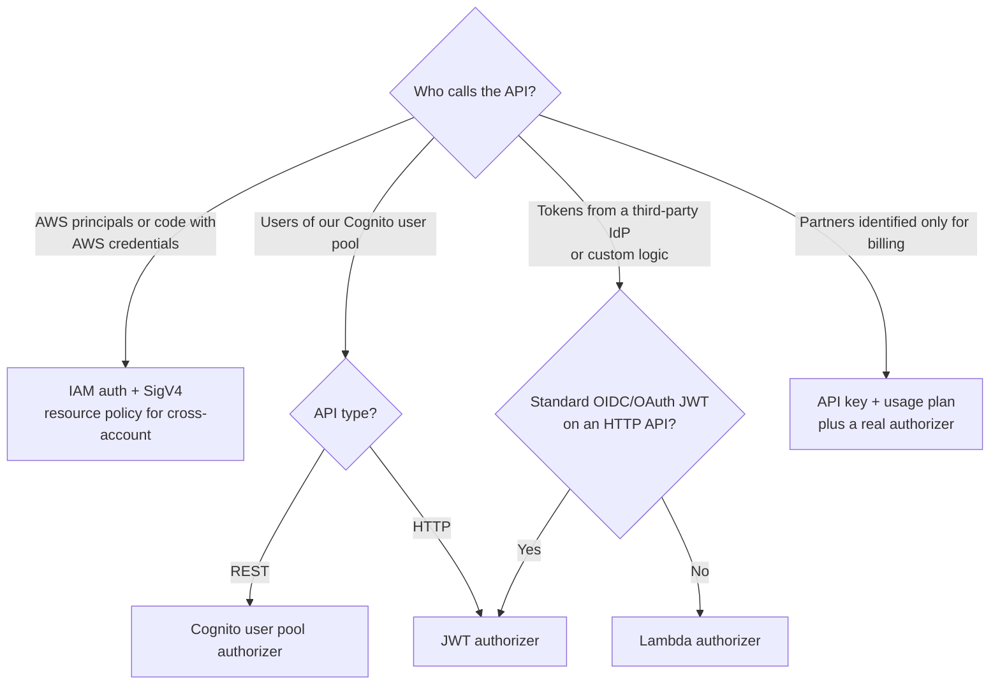

# 2.1.2 Apply access controls such as fine-grained permissions, temporary security tokens, and MFA

**Domain 2 · Task 2.1 · Skill 2.1.2** · [Task overview](README.md) · Previous: [2.1.1 Identity federation](2.1.1-identity-federation.md) · Next: [2.1.3 Secure programmatic access](2.1.3-secure-programmatic-access.md)

## What the exam expects

This skill is about the controls that sit on top of "who are you": narrowing access to specific items or attributes, accepting the right kind of token at an API, and requiring a second factor. Questions usually describe a requirement ("each user reads only their own rows", "a third-party OAuth token must authorize API calls", "deleting production data needs MFA") and ask for the mechanism.

You must be able to:

- Write AWS Identity and Access Management (IAM) conditions for fine-grained access (`dynamodb:LeadingKeys`, `dynamodb:Attributes`, `s3:prefix`, tags, network and transport keys).
- Choose an Amazon API Gateway authorization option: IAM, Cognito user pool authorizer, JWT authorizer, Lambda authorizer, resource policy, or mutual TLS.
- Explain what each kind of security token proves (AWS Security Token Service (STS) session token, Cognito JSON Web Token (JWT), OAuth access token, API key).
- Enforce MFA for AWS users and application users.

## Key terms

| Term | Meaning |
|---|---|
| Fine-grained access control | Permissions narrower than "this table" or "this bucket": specific items, attributes, prefixes, or tagged resources. |
| Condition key | A request attribute an IAM `Condition` block can test, such as `aws:SourceIp` or `dynamodb:LeadingKeys`. |
| ABAC | Attribute-based access control. Grant access by comparing principal tags with resource tags instead of listing Amazon Resource Names (ARNs). |
| RBAC | Role-based access control. Grant access by job function (roles, groups). |
| Bearer token | A token that grants access to whoever holds it (JWT, OAuth access token, presigned URL). |
| STS session token | The third part of temporary AWS credentials. Requests signed with temporary keys must include it. |
| Authorizer | API Gateway component that decides whether a request may reach the integration. |
| MFA | Multi-factor authentication. Something you know plus something you have. |
| TOTP | Time-based one-time password, the six-digit code from an authenticator app or hardware token. |

## Fine-grained conditions

IAM policies scope access with `Resource` ARNs and with `Condition` blocks. The condition keys the exam uses most:

| Condition key | Restricts | Example use |
|---|---|---|
| `dynamodb:LeadingKeys` | Partition key values the caller may touch | Each user reads only items whose partition key is their ID |
| `dynamodb:Attributes` | Attribute names in the request | Hide a `salary` attribute from most readers |
| `dynamodb:Select` | Query and scan projection type | Force `SPECIFIC_ATTRIBUTES` together with `dynamodb:Attributes` |
| `s3:prefix` | Prefix in `ListBucket` requests | Each user lists only `home/<name>/` |
| `aws:ResourceTag/key`, `aws:PrincipalTag/key`, `aws:RequestTag/key`, `aws:TagKeys` | Tags on the resource, caller, or request | ABAC: a team touches only resources tagged with its team |
| `aws:SourceIp` | Caller's public IP range | Office-only access |
| `aws:SourceVpce`, `aws:SourceVpc` | Virtual private cloud (VPC) endpoint or VPC the request came through | Bucket reachable only through one endpoint |
| `aws:SecureTransport` | Whether TLS was used | Deny plain HTTP to a bucket |
| `aws:MultiFactorAuthPresent`, `aws:MultiFactorAuthAge` | MFA on the session and how long ago | Require MFA within the last hour for deletes |
| `aws:RequestedRegion` | Target Region | Block Regions you do not use |

### Per-user DynamoDB items

Combined with a Cognito identity pool, one role restricts every user to their own items and a subset of attributes:

```json
{
  "Version": "2012-10-17",
  "Statement": [{
    "Effect": "Allow",
    "Action": ["dynamodb:GetItem", "dynamodb:PutItem", "dynamodb:Query"],
    "Resource": "arn:aws:dynamodb:us-west-2:123456789012:table/UserScores",
    "Condition": {
      "ForAllValues:StringEquals": {
        "dynamodb:LeadingKeys": ["${cognito-identity.amazonaws.com:sub}"],
        "dynamodb:Attributes": ["UserId", "GameTitle", "TopScore"]
      },
      "StringEqualsIfExists": { "dynamodb:Select": "SPECIFIC_ATTRIBUTES" }
    }
  }]
}
```

IAM enforces this regardless of application bugs, which is why it is the exam answer for multi-tenant isolation in a shared table. For tenant-level isolation, put the tenant ID in the partition key and compare it with a principal tag (`${aws:PrincipalTag/tenantId}`) set through identity pool attributes for access control or STS session tags.

### ABAC with tags

One policy grants different access depending on who uses it:

```json
{
  "Version": "2012-10-17",
  "Statement": [{
    "Effect": "Allow",
    "Action": ["dynamodb:GetItem", "dynamodb:PutItem", "dynamodb:Query"],
    "Resource": "arn:aws:dynamodb:us-east-1:111122223333:table/*",
    "Condition": {
      "StringEquals": { "aws:ResourceTag/team": "${aws:PrincipalTag/team}" }
    }
  }]
}
```

ABAC scales better than RBAC when teams and resources multiply: new tables tagged `team=payments` become reachable by the payments team with no policy edit. Policy variables and evaluation are covered in [2.1.6](2.1.6-least-privilege-permissions.md#policy-variables).

### Network and transport conditions

```json
{
  "Version": "2012-10-17",
  "Statement": [{
    "Sid": "DenyPlainHttp",
    "Effect": "Deny",
    "Principal": "*",
    "Action": "s3:*",
    "Resource": ["arn:aws:s3:::my-bucket", "arn:aws:s3:::my-bucket/*"],
    "Condition": { "Bool": { "aws:SecureTransport": "false" } }
  }]
}
```

Encryption in transit is covered fully in [2.2.1](../task-2.2-encrypt-and-protect-sensitive-data/2.2.1-encryption-at-rest-and-in-transit.md).

## Security tokens and what they prove

| Token | Issued by | Proves | Checked by |
|---|---|---|---|
| STS temporary credentials (access key ID starting `ASIA`, secret key, session token) | AWS STS | The caller is a specific role session or federated user | Every AWS service, through Signature Version 4 (SigV4) signature checks |
| Cognito ID token (JWT) | Cognito user pool | Who the user is | Your backend, API Gateway Cognito authorizer |
| Cognito or third-party OAuth access token (JWT) | Cognito or another OAuth 2.0 server | What the client may do (scopes) | Resource servers, API Gateway JWT or Cognito authorizer with scopes |
| Refresh token | Cognito user pool | The user may get new tokens | Cognito token endpoint only |
| API Gateway API key | API Gateway | Which client or customer this is, for metering | Usage plans (throttling and quotas). Not authentication. |
| Presigned URL or signed cookie | Your code, with AWS or CloudFront keys | Time-limited permission for one request or path | S3 or CloudFront. See [2.1.4](2.1.4-time-limited-access.md). |

Temporary credentials expire on their own and rotate automatically, which is why roles beat long-term access keys. Durations and STS calls are in [2.1.7](2.1.7-assuming-iam-roles.md#credential-lifetimes).

## API Gateway authorization options

| Option | API types | Best for | Authentication | Authorization |
|---|---|---|---|---|
| IAM (`AWS_IAM`) | REST, HTTP, WebSocket | AWS principals: other services, Lambda functions, Cognito identity pool users | SigV4 signature | IAM policy allowing `execute-api:Invoke` (plus resource policy for cross-account) |
| Cognito user pool authorizer | REST | Your own app users | Cognito verifies the token | Valid ID token, or access token with required scopes; finer rules live in the backend |
| JWT authorizer | HTTP | Any OIDC or OAuth 2.0 issuer, including Cognito | Issuer, audience, and signature checks | Scopes on routes |
| Lambda authorizer (token or request) | REST, HTTP, WebSocket | Third-party tokens, custom schemes, header or IP logic | Your function | Your function returns an IAM policy; HTTP APIs also accept a simple boolean response |
| Resource policy | REST | Cross-account callers, IP allow and deny lists, private APIs through VPC endpoints | n/a | Policy on the API itself |
| Mutual TLS (mTLS) | REST, HTTP with custom domain | Clients that present certificates (business-to-business partners, IoT devices) | Client certificate validated against a truststore in S3 | Combine with another authorizer |
| API key + usage plan | REST | Metering and throttling per customer | None | None. Pair with a real authorizer. |

### Lambda authorizers

- **Token-based:** receives a bearer token from one header, such as a JWT or OAuth token.
- **Request parameter-based:** receives headers, query strings, stage variables, and context. Needed for WebSocket APIs and multi-value identity sources.
- Returns a principal ID, a policy, and optional context values that reach the integration.
- Results are cached by identity source for a configurable time to live (TTL), 300 seconds by default and up to 3600 seconds. A cached Deny keeps denying until it expires, and a cached policy must cover every method it will be reused for.

```json
{
  "principalId": "user123",
  "policyDocument": {
    "Version": "2012-10-17",
    "Statement": [{
      "Action": "execute-api:Invoke",
      "Effect": "Allow",
      "Resource": "arn:aws:execute-api:us-east-1:123456789012:abcd1234/prod/GET/orders"
    }]
  },
  "context": { "tenantId": "t-42" }
}
```

### Choosing



Calling an IAM-protected API from code requires SigV4 signing. See [2.1.5](2.1.5-authenticated-requests.md#calling-iam-protected-endpoints).

> **Not on the DVA-C03 service list.** Amazon Verified Permissions evaluates fine-grained application authorization rules written in the Cedar policy language. It can create a Lambda authorizer for API Gateway that checks Cognito ID or access tokens against your policy store. Recognize the name if it appears as an option.

## MFA

### MFA for IAM users and the root user

Supported MFA types:

| Type | Notes |
|---|---|
| Passkeys and security keys (FIDO, Fast IDentity Online) | Recommended. Phishing resistant. One security key, such as a YubiKey, can serve multiple root and IAM users. Enabled only in the console. |
| Virtual authenticator apps (TOTP) | Phone or desktop app. Supports multiple tokens on one device. |
| Hardware TOTP tokens | Six-digit code devices bought through the AWS-listed sources. |

Facts to know:

- MFA is enforced for root users of all account types.
- Each root user or IAM user can register up to eight MFA devices.
- AWS ended support for enabling SMS text message MFA for IAM users.
- IAM password policies protect console passwords only. They do not govern access keys.

### Requiring MFA in policies

```json
{
  "Version": "2012-10-17",
  "Statement": [{
    "Effect": "Allow",
    "Action": ["ec2:StopInstances", "ec2:TerminateInstances"],
    "Resource": "*",
    "Condition": {
      "Bool": { "aws:MultiFactorAuthPresent": "true" },
      "NumericLessThan": { "aws:MultiFactorAuthAge": "3600" }
    }
  }]
}
```

A common variant is a Deny with `"BoolIfExists": { "aws:MultiFactorAuthPresent": "false" }`. `IfExists` matters because long-term access key requests carry no MFA key at all, so a plain `Bool ... false` test would not match them.

### MFA from the CLI and SDK

Long-term access keys never carry MFA. To call an MFA-protected action, get MFA-backed temporary credentials:

```bash
aws sts get-session-token \
  --serial-number arn:aws:iam::123456789012:mfa/dev-user \
  --token-code 123456 \
  --duration-seconds 3600
```

The response holds an access key ID, secret access key, session token, and expiration. For role assumption, add `mfa_serial` to the CLI profile (see [2.1.7](2.1.7-assuming-iam-roles.md#cli-profiles-for-role-assumption)) or pass `SerialNumber` and `TokenCode` to `AssumeRole`.

Passkeys and security keys cannot be passed to STS API calls. With those devices, get CLI and SDK credentials through `aws login` or move to IAM Identity Center.

### MFA in Cognito user pools

- MFA can be off, optional, or required, with TOTP, SMS, or email codes.
- Adaptive authentication (threat protection, Plus plan) scores each sign-in as low, medium, or high risk based on device, location, and IP address, and asks for MFA or blocks only when risk is detected.
- Compromised-credential detection blocks sign-ins with passwords found in breaches.
- Sign-in risk events can go to CloudWatch Logs.

### Other MFA-protected actions

S3 MFA Delete requires an MFA code to permanently delete an object version or suspend versioning. Versioning must be on, and only the bucket owner's root user can enable it, through the CLI or API.

## Worked scenarios

**Shared leaderboard table.** Players write scores from a mobile app through identity pool credentials. Add `dynamodb:LeadingKeys` with `${cognito-identity.amazonaws.com:sub}` to the authenticated role so no player can overwrite another player's item, even with a modified client.

**Partner OAuth tokens.** A partner IdP issues opaque OAuth tokens that need an introspection call. A JWT authorizer cannot validate opaque tokens, so use a Lambda authorizer that calls the introspection endpoint, then cache the result.

**Destructive operations.** Operators may terminate instances only with recent MFA. Grant the action with `aws:MultiFactorAuthPresent` and `aws:MultiFactorAuthAge`, and have them run `get-session-token` with their device before calling it.

## Exam triggers

| Scenario clue | Answer | Why the alternatives are wrong |
|---|---|---|
| Each user can only read their own DynamoDB items | `dynamodb:LeadingKeys` with the Cognito identity ID | Filtering in app code can be bypassed; separate tables per user do not scale |
| Hide some attributes from some readers | `dynamodb:Attributes` + `dynamodb:Select` conditions | Scans with filter expressions still read the data |
| Third-party OAuth or custom tokens must authorize API calls | Lambda authorizer | Cognito authorizers trust only Cognito pools |
| Standard OIDC JWT on an HTTP API, no custom code | JWT authorizer | A Lambda authorizer adds cost and code for no gain |
| Service-to-service calls with AWS credentials | IAM authorization with SigV4 | API keys do not authenticate |
| Cross-account callers or IP allow list on a REST API | API Gateway resource policy | Identity policies live in the caller's account and cannot block other callers by IP |
| Meter and throttle each paying customer | Usage plan + API keys | Authorizers do not meter |
| Require MFA for sensitive API calls from the CLI | `aws:MultiFactorAuthPresent` condition + `sts get-session-token` with the device | Long-term keys never satisfy the MFA condition |
| Prompt for MFA only when a login looks risky | Cognito adaptive authentication | Always-on MFA does not meet "only when risky" |
| Teams should reach only resources tagged with their team, without per-team policies | ABAC with `aws:ResourceTag` = `${aws:PrincipalTag/team}` | Per-team RBAC policies multiply |

## Common traps

- API keys identify and meter clients. They are not an authentication mechanism.
- HTTP APIs have no usage plans, API keys, or resource policies. If those are required, choose a REST API.
- A cached Lambda authorizer result can deny or allow later requests until the TTL expires. Scope cached policies to every method the token will reach, or disable caching for per-method decisions.
- A Deny with `"Bool": {"aws:MultiFactorAuthPresent": "false"}` misses requests that have no MFA key at all. Use `BoolIfExists`.
- `dynamodb:LeadingKeys` needs the multivalued operator `ForAllValues:StringEquals`.
- Only the root user can enable S3 MFA Delete.
- Cognito authorizers accept ID tokens. Scopes require the access token.

## Quick recall

- `LeadingKeys` = rows, `Attributes` = columns, `s3:prefix` = list scope.
- ABAC compares `aws:PrincipalTag` with `aws:ResourceTag`.
- API Gateway auth: IAM (AWS callers), Cognito or JWT (app users), Lambda authorizer (anything custom), resource policy (accounts, IPs, VPC endpoints), mTLS (client certs).
- Lambda authorizer cache TTL: default 300 seconds, maximum 3600.
- API keys + usage plans = metering, not security.
- MFA in policy: `aws:MultiFactorAuthPresent`, `aws:MultiFactorAuthAge`.
- CLI MFA: `sts get-session-token --serial-number --token-code`.
- Passkeys cannot be passed to STS; use `aws login` or Identity Center.
- Up to eight MFA devices per user. Root MFA is enforced.

## Related skills

- [2.1.1 Identity federation](2.1.1-identity-federation.md): where Cognito tokens and identity pool roles come from.
- [2.1.5 Authenticated requests](2.1.5-authenticated-requests.md): signing requests to IAM-protected APIs.
- [2.1.6 Least privilege permissions](2.1.6-least-privilege-permissions.md): policy structure, variables, and evaluation.
- [2.1.7 Assuming IAM roles](2.1.7-assuming-iam-roles.md): MFA on `AssumeRole`, session tags for ABAC.
- [1.1.4 APIs, transformation, and validation](../../domain-1-development-with-aws-services/task-1.1-build-application-code/1.1.4-apis-transformation-and-validation.md): REST vs HTTP API features beyond auth.
- [2.2.2 Certificate management](../task-2.2-encrypt-and-protect-sensitive-data/2.2.2-certificate-management.md): certificates for mTLS and custom domains.

## Sources

- Merged from: `archive/dva-c03-study-notes/02-security.md` (skill 2.1.2), `archive/aws-dva-notes/Markdown Files/1. IAM & AWS CLI.md` (MFA, password policy), `archive/aws-dva-notes/Markdown Files/9. CLI, SDK, IAM Roles & Policies.md` (MFA with the CLI), `archive/aws-dva-notes/Markdown Files/11. S3 Security.md` (MFA Delete), `archive/aws-dva-notes/Markdown Files/20. Serverless - API Gateway.md` (authorizers, usage plans), `archive/aws-dva-notes/Markdown Files/24. Cognito - User Pools, Identity Pools & Cognito Sync.md` (adaptive authentication, DynamoDB policy), `archive/aws-dva-notes/Markdown Files/26. Advanced Identity.md` (STS with MFA), `archive/dva-c03/domain-2-security/README.md` (ABAC policy), `archive/dva-c03/domain-2-security/MASTER-CHUNK.md` (DynamoDB multi-tenant scenario).
- AWS documentation:
  - [AWS Multi-factor authentication in IAM](https://docs.aws.amazon.com/IAM/latest/UserGuide/id_credentials_mfa.html) (MFA types, eight devices, root enforcement, SMS end, passkeys and STS)
  - [Scopes, M2M, and resource servers](https://docs.aws.amazon.com/cognito/latest/developerguide/cognito-user-pools-define-resource-servers.html) (ID vs access token at Cognito authorizers, Verified Permissions)
  - [Requesting temporary security credentials](https://docs.aws.amazon.com/IAM/latest/UserGuide/id_credentials_temp_request.html) (`GetSessionToken`)
