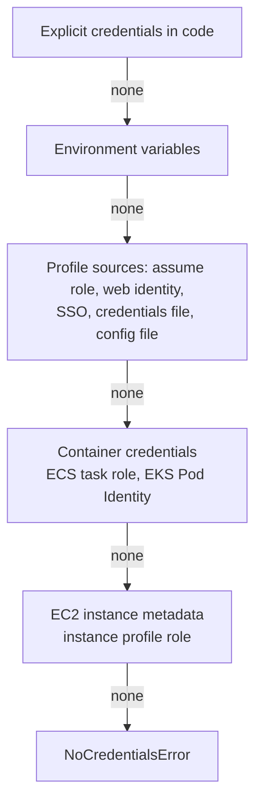

# 2.1.3 Configure secure programmatic access to AWS

**Domain 2 · Task 2.1 · Skill 2.1.3** · [Task overview](README.md) · Previous: [2.1.2 Access controls, tokens, and MFA](2.1.2-access-controls-tokens-and-mfa.md) · Next: [2.1.4 Time-limited access](2.1.4-time-limited-access.md)

## What the exam expects

Programmatic access means code and scripts calling AWS APIs through the AWS software development kits (SDKs) or the AWS Command Line Interface (CLI). The exam tests whether you choose a credential source that is short-lived and never stored in code, and whether you can explain where an SDK actually found its credentials when something works in one place and fails in another.

You must be able to:

- Rank the ways to give code AWS credentials, from AWS Identity and Access Management (IAM) roles on compute down to IAM user access keys.
- Configure CLI and SDK profiles for IAM Identity Center, role assumption, and external credential processes.
- Walk the SDK credential provider chain and predict which source wins.
- Give each compute service its own role: EC2 instance profile, Lambda execution role, Amazon Elastic Container Service (Amazon ECS) task role, Amazon Elastic Kubernetes Service (Amazon EKS) Pod Identity or IAM roles for service accounts (IRSA).
- Handle access keys safely when they are unavoidable.

## Key terms

| Term | Meaning |
|---|---|
| Access key | Long-term IAM user credential pair: access key ID (starts `AKIA`) and secret access key (shown once). |
| Temporary credentials | Access key ID (starts `ASIA`), secret key, and session token from AWS Security Token Service (STS), with an expiration. |
| Profile | A named set of settings in `~/.aws/config` and `~/.aws/credentials`, selected with `--profile` or `AWS_PROFILE`. |
| Credential provider chain | The ordered list of places an SDK or the CLI looks for credentials. The first complete set wins. |
| Instance profile | Container that attaches an IAM role to an EC2 instance. |
| IMDS | Instance Metadata Service at `169.254.169.254`, which serves the instance role's credentials. |
| IMDSv2 | Token-based IMDS: a `PUT` returns a session token that later `GET` requests must send. Blocks server-side request forgery (SSRF) credential theft. |
| IRSA | IAM roles for service accounts on Amazon EKS, based on OIDC web identity. |
| EKS Pod Identity | Newer EKS mechanism that maps a Kubernetes service account to an IAM role through an agent. |

## How humans and code reach AWS

| Method | Protected by |
|---|---|
| AWS Management Console | Password + multi-factor authentication (MFA), or federated sign-in through IAM Identity Center |
| AWS CLI | Access keys or temporary credentials |
| AWS SDKs | Access keys or temporary credentials |
| AWS CloudShell | Browser shell, already authenticated with your console session, with the CLI preinstalled |

The CLI is built on botocore, the same core library boto3 uses. Use the SDK from application code and the CLI from shells and scripts. Both follow the same credential chain.

## Choose the credential source

From best to last resort:

| Rank | Source | Where it fits |
|---|---|---|
| 1 | IAM role attached to the compute | EC2 instance profile, Lambda execution role, ECS task role, EKS Pod Identity or IRSA, CodeBuild service role |
| 2 | IAM Identity Center | Developers on laptops: `aws configure sso`, then `aws sso login` |
| 3 | `aws login` with console credentials | Developers who already sign in to the console, including with passkey MFA, and need short-lived CLI credentials |
| 4 | Federation through OpenID Connect (OIDC) or Security Assertion Markup Language (SAML) | Continuous integration and delivery (CI/CD) systems such as GitHub Actions; see [2.1.1](2.1.1-identity-federation.md#keyless-cicd-with-github-actions-oidc) |
| 5 | IAM Roles Anywhere | Servers outside AWS with X.509 certificates |
| 6 | IAM user access keys | Only when nothing above works. Least privilege, rotate, never commit. |

Hard-coding keys in source, a Dockerfile `ENV` line, or a Lambda environment variable is always the wrong exam answer.

## CLI and SDK credential sources

### Files

| File | Holds |
|---|---|
| `~/.aws/credentials` | Access keys per profile (`aws_access_key_id`, `aws_secret_access_key`, `aws_session_token`) |
| `~/.aws/config` | Region, output format, and how to get credentials: `sso_session`, `role_arn` + `source_profile`, `mfa_serial`, `credential_process`, `web_identity_token_file` |

`aws configure` writes both files. Profiles other than `default` appear as `[profile name]` in `config` and `[name]` in `credentials`.

### Example `~/.aws/config`

```ini
[default]
region = us-east-1

# IAM Identity Center (SSO): short-lived credentials, refreshed by `aws sso login`
[sso-session corp]
sso_start_url = https://my-company.awsapps.com/start
sso_region = us-east-1
sso_registration_scopes = sso:account:access

[profile dev]
sso_session = corp
sso_account_id = 111122223333
sso_role_name = DeveloperAccess
region = us-west-2

# Role assumption on top of another profile, with MFA
[profile prod-admin]
role_arn = arn:aws:iam::444455556666:role/Admin
source_profile = dev
mfa_serial = arn:aws:iam::111122223333:mfa/jane
duration_seconds = 3600

# External process, used by IAM Roles Anywhere
[profile onprem]
credential_process = aws_signing_helper credential-process --certificate cert.pem --private-key key.pem --trust-anchor-arn arn:aws:rolesanywhere:us-east-1:111122223333:trust-anchor/abc --profile-arn arn:aws:rolesanywhere:us-east-1:111122223333:profile/def --role-arn arn:aws:iam::111122223333:role/OnPremApp
```

```bash
aws configure sso              # one-time setup wizard
aws sso login --profile dev    # opens the browser, caches a token
aws s3 ls --profile dev
aws sts get-caller-identity --profile prod-admin   # assumes the role, prompts for the MFA code
```

### The credential provider chain

The SDK stops at the first source that returns a complete set of credentials. The boto3 order, verified against the current documentation:

1. Credentials passed to `boto3.client(...)`.
2. Credentials passed to `boto3.Session(...)`.
3. Environment variables: `AWS_ACCESS_KEY_ID`, `AWS_SECRET_ACCESS_KEY`, `AWS_SESSION_TOKEN`.
4. Assume role provider (`role_arn` in the config file).
5. Assume role with web identity (`AWS_WEB_IDENTITY_TOKEN_FILE` + `AWS_ROLE_ARN`, used by IRSA and some CI/CD systems).
6. IAM Identity Center provider (`sso_session` profiles).
7. Shared credentials file `~/.aws/credentials`.
8. Login with console credentials (`aws login`).
9. AWS config file `~/.aws/config`.
10. Legacy boto2 config file.
11. Container credential provider (`AWS_CONTAINER_CREDENTIALS_RELATIVE_URI` or `_FULL_URI`): ECS task roles and EKS Pod Identity.
12. EC2 instance metadata service: the instance profile role.

Other SDKs use the same idea with small ordering differences. For the exam remember the shape: explicit in code, then environment variables, then profile-based sources (files, SSO, assume role, web identity), then container credentials, then instance metadata last. The CLI also lets command-line options such as `--profile` override everything.



Both credentials and a Region are needed. Boto3 and the CLI do not silently default to `us-east-1`; set `AWS_REGION`, `region` in the profile, or pass it to the client.

### Find out which source won

```python
import boto3

session = boto3.Session()
creds = session.get_credentials()
print(creds.method)        # "env", "shared-credentials-file", "sso", "assume-role",
                           # "assume-role-with-web-identity", "container-role", "iam-role"
print(boto3.client("sts").get_caller_identity()["Arn"])
```

`aws sts get-caller-identity` answers "who am I running as" and needs no permissions.

## Roles for compute

| Compute | Role | How credentials arrive |
|---|---|---|
| EC2 | Instance profile | IMDS at `http://169.254.169.254/latest/meta-data/iam/security-credentials/<role>`, rotated automatically |
| Lambda | Execution role | Lambda assumes the role and sets `AWS_ACCESS_KEY_ID`, `AWS_SECRET_ACCESS_KEY`, `AWS_SESSION_TOKEN` in the environment before your handler runs |
| ECS (EC2 or Fargate) | Task role | Container credential endpoint through `AWS_CONTAINER_CREDENTIALS_RELATIVE_URI` |
| EKS | Pod Identity or IRSA | Container credential endpoint (Pod Identity) or a projected web identity token file (IRSA) |
| CodeBuild, CodePipeline, Step Functions | Service role | The service assumes the role you pass to it (`iam:PassRole`, see [2.1.6](2.1.6-least-privilege-permissions.md#passing-roles-to-services)) |

### EC2 and IMDS

- From IMDS you can read the role name and its temporary credentials. You cannot read the policy document.
- Metadata lives under `/latest/meta-data/`; the launch script lives under `/latest/user-data/`.
- IMDSv2 requires a `PUT` to `/latest/api/token` with a time to live (TTL) header, then the token in `X-aws-ec2-metadata-token` on each request. The token response has a hop limit (default 1), so it cannot be relayed off the instance. Require IMDSv2 on new instances.

```bash
TOKEN=$(curl -s -X PUT "http://169.254.169.254/latest/api/token" \
  -H "X-aws-ec2-metadata-token-ttl-seconds: 21600")
curl -s -H "X-aws-ec2-metadata-token: $TOKEN" \
  http://169.254.169.254/latest/meta-data/iam/security-credentials/
```

Credentials from an instance role typically last about 6 hours and are refreshed before they expire. SDKs handle this.

### ECS task role vs task execution role

| Role | Used by | Grants |
|---|---|---|
| Task role | Your application code in the container | S3, DynamoDB, Amazon SQS, and other calls the app makes |
| Task execution role | The ECS agent or Fargate | Pull images from Amazon Elastic Container Registry (Amazon ECR), write CloudWatch Logs, fetch Secrets Manager or Parameter Store values injected into the task definition |
| Instance profile (EC2 launch type) | The ECS agent on the host | Register with ECS, pull images, send logs |

On the EC2 launch type the agent must have task roles enabled (`ECS_ENABLE_TASK_IAM_ROLE=true`). Give each ECS service its own task role. "Container gets AccessDenied calling S3" means the task role. "Task cannot start, image pull fails" means the execution role.

### One role per workload

- One execution role per Lambda function and one task role per ECS service.
- Do not reuse a broad role across unrelated workloads; the blast radius becomes the union of all their needs.

## When access keys are unavoidable

- Create them for a dedicated IAM user with least privilege. An IAM user can have at most two access keys, which allows rotation: create the second, deploy it, deactivate the first, then delete it.
- Never commit keys. Use pre-commit secret scanning. Keep non-AWS secrets (database passwords, API keys for third parties) in Secrets Manager or Parameter Store, see [2.2.7](../task-2.2-encrypt-and-protect-sensitive-data/2.2.7-secrets-management.md).
- Audit with the IAM credentials report (all users, key age, last used, MFA status). See [2.1.6](2.1.6-least-privilege-permissions.md#tools-for-right-sizing-permissions).
- If a key leaks: deactivate it, check CloudTrail for its use, then delete it and issue a replacement.
- Prefer moving the workload to a role, Identity Center, or Roles Anywhere.

## Worked troubleshooting: "it works on my machine"

A script calling `dynamodb.scan(TableName="Orders")` works on a laptop but fails on ECS Fargate with `AccessDenied: User: arn:aws:sts::123456789012:assumed-role/OrdersTaskRole/... is not authorized to perform: dynamodb:Scan`.

1. On the laptop, `creds.method` reports `sso` or `shared-credentials-file`: the developer's own identity, which happens to allow `Scan`.
2. In ECS it reports `container-role`: the task role, a different identity.
3. The task role allows only `GetItem` and `PutItem` on `Orders`.
4. Fix the task role's policy (or switch the code to `Query`). The code and the developer's permissions are not the problem.

Same code, different environment, different link in the chain, different permissions. Most "works here, fails there" credential questions follow this pattern.

Other variants:

- `NoCredentialsError` in a Docker container on a laptop: no environment variables passed in, no mounted `~/.aws`, and no IMDS. Pass a profile or environment variables in; do not change the SDK call.
- An environment variable left over in a shell (`AWS_ACCESS_KEY_ID`) silently overrides the profile you expected. Environment variables beat files.
- Code meant to run on EC2 fails locally because there is no instance metadata on a laptop.

## Exam triggers

| Scenario clue | Answer | Why the alternatives are wrong |
|---|---|---|
| Application on EC2 needs S3 or DynamoDB | IAM role through an instance profile | Access keys on the instance are long-term and leak-prone |
| Lambda gets AccessDenied writing to DynamoDB | Add the permission to the execution role | The resource-based policy controls who invokes the function, not what it can do |
| ECS container gets AccessDenied calling S3 | Task role | Execution role is for the agent (image pulls, logs, secrets) |
| ECS task fails to pull its image or read an injected secret | Task execution role | Task role is for app code |
| Developer needs CLI access without long-term keys | IAM Identity Center profile with `aws sso login` | IAM user keys are long-term |
| Same code behaves differently in two environments | Different credential source and role in each; check with `get-caller-identity` or `creds.method` | Code changes do not fix role permissions |
| Web app on EC2 has an SSRF flaw; protect instance credentials | Require IMDSv2 (hop limit 1) | Security groups do not cover the link-local metadata address |
| Which identity is my code using? | `aws sts get-caller-identity` | IAM `get-user` fails for role sessions |
| Keys stored in a Dockerfile `ENV` | Remove; use a task role | Baking keys into an image layer equals hard-coding them |

## Common traps

- Environment variables beat the credentials file. A stale `AWS_PROFILE` or `AWS_ACCESS_KEY_ID` explains many surprises.
- Instance metadata is the last source in the chain, so any earlier source on an EC2 host overrides the instance role.
- From IMDS you get the role's credentials, never its policy.
- Lambda does not need your code to call `AssumeRole` for its execution role. The service does it before the handler runs.
- The ECS task execution role and the task role are different roles with different jobs.
- An IAM password policy does not apply to access keys.
- A missing Region is a separate error from missing credentials.

## Quick recall

- Roles for compute first, Identity Center for people, OIDC for CI, Roles Anywhere for on premises, access keys last.
- `AKIA` = long-term IAM user key. `ASIA` = temporary STS key with a session token.
- Chain: code, env vars, profile sources, container, instance metadata.
- `~/.aws/credentials` holds keys; `~/.aws/config` holds Region, `sso_session`, `role_arn`, `source_profile`, `mfa_serial`, `credential_process`.
- IMDS address `169.254.169.254`. IMDSv2 = `PUT` for a token first.
- Task role = app. Task execution role = ECS agent (ECR, logs, secrets).
- Two access keys per IAM user, for rotation.
- `get-caller-identity` needs no permissions.

## Related skills

- [2.1.1 Identity federation](2.1.1-identity-federation.md): Identity Center, OIDC providers, Roles Anywhere.
- [2.1.5 Authenticated requests](2.1.5-authenticated-requests.md): how the chosen credentials sign each request.
- [2.1.7 Assuming IAM roles](2.1.7-assuming-iam-roles.md): what the assume-role and web identity providers do under the hood.
- [1.1.5 AWS SDKs and service APIs](../../domain-1-development-with-aws-services/task-1.1-build-application-code/1.1.5-aws-sdks-and-service-apis.md): clients, paginators, waiters, and SDK configuration.
- [1.2.2 Lambda configuration](../../domain-1-development-with-aws-services/task-1.2-develop-lambda-functions/1.2.2-lambda-configuration.md): environment variables and execution roles.
- [3.3.2 Container deployments](../../domain-3-testing-and-deployment/task-3.3-deploy-with-ci-cd/3.3.2-container-deployments.md): task definitions that reference roles.
- [2.2.7 Secrets management](../task-2.2-encrypt-and-protect-sensitive-data/2.2.7-secrets-management.md): where non-AWS secrets belong.

## Sources

- Merged from: `archive/dva-c03-study-notes/02-security.md` (skills 2.1.3 and 2.1.5), `archive/dva-c03/domain-1-development/aws-sdk-credential-resolution-chain.md`, `archive/aws-dva-notes/Markdown Files/1. IAM & AWS CLI.md` (access methods, access keys, CLI, SDK, roles for services), `archive/aws-dva-notes/Markdown Files/9. CLI, SDK, IAM Roles & Policies.md` (IMDS), `archive/aws-dva-notes/Markdown Files/13. Containers on AWS.md` (ECS roles), `archive/aws-dva-notes/Markdown Files/26. Advanced Identity.md` (IAM role best practices), `archive/dva-c03/domain-1-development/MASTER-CHUNK.md` (IAM section).
- AWS documentation:
  - [Boto3 credentials](https://docs.aws.amazon.com/boto3/latest/guide/credentials.html) (provider order; credentials and Region both required)
  - [Download and upload objects with presigned URLs](https://docs.aws.amazon.com/AmazonS3/latest/userguide/using-presigned-url.html) (EC2 role credentials typically last 6 hours)
  - [AWS Multi-factor authentication in IAM](https://docs.aws.amazon.com/IAM/latest/UserGuide/id_credentials_mfa.html) (`aws login` for passkey users)
