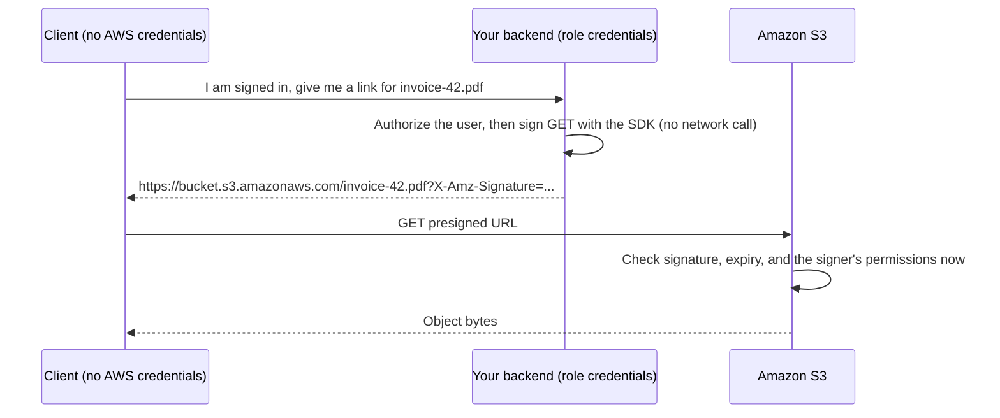
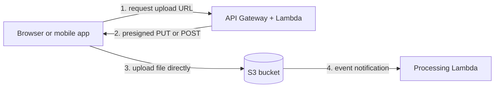
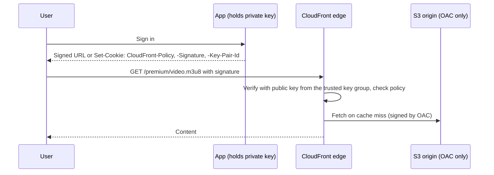

# 2.1.4 Provide time-limited access with S3 presigned URLs and CloudFront signed access

**Domain 2 · Task 2.1 · Skill 2.1.4** · [Task overview](README.md) · Previous: [2.1.3 Secure programmatic access](2.1.3-secure-programmatic-access.md) · Next: [2.1.5 Authenticated requests](2.1.5-authenticated-requests.md)

## What the exam expects

Sometimes a user who has no AWS credentials needs to download or upload one private object, or stream a set of private files, for a limited time. The exam expects you to hand out a signed, expiring link instead of making a bucket public or creating AWS Identity and Access Management (IAM) users.

> **DVA-C02 vs DVA-C03.** DVA-C03 names time-limited access through S3 presigned URLs and CloudFront signed access as an explicit skill in Task 2.1. In DVA-C02 the topic appeared only indirectly. Expect direct questions on expiry limits and on choosing S3 vs CloudFront signing.

You must be able to:

- Generate S3 presigned URLs for download (`GET`) and upload (`PUT`, or presigned `POST` for browser forms) with the SDK or CLI.
- Predict when a presigned URL stops working, including the signer's credential lifetime.
- Choose CloudFront signed URLs or signed cookies with trusted key groups, and canned or custom policies.
- Compare S3 presigned URLs with CloudFront signed URLs.

## Key terms

| Term | Meaning |
|---|---|
| Presigned URL | An S3 URL with a Signature Version 4 (SigV4) signature in its query string (`X-Amz-Signature`, `X-Amz-Expires`, `X-Amz-Credential`). Whoever holds it can perform that one operation until it expires. |
| Presigned POST | A signed policy document for HTML form uploads, with conditions such as size range and key prefix. |
| Signer | The IAM principal whose credentials signed the URL. The request runs with that principal's permissions. |
| CloudFront signed URL | A CloudFront URL carrying `Expires` or `Policy`, `Signature`, and `Key-Pair-Id` parameters, signed with your private key. |
| CloudFront signed cookies | `CloudFront-Policy` or `CloudFront-Expires`, `CloudFront-Signature`, and `CloudFront-Key-Pair-Id` cookies that authorize many files. |
| Trusted key group | A CloudFront key group holding your public keys, attached to a cache behavior. Recommended signer type. |
| Canned policy | CloudFront policy with only an expiration time, for one URL. |
| Custom policy | CloudFront policy with expiration, optional start time, optional IP range, and wildcard resource paths. |
| OAC | Origin access control. Lets only your CloudFront distribution read a private S3 bucket. |

## S3 presigned URLs

### How they work



- Signing happens locally with the signer's credentials. Generating a URL makes no AWS call and always "succeeds", even if the signer lacks permission. The failure shows up as `AccessDenied` when someone uses the URL.
- The URL allows exactly the signed operation, bucket, and key: `GET` for download, `PUT` for upload, `HEAD` for metadata.
- S3 checks the signer's permissions when the URL is used, not when it was created. Removing the signer's permission revokes every URL it signed.
- A presigned URL is a bearer token. Anyone holding it can use it, repeatedly, until it expires. Treat it like a password and keep lifetimes short.
- If an upload key already exists, the presigned `PUT` overwrites it.
- If the object is encrypted with server-side encryption using AWS Key Management Service keys (SSE-KMS), the signer also needs `kms:Decrypt` on the key.

### Expiration rules

| How it was created | Maximum lifetime |
|---|---|
| S3 console | 1 minute to 12 hours |
| AWS CLI or SDK (`--expires-in`, `ExpiresIn`) | Up to 7 days (604,800 seconds) with SigV4. CLI default is 3,600 seconds. |
| Signed with IAM user long-term keys | Up to 7 days |
| Signed with an IAM role session or other AWS Security Token Service (STS) credentials | Ends when those temporary credentials expire, even if you asked for longer |
| Signed with an EC2 instance role | The role credential lifetime, typically about 6 hours |

A URL also dies early if the signing credential is revoked, deleted, or deactivated. S3 checks expiry at the start of the request, so a download that started before expiry finishes; a retry after expiry fails.

The classic exam case: "The URL was generated with a 7-day expiry, but it stops working after an hour." The signer was a role session (for example, a Lambda execution role), and the URL expired with the session.

### Generate them

CLI:

```bash
aws s3 presign s3://my-bucket/videos/intro.mp4 --expires-in 300
```

Python (boto3):

```python
import boto3
from botocore.config import Config

s3 = boto3.client("s3", config=Config(signature_version="s3v4"))

# Download link, valid 15 minutes
get_url = s3.generate_presigned_url(
    "get_object",
    Params={"Bucket": "my-bucket", "Key": "invoices/42.pdf"},
    ExpiresIn=900,
)

# Upload link for one exact key and content type
put_url = s3.generate_presigned_url(
    "put_object",
    Params={"Bucket": "my-bucket", "Key": "uploads/user-7/avatar.png", "ContentType": "image/png"},
    ExpiresIn=300,
)

# Browser form upload with conditions: key prefix and size limit (1 byte to 10 MB)
post = s3.generate_presigned_post(
    Bucket="my-bucket",
    Key="uploads/user-7/${filename}",
    Conditions=[["starts-with", "$key", "uploads/user-7/"], ["content-length-range", 1, 10_485_760]],
    ExpiresIn=300,
)
# post["url"] and post["fields"] go into the HTML form
```

JavaScript (AWS SDK for JavaScript v3):

```javascript
import { S3Client, GetObjectCommand } from "@aws-sdk/client-s3";
import { getSignedUrl } from "@aws-sdk/s3-request-presigner";

const s3 = new S3Client({ region: "us-east-1" });
const url = await getSignedUrl(
  s3,
  new GetObjectCommand({ Bucket: "my-bucket", Key: "invoices/42.pdf" }),
  { expiresIn: 900 }
);
```

### Direct-to-S3 upload pattern



- Files never pass through your servers, which removes payload size limits and compute cost from the upload path.
- Browser uploads need a cross-origin resource sharing (CORS) configuration on the bucket that allows your site's origin and the `PUT` or `POST` method.
- For large or unreliable uploads (hundreds of MB to many GB, mobile networks), use multipart upload: the backend calls `CreateMultipartUpload`, presigns one `UploadPart` URL per part, and calls `CompleteMultipartUpload` at the end. A longer expiry does not fix flaky large uploads.
- Use presigned `POST` when you need server-enforced limits such as maximum size or key prefix.

### Restricting presigned URL use

Bucket policies can limit how presigned requests are used:

| Condition key | Use |
|---|---|
| `s3:signatureAge` | Deny signatures older than N milliseconds, which caps lifetime below 7 days |
| `s3:authType` | Allow or deny `REST-QUERY-STRING` (presigned) requests |
| `aws:SourceIp`, `aws:SourceVpce` | Only accept presigned requests from a network or endpoint |

```json
{
  "Version": "2012-10-17",
  "Statement": [{
    "Sid": "DenyPresignedOlderThan10Minutes",
    "Effect": "Deny",
    "Principal": { "AWS": "*" },
    "Action": "s3:*",
    "Resource": "arn:aws:s3:::my-bucket/*",
    "Condition": { "NumericGreaterThan": { "s3:signatureAge": "600000" } }
  }]
}
```

CloudTrail data events and S3 server access logs record which principal or role session signed each presigned request.

## CloudFront signed URLs and signed cookies

Use these when private content is served through CloudFront, so it benefits from edge caching, and the S3 origin stays locked with OAC.

### Setup

1. Make the bucket private and allow only the distribution through OAC and a bucket policy.
2. Generate an RSA 2048 or ECDSA 256 key pair. Keep the private key in your app (ideally in Secrets Manager).
3. Upload the public key to CloudFront and add it to a key group. A distribution can use up to four key groups by default, each with up to five public keys.
4. Add the key group as a trusted signer on the cache behaviors that must be private, for example `/premium/*`. Behaviors without a signer stay public.
5. Your app authenticates the user, then signs a URL or sets cookies.



### Signers

| Signer | Status |
|---|---|
| Trusted key group | Recommended. Managed through the CloudFront API, so keys can be created and rotated automatically and controlled with IAM policies. |
| AWS account with a CloudFront key pair | Legacy. Requires the root user and the console, at most two active key pairs per account. Avoid. |

### Canned vs custom policy

| | Canned policy | Custom policy |
|---|---|---|
| Restrictions | Expiration only | Expiration, optional start time, optional source IP range |
| Resource | One exact URL | Wildcards allowed, such as `https://d111.cloudfront.net/premium/*` |
| URL parameters | `Expires`, `Signature`, `Key-Pair-Id` | `Policy` (base64 JSON), `Signature`, `Key-Pair-Id` |
| Use with | Signed URLs | Signed URLs and signed cookies covering many files |

### Signed URL vs signed cookies

| Use a signed URL when | Use signed cookies when |
|---|---|
| Access is to one file (one download, one installer) | Access is to many files, such as all HTTP Live Streaming (HLS) video segments or a whole members area |
| The client does not support cookies (some apps and devices) | You do not want to change existing URLs |

Lifetime guidance: shared content such as a rental movie gets a short lifetime (minutes). Content private to one user can be valid much longer.

### Sign a CloudFront URL

```javascript
// npm install @aws-sdk/cloudfront-signer
import { getSignedUrl } from "@aws-sdk/cloudfront-signer";

const url = getSignedUrl({
  url: "https://d111111abcdef8.cloudfront.net/premium/video.mp4",
  keyPairId: "K2JCJMDEHXQW5F",                    // public key ID in the key group
  privateKey: process.env.CF_PRIVATE_KEY,          // load from Secrets Manager in practice
  dateLessThan: new Date(Date.now() + 10 * 60 * 1000).toISOString(),
});
```

The same package has `getSignedCookies`. In Python, `botocore.signers.CloudFrontSigner` plays the same role with an RSA signing function you supply.

## S3 presigned URL vs CloudFront signed URL

| | S3 presigned URL | CloudFront signed URL or cookie |
|---|---|---|
| Grants access to | One S3 object and operation | A path or wildcard pattern, whatever the origin |
| Signed with | The IAM principal's AWS credentials (SigV4) | Your own private key; CloudFront verifies with the public key in a trusted key group |
| Acts as | The signing IAM principal | No IAM identity; CloudFront fetches through OAC |
| Restrictions | Expiration (plus bucket policy conditions) | Expiration, start time, IP range, wildcard paths |
| Lifetime cap | 7 days, or the signer's credential lifetime | Whatever the policy says |
| Caching | None; goes straight to S3 | CloudFront edge caching |
| Uploads | Yes (`PUT`, `POST`) | Mostly downloads and streaming |

If the bucket sits behind CloudFront with OAC and users must go through the CDN, use CloudFront signing. An S3 presigned URL sends the user straight to S3, skipping the edge cache and CloudFront controls.

## Exam triggers

| Scenario clue | Answer | Why the alternatives are wrong |
|---|---|---|
| Give a signed-in user temporary download access to one private object | S3 presigned `GET` URL | Making the bucket public exposes everything; IAM users per customer do not scale |
| Let browsers upload directly to S3 without passing through our servers | Presigned `PUT` or presigned `POST`, plus bucket CORS | Proxying uploads through Lambda hits payload limits and costs more |
| Enforce maximum upload size and key prefix | Presigned `POST` with `content-length-range` and `starts-with` conditions | A presigned `PUT` cannot enforce a size range |
| URL with 7-day expiry stops working after about an hour | It was signed with temporary role credentials that expired | Clock skew or CORS would fail immediately, not after an hour |
| Presigned URL returns AccessDenied even though it has not expired | The signer lacks permission now (or lacks `kms:Decrypt` for SSE-KMS) | Generation never checks permissions |
| Premium subscribers stream all videos under a path through CloudFront | Signed cookies with a custom policy | One signed URL per HLS segment is impractical |
| One private file through CloudFront, client without cookie support | CloudFront signed URL | Signed cookies need cookie support |
| Restrict CloudFront access by IP and start time | Custom policy | Canned policies support only expiration |
| Which CloudFront signer type? | Trusted key group | Root-user CloudFront key pairs are legacy |
| Large (multi-GB) uploads from mobile fail | Multipart upload with one presigned URL per part | Longer expiry or Transfer Acceleration alone does not add resumability |

## Common traps

- A presigned URL's lifetime is capped by the signer's credentials. Long-lived links need long-lived signing credentials, which is a security trade-off; prefer short URLs generated on demand.
- Generating a URL never fails for lack of permissions. Test by using it.
- Presigned URLs can be reused until expiry. They are not one-time links.
- The S3 console caps expiry at 12 hours; the CLI and SDK allow 7 days.
- CloudFront signing uses your own key pair, not IAM credentials, and needs a trusted key group on the cache behavior.
- An S3 static website endpoint as origin cannot use OAC; private content behind CloudFront needs the S3 REST endpoint with OAC.

## Quick recall

- Presigned URL = SigV4 in the query string (`X-Amz-Signature`), running as the signer.
- Max 7 days from CLI or SDK with IAM user keys; console 1 minute to 12 hours; temporary credentials cap it earlier.
- CLI default `--expires-in` is 3,600 seconds.
- Presigned `POST` for browser forms with conditions; multipart + per-part presigned URLs for big files.
- Revoke presigned URLs by removing the signer's permissions or credentials.
- CloudFront: trusted key group (recommended), RSA 2048 or ECDSA 256 keys.
- Canned = expiry only, one URL. Custom = expiry, start time, IP, wildcards.
- Signed URL = one file. Signed cookies = many files.
- Keep the S3 origin private with OAC.

## Related skills

- [2.1.5 Authenticated requests](2.1.5-authenticated-requests.md): SigV4 query-string signing underneath presigned URLs.
- [2.1.7 Assuming IAM roles](2.1.7-assuming-iam-roles.md#credential-lifetimes): why a role-signed URL dies early.
- [2.1.6 Least privilege permissions](2.1.6-least-privilege-permissions.md): scoping the signer's role to only the keys it may presign.
- [2.2.4 KMS key management](../task-2.2-encrypt-and-protect-sensitive-data/2.2.4-kms-key-management.md): `kms:Decrypt` for SSE-KMS objects.
- [2.2.7 Secrets management](../task-2.2-encrypt-and-protect-sensitive-data/2.2.7-secrets-management.md): storing the CloudFront private key.
- [4.3.4 Caching for performance](../../domain-4-troubleshooting-and-optimization/task-4.3-optimize-applications/4.3.4-caching-for-performance.md): CloudFront caching behind signed access.
- [1.1.8 Event-driven applications](../../domain-1-development-with-aws-services/task-1.1-build-application-code/1.1.8-event-driven-applications.md): processing uploads with S3 event notifications.

## Sources

- Merged from: `archive/dva-c03-study-notes/02-security.md` (skill 2.1.4), `archive/aws-dva-notes/Markdown Files/11. S3 Security.md` (presigned URLs, CORS), `archive/aws-dva-notes/Markdown Files/12. CloudFront.md` (signed URLs and cookies, signers, comparison, OAC), `archive/aws-dva-notes/Markdown Files/9. CLI, SDK, IAM Roles & Policies.md` (query-string SigV4), `archive/aws-dva-notes/Markdown Files/30. AI Services & Security (DVA-C03).md` (C03 skill note), `archive/dva-c03/domain-1-development/MASTER-CHUNK.md` (presigned URL code), `archive/dva-c03/practice-questions/full-exams/exam-1-questions.md` (multipart upload trap), `00-foundations/exam-guide.md` (DVA-C02 vs DVA-C03 comparison).
- AWS documentation:
  - [Download and upload objects with presigned URLs](https://docs.aws.amazon.com/AmazonS3/latest/userguide/using-presigned-url.html) (expiry limits, credential types, `s3:signatureAge`, reuse until expiry)
  - [Specify signers that can create signed URLs and signed cookies](https://docs.aws.amazon.com/AmazonCloudFront/latest/DeveloperGuide/private-content-trusted-signers.html) (trusted key groups, key limits, key types)
