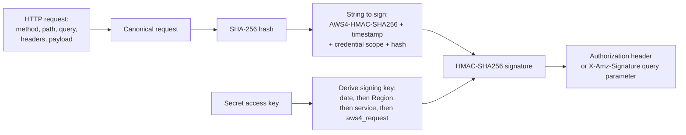

# 2.1.5 Make authenticated requests to AWS services

**Domain 2 · Task 2.1 · Skill 2.1.5** · [Task overview](README.md) · Previous: [2.1.4 Time-limited access](2.1.4-time-limited-access.md) · Next: [2.1.6 Least privilege permissions](2.1.6-least-privilege-permissions.md)

## What the exam expects

Every AWS API request must prove who sent it. AWS does this with Signature Version 4 (SigV4): the caller signs the request with its secret key, and AWS recomputes the signature. SDKs and the CLI sign for you; the exam asks when you must sign yourself, what goes into a signature, and what each authentication error means.

You must be able to:

- Explain what SigV4 signs and how temporary credentials change the request.
- Tell the header method from the query-string method (presigned URLs).
- Sign requests to AWS Identity and Access Management (IAM) protected endpoints that the software development kit (SDK) does not wrap, such as Amazon API Gateway with `AWS_IAM` auth and Lambda function URLs.
- Diagnose `SignatureDoesNotMatch`, `ExpiredToken`, `InvalidClientTokenId`, clock skew, and `AccessDenied`.
- Use `GetCallerIdentity` and `DecodeAuthorizationMessage` while debugging.

## Key terms

| Term | Meaning |
|---|---|
| SigV4 | AWS Signature Version 4. HMAC-SHA256 signature over the request, scoped to a date, Region, and service. |
| SigV4a | Asymmetric variant (elliptic curve digital signature algorithm, ECDSA) whose signature is valid in multiple Regions. Required for multi-Region requests such as S3 Multi-Region Access Points. |
| Canonical request | Normalized form of the method, path, query string, signed headers, and payload hash. |
| String to sign | Algorithm, timestamp, credential scope, and the hash of the canonical request. |
| Credential scope | `date/region/service/aws4_request`, for example `20261230/us-east-1/execute-api/aws4_request`. |
| Session token | Required extra value for temporary credentials, sent as `X-Amz-Security-Token`. |
| HMAC | Hash-based message authentication code. Proves the sender knew the secret without sending it. |

## How SigV4 works



1. Build the canonical request from the HTTP method, URI path, sorted query string, signed headers (always `host` and `x-amz-date`), and the hex SHA-256 hash of the payload.
2. Build the string to sign from the algorithm name, the timestamp, the credential scope, and the hash of the canonical request.
3. Derive a signing key from the secret access key by chaining HMACs over the date, Region, service, and the literal `aws4_request`. The secret itself never travels.
4. Sign the string and attach the result.

AWS repeats the calculation on its side. A match proves identity and that nothing signed was altered in transit.

### Where the signature goes

| Method | Looks like | Used by |
|---|---|---|
| `Authorization` header | `AWS4-HMAC-SHA256 Credential=AKIA.../20261230/us-east-1/s3/aws4_request, SignedHeaders=host;x-amz-content-sha256;x-amz-date, Signature=5d67...` | SDKs and the CLI for normal API calls |
| Query string | `?X-Amz-Algorithm=AWS4-HMAC-SHA256&X-Amz-Credential=...&X-Amz-Date=...&X-Amz-Expires=900&X-Amz-SignedHeaders=host&X-Amz-Signature=...` | S3 presigned URLs ([2.1.4](2.1.4-time-limited-access.md)) |

With temporary credentials from AWS Security Token Service (STS), the request must also include the session token, in the `X-Amz-Security-Token` header or query parameter. Forgetting it produces `InvalidClientTokenId` or a signature error even though the key pair is correct.

### Replay protection and clock skew

In most cases a request must reach AWS within five minutes of its `X-Amz-Date` timestamp. A host whose clock drifts more than that gets every request rejected with errors such as `RequestTimeTooSkewed` (S3), `SignatureDoesNotMatch`, or "Signature expired". Fix the clock (Network Time Protocol, for example Amazon Time Sync Service on EC2), not the code.

### SigV4a

SigV4a uses an ECDSA key pair derived from your secret key, so AWS needs only the public key to verify, and one signature works across Regions. SDKs choose it automatically when you call a multi-Region endpoint such as an S3 Multi-Region Access Point.

## When you sign yourself

The SDKs and CLI sign every request they send. You need to sign explicitly only when:

- No AWS SDK exists for your language, or you call the raw HTTP API.
- You call an IAM-protected HTTP endpoint that the SDK does not model as a client operation:
  - API Gateway REST or HTTP APIs with `AWS_IAM` authorization (service name `execute-api`).
  - Lambda function URLs with `AuthType: AWS_IAM` (service name `lambda`).
  - The API Gateway WebSocket `@connections` callback URL when a backend posts a message to a client.

### Calling IAM-protected endpoints

From a Lambda function, an Amazon Elastic Container Service (Amazon ECS) task, or a laptop, use the SDK's signer with the credentials the chain already resolved:

```python
import json, boto3, requests
from botocore.auth import SigV4Auth
from botocore.awsrequest import AWSRequest

session = boto3.Session()
creds = session.get_credentials().get_frozen_credentials()   # includes the session token

url = "https://abcd1234.execute-api.us-east-1.amazonaws.com/prod/orders"
body = json.dumps({"item": "book"})
req = AWSRequest(method="POST", url=url, data=body, headers={"Content-Type": "application/json"})
SigV4Auth(creds, "execute-api", "us-east-1").add_auth(req)    # adds Authorization, X-Amz-Date, X-Amz-Security-Token

resp = requests.post(url, data=body, headers=dict(req.headers))
print(resp.status_code, resp.text)
```

In JavaScript, `@smithy/signature-v4` (used inside SDK v3) or Amplify's API category performs the same signing.

Permissions the caller needs:

| Endpoint | Caller needs | Cross-account |
|---|---|---|
| API Gateway with `AWS_IAM` | `execute-api:Invoke` on `arn:aws:execute-api:region:account:api-id/stage/METHOD/path` | Identity policy in the caller's account and the API's resource policy must both allow |
| Lambda function URL with `AWS_IAM` | `lambda:InvokeFunctionUrl` | Same account: identity or resource policy. Cross-account: both. |

Cognito identity pool users call IAM-protected APIs the same way, signing with their temporary identity pool credentials.

## Requests that are not signed

| Request | Why no SigV4 |
|---|---|
| Anonymous `GET` of a public S3 object | The bucket policy allows `Principal: "*"` |
| STS `AssumeRoleWithWebIdentity` and `AssumeRoleWithSAML` | The caller has no AWS credentials yet; the OIDC token or SAML assertion is the proof |
| Cognito user pool sign-in calls such as `InitiateAuth`, `SignUp` | Public or token-authorized operations authenticated by the app client and user credentials |
| Calls to your API through Cognito or Lambda authorizers | Authenticated by bearer tokens, not SigV4 |

## Authentication and authorization errors

| Error | Meaning | Fix |
|---|---|---|
| `InvalidClientTokenId`, `UnrecognizedClientException` | AWS does not recognize the access key ID, or a temporary key was sent without its session token | Check which credentials resolved; include the session token |
| `SignatureDoesNotMatch` | Signature mismatch: wrong secret key, the request changed after signing, wrong Region or service in the scope, or clock skew | Use the SDK signer; check secret, Region, service name, and clock |
| `RequestTimeTooSkewed`, "Signature expired" | Timestamp outside the allowed window | Sync the clock |
| `ExpiredToken`, `ExpiredTokenException` | Temporary credentials passed their expiration | Refresh: assume the role again or let the SDK provider refresh |
| `AccessDenied`, `AccessDeniedException`, `UnauthorizedOperation` | Authenticated, but policies do not allow the action | Fix the policy; see [2.1.6](2.1.6-least-privilege-permissions.md#policy-evaluation-logic) |
| `NoCredentialsError` (SDK, client side) | Nothing in the credential chain resolved | See [2.1.3](2.1.3-secure-programmatic-access.md#the-credential-provider-chain) |

Authentication errors (who are you) and authorization errors (are you allowed) need different fixes. A signature error is never solved by adding permissions.

### Debugging commands

```bash
aws sts get-caller-identity
# {"UserId": "AROA...:session", "Account": "123456789012",
#  "Arn": "arn:aws:sts::123456789012:assumed-role/OrdersLambdaRole/orders-fn"}

aws sts decode-authorization-message --encoded-message <encoded-message>
```

- `GetCallerIdentity` shows which identity signed the request. It needs no permissions and cannot be denied by policy.
- Some services, notably EC2, return an encoded authorization failure message. `DecodeAuthorizationMessage` reveals which policy and context caused the denial. The caller needs `sts:DecodeAuthorizationMessage`.

## Throttling is separate from authentication

API rate limits return `ThrottlingException`, `TooManyRequestsException`, or HTTP 503 "Slow Down" from S3. SDKs retry these with exponential backoff and jitter by default. Retry throttling and 5xx errors, never 4xx authentication or authorization errors, which fail the same way every time. Raw HTTP callers that sign their own requests must also implement backoff. Details in [1.1.3](../../domain-1-development-with-aws-services/task-1.1-build-application-code/1.1.3-resilience-retries-and-backoff.md).

## Exam triggers

| Scenario clue | Answer | Why the alternatives are wrong |
|---|---|---|
| Lambda must call an API Gateway method that uses IAM authorization | SigV4-sign the request with the function's role credentials and grant `execute-api:Invoke` | API keys do not satisfy IAM auth; storing user keys in the function is unsafe |
| Requests from one host fail with signature errors; same code works elsewhere | Clock skew; sync time | Rotating keys does not fix a wrong clock |
| `ExpiredToken` after about an hour | Temporary credentials expired; refresh or re-assume | Increasing IAM permissions does not extend a session |
| Temporary keys rejected as invalid | Session token missing from the request | The key pair alone is incomplete for STS credentials |
| Find out which identity the code is using | `sts get-caller-identity` | `iam get-user` fails for role sessions |
| EC2 returns an encoded authorization failure message | `sts decode-authorization-message` | CloudTrail shows the event, not the decoded reasoning |
| How do S3 presigned URLs authenticate? | SigV4 in the query string (`X-Amz-Signature`) | No session or cookie is involved |
| Request to an S3 Multi-Region Access Point | SigV4a (SDK handles it) | Regional SigV4 is scoped to one Region |
| Calling AWS from a language with no SDK | Implement SigV4 signing (and backoff) yourself | Unsigned requests are rejected |

## Common traps

- SDKs and the CLI already sign. "Manually sign each SDK call" is a wrong answer.
- A signature scope includes Region and service. Signing for `us-east-1` and sending to `eu-west-1` fails.
- Temporary credentials need the session token on every request.
- `AccessDenied` is authorization, not authentication. Signature and token errors are authentication.
- `GetCallerIdentity` works even when every other permission is denied.
- Do not retry 4xx authentication or authorization errors.

## Quick recall

- SigV4 = HMAC-SHA256 over canonical request, scoped to date, Region, service.
- Signature in the `Authorization` header or in `X-Amz-Signature` (presigned).
- Temporary credentials add `X-Amz-Security-Token`.
- Requests must arrive within about five minutes of their timestamp.
- SigV4a = asymmetric, multi-Region.
- Sign yourself for `AWS_IAM` API Gateway (`execute-api`) and function URLs (`lambda`).
- `AssumeRoleWithWebIdentity` and `AssumeRoleWithSAML` are unsigned.
- `get-caller-identity` = who am I. `decode-authorization-message` = why denied.

## Related skills

- [2.1.2 Access controls, tokens, and MFA](2.1.2-access-controls-tokens-and-mfa.md#api-gateway-authorization-options): choosing IAM auth vs token authorizers.
- [2.1.3 Secure programmatic access](2.1.3-secure-programmatic-access.md): where the signing credentials come from.
- [2.1.4 Time-limited access](2.1.4-time-limited-access.md): query-string SigV4 as presigned URLs.
- [2.1.7 Assuming IAM roles](2.1.7-assuming-iam-roles.md): refreshing temporary credentials.
- [1.1.5 AWS SDKs and service APIs](../../domain-1-development-with-aws-services/task-1.1-build-application-code/1.1.5-aws-sdks-and-service-apis.md): SDK clients and error handling.
- [1.2.4 Lambda service integrations](../../domain-1-development-with-aws-services/task-1.2-develop-lambda-functions/1.2.4-lambda-service-integrations.md): function URLs and API Gateway integrations.
- [4.1.1 Debugging code and integrations](../../domain-4-troubleshooting-and-optimization/task-4.1-root-cause-analysis/4.1.1-debugging-code-and-integrations.md): broader debugging workflow.

## Sources

- Merged from: `archive/dva-c03-study-notes/02-security.md` (skills 2.1.3 and 2.1.5, error list), `archive/aws-dva-notes/Markdown Files/9. CLI, SDK, IAM Roles & Policies.md` (SigV4, rate limits, backoff), `archive/aws-dva-notes/Markdown Files/26. Advanced Identity.md` (`GetCallerIdentity`, `DecodeAuthorizationMessage`), `archive/aws-dva-notes/Markdown Files/20. Serverless - API Gateway.md` (IAM auth, WebSocket callbacks), `archive/aws-dva-notes/Markdown Files/18. Serverless - Lambda.md` (function URL auth), `archive/dva-c03/exam-bank/bank-1.md` (function URL auth types).
- AWS documentation:
  - [AWS Signature Version 4 for API requests](https://docs.aws.amazon.com/IAM/latest/UserGuide/reference_aws-signing.html) (signing steps, SigV4a, five-minute replay window)
  - [Requesting temporary security credentials](https://docs.aws.amazon.com/IAM/latest/UserGuide/id_credentials_temp_request.html) (session token requirement, unsigned web identity and SAML calls)
