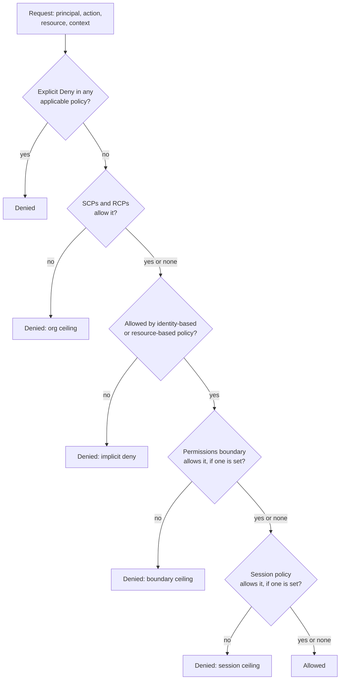

# 2.1.6 Define permissions for IAM users, roles, services, and resources according to least privilege

**Domain 2 · Task 2.1 · Skill 2.1.6** · [Task overview](README.md) · Previous: [2.1.5 Authenticated requests](2.1.5-authenticated-requests.md) · Next: [2.1.7 Assuming IAM roles](2.1.7-assuming-iam-roles.md)

## What the exam expects

AWS Identity and Access Management (IAM) decides every API call. This skill tests two things: writing policies that grant only what a principal needs, and predicting what a combination of policies actually allows. Most "will this call succeed" questions give you two or more policies (an IAM policy and a bucket policy, a role and a permissions boundary, an admin and a service control policy (SCP)) and expect you to run the evaluation logic in the right order.

You must be able to:

- Read and write identity-based and resource-based policies, including `Principal`, `Action`, `Resource`, `Condition`, and policy variables.
- Apply the evaluation rules: explicit deny wins, default deny, same-account union, cross-account intersection, and ceilings (SCPs, resource control policies or RCPs, permissions boundaries, session policies).
- Give services the right permissions: Lambda execution role vs resource-based policy, service principals, `iam:PassRole`, confused deputy protection.
- Right-size permissions with IAM Access Analyzer, last-accessed data, and the policy simulator.

## Key terms

| Term | Meaning |
|---|---|
| Principal | The entity making a request: IAM user, role session, federated user, AWS service, or anonymous caller. |
| Identity-based policy | Policy attached to a user, group, or role. Says what that identity can do. No `Principal` element. |
| Resource-based policy | Policy attached to a resource (S3 bucket, Amazon Simple Queue Service (Amazon SQS) queue, Lambda function, AWS Key Management Service (AWS KMS) key). Says who can use it. Has a `Principal` element. |
| Trust policy | The resource-based policy on a role that says who can assume it. |
| Permissions boundary | Managed policy that caps the maximum permissions of one user or role. Grants nothing. |
| SCP | Service control policy in AWS Organizations. Caps what principals in an account or organizational unit (OU) can do. Grants nothing. |
| RCP | Resource control policy in AWS Organizations. Caps what can be done to supported resources in member accounts, whoever the caller is. Grants nothing. |
| Session policy | Policy passed when a session is created (`AssumeRole`, `GetFederationToken`) that narrows that session. |
| Least privilege | Grant only the actions, resources, and conditions a task needs. |
| Confused deputy | A trusted service or third party is tricked into using its access on behalf of someone who should not have it. |

## IAM building blocks

- IAM is a global service: users, groups, roles, and policies are not Region-scoped.
- **Root user:** created with the account. Use it only for the few tasks that require it. Protect it with multi-factor authentication (MFA).
- **Users:** one per person or, as a last resort, per workload. Prefer federation and roles.
- **Groups:** contain users only, cannot contain other groups, and are not principals in policies. A user does not have to be in a group, can belong to several (up to 10), and gets the union of all attached policies.
- **Roles:** identities with no long-term credentials, assumed by users, services, or federated identities. Temporary credentials rotate automatically.
- **Policies:** JSON documents. Deny by default.

### Policy types

| Type | Attached to | Grants? | Typical use |
|---|---|---|---|
| AWS managed policy | Users, groups, roles | Yes | Quick start, job functions. Updated by AWS when services add actions. |
| Customer managed policy | Users, groups, roles | Yes | Recommended. Reusable, versioned (up to five versions), can roll back. |
| Inline policy | One user, group, or role | Yes | Strict one-to-one; deleted with the principal |
| Resource-based policy | S3 bucket, SQS queue, Amazon Simple Notification Service (Amazon SNS) topic, Lambda function, KMS key, Secrets Manager secret, Amazon Elastic Container Registry (Amazon ECR) repository, API Gateway API, EventBridge bus, role trust policy | Yes | Cross-account access, service-to-service permissions |
| Permissions boundary | One user or role | No, ceiling | Let developers create roles safely |
| SCP | Organization root, OU, or account | No, ceiling | Organization guardrails such as "never disable CloudTrail" |
| RCP | Organization root, OU, or account | No, ceiling | "No principal outside the organization may read our S3 buckets" |
| Session policy | One session | No, ceiling | Narrow one continuous integration and delivery (CI/CD) run below its role |

## Policy structure

| Element | Required | Purpose |
|---|---|---|
| `Version` | Yes | Always `"2012-10-17"`. The policy language version, not a date you update. |
| `Id` | No | Policy identifier |
| `Statement` | Yes | One or more statements |
| `Sid` | No | Statement label |
| `Effect` | Yes | `Allow` or `Deny` |
| `Principal` / `NotPrincipal` | Resource-based policies only | Who the statement applies to |
| `Action` / `NotAction` | Yes (one of them) | API actions, wildcards allowed (`s3:Get*`) |
| `Resource` / `NotResource` | Yes in identity policies | Amazon Resource Names (ARNs) the actions apply to |
| `Condition` | No | When the statement applies |

### Bucket ARN vs object ARN

`s3:ListBucket` acts on the bucket. `s3:GetObject` and `s3:PutObject` act on objects. A policy that lists only one ARN form silently fails for the other set of actions.

```json
{
  "Version": "2012-10-17",
  "Statement": [
    {
      "Effect": "Allow",
      "Action": "s3:ListBucket",
      "Resource": "arn:aws:s3:::reports-bucket"
    },
    {
      "Effect": "Allow",
      "Action": "s3:GetObject",
      "Resource": "arn:aws:s3:::reports-bucket/*"
    }
  ]
}
```

### `NotAction` with care

`"Effect": "Allow", "NotAction": "iam:*"` allows every action except IAM, including services added later. Use `NotAction` mainly in Deny statements, for example "deny everything except these global services outside approved Regions".

### Least privilege in practice

```json
{
  "Version": "2012-10-17",
  "Statement": [{
    "Effect": "Allow",
    "Action": ["dynamodb:PutItem", "dynamodb:GetItem"],
    "Resource": "arn:aws:dynamodb:us-east-1:123456789012:table/Orders",
    "Condition": { "Bool": { "aws:SecureTransport": "true" } }
  }]
}
```

Narrow actions, one resource ARN, and a condition where one makes sense. `"Action": "s3:*", "Resource": "*"` for a function that reads one object is the exam's standard example of over-permissioning, and `s3:Get*` on `*` is still too broad.

## Policy variables

Variables let one policy serve many principals.

| Variable | Resolves to |
|---|---|
| `${aws:username}` | The IAM user's name (not set for role sessions) |
| `${aws:userid}` | Unique ID; for roles, `role-id:session-name` |
| `${aws:PrincipalTag/key}` | A tag on the calling user or role, or a session tag |
| `${aws:PrincipalAccount}` | The caller's account ID |
| `${cognito-identity.amazonaws.com:sub}` | The Cognito identity pool identity ID |
| `${aws:SourceIdentity}` | The source identity set at role assumption |

Per-user home folders with one policy instead of one policy per user:

```json
{
  "Version": "2012-10-17",
  "Statement": [
    {
      "Effect": "Allow",
      "Action": "s3:ListBucket",
      "Resource": "arn:aws:s3:::my-company-bucket",
      "Condition": { "StringLike": { "s3:prefix": ["home/${aws:username}/*"] } }
    },
    {
      "Effect": "Allow",
      "Action": ["s3:GetObject", "s3:PutObject", "s3:DeleteObject"],
      "Resource": "arn:aws:s3:::my-company-bucket/home/${aws:username}/*"
    }
  ]
}
```

For Cognito users, use `${cognito-identity.amazonaws.com:sub}` (see [2.1.1](2.1.1-identity-federation.md#per-user-scoping-with-policy-variables)). For tag-based access, compare `${aws:PrincipalTag/team}` with `aws:ResourceTag/team` (see [2.1.2](2.1.2-access-controls-tokens-and-mfa.md#abac-with-tags)).

## Policy evaluation logic


*Source: [AWS documentation, Policy evaluation for requests within a single account](https://docs.aws.amazon.com/IAM/latest/UserGuide/reference_policies_evaluation-logic_policy-eval-basics.html). The ceilings (SCP, RCP, permissions boundary, session policy) are separate checks before the final allow decision.*



The rules:

1. **Everything starts denied.** A principal with no policies can do nothing.
2. **Explicit deny wins everywhere.** Any applicable `Deny` in any policy type ends evaluation. There is no "most permissive wins".
3. **Ceilings only remove.** SCPs, RCPs, permissions boundaries, and session policies must each allow the action (when present), but none of them grants anything on its own.
4. **Same account: identity OR resource policy.** If either the identity-based policy or the resource-based policy allows the request and nothing denies it, the request is allowed.
5. **Cross-account: identity AND resource policy.** The caller's account must allow the request in an identity-based policy, and the resource's account must allow it in a resource-based policy (or the caller assumes a role in the resource's account).
6. **Two resource types always need their own allow:** a role's trust policy and a KMS key policy. An IAM policy that allows `kms:Decrypt` does nothing unless the key policy allows the account or principal to use IAM policies or names the principal.
7. **Conditions decide whether a statement applies.** A `Deny` whose condition is not met does not apply, and evaluation continues.

Permissions boundaries and session policies add detail to rule 4 (for example, whether a resource-based policy names the role ARN or the session ARN). The exam rarely goes that deep; the AWS page in Sources has the full rules.

### Same-account examples

From an IAM role on EC2 calling an S3 bucket in the same account:

| # | Role's IAM policy | Bucket policy | Result |
|---|---|---|---|
| 1 | Allows read/write on the bucket | None | Allowed |
| 2 | Allows read/write | Explicit Deny for the role | Denied (explicit deny) |
| 3 | No S3 permissions | Explicitly allows the role read/write | Allowed (resource policy is enough in one account) |
| 4 | Explicit Deny on S3 | Explicitly allows the role | Denied (explicit deny) |

### "Looks permissive" trap

```json
{
  "Version": "2012-10-17",
  "Statement": [
    { "Effect": "Allow", "Action": "dynamodb:*", "Resource": "*" },
    {
      "Effect": "Deny",
      "Action": "dynamodb:DeleteTable",
      "Resource": "arn:aws:dynamodb:us-east-1:111122223333:table/prod-orders",
      "Condition": { "StringNotEquals": { "aws:PrincipalTag/break-glass": "true" } }
    }
  ]
}
```

This principal can do anything in DynamoDB except delete `prod-orders`, unless its session carries the `break-glass=true` tag. With the tag, the condition is not met, the Deny does not apply, and the broad Allow takes effect.

### Cross-account example

Account A's `ReportingRole` has an identity policy that allows `s3:GetObject` only on Account A buckets. Account B's bucket policy grants `ReportingRole` `s3:GetObject` and `s3:ListBucket`. Can the role list Account B's bucket? **No.** Cross-account access needs both sides. Account B allowed it, but Account A's identity policy does not allow `s3:ListBucket` on Account B's bucket. Fix: add `s3:ListBucket` and `s3:GetObject` on `arn:aws:s3:::accountb-bucket` and `/*` to `ReportingRole`'s policy.

If the objects are encrypted with an Account B KMS key, the key policy in Account B must also allow `ReportingRole` to `kms:Decrypt`, and the role's identity policy must allow `kms:Decrypt` on that key ARN.

### SCP as the ceiling over an admin

An SCP on the developers' OU denies `cloudtrail:StopLogging` and `cloudtrail:DeleteTrail`. A developer with `AdministratorAccess` still cannot stop logging. "Even an administrator cannot do X across the organization" points to an SCP (or RCP for resource-side rules), never to an IAM policy.

### Four ceilings compared

| Mechanism | Scope | Set by | Example |
|---|---|---|---|
| SCP | Every principal in an account or OU | Organization management account | No account may leave the organization or use unapproved Regions |
| RCP | Requests to supported resources in the account, from any caller | Organization management account | No principal outside the organization may access our S3 buckets |
| Permissions boundary | One user or role, always on | Account admin | A developer-created role can never exceed read-only plus its team's prefix |
| Session policy | One session | Whoever calls `AssumeRole` or `GetFederationToken` | This pipeline run may touch only one stack |

Effective permissions with a boundary are the intersection: a role with `s3:*` and a boundary allowing only `s3:GetObject` on one bucket can only read that bucket. A role with a generous boundary but an empty identity policy can do nothing.

```json
{
  "Version": "2012-10-17",
  "Statement": [{
    "Sid": "DelegatedRoleCreation",
    "Effect": "Allow",
    "Action": ["iam:CreateRole", "iam:AttachRolePolicy", "iam:PutRolePolicy"],
    "Resource": "arn:aws:iam::111122223333:role/team-*",
    "Condition": {
      "StringEquals": { "iam:PermissionsBoundary": "arn:aws:iam::111122223333:policy/TeamBoundary" }
    }
  }]
}
```

This lets a team lead create roles only if they carry `TeamBoundary`, so no created role can exceed it.

## Permissions for services

### Lambda: execution role vs resource-based policy

| | Execution role | Resource-based (function) policy |
|---|---|---|
| Answers | What the function can do | Who can invoke the function |
| Direction | Outbound: read SQS, write DynamoDB, put logs | Inbound: S3, SNS, EventBridge, API Gateway, other accounts |
| Event source mappings (SQS, Kinesis, DynamoDB Streams) | Lambda polls with the execution role, so it needs read permissions there | Not used |
| Fix for | "Function gets AccessDenied writing to DynamoDB" | "S3 cannot trigger the function" |

Managed policies to recognize: `AWSLambdaBasicExecutionRole` (CloudWatch Logs), `AWSLambdaSQSQueueExecutionRole`, `AWSLambdaKinesisExecutionRole`, `AWSLambdaDynamoDBExecutionRole`, `AWSLambdaVPCAccessExecutionRole`, `AWSXRayDaemonWriteAccess`.

```bash
aws lambda add-permission \
  --function-name my-function \
  --statement-id s3-invoke \
  --action lambda:InvokeFunction \
  --principal s3.amazonaws.com \
  --source-arn arn:aws:s3:::my-bucket \
  --source-account 123456789012
```

API Gateway needs this permission for each alias it invokes. Amazon Elastic Container Service (Amazon ECS) task roles vs task execution roles are covered in [2.1.3](2.1.3-secure-programmatic-access.md#ecs-task-role-vs-task-execution-role).

### Service principals and confused deputy protection

A service acts on your behalf in two ways:

- **Assuming your role:** the role's trust policy names the service, for example `"Principal": {"Service": "lambda.amazonaws.com"}`.
- **Calling your resource:** a resource-based policy names the service, for example S3 invoking Lambda or SNS writing to SQS.

When a service principal is allowed in a resource policy, add `aws:SourceArn` and `aws:SourceAccount` conditions. Without them, the service could be made to use your resource on behalf of someone else's bucket or topic.

```json
{
  "Version": "2012-10-17",
  "Statement": [{
    "Effect": "Allow",
    "Principal": { "Service": "sns.amazonaws.com" },
    "Action": "sqs:SendMessage",
    "Resource": "arn:aws:sqs:us-east-1:123456789012:orders-queue",
    "Condition": {
      "ArnEquals": { "aws:SourceArn": "arn:aws:sns:us-east-1:123456789012:orders-topic" },
      "StringEquals": { "aws:SourceAccount": "123456789012" }
    }
  }]
}
```

The third-party version of this problem (a SaaS vendor assuming roles in many customer accounts) is solved with `sts:ExternalId`. See [2.1.7](2.1.7-assuming-iam-roles.md#external-id-and-the-confused-deputy).

### Passing roles to services

When you create an EC2 instance with an instance profile, a Lambda function, an ECS task definition, a Step Functions state machine, or a CodePipeline pipeline, you hand it a role. That requires `iam:PassRole` on the role, which stops a user from handing a service a more powerful role than they have.

```json
{
  "Version": "2012-10-17",
  "Statement": [
    { "Effect": "Allow", "Action": "lambda:CreateFunction", "Resource": "*" },
    {
      "Effect": "Allow",
      "Action": ["iam:GetRole", "iam:PassRole"],
      "Resource": "arn:aws:iam::123456789012:role/orders-fn-role",
      "Condition": { "StringEquals": { "iam:PassedToService": "lambda.amazonaws.com" } }
    }
  ]
}
```

- `iam:PassRole` on `"Resource": "*"` lets the caller pass any role, including admin roles. Scope it to specific role ARNs.
- A role can be passed only to a service its trust policy allows. "Lambda cannot use this role" means the trust policy lacks `lambda.amazonaws.com`.
- `iam:PassRole` (hand a role to a service) and `sts:AssumeRole` (become the role yourself) are different permissions.

## Tools for right-sizing permissions

| Tool | What it does |
|---|---|
| IAM Access Analyzer policy validation | Checks policies for errors, security warnings, and over-broad grants while you write them |
| IAM Access Analyzer policy generation | Builds a least-privilege policy from the actions a role actually used, based on CloudTrail |
| IAM Access Analyzer external access findings | Flags resources (buckets, roles, keys, queues) shared outside your account or organization |
| IAM Access Analyzer unused access findings | Flags unused roles, keys, and permissions |
| Last accessed information (Access Advisor) | Per user or role: which services were granted and when each was last used |
| IAM credentials report | Account-wide CSV of all users: password and access key age, last use, MFA status |
| IAM policy simulator (`simulate-principal-policy`) | Tests whether policies allow specific actions before you deploy |
| CloudTrail | Records API calls, including denied ones, for investigation |

```bash
aws iam simulate-principal-policy \
  --policy-source-arn arn:aws:iam::123456789012:role/OrdersLambdaRole \
  --action-names dynamodb:Scan \
  --resource-arns arn:aws:dynamodb:us-east-1:123456789012:table/Orders
```

A practical workflow: start a prototype with an AWS managed policy, run it, generate a policy from CloudTrail activity, replace the managed policy with the generated customer managed policy, and review last-accessed data periodically.

### Best practices list

- Do not use the root user for daily work; enable MFA on it.
- Prefer roles and federation over IAM users. One physical user per IAM user if users exist at all.
- Grant least privilege; avoid `"Action": "*"` and `"Resource": "*"`.
- One role per application or function. Do not share roles.
- Use customer managed policies for reuse and version control; use inline only for strict one-to-one cases.
- Use conditions (MFA, source, TLS, tags) to tighten grants.
- Set guardrails with SCPs and RCPs, and delegation limits with permissions boundaries.
- Audit with Access Analyzer, last-accessed data, credentials reports, and CloudTrail.

Shared responsibility: AWS secures the IAM service itself; you are responsible for users, roles, policies, MFA, and key rotation.

## Exam triggers

| Scenario clue | Answer | Why the alternatives are wrong |
|---|---|---|
| Lambda gets AccessDenied writing to DynamoDB | Add the action to the execution role | The function's resource policy controls invokers |
| S3 cannot invoke the Lambda function | Lambda resource-based policy (`add-permission`) with source ARN and account | The execution role does not admit callers |
| Allow `ListBucket` on the bucket and `GetObject` on its objects | Two statements with bucket ARN and `bucket/*` ARN | One ARN form covers only one action set |
| Per-user S3 folders with one policy | `${aws:username}` in `Resource` and in an `s3:prefix` condition | One policy per user does not scale |
| Role has `AdministratorAccess` but still cannot do X | SCP or RCP deny, or a permissions boundary | IAM policies cannot override org ceilings |
| Developers must create roles that can never exceed a limit | Permissions boundary enforced with `iam:PermissionsBoundary` | SCPs apply to whole accounts, not to roles developers create |
| One pipeline run should get less than the role allows | Session policy on `AssumeRole` | Editing the role affects every run |
| User creates a Lambda function but fails attaching a role | Missing `iam:PassRole` on that role | `sts:AssumeRole` is a different permission |
| Role's IAM policy allows `kms:Decrypt` but decrypt fails | Key policy does not allow the role | KMS key policies must grant access themselves |
| Bucket policy in Account B grants Account A's role, still denied | Account A's identity policy must also allow the action | Cross-account needs both sides |
| Reusable, versioned policy for many roles | Customer managed policy | Inline policies are one-to-one |
| Remove permissions a role never uses | Access Analyzer policy generation or last-accessed data | Credentials report covers users and keys, not service usage per role |
| Report of all users and their key ages | IAM credentials report | Access Advisor is per principal |
| SNS topic must deliver to SQS without letting other topics in | Queue policy with `aws:SourceArn` and `aws:SourceAccount` | A service principal alone allows any topic of that service |

## Common traps

- Explicit deny always wins, and a Deny with an unmet condition does not apply.
- SCPs, RCPs, permissions boundaries, and session policies never grant. Their Allow statements only define the maximum.
- Same account: identity or resource policy is enough. Cross-account: both are required.
- Trust policies and KMS key policies need their own allow.
- `Principal` belongs only in resource-based policies (including trust policies).
- Groups cannot be nested and cannot be named as principals.
- `Version` is always `2012-10-17`.
- `iam:PassRole` on `*` is a privilege escalation path.
- AWS managed policies change when AWS updates them; customer managed policies change only when you update them.

## Quick recall

- Default deny, explicit deny wins, ceilings only remove.
- Same account = OR. Cross-account = AND.
- Trust policy = who can assume. Permissions policy = what they can do.
- Lambda execution role = outbound; function policy = inbound.
- Bucket ARN for `ListBucket`, `bucket/*` for object actions.
- `${aws:username}`, `${aws:PrincipalTag/key}`, `${cognito-identity.amazonaws.com:sub}`.
- `iam:PassRole` scoped to role ARNs, optionally with `iam:PassedToService`.
- `aws:SourceArn` + `aws:SourceAccount` stop confused deputies for service principals.
- Access Analyzer generates least-privilege policies from CloudTrail.
- Credentials report = account-wide users. Last accessed = per principal.

## Related skills

- [2.1.2 Access controls, tokens, and MFA](2.1.2-access-controls-tokens-and-mfa.md): condition keys for fine-grained access.
- [2.1.3 Secure programmatic access](2.1.3-secure-programmatic-access.md): roles for each compute service.
- [2.1.7 Assuming IAM roles](2.1.7-assuming-iam-roles.md): trust policies, external IDs, session policies.
- [2.2.4 KMS key management](../task-2.2-encrypt-and-protect-sensitive-data/2.2.4-kms-key-management.md): key policies and grants.
- [2.3.1 AI service access control](../task-2.3-secure-ai-services/2.3.1-ai-service-access-control.md): least privilege for Amazon Bedrock model ARNs.
- [1.2.4 Lambda service integrations](../../domain-1-development-with-aws-services/task-1.2-develop-lambda-functions/1.2.4-lambda-service-integrations.md): event source mappings and triggers that depend on these permissions.

## Sources

- Merged from: `archive/dva-c03/domain-2-security/iam-policy-evaluation-logic.md`, `archive/dva-c03/domain-2-security/README.md` (evaluation, worked policies), `archive/dva-c03/domain-2-security/MASTER-CHUNK.md` (sections 4 and 7), `archive/dva-c03/domain-1-development/MASTER-CHUNK.md` (IAM section, simulator command), `archive/dva-c03-study-notes/02-security.md` (skill 2.1.6), `archive/aws-dva-notes/Markdown Files/1. IAM & AWS CLI.md` (users, groups, policy structure, security tools, shared responsibility), `archive/aws-dva-notes/Markdown Files/26. Advanced Identity.md` (evaluation table, policy variables, managed vs inline, `iam:PassRole`), `archive/aws-dva-notes/Markdown Files/18. Serverless - Lambda.md` (execution role vs resource policy), `archive/dva-c03/exam-bank/bank-1.md` (`PassRole` and boundary traps).
- AWS documentation:
  - [Policy evaluation for requests within a single account](https://docs.aws.amazon.com/IAM/latest/UserGuide/reference_policies_evaluation-logic_policy-eval-basics.html) (same-account rule)
  - [Cross-account policy evaluation logic](https://docs.aws.amazon.com/IAM/latest/UserGuide/reference_policies_evaluation-logic-cross-account.html) (both sides must allow)
  - [Policy evaluation logic](https://docs.aws.amazon.com/IAM/latest/UserGuide/reference_policies_evaluation-logic.html) (full rules including boundaries and session policies)
