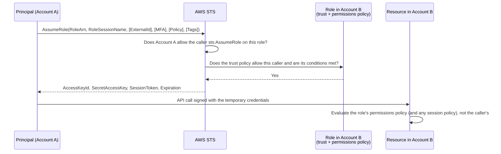

# 2.1.7 Assume IAM roles and use the resulting temporary credentials

**Domain 2 · Task 2.1 · Skill 2.1.7** · [Task overview](README.md) · Previous: [2.1.6 Least privilege permissions](2.1.6-least-privilege-permissions.md) · Next: [2.2.1 Encryption at rest and in transit](../task-2.2-encrypt-and-protect-sensitive-data/2.2.1-encryption-at-rest-and-in-transit.md)

## What the exam expects

AWS Security Token Service (STS) turns "I am allowed to become this role" into temporary credentials. The exam uses role assumption for cross-account access, third-party integrations, multi-factor authentication (MFA) protected admin work, and continuous integration and delivery (CI/CD), and expects you to know which document controls which step, how long the credentials last, and how code uses and refreshes them.

You must be able to:

- Call `AssumeRole` and its variants, and know what each returns.
- Write the trust policy and the caller's permission so assumption succeeds, in one account and across accounts.
- Use external IDs, MFA, session names, session tags, and session policies.
- Predict credential lifetimes, including the one-hour role chaining limit.
- Configure AWS Command Line Interface (CLI) profiles and software development kit (SDK) code that assume roles and refresh credentials.

## Key terms

| Term | Meaning |
|---|---|
| Role | AWS Identity and Access Management (IAM) identity with a trust policy and permissions policies, and no long-term credentials. |
| Trust policy | Resource-based policy on the role: who may assume it (`sts:AssumeRole`, `sts:AssumeRoleWithWebIdentity`, `sts:AssumeRoleWithSAML`). |
| Permissions policy | Identity-based policy on the role: what the session may do. |
| Role session | One assumption of a role. Its Amazon Resource Name (ARN) is `arn:aws:sts::account:assumed-role/RoleName/SessionName`. |
| Temporary credentials | Access key ID (`ASIA...`), secret access key, session token, and expiration. |
| External ID | A value a third party must pass in `AssumeRole`, checked by the trust policy, to prevent the confused deputy problem. |
| Role chaining | Using a role session's credentials to assume another role. |
| Session tags | Key-value tags passed at assumption that become principal tags for attribute-based access control (ABAC). |
| Source identity | A value set at assumption (such as the human's user name) that persists through role chaining and appears in CloudTrail. |

## How role assumption works



Two documents, two different questions:

| Symptom | Look at |
|---|---|
| `AccessDenied` on the `AssumeRole` call itself | Trust policy (principal, conditions such as external ID or MFA), and for cross-account the caller's `sts:AssumeRole` permission |
| `AssumeRole` succeeds, then service calls are denied | The role's permissions policy, a permissions boundary, a session policy, or the resource's own policy |

### Who must allow what

- **Cross-account:** the caller's identity policy in Account A must allow `sts:AssumeRole` on the role ARN, and the role's trust policy in Account B must allow the caller. Both, always.
- **Same account:** if the trust policy names the caller's ARN directly, that is enough. If it names only the account (`arn:aws:iam::111122223333:root`), the caller also needs an identity policy that allows `sts:AssumeRole`.

## STS operations

| Operation | Returns credentials for | Caller signs with | Notes |
|---|---|---|---|
| `AssumeRole` | A role, same account or cross-account | Existing AWS credentials | Supports external ID, MFA, session policies, session tags, source identity |
| `AssumeRoleWithWebIdentity` | A role, for an OIDC token holder | Nothing (unsigned) | Cognito identity pools, Amazon EKS IAM roles for service accounts (IRSA), GitHub Actions. AWS recommends Cognito identity pools for mobile and web apps. |
| `AssumeRoleWithSAML` | A role, for a SAML assertion holder | Nothing (unsigned) | Enterprise IdP federation directly into IAM |
| `GetSessionToken` | The same IAM user (or root), with MFA if provided | Long-term user credentials | MFA for CLI and SDK use |
| `GetFederationToken` | A federated user, through a custom broker | Long-term IAM user credentials | Must pass a session policy or rely on resource policies; otherwise the session has no permissions |
| `GetCallerIdentity` | Nothing; returns account, user ID, ARN | Any credentials | Needs no permissions |
| `DecodeAuthorizationMessage` | Nothing; decodes an encoded denial message | Any credentials with `sts:DecodeAuthorizationMessage` | Explains why a request was denied |

### `AssumeRole` parameters

| Parameter | Purpose |
|---|---|
| `RoleArn` | Role to assume |
| `RoleSessionName` | Name for the session, shown in the session ARN and CloudTrail. Use something traceable (user, job ID). |
| `DurationSeconds` | 900 seconds up to the role's maximum session duration |
| `ExternalId` | Third-party access check |
| `SerialNumber`, `TokenCode` | MFA device ARN and current time-based one-time password (TOTP) code |
| `Policy`, `PolicyArns` | Session policies that narrow the session |
| `Tags`, `TransitiveTagKeys` | Session tags for ABAC, optionally carried through role chaining |
| `SourceIdentity` | Persistent identity of the original human or workload |

## Credential lifetimes

| How obtained | Lifetime |
|---|---|
| `AssumeRole`, `AssumeRoleWithWebIdentity`, `AssumeRoleWithSAML` | 15 minutes to the role's maximum session duration. Default 1 hour. The maximum is configurable from 1 to 12 hours per role. |
| Role chaining (assume a role with role credentials) | Maximum 1 hour, whatever either role's maximum is |
| `GetSessionToken` as an IAM user | 15 minutes to 36 hours. Default 12 hours. |
| `GetSessionToken` as the root user | Maximum 1 hour |
| `GetFederationToken` | 15 minutes to 36 hours. Default 12 hours. Root maximum 1 hour. |

Older notes say temporary credentials last "15 minutes to 1 hour". That describes the defaults, not the limits. Asking for `DurationSeconds` above the role's maximum fails the call. A presigned URL or any other artifact signed with these credentials dies when they do ([2.1.4](2.1.4-time-limited-access.md#expiration-rules)).

Temporary credentials cannot be revoked individually. To cut off sessions already issued, remove the role's permissions or use the console's "Revoke active sessions", which attaches a Deny for sessions issued before now (using `aws:TokenIssueTime`).

## Cross-account access step by step

1. **Account B (owns the resource)** creates a role. Its trust policy names Account A or a specific role in it. Its permissions policy grants only what Account A needs.
2. **Account A (the caller)** grants its role or user `sts:AssumeRole` on that role ARN.
3. **The caller** calls `AssumeRole` and uses the returned credentials against Account B's resources.
4. **Revocation** means editing the trust policy. No shared key needs rotating.

Trust policy in Account B:

```json
{
  "Version": "2012-10-17",
  "Statement": [{
    "Effect": "Allow",
    "Principal": { "AWS": "arn:aws:iam::111122223333:role/ReportingLambdaRole" },
    "Action": "sts:AssumeRole"
  }]
}
```

Caller permission in Account A:

```json
{
  "Version": "2012-10-17",
  "Statement": [{
    "Effect": "Allow",
    "Action": "sts:AssumeRole",
    "Resource": "arn:aws:iam::444455556666:role/ReportsReadOnly"
  }]
}
```

The alternative for some services is a resource-based policy in Account B (an S3 bucket policy, for example) that names Account A's role directly. The caller then keeps its own identity, and Account A's identity policy must still allow the action. Role assumption works for every service and keeps Account B's permissions in one place.

## External ID and the confused deputy

A SaaS vendor's single AWS account assumes roles in many customer accounts. If customer X could tell the vendor "my role is `arn:aws:iam::<customer-Y>:role/Vendor`", the vendor would access customer Y's data on X's behalf. That is the confused deputy.

The fix: the vendor generates a unique external ID per customer and always passes it. Each customer's trust policy requires its own value.

```json
{
  "Version": "2012-10-17",
  "Statement": [{
    "Effect": "Allow",
    "Principal": { "AWS": "arn:aws:iam::999988887777:root" },
    "Action": "sts:AssumeRole",
    "Condition": { "StringEquals": { "sts:ExternalId": "customer-y-7f3a9c" } }
  }]
}
```

Because the vendor ties each external ID to the customer who registered it, X cannot make the vendor present Y's external ID. External IDs are for third-party access; between your own accounts, scoping the trust policy to specific role ARNs is enough. MFA is not a substitute, because the vendor's automation cannot supply a code.

For AWS services acting as deputies, the equivalent controls are `aws:SourceArn` and `aws:SourceAccount` ([2.1.6](2.1.6-least-privilege-permissions.md#service-principals-and-confused-deputy-protection)).

## MFA on role assumption

Require MFA in the trust policy:

```json
{
  "Version": "2012-10-17",
  "Statement": [{
    "Effect": "Allow",
    "Principal": { "AWS": "arn:aws:iam::111122223333:root" },
    "Action": "sts:AssumeRole",
    "Condition": { "Bool": { "aws:MultiFactorAuthPresent": "true" } }
  }]
}
```

The caller passes `SerialNumber` and `TokenCode`, or uses a CLI profile with `mfa_serial`.

## CLI profiles for role assumption

```ini
# ~/.aws/config
[profile dev]
sso_session = corp
sso_account_id = 111122223333
sso_role_name = DeveloperAccess

[profile prod-readonly]
role_arn = arn:aws:iam::444455556666:role/ReadOnly
source_profile = dev
role_session_name = jane-prod-readonly
mfa_serial = arn:aws:iam::111122223333:mfa/jane
duration_seconds = 3600
# For compute, use credential_source = Ec2InstanceMetadata or EcsContainer instead of source_profile
```

```bash
aws s3 ls --profile prod-readonly     # CLI calls AssumeRole, prompts for MFA, caches credentials
```

Manual equivalent:

```bash
aws sts assume-role \
  --role-arn arn:aws:iam::444455556666:role/ReadOnly \
  --role-session-name audit-session \
  --duration-seconds 3600
# Export AccessKeyId, SecretAccessKey, SessionToken as AWS_ACCESS_KEY_ID, AWS_SECRET_ACCESS_KEY, AWS_SESSION_TOKEN
```

## Assuming roles in code

### Explicit `AssumeRole` (boto3)

```python
import boto3

sts = boto3.client("sts")
resp = sts.assume_role(
    RoleArn="arn:aws:iam::444455556666:role/CrossAccountReadOnly",
    RoleSessionName="partner-integration",
    ExternalId="partner-secret-abc123",       # only if the trust policy requires it
    DurationSeconds=3600,
)
c = resp["Credentials"]                        # AccessKeyId, SecretAccessKey, SessionToken, Expiration

s3 = boto3.client(
    "s3",
    aws_access_key_id=c["AccessKeyId"],
    aws_secret_access_key=c["SecretAccessKey"],
    aws_session_token=c["SessionToken"],       # required with temporary credentials
)
print(s3.list_objects_v2(Bucket="partner-reports")["KeyCount"])
```

These credentials do not refresh themselves. Long-running code must call `AssumeRole` again before `Expiration`, or it starts failing with `ExpiredToken`.

### Self-refreshing credentials

Let the SDK provider do the refresh:

```python
# Uses the role_arn profile from ~/.aws/config; the SDK re-assumes before expiry
session = boto3.Session(profile_name="prod-readonly")
s3 = session.client("s3")
```

```javascript
// AWS SDK for JavaScript v3
import { S3Client } from "@aws-sdk/client-s3";
import { fromTemporaryCredentials } from "@aws-sdk/credential-providers";

const s3 = new S3Client({
  region: "us-east-1",
  credentials: fromTemporaryCredentials({
    params: {
      RoleArn: "arn:aws:iam::444455556666:role/CrossAccountReadOnly",
      RoleSessionName: "orders-sync",
      DurationSeconds: 3600,
    },
  }),   // refreshes automatically
});
```

Inside Lambda, a function that needs Account B access uses its execution role (from environment variables) as the source credentials for this call. The execution role needs `sts:AssumeRole` on the target role.

## Session tags, source identity, and session policies

### Session tags

Tags passed in `AssumeRole` become `aws:PrincipalTag/...` values for that session, enabling ABAC per session (for example, a `tenantId` per request in a multi-tenant SaaS). The trust policy must also allow `sts:TagSession`. Transitive tags carry over to chained roles.

### Source identity

`SourceIdentity` records who really started the session (for example, `jane@example.com`) and persists through role chaining. CloudTrail shows it on every call. The trust policy must allow `sts:SetSourceIdentity`.

### Session policies

```bash
aws sts assume-role \
  --role-arn arn:aws:iam::111122223333:role/DeployerRole \
  --role-session-name deploy-orders-stack \
  --policy '{"Version":"2012-10-17","Statement":[{"Effect":"Allow","Action":"cloudformation:*","Resource":"arn:aws:cloudformation:us-east-1:111122223333:stack/orders/*"}]}'
```

The session's permissions are the intersection of the role's policies and the session policy. A session policy can never add permissions the role lacks.

## Role chaining

Role A assumes role B (for example, a pipeline role in a tooling account assumes a deploy role in a workload account, or a console user switches from one role to another). The chained session lasts at most 1 hour. If a pipeline step runs longer, re-assume the role during the step or restructure so the job starts from a non-role identity that can request longer sessions.

## Roles that services assume for you

You never call `AssumeRole` for these. The service does, based on the trust policy:

| Service | Trust principal | Your code sees |
|---|---|---|
| Lambda execution role | `lambda.amazonaws.com` | Environment variables with temporary credentials |
| EC2 instance profile | `ec2.amazonaws.com` | Instance Metadata Service (IMDS) credentials |
| Amazon ECS task role | `ecs-tasks.amazonaws.com` | Container credential endpoint |
| CodeBuild service role | `codebuild.amazonaws.com` | Container credentials in the build |

Details in [2.1.3](2.1.3-secure-programmatic-access.md#roles-for-compute). To attach one of these roles, the person configuring the service needs `iam:PassRole` ([2.1.6](2.1.6-least-privilege-permissions.md#passing-roles-to-services)).

## Worked scenarios

**Partner Lambda reads your bucket.** A partner's function in its account must read a shipment-status bucket in yours, revocably and without shared keys. Create a role in your account trusting the partner's role ARN (with an external ID if the partner is a multi-customer vendor), grant it read on the bucket, and have the partner's function assume it. Revoke by editing the trust policy.

**Multi-tenant isolation.** A SaaS backend handles requests for many tenants in one account. For each request, it assumes a shared `TenantDataRole` with a session tag `tenantId=t-42` and a session policy limited to `tenants/t-42/*`. Data access is enforced by IAM, not by a prompt or app-level check.

**Pipeline times out at 60 minutes.** A CodeBuild job assumes a deploy role in another account and fails with `ExpiredToken` after an hour even though the deploy role allows 4-hour sessions. The build's service role credentials are role credentials, so this is role chaining, capped at 1 hour. Re-assume mid-job or split the deployment.

## Exam triggers

| Scenario clue | Answer | Why the alternatives are wrong |
|---|---|---|
| App in Account A must write to a bucket in Account B, no shared keys | Role in B trusted by A's role, A allowed `sts:AssumeRole`; or a bucket policy in B plus A's identity policy | IAM user keys from B are long-term shared secrets |
| Third-party SaaS needs access to your account | Role with trust policy requiring a unique `sts:ExternalId` | MFA cannot be supplied by automation; `Resource: *` trust is open to anyone |
| Cannot assume the role at all | Fix the trust policy (and, cross-account, the caller's `sts:AssumeRole`) | The permissions policy is checked only after assumption |
| Assumed the role, every call denied | Fix the role's permissions policy, boundary, or session policy | The trust policy already passed |
| Session expires after 1 hour despite a 12-hour role maximum | Role chaining limit | `DurationSeconds` cannot exceed 1 hour when chaining |
| One assumption should be narrower than the role | Session policy (`Policy` or `PolicyArns`) | Editing the role changes every session |
| Per-request tenant scoping with one role | Session tags + ABAC conditions, trust allows `sts:TagSession` | One role per tenant does not scale |
| Find which human started a chain of role sessions | `SourceIdentity` in CloudTrail | Session names can be changed at each hop |
| Long-running process starts failing with `ExpiredToken` | Refresh credentials before expiry (SDK provider or re-assume) | Adding permissions does not extend a session |
| Require MFA before assuming an admin role | `aws:MultiFactorAuthPresent` in the trust policy; profile with `mfa_serial` | Password policies do not affect role assumption |

## Common traps

- The trust policy controls assumption; the permissions policy controls what happens after. They are separate documents on the same role.
- Cross-account assumption needs both the trust policy and the caller's `sts:AssumeRole` permission.
- Role chaining caps the session at 1 hour.
- Credentials from a manual `AssumeRole` call do not refresh; SDK profile-based providers do.
- Every request with temporary credentials must include the session token.
- `GetFederationToken` with no session policy yields a session with no permissions unless resource policies grant access.
- `AssumeRoleWithWebIdentity` and `AssumeRoleWithSAML` need no prior AWS credentials.
- Issued temporary credentials cannot be deleted; revoke by changing policies or using "Revoke active sessions".

## Quick recall

- `AssumeRole` returns access key, secret key, session token, expiration.
- Duration: 15 minutes to the role maximum (1 to 12 hours, default 1 hour). Chaining: 1 hour max.
- `GetSessionToken`: 15 minutes to 36 hours, default 12 hours, root 1 hour.
- External ID = third-party confused deputy defense.
- Trust policy for who; permissions policy for what.
- CLI: `role_arn` + `source_profile` (or `credential_source`) + `mfa_serial`.
- Session tags need `sts:TagSession`; source identity needs `sts:SetSourceIdentity`.
- Session policy = intersection, never broader.
- `get-caller-identity` shows the assumed-role session ARN.

## Related skills

- [2.1.1 Identity federation](2.1.1-identity-federation.md): the web identity and SAML assumption paths.
- [2.1.2 Access controls, tokens, and MFA](2.1.2-access-controls-tokens-and-mfa.md): MFA conditions and ABAC.
- [2.1.3 Secure programmatic access](2.1.3-secure-programmatic-access.md): profiles and roles for compute.
- [2.1.6 Least privilege permissions](2.1.6-least-privilege-permissions.md): evaluation logic and ceilings that still apply after assumption.
- [3.3.5 CodePipeline release promotion](../../domain-3-testing-and-deployment/task-3.3-deploy-with-ci-cd/3.3.5-codepipeline-release-promotion.md): cross-account deployment roles.
- [2.3.4 AI agent security](../task-2.3-secure-ai-services/2.3.4-ai-agent-security.md): scoping agent tool roles per session.

## Sources

- Merged from: `archive/dva-c03-study-notes/02-security.md` (skill 2.1.7), `archive/aws-dva-notes/Markdown Files/26. Advanced Identity.md` (STS APIs, durations, cross-account, STS with MFA), `archive/dva-c03/domain-1-development/MASTER-CHUNK.md` (STS section, boto3 code), `archive/dva-c03/domain-2-security/MASTER-CHUNK.md` (section 9, appendix scenarios), `archive/dva-c03/domain-2-security/README.md` (cross-account sequence, use cases), `archive/dva-c03/practice-questions/full-exams/exam-1-questions.md` (external ID trap).
- AWS documentation:
  - [Requesting temporary security credentials](https://docs.aws.amazon.com/IAM/latest/UserGuide/id_credentials_temp_request.html) (operation comparison, `GetSessionToken` and `GetFederationToken` durations, unsigned web identity and SAML calls)
  - [Cross-account policy evaluation logic](https://docs.aws.amazon.com/IAM/latest/UserGuide/reference_policies_evaluation-logic-cross-account.html)
