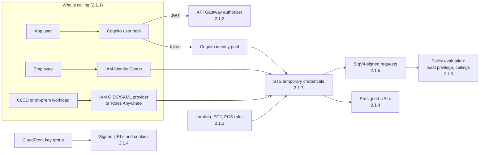

# Task 2.1: Implement authentication and authorization

**Domain 2 · Task 2.1** · [Domain overview](../README.md)

This task covers how users, workloads, and AWS services prove who they are (authentication) and what they may do (authorization). It runs from signing in app users with Amazon Cognito and employees with AWS IAM Identity Center (IAM is AWS Identity and Access Management), through the credentials that code uses and the Signature Version 4 (SigV4) signatures on every request, to writing least-privilege IAM policies, predicting how several policies combine, and assuming roles with AWS Security Token Service (STS). Time-limited access with S3 presigned URLs and CloudFront signed URLs and cookies is an explicit skill in DVA-C03. Task 2.2 builds on this with encryption and secrets, where AWS Key Management Service (AWS KMS) key policies follow the same evaluation logic, and Task 2.3 applies the same least-privilege rules to artificial intelligence (AI) services and agents. Acronyms used in the tables below: multi-factor authentication (MFA), attribute-based access control (ABAC), single sign-on (SSO), Amazon Elastic Container Service (ECS), Amazon Elastic Kubernetes Service (EKS), service control policy (SCP), resource control policy (RCP), and continuous integration and delivery (CI/CD).

## Skills

| Skill | Note | Covers |
|---|---|---|
| 2.1.1 | [Identity federation](2.1.1-identity-federation.md) | Cognito user pools (tokens, OAuth flows, triggers, groups) and identity pools (AWS credentials, role mapping), IAM Identity Center, IAM OIDC and SAML providers, GitHub Actions OIDC, IAM Roles Anywhere, Directory Service |
| 2.1.2 | [Access controls, tokens, and MFA](2.1.2-access-controls-tokens-and-mfa.md) | Fine-grained condition keys (`LeadingKeys`, `Attributes`, tags), ABAC, token types, API Gateway authorizers and API keys, IAM and Cognito MFA |
| 2.1.3 | [Secure programmatic access](2.1.3-secure-programmatic-access.md) | Credential source ranking, CLI config and SSO profiles, the SDK credential provider chain, roles for EC2, Lambda, ECS, and EKS, IMDSv2, access key hygiene |
| 2.1.4 | [Time-limited access](2.1.4-time-limited-access.md) | S3 presigned GET, PUT, and POST, expiry rules, direct-to-S3 uploads, CloudFront signed URLs and cookies, trusted key groups, canned vs custom policies |
| 2.1.5 | [Authenticated requests](2.1.5-authenticated-requests.md) | SigV4 and SigV4a mechanics, signing calls to IAM-protected API Gateway and function URLs, unsigned requests, authentication error codes, `GetCallerIdentity` |
| 2.1.6 | [Least privilege permissions](2.1.6-least-privilege-permissions.md) | Policy types and structure, policy variables, full evaluation logic, SCPs, RCPs, boundaries, Lambda execution role vs function policy, `iam:PassRole`, confused deputy, Access Analyzer |
| 2.1.7 | [Assuming IAM roles](2.1.7-assuming-iam-roles.md) | STS operations, trust vs permissions policy, cross-account steps, external ID, credential lifetimes, role chaining, CLI and SDK role assumption, session tags and policies |

## How the skills fit together

| Requirement in the question | Skill | Usual answer |
|---|---|---|
| App users sign up and sign in | 2.1.1 | Cognito user pool |
| App users call S3 or DynamoDB directly | 2.1.1, 2.1.2 | Identity pool + policy variables or `LeadingKeys` |
| Employees need many accounts | 2.1.1 | IAM Identity Center |
| Third-party or custom tokens at an API | 2.1.2 | Lambda authorizer |
| Require MFA for sensitive actions | 2.1.2 | `aws:MultiFactorAuthPresent` + `GetSessionToken` |
| Code on AWS needs credentials | 2.1.3 | Role for the compute service |
| Developer laptop needs CLI access | 2.1.3 | Identity Center profile, `aws sso login` |
| Temporary link to one private object | 2.1.4 | S3 presigned URL |
| Many private files through the CDN | 2.1.4 | CloudFront signed cookies |
| Code calls an IAM-protected API | 2.1.5 | SigV4-sign with role credentials |
| "Will this call succeed?" with several policies | 2.1.6 | Explicit deny, ceilings, same-account OR, cross-account AND |
| Access another account or let a vendor in | 2.1.7 | Role + trust policy (+ external ID for vendors) |

## Study checklist

- [ ] 2.1.1 Explain user pool vs identity pool, validate a Cognito JWT, and pick Cognito, Identity Center, or an IAM OIDC provider for a scenario.
- [ ] 2.1.2 Write a `LeadingKeys` policy, choose an API Gateway authorizer, and enforce MFA in a policy and from the CLI.
- [ ] 2.1.3 Recite the credential provider chain and match each compute service to its role.
- [ ] 2.1.4 State presigned URL expiry limits and choose S3 presigned vs CloudFront signed URLs vs signed cookies.
- [ ] 2.1.5 Describe what SigV4 signs and map each authentication error to its fix.
- [ ] 2.1.6 Evaluate combinations of identity, resource, boundary, SCP, and session policies; scope `iam:PassRole`.
- [ ] 2.1.7 Set up cross-account access with trust and caller policies, and state every STS credential lifetime.

## Labs and practice

- [Labs](labs.md): (1) least-privilege role and STS `AssumeRole`; (2) Cognito user pool sign-up and sign-in with token inspection; (3) permissions boundary as a ceiling.
- [Practice questions](practice-questions.md): 3 multiple-choice and multiple-response questions with explanations.
