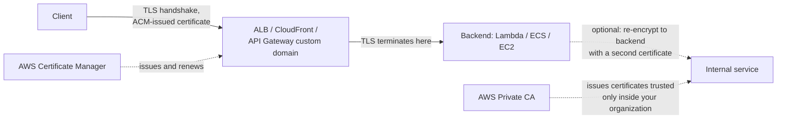

# 2.2.1 Apply encryption both at rest and in transit

**Domain 2 · Task 2.2 · Skill 2.2.1** · [Task overview](README.md) · Previous: [2.1.7 Assuming IAM roles](../task-2.1-authentication-and-authorization/2.1.7-assuming-iam-roles.md) · Next: [2.2.2 Certificate management](2.2.2-certificate-management.md)

## What the exam expects

Almost every AWS storage and messaging service can encrypt data at rest with AWS Key Management Service (AWS KMS), and every AWS API endpoint accepts Transport Layer Security (TLS). This skill tests whether you know which services encrypt by default, which ones you must turn on (and when you can no longer turn it on), and how to force clients to use TLS. Questions often describe a gap ("data was read from a snapshot", "traffic was sniffed between two hops") and expect you to name the right kind of encryption and the setting that closes it.

You must be able to:

- Tell encryption at rest from encryption in transit and match a described threat to the right one.
- Name the default at-rest encryption and the key options for S3, DynamoDB, RDS and Aurora, EBS, EFS, SQS, SNS, Kinesis, CloudWatch Logs, and Lambda.
- Encrypt an existing unencrypted RDS database or EBS volume (snapshot, encrypted copy, restore).
- Enforce HTTPS with `aws:SecureTransport`, CloudFront protocol policies, load balancer listeners, and database TLS settings.
- Know where TLS terminates in a typical request path and when to re-encrypt to the backend.

## Key terms

| Term | Meaning |
|---|---|
| Encryption at rest | Stored data (disk, object, snapshot, backup) is encrypted. Protects against someone who reads the storage layer directly. |
| Encryption in transit (in flight) | Data is encrypted while it moves over a network, using TLS (HTTPS). Protects against interception, such as man-in-the-middle (MITM) attacks. |
| TLS | Transport Layer Security, the protocol behind HTTPS. "SSL" (Secure Sockets Layer) is the older name people still use. |
| Server-side encryption (SSE) | The AWS service encrypts data after it receives it and decrypts it before returning it. See [2.2.3](2.2.3-client-side-vs-server-side-encryption.md). |
| SSE-S3, SSE-KMS, DSSE-KMS, SSE-C | S3 server-side encryption with S3-managed keys, with KMS keys, dual-layer with KMS keys, and with customer-provided keys |
| KMS key | The AWS KMS key that protects the data keys a service uses. Can be AWS owned, AWS managed, or customer managed. See [2.2.4](2.2.4-kms-key-management.md). |
| `aws:SecureTransport` | Global IAM condition key that is `true` when the request arrived over TLS. Used in a `Deny` to block plain HTTP. |
| Mutual TLS (mTLS) | Both sides present certificates, so the server also authenticates the client. |
| Server Name Indication (SNI) | TLS extension where the client names the host it wants, so one listener can serve several certificates. |

## Three kinds of encryption

| Type | How it works | Protects against |
|---|---|---|
| Encryption in transit (TLS) | Data is encrypted before sending and decrypted after receiving. TLS certificates enable HTTPS. | Interception on the network (MITM) |
| Server-side encryption at rest | The server encrypts data after receiving it, stores it encrypted with a data key, and decrypts it before sending it back. The server must have access to the keys. | Someone reading the stored data, a lost disk, a copied snapshot |
| Client-side encryption | The client encrypts the data, and the server never decrypts it. Another client with the key decrypts it. | The server or storage provider itself reading the data |

The exam treats these as separate controls. "SSL" or "HTTPS" in an answer is never a fix for an at-rest requirement, and default at-rest encryption is never a fix for an in-transit requirement.

## Encryption at rest, service by service

| Service | Default | Options | Can you turn it on later? |
|---|---|---|---|
| Amazon S3 | SSE-S3 applied to every new object | SSE-S3, SSE-KMS, DSSE-KMS, SSE-C, client-side | Yes. Default encryption applies to new objects; existing objects must be copied over themselves to change. |
| Amazon DynamoDB | Always encrypted with an AWS owned key | AWS owned key, AWS managed key (`aws/dynamodb`), customer managed key | Always on. You can switch between key types at any time. |
| Amazon RDS and Aurora | Off unless chosen at creation (console defaults may pre-select it) | AWS managed key (`aws/rds`) or customer managed key; Transparent Data Encryption (TDE) for Oracle and SQL Server | No. Snapshot, copy the snapshot with encryption, restore. |
| Amazon EBS | Off unless you enable "encryption by default" for the Region | AWS managed key (`aws/ebs`) or customer managed key | No for an existing volume. Snapshot, copy encrypted, create a new volume. |
| Amazon EFS | Chosen at file system creation | AWS managed or customer managed key | No. Create a new encrypted file system and copy data. |
| Amazon SQS | SSE-SQS (SQS-owned keys) on new queues | SSE-SQS or SSE-KMS | Yes |
| Amazon SNS | Off | SSE-KMS | Yes |
| Amazon Kinesis Data Streams | Off | SSE-KMS | Yes |
| Amazon CloudWatch Logs | Encrypted server-side by default | Customer KMS key per log group | Yes, with the `associate-kms-key` API or CLI (not the console) |
| AWS Lambda environment variables | Always encrypted with the AWS managed key `aws/lambda` | Customer managed key; optional client-side "encryption helpers" | Yes. See [2.2.7](2.2.7-secrets-management.md). |
| Lambda `/tmp` | Not encrypted by you | Generate KMS data keys and encrypt files yourself | Your code |
| AWS Secrets Manager | Always encrypted (`aws/secretsmanager` or customer managed key) | Customer managed key | Always on |
| Systems Manager Parameter Store `SecureString` | Encrypted with `aws/ssm` or a customer managed key | `String` and `StringList` are not encrypted | Choose `SecureString` |
| Amazon ECR, Step Functions, CodeBuild artifacts, CodeCommit | Encrypted by default | Customer managed key on most | Varies |
| Amazon ElastiCache | At-rest encryption is a cluster option | AWS managed or customer managed key | Set at creation |
| API Gateway cache | Optional "encrypt cache data" setting on the stage | | Yes |

### RDS and Aurora

- Encryption at rest covers the instance storage, automated backups, snapshots, logs, and read replicas.
- If the primary is not encrypted, its read replicas cannot be encrypted.
- To encrypt an existing database: take a snapshot, copy the snapshot with encryption enabled, then restore a new instance from the encrypted copy and repoint the application.
- Oracle and SQL Server also support TDE, which the database engine performs.

```bash
aws rds create-db-snapshot --db-instance-identifier orders-db --db-snapshot-identifier orders-plain
aws rds copy-db-snapshot --source-db-snapshot-identifier orders-plain \
  --target-db-snapshot-identifier orders-encrypted --kms-key-id alias/rds-app-key
aws rds restore-db-instance-from-db-snapshot --db-instance-identifier orders-db-enc \
  --db-snapshot-identifier orders-encrypted
```

### EBS

- Turn on EBS encryption by default per Region so every new volume and snapshot copy is encrypted.
- Snapshots of encrypted volumes are encrypted, and volumes created from them are encrypted.
- KMS keys are Regional. Copying a snapshot to another Region re-encrypts it under a key in the target Region. Sharing an encrypted snapshot with another account requires a customer managed key, because you cannot edit the key policy of `aws/ebs`. Details in [2.2.4](2.2.4-kms-key-management.md#protect-and-recover-data).

### S3

S3 applies SSE-S3 to every new object by default. You can set a different bucket default (SSE-KMS or DSSE-KMS) and you can enforce a specific method with a bucket policy. Bucket policies are evaluated before default encryption, so a policy that denies uploads without the `aws:kms` header rejects the request even though default encryption would have encrypted it. The full comparison of SSE-S3, SSE-KMS, DSSE-KMS, SSE-C, and client-side encryption is in [2.2.3](2.2.3-client-side-vs-server-side-encryption.md).

### CloudWatch Logs

Log data is always encrypted at rest. To use your own KMS key on a log group:

```bash
aws logs associate-kms-key --log-group-name my-app-logs \
  --kms-key-id arn:aws:kms:us-east-1:123456789012:key/abcd-1234
```

The key policy must allow the CloudWatch Logs service principal (`logs.<region>.amazonaws.com`) to use the key. Use `create-log-group --kms-key-id` for a new group. The console cannot associate a KMS key with a log group.

## Encryption in transit

All AWS service API endpoints support HTTPS, and the AWS SDKs and CLI use HTTPS by default. The exam focuses on places where plain HTTP is still possible or where TLS terminates before the backend.

### Where TLS terminates



Public certificates from AWS Certificate Manager (ACM) sit at the internet-facing edge. Certificates from AWS Private CA sit on internal hops. If a requirement says "encrypted end to end", plain HTTP between the load balancer and the targets breaks it. Use an HTTPS target group (re-encryption) or TCP passthrough on a Network Load Balancer (NLB). Certificates are covered in [2.2.2](2.2.2-certificate-management.md).

### How to enforce TLS per service

| Service | How to enforce or configure TLS |
|---|---|
| S3 | Bucket policy `Deny` when `aws:SecureTransport` is `false`. SSE-C requests must use HTTPS. |
| SNS and SQS | Topic or queue policy `Deny` when `aws:SecureTransport` is `false` |
| API Gateway | Endpoints are HTTPS only. Choose a security policy (minimum TLS version) on custom domains. mTLS on custom domains uses a trust store in S3. |
| Application Load Balancer (ALB) | HTTPS listener with an ACM certificate and a TLS security policy. Redirect HTTP 80 to HTTPS 443. SNI serves several certificates on one listener. mTLS through a trust store. |
| NLB | TLS listener (terminate) or TCP listener (passthrough to targets that terminate TLS themselves) |
| Classic Load Balancer | One certificate per load balancer, no SNI. Avoid for new work. |
| CloudFront | Viewer protocol policy (client to CloudFront): "Redirect HTTP to HTTPS" or "HTTPS only". Origin protocol policy (CloudFront to origin): "HTTPS only" or "Match viewer". |
| RDS and Aurora | Connect with TLS and verify the server with the RDS certificate authority bundle (`sslmode=verify-full` for PostgreSQL). Force it with `rds.force_ssl` (PostgreSQL, SQL Server) or `require_secure_transport` (MySQL, MariaDB). |
| ElastiCache | In-transit encryption option on the cluster; clients connect with TLS |
| On-premises networks | AWS Site-to-Site VPN (Internet Protocol Security, IPsec) over the internet, or MACsec (link-layer encryption) on Direct Connect |

### Enforce HTTPS on an S3 bucket

```json
{
  "Version": "2012-10-17",
  "Statement": [{
    "Sid": "DenyInsecureTransport",
    "Effect": "Deny",
    "Principal": "*",
    "Action": "s3:*",
    "Resource": [
      "arn:aws:s3:::my-bucket",
      "arn:aws:s3:::my-bucket/*"
    ],
    "Condition": { "Bool": { "aws:SecureTransport": "false" } }
  }]
}
```

The same `Deny` pattern works in SQS queue policies and SNS topic policies.

### CloudFront end to end

| Leg | Setting | Values |
|---|---|---|
| Client to CloudFront | Viewer protocol policy | HTTP and HTTPS; Redirect HTTP to HTTPS; HTTPS only |
| CloudFront to origin | Origin protocol policy | HTTP only; HTTPS only; Match viewer |

- The viewer certificate comes from ACM in us-east-1 (or the default `*.cloudfront.net` certificate).
- A custom origin (ALB, EC2) must present a certificate from a trusted certificate authority, not a self-signed one.
- An S3 static website endpoint only supports HTTP to the origin. For HTTPS all the way, use the S3 REST (bucket) endpoint with origin access control (OAC).

### Database connection over TLS

```python
import psycopg2

# The RDS CA bundle is downloaded from AWS and shipped with the app.
conn = psycopg2.connect(
    host="orders.cluster-abc.us-east-1.rds.amazonaws.com",
    dbname="orders", user="app", password=password_from_secrets_manager,
    sslmode="verify-full",          # encrypt and verify the server certificate and hostname
    sslrootcert="/opt/global-bundle.pem",
)
```

`sslmode=require` encrypts but does not verify the server. `verify-full` also checks the certificate chain and hostname, which is what stops a MITM. Get the password from Secrets Manager, as in [2.2.7](2.2.7-secrets-management.md).

## Worked walkthrough: one request, both kinds of encryption

```mermaid
sequenceDiagram
    participant Client as Mobile client
    participant CF as CloudFront (ACM certificate)
    participant APIGW as API Gateway
    participant L as Lambda
    participant KMS as AWS KMS
    participant DDB as DynamoDB

    Client->>CF: HTTPS (in transit, hop 1)
    CF->>APIGW: HTTPS (in transit, hop 2)
    APIGW->>L: Invoke (AWS internal, encrypted)
    L->>KMS: GenerateDataKey (only if the app encrypts fields itself)
    L->>DDB: Write over HTTPS; DynamoDB encrypts at rest with its KMS key
    DDB-->>L: Ack
```

Two gaps, two symptoms, two fixes:

- An in-transit gap shows up as "data was intercepted on the wire between two hops". Fix it with TLS on every hop, including re-encryption where a load balancer would otherwise forward plain HTTP.
- An at-rest gap shows up as "data was readable from the storage layer (a table export, an S3 object, an EBS snapshot) without going through the application". Fix it with KMS-backed encryption on the storage service, regardless of how well the traffic was encrypted.

A question that says "an attacker with access to the underlying storage, not the API, still couldn't read the data" is testing at-rest encryption. "Data sniffed on the network between two services" is testing in-transit encryption.

## Exam triggers

| Scenario clue | Answer | Why the alternatives are wrong |
|---|---|---|
| "Ensure all access to the bucket uses HTTPS" | Bucket policy `Deny` with `aws:SecureTransport` = `false` | Default encryption is at rest only. Block Public Access does not inspect the protocol. |
| "Encrypt an existing unencrypted RDS instance" | Snapshot, encrypted snapshot copy, restore | There is no in-place toggle. Enabling encryption on a read replica is not allowed when the primary is unencrypted. |
| "Encrypt an existing EBS volume" | Snapshot, encrypted copy, new volume from the copy | Volumes cannot be encrypted in place |
| "Every new EBS volume in the account must be encrypted" | EBS encryption by default for the Region | Per-volume settings rely on every developer remembering |
| "Encrypt an existing CloudWatch log group with our key" | `aws logs associate-kms-key` plus a key policy that allows CloudWatch Logs | The console cannot do it. Without the key policy statement, the association fails. |
| "HTTPS from the browser all the way to the origin through CloudFront" | Viewer protocol policy HTTPS only (or redirect) plus origin protocol policy HTTPS only | Viewer policy alone leaves the origin leg open. An S3 website endpoint cannot do HTTPS. |
| "Host several HTTPS domains on one load balancer" | ALB or NLB with SNI and several certificates | A Classic Load Balancer holds one certificate |
| "Database connections must be encrypted, enforced by the server" | `rds.force_ssl` or `require_secure_transport` parameter | Client-side TLS settings alone do not stop a client that skips TLS |
| "Audit every use of the encryption key" | SSE-KMS (or service encryption) with a customer managed key; CloudTrail logs each use | SSE-S3 and AWS owned keys don't produce per-use CloudTrail events in your account |

## Common traps

- "SSL" or "HTTPS" in an answer for an at-rest requirement. TLS is in transit only.
- Assuming RDS, EBS, or EFS encryption can be switched on later. It is a creation-time choice; existing resources need a copy or restore.
- Thinking S3 default encryption overrides a bucket policy. The policy is evaluated first, so a `Deny` still rejects the upload.
- Forgetting that DynamoDB and S3 already encrypt by default. "Enable encryption" is not the missing step there; key control usually is.
- Forgetting the key policy statement for CloudWatch Logs when associating a customer managed key.
- Terminating TLS at the load balancer and forwarding HTTP when the requirement says "end to end".
- Using `sslmode=require` and calling it protected against MITM. Without certificate verification, a forged server still works.

## Quick recall

- TLS = in transit. KMS-backed SSE = at rest. Client-side = the service never sees plaintext.
- S3: SSE-S3 is the default for new objects; bucket policies run before default encryption.
- DynamoDB: always encrypted; choose AWS owned, AWS managed, or customer managed key.
- RDS, EBS, EFS: encryption is set at creation. Existing RDS: snapshot, encrypted copy, restore.
- Unencrypted RDS primary means no encrypted read replicas.
- SQS new queues get SSE-SQS; SNS and Kinesis need SSE-KMS turned on.
- CloudWatch Logs customer key: `associate-kms-key` via CLI or API, and the key policy must allow `logs.<region>.amazonaws.com`.
- `aws:SecureTransport` = `false` in a `Deny` forces HTTPS on S3, SQS, and SNS.
- CloudFront: viewer protocol policy plus origin protocol policy for HTTPS end to end; ACM certificate in us-east-1.
- ALB and NLB support SNI; CLB supports one certificate.

## Related skills

- [2.2.2 Certificate management](2.2.2-certificate-management.md): where the TLS certificates come from.
- [2.2.3 Client-side vs server-side encryption](2.2.3-client-side-vs-server-side-encryption.md): the S3 SSE options and client-side libraries in detail.
- [2.2.4 KMS key management](2.2.4-kms-key-management.md): key types, key policies, cross-Region and cross-account snapshot copies.
- [2.2.7 Secrets management](2.2.7-secrets-management.md): Lambda environment variable encryption and database passwords.
- [2.3.2 AI data privacy and private connectivity](../task-2.3-secure-ai-services/2.3.2-ai-data-privacy-and-private-connectivity.md): why TLS alone does not satisfy "never touches the public internet".
- [1.3.4 DynamoDB design and operations](../../domain-1-development-with-aws-services/task-1.3-use-data-stores/1.3.4-dynamodb-design-and-operations.md): the table whose encryption options are listed here.

## Sources

- Merged from: `archive/dva-c03-study-notes/02-security.md` (skill 2.2.1), `archive/dva-c03-study-notes/00-developer-basics.md` (encryption concepts), `archive/dva-c03/domain-2-security/README.md` (how it fits together, encryption in transit diagram, in transit vs at rest walkthrough), `archive/dva-c03/domain-2-security/MASTER-CHUNK.md` (sections 1, 15, 17, 21), `archive/aws-dva-notes/Markdown Files/27. AWS Security & Encryption.md` (why encryption, CloudWatch Logs encryption, snapshot copies), `archive/aws-dva-notes/Markdown Files/11. S3 Security.md` (encryption in transit, default encryption vs bucket policies), `archive/aws-dva-notes/Markdown Files/12. CloudFront.md` (HTTPS end to end), `archive/aws-dva-notes/Markdown Files/4. High Availability & Scalability.md` (SSL, TLS, SNI), `archive/aws-dva-notes/Markdown Files/5. RDS, Aurora, & ElastiCache.md` (RDS encryption), `archive/aws-dva-notes/Markdown Files/16. Messaging - SQS, SNS & Kinesis.md`, `archive/aws-dva-notes/Markdown Files/18. Serverless - Lambda.md` (`/tmp` encryption), `archive/aws-dva-notes/Markdown Files/31. Exam Day Cheat Sheet.md` (encryption picker).
- AWS documentation:
  - [Securing Lambda environment variables](https://docs.aws.amazon.com/lambda/latest/dg/configuration-envvars-encryption.html) (default AWS managed key)
  - [Using server-side encryption with customer-provided keys (SSE-C)](https://docs.aws.amazon.com/AmazonS3/latest/userguide/ServerSideEncryptionCustomerKeys.html) (HTTPS required)
  - [AWS KMS cryptographic details and concepts](https://docs.aws.amazon.com/kms/latest/developerguide/concepts.html)
