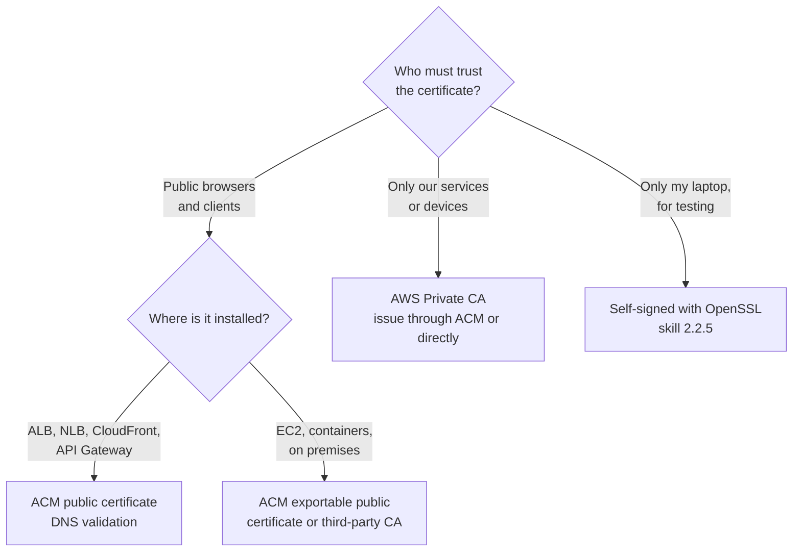

# 2.2.2 Manage public and private certificates with ACM and AWS Private CA

**Domain 2 · Task 2.2 · Skill 2.2.2** · [Task overview](README.md) · Previous: [2.2.1 Encryption at rest and in transit](2.2.1-encryption-at-rest-and-in-transit.md) · Next: [2.2.3 Client-side vs server-side encryption](2.2.3-client-side-vs-server-side-encryption.md)

## What the exam expects

AWS Certificate Manager (ACM) and AWS Private CA were added to the in-scope service list for DVA-C03. The exam tests whether you can pick the right certificate source for an endpoint (public ACM, private certificate from AWS Private CA, imported, or self-signed), put it in the right Region for the service that uses it, and keep it renewing without an outage.

You must be able to:

- Request a public ACM certificate, validate it with DNS, and attach it to an ALB, NLB, CloudFront distribution, or API Gateway custom domain.
- Know the Region rules (CloudFront and edge-optimized APIs need the certificate in us-east-1).
- Explain which certificates renew automatically and which do not (imported certificates, email validation problems).
- Choose AWS Private CA for internal hostnames, mutual TLS (mTLS) client certificates, and devices.
- Explain when an ACM certificate can leave AWS (exportable public certificates, private certificates).

## Key terms

| Term | Meaning |
|---|---|
| X.509 certificate | Binds a domain name (or identity) to a public key, signed by a certificate authority (CA) |
| Public CA | A CA that browsers and operating systems trust by default. ACM issues public certificates from Amazon's public CA. |
| Private CA | A CA that only clients you configure trust. AWS Private CA is the managed service. |
| Root CA, subordinate CA | The top of a CA hierarchy and the intermediate CAs it signs. End-entity certificates are issued by a subordinate. |
| Domain validation | Proof that you control the domain before a public certificate is issued: DNS (CNAME record), email, or HTTP |
| Managed renewal | ACM renews eligible certificates before they expire and redeploys them to integrated services |
| Certificate Transparency (CT) log | Public, append-only log of issued public certificates. Hostnames in public certificates become public. |
| Certificate signing request (CSR) | A request containing your public key and identity, sent to a CA to get a signed certificate |
| Certificate revocation list (CRL), Online Certificate Status Protocol (OCSP) | Two ways clients check whether a certificate was revoked |

## AWS Certificate Manager (ACM)

### Public certificates

- Free for certificates used with integrated services. ACM provisions, deploys, and renews them.
- Validity: ACM public certificates are valid for 198 days. Older material says about 13 months; the shorter period follows industry changes to maximum certificate lifetimes.
- Validation:
  - DNS validation: add a CNAME record once. ACM re-checks it at renewal, so renewal is automatic as long as the record stays in place. AWS recommends this method.
  - Email validation: a domain contact must click an approval link, including at renewal. A missed email means an expired certificate.
  - HTTP validation exists for some CloudFront use cases and does not support wildcard certificates.
- Wildcards: `*.example.com` covers one subdomain level (`api.example.com`, not `a.b.example.com`) and does not cover the apex `example.com`. Request both names if you need both.
- ACM certificates are Regional. Request the certificate in the Region where the consuming resource lives.
- Public certificate hostnames are written to CT logs. If internal naming must stay private, use AWS Private CA.

### Where ACM certificates attach

| Service | Certificate Region |
|---|---|
| CloudFront distribution | us-east-1 |
| API Gateway edge-optimized custom domain | us-east-1 |
| API Gateway Regional custom domain | Same Region as the API |
| ALB, NLB | Same Region as the load balancer |
| Cognito user pool custom domain (managed login) | us-east-1 |
| App Runner, Amplify, Elastic Beanstalk (through its load balancer) | Managed for you or same Region |

A standard ACM public certificate cannot be installed directly on an EC2 instance or an on-premises server. You attach it to an integrated service, and ACM keeps the private key.

> **Exportable public certificates (2025).** ACM can also issue paid exportable public certificates. You mark the certificate exportable at request time, validate with DNS, export the certificate, private key, and chain, and install them anywhere (EC2, containers, on premises). ACM renews them (about 45 days before expiry) and sends an Amazon EventBridge event, but you must deploy each renewed certificate yourself. Older exam questions assume ACM public certificates can never leave AWS.

### Imported certificates

You can import a certificate from a third-party CA, or a self-signed one for testing, with `aws acm import-certificate`. ACM does not renew imported certificates. ACM sends expiry events through EventBridge and AWS Health, and publishes a `DaysToExpiry` CloudWatch metric, so you can alarm on it. Re-import a new certificate to the same ARN to replace it without changing the listener configuration.

Regions where ACM is not available can still use IAM server certificates (`aws iam upload-server-certificate`), a legacy option without renewal.

### Request a public certificate

```bash
# 1. Request with DNS validation
CERT_ARN=$(aws acm request-certificate --domain-name api.example.com \
  --subject-alternative-names example.com --validation-method DNS \
  --query CertificateArn --output text)

# 2. Read the CNAME record ACM wants, then create it in Route 53
aws acm describe-certificate --certificate-arn "$CERT_ARN" \
  --query 'Certificate.DomainValidationOptions[].ResourceRecord'

# 3. Attach to an HTTPS listener once the status is ISSUED
aws elbv2 create-listener --load-balancer-arn "$ALB_ARN" --protocol HTTPS --port 443 \
  --certificates CertificateArn="$CERT_ARN" \
  --ssl-policy ELBSecurityPolicy-TLS13-1-2-2021-06 \
  --default-actions Type=forward,TargetGroupArn="$TG_ARN"
```

For a CloudFront distribution, run step 1 with `--region us-east-1`.

### Load balancers and SNI

An HTTPS or TLS listener needs a default certificate and can hold a list of extra certificates. Clients send the hostname with Server Name Indication (SNI), and the load balancer picks the matching certificate. ALB and NLB support SNI. A Classic Load Balancer supports one certificate, so several domains would need several load balancers. The listener's security policy sets the TLS versions and ciphers.

## AWS Private CA

AWS Private CA is a managed private CA. You create a root CA and subordinate CAs and issue end-entity certificates that only clients configured to trust your root accept.

Use it for:

- TLS between internal services with internal hostnames such as `billing.internal.corp`, which a public CA won't issue and which should not appear in CT logs.
- Client certificates for mTLS (ALB and API Gateway trust stores, service meshes).
- Device identity (IoT fleets), code signing, user and machine authentication.
- Replacing a self-hosted internal CA that someone renews by hand.

### Two ways to issue

| Path | How | Renewal | Private key |
|---|---|---|---|
| Through ACM | `aws acm request-certificate --certificate-authority-arn ...` | ACM managed renewal for certificates in use | Kept in ACM; you can export it with `aws acm export-certificate` |
| Directly from AWS Private CA | Create a key and CSR yourself, then `aws acm-pca issue-certificate` | You renew | You hold it |

```bash
# Private certificate for an internal hostname, issued through ACM
aws acm request-certificate --domain-name billing.internal.corp \
  --certificate-authority-arn arn:aws:acm-pca:us-east-1:111122223333:certificate-authority/abcd1234-ef56-7890-ab12-cd34ef567890

# Export it for a service outside ACM-integrated services (passphrase protects the key)
aws acm export-certificate --certificate-arn "$PRIVATE_CERT_ARN" --passphrase fileb://passphrase.txt
```

### CA modes, sharing, and revocation

- General-purpose mode issues certificates with any validity. Short-lived certificate mode is cheaper and issues certificates valid for up to 7 days, for workloads that renew constantly (verify).
- Revocation through CRLs published to S3 or OCSP.
- Share a CA across accounts with AWS Resource Access Manager (RAM), so one central CA serves many accounts.
- Pricing is a monthly fee per CA plus a charge per certificate issued. Public ACM certificates for integrated services are free.

### Nested validity


*Source: [AWS Private CA certificate validity](https://docs.aws.amazon.com/privateca/latest/userguide/PcaValidity.html). A subordinate CA or end-entity certificate can never outlive its parent.*

Worked scenario: a fintech's internal mTLS uses a self-managed CA. A script renews leaf certificates, but every two years connections fail right after a renewal. The subordinate CA certificate is near its own expiry, and a new leaf cannot extend past its issuer's remaining validity. Moving to AWS Private CA, which tracks the hierarchy's validity, removes the failure mode that a leaf-only renewal script misses.

### Least-privilege access to a CA

```json
{
  "Version": "2012-10-17",
  "Statement": [{
    "Effect": "Allow",
    "Action": ["acm-pca:IssueCertificate", "acm-pca:GetCertificate"],
    "Resource": "arn:aws:acm-pca:us-east-1:111122223333:certificate-authority/abcd1234-ef56-7890-ab12-cd34ef567890"
  }]
}
```

Scope issuing rights to one CA ARN. `acm-pca:*` on `"Resource": "*"` lets a workload mint certificates from any CA in the account.

## Choosing a certificate source

| Need | Use | Why not the others |
|---|---|---|
| Internet-facing HTTPS on CloudFront, ALB, or API Gateway | Public ACM certificate, DNS validation | Free and renews itself. Private certificates are rejected by public browsers. |
| Internal hostname, internal clients only | AWS Private CA | Public CAs won't issue for `.internal.corp` and would publish the name to CT logs. Self-signed doesn't scale. |
| mTLS client certificates for many callers or devices | AWS Private CA | Central issuing, revocation, and audit through CloudTrail |
| HTTPS on a self-managed web server on EC2 | ACM exportable public certificate, or a third-party certificate | Standard ACM certificates can't be installed on EC2 |
| Certificate from an existing third-party CA on an ALB | Import into ACM; alarm on `DaysToExpiry` | Imported certificates don't auto-renew |
| Local development HTTPS | Self-signed certificate. See [2.2.5](2.2.5-development-certificates-and-ssh-keys.md). | Public CAs can't issue for `localhost` |



## Exam triggers

| Scenario clue | Answer | Why the alternatives are wrong |
|---|---|---|
| "Custom domain on an edge-optimized API fails with a certificate in eu-west-1" | Request the ACM certificate in us-east-1 | Edge-optimized APIs and CloudFront read certificates from us-east-1 only |
| "Regional API Gateway custom domain" | ACM certificate in the API's Region | A us-east-1 certificate is invisible to a Regional endpoint elsewhere |
| "Certificate must renew automatically forever with zero manual steps" | ACM public certificate with DNS validation | Email validation needs a human click at renewal. Imported certificates never renew. |
| "ALB certificate expired even though it was in ACM" | It was imported (or DNS validation record was removed) | ACM only renews certificates it issued and can still validate |
| "Internal hostnames must never appear in a public CT log" | AWS Private CA | Every public certificate is logged |
| "Internal clients must trust certificates automatically without copying a root to each one by hand" | AWS Private CA with the root distributed through your trust configuration | Self-signed per service has no hierarchy or renewal |
| "Several HTTPS domains on one ALB" | Add certificates to the listener; SNI picks one | Classic Load Balancer supports one certificate |
| "Need the TLS private key on an EC2 web server" | ACM exportable public certificate or third-party CA | Standard ACM certificates can't be exported |
| "Alert before an imported certificate expires" | EventBridge ACM expiry event or CloudWatch alarm on `DaysToExpiry` | ACM won't renew it for you |

## Common traps

- Requesting the CloudFront or edge-optimized API certificate in the application's Region instead of us-east-1.
- Assuming every ACM certificate renews. Imported certificates don't, and email-validated ones depend on someone clicking a link.
- Deleting the DNS validation CNAME after issuance, which breaks the next automatic renewal.
- Using a public certificate for internal-only names, which publishes them to CT logs.
- Using a private certificate on a public endpoint. Customers' browsers reject it because they don't trust your root.
- Repeating "ACM certificates can never be exported". Exportable public certificates (paid) and private certificates issued through ACM can be exported.
- Granting `acm-pca:*` on all CAs to an application that only needs to issue from one.
- Renewing leaf certificates but ignoring the expiry of the subordinate CA that signs them.

## Quick recall

- Public ACM certificates: free on integrated services, valid 198 days, renewed by ACM.
- DNS validation enables automatic renewal; email validation needs a human.
- CloudFront, edge-optimized API Gateway, and Cognito custom domains need the certificate in us-east-1.
- ALB, NLB, and Regional APIs need it in their own Region.
- Imported certificates: no renewal. Watch `DaysToExpiry` and EventBridge expiry events.
- Standard ACM certificates can't go on EC2. Exportable public certificates (paid, 2025) can.
- AWS Private CA: internal names, mTLS client certificates, devices, code signing; share with RAM.
- Private certificates issued through ACM get managed renewal and can be exported.
- Wildcards cover one level and not the apex.
- ALB and NLB support SNI; CLB holds one certificate.

## Related skills

- [2.2.1 Encryption at rest and in transit](2.2.1-encryption-at-rest-and-in-transit.md): where TLS terminates and how to force HTTPS.
- [2.2.5 Development certificates and SSH keys](2.2.5-development-certificates-and-ssh-keys.md): self-signed certificates, CSRs, and importing test certificates.
- [2.1.2 Access controls, tokens, and MFA](../task-2.1-authentication-and-authorization/2.1.2-access-controls-tokens-and-mfa.md): mTLS as an API Gateway authentication option.
- [3.1.5 API Gateway stages and endpoints](../../domain-3-testing-and-deployment/task-3.1-prepare-deployable-artifacts/3.1.5-api-gateway-stages-and-endpoints.md): custom domain names that use these certificates.
- [4.2.3 Alerts and notifications](../../domain-4-troubleshooting-and-optimization/task-4.2-observability/4.2.3-alerts-and-notifications.md): alarming on certificate expiry.

## Sources

- Merged from: `archive/dva-c03-study-notes/02-security.md` (skill 2.2.2), `archive/dva-c03/domain-2-security/MASTER-CHUNK.md` (section 1 and appendix scenario), `archive/dva-c03/domain-2-security/README.md` (encryption in transit, ACM placement), `archive/aws-dva-notes/Markdown Files/28. Other Services.md` (ACM, Private CA, exportable certificates), `archive/aws-dva-notes/Markdown Files/4. High Availability & Scalability.md` (SSL, SNI), `archive/aws-dva-notes/Markdown Files/20. Serverless - API Gateway.md` (custom domain Regions), `archive/aws-dva-notes/Markdown Files/24. Cognito - User Pools, Identity Pools & Cognito Sync.md` (custom domain in us-east-1), `archive/aws-dva-notes/Markdown Files/12. CloudFront.md`, `archive/dva-c03/exam-bank/bank-2.md` (DNS vs email validation trap).
- AWS documentation:
  - [ACM certificate characteristics](https://docs.aws.amazon.com/acm/latest/userguide/acm-certificate-characteristics.html) (198-day validity, wildcard rules, HTTP validation note)
  - [AWS Certificate Manager exportable public certificates](https://docs.aws.amazon.com/acm/latest/userguide/acm-exportable-certificates.html) (DNS validation, 45-day renewal, you deploy renewed certificates)
  - [AWS Private CA certificate validity](https://docs.aws.amazon.com/privateca/latest/userguide/PcaValidity.html)
