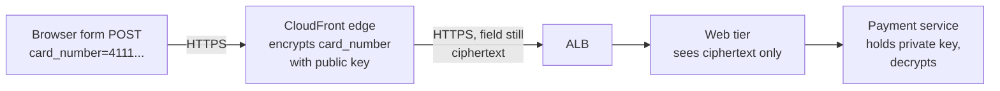
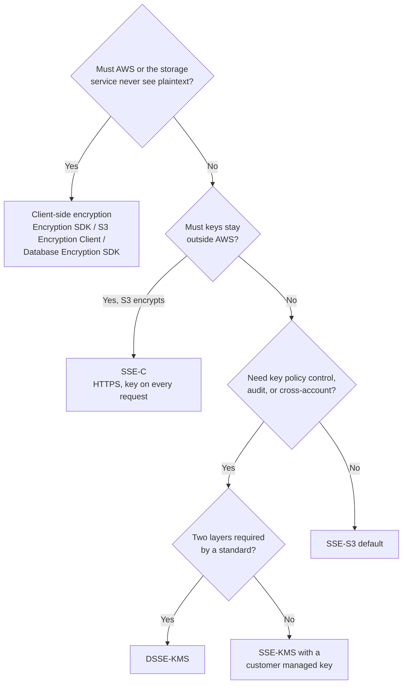

# 2.2.3 Choose and implement client-side or server-side encryption

**Domain 2 · Task 2.2 · Skill 2.2.3** · [Task overview](README.md) · Previous: [2.2.2 Certificate management](2.2.2-certificate-management.md) · Next: [2.2.4 KMS key management](2.2.4-kms-key-management.md)

## What the exam expects

The deciding question is who encrypts and who holds the key. Server-side encryption is configuration: the AWS service encrypts after it receives the data. Client-side encryption is code: your application encrypts before sending, so the service only ever stores ciphertext. Most questions use S3 as the example, so you need the four S3 server-side options cold, plus the client-side libraries AWS provides.

You must be able to:

- Choose between SSE-S3, SSE-KMS, DSSE-KMS, SSE-C, and client-side encryption from a scenario's key-management and audit requirements.
- Send the right request headers and write a bucket policy that enforces one method.
- Use the AWS Encryption SDK, Amazon S3 Encryption Client, or AWS Database Encryption SDK when the service must never see plaintext.
- Recognize CloudFront field-level encryption and Lambda encryption helpers as client-side patterns.

## Key terms

| Term | Meaning |
|---|---|
| Server-side encryption (SSE) | The service encrypts data at rest after receiving it and decrypts it on read. The service briefly sees plaintext. |
| Client-side encryption (CSE) | Your code encrypts before upload and decrypts after download. The service stores ciphertext only. |
| SSE-S3 | S3-managed keys, AES-256. Default for new objects. |
| SSE-KMS | S3 uses a KMS key you choose. Each key use is logged in CloudTrail and governed by the key policy. |
| DSSE-KMS | Dual-layer server-side encryption with KMS keys: two independent layers of encryption for compliance rules that require it. |
| SSE-C | Server-side encryption with customer-provided keys. You send the key with every request; S3 never stores it. |
| Envelope encryption | Encrypt data with a data key, then encrypt the data key with a KMS key. Used by both server-side and client-side tools. See [2.2.4](2.2.4-kms-key-management.md#envelope-encryption). |

## Server-side vs client-side

| | Server-side encryption | Client-side encryption |
|---|---|---|
| Who encrypts | The AWS service, after receiving data | Your application, before sending |
| Service sees plaintext | Yes, briefly in memory | No |
| Effort | Configuration only | Code plus key handling |
| Tools | SSE-S3, SSE-KMS, DSSE-KMS, SSE-C, DynamoDB and RDS encryption | AWS Encryption SDK, Amazon S3 Encryption Client, AWS Database Encryption SDK |
| Server-side features keep working | Yes (S3 Select, replication, Athena, Macie scanning) | Services can't read the content |
| Typical driver | Compliance asks for encryption at rest | Data must be protected from the storage service and its administrators, end to end, or per field |

## S3 encryption options

| Method | Who manages the key | Where encryption happens | Request header | Key point |
|---|---|---|---|---|
| SSE-S3 | S3 | Server side | `x-amz-server-side-encryption: AES256` | Default; no key management at all |
| SSE-KMS | AWS KMS (you control the key and its policy) | Server side | `x-amz-server-side-encryption: aws:kms` (+ optional `x-amz-server-side-encryption-aws-kms-key-id`) | CloudTrail audit of key use; KMS request quotas apply |
| DSSE-KMS | AWS KMS plus a second S3 layer | Server side, twice | `x-amz-server-side-encryption: aws:kms:dsse` | Multi-layer compliance; more cost and latency |
| SSE-C | You, outside AWS | Server side | `x-amz-server-side-encryption-customer-algorithm`, `-customer-key`, `-customer-key-MD5` | HTTPS only; key on every request; disabled by default on new buckets since April 2026 |
| Client-side | You | Your code | None | S3 stores ciphertext only |

### SSE-S3

S3 owns and manages the keys and encrypts with AES-256. It has been applied to every new object by default since January 2023. Pick it when the requirement is "encrypt at rest, no key management".

### SSE-KMS

- Upload calls `GenerateDataKey` on the KMS key; download calls `Decrypt`. Both count against your account's KMS request quota, so very high request rates can throttle. Enable an S3 Bucket Key to cut S3-to-KMS calls by up to 99% (details in [2.2.4](2.2.4-kms-key-management.md#quotas-and-throttling)).
- The caller needs S3 permissions and KMS permissions on the key. Multipart uploads need `kms:GenerateDataKey` and `kms:Decrypt`, because S3 decrypts parts to assemble the object.
- Sending only `x-amz-server-side-encryption: aws:kms` without a key ID uses the AWS managed key `aws/s3`. Use a customer managed key when you need cross-account access, a custom key policy, or control over rotation.

### DSSE-KMS

Applies two layers of encryption to the object (a KMS-based layer and a second independent layer). Choose it only when a standard explicitly requires multi-layer encryption.

### SSE-C

- S3 uses your key to encrypt, then discards it. You must send the same key to read the object.
- HTTPS is mandatory; S3 rejects SSE-C over HTTP. Treat any key sent over HTTP as compromised.
- You track which key encrypted which object (and which version). Lose the key and you lose the object.
- No rotation by AWS, no console support, and AWS services that read your objects can't decrypt them.
- Since April 2026, SSE-C is disabled by default on new general purpose buckets and on existing buckets in accounts with no SSE-C objects. SSE-C writes return HTTP 403 `AccessDenied` until you set `BlockedEncryptionTypes` to `NONE` with `PutBucketEncryption`.

```python
import base64, hashlib, os, boto3

s3 = boto3.client("s3")
key = os.urandom(32)  # you store and protect this key yourself

s3.put_object(Bucket="vault-bucket", Key="report.pdf", Body=b"...",
              SSECustomerAlgorithm="AES256", SSECustomerKey=key)   # SDK adds the MD5 header

obj = s3.get_object(Bucket="vault-bucket", Key="report.pdf",
                    SSECustomerAlgorithm="AES256", SSECustomerKey=key)  # same key or the read fails
```

### Choosing an S3 option

| Clue | Answer |
|---|---|
| "Don't want to manage keys" | SSE-S3 |
| "Audit every use of the key", "control rotation", "separate key permissions from bucket permissions" | SSE-KMS with a customer managed key |
| "Standard requires two layers of encryption" | DSSE-KMS |
| "Keys must stay outside AWS, but S3 should do the encryption" | SSE-C |
| "S3 and AWS must never see plaintext" | Client-side encryption |

### Request examples and enforcement

```python
s3.put_object(Bucket="prod-data", Key="orders/1.json", Body=data,
              ServerSideEncryption="aws:kms",
              SSEKMSKeyId="alias/prod-data-key",
              BucketKeyEnabled=True)
```

Default bucket encryption encrypts objects that arrive without a header. To reject anything that is not SSE-KMS, add a bucket policy. The policy is evaluated before default encryption is applied:

```json
{
  "Version": "2012-10-17",
  "Statement": [{
    "Sid": "DenyNonKmsUploads",
    "Effect": "Deny",
    "Principal": "*",
    "Action": "s3:PutObject",
    "Resource": "arn:aws:s3:::prod-data/*",
    "Condition": { "StringNotEquals": { "s3:x-amz-server-side-encryption": "aws:kms" } }
  }]
}
```

To require one specific key, add a condition on `s3:x-amz-server-side-encryption-aws-kms-key-id`. With this policy in place, a client that relies on default encryption and sends no header is rejected, so clients must send the header explicitly.

## Server-side encryption in other services

DynamoDB, RDS, EBS, EFS, SQS, SNS, Kinesis, and CloudWatch Logs all offer KMS-backed server-side encryption. The defaults and the "can you turn it on later" rules are in [2.2.1](2.2.1-encryption-at-rest-and-in-transit.md#encryption-at-rest-service-by-service). Server-side encryption protects against someone who reads the storage layer directly. It does not hide data from a principal who is allowed to call the service's read API, because the service decrypts for them.

## Client-side encryption tools

| Tool | What it does | Use when |
|---|---|---|
| AWS Encryption SDK | Library (Java, Python, C, JavaScript, .NET, CLI) that implements envelope encryption with KMS keys and writes a self-contained message holding the ciphertext and encrypted data keys | Encrypt any payload before storing it anywhere |
| Amazon S3 Encryption Client | Wraps the S3 client so objects are encrypted before upload and decrypted after download | Client-side encryption for S3 specifically |
| AWS Database Encryption SDK | Encrypts and signs individual DynamoDB attributes in your code | Field-level protection for sensitive attributes, keeping keys searchable through beacons |
| CloudFront field-level encryption | CloudFront encrypts up to 10 named fields in POST requests at the edge with your public key; only the backend holding the private key can decrypt | A credit card number must stay encrypted through the load balancer, web tier, and logs |
| Lambda encryption helpers | The console encrypts an environment variable value with your KMS key before sending it to Lambda; your code calls `kms:Decrypt` | Covered in [2.2.7](2.2.7-secrets-management.md#how-lambda-encrypts-environment-variables) |
| SQS and SNS client-side | Encrypt the message body before `SendMessage` or `Publish` | Consumers, not the queue, should be the only readers |

### AWS Encryption SDK example

```python
import aws_encryption_sdk
from aws_encryption_sdk import CommitmentPolicy

KEY_ARN = "arn:aws:kms:us-east-1:111122223333:key/abcd1234-ef56-7890-ab12-cd34ef567890"
client = aws_encryption_sdk.EncryptionSDKClient(
    commitment_policy=CommitmentPolicy.REQUIRE_ENCRYPT_REQUIRE_DECRYPT)
key_provider = aws_encryption_sdk.StrictAwsKmsMasterKeyProvider(key_ids=[KEY_ARN])

ciphertext, _ = client.encrypt(
    source=b"patient record ...",
    key_provider=key_provider,
    encryption_context={"tenant": "acme", "purpose": "records"},  # bound to the ciphertext
)
plaintext, header = client.decrypt(source=ciphertext, key_provider=key_provider)
assert header.encryption_context["tenant"] == "acme"
```

The SDK calls `GenerateDataKey` once per message, encrypts locally, and stores the encrypted data key inside the output. For high volumes, its data key caching feature reuses data keys to reduce KMS calls (see [2.2.4](2.2.4-kms-key-management.md#quotas-and-throttling)).

### CloudFront field-level encryption



It adds a layer on top of HTTPS. TLS protects each hop; field-level encryption keeps the field protected inside your own stack, so intermediate services and their logs only see ciphertext. The distribution must use HTTPS and accept POST and PUT.

## Decision flow



## Exam triggers

| Scenario clue | Answer | Why the alternatives are wrong |
|---|---|---|
| "Data must be encrypted before leaving the app; AWS must never see plaintext" | Client-side encryption with the AWS Encryption SDK and a KMS key | Every SSE option decrypts on read inside AWS |
| "Encrypt specific DynamoDB attributes" | AWS Database Encryption SDK | Table encryption covers the whole table and is transparent to readers |
| "Encrypt the card number at the edge so only the payment service can read it" | CloudFront field-level encryption | HTTPS terminates at each hop; downstream services would see plaintext |
| "Company provides the key, S3 encrypts, S3 must not store the key" | SSE-C | SSE-KMS keeps keys in KMS; client-side means S3 doesn't encrypt |
| "Every upload must use SSE-KMS; reject anything else" | Bucket policy `Deny` on `s3:x-amz-server-side-encryption` not equal to `aws:kms` | Default encryption alone doesn't reject non-compliant requests |
| "SSE-C uploads to a new bucket fail with 403" | Unblock SSE-C with `PutBucketEncryption` (`BlockedEncryptionTypes` = `NONE`), or switch to SSE-KMS | Since April 2026 SSE-C is blocked by default on new buckets |
| "Multipart upload to an SSE-KMS bucket fails with AccessDenied" | Add `kms:Decrypt` (and `kms:GenerateDataKey`) for the caller | S3 permissions alone don't cover the key |
| "SSE-KMS uploads throttled at high request rates" | Enable S3 Bucket Keys or request a KMS quota increase | Switching to client-side adds work without removing KMS calls |
| "Encryption at rest with no key management" | SSE-S3 | SSE-KMS adds key cost and policy work |

## Common traps

- Choosing SSE-KMS when the requirement says the provider must never see plaintext. Server-side means the service decrypts.
- Choosing SSE-C and forgetting the operational cost: key on every request, HTTPS only, no recovery, no console, and blocked by default on new buckets since April 2026.
- Expecting default encryption to reject uploads. Only a bucket policy rejects.
- Forgetting KMS permissions on an SSE-KMS bucket. Bucket access without `kms:Decrypt` still fails.
- Treating CloudFront field-level encryption as a replacement for HTTPS. It sits on top of HTTPS.
- Assuming client-side encrypted objects can still be scanned, queried, or transformed by AWS services.

## Quick recall

- Server-side = configuration; client-side = code; client-side means the service stores ciphertext only.
- S3 headers: `AES256` (SSE-S3), `aws:kms` (SSE-KMS), `aws:kms:dsse` (DSSE-KMS), three `customer-*` headers (SSE-C).
- SSE-S3 is the default for new objects.
- SSE-KMS: CloudTrail audit, key policy, KMS quotas, Bucket Keys cut calls by up to 99%.
- SSE-C: HTTPS only, key never stored, lose key = lose data, blocked by default on new buckets since April 2026.
- Bucket policies are evaluated before default encryption.
- AWS Encryption SDK = envelope encryption library; S3 Encryption Client = S3 wrapper; Database Encryption SDK = DynamoDB attributes.
- CloudFront field-level encryption: up to 10 POST fields, public key at the edge.

## Related skills

- [2.2.1 Encryption at rest and in transit](2.2.1-encryption-at-rest-and-in-transit.md): defaults for each service's server-side encryption.
- [2.2.4 KMS key management](2.2.4-kms-key-management.md): envelope encryption, key policies, Bucket Keys, and data key caching.
- [2.2.6 Sensitive data detection and masking](2.2.6-sensitive-data-detection-and-masking.md): field-level protection as a way to restrict access to PII.
- [2.2.7 Secrets management](2.2.7-secrets-management.md): Lambda environment variable encryption helpers.
- [2.1.4 Time-limited access](../task-2.1-authentication-and-authorization/2.1.4-time-limited-access.md): presigned URLs on SSE-KMS objects still need the signer's KMS permissions.

## Sources

- Merged from: `archive/dva-c03-study-notes/02-security.md` (skill 2.2.3), `archive/dva-c03-study-notes/00-developer-basics.md` (client-side vs server-side), `archive/aws-dva-notes/Markdown Files/11. S3 Security.md` (encryption methods, headers, SSE-C change, default encryption vs bucket policies), `archive/aws-dva-notes/Markdown Files/27. AWS Security & Encryption.md` (why encryption, Encryption SDK), `archive/aws-dva-notes/Markdown Files/12. CloudFront.md` (field-level encryption), `archive/aws-dva-notes/Markdown Files/31. Exam Day Cheat Sheet.md` (encryption picker, multipart trap), `archive/aws-dva-notes/Markdown Files/16. Messaging - SQS, SNS & Kinesis.md` (client-side option), `archive/dva-c03/domain-2-security/MASTER-CHUNK.md` (section 21 bucket policy), `archive/dva-c03/exam-bank/bank-1.md` (SSE-C consequences, enforced SSE-KMS).
- AWS documentation:
  - [Using server-side encryption with customer-provided keys (SSE-C)](https://docs.aws.amazon.com/AmazonS3/latest/userguide/ServerSideEncryptionCustomerKeys.html) (April 2026 default, `BlockedEncryptionTypes`, HTTPS requirement)
  - [AWS KMS request quotas](https://docs.aws.amazon.com/kms/latest/developerguide/requests-per-second.html) (SSE-KMS requests count against your quota)
  - [Data key caching in the AWS Encryption SDK](https://docs.aws.amazon.com/encryption-sdk/latest/developer-guide/data-key-caching.html)
