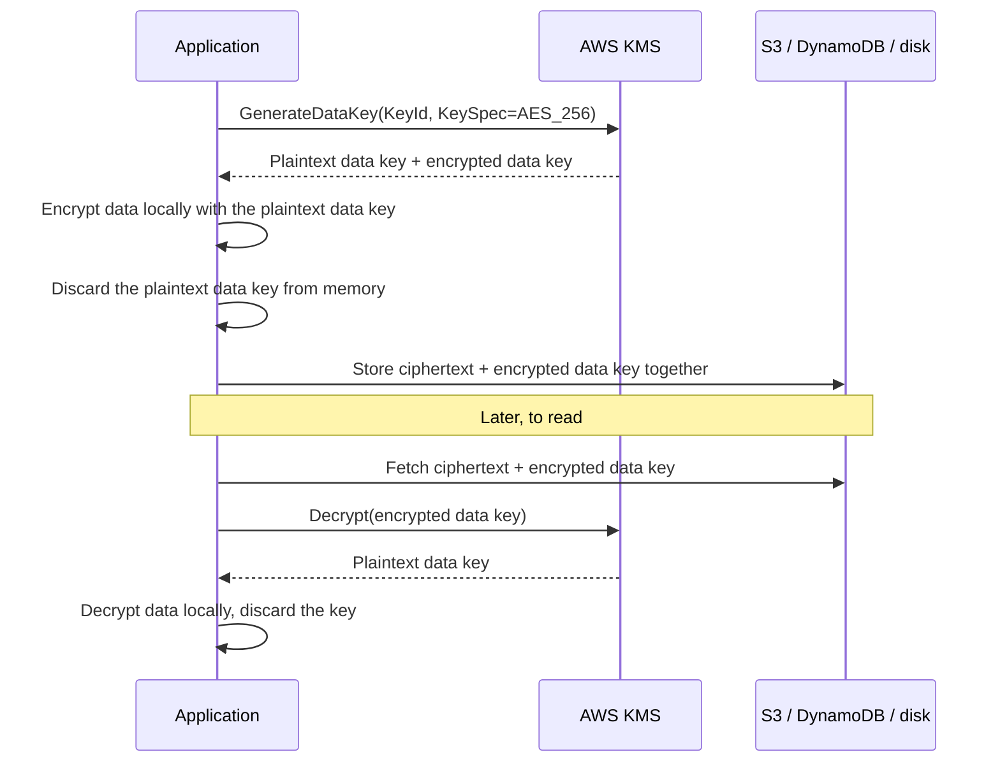

# 2.2.4 Use encryption keys to protect and recover data, including KMS-based patterns

**Domain 2 · Task 2.2 · Skill 2.2.4** · [Task overview](README.md) · Previous: [2.2.3 Client-side vs server-side encryption](2.2.3-client-side-vs-server-side-encryption.md) · Next: [2.2.5 Development certificates and SSH keys](2.2.5-development-certificates-and-ssh-keys.md)

## What the exam expects

"Encryption" in a DVA question usually means AWS Key Management Service (AWS KMS). This is the most code-heavy part of Task 2.2: you call KMS APIs, choose a key type, write key policies, and avoid the 4 KB and throttling limits. "Protect and recover" adds the lifecycle side: rotation, disabling, scheduled deletion, multi-Region keys, and moving encrypted data between Regions and accounts.

You must be able to:

- Choose AWS owned, AWS managed, or customer managed keys, and symmetric, asymmetric, or HMAC key specs.
- Use `Encrypt`, `Decrypt`, `GenerateDataKey`, `GenerateDataKeyWithoutPlaintext`, and `ReEncrypt` correctly, including envelope encryption for anything over 4 KB.
- Write key policies and IAM policies that work together, use grants, and add conditions such as `kms:ViaService` and encryption context.
- Explain rotation, disable versus delete, and how to keep data recoverable across Regions and accounts.
- Diagnose `AccessDeniedException` and `ThrottlingException` from KMS.

## Key terms

| Term | Meaning |
|---|---|
| KMS key | The KMS resource you reference by key ID, key ARN, or alias. Formerly called a customer master key (CMK). Its key material never leaves KMS unencrypted. |
| Key material | The secret bits inside a KMS key. Rotation changes the current key material; the key ID stays the same. |
| Data key (DEK) | A symmetric key generated by KMS for you to encrypt data locally. Returned in plaintext and encrypted under the KMS key. |
| Envelope encryption | Encrypt data with a data key, encrypt the data key with a KMS key, store the encrypted data key with the data |
| Key policy | The resource policy on a KMS key. Every key has one, and no principal can use the key unless the key policy allows it directly or delegates to IAM. |
| Grant | A delegated permission on one key for one principal and a list of operations, created with `CreateGrant` without editing the key policy |
| Encryption context | Non-secret key-value pairs bound to the ciphertext as additional authenticated data (AAD). Decrypt must supply the same pairs. |
| Alias | A friendly name (`alias/app-key`) that points at a key. You can repoint it to a new key. |
| Multi-Region key | A set of related keys in different Regions that share key ID and key material, so ciphertext from one decrypts in another |

## Key types

### Ownership

| Type | Example | In your account? | Key policy you control | Rotation | Cost |
|---|---|---|---|---|---|
| AWS owned key | Defaults for SSE-S3, SSE-SQS, DynamoDB | No | No | Managed by the owning service | Free |
| AWS managed key | `aws/s3`, `aws/rds`, `aws/ebs`, `aws/lambda`, `aws/secretsmanager` | Yes (visible) | No (can't edit, can't use cross-account) | Every year, automatic, not configurable | No monthly fee; per-request charges can apply |
| Customer managed key | Keys you create | Yes | Yes | Optional automatic (90 to 2,560 days, default 365) and on demand | About $1 per key per month plus requests |
| Customer managed, imported key material | Keys whose material you upload | Yes | Yes | No automatic rotation; on-demand rotation after importing new material, or manual via alias | Same |

AWS owned keys don't count against your KMS request quotas and don't appear in your CloudTrail. Choose a customer managed key when a scenario needs any of: an auditable key policy, cross-account use, sharing encrypted snapshots, control over rotation, or the ability to disable the key.

### Key specs

| | Symmetric (AES-256-GCM) | Asymmetric (RSA, ECC) | HMAC |
|---|---|---|---|
| Keys | One key encrypts and decrypts | Public key (encrypt, verify) and private key (decrypt, sign) | One secret key |
| Operations | Encrypt, decrypt, generate data keys | Encrypt and decrypt (RSA), or sign and verify (RSA, ECC) | `GenerateMac`, `VerifyMac` |
| Key material access | Never leaves KMS unencrypted | Public key downloadable with `GetPublicKey`; private key never leaves KMS | Never leaves KMS |
| Used by AWS services | Yes, this is the default for integrations | No | No |
| Use case | Almost everything | Users outside AWS who can't call KMS encrypt with the public key; digital signatures | Message authentication, tokens |

### Key hierarchy


*Source: [AWS KMS concepts](https://docs.aws.amazon.com/kms/latest/developerguide/concepts.html). Root keys stay in KMS hardware security modules (HSMs). Your KMS key wraps data keys; data keys encrypt data.*

This hierarchy is why rotating a KMS key doesn't require re-encrypting data. Rotation changes how new data keys are wrapped. Old wrapped data keys still decrypt because KMS keeps every previous version of the key material.

## KMS API summary

| API | What it does | Notes |
|---|---|---|
| `Encrypt` | Encrypts up to 4 KB of plaintext with the KMS key | For small secrets or data keys, not bulk data |
| `Decrypt` | Decrypts ciphertext produced by KMS | For symmetric ciphertext, `KeyId` is optional because it's in the ciphertext metadata |
| `GenerateDataKey` | Returns a plaintext data key and the same key encrypted under the KMS key | The basis of envelope encryption |
| `GenerateDataKeyWithoutPlaintext` | Returns only the encrypted data key | A component that will encrypt later (or elsewhere) calls `Decrypt` when it needs the key |
| `ReEncrypt` | Decrypts and re-encrypts under a different key inside KMS | Plaintext never leaves KMS; used to move data to a new key |
| `GenerateRandom` | Returns random bytes | |
| `Sign`, `Verify` | Digital signatures with asymmetric keys | |
| `GenerateMac`, `VerifyMac` | HMAC with HMAC keys | |
| `GenerateDataKeyPair` | Returns an asymmetric data key pair | For signing or encryption outside KMS |
| `CreateGrant`, `RetireGrant`, `RevokeGrant` | Manage grants | |
| `DescribeKey`, `GetKeyPolicy`, `PutKeyPolicy` | Inspect and manage keys | |
| `ScheduleKeyDeletion`, `CancelKeyDeletion`, `DisableKey`, `EnableKey` | Lifecycle | See [protect and recover data](#protect-and-recover-data) |

```bash
# Encrypt a small secret (≤ 4 KB) and decrypt it again
aws kms encrypt --key-id alias/my-key --plaintext fileb://secret.txt \
  --query CiphertextBlob --output text > secret.enc.b64
aws kms decrypt --ciphertext-blob fileb://<(base64 -d secret.enc.b64) \
  --query Plaintext --output text | base64 -d
```

## Envelope encryption

`Encrypt` is limited to 4 KB, and sending bulk data to KMS would be slow and expensive. To encrypt anything larger, use envelope encryption. Every KMS-integrated AWS service (S3 SSE-KMS, EBS, DynamoDB, Secrets Manager) does this for you behind the scenes.



Encrypt (for example a 10 MB file):

1. Call `GenerateDataKey`. KMS checks permissions and returns a plaintext data key and the same key encrypted under your KMS key.
2. Encrypt the file locally with the plaintext data key (AES-GCM).
3. Store the encrypted file together with the encrypted data key (the "envelope").
4. Discard the plaintext data key.

Decrypt:

1. Send the encrypted data key to `Decrypt`. KMS returns the plaintext data key.
2. Decrypt the file locally and discard the key.

Only the small data key ever goes to KMS, so the 4 KB limit never applies to the data itself.

```python
import os, boto3
from cryptography.hazmat.primitives.ciphers.aead import AESGCM

kms = boto3.client("kms")
CONTEXT = {"tenant": "acme"}  # must match on decrypt

def encrypt_blob(plaintext: bytes) -> dict:
    dk = kms.generate_data_key(KeyId="alias/app-data-key", KeySpec="AES_256",
                               EncryptionContext=CONTEXT)
    nonce = os.urandom(12)
    ciphertext = AESGCM(dk["Plaintext"]).encrypt(nonce, plaintext, None)
    del dk["Plaintext"]                      # don't keep the plaintext key around
    return {"ciphertext": ciphertext, "nonce": nonce, "encrypted_key": dk["CiphertextBlob"]}

def decrypt_blob(envelope: dict) -> bytes:
    key = kms.decrypt(CiphertextBlob=envelope["encrypted_key"],
                      EncryptionContext=CONTEXT)["Plaintext"]
    return AESGCM(key).decrypt(envelope["nonce"], envelope["ciphertext"], None)
```

In production, prefer the AWS Encryption SDK ([2.2.3](2.2.3-client-side-vs-server-side-encryption.md#aws-encryption-sdk-example)), which implements this pattern with a standard message format, multiple keys, and data key caching.

## Encryption context

- A set of non-secret key-value pairs (`{"tenant": "acme"}`) passed to `Encrypt` or `GenerateDataKey`. KMS binds it to the ciphertext as additional authenticated data.
- `Decrypt` must pass exactly the same pairs or it fails with `InvalidCiphertextException`.
- It appears in plaintext in CloudTrail, so never put secrets in it. That visibility is useful: you can see which tenant's data was decrypted.
- Policies can require it: `kms:EncryptionContext:tenant` or `kms:EncryptionContextKeys`, which lets one key serve many tenants with per-tenant decrypt rights.
- AWS services set their own context. For example, S3 uses the object or bucket ARN and Secrets Manager uses the secret ARN.

## Access control: key policies, IAM, and grants

### The key policy is the first gate

Unlike most AWS resources, a KMS key policy does not automatically give the account or any of its identities permission. Every key has a key policy, and:

- If the key policy names a principal, that principal can use the key (subject to any explicit deny).
- If the key policy contains the default statement that gives the account principal (`arn:aws:iam::111122223333:root`) access, IAM policies in that account can grant access. Without that statement, IAM policies that allow access are ineffective, though IAM denies still apply.

```json
{
  "Sid": "Enable IAM User Permissions",
  "Effect": "Allow",
  "Principal": { "AWS": "arn:aws:iam::111122223333:root" },
  "Action": "kms:*",
  "Resource": "*"
}
```

This statement does not give everyone in the account access. It delegates the decision to IAM policies. The default key policy for keys created through the API is this one statement. Keys created in the console also get key administrator and key user statements.

Worked diagnosis: a Lambda execution role has `kms:Decrypt` on a customer managed key's ARN in its IAM policy, but every call fails with `AccessDeniedException`. The key policy was customized and no longer includes the account principal statement, and it doesn't name the role. Fix it by adding the role to the key policy (or restoring the delegation statement). Checking only the IAM policy never finds this.

### Key administrators vs key users

The console's default policy separates people who manage the key (`kms:Create*`, `kms:Put*`, `kms:Disable*`, `kms:ScheduleKeyDeletion`, and so on, but no cryptographic operations) from principals who use it (`kms:Encrypt`, `kms:Decrypt`, `kms:ReEncrypt*`, `kms:GenerateDataKey*`, `kms:DescribeKey`). A key administrator can still change the key policy and so grant themselves use.

### Scoped IAM policy with `kms:ViaService`

```json
{
  "Version": "2012-10-17",
  "Statement": [{
    "Effect": "Allow",
    "Action": ["kms:Decrypt", "kms:GenerateDataKey"],
    "Resource": "arn:aws:kms:us-east-1:111122223333:key/abcd1234-ef56-7890-ab12-cd34ef567890",
    "Condition": { "StringEquals": { "kms:ViaService": "s3.us-east-1.amazonaws.com" } }
  }]
}
```

`kms:ViaService` allows the key only when S3 calls KMS on the principal's behalf, so the role can read SSE-KMS objects but can't call `kms:Decrypt` directly on arbitrary ciphertext. Other useful conditions: `kms:CallerAccount`, `kms:EncryptionContext:*`, `aws:SourceVpce`, `kms:GrantIsForAWSResource`.

### Grants

A principal that has `kms:CreateGrant` on a key can give another principal specific operations (for example `Decrypt`) on that key without editing the key policy. AWS services use grants heavily: EBS creates a grant so EC2 can decrypt a volume, and Lambda creates a grant when you give it a customer managed key for environment variables. Grants suit platform teams that hand out key access programmatically. A new grant can take a short time to become effective everywhere; pass the returned grant token to use it immediately.

```bash
aws kms create-grant --key-id "$KEY_ARN" \
  --grantee-principal arn:aws:iam::111122223333:role/report-reader \
  --operations Decrypt DescribeKey \
  --constraints EncryptionContextSubset={department=finance}
```

### Cross-account use

Both sides must allow it:

1. The key policy in the owning account names the other account (or a role in it).
2. The other account's IAM policy allows the KMS actions on the key ARN.

You can't use AWS managed keys across accounts because you can't edit their key policies. That is why sharing an encrypted EBS snapshot, an encrypted RDS snapshot, or a Secrets Manager secret with another account requires a customer managed key. Cross-account requests count against the caller's request quota, not the key owner's.

### Principal options in key policies

- Account: `"AWS": "arn:aws:iam::123456789012:root"`
- IAM role: `"AWS": "arn:aws:iam::123456789012:role/role-name"`
- Role session: `arn:aws:sts::123456789012:assumed-role/role-name/role-session-name`
- IAM user: `arn:aws:iam::123456789012:user/user-name`
- AWS service: `"Service": "logs.us-east-1.amazonaws.com"`
- Everyone (with conditions): `"AWS": "*"`

## Key rotation

| Key type | Rotation |
|---|---|
| AWS managed | Automatic every year; you can't change it |
| AWS owned | Decided by the owning service |
| Customer managed, KMS-generated material | Optional automatic rotation, period 90 to 2,560 days (default 365). On-demand rotation with `RotateKeyOnDemand` at any time. |
| Customer managed, imported material | No automatic rotation. On-demand rotation after importing new material into the key, or manual rotation. |
| Asymmetric, HMAC, custom key store keys | Manual rotation only: create a new key and repoint the alias |

What rotation does and doesn't do:

- The key ID, ARN, aliases, and policy stay the same. Applications need no changes.
- New encryption uses the new key material. Decryption automatically picks the material that encrypted the ciphertext.
- Rotation doesn't re-encrypt existing data and doesn't rotate data keys already generated. It won't fix a compromised data key.
- KMS writes a `RotateKey` CloudTrail event and an EventBridge event when it rotates.
- Manual rotation means a new key: repoint the alias, keep the old key enabled for decrypting old data, and use `ReEncrypt` if you want to move ciphertext to the new key.

> DVA-C02 material says customer managed keys rotate yearly only and AWS managed keys every three years. AWS managed keys moved to yearly rotation in May 2022, and configurable periods plus on-demand rotation were added in 2024.

## Protect and recover data

### Disable vs delete

| Action | Effect | Reversible? |
|---|---|---|
| `DisableKey` | Key can't be used for cryptographic operations until re-enabled. Data is safe but unreadable meanwhile. | Yes, `EnableKey` |
| `ScheduleKeyDeletion` | Key enters "pending deletion" for a waiting period of 7 to 30 days (default 30) and can't be used. After the period, the key and its material are deleted. | Yes, `CancelKeyDeletion` during the waiting period |
| Key deleted | Every piece of data encrypted under it becomes unrecoverable | No |
| Delete imported key material | Key is unusable until you re-import the same material | Yes, if you kept the material |

Before deleting, disable the key first and watch for failures. Create a CloudWatch alarm on CloudTrail events for attempted use of a key pending deletion. Prefer disabling over deleting when unsure.

### Across Regions

- KMS keys are Regional. An EBS snapshot encrypted with key A in eu-west-2 can't use key A in ap-southeast-2.
- Copying a snapshot (EBS, RDS) to another Region re-encrypts it under a key you choose in the target Region.
- Multi-Region keys share key ID and key material across Regions. Data encrypted in us-east-1 decrypts with the replica in eu-west-1 without a cross-Region call or re-encryption, which suits disaster recovery, global DynamoDB tables with client-side encryption, and active-active apps. Two separately created keys with identical policies can't decrypt each other's ciphertext.

### Across accounts (encrypted snapshot)

1. Encrypt the snapshot with a customer managed key.
2. Add the target account to the key policy.
3. Share the snapshot with the target account.
4. In the target account, copy the snapshot and encrypt the copy with a key in that account.
5. Create the volume or restore the database from the copy.

## Quotas and throttling

KMS request quotas are per account per Region and shared by every caller, including AWS services that call KMS on your behalf (SSE-KMS on S3, for example). Exceeding them returns `ThrottlingException`.

| Quota | Default (requests per second) |
|---|---|
| Cryptographic operations, symmetric keys (`Encrypt`, `Decrypt`, `GenerateDataKey`, `GenerateDataKeyWithoutPlaintext`, `ReEncrypt`, `GenerateRandom`, `GenerateMac`, `VerifyMac`) | 10,000 in most Regions; 20,000 in us-east-2, ap-southeast-1, ap-southeast-2, ap-northeast-1, eu-central-1, eu-west-2, eu-south-2; 100,000 in us-east-1, us-west-2, eu-west-1 |
| Cryptographic operations, RSA keys | 1,000 (shared) |
| Cryptographic operations, ECC keys | 1,000 (shared) |
| CloudHSM or external key store | 1,800 per key store, not adjustable |

All quotas except the custom key store ones are adjustable through Service Quotas. AWS owned keys don't count against your quota. Older material quotes 5,500 for symmetric operations in most Regions; that value is out of date.

Fixes for throttling, in order of preference:

1. Retry with exponential backoff and jitter (the SDKs do this by default).
2. Reduce calls: AWS Encryption SDK data key caching (reuse data keys with limits on age, bytes, and messages, a deliberate security trade-off), S3 Bucket Keys (S3 gets one bucket-level key from KMS and derives object data keys from it, cutting S3-to-KMS requests by up to 99%), and caching decrypted secrets (see [2.2.7](2.2.7-secrets-management.md)).
3. Request a quota increase.

## AWS CloudHSM and custom key stores

> **Not on the DVA-C03 service list.** AWS CloudHSM gives you dedicated, single-tenant HSMs in your VPC where you create and manage the keys and HSM users yourself. It supports symmetric and asymmetric keys, SSL/TLS offload, and Oracle TDE acceleration, and has no free tier. A KMS custom key store backed by CloudHSM lets services like S3 and EBS keep using KMS while the key material lives in your HSMs. Older material says only CloudHSM meets FIPS 140 Level 3; KMS HSMs are now validated at FIPS 140-3 Level 3 as well (verify), so the deciding factors are single tenancy and full customer control of the keys.

## Exam triggers

| Scenario clue | Answer | Why the alternatives are wrong |
|---|---|---|
| "Encrypt a 50 MB file with KMS" | `GenerateDataKey` envelope encryption, or the Encryption SDK | `Encrypt` accepts at most 4 KB |
| "Generate a key now, encrypt later on another system" | `GenerateDataKeyWithoutPlaintext` | `GenerateDataKey` returns a plaintext key you don't need yet |
| "Change the key protecting stored ciphertext without exposing plaintext" | `ReEncrypt` | Decrypt then Encrypt exposes plaintext to your code |
| "Bind ciphertext to a tenant; decrypt must prove the tenant" | Encryption context, optionally required by `kms:EncryptionContext:tenant` | Separate keys per tenant work but cost more and don't scale as well |
| "IAM allows `kms:Decrypt` but calls fail with AccessDenied" | Check the key policy (named principal or the account delegation statement) | Adding more IAM permissions doesn't help when the key policy doesn't delegate |
| "Let new application roles use the key without editing the key policy each time" | Grants (`CreateGrant`) | Permissions boundaries and bucket policies don't authorize key use |
| "Only allow decrypt when S3 is calling on the role's behalf" | `kms:ViaService` condition | Resource ARN scoping alone allows direct calls |
| "Decrypt in eu-west-1 data encrypted in us-east-1 after failover, no re-encryption" | Multi-Region key | Identical single-Region keys have different material; rotation doesn't replicate |
| "Share an encrypted snapshot with another account" | Customer managed key, key policy grant, share, copy in the target account | AWS managed keys (`aws/ebs`) can't be shared |
| "Enable annual rotation; what happens to old data?" | Still decrypts automatically; no re-encryption | Rotation never invalidates or re-encrypts old ciphertext |
| "`ThrottlingException` from the Encryption SDK" | Data key caching | More retries alone keep hitting the shared quota |
| "SSE-KMS bucket throttled or KMS bill too high" | S3 Bucket Key | Switching to SSE-C moves the key burden to you |
| "Accidentally scheduled a key for deletion" | `CancelKeyDeletion` within the 7 to 30 day window | Once deleted, data is unrecoverable |
| "Dedicated single-tenant HSM, you control the keys" | CloudHSM (not on the DVA-C03 list) | KMS is multi-tenant and AWS-managed |

## Common traps

- Calling `Encrypt` on payloads larger than 4 KB.
- Saying "an IAM policy alone is never enough for KMS". The accurate rule: the key policy must allow access, either by naming the principal or by delegating to IAM through the account principal statement.
- Assuming AWS managed keys can be shared cross-account or have editable policies.
- Expecting rotation to re-encrypt existing data or to require application changes.
- Keeping the plaintext data key after encrypting, or storing it next to the ciphertext.
- Putting secrets in the encryption context. It is logged in plaintext.
- Forgetting that SSE-KMS requests from S3 count against your account's KMS quota.
- Deleting a key "to clean up" without a waiting period plan; data encrypted under it is gone for good.
- Using an old quota number (5,500) to reason about throttling.

## Quick recall

- `Encrypt` and `Decrypt` handle at most 4 KB; bigger data uses `GenerateDataKey` (envelope encryption).
- `GenerateDataKeyWithoutPlaintext` = encrypt later. `ReEncrypt` = change keys without exposing plaintext.
- AWS owned (free, invisible), AWS managed (`aws/service`, yearly rotation, no policy edits), customer managed (full control, about $1 per month).
- Key policy is mandatory; the account principal statement delegates to IAM.
- Cross-account: key policy plus caller IAM policy; never with AWS managed keys.
- Encryption context must match on decrypt and shows in CloudTrail.
- Customer managed rotation: 90 to 2,560 days (default 365) plus on demand; key ID unchanged.
- Deletion waiting period: 7 to 30 days (default 30); cancel with `CancelKeyDeletion`.
- Multi-Region keys share material across Regions.
- Symmetric crypto quota: 10,000 / 20,000 / 100,000 requests per second by Region; fix with backoff, caching, Bucket Keys, quota increase.

## Related skills

- [2.2.3 Client-side vs server-side encryption](2.2.3-client-side-vs-server-side-encryption.md): SSE-KMS and the Encryption SDK that sit on these APIs.
- [2.2.7 Secrets management](2.2.7-secrets-management.md): the `kms:Decrypt` grant needed to read secrets encrypted with a customer managed key.
- [2.1.6 Least privilege permissions](../task-2.1-authentication-and-authorization/2.1.6-least-privilege-permissions.md): how key policies combine with IAM policies in evaluation.
- [2.1.7 Assuming IAM roles](../task-2.1-authentication-and-authorization/2.1.7-assuming-iam-roles.md): cross-account roles that use keys in another account.
- [1.1.3 Resilience, retries, and backoff](../../domain-1-development-with-aws-services/task-1.1-build-application-code/1.1.3-resilience-retries-and-backoff.md): handling `ThrottlingException`.

## Sources

- Merged from: `archive/dva-c03-study-notes/02-security.md` (skill 2.2.4), `archive/dva-c03-study-notes/00-developer-basics.md` (envelope encryption), `archive/dva-c03/domain-2-security/MASTER-CHUNK.md` (section 5 and appendix KMS scenario), `archive/dva-c03/domain-2-security/README.md` (envelope encryption, key hierarchy), `archive/aws-dva-notes/Markdown Files/27. AWS Security & Encryption.md` (key types, pricing, rotation, snapshot copies, key policies, APIs, quotas, Bucket Key, CloudHSM), `archive/aws-dva-notes/Markdown Files/11. S3 Security.md` (SSE-KMS quota), `archive/aws-dva-notes/Markdown Files/31. Exam Day Cheat Sheet.md`, `archive/dva-c03/exam-bank/bank-1.md` (key policy and grants traps), `archive/dva-c03/exam-bank/bank-2.md` (multi-Region key), `archive/dva-c03/exam-bank/bank-3.md` (rotation, `kms:ViaService`).
- AWS documentation:
  - [Request quotas](https://docs.aws.amazon.com/kms/latest/developerguide/requests-per-second.html) (10,000 / 20,000 / 100,000 symmetric; RSA and ECC 1,000; AWS owned keys don't count; cross-account throttles the caller)
  - [Rotate AWS KMS keys](https://docs.aws.amazon.com/kms/latest/developerguide/rotate-keys.html) (automatic, on-demand, manual; AWS managed keys yearly since May 2022)
  - [EnableKeyRotation](https://docs.aws.amazon.com/kms/latest/APIReference/API_EnableKeyRotation.html) (`RotationPeriodInDays` 90 to 2,560, default 365)
  - [Default key policy](https://docs.aws.amazon.com/kms/latest/developerguide/key-policy-default.html) (account principal statement enables IAM policies)
  - [AWS KMS concepts](https://docs.aws.amazon.com/kms/latest/developerguide/concepts.html)
  - [Data key caching](https://docs.aws.amazon.com/encryption-sdk/latest/developer-guide/data-key-caching.html)
