# 2.2.6 Detect, mask, and restrict access to sensitive data such as PII and PHI

**Domain 2 · Task 2.2 · Skill 2.2.6** · [Task overview](README.md) · Previous: [2.2.5 Development certificates and SSH keys](2.2.5-development-certificates-and-ssh-keys.md) · Next: [2.2.7 Secrets management](2.2.7-secrets-management.md)

## What the exam expects

Personally identifiable information (PII) and protected health information (PHI) leak in predictable places: application logs, message payloads, data lakes, and responses returned to users who shouldn't see every field. This skill tests three moves: find the sensitive data, hide it where it doesn't belong, and limit who can read the original. Many questions hinge on the difference between a detective control (it tells you the data is there) and a preventive one (it stops the exposure).

You must be able to:

- Pick a detection tool for the place the data lives: logs, messages, S3 objects, free text, or AI prompts and responses.
- Mask or redact before data reaches logs, using CloudWatch Logs data protection policies, SNS message data protection, application code, or Bedrock Guardrails.
- Restrict access with IAM conditions, KMS key policies, field-level encryption, and separate data stores.
- Pair a detective control with a preventive one when a scenario needs both.

## Key terms

| Term | Meaning |
|---|---|
| PII | Personally identifiable information: data that identifies a person (name with address, Social Security number (SSN), email, phone) |
| PHI | Protected health information: health data tied to a person. Regulated in the US by the Health Insurance Portability and Accountability Act (HIPAA). |
| Masking | Hiding part or all of a value while keeping the shape (`***-**-1234`) |
| Redaction | Removing the value entirely |
| Tokenization | Replacing the value with a reference token; the real value lives in a protected store |
| Data identifier | A pattern or model that recognizes a sensitive data type. Managed identifiers are built in; custom identifiers are your regular expressions. |
| Detective control | Finds and reports a problem (Macie findings, audit reports). Doesn't stop anything. |
| Preventive control | Blocks or transforms data before exposure (masking policy, bucket policy, IAM deny) |

## Identify, mask, restrict

```mermaid
flowchart LR
    subgraph IDENTIFY["1. Identify"]
        CWDP[CloudWatch Logs\ndata protection]
        SNSDP[SNS message\ndata protection]
        GR[Bedrock Guardrails\nsensitive information filters]
        MAC[Macie for S3]
        COMP[Comprehend PII API\nfor free text]
    end
    subgraph MASK["2. Mask or redact"]
        M1[Mask in log groups,\nlogs:Unmask to view]
        M2[De-identify or deny\nSNS messages]
        M3[Redact in code\nbefore logging or returning]
        M4[Guardrails MASK action]
    end
    subgraph RESTRICT["3. Restrict access"]
        R1[IAM conditions:\nLeadingKeys, Attributes, prefixes]
        R2[KMS key policy\nlimits who can decrypt]
        R3[Field-level or\nattribute-level encryption]
        R4[Separate tables and\nbuckets for sensitive data]
    end
    IDENTIFY --> MASK --> RESTRICT
```



## Detect sensitive data

| Where the data is | Tool | What it does |
|---|---|---|
| CloudWatch Logs | Log group or account-level data protection policy | Detects managed identifiers (credentials, financial, PII, PHI, device identifiers) and custom ones; audits findings and masks matches |
| SNS messages | Message data protection policy on the topic | Audits, de-identifies (mask or redact), or denies messages containing PII or PHI, inbound (publish) or outbound (deliver) |
| Prompts and model responses | Bedrock Guardrails sensitive information filters, or `ApplyGuardrail` on any text | Detects PII and custom regex; action BLOCK or MASK. Details in [2.3.3](../task-2.3-secure-ai-services/2.3.3-ai-input-and-output-filtering.md). |
| Objects in S3 | Amazon Macie (see the block below) | Classification jobs and automated discovery across buckets |
| Free text in your application | Amazon Comprehend PII detection (see the block below) | Returns entity types and offsets so your code can redact |
| Your own code paths | Structured logging with an allow list of fields | Prevents sensitive fields from being written at all |

> **Not on the DVA-C03 service list.** Amazon Macie uses machine learning and pattern matching to discover sensitive data (PII, financial data, credentials) in S3 only. It runs one-time or scheduled classification jobs (with object criteria and sampling to control cost) or automated sensitive data discovery, and sends findings to EventBridge and Security Hub. It is a detective control: it never encrypts, deletes, or blocks anything. Amazon Comprehend's `DetectPiiEntities` and `ContainsPiiEntities` APIs find PII in text you send, and batch jobs can return redacted documents. Comprehend recognizes natural-language PII; it isn't a secret scanner for API keys and tokens.

## Mask in CloudWatch Logs

A data protection policy on a log group (or one for the whole account) scans log events as they are ingested.

- Matches are masked at every egress point: the console, CloudWatch Logs Insights, metric filters, and subscription filters.
- Only principals with the `logs:Unmask` permission can see the original values. Grant it to a small incident-response role.
- Only events ingested after the policy exists are masked. Older events stay as they were.
- Each finding emits the `LogEventsWithFindings` metric in the `AWS/Logs` namespace, so you can alarm on leaks. Audit findings can go to S3, CloudWatch Logs, or Firehose.
- One log-group-level policy per log group. An account policy and a log group policy both apply.

```json
{
  "Name": "mask-pii",
  "Version": "2021-06-01",
  "Statement": [
    {
      "Sid": "audit",
      "DataIdentifier": [
        "arn:aws:dataprotection::aws:data-identifier/EmailAddress",
        "arn:aws:dataprotection::aws:data-identifier/CreditCardNumber"
      ],
      "Operation": { "Audit": { "FindingsDestination": {} } }
    },
    {
      "Sid": "redact",
      "DataIdentifier": [
        "arn:aws:dataprotection::aws:data-identifier/EmailAddress",
        "arn:aws:dataprotection::aws:data-identifier/CreditCardNumber"
      ],
      "Operation": { "Deidentify": { "MaskConfig": {} } }
    }
  ]
}
```

```bash
aws logs put-data-protection-policy --log-group-identifier /aws/lambda/orders \
  --policy-document file://mask-pii.json
```

The masking policy is a safety net. The root cause of PII in logs is almost always code that logged a raw payload before any filter ran, so fix the logging too.

## Mask in SNS messages

SNS message data protection policies use the same data identifiers. Each statement applies to `Publish` (inbound) or to delivery (outbound) and takes one operation:

- Audit: report findings and let the message through.
- De-identify: mask or redact the matched text before delivery.
- Deny: block the publish or the delivery to a subscriber.

Use it when, for example, a topic fans out to an analytics subscriber that must never receive card numbers while the payment subscriber receives the full message.

## Redact in application code

Redact before writing logs or returning data, so nothing downstream ever sees the value.

```python
import json, boto3

bedrock = boto3.client("bedrock-runtime")

def mask_pii(text: str) -> str:
    """Run text through a guardrail whose sensitive information filter uses MASK."""
    resp = bedrock.apply_guardrail(
        guardrailIdentifier="gr-abc123", guardrailVersion="1",
        source="OUTPUT", content=[{"text": {"text": text}}])
    if resp["action"] == "GUARDRAIL_INTERVENED" and resp["outputs"]:
        return resp["outputs"][0]["text"]      # PII replaced, for example {EMAIL}
    return text

def handler(event, context):
    body = json.loads(event["body"])
    # Log metadata, not the payload
    print(json.dumps({"request_id": context.aws_request_id, "fields": sorted(body)}))
    note = mask_pii(body["support_note"])
    ...
```

`ApplyGuardrail` works on any text, not only model prompts, so it doubles as an in-scope PII redaction API. Comprehend's `DetectPiiEntities` (not on the DVA-C03 list) returns entity types and offsets for the same job.

Other patterns:

- Structured logging with an explicit allow list of fields ([4.2.1](../../domain-4-troubleshooting-and-optimization/task-4.2-observability/4.2.1-structured-logging.md)). Log IDs, not names, emails, or tokens.
- Powertools for AWS Lambda data masking utility: erase fields or encrypt them with KMS before logging or storing.
- Tokenization: store the real value in a protected table and pass a token through the rest of the system.
- Bedrock Guardrails with the MASK action, or `ApplyGuardrail` on text before you log or store it ([2.3.5](../task-2.3-secure-ai-services/2.3.5-ai-sensitive-data-in-logs.md)).

### S3 Object Lambda (availability change)

S3 Object Lambda puts a Lambda function behind an S3 Object Lambda Access Point so each caller gets a transformed view of the same object, such as a redacted copy for analytics. Since November 7, 2025, it is available only to existing customers and select AWS Partner Network partners. New workloads use alternatives such as Lambda behind CloudFront, API Gateway, or a function URL that reads the object and redacts it. Older questions may still name S3 Object Lambda as the answer for "same object, different view per consumer, no copies".

## Restrict access

| Technique | Example |
|---|---|
| Fine-grained IAM on DynamoDB | `dynamodb:LeadingKeys` limits a user to items whose partition key is their own ID; `dynamodb:Attributes` limits which attributes they can read |
| Prefix-scoped S3 access | Policy variables such as `${cognito-identity.amazonaws.com:sub}` restrict each user to their own prefix ([2.1.6](../task-2.1-authentication-and-authorization/2.1.6-least-privilege-permissions.md)) |
| KMS key policy as a second gate | Even with S3 or DynamoDB read access, a principal without `kms:Decrypt` on the customer managed key can't read SSE-KMS data. Use `kms:ViaService` and encryption context conditions ([2.2.4](2.2.4-kms-key-management.md#access-control-key-policies-iam-and-grants)). |
| Field-level and attribute-level encryption | CloudFront field-level encryption, AWS Database Encryption SDK ([2.2.3](2.2.3-client-side-vs-server-side-encryption.md)) |
| Separate stores | Keep PHI in its own table or bucket with its own key and policies, so broad analytics roles never touch it |
| Time-limited sharing | Presigned URLs for one object instead of opening the bucket ([2.1.4](../task-2.1-authentication-and-authorization/2.1.4-time-limited-access.md)) |
| Isolated processing | AWS Nitro Enclaves: an isolated VM carved from an EC2 instance with no persistent storage, no interactive access, and no external networking. KMS key policies can require a valid enclave attestation, so only approved code can decrypt card or health data. |
| Audit | CloudTrail records who called `GetItem`, `GetObject` (data events), and `Decrypt` |

```json
{
  "Version": "2012-10-17",
  "Statement": [{
    "Effect": "Allow",
    "Action": ["dynamodb:GetItem", "dynamodb:Query"],
    "Resource": "arn:aws:dynamodb:us-east-1:111122223333:table/patients",
    "Condition": {
      "ForAllValues:StringEquals": {
        "dynamodb:LeadingKeys": ["${cognito-identity.amazonaws.com:sub}"],
        "dynamodb:Attributes": ["patient_id", "appointment_time", "clinic"]
      },
      "StringEqualsIfExists": { "dynamodb:Select": "SPECIFIC_ATTRIBUTES" }
    }
  }]
}
```

This role can read only its own items and only three non-sensitive attributes. Diagnosis and notes attributes stay invisible to it.

> **Not on the DVA-C03 service list.** AWS Lake Formation adds column-level and row-level filters for analytics over S3 data lakes, a common way to hide PII columns from analysts.

## Detective plus preventive

A scenario that says "make sure new uploads are protected and find out whether old ones already leaked PII" needs both halves:

- Preventive: a bucket policy that requires SSE-KMS, default encryption, Block Public Access, least-privilege IAM.
- Detective: a Macie classification job over the existing objects before granting broader access.

Worked scenario: a healthcare company migrates ten years of records into one S3 data lake. Before giving the analytics team read access, compliance wants certainty that no unredacted SSNs or medical record numbers remain. Run a Macie job first, then remediate what it finds. Preventive controls only protect data written from now on.

## PHI and HIPAA

- Run PHI only on HIPAA-eligible services and accept the Business Associate Addendum (BAA) through AWS Artifact.
- Encrypt at rest with a customer managed key the compliance team controls, encrypt in transit, and log access with CloudTrail.
- Keep PHI out of logs, test data, and AI prompts unless the downstream path is approved.

Worked case: a records API uses a customer managed KMS key with a tightly scoped key policy (auditable, revocable), `dynamodb:LeadingKeys` restricted to the clinician's assigned patients, CloudTrail for per-access audit, and a VPC endpoint for any Bedrock call. Using the AWS managed key instead would fail the "revocable key under compliance control" requirement.

## Exam triggers

| Scenario clue | Answer | Why the alternatives are wrong |
|---|---|---|
| "Credit card numbers appear in application logs" | CloudWatch Logs data protection policy (mask), and fix the logging code | KMS encryption of the log group still shows plaintext to readers; deleting logs loses evidence |
| "Analysts need logs without PII; incident responders need the originals" | Data protection policy plus `logs:Unmask` only for responders | Separate copies of logs double cost and drift |
| "Masking policy added, but old log events still show PII" | Masking applies only to events ingested after the policy | The policy isn't broken |
| "One SNS subscriber must never receive PII" | SNS message data protection (de-identify or deny outbound) | Subscription filter policies deliver or drop whole messages; they don't mask fields inside a message |
| "Find out whether PII already exists in an S3 data lake" | Macie classification job (not on the DVA-C03 list) | Config tracks settings, CloudTrail tracks API calls, GuardDuty detects threats |
| "Detect PII in free text submitted by users" | Bedrock Guardrails sensitive information filters (`ApplyGuardrail`), or Comprehend PII detection (not on the DVA-C03 list) | Regex alone misses context; Macie only scans S3 |
| "Chatbot responses must mask phone numbers" | Bedrock Guardrails sensitive information filter with MASK | Prompt instructions are not a control |
| "Same object, redacted view for some callers, no copies" | S3 Object Lambda for existing customers; for new workloads, a Lambda behind CloudFront, API Gateway, or a function URL | Copying redacted versions doubles storage and drifts |
| "Users may read only their own items and only some attributes" | `dynamodb:LeadingKeys` and `dynamodb:Attributes` conditions | Application-only checks fail open on a bug |
| "Even a DBA with table access must not read SSNs" | Attribute-level client-side encryption with a key the DBA can't use | Table encryption is transparent to anyone who can read the table |
| "Process card data where even instance administrators can't see it" | Nitro Enclaves with KMS attestation conditions | A locked-down instance still has root access |

## Common traps

- Treating Macie as preventive. It reports; something else must act.
- Expecting Macie to scan DynamoDB or RDS. It is S3 only.
- Enabling a log data protection policy and assuming historical events are now masked.
- Relying on a downstream filter when the leak happens at the log-writing step, before any filter runs.
- Granting `logs:Unmask` broadly, which undoes the masking.
- Confusing at-rest encryption with access restriction. Encrypted data is still returned in plaintext to anyone the service authorizes.
- Using Comprehend as a secret scanner. It detects natural-language PII, not credential formats.
- Naming S3 Object Lambda for a brand-new workload without noting the availability change.

## Quick recall

- Identify, mask, restrict. Detective controls find; preventive controls stop.
- CloudWatch Logs data protection: managed and custom identifiers, masks at ingestion onward, `logs:Unmask` to see originals, `LogEventsWithFindings` metric.
- SNS message data protection: audit, de-identify, or deny, inbound or outbound.
- Bedrock Guardrails sensitive information filters: BLOCK or MASK; `ApplyGuardrail` works on any text.
- Macie = PII in S3 (not on the DVA-C03 list). Comprehend = PII in text (not on the list).
- S3 Object Lambda closed to new customers since November 7, 2025.
- `dynamodb:LeadingKeys` = whose items; `dynamodb:Attributes` = which fields.
- KMS key policy is a second gate on sensitive data.
- Nitro Enclaves = isolated processing with attestation-gated KMS keys.
- PHI: HIPAA-eligible services, BAA through AWS Artifact, encrypt, audit.

## Related skills

- [2.3.3 AI input and output filtering](../task-2.3-secure-ai-services/2.3.3-ai-input-and-output-filtering.md): Guardrails sensitive information filters in depth.
- [2.3.5 AI sensitive data in logs](../task-2.3-secure-ai-services/2.3.5-ai-sensitive-data-in-logs.md): the same masking tools applied to model invocation logs.
- [2.2.3 Client-side vs server-side encryption](2.2.3-client-side-vs-server-side-encryption.md): field-level and attribute-level encryption.
- [2.2.4 KMS key management](2.2.4-kms-key-management.md): key policies and encryption context as access controls.
- [2.1.6 Least privilege permissions](../task-2.1-authentication-and-authorization/2.1.6-least-privilege-permissions.md): policy variables and condition keys.
- [4.2.1 Structured logging](../../domain-4-troubleshooting-and-optimization/task-4.2-observability/4.2.1-structured-logging.md): logging fields deliberately instead of whole payloads.
- [1.3.1 Data lifecycle management](../../domain-1-development-with-aws-services/task-1.3-use-data-stores/1.3.1-data-lifecycle-management.md): retention limits on logs and data that hold PII.

## Sources

- Merged from: `archive/dva-c03-study-notes/02-security.md` (skill 2.2.6), `archive/dva-c03-study-notes/00-developer-basics.md` (PII and PHI, masking and redaction), `archive/dva-c03/domain-2-security/MASTER-CHUNK.md` (sections 15, 17, 19, appendix Macie scenario, healthcare case study), `archive/dva-c03/domain-2-security/README.md` (Macie's role, detective vs preventive), `archive/aws-dva-notes/Markdown Files/30. AI Services & Security (DVA-C03).md` (Guardrails sensitive information filters, log masking), `archive/aws-dva-notes/Markdown Files/28. Other Services.md` (Macie), `archive/aws-dva-notes/Markdown Files/11. S3 Security.md` (S3 Object Lambda and availability note), `archive/aws-dva-notes/Markdown Files/27. AWS Security & Encryption.md` (Nitro Enclaves), `archive/aws-dva-notes/Markdown Files/31. Exam Day Cheat Sheet.md`, `archive/dva-c03/exam-bank/bank-2.md` (Macie cost controls), `archive/dva-c03/exam-bank/bank-3.md` (Comprehend PII and its limits for secret scanning, PII in Lambda logs).
- AWS documentation:
  - [Help protect sensitive log data with masking](https://docs.aws.amazon.com/AmazonCloudWatch/latest/logs/mask-sensitive-log-data.html) (`logs:Unmask`, masking only after policy creation, `LogEventsWithFindings`)
  - [Amazon S3 Object Lambda availability change](https://docs.aws.amazon.com/AmazonS3/latest/userguide/amazons3-ol-change.html) (existing customers only since November 7, 2025)
