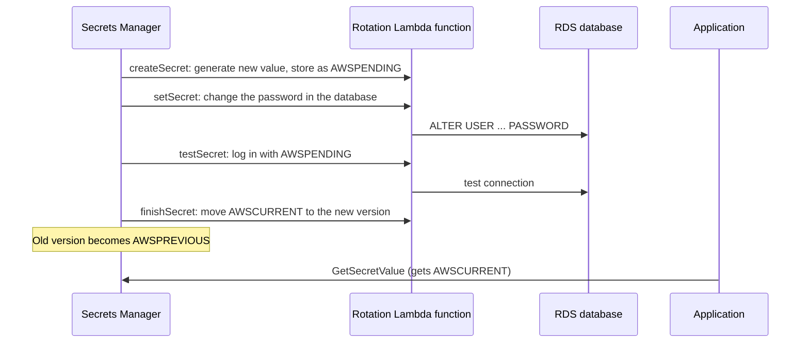
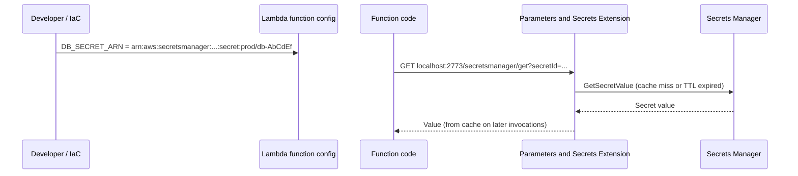

# 2.2.7 Store and retrieve sensitive values with managed secret services

**Domain 2 · Task 2.2 · Skill 2.2.7** · [Task overview](README.md) · Previous: [2.2.6 Sensitive data detection and masking](2.2.6-sensitive-data-detection-and-masking.md) · Next: [2.3.1 AI service access control](../task-2.3-secure-ai-services/2.3.1-ai-service-access-control.md)

## What the exam expects

Database passwords, API keys, and OAuth client secrets must never sit in code, templates, images, or plain environment variables. The exam rarely asks "which service stores secrets"; it describes a requirement ("the password rotates every 30 days without a redeploy", "store a feature flag cheaply") and expects AWS Secrets Manager or Systems Manager Parameter Store. It then tests the wiring: the IAM and KMS permissions, caching in Lambda, injection into ECS and CodeBuild, and CloudFormation dynamic references.

You must be able to:

- Choose Secrets Manager or Parameter Store from rotation, cost, size, and sharing requirements.
- Explain how Secrets Manager rotation works (Lambda rotation function, staging labels, managed rotation) and how RDS can manage its own master password.
- Read secrets from Lambda with caching (the AWS Parameters and Secrets Lambda Extension or an SDK cache), with the right two permissions.
- Inject secrets into ECS tasks, CodeBuild builds, and CloudFormation stacks without exposing the value.
- Explain the two layers of Lambda environment variable encryption and why they don't replace a secret store.

## Key terms

| Term | Meaning |
|---|---|
| Secret | A sensitive value (password, API key, token, certificate private key) that must be access-controlled and audited |
| AWS Secrets Manager | Managed secret store with automatic rotation, versioning with staging labels, replication, and resource policies |
| Parameter Store | Capability of AWS Systems Manager that stores configuration as `String`, `StringList`, or KMS-encrypted `SecureString` parameters in a hierarchy |
| Rotation | Replacing a secret's value on a schedule, updating both the secret store and the system that checks it (the database) |
| Staging label | Pointer to a secret version: `AWSCURRENT` (in use), `AWSPENDING` (being rotated in), `AWSPREVIOUS` (last good value) |
| Dynamic reference | `{{resolve:...}}` syntax that makes CloudFormation fetch a value from Parameter Store or Secrets Manager at deploy time |
| AWS Parameters and Secrets Lambda Extension | AWS-provided Lambda layer that serves cached parameters and secrets over a local HTTP endpoint |

## Secrets Manager

- Stores credentials, API keys, OAuth tokens, and any text or binary up to 64 KB.
- Always encrypted with KMS: the AWS managed key `aws/secretsmanager` by default, or a customer managed key.
- Versions with staging labels; `GetSecretValue` returns `AWSCURRENT` unless you ask for another label or version.
- Resource policies allow cross-account access. Cross-account access requires a customer managed key, because the AWS managed key can't be used from another account.
- Replicate secrets to other Regions for multi-Region apps and disaster recovery; promote a replica to a standalone secret if needed.
- `GetRandomPassword` generates strong passwords; CloudFormation can generate them at creation with `GenerateSecretString`.
- Deleting a secret starts a recovery window of 7 to 30 days (default 30), during which `RestoreSecret` brings it back.
- Charged per secret per month plus per API call. Caching reduces the API call charges.

### Rotation



- Rotation runs a Lambda function through four steps: `createSecret`, `setSecret`, `testSecret`, `finishSecret`. AWS provides rotation function templates for Amazon RDS, Aurora, Redshift, and DocumentDB, so you don't write rotation logic for those.
- Managed rotation: some services, such as RDS with `ManageMasterUserPassword`, create and rotate their own secret with no rotation function for you to maintain.
- Schedules use `rate()` or `cron()` expressions with a rotation window. The most frequent schedule is every four hours; the longest interval is 999 days.
- Strategies:
  - Single user: change the password of one database user. Connections opened with the old password keep working, but new logins briefly race the change.
  - Alternating users: two database users take turns being `AWSCURRENT`. The previous user still exists and works, so long-running connections don't break mid-rotation.
- The rotation Lambda function needs network access to the database (VPC configuration) and to the Secrets Manager endpoint (NAT gateway or a VPC interface endpoint).
- Applications must fetch the secret at runtime (with caching and a refresh on authentication failure). An app that read the password once at startup and never again breaks after rotation.


*Source: [How rotation works](https://docs.aws.amazon.com/secretsmanager/latest/userguide/rotate-secrets_how-rotation-works.html). With alternating users, user A and user B swap which one is `AWSCURRENT` at each rotation.*

## Parameter Store

- Stores configuration and secrets as `String`, `StringList`, or `SecureString` (encrypted with `aws/ssm` or a customer managed key).
- Versioned, with labels; changes can trigger EventBridge notifications; integrates with CloudFormation.
- Hierarchical names let each environment read its own subtree:

```text
/my-department/
    my-app/
        dev/
            db-url
            db-password
        prod/
            db-url
            db-password
/aws/reference/secretsmanager/<secret_id>          (read a Secrets Manager secret through Parameter Store)
/aws/service/ami-amazon-linux-latest/...           (public parameters published by AWS)
```

```bash
aws ssm put-parameter --name /my-app/prod/db-password --type SecureString \
  --key-id alias/app-config-key --value 'S3cretP@ss'
aws ssm get-parameters --names /my-app/dev/db-url /my-app/dev/db-password --with-decryption
aws ssm get-parameters-by-path --path /my-app/dev/ --recursive --with-decryption
```

Without `--with-decryption` (`WithDecryption=True` in the SDK), a `SecureString` comes back still encrypted. The caller also needs `kms:Decrypt` on the key.

### Standard vs advanced tiers

| | Standard | Advanced |
|---|---|---|
| Parameters per account and Region | 10,000 | 100,000 |
| Maximum value size | 4 KB | 8 KB |
| Parameter policies | No | Yes |
| Cost | No additional charge | Charged per advanced parameter per month |

Parameter policies (advanced only):

- `Expiration`: delete the parameter on a date.
- `ExpirationNotification`: send an EventBridge event before it expires.
- `NoChangeNotification`: send an event if the value hasn't changed for a period, a reminder to rotate.

Parameter Store has no built-in rotation. You can build it with an EventBridge schedule that invokes your Lambda function, which changes both the database password and the parameter.

## Secrets Manager vs Parameter Store

| Need | Secrets Manager | Parameter Store |
|---|---|---|
| Automatic rotation | Built in, with templates for RDS, Aurora, Redshift, DocumentDB, and managed rotation | None built in; build it with EventBridge and Lambda |
| Encryption | Always KMS | Optional (`SecureString`) |
| Cost | Per secret per month plus API calls | Standard tier free; advanced charged |
| Maximum size | 64 KB | 4 KB standard, 8 KB advanced |
| Versioning | Versions with staging labels used by rotation | Versions and labels |
| Cross-account sharing | Resource policy plus customer managed key | Advanced parameters can be shared with AWS RAM (verify) |
| Cross-Region replication | Built in | No |
| Hierarchies and `GetParametersByPath` | No | Yes |
| Best fit | Database credentials, API keys that must rotate, secrets shared across accounts | Configuration, feature flags, endpoints, simple secrets without rotation |

Rotation is the most-tested differentiator. Encryption is not a differentiator; both use KMS. A non-sensitive feature flag stored in Secrets Manager "to be safe" just costs money: use a Parameter Store standard parameter (or AWS AppConfig for flags that need gradual rollout, see [3.1.4](../../domain-3-testing-and-deployment/task-3.1-prepare-deployable-artifacts/3.1.4-environment-specific-configuration.md)).

## Secrets in Lambda

### How Lambda encrypts environment variables

```mermaid
flowchart TD
    DEV[Developer sets env var value] --> ATREST{Encryption at rest}
    ATREST -->|always on| KEY[AWS managed key aws/lambda,\nor a customer managed key]
    KEY --> STORED[Stored encrypted in\nLambda's configuration]
    DEV -.optional.-> HELPERS{Encryption helpers\nfor encryption in transit}
    HELPERS --> CMK[Console encrypts the value\nwith your KMS key before sending]
    CMK --> STORED
    STORED -->|at invoke| RUNTIME[Lambda decrypts the at-rest layer\nand passes plaintext to os.environ]
    CMK -.value is still ciphertext\nin os.environ.-> CODE[Your code calls kms:Decrypt]
```

1. Encryption at rest is always on. By default Lambda uses the AWS managed key `aws/lambda` at no charge. You can choose a customer managed key instead; then only users with access to that key can view or manage the function's environment variables. Either way, your code reads plaintext from `os.environ` or `process.env` without calling KMS.
2. Encryption helpers ("encryption in transit") are opt-in. The console encrypts chosen values client-side with your customer managed key before sending them to Lambda. They stay ciphertext in `GetFunctionConfiguration` output and in `os.environ`, and your code must call `kms:Decrypt`. This protects a value from people who can read the function's configuration but shouldn't see its contents.

### Why environment variables aren't enough for real secrets

AWS recommends Secrets Manager instead of environment variables for database credentials. Even with encryption helpers:

1. No rotation. Changing the value means `UpdateFunctionConfiguration` or a redeploy.
2. Deployment artifacts leak. A literal value in a CloudFormation, SAM, or Terraform template, a plan output, or a CI/CD log is exposed before Lambda encrypts anything.
3. No read audit. CloudTrail records who changed the configuration, but there is no equivalent of the `GetSecretValue` record that shows when the secret was read.
4. Size. All environment variables together are limited to 4 KB.

Encrypted environment variables are fine for non-secret configuration (log level, table name, endpoint URL, feature flags). For secrets, prefer Secrets Manager or Parameter Store with caching.

> DVA-C02 material and older Lambda notes recommend storing passwords in KMS-encrypted environment variables. Current AWS guidance prefers Secrets Manager or Parameter Store, with the environment variable holding only the secret's name or ARN.

### Recommended pattern: the environment variable holds a reference



1. The environment variable holds the secret's ARN or name, which isn't sensitive.
2. At runtime the function asks the AWS Parameters and Secrets Lambda Extension (a layer) on `localhost:2773`, authenticating with the `X-Aws-Parameters-Secrets-Token` header set to `AWS_SESSION_TOKEN`.
3. The extension caches values in memory for the life of the execution environment. Defaults: 300 seconds time to live (TTL), up to 1,000 secrets. Warm invocations skip the network call.
4. A cold start pays one real `GetSecretValue` call. Plain environment variables add no latency; secret lookups add some on the first invocation of each new environment. Provisioned concurrency hides it if needed.

```python
import os, json, urllib.parse, urllib.request

SECRET_ARN = os.environ["DB_SECRET_ARN"]   # a reference, not the password

def get_db_password() -> str:
    url = ("http://localhost:2773/secretsmanager/get?secretId="
           + urllib.parse.quote(SECRET_ARN, safe=""))
    req = urllib.request.Request(
        url, headers={"X-Aws-Parameters-Secrets-Token": os.environ["AWS_SESSION_TOKEN"]})
    with urllib.request.urlopen(req) as resp:
        secret = json.loads(resp.read())
    return json.loads(secret["SecretString"])["password"]
```

Without the extension, cache in global scope with the SDK:

```python
import json, time, boto3

sm = boto3.client("secretsmanager")      # created once per execution environment
_cache = {"value": None, "expires": 0.0}

def get_secret(secret_id: str, ttl: int = 300) -> dict:
    if time.time() >= _cache["expires"]:
        _cache["value"] = json.loads(sm.get_secret_value(SecretId=secret_id)["SecretString"])
        _cache["expires"] = time.time() + ttl
    return _cache["value"]
```

AWS also publishes Secrets Manager client-side caching libraries for several languages, including Java, Python, .NET, and Go. On an authentication failure after rotation, refresh the cache once and retry.

### The execution role needs two grants

```json
{
  "Version": "2012-10-17",
  "Statement": [
    {
      "Sid": "ReadThisSecretOnly",
      "Effect": "Allow",
      "Action": "secretsmanager:GetSecretValue",
      "Resource": "arn:aws:secretsmanager:us-east-1:111122223333:secret:prod/db-AbCdEf"
    },
    {
      "Sid": "DecryptWithTheKeyThatProtectsIt",
      "Effect": "Allow",
      "Action": "kms:Decrypt",
      "Resource": "arn:aws:kms:us-east-1:111122223333:key/abcd1234-ef56-7890-ab12-cd34ef567890",
      "Condition": { "StringEquals": { "kms:ViaService": "secretsmanager.us-east-1.amazonaws.com" } }
    }
  ]
}
```

1. `secretsmanager:GetSecretValue` on the exact secret ARN, never `"Resource": "*"`.
2. `kms:Decrypt` on the customer managed key that encrypts the secret. With the default `aws/secretsmanager` key you don't need this statement. With a customer managed key you do, and the key policy must also allow the role (directly or by delegating to IAM, see [2.2.4](2.2.4-kms-key-management.md#the-key-policy-is-the-first-gate)).
3. `kms:ViaService` limits the decrypt permission to calls Secrets Manager makes on the role's behalf.

### Worked scenarios

"Works in dev, `AccessDeniedException` in prod." Check, in order: the secret exists at that ARN in the prod account; the prod execution role has `GetSecretValue` on it; the prod secret uses a customer managed key whose key policy never allowed the prod role. Dev often uses the default key, which is why it worked there.

"Cold starts got slower after moving the password out of an environment variable." Expected. The first invocation of each execution environment now makes one `GetSecretValue` call. Accept it, or use provisioned concurrency; the cache handles warm invocations.

"The password showed up in a CI/CD log even though the Lambda variable used encryption helpers." The password was passed as a literal CloudFormation parameter, and the pipeline logged its deploy command. The leak happened before Lambda saw the value. Pass the secret's ARN as the parameter and fetch the value at runtime, or use a dynamic reference.

### Common Lambda mistakes

- Storing the secret value in an environment variable "because it's encrypted at rest".
- Enabling encryption helpers and never calling `kms:Decrypt`, leaving ciphertext in `os.environ`.
- Granting `kms:Decrypt` on `"Resource": "*"` to make an error go away.
- Calling `GetSecretValue` on every invocation with no cache.
- Logging the full event or environment after the secret has been fetched into memory.

## Secrets in containers and builds

### ECS task definitions

```json
{
  "containerDefinitions": [{
    "name": "api",
    "image": "111122223333.dkr.ecr.us-east-1.amazonaws.com/api:1.4.2",
    "secrets": [
      { "name": "DB_PASSWORD", "valueFrom": "arn:aws:secretsmanager:us-east-1:111122223333:secret:prod/db-AbCdEf:password::" },
      { "name": "API_URL", "valueFrom": "arn:aws:ssm:us-east-1:111122223333:parameter/my-app/prod/api-url" }
    ]
  }],
  "executionRoleArn": "arn:aws:iam::111122223333:role/ecsTaskExecutionRole",
  "taskRoleArn": "arn:aws:iam::111122223333:role/api-task-role"
}
```

- The task execution role (used by the ECS agent or Fargate) needs `secretsmanager:GetSecretValue` or `ssm:GetParameters`, plus `kms:Decrypt` for customer managed keys. The task role is what your application code uses.
- Values are injected as environment variables when the container starts. A rotated secret reaches running tasks only after they restart (force a new deployment), or if the app reads the secret itself at runtime.

### CodeBuild

```yaml
version: 0.2
env:
  variables:
    NODE_ENV: production
  parameter-store:
    API_URL: /myapp/prod/api-url
  secrets-manager:
    DB_PASSWORD: prod/myapp/db:password
```

Don't put secrets in plaintext `variables`. The CodeBuild service role needs read access to the referenced parameters and secrets. CodeBuild masks these values in build logs (verify).

### CloudFormation dynamic references

| Source | Syntax |
|---|---|
| Parameter Store `String` | `{{resolve:ssm:parameter-name:version}}` |
| Parameter Store `SecureString` | `{{resolve:ssm-secure:parameter-name:version}}` (supported only on specific resource properties) |
| Secrets Manager | `{{resolve:secretsmanager:secret-id:SecretString:json-key:version-stage:version-id}}` |

CloudFormation resolves the value during create, update, and delete and doesn't show it in the template. Two ways to give RDS a password without writing it anywhere:

```yaml
# Option 1: RDS manages the secret and its rotation
MyDB:
  Type: AWS::RDS::DBInstance
  Properties:
    Engine: mysql
    MasterUsername: admin
    ManageMasterUserPassword: true
```

```yaml
# Option 2: generate a secret, reference it, attach it for rotation
MySecret:
  Type: AWS::SecretsManager::Secret
  Properties:
    GenerateSecretString:
      SecretStringTemplate: '{"username": "admin"}'
      GenerateStringKey: password
      PasswordLength: 16
      ExcludeCharacters: '"@/\'
MyDB:
  Type: AWS::RDS::DBInstance
  Properties:
    Engine: mysql
    MasterUsername: !Sub '{{resolve:secretsmanager:${MySecret}::username}}'
    MasterUserPassword: !Sub '{{resolve:secretsmanager:${MySecret}::password}}'
SecretRDSAttachment:
  Type: AWS::SecretsManager::SecretTargetAttachment
  Properties:
    SecretId: !Ref MySecret
    TargetId: !Ref MyDB
    TargetType: AWS::RDS::DBInstance
```

`NoEcho` parameters hide values in the console and API output but still require someone to pass the plaintext at deploy time, so dynamic references are the stronger choice.

## Never store secrets in

- Source code or Git history, including `.env` files.
- Plain environment variables, template parameters, or CI/CD variables in plaintext.
- AMIs, container images, or Lambda deployment packages.
- Logs. Mask them if they slip through ([2.2.6](2.2.6-sensitive-data-detection-and-masking.md)).
- Base64 "encoding", which is reversible by anyone.

## Exam triggers

| Scenario clue | Answer | Why the alternatives are wrong |
|---|---|---|
| "Database password must rotate automatically, no code redeploy, never in plaintext config" | Secrets Manager with rotation; app fetches `AWSCURRENT` with caching | Parameter Store has no built-in rotation; environment variables need a redeploy |
| "Rotate an RDS password with AWS-provided logic, no custom code" | Secrets Manager rotation with the RDS template, or `ManageMasterUserPassword` | Writing your own EventBridge plus Lambda rotation is the Parameter Store workaround |
| "Long-running connections must not break during rotation" | Alternating users rotation strategy | Single user changes the only login |
| "Store non-secret config cheaply, hierarchical per environment" | Parameter Store standard `String` with `GetParametersByPath` | Secrets Manager charges per secret |
| "`SecureString` comes back encrypted" | `WithDecryption=True` and `kms:Decrypt` on the key | `ssm:GetParameter` alone doesn't decrypt |
| "Reduce latency and cost of reading secrets in Lambda" | Parameters and Secrets Lambda Extension or an SDK cache in global scope | Calling `GetSecretValue` per invocation adds latency and charges |
| "Teammate with read-only Lambda console access sees the password in environment variables" | Move it to Secrets Manager (or at least encryption helpers with a customer managed key) | At-rest encryption with the default key still shows plaintext to readers |
| "`GetSecretValue` allowed but still AccessDenied" | Add `kms:Decrypt` for the customer managed key and check its key policy | The secret permission and the key permission are separate checks |
| "ECS task needs the DB password as an environment variable" | Task definition `secrets` with `valueFrom`; execution role can read it | Plaintext `environment` exposes it in the task definition |
| "ECS tasks still use the old password after rotation" | Force a new deployment, or read the secret at runtime | Injection happens only at container start |
| "Use a DB password in CodeBuild without plaintext" | `env.secrets-manager` or `env.parameter-store` in the buildspec | Plaintext `env.variables` shows in the project configuration |
| "Don't put the DB password in the CloudFormation template" | Dynamic reference or `ManageMasterUserPassword: true` | `NoEcho` parameters still need the plaintext at deploy time |
| "Share a secret with another account" | Secrets Manager resource policy plus a customer managed key the other account can use | The AWS managed key can't be used cross-account |
| "Secret must be available in a second Region for DR" | Secrets Manager replication | Copying manually drifts after each rotation |

## Common traps

- Picking Parameter Store when the scenario says "rotate automatically". Rotation is the deciding feature.
- Picking Secrets Manager for plain configuration that doesn't need rotation, which only adds cost.
- Treating KMS-encrypted Lambda environment variables as the best practice for passwords.
- Forgetting `kms:Decrypt` (and the key policy) when a secret uses a customer managed key.
- Forgetting `WithDecryption` on `SecureString`.
- Giving the ECS task role, instead of the execution role, the permission to read injected secrets.
- Expecting running ECS tasks to pick up a rotated secret without restarting.
- Reading the secret once at startup and caching it forever, which fails after rotation.
- Passing a secret as a literal template parameter and leaking it through deploy logs.

## Quick recall

- Rotation needed: Secrets Manager. Config or no rotation, cost-sensitive: Parameter Store.
- Secrets Manager: always KMS, up to 64 KB, staging labels `AWSCURRENT`/`AWSPENDING`/`AWSPREVIOUS`, rotation as often as every 4 hours, replication, resource policies, 7 to 30 day deletion recovery window.
- Rotation Lambda steps: `createSecret`, `setSecret`, `testSecret`, `finishSecret`; templates for RDS, Aurora, Redshift, DocumentDB.
- Parameter Store: standard 4 KB and 10,000 parameters free; advanced 8 KB, 100,000, parameter policies.
- `SecureString` needs `WithDecryption` and `kms:Decrypt`.
- Lambda environment variables: always encrypted at rest with `aws/lambda`; encryption helpers are optional client-side encryption; 4 KB total.
- Extension: `localhost:2773`, `X-Aws-Parameters-Secrets-Token` header, 300-second default TTL.
- Execution role needs `GetSecretValue` plus `kms:Decrypt` for a customer managed key.
- ECS: `secrets` + `valueFrom`, execution role reads them, injected at start.
- CodeBuild: `env.secrets-manager`, `env.parameter-store`. CloudFormation: `{{resolve:...}}`, `ManageMasterUserPassword`.

## Related skills

- [2.2.4 KMS key management](2.2.4-kms-key-management.md): key policies behind `SecureString` and Secrets Manager encryption.
- [1.2.2 Lambda configuration](../../domain-1-development-with-aws-services/task-1.2-develop-lambda-functions/1.2.2-lambda-configuration.md): environment variables, layers, and extensions.
- [3.1.4 Environment-specific configuration](../../domain-3-testing-and-deployment/task-3.1-prepare-deployable-artifacts/3.1.4-environment-specific-configuration.md): AppConfig, Parameter Store, and Secrets Manager per environment.
- [3.1.1 Packaging dependencies and configuration](../../domain-3-testing-and-deployment/task-3.1-prepare-deployable-artifacts/3.1.1-packaging-dependencies-and-configuration.md): keeping secrets out of build artifacts.
- [3.3.3 Infrastructure as code deployment](../../domain-3-testing-and-deployment/task-3.3-deploy-with-ci-cd/3.3.3-infrastructure-as-code-deployment.md): dynamic references in templates.
- [2.1.6 Least privilege permissions](../task-2.1-authentication-and-authorization/2.1.6-least-privilege-permissions.md): ECS task role vs execution role.
- [4.3.1 Concurrency controls](../../domain-4-troubleshooting-and-optimization/task-4.3-optimize-applications/4.3.1-concurrency-controls.md): provisioned concurrency for cold-start-sensitive secret lookups.

## Sources

- Merged from: `archive/dva-c03/domain-2-security/securing-lambda-environment-variables-and-secrets.md` (two encryption layers, reference pattern, extension code, two grants, worked scenarios, common mistakes), `archive/dva-c03-study-notes/02-security.md` (skill 2.2.7), `archive/dva-c03/domain-2-security/MASTER-CHUNK.md` (section 10, appendix cost scenario), `archive/dva-c03/domain-2-security/README.md` (decision table, use cases), `archive/aws-dva-notes/Markdown Files/27. AWS Security & Encryption.md` (Parameter Store, tiers, policies, Secrets Manager, comparison, dynamic references, CodeBuild), `archive/aws-dva-notes/Markdown Files/13. Containers on AWS.md` (task role vs execution role, secrets), `archive/aws-dva-notes/Markdown Files/21. CICD - CodeCommit, CodePipeline, CodeBuild, CodeDeploy.md` (buildspec env), `archive/aws-dva-notes/Markdown Files/18. Serverless - Lambda.md` (environment variable size), `archive/aws-dva-notes/Markdown Files/31. Exam Day Cheat Sheet.md`, `archive/dva-c03/exam-bank/bank-1.md` (rotation with AWS-provided logic), `archive/dva-c03/exam-bank/bank-2.md` (`SecureString` decryption).
- Conflict resolved: the Lambda chapter of the service notes recommends KMS-encrypted environment variables for passwords. This note follows current AWS guidance (Secrets Manager or Parameter Store with caching).
- AWS documentation:
  - [Securing Lambda environment variables](https://docs.aws.amazon.com/lambda/latest/dg/configuration-envvars-encryption.html) (default AWS managed key, recommendation to use Secrets Manager for database credentials, helpers need `kms:Decrypt`)
  - [Use Secrets Manager secrets in Lambda functions](https://docs.aws.amazon.com/lambda/latest/dg/with-secrets-manager.html) (extension caches for 300 seconds, up to 1,000 secrets)
  - [Rotation schedules](https://docs.aws.amazon.com/secretsmanager/latest/userguide/rotate-secrets_schedule.html) (every four hours at most, 999 days maximum)
  - [How rotation works](https://docs.aws.amazon.com/secretsmanager/latest/userguide/rotate-secrets_how-rotation-works.html)
  - [Using Parameter Store parameters in Lambda functions](https://docs.aws.amazon.com/systems-manager/latest/userguide/ps-integration-lambda-extensions.html)
