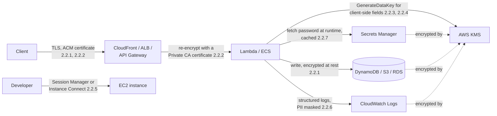

# Task 2.2: Encrypt and protect sensitive data

**Domain 2 · Task 2.2** · [Domain overview](../README.md)

Task 2.1 decides who may make a request. Task 2.2 protects the data itself once a request gets through, or when someone bypasses the API and reads storage, the network, logs, or a deployment artifact directly. It covers encryption at rest and in transit, the certificates that make TLS work, the choice between client-side and server-side encryption, AWS Key Management Service (AWS KMS) keys and their lifecycle, development certificates and SSH keys, finding and masking personally identifiable information (PII) and protected health information (PHI), and keeping secrets in AWS Secrets Manager or Systems Manager Parameter Store. Task 2.3 reuses most of these controls for AI services: KMS-encrypted invocation logs, masked prompts, and private connectivity.

> **DVA-C02 vs DVA-C03.** DVA-C02 spread encryption and sensitive-data handling across several skills. DVA-C03 consolidates them into this one seven-skill task. The underlying material didn't shrink.

## Skills

| Skill | Note | Covers |
|---|---|---|
| 2.2.1 | [Encryption at rest and in transit](2.2.1-encryption-at-rest-and-in-transit.md) | Per-service at-rest defaults, encrypting existing RDS and EBS, `aws:SecureTransport`, CloudFront and load balancer TLS, database TLS |
| 2.2.2 | [Certificate management](2.2.2-certificate-management.md) | ACM public certificates, DNS validation and renewal, Region rules, imported and exportable certificates, AWS Private CA |
| 2.2.3 | [Client-side vs server-side encryption](2.2.3-client-side-vs-server-side-encryption.md) | SSE-S3, SSE-KMS, DSSE-KMS, SSE-C, Encryption SDK, S3 Encryption Client, Database Encryption SDK, CloudFront field-level encryption |
| 2.2.4 | [KMS key management](2.2.4-kms-key-management.md) | Key types, KMS APIs, envelope encryption, encryption context, key policies and grants, rotation, deletion, multi-Region keys, quotas |
| 2.2.5 | [Development certificates and SSH keys](2.2.5-development-certificates-and-ssh-keys.md) | `ssh-keygen`, EC2 key pairs, Session Manager, EC2 Instance Connect, OpenSSL self-signed certificates and CSRs |
| 2.2.6 | [Sensitive data detection and masking](2.2.6-sensitive-data-detection-and-masking.md) | CloudWatch Logs and SNS data protection, Guardrails, Macie, Comprehend, redaction in code, fine-grained access to PII and PHI |
| 2.2.7 | [Secrets management](2.2.7-secrets-management.md) | Secrets Manager rotation, Parameter Store tiers, Lambda secrets with caching, ECS, CodeBuild, CloudFormation dynamic references |

## How the skills fit together

| Requirement in the question | Skill | Usual answer |
|---|---|---|
| "Data on the wire must be encrypted" | 2.2.1, 2.2.2 | TLS with ACM certificates; `aws:SecureTransport` deny |
| "Stored data must be encrypted and the key auditable" | 2.2.1, 2.2.4 | Service encryption with a customer managed KMS key |
| "AWS must never see plaintext" | 2.2.3 | Client-side encryption with the AWS Encryption SDK |
| "Encrypt something bigger than 4 KB with KMS" | 2.2.4 | `GenerateDataKey` envelope encryption |
| "Internal hostnames or mTLS client certificates" | 2.2.2 | AWS Private CA |
| "Local HTTPS or SSH access for developers" | 2.2.5 | OpenSSL self-signed certificate; Session Manager or Instance Connect |
| "PII appears in logs or messages" | 2.2.6 | CloudWatch Logs or SNS data protection policy, plus fixing the code |
| "Password must rotate without a redeploy" | 2.2.7 | Secrets Manager rotation, fetched with caching |

## Study checklist

- [ ] 2.2.1 List the at-rest default for S3, DynamoDB, RDS, EBS, SQS, SNS, CloudWatch Logs, and Lambda, and encrypt an existing RDS database.
- [ ] 2.2.1 Write a bucket policy that denies requests without TLS, and configure CloudFront for HTTPS end to end.
- [ ] 2.2.2 Request an ACM certificate with DNS validation in the correct Region for CloudFront, an edge-optimized API, a Regional API, and an ALB.
- [ ] 2.2.2 Explain when to use AWS Private CA, imported certificates, and exportable public certificates.
- [ ] 2.2.3 Pick SSE-S3, SSE-KMS, DSSE-KMS, SSE-C, or client-side encryption from a scenario, and name the request header for each.
- [ ] 2.2.4 Walk through envelope encryption, both directions, and explain the 4 KB limit.
- [ ] 2.2.4 Diagnose a KMS `AccessDeniedException` (key policy) and `ThrottlingException` (caching, Bucket Keys, quota).
- [ ] 2.2.4 Explain rotation, disable vs scheduled deletion, multi-Region keys, and cross-account snapshot sharing.
- [ ] 2.2.5 Create and import an EC2 key pair, and choose Session Manager or Instance Connect instead of shared keys.
- [ ] 2.2.5 Generate a self-signed certificate with a SAN and a CSR with OpenSSL.
- [ ] 2.2.6 Configure a CloudWatch Logs data protection policy and explain `logs:Unmask`.
- [ ] 2.2.6 Pair a detective control (Macie) with a preventive one for an S3 data lake.
- [ ] 2.2.7 Choose Secrets Manager or Parameter Store from rotation and cost requirements.
- [ ] 2.2.7 Read a secret from Lambda through the extension, with both IAM grants, and inject secrets into ECS, CodeBuild, and CloudFormation.

## Labs and practice

- [Labs](labs.md): Lab 1 compares Secrets Manager and Parameter Store and calls `rotate-secret`; Lab 2 runs KMS envelope encryption end to end; Lab 3 secures a Lambda secret with an ARN reference plus the `GetSecretValue` and `kms:Decrypt` grants.
- [Practice questions](practice-questions.md): 4 multiple-choice questions with explanations of every option, covering Private CA, customer managed keys, Secrets Manager rotation, and Macie.
