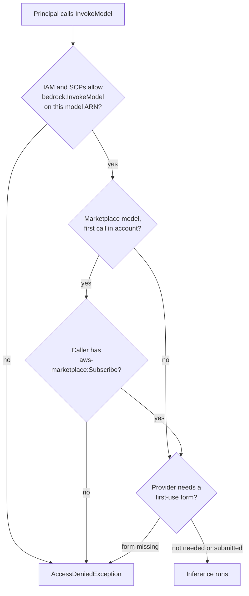

# 2.3.1 Request, grant, restrict, and manage access to AI services

**Domain 2 · Task 2.3 · Skill 2.3.1** · [Task overview](README.md) · Previous: [2.2.7 Secrets management](../task-2.2-encrypt-and-protect-sensitive-data/2.2.7-secrets-management.md) · Next: [2.3.2 AI data privacy and private connectivity](2.3.2-ai-data-privacy-and-private-connectivity.md)

## What the exam expects

Calling a foundation model is an AWS API call like any other, so AWS Identity and Access Management (IAM) decides who can make it. This skill tests whether you can grant only the Amazon Bedrock actions and model Amazon Resource Names (ARNs) a workload needs, block models you have not approved, force every call through a company guardrail, and explain what "requesting model access" means today. Most questions are Task 2.1 least-privilege questions with Bedrock as the service.

You must be able to:

- Write an identity-based policy that allows `bedrock:InvokeModel` (and streaming) on specific model or inference profile ARNs, and nothing from the management plane.
- Explain current model access: automatic enablement on first use, AWS Marketplace subscription permissions, and one-time first-use forms.
- Block a model with an IAM or service control policy (SCP) deny on `bedrock:InvokeModel`, and know why denying the Marketplace subscription alone does not work.
- Require a specific guardrail on every inference call with the `bedrock:GuardrailIdentifier` condition key.
- Give the right role to each caller (Lambda execution role, Amazon Elastic Container Service (ECS) task role, EC2 instance profile, agent roles) and audit calls with AWS CloudTrail.

## Key terms

| Term | Meaning |
|---|---|
| Foundation model (FM) | A large pre-trained model, such as an Amazon Nova or Anthropic Claude model, that Bedrock serves through one API. |
| Model ARN | `arn:aws:bedrock:<region>::foundation-model/<model-id>`. Note the empty account field: AWS owns the base models. |
| Inference profile | A resource that routes requests for a model, either across Regions (system-defined cross-Region profiles such as `us.` or `global.` prefixes) or for cost tracking (application inference profiles you create and tag). |
| Control plane (`bedrock`) | Endpoint for managing resources: guardrails, logging configuration, custom models, agents. |
| Data plane (`bedrock-runtime`) | Endpoint for inference: `InvokeModel`, `Converse`, streaming, `ApplyGuardrail`. |
| Guardrail ARN | `arn:aws:bedrock:<region>:<account>:guardrail/<id>`, optionally with `:<version>`. |
| SCP | Service control policy in AWS Organizations. Caps what principals in member accounts can do. Grants nothing. |
| First-use form | A one-time use case form some third-party providers require before an account can call their models. |

## Which permission does each call need

| Call | IAM action | Resource |
|---|---|---|
| `InvokeModel`, `Converse` | `bedrock:InvokeModel` (there is no separate `Converse` action) | Model ARN or inference profile ARN |
| `InvokeModelWithResponseStream`, `ConverseStream` | `bedrock:InvokeModelWithResponseStream` | Model ARN or inference profile ARN |
| `ApplyGuardrail` (standalone, or a guardrail attached to an inference call) | `bedrock:ApplyGuardrail` | Guardrail ARN |
| Knowledge base queries | `bedrock:Retrieve`, `bedrock:RetrieveAndGenerate` | Knowledge base ARN |
| Invoke a Bedrock agent | `bedrock:InvokeAgent` | Agent alias ARN |
| Invoke an agent hosted on Amazon Bedrock AgentCore Runtime | `bedrock-agentcore:InvokeAgentRuntime` | Agent runtime ARN |

Calls through a cross-Region inference profile are authorized against the profile ARN and against the foundation model ARN in each Region the profile can route to. Scope the `Resource` list to both, or the cross-Region hop fails with `AccessDeniedException`.

## Least-privilege runtime policy

A chatbot's runtime role needs to invoke one approved model family and apply one guardrail. Nothing else.

```json
{
  "Version": "2012-10-17",
  "Statement": [
    {
      "Sid": "InvokeApprovedModels",
      "Effect": "Allow",
      "Action": ["bedrock:InvokeModel", "bedrock:InvokeModelWithResponseStream"],
      "Resource": "arn:aws:bedrock:us-east-1::foundation-model/amazon.nova-pro-v1:0"
    },
    {
      "Sid": "ApplyCompanyGuardrail",
      "Effect": "Allow",
      "Action": "bedrock:ApplyGuardrail",
      "Resource": "arn:aws:bedrock:us-east-1:111122223333:guardrail/abcd1234"
    }
  ]
}
```

Two dimensions must be tight, and the exam tests each one separately:

| Policy | Problem |
|---|---|
| `"Action": "bedrock:*", "Resource": "*"` | Every action on every resource. The classic "make it work in dev" grant that never gets tightened. |
| `"Action": "bedrock:*", "Resource": "arn:...:foundation-model/anthropic.claude-*"` | Looks scoped, but the action wildcard still grants every Bedrock action that accepts that resource. Narrow the action list too. |
| `InvokeModel` plus `CreateModelCustomizationJob`, `DeleteGuardrail` on `*` | Mixes runtime and management. A compromised function could delete the guardrail that protects it or start training jobs. |

Keep management-plane permissions (create or update guardrails, change invocation logging, create custom models) on an administrator or pipeline role, never on the application role.

## Model access: what "request access" means now

Older material describes a console page where you request access to each model. That changed:

- **Automatic enablement.** In commercial Regions, most serverless models are available on first use. IAM decides who may call them.
- **AWS Marketplace models.** Third-party models sold through AWS Marketplace need `aws-marketplace:Subscribe` (plus `aws-marketplace:Unsubscribe` and `aws-marketplace:ViewSubscriptions`) the first time any principal in the account calls the model. Bedrock creates the subscription automatically on that first call. After that, callers need only Bedrock permissions.
- **First-use forms.** Some providers require a one-time use case form (`PutUseCaseForModelAccess`), submitted once per account or once from the organization's management account. Anthropic models earlier than Claude Opus 4.7 are the usual example.
- **AWS GovCloud (US)** still uses the model access request page.



## Blocking or allow-listing models

To block a model, deny the invoke actions on its ARN. To allow only approved models, deny everything except their ARNs.

```json
{
  "Version": "2012-10-17",
  "Statement": [
    {
      "Sid": "OnlyApprovedModels",
      "Effect": "Deny",
      "Action": ["bedrock:InvokeModel", "bedrock:InvokeModelWithResponseStream"],
      "NotResource": [
        "arn:aws:bedrock:*::foundation-model/amazon.nova-pro-v1:0",
        "arn:aws:bedrock:*::foundation-model/amazon.nova-lite-v1:0"
      ]
    }
  ]
}
```

Attach it as an IAM policy for one account, or as an SCP for many accounts.

> **Not on the DVA-C03 service list.** AWS Organizations is not listed, but SCPs appear throughout Domain 2 as the organization-wide ceiling. An SCP with the deny above blocks unapproved models in every member account regardless of what IAM policies allow.

Denying `aws-marketplace:Subscribe` does not reliably block a model. Bedrock subscribes automatically on the first permitted call, and once any principal has subscribed, other callers need only `bedrock:InvokeModel`. Deny the invoke action instead.

## Requiring a guardrail on every call

Holding `bedrock:InvokeModel` does not by itself force a caller to attach a guardrail. A caller can simply omit `guardrailIdentifier`. To enforce it, use the `bedrock:GuardrailIdentifier` condition key, which works on `InvokeModel`, `InvokeModelWithResponseStream`, `Converse`, and `ConverseStream`:

```json
{
  "Version": "2012-10-17",
  "Statement": [
    {
      "Sid": "AllowOnlyWithGuardrailV1",
      "Effect": "Allow",
      "Action": ["bedrock:InvokeModel", "bedrock:InvokeModelWithResponseStream"],
      "Resource": "arn:aws:bedrock:us-east-1::foundation-model/*",
      "Condition": {
        "StringEquals": {
          "bedrock:GuardrailIdentifier": "arn:aws:bedrock:us-east-1:111122223333:guardrail/abcd1234:1"
        }
      }
    },
    {
      "Sid": "DenyWithoutGuardrailV1",
      "Effect": "Deny",
      "Action": ["bedrock:InvokeModel", "bedrock:InvokeModelWithResponseStream"],
      "Resource": "arn:aws:bedrock:us-east-1::foundation-model/*",
      "Condition": {
        "StringNotEquals": {
          "bedrock:GuardrailIdentifier": "arn:aws:bedrock:us-east-1:111122223333:guardrail/abcd1234:1"
        }
      }
    },
    {
      "Sid": "ApplyThatGuardrail",
      "Effect": "Allow",
      "Action": "bedrock:ApplyGuardrail",
      "Resource": "arn:aws:bedrock:us-east-1:111122223333:guardrail/abcd1234"
    }
  ]
}
```

- The value `guardrail/<id>:1` pins version 1. `guardrail/<id>` alone matches the working draft; `ArnLike` with `guardrail/<id>:*` matches any numbered version.
- The explicit deny stops the call even if another policy allows `InvokeModel`.
- The caller also needs `bedrock:ApplyGuardrail` on the guardrail, because attaching a guardrail to an inference call runs it.

Bedrock can also apply a guardrail without the caller doing anything. Account-level enforcement (`PutEnforcedGuardrailConfiguration`, set per Region) applies one guardrail version to every model invocation in the account. Organization-level enforcement uses Amazon Bedrock policies in AWS Organizations. When an application also passes its own guardrail, the effective controls are the union, with the stricter setting winning. What each guardrail filters is covered in [2.3.3](2.3.3-ai-input-and-output-filtering.md).

## Giving compute and agents their permissions

| Caller | Where the Bedrock permissions go |
|---|---|
| Lambda function | Execution role |
| ECS task | Task role (not the task execution role, which pulls images and writes logs) |
| EC2 instance | Instance profile role |
| Developer laptop or CI | Short-term credentials from IAM Identity Center or an OpenID Connect (OIDC) role, never long-term access keys |
| Bedrock agent | The agent's service role (calls models and knowledge bases), plus a separate execution role for each action group Lambda function. The Lambda function's resource-based policy allows `bedrock.amazonaws.com`, scoped with `aws:SourceArn` to the agent. |
| Agent on AgentCore Runtime | Inbound: IAM Signature Version 4 (SigV4) or a JSON Web Token (JWT) from Amazon Cognito or another identity provider decides who can invoke it. Outbound: AgentCore Identity holds OAuth (Open Authorization) tokens and API keys for tools. Details in [2.3.4](2.3.4-ai-agent-security.md). |

Never put access keys in code or environment variables. The SDK credential provider chain picks up the role automatically ([2.1.3](../task-2.1-authentication-and-authorization/2.1.3-secure-programmatic-access.md)).

Kiro, the AI development environment on the exam, authenticates users through IAM Identity Center or supported identity providers, and enterprise administrators control which models and Model Context Protocol (MCP) servers it may use. See [1.1.9](../../domain-1-development-with-aws-services/task-1.1-build-application-code/1.1.9-ai-assisted-development-tools.md).

## Managing access over time: quotas, cost, and audit

- **Quotas.** On-demand inference has per-model requests-per-minute and tokens-per-minute quotas per Region. Exceeding them returns `ThrottlingException`; retry with exponential backoff and jitter.
- **Cost attribution.** Application inference profiles carry tags, so each team or application gets its own line in cost reports. Provisioned Throughput reserves capacity for predictable high volume.
- **Audit.** CloudTrail records `InvokeModel`, `InvokeModelWithResponseStream`, `Converse`, and `ConverseStream` as management events, which trails capture by default. Each event shows who called which model, from where, and when. It does not contain the prompt or response text. Agent runtime calls (`InvokeAgent`), knowledge base `Retrieve`, and `ApplyGuardrail` are data events that need advanced event selectors.
- **Review.** Use IAM Access Analyzer and last-accessed data to remove Bedrock permissions nobody uses ([2.1.6](../task-2.1-authentication-and-authorization/2.1.6-least-privilege-permissions.md)).

## Worked scenario: three teams, one assistant

An internal documentation assistant runs on Bedrock. Only three owning teams may invoke the model, and nobody else in the organization should be able to call it even by writing their own script.

1. Attach the least-privilege runtime policy (model ARN plus guardrail ARN) to a role that only those teams can assume.
2. Keep guardrail management on a separate administrator role, so the runtime role cannot weaken the guardrail.
3. Add the `bedrock:GuardrailIdentifier` deny so the model cannot be called without the guardrail, even by the owning teams.
4. Add an SCP allow-list of approved model ARNs so other accounts cannot reach unapproved models.
5. Query CloudTrail for `InvokeModel` events to confirm only the expected role sessions call the model.

## Exam triggers

| Scenario clue | Answer | Why the alternatives are wrong |
|---|---|---|
| "Allow the function to call only one model" | IAM `bedrock:InvokeModel` on that model ARN | `bedrock:*` or `Resource: "*"` breaks least privilege |
| "Only approved models may be used across the organization" | SCP deny on invoke actions with `NotResource` approved ARNs | Per-account IAM policies can be changed by account admins; denying Marketplace subscribe does not block |
| "Every invocation must use the company guardrail" | `bedrock:GuardrailIdentifier` condition with an explicit deny, or an enforced guardrail | A system prompt instruction or a code review does not stop a caller from omitting the guardrail |
| `AccessDeniedException` on the first call to a third-party model | Missing Marketplace permissions or first-use form, or a missing IAM allow | "Request access in the console" is outdated for most commercial Regions |
| "Who invoked which model, and when?" | CloudTrail | CloudWatch Logs holds application output; model invocation logging holds payloads |
| Runtime role has `bedrock:*` on a model ARN | Narrow the actions to invoke and `ApplyGuardrail` | Resource scoping alone leaves management actions open |

## Common traps

- `bedrock:Converse` is not an IAM action. `Converse` is authorized by `bedrock:InvokeModel`; `ConverseStream` by `bedrock:InvokeModelWithResponseStream`.
- Foundation model ARNs have no account ID. Guardrail, inference profile, agent, and knowledge base ARNs do.
- Bedrock calls are IAM-authorized like any other API. A "managed service needs no IAM" answer is always wrong.
- Denying `aws-marketplace:Subscribe` alone does not block a model.
- A cross-Region inference profile needs permission on the profile and on the model in every destination Region. SCPs that deny those Regions also break it.
- An ECS task's Bedrock permissions belong on the task role, not the task execution role.

## Quick recall

- `bedrock:InvokeModel` covers `InvokeModel` and `Converse`; the streaming action covers both streaming APIs.
- Model ARN: `arn:aws:bedrock:region::foundation-model/id`.
- Block a model: deny `bedrock:InvokeModel` (IAM or SCP).
- Force a guardrail: `bedrock:GuardrailIdentifier` condition plus `bedrock:ApplyGuardrail`.
- Most models enable on first use; Marketplace models need `aws-marketplace:Subscribe` once.
- Runtime role invokes; admin role manages guardrails and logging.
- CloudTrail logs `InvokeModel` and `Converse` as management events without prompt content.
- Throttling: `ThrottlingException`, back off and retry.

## Related skills

- [2.1.6 Least privilege permissions](../task-2.1-authentication-and-authorization/2.1.6-least-privilege-permissions.md): policy evaluation, SCPs, and Access Analyzer behind every policy here.
- [2.1.3 Secure programmatic access](../task-2.1-authentication-and-authorization/2.1.3-secure-programmatic-access.md): roles for Lambda, ECS, and EC2 instead of access keys.
- [2.3.3 AI input and output filtering](2.3.3-ai-input-and-output-filtering.md): what the required guardrail actually filters.
- [2.3.4 AI agent security](2.3.4-ai-agent-security.md): agent service roles, action group roles, and AgentCore Identity.
- [1.1.10 Managed AI service integration](../../domain-1-development-with-aws-services/task-1.1-build-application-code/1.1.10-managed-ai-service-integration.md): the API calls these permissions authorize, error codes, and inference profiles.

## Sources

- Merged from: `archive/aws-dva-notes/Markdown Files/30. AI Services & Security (DVA-C03).md` (sections 2, 3, 11), `archive/dva-c03-study-notes/02-security.md` (skill 2.3.1), `archive/dva-c03/domain-2-security/ai-service-security-risks.md` (access control, over-grant scenario, use cases, diagnostic order), `archive/dva-c03/domain-2-security/prompt-injection-and-genai-security-deep-dive.md` (guardrail-scoped policy), `archive/dva-c03/domain-2-security/MASTER-CHUNK.md` (sections 8 and 14), `archive/dva-c03/domain-2-security/README.md` (AI risk table), `archive/dva-c03-study-notes/05-cheat-sheet.md`, `archive/aws-dva-notes/Markdown Files/31. Exam Day Cheat Sheet.md`.
- Conflict resolved: the prompt-injection deep dive said a guardrail can only be forced "in application code or via a stricter policy condition"; the `bedrock:GuardrailIdentifier` condition key and enforced guardrails settle it.
- Conflict resolved: one source listed `bedrock:Converse` as an IAM action; `Converse` is authorized by `bedrock:InvokeModel`.
- AWS documentation:
  - [Enforce the use of specific guardrails in model inference requests](https://docs.aws.amazon.com/bedrock/latest/userguide/guardrails-permissions-id.html)
  - [Apply cross-account safeguards with Amazon Bedrock Guardrails enforcements](https://docs.aws.amazon.com/bedrock/latest/userguide/guardrails-enforcements.html)
  - [Access Amazon Bedrock foundation models](https://docs.aws.amazon.com/bedrock/latest/userguide/model-access.html)
  - [Prerequisites for inference profiles](https://docs.aws.amazon.com/bedrock/latest/userguide/cross-region-inference-prereq.html)
  - [Monitor Amazon Bedrock API calls using CloudTrail](https://docs.aws.amazon.com/bedrock/latest/userguide/logging-using-cloudtrail.html)
  - [Converse API reference](https://docs.aws.amazon.com/bedrock/latest/APIReference/API_runtime_Converse.html)
