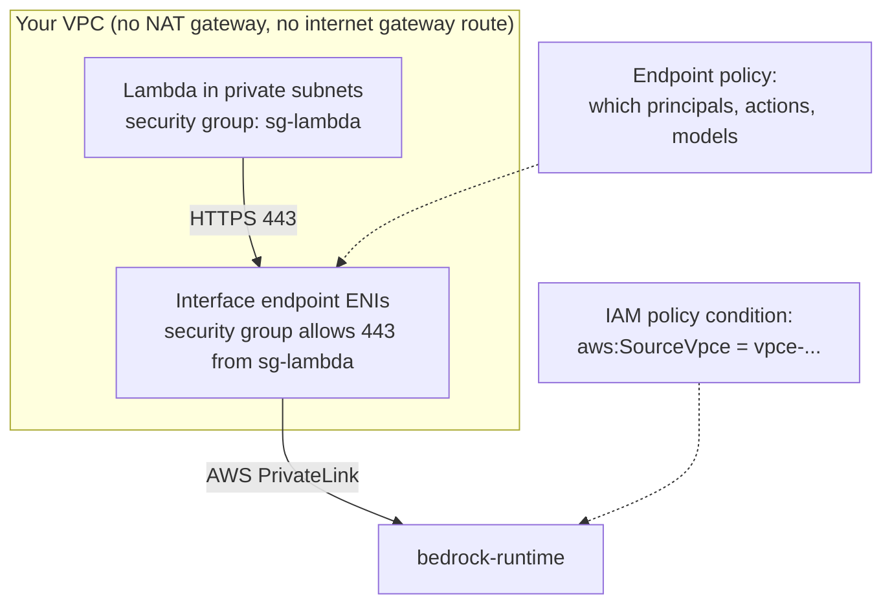
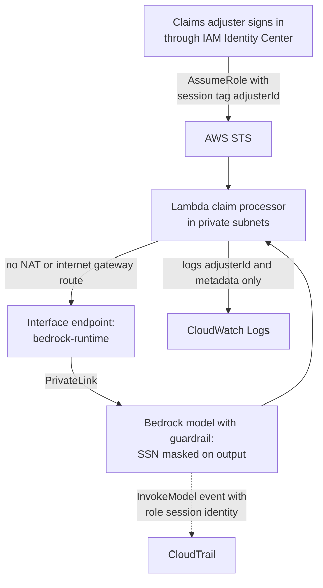

# 2.3.2 Protect data sent to AI services with private connectivity and data-use controls

**Domain 2 · Task 2.3 · Skill 2.3.2** · [Task overview](README.md) · Previous: [2.3.1 AI service access control](2.3.1-ai-service-access-control.md) · Next: [2.3.3 AI input and output filtering](2.3.3-ai-input-and-output-filtering.md)

## What the exam expects

Prompts often contain customer data, so the questions become "where does that data travel, who can see it, and is it used to train anything?" This skill tests the Amazon Bedrock data-use commitments, keeping traffic off the internet with interface virtual private cloud (VPC) endpoints from AWS PrivateLink, restricting those endpoints, encrypting what Bedrock stores, and sending the model only the data it needs.

You must be able to:

- State what Bedrock does with prompts and completions, and how that differs from other AWS AI services and from personal chat tools.
- Create interface VPC endpoints for the Bedrock endpoints an application calls, and restrict them with endpoint policies, security groups, and AWS Identity and Access Management (IAM) conditions such as `aws:SourceVpce`.
- Choose between "encrypted over Transport Layer Security (TLS)" and "no path to the internet at all" when a requirement uses absolute wording.
- Apply encryption and data minimization (redact before sending, filter retrieval per tenant).

## Key terms

| Term | Meaning |
|---|---|
| Model deployment account | An AWS-owned account per model provider per Region where Bedrock runs that provider's model. Providers have no access to it. |
| Interface VPC endpoint | Elastic network interfaces (ENIs) with private IP addresses in your subnets that carry traffic to an AWS service over PrivateLink. |
| Endpoint policy | A resource-based policy on the endpoint that limits which principals, actions, and resources can be used through it. Default: full access. |
| Private DNS | Makes the service's normal Regional hostname (for example `bedrock-runtime.us-east-1.amazonaws.com`) resolve to the endpoint's private IPs, so SDK code does not change. |
| `aws:SourceVpce` / `aws:SourceVpc` | IAM condition keys present only when a request arrives through a VPC endpoint. |
| AI services opt-out policy | An AWS Organizations policy that stops supported AWS AI services from storing and using your content for service improvement. |
| Data minimization | Sending a model only the fields it needs, with personally identifiable information (PII) removed when it is not needed. |

## Data-use commitments

| Question | Amazon Bedrock |
|---|---|
| Are my prompts and completions used to train models? | No. AWS and third-party providers do not use Bedrock inputs or outputs to train Amazon or third-party models. |
| Can the model provider see my prompts? | No. Models run in Bedrock-owned model deployment accounts that providers cannot access, so providers never see prompts, completions, or Bedrock logs. |
| Is there a setting to turn this on? | No. It is how Bedrock works for every model. There is nothing to enable. |
| Do prompts end up in my logs? | Not from Bedrock itself unless you turn on model invocation logging, which is off by default ([2.3.5](2.3.5-ai-sensitive-data-in-logs.md)). Your own application logs are a separate risk. |
| Where is the data processed? | In the Region you call, unless you use a cross-Region inference profile. Geographic profiles (`us.`, `eu.`, `apac.`) stay inside that geography; `global.` profiles can route anywhere. Guardrails on the Standard tier also use cross-Region inference. |
| Fine-tuning on my data? | Bedrock makes a private copy of the base model for your account. Your training data is not used to improve the base model or shared with other customers. |

Other AWS AI services may use and store customer content for service improvement unless you opt out. The organization-wide control is an **AI services opt-out policy**; it applies to all current and future supported services, and member accounts cannot override it.

> **Not on the DVA-C03 service list.** AWS Organizations (opt-out policies) and task-specific AI services such as Amazon Comprehend and Amazon Textract are not listed. Know that the opt-out policy exists for "other AI services must not use our content", and that Bedrock needs no opt-out.

A personal account on a consumer chat product has its own, often unknown, data-handling terms. "A developer pastes production code into a personal AI chat account" is a data-privacy problem, not a capability question. Kiro's data-use terms depend on the sign-in method; see [1.1.9](../../domain-1-development-with-aws-services/task-1.1-build-application-code/1.1.9-ai-assisted-development-tools.md).

## Private connectivity with PrivateLink

Without an endpoint, a Lambda function in a private subnet reaches the public Regional Bedrock endpoint through a NAT gateway and an internet gateway. The traffic is TLS-encrypted, but it leaves your VPC and needs a route to the internet. An interface endpoint gives Bedrock a private IP address inside your subnets, so no internet gateway, NAT device, VPN, or public IP address is needed.

Create one endpoint per Bedrock endpoint the application calls:

| Service name | Used for |
|---|---|
| `com.amazonaws.<region>.bedrock-runtime` | Inference: `InvokeModel`, `Converse`, streaming, `ApplyGuardrail` |
| `com.amazonaws.<region>.bedrock-agent-runtime` | Invoking agents, knowledge base `Retrieve` and `RetrieveAndGenerate` |
| `com.amazonaws.<region>.bedrock` | Control plane: guardrails, logging configuration, custom models |
| `com.amazonaws.<region>.bedrock-agent` | Building agents and knowledge bases |
| `com.amazonaws.<region>.bedrock-runtime-fips`, `bedrock-fips` | Federal Information Processing Standard (FIPS) 140-3 endpoints in supported Regions |

Bedrock also lists a `bedrock-mantle` endpoint for its OpenAI-compatible APIs, and Amazon Bedrock AgentCore supports interface endpoints for its own APIs.

```bash
aws ec2 create-vpc-endpoint \
  --vpc-id vpc-0abc1234 \
  --vpc-endpoint-type Interface \
  --service-name com.amazonaws.us-east-1.bedrock-runtime \
  --subnet-ids subnet-0aaa1111 subnet-0bbb2222 \
  --security-group-ids sg-0endpoint \
  --private-dns-enabled \
  --policy-document file://bedrock-endpoint-policy.json
```

### Three layers that restrict the private path



| Layer | What it controls | Symptom it explains |
|---|---|---|
| No internet route (no NAT, no internet gateway) | Whether any path to the public endpoint exists | Satisfies "must never traverse the internet" literally |
| Security group on the endpoint ENIs | Which network sources can reach the endpoint on port 443 | "Endpoint exists and IAM is right, but calls time out" |
| Endpoint policy | Which principals, actions, and resources can be used through this endpoint | "Several workloads share the VPC, but only one may call Bedrock through it" |
| IAM condition `aws:SourceVpce` or `aws:SourceVpc` | Whether a principal may call Bedrock from anywhere other than the endpoint | "Calls must only come through our endpoint" |

Endpoint policy allowing one role to invoke one model:

```json
{
  "Version": "2012-10-17",
  "Statement": [
    {
      "Effect": "Allow",
      "Principal": {"AWS": "arn:aws:iam::111122223333:role/claims-processor"},
      "Action": ["bedrock:InvokeModel", "bedrock:InvokeModelWithResponseStream"],
      "Resource": "arn:aws:bedrock:us-east-1::foundation-model/amazon.nova-pro-v1:0"
    }
  ]
}
```

Identity policy that denies Bedrock calls not made through the endpoint:

```json
{
  "Effect": "Deny",
  "Action": "bedrock:*",
  "Resource": "*",
  "Condition": {
    "StringNotEquals": {"aws:SourceVpce": "vpce-0123456789abcdef0"}
  }
}
```

`aws:SourceIp` is not in the request context when the request comes through a VPC endpoint. An `IpAddress` condition on `aws:SourceIp` cannot match those calls, so use `aws:SourceVpce`, `aws:SourceVpc`, or `aws:VpcSourceIp`.

The Lambda function itself must be attached to the VPC to use the endpoint ([1.2.1](../../domain-1-development-with-aws-services/task-1.2-develop-lambda-functions/1.2.1-lambda-vpc-access.md)). An interface endpoint has an hourly charge per Availability Zone plus a per-GB processing charge, separate from Bedrock token pricing. Compliance requirements usually justify it, but it is not free.

## Encryption

- **In transit:** Bedrock requires TLS 1.2 and recommends TLS 1.3.
- **At rest:** guardrails are encrypted with an AWS managed key by default; you can choose a customer managed AWS Key Management Service (AWS KMS) key. Knowledge bases, agents, custom models, and invocation log destinations (CloudWatch Logs group, S3 bucket with SSE-KMS) can also use customer managed keys. See [2.2.1](../task-2.2-encrypt-and-protect-sensitive-data/2.2.1-encryption-at-rest-and-in-transit.md) and [2.2.4](../task-2.2-encrypt-and-protect-sensitive-data/2.2.4-kms-key-management.md).
- **Free-text fields:** do not put customer data in resource names, descriptions, or tags. Those can appear in billing and diagnostic logs.

## Data minimization

- Send only the fields the task needs. A sentiment classifier does not need the customer's account number.
- Strip or mask PII before it enters the prompt when the model does not need it: a Guardrails sensitive information filter on input ([2.3.3](2.3.3-ai-input-and-output-filtering.md)), or your own code ([2.2.6](../task-2.2-encrypt-and-protect-sensitive-data/2.2.6-sensitive-data-detection-and-masking.md)).
- Keep retrieval data access-controlled. Filter knowledge base queries by tenant or user metadata before documents reach the prompt, so a query cannot pull another tenant's content. The same control also limits indirect prompt injection ([2.3.4](2.3.4-ai-agent-security.md)).
- Never put secrets in a system prompt; a successful prompt injection can echo them back.

## Worked case study: claim forms that must never touch the internet

An insurance company sends scanned claim forms to Bedrock for extraction. Requirements: (1) no document may traverse the public internet, (2) every extraction call must be attributable to a named claims adjuster, and (3) a policyholder's Social Security number (SSN) must never appear in an application log.



| Requirement | Control | Distractor that fails it |
|---|---|---|
| Never traverses the internet | Interface endpoint for `bedrock-runtime` and no NAT or internet gateway route | "TLS is enough": encrypted traffic still leaves the VPC |
| Per-adjuster attribution | Role session with an `adjusterId` session tag from AWS Security Token Service (AWS STS); CloudTrail records the session identity on every call | Application-level log tags alone do not show up in CloudTrail |
| No SSN in logs | Guardrail masks SSNs in output, and the code never logs the raw extraction | Relying on the guardrail alone misses prompts logged before the guardrail runs ([2.3.5](2.3.5-ai-sensitive-data-in-logs.md)) |

## Exam triggers

| Scenario clue | Answer | Why the alternatives are wrong |
|---|---|---|
| "Calls to Bedrock must not leave the AWS network" or "no internet access" | Interface VPC endpoint (PrivateLink) for `bedrock-runtime` | NAT gateway routes to the internet; Direct Connect is for on-premises links; a gateway endpoint exists only for S3 and DynamoDB |
| "Never traverses the public internet," stated absolutely | Endpoint plus no NAT or internet gateway route | TLS alone encrypts but does not remove the path |
| "Are our prompts used to train the model?" | No; Bedrock does not use them and providers cannot see them | "Enable the opt-out setting in Bedrock" describes a setting that does not exist |
| "Other AWS AI services must not use our content" | AI services opt-out policy in AWS Organizations | Bedrock commitments do not cover other services |
| "Only one of several workloads in the VPC may call Bedrock" | Endpoint policy and endpoint security group | IAM on the calling role alone does not restrict the shared endpoint |
| `aws:SourceIp` condition blocks calls after adding an endpoint | Switch to `aws:SourceVpce` | `aws:SourceIp` is absent for endpoint traffic |
| "Calls time out after creating the endpoint" | Endpoint security group must allow 443 from the function's security group; check private DNS | IAM errors return `AccessDenied`, not timeouts |

## Common traps

- Bedrock's no-training behavior is not a toggle. Answers that "enable" or "verify the opt-out setting" for Bedrock are wrong; the opt-out policy is for other AWS AI services.
- Agents and knowledge bases use `bedrock-agent-runtime`. An endpoint for `bedrock-runtime` alone does not cover them.
- Cross-Region inference profiles move processing to other Regions in the geography. A strict single-Region data residency requirement needs in-Region model IDs.
- The default endpoint policy allows full access. Creating an endpoint without a custom policy restricts nothing.
- Encryption with KMS does not stop someone who can read the log group from reading PII. Masking and access control are separate controls.

## Quick recall

- Bedrock does not train on prompts or completions, and providers cannot see them.
- No opt-out needed for Bedrock; Organizations AI opt-out policy for other AI services.
- Endpoints: `bedrock-runtime` (inference), `bedrock-agent-runtime` (agents, knowledge bases), `bedrock` (control plane).
- Endpoint policy default is full access.
- `aws:SourceVpce` works through endpoints; `aws:SourceIp` does not.
- Strongest "no internet": endpoint plus no NAT or internet gateway route.
- TLS 1.2 required; customer managed KMS keys for guardrails, knowledge bases, agents, logs.
- Geographic cross-Region profiles stay in the geography.

## Related skills

- [1.2.1 Lambda VPC access](../../domain-1-development-with-aws-services/task-1.2-develop-lambda-functions/1.2.1-lambda-vpc-access.md): putting the calling function in private subnets.
- [2.2.1 Encryption at rest and in transit](../task-2.2-encrypt-and-protect-sensitive-data/2.2.1-encryption-at-rest-and-in-transit.md): TLS and KMS defaults.
- [2.2.6 Sensitive data detection and masking](../task-2.2-encrypt-and-protect-sensitive-data/2.2.6-sensitive-data-detection-and-masking.md): finding and masking PII before it reaches a prompt.
- [2.1.7 Assuming IAM roles](../task-2.1-authentication-and-authorization/2.1.7-assuming-iam-roles.md): session tags for per-user attribution.
- [2.3.5 AI sensitive data in logs](2.3.5-ai-sensitive-data-in-logs.md): what Bedrock stores once invocation logging is on.

## Sources

- Merged from: `archive/aws-dva-notes/Markdown Files/30. AI Services & Security (DVA-C03).md` (section 4), `archive/dva-c03-study-notes/02-security.md` (skill 2.3.2), `archive/dva-c03/domain-2-security/ai-service-security-risks.md` (VPC endpoints, training opt-out, PrivateLink layers, insurance case study, pricing), `archive/dva-c03/domain-2-security/MASTER-CHUNK.md` (sections 8, 14, 23), `archive/dva-c03/domain-2-security/README.md` (AI risk table), `archive/aws-dva-notes/Markdown Files/31. Exam Day Cheat Sheet.md`, `archive/dva-c03/practice-questions/domain-2-questions.md` (traps).
- Conflict resolved: `ai-service-security-risks.md` told readers to "confirm/enable the no-training-use setting" for Bedrock; Bedrock has no such setting because it never uses prompts or completions for training. The opt-out policy applies to other AWS AI services.
- AWS documentation:
  - [Amazon Bedrock data protection](https://docs.aws.amazon.com/bedrock/latest/userguide/data-protection.html) (model deployment accounts, TLS 1.2)
  - [Learn how Amazon Bedrock uses model input and output data](https://repost.aws/knowledge-center/amazon-bedrock-model-data-use) (AWS Knowledge Center)
  - [Use interface VPC endpoints (AWS PrivateLink) with Amazon Bedrock](https://docs.aws.amazon.com/bedrock/latest/userguide/vpc-interface-endpoints.html) (endpoint service names, default endpoint policy)
  - [AWS global condition context keys](https://docs.aws.amazon.com/IAM/latest/UserGuide/reference_policies_condition-keys.html) (`aws:SourceIp` absent through VPC endpoints)
  - [AI services opt-out policies](https://docs.aws.amazon.com/organizations/latest/userguide/orgs_manage_policies_ai-opt-out.html)
  - [Safeguard tiers for guardrails policies](https://docs.aws.amazon.com/bedrock/latest/userguide/guardrails-tiers.html) (Standard tier uses cross-Region inference)
