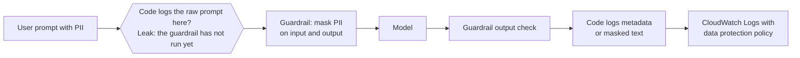

# 2.3.5 Prevent prompts, responses, PII, PHI, and other sensitive content from leaking through monitoring logs

**Domain 2 · Task 2.3 · Skill 2.3.5** · [Task overview](README.md) · Previous: [2.3.4 AI agent security](2.3.4-ai-agent-security.md) · Next: [3.1.1 Packaging dependencies and configuration](../../domain-3-testing-and-deployment/task-3.1-prepare-deployable-artifacts/3.1.1-packaging-dependencies-and-configuration.md)

## What the exam expects

Users paste their address, card number, diagnosis, or an API key into a chat box, and that text becomes a prompt. Every place that records prompts or responses then holds personally identifiable information (PII) or protected health information (PHI). This skill tests knowing where AI content gets logged, keeping it out of logs that do not need it, and protecting the logs that must keep it.

You must be able to:

- Explain Amazon Bedrock model invocation logging: what it captures, where it goes, and that it is off by default.
- Mask sensitive data in CloudWatch Logs with data protection policies and restrict `logs:Unmask`.
- Redact before logging: log metadata instead of payloads, mask with Guardrails or code, and check the order in which code logs and filters.
- Encrypt, restrict, and expire AI logs in CloudWatch Logs and S3.
- Tell CloudTrail (who called what) apart from invocation logs (what was said).

## Key terms

| Term | Meaning |
|---|---|
| Model invocation logging | Bedrock account-level, per-Region setting that records full request and response bodies plus metadata for inference calls. |
| Data protection policy | CloudWatch Logs policy that audits and masks sensitive data matching managed or custom data identifiers in a log group or across the account. |
| Data identifier | A pattern for one kind of sensitive data, such as email address, credit card number, US Social Security number (SSN), or health insurance ID. |
| `logs:Unmask` | AWS Identity and Access Management (IAM) permission needed to view masked log data in clear text. |
| Masking / redaction | Masking hides a value behind placeholders or asterisks; redaction removes it. |
| Structured logging | Logging JSON objects with chosen fields, so you decide exactly what is recorded. |
| Span attribute | A key-value pair attached to a trace segment in AWS X-Ray or OpenTelemetry. |

## Where AI content ends up

| Location | What it contains | Default |
|---|---|---|
| Bedrock model invocation logging | Full input and output bodies, token counts, model ID, caller Amazon Resource Name (ARN) (`identity.arn`), optional caller-supplied `requestMetadata` | Off |
| Your application logs (Lambda, Amazon Elastic Container Service (ECS), EC2 to CloudWatch Logs) | Whatever your code prints: often the whole prompt "for debugging" | Depends on your code |
| API Gateway execution logs with full request and response data logging | Request bodies, which are the user's prompts | Off; often enabled while troubleshooting |
| Guardrails trace output | Which policy fired and why, which can include the detected text fragments | Only when trace is enabled |
| X-Ray and OpenTelemetry traces, AgentCore Observability | Span attributes, sometimes prompt or tool input text if instrumented that way | Depends on instrumentation |
| AWS CloudTrail | Who called `InvokeModel` or `Converse`, when, from where, with which model ID. No prompt or response text. | Management events on |

## Model invocation logging

- **Disabled by default.** Enable it in Bedrock settings or with `PutModelInvocationLoggingConfiguration`. Once on, it applies to every supported call in that account and Region, including other teams' applications, and continues until you delete the configuration.
- **Operations logged:** `Converse`, `ConverseStream`, `InvokeModel`, `InvokeModelWithResponseStream`, through the `bedrock-runtime` endpoint.
- **Modalities:** choose text, image, embedding, and video. Logging applies to all models that support the chosen modality.
- **Destinations:** CloudWatch Logs, S3, or both, in the **same account and Region** as the configuration.
- **Size:** each record holds input and output JSON bodies up to 100 KB. Larger bodies and binary data (images) go to S3 as separate objects under a data prefix, so a CloudWatch-only setup needs an S3 location for large data.

```bash
aws bedrock put-model-invocation-logging-configuration --logging-config '{
  "cloudWatchConfig": {
    "logGroupName": "/bedrock/invocations",
    "roleArn": "arn:aws:iam::111122223333:role/BedrockInvocationLogging",
    "largeDataDeliveryS3Config": {"bucketName": "bedrock-large-payloads", "keyPrefix": "large/"}
  },
  "textDataDeliveryEnabled": true,
  "imageDataDeliveryEnabled": false,
  "embeddingDataDeliveryEnabled": false
}'
```

For the CloudWatch Logs destination, Bedrock assumes a role whose trust policy allows `bedrock.amazonaws.com` (scoped with `aws:SourceAccount` and `aws:SourceArn`) and which grants `logs:CreateLogStream` and `logs:PutLogEvents`. For an S3 destination with server-side encryption using AWS Key Management Service (AWS KMS) keys (SSE-KMS), the key policy must allow `bedrock.amazonaws.com` to call `kms:GenerateDataKey`.

Turn invocation logging on when there is a requirement for a full record of prompts and responses (compliance audit, abuse investigation, evaluation datasets). Then treat the destination as a sensitive data store.

## Protecting the logs you keep

| Protection | How | What it does not do |
|---|---|---|
| Mask PII in CloudWatch Logs | Data protection policy on the log group or account | Does not mask events ingested before the policy existed; does not touch S3 copies |
| Restrict unmasking | Grant `logs:Unmask` only to incident responders. `CloudWatchLogsFullAccess` includes it, so avoid that managed policy for analysts. | |
| Encrypt | Customer managed AWS Key Management Service (AWS KMS) key on the log group (`aws logs associate-kms-key`), SSE-KMS on the S3 bucket | Anyone allowed to read the logs still sees plaintext. Encryption is not redaction. |
| Restrict access | Least-privilege IAM on the log group and bucket, bucket policy, S3 Block Public Access | |
| Expire | Log group retention, S3 Lifecycle expiration | Without them, logs are kept indefinitely |
| Alert | `LogEventsWithFindings` metric in the `AWS/Logs` namespace when data protection finds sensitive data | |

### CloudWatch Logs data protection policy

Sensitive data matching the selected identifiers is detected at ingestion and masked at every egress point: the console, CloudWatch Logs Insights, metric filters, and subscription filters. Users with `logs:Unmask` can call `GetLogEvents` or `FilterLogEvents` with `unmask` set to true. Managed identifiers cover credentials (such as AWS secret access keys), financial data, PII, PHI, and device identifiers; custom identifiers take regular expressions.

```json
{
  "Name": "ai-log-masking",
  "Version": "2021-06-01",
  "Statement": [
    {
      "Sid": "audit",
      "DataIdentifier": [
        "arn:aws:dataprotection::aws:data-identifier/EmailAddress",
        "arn:aws:dataprotection::aws:data-identifier/CreditCardNumber"
      ],
      "Operation": {"Audit": {"FindingsDestination": {}}}
    },
    {
      "Sid": "mask",
      "DataIdentifier": [
        "arn:aws:dataprotection::aws:data-identifier/EmailAddress",
        "arn:aws:dataprotection::aws:data-identifier/CreditCardNumber"
      ],
      "Operation": {"Deidentify": {"MaskConfig": {}}}
    }
  ]
}
```

```bash
# One log group
aws logs put-data-protection-policy \
  --log-group-identifier /bedrock/invocations \
  --policy-document file://ai-log-masking.json

# Every existing and future log group in the account
aws logs put-account-policy --policy-name ai-log-masking \
  --policy-type DATA_PROTECTION_POLICY \
  --policy-document file://ai-log-masking.json
```

Each log group has at most one log-group-level policy; an account-level policy applies on top of it. Masking works for both the Standard and Essentials (formerly Infrequent Access) log classes.

## Not logging what you do not need

The strongest control is never writing the sensitive text. For application code that calls a model, log metadata, not payloads:

```python
import json, logging, os
import boto3

logger = logging.getLogger()
logger.setLevel("INFO")
brt = boto3.client("bedrock-runtime")
MODEL_ID = os.environ["MODEL_ID"]

def handler(event, context):
    resp = brt.converse(
        modelId=MODEL_ID,
        messages=[{"role": "user", "content": [{"text": event["question"]}]}],
        guardrailConfig={"guardrailIdentifier": os.environ["GUARDRAIL_ID"],
                         "guardrailVersion": os.environ["GUARDRAIL_VERSION"]},
    )
    # Allow-listed fields only. No prompt text, no response text.
    logger.info(json.dumps({
        "requestId": context.aws_request_id,
        "bedrockRequestId": resp["ResponseMetadata"]["RequestId"],
        "modelId": MODEL_ID,
        "inputTokens": resp["usage"]["inputTokens"],
        "outputTokens": resp["usage"]["outputTokens"],
        "latencyMs": resp["metrics"]["latencyMs"],
        "stopReason": resp["stopReason"],
    }))
    return {"answer": resp["output"]["message"]["content"][0]["text"]}
```

- Use structured logging with an explicit field allow-list ([4.2.1](../../domain-4-troubleshooting-and-optimization/task-4.2-observability/4.2.1-structured-logging.md)). Log request IDs, model ID, token counts, latency, stop reason, and guardrail action. Correlate with the request ID if someone needs the payload from an access-controlled store.
- If text must be logged, mask it first: run `ApplyGuardrail` with a sensitive information filter set to `ANONYMIZE` ([2.3.3](2.3.3-ai-input-and-output-filtering.md)), or use the data masking utility in Powertools for AWS Lambda.
- Configure input masking in the guardrail so PII is replaced before the model sees it and before anything downstream records it.
- Do not log guardrail traces verbatim. They can contain the very fragments the guardrail caught.
- Keep PII out of trace span attributes and out of Bedrock `requestMetadata` tags, which are written into the invocation log record for that call.
- Turn off full request and response data logging on API Gateway stages in production, or mask that log group.

## Order matters: log after the safety layer, not before



Most real leaks on this topic look the same: the control existed somewhere in the system, just not at the point the data leaked from. An application that logs the prompt while building it has already written the PII before the guardrail ever sees the text.

### Worked scenario: diagnosing a leaked address

An internal tool should only summarize anonymized tickets, yet its CloudWatch Logs contain a customer's home address. Work through it in order:

1. **Access:** query CloudTrail for `InvokeModel` events to confirm only the expected role called the model.
2. **Guardrail configuration:** check whether the sensitive information filter was enabled for `ADDRESS`, and on input as well as output.
3. **Logging code path:** check whether the prompt (raw ticket text) was logged when it was built, before anonymization and before the guardrail. This is the most common root cause.
4. **Fix:** enable the missing PII type, move redaction to the log-writing step (or remove the log line), add a data protection policy to the log group, and set retention so the exposed events expire.

The same order applies to "a dollar amount and a customer name appeared in a fraud summarizer's logs": check the pre-filter code path before assuming the guardrail failed.

### Worked scenario: full audit trail without exposure

Compliance needs every prompt and response kept for seven years, but support engineers must not see customer PII. Enable model invocation logging to an S3 bucket in the same account and Region, encrypted with a customer managed KMS key, with a lifecycle rule for the retention period and access limited to an audit role. Send only metadata to the CloudWatch log groups engineers use, and attach a data protection policy to those log groups in case PII slips in.

## CloudTrail versus invocation logs versus application logs

| Need | Use |
|---|---|
| Who called which model, from which role and IP, when | CloudTrail (`InvokeModel`, `Converse` are management events) |
| What was asked and answered | Model invocation logging |
| How the application behaved: errors, latency, token use | Application logs with metadata, CloudWatch metrics |
| Which agent step or tool call failed | AgentCore Observability or X-Ray traces |

CloudTrail management events do not include prompt or response content, so "keep a record of every prompt" is never a CloudTrail-only answer.

## Exam triggers

| Scenario clue | Answer | Why the alternatives are wrong |
|---|---|---|
| "Invocation logs contain customer PII; analysts need the logs without it" | CloudWatch Logs data protection policy, `logs:Unmask` only for responders, KMS on the log group | Deleting logs loses the audit; KMS alone still shows plaintext to readers |
| "Record every prompt and response for compliance, securely" | Model invocation logging to encrypted S3 with lifecycle retention and restricted access | CloudTrail does not hold prompt content; custom wrappers duplicate a built-in feature |
| "Card numbers appeared in Lambda logs because they were in a prompt" | Stop logging raw prompts; redact before writing; add a data protection policy | Encrypting the log group or deleting it once does not stop the next leak |
| "PII is masked in the console but appears in an older export" | Masking applies only to events ingested after the policy; clean up the old data separately | The policy does not rewrite history |
| "Bedrock invocation logs are not appearing" | Logging is off by default; enable it with a destination in the same account and Region | Cross-Region or cross-account destinations are not supported |
| "Large prompts are missing from the CloudWatch log records" | Bodies over 100 KB go to S3; configure the large-data S3 location | CloudWatch Logs event size is not the issue to tune |
| "Who changed the guardrail or the logging configuration?" | CloudTrail management events | Invocation logs record inference, not configuration changes |

## Common traps

- Invocation logging is per account and per Region, and it captures every application's calls once enabled. Plan for that before turning it on in a shared account.
- KMS encryption at rest is not a substitute for masking or not logging.
- Data protection masks at egress points. Users with `logs:Unmask` (including holders of `CloudWatchLogsFullAccess`) still see clear text.
- Guardrails masking only helps if your code logs after the guardrail runs, or logs the guardrail's masked output.
- Guardrails do not mask PII the model puts into tool call arguments, so tool code that logs its inputs can leak it.
- `requestMetadata` tags you attach to a Bedrock call are written into that call's invocation log record.

## Quick recall

- Model invocation logging: off by default, full bodies, CloudWatch Logs and/or S3, same account and Region, over 100 KB to S3.
- CloudTrail records who and when, not what was said.
- Data protection policy masks at ingestion for new events; `logs:Unmask` to view.
- Log metadata (request ID, model ID, tokens, latency, stop reason), not prompts.
- Mask with `ApplyGuardrail` or Powertools for AWS Lambda data masking before logging.
- Encrypt (KMS), restrict (IAM), expire (retention, lifecycle).
- Leaks usually come from logging before the safety layer.

## Related skills

- [2.2.6 Sensitive data detection and masking](../task-2.2-encrypt-and-protect-sensitive-data/2.2.6-sensitive-data-detection-and-masking.md): data protection policies and masking outside AI workloads.
- [2.2.4 KMS key management](../task-2.2-encrypt-and-protect-sensitive-data/2.2.4-kms-key-management.md): key policies for log groups and buckets.
- [2.3.3 AI input and output filtering](2.3.3-ai-input-and-output-filtering.md): sensitive information filters and `ApplyGuardrail`.
- [4.2.1 Structured logging](../../domain-4-troubleshooting-and-optimization/task-4.2-observability/4.2.1-structured-logging.md): field allow-lists and correlation IDs.
- [4.1.3 Querying logs](../../domain-4-troubleshooting-and-optimization/task-4.1-root-cause-analysis/4.1.3-querying-logs.md): Logs Insights over invocation logs, for example token use by `identity.arn`.
- [1.3.1 Data lifecycle management](../../domain-1-development-with-aws-services/task-1.3-use-data-stores/1.3.1-data-lifecycle-management.md): retention periods and S3 Lifecycle rules.

## Sources

- Merged from: `archive/aws-dva-notes/Markdown Files/30. AI Services & Security (DVA-C03).md` (section 7), `archive/dva-c03-study-notes/02-security.md` (skill 2.3.5), `archive/dva-c03/domain-2-security/ai-service-security-risks.md` (sensitive data in logs, guardrail traces, diagnostic order, use cases 8 and 10), `archive/dva-c03-study-notes/01-development-with-aws-services.md` (log token usage, keep prompts out of logs), `archive/dva-c03/domain-2-security/README.md` (multi-tenant logging), `archive/aws-dva-notes/Markdown Files/31. Exam Day Cheat Sheet.md`, `archive/dva-c03/exam-bank/bank-2.md` (invocation logging vs CloudTrail trap).
- AWS documentation:
  - [Monitor model invocation using CloudWatch Logs and Amazon S3](https://docs.aws.amazon.com/bedrock/latest/userguide/model-invocation-logging.html) (off by default, same account and Region, 100 KB, log format)
  - [Help protect sensitive log data with masking](https://docs.aws.amazon.com/AmazonCloudWatch/latest/logs/mask-sensitive-log-data.html) (egress masking, `logs:Unmask`, ingestion-time only, `LogEventsWithFindings`)
  - [Monitor Amazon Bedrock API calls using CloudTrail](https://docs.aws.amazon.com/bedrock/latest/userguide/logging-using-cloudtrail.html) (management events without prompt content)
  - [Remove PII from conversations by using sensitive information filters](https://docs.aws.amazon.com/bedrock/latest/userguide/guardrails-sensitive-filters.html) (tool call arguments not masked)
