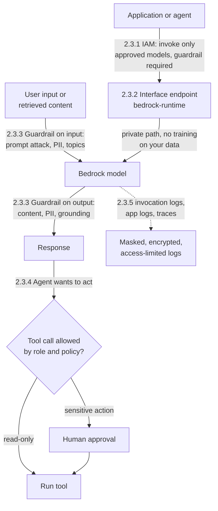

# Task 2.3: Secure the use of AI services

**Domain 2 · Task 2.3** · [Domain overview](../README.md)

This task, new in DVA-C03, covers what can go wrong when an application calls an artificial intelligence (AI) service such as Amazon Bedrock, and how a developer prevents it. It applies the same ideas as Tasks 2.1 and 2.2 to a new kind of component: least-privilege AWS Identity and Access Management (IAM) policies scoped to model Amazon Resource Names (ARNs), private connectivity with AWS PrivateLink, filtering untrusted input and output with Amazon Bedrock Guardrails, limiting what AI agents can do, and keeping prompts that contain personally identifiable information (PII) or protected health information (PHI) out of logs. The exam tests a developer using and securing AI services, not a machine learning (ML) engineer choosing or training models. Calling the services is covered in [1.1.10](../../domain-1-development-with-aws-services/task-1.1-build-application-code/1.1.10-managed-ai-service-integration.md); AI developer tools such as Kiro are in [1.1.9](../../domain-1-development-with-aws-services/task-1.1-build-application-code/1.1.9-ai-assisted-development-tools.md).

## Skills

| Skill | Note | Covers |
|---|---|---|
| 2.3.1 | [AI service access control](2.3.1-ai-service-access-control.md) | `bedrock:InvokeModel` on model and inference profile ARNs, runtime vs management permissions, current model access (first use, Marketplace, first-use forms), blocking models with IAM or service control policies (SCPs), `bedrock:GuardrailIdentifier`, enforced guardrails, roles for compute and agents, CloudTrail audit |
| 2.3.2 | [AI data privacy and private connectivity](2.3.2-ai-data-privacy-and-private-connectivity.md) | No-training commitment and model deployment accounts, AI services opt-out policies, interface endpoints for each Bedrock endpoint, endpoint policies, security groups, `aws:SourceVpce`, encryption, data minimization, insurance case study |
| 2.3.3 | [AI input and output filtering](2.3.3-ai-input-and-output-filtering.md) | Guardrails policies and which pattern each catches, tiers, creating and applying guardrails, input tags, `ApplyGuardrail`, the tool-use gap, direct and indirect prompt injection, defense in depth, output as untrusted input |
| 2.3.4 | [AI agent security](2.3.4-ai-agent-security.md) | Least privilege per tool, acting on behalf of the user (AgentCore Identity), AgentCore Gateway and Policy, session isolation (AgentCore Runtime microVMs, session IDs, memory, retrieval filters), user confirmation, return of control, `.waitForTaskToken`, multi-tenant case study |
| 2.3.5 | [AI sensitive data in logs](2.3.5-ai-sensitive-data-in-logs.md) | Model invocation logging, CloudWatch Logs data protection policies and `logs:Unmask`, metadata-only logging, masking before logging, guardrail traces and span attributes, encryption and retention, CloudTrail vs invocation logs |

## How the skills fit together

When a question gives a symptom, work through the skills in order: who could call it (2.3.1), what path the data took (2.3.2), what was filtered (2.3.3), what the agent was allowed to do (2.3.4), and where the data was recorded (2.3.5). Most scenarios map to one of them.

| Requirement in the question | Skill | Usual answer |
|---|---|---|
| Allow only one model, or block a model organization-wide | 2.3.1 | IAM `bedrock:InvokeModel` on the model ARN; SCP deny |
| Every call must use the company guardrail | 2.3.1 | `bedrock:GuardrailIdentifier` condition or an enforced guardrail |
| Bedrock calls must not leave the AWS network | 2.3.2 | Interface VPC endpoint plus endpoint policy and `aws:SourceVpce` |
| Are our prompts used for training? | 2.3.2 | No; providers cannot see them either |
| Harmful content, denied subject, specific words, PII | 2.3.3 | Content filter, denied topic, word filter, sensitive information filter |
| "Ignore previous instructions" | 2.3.3 | Prompt attack filter plus layered design |
| Same policies for a model outside Bedrock | 2.3.3 | `ApplyGuardrail` |
| Agent needs approval before acting | 2.3.4 | User confirmation, return of control, or `.waitForTaskToken` |
| One user's session must not reach another's | 2.3.4 | AgentCore Runtime session isolation, per-user IDs and retrieval filters |
| Full record of prompts and responses | 2.3.5 | Model invocation logging to encrypted storage |
| PII in log groups | 2.3.5 | CloudWatch Logs data protection policy, restricted `logs:Unmask`, stop logging raw prompts |

| Classic Domain 2 concern | Task 2.1 and 2.2 version | Task 2.3 version |
|---|---|---|
| Who can call what | IAM policy for S3 or DynamoDB | IAM policy on model ARNs and guardrails |
| Network path | VPC endpoints for AWS services | Interface endpoint for `bedrock-runtime` |
| Protecting data | AWS Key Management Service (AWS KMS), Secrets Manager | No-training commitment, Guardrails PII masking |
| Untrusted input | Validation against SQL injection | Prompt injection defenses, model output treated as untrusted |
| Least-privilege execution | Scoped Lambda role | Scoped agent tool roles and AgentCore Policy |
| Audit | CloudTrail | CloudTrail for `InvokeModel`, data events for `InvokeAgent` |
| Not logging secrets | Avoid logging credentials | Avoid logging raw prompts and responses |

## Study checklist

- [ ] 2.3.1 Write a least-privilege Bedrock runtime policy, block a model with an SCP, and force a guardrail with `bedrock:GuardrailIdentifier`.
- [ ] 2.3.2 Name the Bedrock endpoints, create an interface endpoint with a restrictive policy, and state the no-training commitment and where the opt-out policy applies instead.
- [ ] 2.3.3 Match each Guardrails policy to its pattern, attach a guardrail to `Converse` and `InvokeModel` (with input tags), and explain why prompt injection needs several layers.
- [ ] 2.3.4 Choose between user confirmation, return of control, and `.waitForTaskToken`, and explain session isolation vs IAM scoping.
- [ ] 2.3.5 State what model invocation logging captures and where, write a data protection policy, and find the code path that leaks a prompt before the guardrail runs.

## Labs and practice

- [Labs](labs.md): (1) interface VPC endpoint for `bedrock-runtime` with a restrictive endpoint policy; (2) Step Functions human-approval gate for an agent action.
- [Practice questions](practice-questions.md): 6 multiple-choice and multiple-response questions with explanations.
