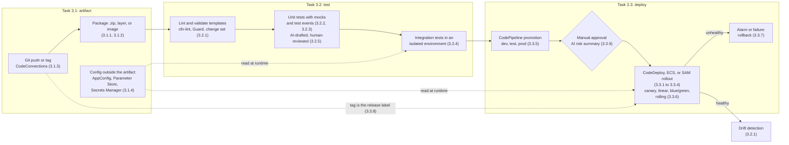
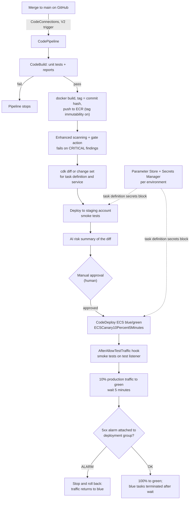

# Domain 3: Testing and Deployment (22%)

[Study guide home](../README.md) · Previous: [Domain 2: Security](../domain-2-security/README.md) · Next: [Domain 4: Troubleshooting and Optimization](../domain-4-troubleshooting-and-optimization/README.md)

Domain 3 tests whether you can get code from a Git commit to production on AWS safely and repeatably. You package code and container images into artifacts, keep environment-specific values outside those artifacts, test functions and templates before release, and ship through AWS continuous integration and continuous delivery (CI/CD) services: AWS CodePipeline, AWS CodeBuild, and AWS CodeDeploy. Exam questions are scenario-based. They ask which deployment strategy, rollback trigger, packaging format, configuration store, or test technique fits a stated requirement such as "roll back automatically on errors" or "promote the same build to production".

The three tasks follow the life of one release. [Task 3.1](task-3.1-prepare-deployable-artifacts/README.md) produces one immutable artifact per commit (a .zip file, a Lambda layer, or an image in Amazon Elastic Container Registry (ECR)) and moves configuration into services the artifact reads at runtime. [Task 3.2](task-3.2-test-applications/README.md) supplies the gates: template validation, unit tests with mocks and realistic events, integration tests in isolated environments, and drift detection after deployment. [Task 3.3](task-3.3-deploy-with-ci-cd/README.md) wires those gates into a pipeline that deploys infrastructure as code (IaC) with AWS CloudFormation and the AWS Serverless Application Model (AWS SAM), rolls out with blue/green, canary, linear, or rolling strategies, and rolls back when alarms fire. Artificial intelligence (AI) tools appear in Tasks 3.2 and 3.3 with one consistent rule: the tool proposes and summarizes, and a human or a deterministic check decides. Domain 4 reuses the same alarms and logs to troubleshoot deployments that fail.

## Tasks

| Task | Overview | Skills | Scope |
|---|---|---|---|
| 3.1 Prepare deployable application artifacts | [Task 3.1 README](task-3.1-prepare-deployable-artifacts/README.md) | 5 | Dependencies, container images and ECR, repositories as pipeline sources, per-environment configuration, API Gateway stages and endpoints |
| 3.2 Test applications in AWS environments | [Task 3.2 README](task-3.2-test-applications/README.md) | 5 | SAM, AWS Cloud Development Kit (AWS CDK), and CloudFormation testing, mock APIs, test events, isolated environments, AI-assisted testing |
| 3.3 Deploy through AWS CI/CD services | [Task 3.3 README](task-3.3-deploy-with-ci-cd/README.md) | 9 | Lambda and container deployment, IaC templates, CodeDeploy, CodePipeline promotion, strategies, rollback, versions, AI-assisted deployment |

## Skill map

### Task 3.1: Prepare deployable application artifacts

| Skill | Note | Summary |
|---|---|---|
| 3.1.1 | [Packaging dependencies and configuration](task-3.1-prepare-deployable-artifacts/3.1.1-packaging-dependencies-and-configuration.md) | Build once, deploy many; lock files and native dependencies for Lambda; AWS CodeArtifact upstreams and package origin controls; Elastic Beanstalk source bundles; CodeBuild artifacts. |
| 3.1.2 | [Container images and ECR](task-3.1-prepare-deployable-artifacts/3.1.2-container-images-and-ecr.md) | Multi-stage Dockerfiles, ECR login and push, commit-hash tags with tag immutability, lifecycle policy rules, basic and enhanced scanning. |
| 3.1.3 | [Code repositories in deployment](task-3.1-prepare-deployable-artifacts/3.1.3-code-repositories-in-deployment.md) | AWS CodeConnections to GitHub, GitLab, or Bitbucket; CodePipeline V2 triggers; pull request builds; what belongs in the repository; CodeCommit status. |
| 3.1.4 | [Environment-specific configuration](task-3.1-prepare-deployable-artifacts/3.1.4-environment-specific-configuration.md) | Choosing AWS AppConfig, Parameter Store, Secrets Manager, Lambda environment variables, stage variables, or IaC parameters for each value. |
| 3.1.5 | [API Gateway stages and endpoints](task-3.1-prepare-deployable-artifacts/3.1.5-api-gateway-stages-and-endpoints.md) | Deployments versus stages, stage variables pointing at Lambda aliases, canary releases on a stage, endpoint types, custom domains. |

### Task 3.2: Test applications in AWS environments

| Skill | Note | Summary |
|---|---|---|
| 3.2.1 | [Testing with SAM, CDK, and CloudFormation](task-3.2-test-applications/3.2.1-testing-with-sam-cdk-and-cloudformation.md) | Testing pyramid, `sam local` and `sam remote` command line interface (CLI) commands, CDK assertion and snapshot tests, cfn-lint, CloudFormation Guard, change sets, drift detection. |
| 3.2.2 | [Mock APIs](task-3.2-test-applications/3.2.2-mock-apis.md) | API Gateway `MOCK` integrations, stub backends per stage, software development kit (SDK) mocking with moto or botocore `Stubber`, Step Functions `TestState` mocks. |
| 3.2.3 | [Test events and payloads](task-3.2-test-applications/3.2.3-test-events-and-payloads.md) | Lambda console and CLI test events, `sam local generate-event`, event shapes per source, API Gateway console tests, EventBridge pattern tests. |
| 3.2.4 | [Isolated test environments](task-3.2-test-applications/3.2.4-isolated-test-environments.md) | Lambda versions and aliases, image tags and digests, Amplify branches and previews, Copilot environments, separate stages, APIs, stacks, and accounts. |
| 3.2.5 | [AI-assisted testing](task-3.2-test-applications/3.2.5-ai-assisted-testing.md) | Kiro specs, property-based tests, hooks, and headless runs; CodeBuild test and coverage reports; reviewing generated tests. |

### Task 3.3: Deploy through AWS CI/CD services

| Skill | Note | Summary |
|---|---|---|
| 3.3.1 | [Lambda packaging](task-3.3-deploy-with-ci-cd/3.3.1-lambda-packaging.md) | .zip archives, layers, or container images chosen by the 50 MB, 250 MB, and 10 GB limits, and packaging through SAM, CloudFormation, and CDK. |
| 3.3.2 | [Container deployments](task-3.3-deploy-with-ci-cd/3.3.2-container-deployments.md) | Amazon Elastic Container Service (ECS) task definitions and services, Fargate, rolling updates and the circuit breaker, Amazon Elastic Kubernetes Service (EKS) manifests, pipeline deploy files. |
| 3.3.3 | [Infrastructure as code deployment](task-3.3-deploy-with-ci-cd/3.3.3-infrastructure-as-code-deployment.md) | CloudFormation template sections, intrinsic functions, change sets, capabilities, resource protection, StackSets, SAM templates and CLI, CDK summary. |
| 3.3.4 | [CodeDeploy](task-3.3-deploy-with-ci-cd/3.3.4-codedeploy.md) | Applications, deployment groups, AppSpec files, lifecycle hooks, and predefined deployment configurations for Amazon Elastic Compute Cloud (EC2), Lambda, and ECS. |
| 3.3.5 | [CodePipeline release promotion](task-3.3-deploy-with-ci-cd/3.3.5-codepipeline-release-promotion.md) | Stages, actions, artifacts, V2 triggers and execution modes, buildspec files, manual approvals, cross-account promotion. |
| 3.3.6 | [Deployment strategies](task-3.3-deploy-with-ci-cd/3.3.6-deployment-strategies.md) | Blue/green, canary, linear, rolling, and immutable deployments compared on cost, speed, and risk across AWS services. |
| 3.3.7 | [Rollback](task-3.3-deploy-with-ci-cd/3.3.7-rollback.md) | Failure versus alarm triggers; automatic and manual rollback in CloudFormation, CodeDeploy, ECS, Lambda, and CodePipeline. |
| 3.3.8 | [Versions and releases](task-3.3-deploy-with-ci-cd/3.3.8-versions-and-releases.md) | Branching strategies, Git tags as release labels, commit traceability, and how Git releases map to Lambda versions and aliases. |
| 3.3.9 | [AI-assisted deployment](task-3.3-deploy-with-ci-cd/3.3.9-ai-assisted-deployment.md) | AI risk summaries for approvals, drafted environments checked by deterministic tools, AI analysis of post-deployment telemetry. |

## Artifact to test to deploy



The same artifact moves left to right without being rebuilt. Only the configuration it reads changes per environment, and every environment is a separate alias, stage, stack, or account ([3.2.4](task-3.2-test-applications/3.2.4-isolated-test-environments.md)).

## Worked case studies

These scenarios span several tasks. Each design decision links to the note that explains it, so read the decision here and the mechanism there.

### Case study 1: CI/CD for a containerized checkout microservice

**Requirement.** A checkout microservice runs on ECS with the Fargate launch type behind an Application Load Balancer (ALB). Every merge to `main` in GitHub must deploy automatically to staging. Production must not go live until unit tests pass, the infrastructure change is reviewed, and a human approves with an AI-generated risk summary in hand. If the 5xx error rate rises within 5 minutes of the new version receiving traffic, the deployment must roll back on its own. The database connection string and feature flags differ between staging and production, and the image must not be rebuilt for each environment.



| Decision | Why | Note |
|---|---|---|
| Source from GitHub through a CodeConnections connection with a V2 trigger on `main` | Pushes start the pipeline with no polling. Changing the provider later changes only the source action. | [3.1.3](task-3.1-prepare-deployable-artifacts/3.1.3-code-repositories-in-deployment.md), [3.3.5](task-3.3-deploy-with-ci-cd/3.3.5-codepipeline-release-promotion.md) |
| Run unit tests in CodeBuild before the image is built, and publish test and coverage reports | A failing test never produces a deployable image. Reports make failures readable in the console. | [3.2.1](task-3.2-test-applications/3.2.1-testing-with-sam-cdk-and-cloudformation.md), [3.2.5](task-3.2-test-applications/3.2.5-ai-assisted-testing.md) |
| Tag the image with the commit hash (SHA), never `latest`, and turn on tag immutability | Every deployment traces to one commit, and rollback targets an exact prior image. ECS resolves a tag to a digest at deployment start, so a reused tag does not update running tasks. | [3.1.2](task-3.1-prepare-deployable-artifacts/3.1.2-container-images-and-ecr.md), [3.3.2](task-3.3-deploy-with-ci-cd/3.3.2-container-deployments.md), [3.3.8](task-3.3-deploy-with-ci-cd/3.3.8-versions-and-releases.md) |
| Use enhanced scanning (Amazon Inspector) and add a pipeline action that fails on critical findings | Scanning only reports findings. It does not block a pull or a deployment unless the pipeline acts on the result. | [3.1.2](task-3.1-prepare-deployable-artifacts/3.1.2-container-images-and-ecr.md) |
| Review the infrastructure change with `cdk diff` or a CloudFormation change set | Shows a removed environment variable or a replaced resource before anything changes. | [3.2.1](task-3.2-test-applications/3.2.1-testing-with-sam-cdk-and-cloudformation.md), [3.3.3](task-3.3-deploy-with-ci-cd/3.3.3-infrastructure-as-code-deployment.md) |
| Inject per-environment values through the task definition `secrets` block, read by the task execution role | The same image runs in staging and production. Secrets Manager rotates the password; Parameter Store holds cheap non-secret settings; AppConfig handles flags that need a gradual rollout. | [3.1.4](task-3.1-prepare-deployable-artifacts/3.1.4-environment-specific-configuration.md), [2.2.7](../domain-2-security/task-2.2-encrypt-and-protect-sensitive-data/2.2.7-secrets-management.md) |
| Deploy staging and production into separate accounts through `sts:AssumeRole` into a cross-account role | The pipeline account never holds standing production credentials. Cross-account artifacts need a customer managed AWS Key Management Service (KMS) key. | [3.3.5](task-3.3-deploy-with-ci-cd/3.3.5-codepipeline-release-promotion.md#cross-account-and-cross-region-deployments), [2.1.7](../domain-2-security/task-2.1-authentication-and-authorization/2.1.7-assuming-iam-roles.md) |
| Put the AI risk summary in the manual approval action's review link, and grant `codepipeline:PutApprovalResult` only to people | The AI informs the approver. It does not approve. | [3.3.9](task-3.3-deploy-with-ci-cd/3.3.9-ai-assisted-deployment.md) |
| Build `imageDetail.json`, `taskdef.json`, and `appspec.yaml` for the Amazon ECS (blue/green) deploy action | That action hands the release to CodeDeploy. The standard ECS action needs only `imagedefinitions.json` and runs a rolling update. | [3.3.2](task-3.3-deploy-with-ci-cd/3.3.2-container-deployments.md#deploying-from-codepipeline), [3.3.4](task-3.3-deploy-with-ci-cd/3.3.4-codedeploy.md#ecs-compute-platform) |
| CodeDeploy ECS blue/green with `CodeDeployDefault.ECSCanary10Percent5Minutes` and two target groups | 10% of traffic for 5 minutes matches the 5-minute error window. Canary and linear shifting require an ALB; with a Network Load Balancer only `ECSAllAtOnce` is supported. | [3.3.4](task-3.3-deploy-with-ci-cd/3.3.4-codedeploy.md), [3.3.6](task-3.3-deploy-with-ci-cd/3.3.6-deployment-strategies.md) |
| Run smoke tests in an `AfterAllowTestTraffic` hook against the test listener | Green is checked before any production user reaches it. The hook function must report `Succeeded` or `Failed` with `PutLifecycleEventHookExecutionStatus`. | [3.3.4](task-3.3-deploy-with-ci-cd/3.3.4-codedeploy.md) |
| Attach the 5xx CloudWatch alarm to the deployment group and enable rollback when alarm thresholds are met | A failure trigger alone misses a release that deployed cleanly and then errors. Neither trigger is on unless you configure it. CodeDeploy rolls back by redeploying the last known good revision as a new deployment. | [3.3.7](task-3.3-deploy-with-ci-cd/3.3.7-rollback.md) |

**Alternative.** Since 2025, ECS also offers built-in blue/green, linear, and canary deployments with the `ECS` deployment controller, bake time, and Lambda lifecycle hooks, without CodeDeploy. Choose it for new services when the question allows; CodeDeploy blue/green (`CODE_DEPLOY` controller) still appears in exam questions. See [3.3.2](task-3.3-deploy-with-ci-cd/3.3.2-container-deployments.md#other-ecs-deployment-strategies) and [3.3.6](task-3.3-deploy-with-ci-cd/3.3.6-deployment-strategies.md).

### Case study 2: SAM pipeline for a Lambda orders API

**Requirement.** An orders API runs on API Gateway and Lambda, defined in a SAM template. Each release must reach 10% of traffic first and roll back on Lambda errors. A smoke test must pass before any traffic shifts. The canary slice must not hit cold starts, and developers must be able to test handlers without deploying.

The core of the template is short:

```yaml
GetOrderFunction:
  Type: AWS::Serverless::Function
  Properties:
    AutoPublishAlias: live
    DeploymentPreference:
      Type: Canary10Percent5Minutes
      Alarms:
        - !Ref OrdersErrorAlarm
      Hooks:
        PreTraffic: !Ref PreTrafficHook
```

| Decision | Why | Note |
|---|---|---|
| Test handlers locally with `sam local invoke` and events from `sam local generate-event`, and fake downstream services with moto or `Stubber` | Parsing and response logic is verified with no deployed stack. Local runs do not reproduce AWS Identity and Access Management (IAM) permissions or service limits, so integration tests still run in the cloud. | [3.2.1](task-3.2-test-applications/3.2.1-testing-with-sam-cdk-and-cloudformation.md), [3.2.2](task-3.2-test-applications/3.2.2-mock-apis.md), [3.2.3](task-3.2-test-applications/3.2.3-test-events-and-payloads.md) |
| Move shared libraries into a versioned layer | Function packages stay small, and every function picks up one dependency version on its next deploy. | [3.3.1](task-3.3-deploy-with-ci-cd/3.3.1-lambda-packaging.md) |
| Run `sam validate --lint` and `sam build` in CodeBuild, then deploy through a change set | Template errors stop the build stage. The CloudFormation deploy action applies the packaged template, not the raw one. | [3.3.3](task-3.3-deploy-with-ci-cd/3.3.3-infrastructure-as-code-deployment.md#sam-features-to-recognize), [3.3.5](task-3.3-deploy-with-ci-cd/3.3.5-codepipeline-release-promotion.md) |
| `AutoPublishAlias` plus `DeploymentPreference` instead of a hand-written AppSpec | SAM generates the version, alias, CodeDeploy application, and deployment group. You write an AppSpec file only when calling CodeDeploy directly. | [3.3.3](task-3.3-deploy-with-ci-cd/3.3.3-infrastructure-as-code-deployment.md#sam-features-to-recognize), [3.3.4](task-3.3-deploy-with-ci-cd/3.3.4-codedeploy.md) |
| `Canary10Percent5Minutes` with an error alarm, not a hand-weighted alias | A weighted alias alone has no alarms, hooks, or automatic rollback. | [3.3.6](task-3.3-deploy-with-ci-cd/3.3.6-deployment-strategies.md), [3.3.7](task-3.3-deploy-with-ci-cd/3.3.7-rollback.md) |
| `PreTraffic` hook (CodeDeploy `BeforeAllowTraffic`) invokes the new version directly | Smoke tests run before the alias moves. Lambda deployments have only `BeforeAllowTraffic` and `AfterAllowTraffic`; `AfterAllowTestTraffic` exists only for ECS. | [3.3.4](task-3.3-deploy-with-ci-cd/3.3.4-codedeploy.md) |
| Configure provisioned concurrency on the new version before the shift | Traffic shifting does not warm the new version. The two features are independent. | [3.3.6](task-3.3-deploy-with-ci-cd/3.3.6-deployment-strategies.md), [4.3.1](../domain-4-troubleshooting-and-optimization/task-4.3-optimize-applications/4.3.1-concurrency-controls.md) |
| API Gateway `dev` and `prod` stages call different aliases through a stage variable, with a Lambda permission per alias | One API definition serves both environments. A missing per-alias permission shows up as a 500 error from the stage. | [3.1.5](task-3.1-prepare-deployable-artifacts/3.1.5-api-gateway-stages-and-endpoints.md), [3.2.4](task-3.2-test-applications/3.2.4-isolated-test-environments.md) |
| Release from a Git tag, and record the commit in the version description | Each Lambda version traces back to source, and rollback to a previous version is one alias change. | [3.3.8](task-3.3-deploy-with-ci-cd/3.3.8-versions-and-releases.md) |

### Shorter scenarios

| Scenario | Decision | Notes |
|---|---|---|
| dev, staging, and prod share a codebase; a config mistake in one must not reach another, and builds must not be repeated | One immutable artifact tagged with the commit SHA; per-environment values in Parameter Store paths or Secrets Manager, read at runtime | [3.1.1](task-3.1-prepare-deployable-artifacts/3.1.1-packaging-dependencies-and-configuration.md), [3.1.4](task-3.1-prepare-deployable-artifacts/3.1.4-environment-specific-configuration.md) |
| A payments service must be undoable within seconds, even at the cost of double capacity | Blue/green: the old environment stays up, so rollback is a traffic flip | [3.3.6](task-3.3-deploy-with-ci-cd/3.3.6-deployment-strategies.md) |
| A cost-sensitive internal service can tolerate a mixed-version window | ECS rolling update with the deployment circuit breaker; rollback is slower because there is no single flip point | [3.3.2](task-3.3-deploy-with-ci-cd/3.3.2-container-deployments.md), [3.3.7](task-3.3-deploy-with-ci-cd/3.3.7-rollback.md) |
| A feature flag must reach 10% of users first and roll back on an alarm | AppConfig deployment strategy with a CloudWatch alarm monitor, not a Parameter Store value flipped for everyone | [3.1.4](task-3.1-prepare-deployable-artifacts/3.1.4-environment-specific-configuration.md) |
| A regulated pipeline needs template checks and a documented human sign-off even when an AI tool rates the change low-risk | cfn-lint and CloudFormation Guard as hard build gates, then a manual approval action informed by the AI summary | [3.2.1](task-3.2-test-applications/3.2.1-testing-with-sam-cdk-and-cloudformation.md), [3.3.9](task-3.3-deploy-with-ci-cd/3.3.9-ai-assisted-deployment.md) |
| Builds fail when a public npm or PyPI package disappears, or an attacker publishes a public package named like an internal one | CodeArtifact with an external connection that caches versions, plus package origin controls that block upstream for internal names | [3.1.1](task-3.1-prepare-deployable-artifacts/3.1.1-packaging-dependencies-and-configuration.md) |
| Old and untagged images pile up in ECR | A lifecycle policy that expires untagged images after N days and keeps the last N release tags | [3.1.2](task-3.1-prepare-deployable-artifacts/3.1.2-container-images-and-ecr.md) |
| A 40-minute test suite is mostly end-to-end tests against staging | Inverted testing pyramid: move coverage into unit and integration tests | [3.2.1](task-3.2-test-applications/3.2.1-testing-with-sam-cdk-and-cloudformation.md) |
| Someone changed a security group in the console after deployment | CloudFormation drift detection, then revert with a drift-aware change set or adopt the change in the template | [3.2.1](task-3.2-test-applications/3.2.1-testing-with-sam-cdk-and-cloudformation.md) |
| Every pull request needs its own preview environment | Amplify pull request previews for web apps, or a per-branch stack or stage for APIs | [3.2.4](task-3.2-test-applications/3.2.4-isolated-test-environments.md) |
| A front end team needs a backend that does not exist yet | API Gateway REST API `MOCK` integration returning fixed responses; HTTP APIs have no mock integration | [3.2.2](task-3.2-test-applications/3.2.2-mock-apis.md) |
| A stack update failed and the stack is stuck in `UPDATE_ROLLBACK_FAILED` | Fix the cause, then continue the rollback, skipping resources only if necessary | [3.3.7](task-3.3-deploy-with-ci-cd/3.3.7-rollback.md) |

### Cross-domain scenarios

Harder exam questions rarely stay inside one domain. In each of these, Domain 3 is the delivery path for decisions made elsewhere.

| Scenario | Other domains | Domain 3 part |
|---|---|---|
| Flash-sale checkout that must absorb a traffic spike and never double-charge | Conditional writes in DynamoDB ([1.3.4](../domain-1-development-with-aws-services/task-1.3-use-data-stores/1.3.4-dynamodb-design-and-operations.md)); encryption at rest ([2.2.1](../domain-2-security/task-2.2-encrypt-and-protect-sensitive-data/2.2.1-encryption-at-rest-and-in-transit.md)); custom metrics and tracing set up before the sale ([4.2.2](../domain-4-troubleshooting-and-optimization/task-4.2-observability/4.2.2-custom-metrics.md), [4.2.4](../domain-4-troubleshooting-and-optimization/task-4.2-observability/4.2.4-distributed-tracing.md)) | Blue/green or canary release with alarm-based rollback ([3.3.6](task-3.3-deploy-with-ci-cd/3.3.6-deployment-strategies.md), [3.3.7](task-3.3-deploy-with-ci-cd/3.3.7-rollback.md)) |
| Multi-tenant support chatbot on Amazon Bedrock | Agent tool and action group authorization ([2.3.4](../domain-2-security/task-2.3-secure-ai-services/2.3.4-ai-agent-security.md)); safe logging of model input and output ([2.3.5](../domain-2-security/task-2.3-secure-ai-services/2.3.5-ai-sensitive-data-in-logs.md)) | Changes to the agent's action groups ship through the pipeline behind a manual approval ([3.3.5](task-3.3-deploy-with-ci-cd/3.3.5-codepipeline-release-promotion.md), [3.3.9](task-3.3-deploy-with-ci-cd/3.3.9-ai-assisted-deployment.md)) |
| Healthcare records API leaving a monolith | Lambda attached to a virtual private cloud (VPC) reaching Amazon Relational Database Service (RDS) ([1.2.1](../domain-1-development-with-aws-services/task-1.2-develop-lambda-functions/1.2.1-lambda-vpc-access.md)); customer managed KMS key ([2.2.4](../domain-2-security/task-2.2-encrypt-and-protect-sensitive-data/2.2.4-kms-key-management.md)); CloudTrail evidence for audits ([4.1.1](../domain-4-troubleshooting-and-optimization/task-4.1-root-cause-analysis/4.1.1-debugging-code-and-integrations.md)) | Template validated with cfn-lint and Guard, deployed by change set, drift checked afterward ([3.2.1](task-3.2-test-applications/3.2.1-testing-with-sam-cdk-and-cloudformation.md), [3.3.3](task-3.3-deploy-with-ci-cd/3.3.3-infrastructure-as-code-deployment.md)) |
| First serverless feature in a legacy inventory system | VPC access to a private RDS instance ([1.2.1](../domain-1-development-with-aws-services/task-1.2-develop-lambda-functions/1.2.1-lambda-vpc-access.md)); structured logging from day one ([4.2.1](../domain-4-troubleshooting-and-optimization/task-4.2-observability/4.2.1-structured-logging.md)) | Externalized configuration so the function joins the existing promotion pipeline unchanged ([3.1.4](task-3.1-prepare-deployable-artifacts/3.1.4-environment-specific-configuration.md), [3.3.5](task-3.3-deploy-with-ci-cd/3.3.5-codepipeline-release-promotion.md)) |
| Cutting the serverless bill by changing Lambda memory | Memory and duration trade-off ([4.3.2](../domain-4-troubleshooting-and-optimization/task-4.3-optimize-applications/4.3.2-memory-and-compute-tuning.md)) | The memory change goes through the same template, pipeline, and canary rollback as any release, not a console edit ([3.3.3](task-3.3-deploy-with-ci-cd/3.3.3-infrastructure-as-code-deployment.md), [3.3.6](task-3.3-deploy-with-ci-cd/3.3.6-deployment-strategies.md)) |
| Pipeline roles with too many permissions | Least privilege for the CodePipeline and CodeBuild service roles ([2.1.6](../domain-2-security/task-2.1-authentication-and-authorization/2.1.6-least-privilege-permissions.md)) | Scope each role to its repository, bucket, and stack ([3.3.5](task-3.3-deploy-with-ci-cd/3.3.5-codepipeline-release-promotion.md)); read deploy logs when it fails ([4.1.4](../domain-4-troubleshooting-and-optimization/task-4.1-root-cause-analysis/4.1.4-diagnosing-deployment-failures.md)) |

## DVA-C02 vs DVA-C03

| Change | Detail |
|---|---|
| Weight | 24% in DVA-C02, 22% in DVA-C03. The domain is now named Testing and Deployment. |
| Testing consolidated | Two DVA-C02 testing tasks with 11 skills became one five-skill Task 3.2, which adds AI-generated tests, automated execution, result analysis, regression automation, and coverage checks. |
| Unit testing with SAM moved in | From Domain 1, Task 1.1 to Task 3.2 ([3.2.1](task-3.2-test-applications/3.2.1-testing-with-sam-cdk-and-cloudformation.md)). |
| API Gateway stages and custom domains moved | From DVA-C02 Task 3.4 to Task 3.1 ([3.1.5](task-3.1-prepare-deployable-artifacts/3.1.5-api-gateway-stages-and-endpoints.md)). |
| Container images added | Dockerfiles, ECR repositories, tags, and lifecycle policies are an explicit skill ([3.1.2](task-3.1-prepare-deployable-artifacts/3.1.2-container-images-and-ecr.md)). |
| Container deployment and AI in CI/CD added | ECS, EKS, and Fargate deployments, rolling updates ([3.3.2](task-3.3-deploy-with-ci-cd/3.3.2-container-deployments.md)), and AI-supported CI/CD workflows ([3.3.9](task-3.3-deploy-with-ci-cd/3.3.9-ai-assisted-deployment.md)). |
| IaC templates unchanged | CDK, SAM, and CloudFormation templates stay in Task 3.3 ([3.3.3](task-3.3-deploy-with-ci-cd/3.3.3-infrastructure-as-code-deployment.md)). |

Moves change where AWS classifies the material, not whether you need it. Full comparison: [exam guide](../00-foundations/exam-guide.md#dva-c02-and-dva-c03-comparison).

## Labs and practice

| Task | Labs | Practice questions |
|---|---|---|
| 3.1 | [2 labs](task-3.1-prepare-deployable-artifacts/labs.md): push an image to ECR with a lifecycle policy (3.1.2); deploy one .zip twice with per-environment Parameter Store config (3.1.4, 3.1.1) | [3 questions](task-3.1-prepare-deployable-artifacts/practice-questions.md), single answer, skills 3.1.1, 3.1.2, 3.1.4, 3.1.5 |
| 3.2 | [3 labs](task-3.2-test-applications/labs.md): validate and invoke with SAM (3.2.1, 3.2.3); detect and revert drift (3.2.1); unit and integration tests with mocked services (3.2.1, 3.2.2, 3.2.3) | [3 questions](task-3.2-test-applications/practice-questions.md), single answer, skills 3.2.1, 3.2.3, 3.2.5 |
| 3.3 | [4 labs](task-3.3-deploy-with-ci-cd/labs.md): Lambda AppSpec and canary deployment group (3.3.4, 3.3.6); alarm-driven rollback (3.3.7, 3.3.4); ECS task definitions and Fargate service (3.3.2); deployment configurations compared (3.3.4, 3.3.6) | [5 questions](task-3.3-deploy-with-ci-cd/practice-questions.md), 3 single answer and 2 "choose TWO", skills 3.3.1, 3.3.4 to 3.3.7, 3.3.9 |

Domain total: 9 labs and 11 practice questions. For night-before review, use the Domain 3 section of the [cheat sheet](../exam-prep/cheat-sheet.md).

## Sources

- Merged from: `archive/dva-c03/domain-3-testing-deployment/README.md` (pipeline walkthrough, checkout microservice case study, use cases, SAM pipeline example, ECS blue/green deep dive, additional scenarios), `archive/dva-c03/README.md` (cross-domain use cases), `00-foundations/exam-guide.md` (outline and DVA-C02 comparison).
- Current facts (CodeDeploy configuration names, ECS built-in blue/green, CodeCommit status, Copilot end of support, ECR scanning) follow the Domain 3 skill notes, which cite the AWS pages.
- AWS documentation: [Domain 3: Testing and Deployment](https://docs.aws.amazon.com/aws-certification/latest/developer-associate-03/developer-associate-03-domain3.html), [DVA-C02 and DVA-C03 comparison](https://docs.aws.amazon.com/aws-certification/latest/developer-associate-03/dva-03-comparison.html)
