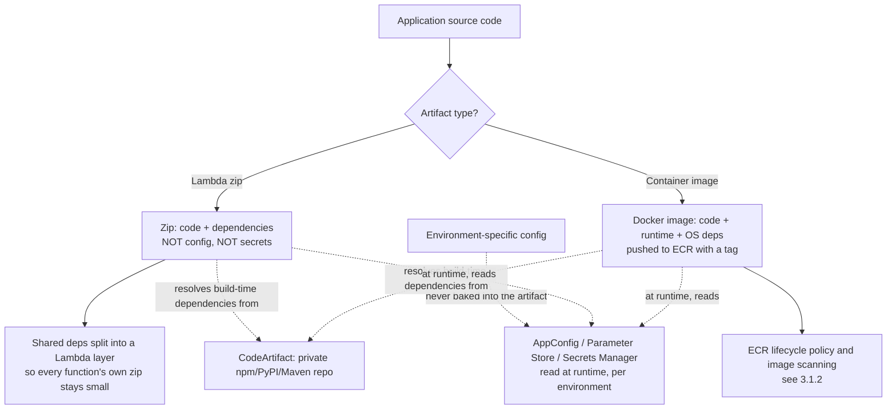
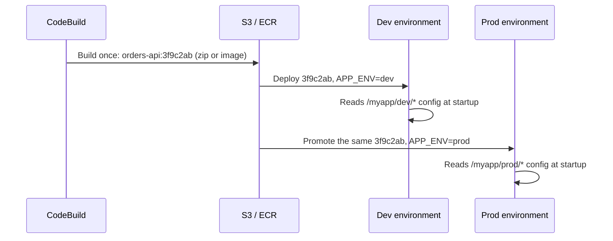
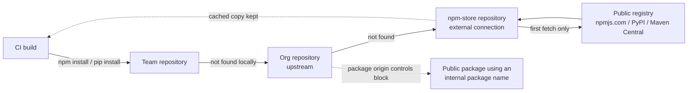

# 3.1.1 Package code dependencies, configuration files, environment variables, and related artifacts correctly

**Domain 3 · Task 3.1 · Skill 3.1.1** · [Task overview](README.md) · Previous: [2.3.5 AI sensitive data in logs](../../domain-2-security/task-2.3-secure-ai-services/2.3.5-ai-sensitive-data-in-logs.md) · Next: [3.1.2 Container images and ECR](3.1.2-container-images-and-ecr.md)

## What the exam expects

This skill tests whether you can turn source code into a deployment artifact that runs the same way in every environment. Questions describe a build that breaks, a package that is too big, a library that fails to import on Lambda, or a team that rebuilds for every environment, and ask for the packaging fix. The recurring rule is **build once, deploy many**: the artifact holds code and dependencies, and environment-specific values live outside it.

You must be able to:

- Decide what belongs inside an artifact (code, pinned dependencies, environment-neutral defaults) and what stays outside (environment-specific values, secrets).
- Package dependencies for each language, including native libraries that must match the Lambda operating system and CPU architecture.
- Choose between bundling dependencies, a Lambda layer, or a container image, and know the size limits that force the choice.
- Use AWS CodeArtifact to serve private packages and cache public ones, and authenticate build tools to it.
- Package an AWS Elastic Beanstalk source bundle with its dependency file and `.ebextensions` configuration.
- Produce build artifacts in AWS CodeBuild with `buildspec.yml`.

## Key terms

| Term | Meaning |
|---|---|
| Deployment artifact | The built output you deploy: a .zip file, Java archive (JAR), container image, or Beanstalk source bundle. |
| Dependency manifest | The file that lists libraries: `requirements.txt` or `pyproject.toml` (Python), `package.json` (Node.js), `pom.xml` or `build.gradle` (Java), `.csproj` (.NET), `go.mod` (Go). |
| Lock file | Records the exact resolved version of every dependency (`package-lock.json`, `poetry.lock`) so every build installs the same versions. |
| Build once, deploy many | Build one immutable artifact and promote it unchanged through dev, test, and prod. Only the configuration it reads changes. |
| Native dependency | A library with compiled code (for example `numpy`, `cryptography`, `sharp`) that must be built for the target OS and architecture. |
| Lambda layer | A .zip archive of libraries or a custom runtime that Lambda extracts into `/opt` and shares across functions. |
| AWS CodeArtifact | Managed package repository for npm, PyPI, Maven, Gradle, NuGet, Cargo, Swift, Ruby, and generic packages. |
| Upstream repository | A CodeArtifact repository that another repository falls back to when a package is not found locally. |
| External connection | A link from a CodeArtifact repository to a public registry such as npmjs.com or PyPI. Fetched packages are cached. |
| Source bundle | The .zip file you upload to Elastic Beanstalk as an application version. |
| `.ebextensions` | Folder at the root of a Beanstalk source bundle holding `.config` files (YAML or JSON) that set options and add resources. |

## What goes into an artifact



| Put inside the artifact | Keep outside the artifact |
|---|---|
| Application code | Database hosts, queue URLs, API base URLs that differ per environment |
| Dependencies at pinned versions (from a lock file) | Passwords, API keys, tokens |
| Environment-neutral defaults (log format, retry counts that never change per environment) | Feature flags and tuning values you want to change without a deploy |
| Build metadata (Git commit hash, also called the commit SHA, and a version string) | Anything a security team must rotate |
| Infrastructure templates that travel with the code (`template.yaml`, `appspec.yml`) | Developer-only tooling, tests, `.git`, local `.env` files |

If you must rebuild the .zip or image to point it at a different database, environment-specific configuration has leaked into the artifact. The fix is to externalize it, covered in [3.1.4 Environment-specific configuration](3.1.4-environment-specific-configuration.md).

## Build once, deploy many

The same artifact, identified by a version or commit hash, flows from the build stage to production. Staging and production never get separately rebuilt artifacts, so what you tested is exactly what you release.



Why it matters on the exam:

- A scenario that says "the same build artifact must be deployable unchanged to dev, staging, and production" points to externalized configuration, not to per-environment builds.
- Rebuilding per environment can pull different dependency versions (if versions are not pinned), so prod runs code that was never tested.
- Traceability: tagging the artifact with the commit SHA lets you tell exactly which code runs where. See [3.1.2](3.1.2-container-images-and-ecr.md) for image tags and [3.1.3](3.1.3-code-repositories-in-deployment.md) for passing the commit ID through a pipeline.

## Packaging dependencies by language

| Language | Manifest and lock | How to package for Lambda or a server |
|---|---|---|
| Python | `requirements.txt` or `pyproject.toml` plus a lock | `pip install -r requirements.txt --target ./package`, then zip `package/` with your code. Layers use `python/` inside the zip (extracted to `/opt/python`). |
| Node.js | `package.json` plus `package-lock.json` | `npm ci` (installs exactly what the lock file says), optionally bundle and tree-shake with esbuild. Layers use `nodejs/node_modules` (extracted to `/opt/nodejs/node_modules`). |
| Java | `pom.xml` or `build.gradle` | Build a fat (uber) JAR with Maven or Gradle, or put dependency JARs in a layer under `java/lib` (extracted to `/opt/java/lib`). |
| .NET | `.csproj` | `dotnet lambda package` or `dotnet publish` output zipped. |
| Go | `go.mod` and `go.sum` | Compile a static binary named `bootstrap` for the `provided.al2023` runtime, then zip it. |

Rules that apply to every language:

- **Pin versions** with a lock file and install from it (`npm ci`, not `npm install`) so builds are repeatable.
- **Exclude dev dependencies and tests** from the artifact. Smaller packages deploy faster and cold-start faster.
- **The AWS SDK is included** in Lambda managed runtimes, but bundling a pinned SDK version keeps behavior stable when the runtime's copy changes.
- **Do not commit dependency folders** (`node_modules/`, `package/`) to source control. Install them during the build.

### Native dependencies must match the Lambda environment

Lambda runs on Amazon Linux on x86_64 or arm64. A library compiled on a developer's Mac or Windows laptop can fail at import time on Lambda with errors such as `invalid ELF header` or `No module named '_cffi_backend'`.

Fixes:

- Build inside a container that matches the runtime: `sam build --use-container`.
- Build on Amazon Linux for the target architecture, or install wheels built for it, for example `pip install --platform manylinux2014_aarch64 --only-binary=:all: --target ./package -r requirements.txt` for arm64 (Graviton).
- For container images, build with `docker build --platform linux/arm64` (or `linux/amd64`) to match the function's architecture.

> **Exam trigger:** "Lambda fails importing a compiled library that works locally" → build for the Lambda OS and architecture, usually with `sam build --use-container`.

## Lambda packaging choices at a glance

Full treatment, including deployment commands and infrastructure as code (IaC) properties, is in [3.3.1 Lambda packaging](../task-3.3-deploy-with-ci-cd/3.3.1-lambda-packaging.md). The limits drive the choice:

| Method | Limits | Use when |
|---|---|---|
| .zip archive | 50 MB zipped for direct upload; 250 MB unzipped including all layers (upload larger zips through Amazon Simple Storage Service, or S3) | Most functions |
| Layers | Up to 5 layers per function, counted inside the 250 MB unzipped limit | Several functions share a large library; you want to update dependencies separately from code |
| Container image | Up to 10 GB, stored in Amazon Elastic Container Registry (ECR) | Large dependencies such as machine learning libraries, custom OS packages, existing container tooling |

Layer settings such as layer versions and extensions are covered in [1.2.2 Lambda configuration](../../domain-1-development-with-aws-services/task-1.2-develop-lambda-functions/1.2.2-lambda-configuration.md).

## Configuration files and environment variables in packages

| Mechanism | Safe for | Not for |
|---|---|---|
| Config file baked into the artifact | Environment-neutral defaults that only change with a code release | Anything that differs between dev and prod; secrets |
| Lambda environment variables | Non-secret, per-function settings such as table names, `APP_ENV`, log level. Up to 4 KB total. | Secrets in plaintext. Values you want to change without updating the function version. |
| Elastic Beanstalk environment properties | Per-environment settings passed to the app as environment variables | Secrets in plaintext |
| Amazon Elastic Container Service (ECS) task definition `environment` | Non-sensitive values | Secrets; use the `secrets` block with Secrets Manager or Parameter Store Amazon Resource Names (ARNs) |
| External store (AppConfig, Parameter Store, Secrets Manager) | Environment-specific values, feature flags, secrets | Values that change on every request |

A Lambda environment variable can hold the *name* of the environment or the *path* of a parameter (for example `CONFIG_PATH=/myapp/prod/`) while the value itself lives in Parameter Store. That keeps the artifact identical across environments. Encrypted environment variables are acceptable for non-secret configuration, but the best practice for passwords and keys is Secrets Manager or Parameter Store with caching, described in [2.2.7 Secrets management](../../domain-2-security/task-2.2-encrypt-and-protect-sensitive-data/2.2.7-secrets-management.md).

## AWS CodeArtifact: private packages and cached public packages

Pulling every dependency from the public internet on every build creates three problems:

- **Availability:** a public registry outage, or a package version removed by its author, breaks your build at a time you do not control.
- **Security:** nothing stops an attacker from publishing a public package with the same name as your internal one (dependency confusion), and you have no central control over what gets pulled.
- **Speed and cost:** every build downloads the same packages again.

CodeArtifact puts a managed repository, controlled by AWS Identity and Access Management (IAM), between your builds and the public registries.

### How CodeArtifact is organized

- A **domain** groups repositories, usually one per organization. Package assets are stored once per domain even if several repositories hold them, and one AWS Key Management Service (KMS) key encrypts the domain.
- A **repository** holds package versions and has an endpoint per package format.
- A repository can have **upstream repositories**. If a package is not found, CodeArtifact checks the upstreams in order.
- A repository can have an **external connection** to a public registry (npmjs.com, PyPI, Maven Central, NuGet Gallery, and others). Packages fetched through it are retained in CodeArtifact, so later builds get that version even if the public registry is down or the version is removed.
- Package versions have a **status**: Published, Unlisted, Archived, or Disposed.




*Source: [AWS CodeArtifact User Guide](https://docs.aws.amazon.com/codeartifact/latest/ug/welcome.html). A team repository resolves through an org repository to the public registry, with caching at the layer that holds the external connection.*

### Authenticating build tools

CodeArtifact uses an authorization token from the `GetAuthorizationToken` API, created from your AWS credentials.

- Tokens last **12 hours by default** and can be set from 15 minutes to 12 hours with `--duration-seconds`. When you are using an assumed role, `--duration-seconds 0` matches the token to the role session's remaining time.
- `aws codeartifact login --tool npm|pip|twine|dotnet|nuget|swift` fetches a token and configures the package manager in one step.
- For Maven, Gradle, and other tools without `login` support, call `get-authorization-token` and pass the token through an environment variable such as `CODEARTIFACT_AUTH_TOKEN`, not a file that could be committed.
- Root users cannot call `GetAuthorizationToken`.
- The caller needs `codeartifact:GetAuthorizationToken` and `sts:GetServiceBearerToken`, plus read permissions on the repository. Publishing needs `codeartifact:PublishPackageVersion`.

```bash
# Authenticate npm to a CodeArtifact repository, then install as normal
aws codeartifact login --tool npm --repository my-repo --domain my-domain --domain-owner 123456789012
npm ci   # resolves from CodeArtifact, which caches from the public registry

# Maven or Gradle: export a token for the build tool to read
export CODEARTIFACT_AUTH_TOKEN=$(aws codeartifact get-authorization-token \
  --domain my-domain --domain-owner 123456789012 \
  --query authorizationToken --output text)
```

### Access control and integrations

- **IAM policies** on the developer or CodeBuild role control who can read or publish.
- **Repository and domain resource policies** grant other accounts access. A repository policy grants read to all packages in a repository or none; there is no per-package read permission.
- **Cross-account domains:** pass `--domain-owner` when the domain belongs to another account.
- **Package origin controls** decide whether a package name may be published directly, fetched from upstream, or both. Blocking upstream for internal names such as `@mycompany/*` stops dependency confusion.
- **Amazon EventBridge** receives an event when a package version is created, modified, or deleted. A rule can start AWS CodePipeline to rebuild and redeploy an application when a patched library version is published.
- **Virtual private cloud (VPC) endpoints** let builds in private subnets reach CodeArtifact without internet access.

### CodeArtifact versus similar services

| Service | Stores | Typical consumer |
|---|---|---|
| CodeArtifact | Language packages (npm, PyPI, Maven, NuGet, and more) | `npm`, `pip`, `mvn` during the build's install phase |
| Amazon ECR | Container images and OCI (Open Container Initiative) artifacts | `docker pull`, ECS, Amazon Elastic Kubernetes Service (EKS), Lambda |
| Git repository | Source code | CodePipeline source action, CodeBuild |
| Amazon S3 | Build outputs (.zip files, templates), CodePipeline artifacts | Lambda `S3Key`, CloudFormation, CodeDeploy |

## Elastic Beanstalk source bundles

Elastic Beanstalk deploys a source bundle (.zip) as a new **application version**:

1. Describe dependencies in the platform's manifest (`requirements.txt` for Python, `package.json` for Node.js).
2. Zip the code with the manifest. Beanstalk installs the dependencies on each instance and starts the app.
3. Upload through the console, the Elastic Beanstalk Command Line Interface (EB CLI) `eb deploy`, or the API (create application version, then update environment).

Configuration as code lives in `.ebextensions`:

- The folder must be named **`.ebextensions`**, sit at the **root of the bundle**, and contain files ending in **`.config`** (YAML or JSON). A file named `settings.yaml` there is ignored.
- `option_settings` change environment options, including environment properties.
- `Resources` can add AWS resources (an ElastiCache cluster, an S3 bucket, a DynamoDB table). Beanstalk provisions them through AWS CloudFormation, and they are **deleted when the environment is deleted**.

```yaml
# .ebextensions/env.config
option_settings:
  aws:elasticbeanstalk:application:environment:
    LOG_LEVEL: info
    CONFIG_PATH: /myapp/prod/
```

Keep environment-specific values such as a database URL out of the bundle when you promote the same bundle between environments. Set them as environment properties per environment instead (see [3.1.4](3.1.4-environment-specific-configuration.md#elastic-beanstalk-environment-properties)).

### Application version lifecycle policy

Elastic Beanstalk has a quota on stored application versions (for example 1,000 per Region, shared across all applications). When you hit it, new versions cannot be created and deployments fail.

- An **application version lifecycle policy** deletes old versions by age or by count.
- Versions in use by an environment are never deleted.
- You can keep the source bundle in S3 when the version is deleted.
- The policy runs when a new version is created, so if you are already at the quota you must delete some versions manually first.

## Producing artifacts in CodeBuild

AWS CodeBuild runs `buildspec.yml` from the root of the source to install dependencies, test, and package. The `artifacts` section defines what goes to S3 (encrypted with KMS) as the build output, and `cache` keeps downloaded dependencies between builds. Pipeline wiring is covered in [3.3.5 CodePipeline release promotion](../task-3.3-deploy-with-ci-cd/3.3.5-codepipeline-release-promotion.md).

```yaml
version: 0.2

env:
  variables:
    NODE_ENV: production
  parameter-store:
    API_URL: /myapp/prod/api-url
  secrets-manager:
    DB_PASSWORD: prod/myapp/db:password

phases:
  install:
    runtime-versions:
      nodejs: 20
    commands:
      - aws codeartifact login --tool npm --domain my-domain --domain-owner $AWS_ACCOUNT_ID --repository my-repo
      - npm ci
  pre_build:
    commands:
      - npm test
  build:
    commands:
      - npm run build
  post_build:
    commands:
      - echo "Build completed on $(date)"

artifacts:
  files:
    - '**/*'
  base-directory: dist

cache:
  paths:
    - 'node_modules/**/*'
```

Points to remember:

- `buildspec.yml` must be at the **root** of the source unless the project names another path.
- Secrets reach the build through `env.parameter-store` and `env.secrets-manager`, never as plaintext `env.variables`. The CodeBuild service role needs read access to those parameters and secrets.
- `cache` (S3 or local) speeds up builds that re-download dependencies.
- The build role needs CodeArtifact permissions for the `login` line to work.

## Exam triggers

| Scenario clue | Answer | Why the alternatives are wrong |
|---|---|---|
| Same artifact must run in dev, staging, and prod without a rebuild | Externalize configuration (AppConfig, Parameter Store, Secrets Manager) and read it at runtime | Per-environment builds break "what you tested is what you ship"; baked-in config files force rebuilds |
| Share internal libraries across teams and cache public packages | CodeArtifact with upstream repositories and an external connection | S3 has no package manager protocol; ECR stores images, not npm or PyPI packages |
| Builds fail because a public package version was removed or the registry is down | Resolve packages through CodeArtifact, which keeps fetched versions | Vendoring into Git bloats the repo; retries do not help when the version is gone |
| Attacker publishes a public package with your internal package's name | CodeArtifact package origin controls that block upstream for internal names | A naming convention alone does not stop a resolver from preferring the public copy |
| Maven build in CodeBuild must authenticate to CodeArtifact | `get-authorization-token` into an environment variable such as `CODEARTIFACT_AUTH_TOKEN` | Storing a long-lived token in the repo exposes it; tokens expire after at most 12 hours anyway |
| Lambda fails importing a compiled library that works on a laptop | Build for Amazon Linux and the function's architecture (`sam build --use-container`) | Raising memory or timeout does not fix a binary built for the wrong OS |
| Several functions share a 40 MB library | Lambda layer | Copying it into every zip wastes space and causes version drift |
| Package exceeds 250 MB unzipped | Container image (up to 10 GB) | Layers count toward the same 250 MB limit |
| Beanstalk ignores your configuration file | Put `.config` files in `.ebextensions/` at the bundle root | Other folder names or file extensions are not read |
| Beanstalk deployments fail with too many application versions | Application version lifecycle policy | Deleting the environment does not clear versions from the application |
| Database password needed during a CodeBuild build | buildspec `env.secrets-manager` or `env.parameter-store` | Plaintext `env.variables` show up in the console and logs |

## Common traps

- Confusing CodeArtifact (language packages), ECR (container images), and a Git repository (source code). Three different artifact types.
- Treating Lambda environment variables as a secret store. They are for non-secret configuration; secrets belong in Secrets Manager or Parameter Store.
- Assuming an encrypted environment variable makes it fine to bake a production password into a template or artifact.
- Forgetting that CodeArtifact keeps fetched versions only after the first fetch through it. It cannot rescue a version it never cached.
- Placing `.ebextensions` inside a subfolder or naming files `.yaml`. Beanstalk only reads `.ebextensions/*.config` at the root.
- Provisioning a production database through `.ebextensions` resources. It is deleted with the environment.
- Running `npm install` in continuous integration (CI) instead of `npm ci`, which can drift from the lock file.
- Building native Python wheels on macOS and zipping them for Lambda.

## Quick recall

- Build once, deploy many: artifact = code + pinned dependencies; config and secrets live outside.
- Lambda limits: 50 MB zipped direct upload, 250 MB unzipped with layers, 5 layers, 10 GB container image, 4 KB environment variables.
- Native dependencies: `sam build --use-container`, match x86_64 or arm64.
- CodeArtifact: domain → repositories → upstreams → one repository with the external connection to the public registry.
- CodeArtifact token: 12 hours by default, 15 minutes to 12 hours; `aws codeartifact login --tool npm|pip|twine|dotnet|nuget|swift`.
- CodeArtifact repository policy: read all packages or none.
- Package origin controls stop dependency confusion.
- Beanstalk: `.ebextensions/*.config` at the root; resources defined there die with the environment; application version lifecycle policy prevents the version quota from blocking deploys.
- buildspec: at the root; `env.parameter-store` and `env.secrets-manager` for secrets; `cache` for dependencies.

## Related skills

- [3.1.2 Container images and ECR](3.1.2-container-images-and-ecr.md): when the artifact is an image instead of a .zip.
- [3.1.4 Environment-specific configuration](3.1.4-environment-specific-configuration.md): where the values you kept out of the artifact live.
- [3.3.1 Lambda packaging](../task-3.3-deploy-with-ci-cd/3.3.1-lambda-packaging.md): .zip, layer, and image deployment in depth.
- [3.3.5 CodePipeline release promotion](../task-3.3-deploy-with-ci-cd/3.3.5-codepipeline-release-promotion.md): how the artifact moves between environments.
- [1.2.2 Lambda configuration](../../domain-1-development-with-aws-services/task-1.2-develop-lambda-functions/1.2.2-lambda-configuration.md): environment variables, layers, and extensions as function settings.
- [2.2.7 Secrets management](../../domain-2-security/task-2.2-encrypt-and-protect-sensitive-data/2.2.7-secrets-management.md): storing and rotating the secrets you kept out of the package.

## Sources

- Merged from: `archive/dva-c03-study-notes/03-testing-deployment.md` (skill 3.1.1), `archive/dva-c03/domain-3-testing-deployment/README.md` (Task 3.1 diagram, use cases, scenarios), `archive/dva-c03/domain-3-testing-deployment/MASTER-CHUNK.md` (section 5, CodeArtifact), `archive/aws-dva-notes/Markdown Files/14. Elastic Beanstalk.md`, `archive/aws-dva-notes/Markdown Files/18. Serverless - Lambda.md` (sections 10, 14, 16), `archive/aws-dva-notes/Markdown Files/21. CICD - CodeCommit, CodePipeline, CodeBuild, CodeDeploy.md` (sections 4 and 6), `archive/aws-dva-notes/Markdown Files/27. AWS Security & Encryption.md` (section 15), `archive/dva-c03-study-notes/00-developer-basics.md`.
- AWS documentation: [AWS CodeArtifact authentication and tokens](https://docs.aws.amazon.com/codeartifact/latest/ug/tokens-authentication.html)
- AWS documentation: [What is AWS CodeArtifact?](https://docs.aws.amazon.com/codeartifact/latest/ug/welcome.html)
