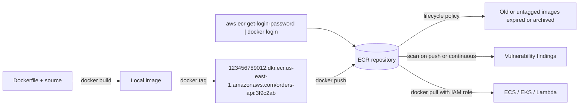

# 3.1.2 Build and manage container images with Dockerfiles, ECR repositories, image tags, and lifecycle policies

**Domain 3 · Task 3.1 · Skill 3.1.2** · [Task overview](README.md) · Previous: [3.1.1 Packaging dependencies and configuration](3.1.1-packaging-dependencies-and-configuration.md) · Next: [3.1.3 Code repositories in deployment](3.1.3-code-repositories-in-deployment.md)

## What the exam expects

DVA-C03 made container images an explicit skill. Questions describe a Dockerfile that builds slowly or produces a huge image, a pipeline that cannot push to Amazon Elastic Container Registry (ECR), a tag that silently points at the wrong code, or a repository full of old images, and ask for the fix. You do not need deep Docker internals, but you must know the build, tag, push workflow and the ECR features that keep images traceable and cheap.

You must be able to:

- Read and write a Dockerfile, including multi-stage builds, layer caching, and a Lambda base image.
- Authenticate to ECR, then build, tag, and push an image from a laptop or AWS CodeBuild.
- Choose a tagging strategy (Git commit hash, also called the commit SHA, semantic version, environment) and know why `latest` is risky.
- Turn on tag immutability and deploy by digest.
- Write and reason about ECR lifecycle policy rules, including rule priority.
- Configure image scanning, repository policies, replication, and pull-through cache.

> **DVA-C02 vs DVA-C03.** DVA-C02 mentioned ECR mostly as "where Amazon Elastic Container Service (ECS) pulls images from." DVA-C03 Task 3.1 names Dockerfiles, ECR repositories, image tagging, and lifecycle policies directly, so expect questions on each.

## Key terms

| Term | Meaning |
|---|---|
| Image | Read-only package of application code, runtime, libraries, and OS files, built from a Dockerfile. |
| Container | A running instance of an image. |
| Layer | One cached filesystem change produced by a Dockerfile instruction. Unchanged layers are reused between builds and deduplicated in ECR. |
| Registry | A service that stores images. ECR is AWS's registry; each account has one private registry per Region. |
| Repository | A named collection of images inside a registry, for example `orders-api`. |
| Tag | A human-readable, movable label on an image, such as `v1.4.2`, `3f9c2ab`, or `latest`. |
| Digest | The immutable content hash of an image manifest, such as `sha256:4f70...`. The same digest always means the same bytes. |
| Multi-stage build | A Dockerfile with several `FROM` stages, where only the final, slim stage becomes the shipped image. |
| Lifecycle policy | JSON rules on an ECR repository that expire or archive images by tag status, tag pattern, age, or count. |
| Tag immutability | Repository setting that rejects a push reusing an existing tag. |

## Dockerfile basics

| Instruction | Purpose |
|---|---|
| `FROM` | Base image. For Lambda, use an AWS base image such as `public.ecr.aws/lambda/python:3.13`. |
| `WORKDIR` | Working directory for later instructions. |
| `COPY` | Copy files from the build context into the image. |
| `RUN` | Run a command at build time (install packages, compile). |
| `ENV` | Set an environment variable in the image. Use only for non-secret, environment-neutral defaults. |
| `EXPOSE` | Document the port the container listens on. |
| `USER` | Run as a non-root user. |
| `ENTRYPOINT` / `CMD` | The process to start. For Lambda images, `CMD` names the handler. |

### Keep images small and builds fast

- **Multi-stage builds:** compile or install in a large build stage, then copy only the output into a slim runtime stage.
- **Order instructions from stable to frequently changing.** Copy dependency manifests and install dependencies before copying source code, so a code change does not invalidate the dependency layer.
- **`.dockerignore`:** exclude `.git`, `node_modules`, tests, and local `.env` files from the build context. This also keeps secrets out of the image.
- **Slim, trusted base images:** AWS-provided or official minimal images, pinned to a version rather than `latest`.
- **`USER`** a non-root account.
- **`--platform linux/arm64`** (or `linux/amd64`) to match the target, for example AWS Graviton instances or an arm64 Lambda function.
- **Never put secrets in `ENV`, `ARG`, or a copied file.** Anyone who can pull the image can read its layers. Inject secrets at runtime (see [3.1.4](3.1.4-environment-specific-configuration.md)).

```dockerfile
# Multi-stage build for a Node.js service
FROM public.ecr.aws/docker/library/node:20-slim AS build
WORKDIR /app
COPY package.json package-lock.json ./
RUN npm ci                      # cached until the lock file changes
COPY . .
RUN npm run build && npm prune --omit=dev

FROM public.ecr.aws/docker/library/node:20-slim
WORKDIR /app
COPY --from=build /app/dist ./dist
COPY --from=build /app/node_modules ./node_modules
USER node
EXPOSE 8080
CMD ["node", "dist/server.js"]
```

### Lambda container images

Lambda can run images up to 10 GB from ECR. The image must implement the Lambda Runtime API, which the AWS base images do. Images from other bases need the runtime interface client. Test locally with the Lambda Runtime Interface Emulator.

```dockerfile
# Use an AWS base image that implements the Lambda Runtime API
FROM public.ecr.aws/lambda/nodejs:20
COPY app.js package*.json ${LAMBDA_TASK_ROOT}/
RUN npm install
CMD [ "app.lambdaHandler" ]
```

- AWS base images are built on Amazon Linux and cached by Lambda, which helps cold starts.
- Older examples use `amazon/aws-lambda-nodejs:12`. Node.js 12 is long deprecated; current base images live in the ECR Public Gallery as `public.ecr.aws/lambda/<runtime>:<version>`.
- Functions that share large layers can use a single ECR repository, because ECR deduplicates layers.
- Choosing between a .zip and an image is covered in [3.3.1 Lambda packaging](../task-3.3-deploy-with-ci-cd/3.3.1-lambda-packaging.md).

## Build, tag, and push to ECR



```bash
# 1. Create the repository with immutable tags and scan on push
aws ecr create-repository --repository-name orders-api \
  --image-tag-mutability IMMUTABLE \
  --image-scanning-configuration scanOnPush=true

# 2. Authenticate Docker to the private registry (AWS CLI v2)
aws ecr get-login-password --region us-east-1 | docker login --username AWS \
  --password-stdin 123456789012.dkr.ecr.us-east-1.amazonaws.com

# 3. Build, tag with the commit SHA, push
docker build -t orders-api .
docker tag orders-api:latest 123456789012.dkr.ecr.us-east-1.amazonaws.com/orders-api:$(git rev-parse --short HEAD)
docker push 123456789012.dkr.ecr.us-east-1.amazonaws.com/orders-api:$(git rev-parse --short HEAD)
```

Authentication facts:

- `aws ecr get-login-password` exchanges your AWS Identity and Access Management (IAM) credentials (often temporary role credentials) for a Docker login token valid for **12 hours**. A "no basic auth credentials" error on push or pull usually means the token expired or you never logged in.
- The pushing principal needs `ecr:GetAuthorizationToken` plus repository actions such as `ecr:InitiateLayerUpload`, `ecr:UploadLayerPart`, `ecr:CompleteLayerUpload`, `ecr:BatchCheckLayerAvailability`, and `ecr:PutImage`. Pulling needs `ecr:BatchGetImage` and `ecr:GetDownloadUrlForLayer`.
- ECR access is controlled through IAM. If an Amazon Elastic Compute Cloud (EC2) instance, ECS task, or pipeline cannot pull, check the instance profile, the ECS task execution role, or the build role first.

### Building in CodeBuild

- Docker builds in AWS CodeBuild need **privileged mode** turned on for the project (unless you use a build approach that does not need the Docker daemon). Without it, `docker build` fails with an error that the Docker daemon is not reachable.
- The CodeBuild service role needs the ECR push permissions above, scoped to the target repository.
- `CODEBUILD_RESOLVED_SOURCE_VERSION` holds the commit ID, which makes a traceable tag.

```yaml
# buildspec.yml: build the image, tag it with the commit hash, push it
version: 0.2
phases:
  pre_build:
    commands:
      - aws ecr get-login-password --region $AWS_DEFAULT_REGION | docker login --username AWS --password-stdin $AWS_ACCOUNT_ID.dkr.ecr.$AWS_DEFAULT_REGION.amazonaws.com
      - COMMIT_HASH=$(echo $CODEBUILD_RESOLVED_SOURCE_VERSION | cut -c 1-7)
  build:
    commands:
      - docker build -t orders-api:$COMMIT_HASH .
      - docker tag orders-api:$COMMIT_HASH $AWS_ACCOUNT_ID.dkr.ecr.$AWS_DEFAULT_REGION.amazonaws.com/orders-api:$COMMIT_HASH
  post_build:
    commands:
      - docker push $AWS_ACCOUNT_ID.dkr.ecr.$AWS_DEFAULT_REGION.amazonaws.com/orders-api:$COMMIT_HASH
      - printf '{"ImageURI":"%s"}' $AWS_ACCOUNT_ID.dkr.ecr.$AWS_DEFAULT_REGION.amazonaws.com/orders-api:$COMMIT_HASH > imageDetail.json
artifacts:
  files:
    - imageDetail.json
```

The `imageDetail.json` file (for the ECS blue/green deploy action) and `imagedefinitions.json` (for the standard ECS deploy action) tell the next pipeline stage which image to deploy. Those deployment files are covered in [3.3.2 Container deployments](../task-3.3-deploy-with-ci-cd/3.3.2-container-deployments.md). Other build options include EC2 Image Builder container recipes and local Docker or Finch.

## Tagging strategy

| Tag style | Example | Strength | Weakness |
|---|---|---|---|
| Git commit SHA | `3f9c2ab` | Traces a running container back to exact source | Not meaningful to humans |
| Semantic version | `1.4.2` | Communicates release meaning; pairs with Git release tags | Must be enforced so nobody re-pushes `1.4.2` |
| Build number | `build-123` | Unique per pipeline run | Needs a lookup to find the commit |
| Environment | `staging`, `prod` | Shows what is promoted where | Moves over time, so it is not an identity |
| `latest` | `latest` | Convenient for local work | Changes on every push, so you cannot tell what is running or roll back cleanly |

Guidance:

- Tag every build with something unique and immutable (commit SHA or build number), and add a semantic version for releases.
- **Do not rely on `latest`** in deployments. It is only a tag, not "the newest image." Without tag immutability, a later push silently repoints it, which causes "I deployed new code but the old version still runs" and the reverse.
- **Deploy by digest** (`orders-api@sha256:...`) when you need an exact, unchangeable reference.
- **Promote by retagging the same digest** (`build-123` → `staging` → `prod`) instead of rebuilding. This is the container form of build once, deploy many, and it is also how image tags create isolated environments in [3.2.4](../task-3.2-test-applications/3.2.4-isolated-test-environments.md).

### Tag immutability

- `MUTABLE` (default): a push with an existing tag moves the tag to the new image.
- `IMMUTABLE`: ECR rejects a push that reuses an existing tag with `ImageTagAlreadyExistsException`. `v1.2.0` always means the same image.
- `IMMUTABLE_WITH_EXCLUSION`: tags are immutable except those matching exclusion filters, for example keep release tags immutable while letting `latest` move.
- `MUTABLE_WITH_EXCLUSION`: tags are mutable except those matching the filters, which stay fixed.

Turning on immutability breaks a pipeline that re-pushes the same tag (such as `latest`) on every build. Switch the pipeline to unique tags, or exclude that one tag.

## Lifecycle policies

Lifecycle policies clean up images automatically so storage costs and console clutter do not grow forever. ECR applies them within 24 hours after an image meets the criteria, and records each action in AWS CloudTrail.


*Source: [Amazon ECR User Guide: Automate the cleanup of images by using lifecycle policies](https://docs.aws.amazon.com/AmazonECR/latest/userguide/LifecyclePolicies.html). Create rules, preview their effect, then apply them.*

### Rule structure

Each rule has a `rulePriority`, a `selection`, and an `action`.

| Field | Values |
|---|---|
| `tagStatus` | `tagged`, `untagged`, or `any` |
| `tagPrefixList` / `tagPatternList` | Prefixes (`release-`) or wildcard patterns (`prod*`). Only valid with `tagStatus: tagged`. A rule uses one or the other, not both. |
| `countType` | `imageCountMoreThan` (keep the newest N), `sinceImagePushed` (older than N days), `sinceImagePulled` (not pulled for N days), `sinceImageTransitioned` (archived for N days) |
| `countUnit` / `countNumber` | `days` and the number, or just the count for `imageCountMoreThan` |
| `action.type` | `expire` (delete) or `transition` to the `archive` storage class |

```json
{
  "rules": [
    {
      "rulePriority": 1,
      "description": "Keep the last 30 release images",
      "selection": {
        "tagStatus": "tagged",
        "tagPrefixList": ["release-"],
        "countType": "imageCountMoreThan",
        "countNumber": 30
      },
      "action": { "type": "expire" }
    },
    {
      "rulePriority": 2,
      "description": "Expire untagged images older than 14 days",
      "selection": {
        "tagStatus": "untagged",
        "countType": "sinceImagePushed",
        "countUnit": "days",
        "countNumber": 14
      },
      "action": { "type": "expire" }
    },
    {
      "rulePriority": 3,
      "description": "Keep only the newest 50 of any remaining images",
      "selection": {
        "tagStatus": "any",
        "countType": "imageCountMoreThan",
        "countNumber": 50
      },
      "action": { "type": "expire" }
    }
  ]
}
```

### How rules are evaluated

- **A lower `rulePriority` number wins.** Priority 1 beats priority 2.
- All rules are evaluated at the same time, then applied by priority. **Each image is acted on by exactly one rule or none.**
- An image that matches the tagging requirements of a higher-priority rule cannot be expired by a lower-priority rule. A broad rule placed above a narrow protective rule therefore wins, which is the classic rule-ordering bug.
- Only one rule per storage class may select untagged images.
- A rule with `tagStatus: any` must have the highest number (lowest priority).
- Expiration always removes older images before newer ones.
- **Preview before applying:** `aws ecr start-lifecycle-policy-preview` shows exactly which images a policy would touch. If a policy deleted an image you still needed, a rule-ordering mistake is the usual cause.

To protect production images while cleaning up everything else, give the protective rule for `prod` tags the lowest number and a generous count, then add cleanup rules below it. Never rely on one catch-all rule.

### Archive storage class

Since November 2025, ECR has an **archive** storage class for rarely pulled images. Lifecycle rules can `transition` images to archive (for example, not pulled in 90 days) and later expire them.

- Archived images **cannot be pulled**; a pull returns 404. They still appear in `describe-images` with status `ARCHIVED`.
- Archive has a **90-day minimum storage duration**. Lifecycle policies cannot delete images archived for less than 90 days.
- Restore by selecting the image or by pushing it again.

Archive reduces storage cost for images you must keep for audit. It is not a substitute for expiring images you never need.

## Image scanning

| Mode | Engine | When it scans | Coverage |
|---|---|---|---|
| Basic | ECR, using AWS native scanning technology (the older Clair engine was retired in February 2026) | On push, or manually | OS packages |
| Enhanced | Amazon Inspector | On push and continuously as new Common Vulnerabilities and Exposures (CVEs) are published | OS packages and programming language packages |

- Scanning **reports** findings. It does not block `docker pull` or a deployment by itself.
- To gate a pipeline on findings, route scan results (EventBridge events or the Inspector and ECR APIs) to a pipeline action, often a Lambda invoke action that fails the stage when a `CRITICAL` finding exists for the image digest being deployed.
- "Scan for vulnerabilities and block risky images from production" → enhanced scanning plus an explicit pipeline gate.

## Other ECR features

| Feature | What it does | Exam clue |
|---|---|---|
| Repository policy | Resource-based policy on a repository, for example allow another account's role to pull, or restrict push to the CI role | "Account B's ECS tasks must pull from account A's repository" |
| Replication | Cross-Region and cross-account replication of images, preserving tags and digests | "Images must be available in a DR Region" |
| Pull-through cache | Caches images from upstream registries (ECR Public, Docker Hub, Quay, and others) inside your private registry | "Avoid Docker Hub rate limits; pull public base images from inside AWS" |
| Repository creation templates | Default settings (immutability, lifecycle, encryption) for repositories created by pull-through cache or replication | "New repositories must get our standard policies automatically" |
| Encryption | AES-256 by default, or AWS Key Management Service (KMS) keys | "Images must be encrypted with a customer managed key" |
| Image signing | AWS Signer with the Notation client signs images; verification happens at deploy time | "Only signed images may run" |
| Virtual private cloud (VPC) endpoints | Interface endpoints `ecr.api` and `ecr.dkr`, plus an Amazon Simple Storage Service (S3) gateway endpoint for layer downloads | "Tasks in a private subnet with no NAT cannot pull images" |
| ECR Public | Public repositories in the ECR Public Gallery (`gallery.ecr.aws`) | "Distribute an open-source image publicly" |

ECR only stores and serves images. It never runs them. Running belongs to Amazon ECS, Amazon Elastic Kubernetes Service (EKS), AWS Fargate, or Lambda, covered in [3.3.2](../task-3.3-deploy-with-ci-cd/3.3.2-container-deployments.md). For ECS, the **task execution role** (or the EC2 instance profile on the EC2 launch type) pulls the image; the task role is what your application code uses.

## Worked scenario

A team pushes an image on every commit to `main`, tagged with the commit SHA. Six months later the repository holds thousands of images, and an engineer re-pushed `v2.0.0` by mistake, so prod rolled to untested code.

| Problem | Fix |
|---|---|
| Thousands of old images | Lifecycle policy: keep the last 30 `release-` images, expire untagged images after 14 days, cap everything else at 50 |
| `v2.0.0` overwritten | Repository set to `IMMUTABLE`; prod deploys reference a digest or a unique tag |
| Unknown code in prod | Tag with the commit SHA and record it in the deployment |
| Vulnerable base image | Enhanced scanning plus a pipeline gate on `CRITICAL` findings |
| Slow builds | Multi-stage Dockerfile with dependency install before `COPY . .`, plus CodeBuild local Docker layer cache |

## Exam triggers

| Scenario clue | Answer | Why the alternatives are wrong |
|---|---|---|
| Prevent overwriting a released image tag | Tag immutability (`IMMUTABLE`) | Lifecycle policies delete images; IAM cannot stop a same-tag push that the role is allowed to make |
| Storage cost from many old or untagged images | Lifecycle policy | Manual cleanup does not scale and risks deleting an image in use |
| Keep prod images forever, delete untagged after 1 day | Separate rules with the protective rule at a lower priority number | A single catch-all rule cannot express both |
| Trace a running container back to source | Tag with the Git commit SHA (or deploy by digest) | `latest` or environment tags move |
| CodeBuild cannot run `docker build` | Enable privileged mode on the project | More memory or a different image does not start the Docker daemon |
| `no basic auth credentials` on push | Re-run `aws ecr get-login-password \| docker login`; token lasts 12 hours | Not a repository policy problem |
| ECS task fails with `CannotPullContainerError` | Task execution role permissions, or ECR VPC endpoints / NAT for private subnets | The task role is for application calls, not image pulls |
| Image must be pulled from a private subnet without internet | `ecr.api` and `ecr.dkr` interface endpoints plus the S3 gateway endpoint | Missing the S3 endpoint breaks layer downloads |
| Continuously rescan stored images for new CVEs | Enhanced scanning with Amazon Inspector | Basic scanning only covers OS packages at push or on demand |
| Image is too large and builds slowly | Multi-stage build, slim base, `.dockerignore`, stable layers first | Bigger build instances do not shrink the image |

## Common traps

- Believing `latest` means "most recent." It is a mutable tag like any other.
- Expecting ECR scanning to block pulls. You must build the gate.
- Putting a broad `tagStatus: any` rule above a protective rule. The broad rule claims the images first.
- Using `tagPrefixList` with `tagStatus: untagged`. Prefix and pattern lists only work with `tagged`.
- Confusing ECR (stores images) with ECS or EKS (runs them).
- Confusing the ECS task execution role (pull image, write logs, read referenced secrets) with the task role (application permissions).
- Baking secrets into `ENV` or `ARG`. They are visible in the image layers.
- Turning on tag immutability without changing a pipeline that reuses a tag.
- Assuming archived images can still be pulled. They return 404 until restored.

## Quick recall

- Workflow: `get-login-password | docker login` → `docker build` → `docker tag` → `docker push`.
- Login token: 12 hours.
- Tag with commit SHA or version; deploy by digest for exactness; avoid `latest`.
- Tag immutability: `IMMUTABLE` rejects reused tags; `IMMUTABLE_WITH_EXCLUSION` exempts chosen tags.
- Lifecycle rules: lower `rulePriority` number wins; each image handled by one rule; preview first; actions happen within 24 hours.
- `countType`: `imageCountMoreThan`, `sinceImagePushed`, `sinceImagePulled`, `sinceImageTransitioned`.
- Archive storage class: no pulls, 90-day minimum.
- Enhanced scanning = Amazon Inspector, continuous, OS plus language packages.
- CodeBuild Docker builds need privileged mode.
- Private subnet pulls need `ecr.api`, `ecr.dkr`, and S3 gateway endpoints.

## Related skills

- [3.1.1 Packaging dependencies and configuration](3.1.1-packaging-dependencies-and-configuration.md): what goes inside the artifact, image or .zip.
- [3.2.4 Isolated test environments](../task-3.2-test-applications/3.2.4-isolated-test-environments.md): container image tags as environments.
- [3.3.1 Lambda packaging](../task-3.3-deploy-with-ci-cd/3.3.1-lambda-packaging.md): when a Lambda function should ship as an image.
- [3.3.2 Container deployments](../task-3.3-deploy-with-ci-cd/3.3.2-container-deployments.md): task definitions, EKS manifests, and rolling updates that consume these images.
- [3.3.8 Versions and releases](../task-3.3-deploy-with-ci-cd/3.3.8-versions-and-releases.md): linking image tags to Git tags and commits.
- [2.1.6 Least-privilege permissions](../../domain-2-security/task-2.1-authentication-and-authorization/2.1.6-least-privilege-permissions.md): scoping the push role to one repository.

## Sources

- Merged from: `archive/dva-c03-study-notes/03-testing-deployment.md` (skill 3.1.2), `archive/dva-c03/domain-3-testing-deployment/MASTER-CHUNK.md` (section 18, ECR), `archive/dva-c03/domain-3-testing-deployment/README.md` (container CI/CD deep dive, use cases), `archive/aws-dva-notes/Markdown Files/13. Containers on AWS.md` (sections 1, 4, 10, 12), `archive/aws-dva-notes/Markdown Files/18. Serverless - Lambda.md` (container images), `archive/aws-dva-notes/Markdown Files/30. AI Services & Security (DVA-C03).md` (section 9), `archive/dva-c03/exam-bank/bank-2.md` (scanning trap).
- AWS documentation: [Automate the cleanup of images by using lifecycle policies in Amazon ECR](https://docs.aws.amazon.com/AmazonECR/latest/userguide/LifecyclePolicies.html)
- AWS documentation: [Archiving an image in Amazon ECR](https://docs.aws.amazon.com/AmazonECR/latest/userguide/archive-image.html)
- AWS documentation: [Preventing image tags from being overwritten in Amazon ECR](https://docs.aws.amazon.com/AmazonECR/latest/userguide/image-tag-mutability.html)
- AWS documentation: [Scan images for OS vulnerabilities in Amazon ECR (basic scanning)](https://docs.aws.amazon.com/AmazonECR/latest/userguide/image-scanning-basic.html)
- AWS What's New: [Amazon ECR introduces archive storage class for rarely accessed container images](https://aws.amazon.com/about-aws/whats-new/2025/11/amazon-ecr-archive-storage-class-container-images/)
