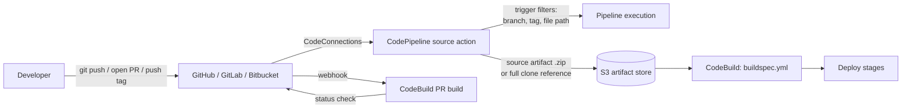

# 3.1.3 Use code repositories as part of deployment workflows

**Domain 3 · Task 3.1 · Skill 3.1.3** · [Task overview](README.md) · Previous: [3.1.2 Container images and ECR](3.1.2-container-images-and-ecr.md) · Next: [3.1.4 Environment-specific configuration](3.1.4-environment-specific-configuration.md)

## What the exam expects

A deployment workflow starts at the repository: a push, a pull request, or a tag starts a build, and the files committed next to the code tell each stage what to do. This skill tests how a Git repository connects to AWS build and deploy services, which events trigger what, what belongs in the repository, and how to keep it safe. Deeper pipeline design is in [3.3.5](../task-3.3-deploy-with-ci-cd/3.3.5-codepipeline-release-promotion.md), and release tagging strategy is in [3.3.8](../task-3.3-deploy-with-ci-cd/3.3.8-versions-and-releases.md).

You must be able to:

- Connect GitHub, GitLab, or Bitbucket to AWS CodePipeline and AWS CodeBuild through AWS CodeConnections.
- Choose the trigger: push to a branch, a pull request, or a Git tag, with branch and file-path filters.
- Run pull request builds with CodeBuild webhooks.
- Keep build, deployment, and infrastructure files versioned with the code.
- Keep secrets out of the repository and control who can reach it.
- Carry the commit ID through the pipeline for traceability.

## Key terms

| Term | Meaning |
|---|---|
| Repository | A Git project that stores code and its history. |
| Branch | A movable line of commits, such as `main`, `feature/login`, or `release/2.3`. |
| Tag | A fixed label on one commit, usually a release such as `v2.3.0`. |
| Pull request (PR) | A request to merge one branch into another, reviewed and checked before merge. |
| AWS CodeConnections | AWS service (formerly AWS CodeStar Connections) that authorizes AWS services to access third-party Git providers. |
| Source action | The first CodePipeline action. It watches a repository and outputs the source as an artifact. |
| Trigger | CodePipeline V2 rule that decides which pushes, PRs, or tags start the pipeline, with branch, tag, and file-path filters. |
| Webhook | A Git provider callback to CodeBuild on push or PR events. |
| Full clone | Source action output format that passes a Git reference so CodeBuild can run Git commands, instead of a plain .zip of the files. |
| Continuous integration and continuous delivery (CI/CD) | Building and testing every change automatically (CI) and releasing passing changes automatically (CD). |

## Where code lives and how AWS reaches it

| Source | How AWS connects | Notes |
|---|---|---|
| GitHub, GitHub Enterprise Server, GitLab.com, GitLab self-managed, Bitbucket Cloud | AWS CodeConnections connection, used by the CodePipeline `CodeStarSourceConnection` action and by CodeBuild | The current default on the exam |
| Amazon Simple Storage Service (S3), versioned object | CodePipeline S3 source action | A .zip of the source, often uploaded by another system |
| Amazon Elastic Container Registry (ECR) | CodePipeline ECR source action | Starts a pipeline when an image is pushed |
| AWS CodeCommit | CodePipeline CodeCommit source action, EventBridge events | Not on the DVA-C03 service list; see the block below |

### AWS CodeConnections

- A **connection** is an AWS resource with an Amazon Resource Name (ARN) that represents an authorized link to a Git provider account or organization, usually through a GitHub App or OAuth (Open Authorization) installation.
- A connection created from the AWS Command Line Interface (CLI) or a template starts in **`PENDING`** status. Someone must finish the handshake with the provider in the console before it becomes **`AVAILABLE`**.
- The CodePipeline service role, and the CodeBuild role when it needs the repository, must be allowed `codeconnections:UseConnection` (older roles use `codestar-connections:UseConnection`) on the connection ARN. Missing this permission is a common cause of "insufficient permissions" in the source stage.
- One connection can serve many pipelines and build projects.
- Moving from CodeCommit to GitHub only means repointing the source action at a connection. Build and deploy stages do not change.

## Triggering builds and deployments from the repository

| Goal | Mechanism |
|---|---|
| Deploy when code is pushed to `main` | CodePipeline source action on the `main` branch through CodeConnections |
| Run tests on every pull request before merge | CodeBuild webhook with a PR event filter, reporting status back to the PR; or a CodePipeline V2 trigger on PR events |
| Release only when a tag like `v1.2.0` is pushed | CodePipeline V2 trigger with a Git tag filter (see [3.3.8](../task-3.3-deploy-with-ci-cd/3.3.8-versions-and-releases.md)) |
| Only run the pipeline when files under `services/orders/` change (monorepo) | CodePipeline V2 trigger with a file-path include filter |
| Deploy a CloudFormation stack straight from a repository | CloudFormation Git sync, which watches a branch and a deployment file in the repository |
| Build and host a web front end per branch | AWS Amplify Hosting branch auto-builds and PR previews (see [3.2.4](../task-3.2-test-applications/3.2.4-isolated-test-environments.md)) |
| React to a CodeCommit push | EventBridge rule on the repository's `referenceUpdated` event |

### Source artifact formats

- **CodePipeline default** (`CODE_ZIP`): the source action stores a .zip of the files in the S3 artifact bucket. There is no `.git` folder, so `git log` or `git describe` fails in CodeBuild.
- **Full clone** (`CODEBUILD_CLONE_REF`): the action passes a reference and CodeBuild clones the repository, keeping Git metadata. Use it when the build needs tags, history, or submodules. The CodeBuild role then needs `UseConnection` on the connection.

### Traceability from commit to running code

- CodePipeline source actions publish variables such as `#{SourceVariables.CommitId}` and `#{SourceVariables.BranchName}` that later actions can use.
- CodeBuild exposes `CODEBUILD_RESOLVED_SOURCE_VERSION` (the commit ID).
- Feed the commit ID into image tags ([3.1.2](3.1.2-container-images-and-ecr.md)), Lambda version descriptions, CloudFormation parameters, and AppConfig version labels, so you can always answer "which commit is running in prod?"

## What belongs in the repository

Keep everything a deployment needs versioned with the code ("everything as code"), so a change to the build or the infrastructure gets the same review as a code change.

| File | Used by | Rule |
|---|---|---|
| `buildspec.yml` | CodeBuild | At the root of the source unless the project names another path |
| `appspec.yml` (Amazon EC2 and on-premises servers) or `appspec.yaml` (Amazon ECS and Lambda) | CodeDeploy | At the root of the revision for EC2 and on-premises |
| `template.yaml`, `samconfig.toml` | AWS Serverless Application Model (SAM) | Parameters per environment in `samconfig.toml` |
| CDK app (`cdk.json`, stacks) | AWS Cloud Development Kit (CDK) | Context values per environment |
| `Dockerfile`, `.dockerignore` | Docker, CodeBuild | `.dockerignore` keeps `.git` and secrets out of images |
| `package-lock.json`, `poetry.lock` | Package managers | Commit lock files for repeatable builds |
| `.ebextensions/*.config` | Elastic Beanstalk | At the root of the source bundle |
| `.gitignore` | Git | Excludes `node_modules/`, build output, `.env`, credentials files |

What does not belong in the repository:

- **Secrets** (passwords, API keys, private keys, access keys). Store them in AWS Secrets Manager or Parameter Store and reference them from buildspec `env.secrets-manager` or the runtime. Add a secret scanner to pull request checks.
- **Environment-specific values** that differ per environment. Keep them in Parameter Store, AppConfig, or per-environment infrastructure as code (IaC) parameters ([3.1.4](3.1.4-environment-specific-configuration.md)).
- **Build outputs and dependency folders.** They are produced by the build.
- **Large binaries.** Put them in S3 or a package repository such as AWS CodeArtifact ([3.1.1](3.1.1-packaging-dependencies-and-configuration.md)).

## Branches and environments

| Branch or ref | Typical deployment |
|---|---|
| `feature/*` | PR build and tests; optionally an ephemeral preview environment |
| `main` (trunk) | Deploys to dev or staging automatically; promotion to prod after tests and approval |
| `release/*` | Stabilization; deploys to a release candidate environment |
| `hotfix/*` | Fast path to prod, merged back into `main` |
| Tag `vX.Y.Z` | Production release |

- Protect `main` with required reviews and required status checks, so untested code never reaches the branch the pipeline watches.
- Review gates come in two kinds: a **merge-time** gate (branch protection or CodeCommit approval rules) and a **deploy-time** gate (a CodePipeline manual approval action). A question asking to block unreviewed code "before it can merge" wants the first; "before it is released to production" wants the second.

## Repository access and security

- Grant AWS services access through CodeConnections or AWS Identity and Access Management (IAM) roles, never by sharing personal tokens or SSH keys.
- Scope `UseConnection` to the specific connection ARN.
- For cross-account access to a CodeCommit repository, use an IAM role in the repository's account and AWS Security Token Service (STS) `AssumeRole` ([2.1.7](../../domain-2-security/task-2.1-authentication-and-authorization/2.1.7-assuming-iam-roles.md)).
- Pipelines and builds that need private resources should run with least-privilege roles ([2.1.6](../../domain-2-security/task-2.1-authentication-and-authorization/2.1.6-least-privilege-permissions.md)).

> **Not on the DVA-C03 service list.** AWS CodeCommit is not in the DVA-C03 in-scope services. AWS closed it to new customers in July 2024, then returned it to full general availability on November 24, 2025, so new accounts can create repositories again. Older questions may still use it as the source stage. Facts worth recognizing:
>
> - Private Git repositories inside your AWS account, encrypted at rest with KMS (AWS Key Management Service) and in transit over HTTPS or SSH.
> - Authentication: SSH keys or HTTPS Git credentials for IAM users, or the `git-remote-codecommit` helper (`codecommit::` URLs) using AWS CLI credentials.
> - Authorization with IAM policies. Cross-account access uses an IAM role and STS `AssumeRole`, never shared keys.
> - **Approval rules** and approval rule templates require N approvers before a pull request can merge (a merge-time control).
> - Pushes emit EventBridge events (`referenceUpdated`) that can start CodeBuild or a pipeline.
> - Interface virtual private cloud (VPC) endpoints allow Git access from a VPC with no internet path.
>
> | | CodeCommit | GitHub |
> |---|---|---|
> | Code review (pull requests) | Yes | Yes |
> | CodeBuild integration | Yes | Yes |
> | Authentication | SSH and HTTPS | SSH and HTTPS |
> | Identity | IAM users and roles | GitHub users |
> | Hosting | Managed by AWS | Hosted by GitHub (or self-hosted Enterprise Server) |

## Exam triggers

| Scenario clue | Answer | Why the alternatives are wrong |
|---|---|---|
| Start the pipeline when code is pushed to `main` in GitHub | CodePipeline source action using a CodeConnections connection | Polling S3 or a scheduled rule adds delay and extra moving parts |
| Run tests on every pull request | CodeBuild PR webhook (or a CodePipeline V2 PR trigger) | A pipeline on `main` only tests after the merge |
| Deploy to production only when a release tag is pushed | CodePipeline V2 trigger with a tag filter | Branch triggers fire on every push |
| Monorepo: only rebuild the service whose files changed | V2 trigger with file-path filters | One pipeline per push rebuilds everything |
| `git describe` fails in CodeBuild | Use the full clone output format and give CodeBuild `UseConnection` | The default .zip artifact has no `.git` metadata |
| New connection to GitHub does not work | Complete the pending handshake in the console | A `PENDING` connection cannot be used |
| Source stage fails with insufficient permissions | Add `codeconnections:UseConnection` for the connection ARN to the pipeline role | Changing the repository settings does not fix the IAM role |
| Pipeline needs a database password during the build | buildspec `env.secrets-manager` or `env.parameter-store` | Committing it to the repository exposes it to everyone with read access |
| Migrate the source from CodeCommit to GitHub with no other pipeline changes | Repoint the source action to a CodeConnections connection | Build and deploy stages do not depend on the provider |
| Block unreviewed code from merging into `main` | Branch protection or CodeCommit approval rules | A pipeline manual approval runs after the merge |

## Common traps

- Committing `.env` files, credentials, or private keys. Even after deletion, they stay in Git history; rotate them.
- Putting `buildspec.yml` in a subfolder without telling CodeBuild where it is.
- Assuming the CodePipeline source artifact includes Git history.
- Confusing a merge-time approval (branch protection, CodeCommit approval rules) with a deploy-time manual approval action.
- Confusing CodeCommit (source code), CodeArtifact (packages), and ECR (images).
- Treating CodeConnections as an IAM user. It is an authorized connection resource; access to it is still controlled by IAM.
- Assuming CodeCommit is closed to new customers. That changed in November 2025, but it remains outside the DVA-C03 service list.

## Quick recall

- Third-party Git → AWS CodeConnections (formerly CodeStar Connections); permission `codeconnections:UseConnection`.
- New connections start `PENDING` until the console handshake completes.
- CodePipeline V2 triggers: push, PR, tag events; branch, tag, and file-path filters.
- CodeBuild webhooks run PR builds and report status.
- Full clone output keeps Git metadata for CodeBuild; the default is a .zip without `.git`.
- Commit ID: `#{SourceVariables.CommitId}` in CodePipeline, `CODEBUILD_RESOLVED_SOURCE_VERSION` in CodeBuild.
- `buildspec.yml` at the source root; `appspec.yml` at the revision root.
- No secrets in Git; reference Secrets Manager or Parameter Store.
- CloudFormation Git sync deploys stacks from a repository branch.

## Related skills

- [3.1.1 Packaging dependencies and configuration](3.1.1-packaging-dependencies-and-configuration.md): what the build produces from the repository.
- [3.1.2 Container images and ECR](3.1.2-container-images-and-ecr.md): tagging images with the commit hash (SHA).
- [3.2.4 Isolated test environments](../task-3.2-test-applications/3.2.4-isolated-test-environments.md): Amplify branches and PR previews.
- [3.3.5 CodePipeline release promotion](../task-3.3-deploy-with-ci-cd/3.3.5-codepipeline-release-promotion.md): stages, approvals, and multi-environment promotion after the source stage.
- [3.3.8 Versions and releases](../task-3.3-deploy-with-ci-cd/3.3.8-versions-and-releases.md): branching models, tags, and labels for releases.
- [4.1.4 Diagnosing deployment failures](../../domain-4-troubleshooting-and-optimization/task-4.1-root-cause-analysis/4.1.4-diagnosing-deployment-failures.md): reading source and build failures.

## Sources

- Merged from: `archive/dva-c03-study-notes/03-testing-deployment.md` (skills 3.1.3, 3.3.5, 3.3.8), `archive/dva-c03/domain-3-testing-deployment/MASTER-CHUNK.md` (section 7, CodeCommit; section 9, CodePipeline), `archive/dva-c03/domain-3-testing-deployment/README.md` (pipeline walkthrough), `archive/aws-dva-notes/Markdown Files/21. CICD - CodeCommit, CodePipeline, CodeBuild, CodeDeploy.md` (sections 1 to 4), `archive/dva-c03-study-notes/00-developer-basics.md` (source control).
- AWS documentation: [CodeStarSourceConnection for Bitbucket Cloud, GitHub, GitHub Enterprise Server, GitLab.com, and GitLab self-managed actions](https://docs.aws.amazon.com/codepipeline/latest/userguide/action-reference-CodestarConnectionSource.html)
- AWS DevOps blog: [AWS CodeCommit posts, including the November 24, 2025 return to general availability](https://aws.amazon.com/blogs/devops/category/developer-tools/aws-codecommit/)
