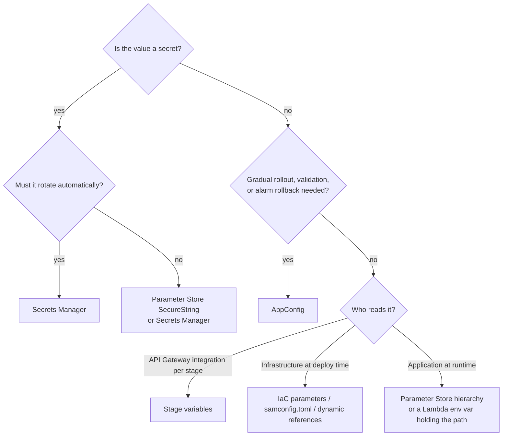
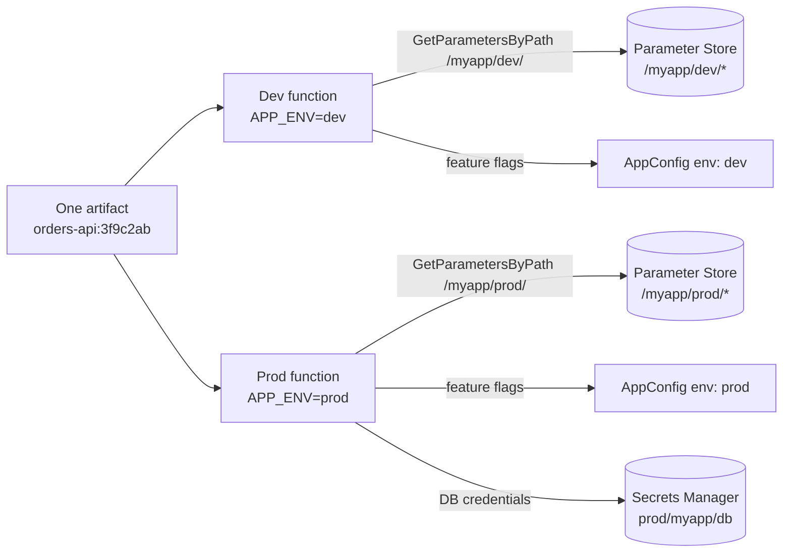
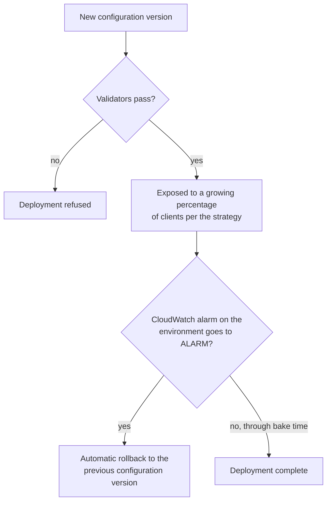

# 3.1.4 Keep environment-specific configuration in services such as AppConfig, Parameter Store, Secrets Manager, API Gateway, and Lambda

**Domain 3 · Task 3.1 · Skill 3.1.4** · [Task overview](README.md) · Previous: [3.1.3 Code repositories in deployment](3.1.3-code-repositories-in-deployment.md) · Next: [3.1.5 API Gateway stages and endpoints](3.1.5-api-gateway-stages-and-endpoints.md)

## What the exam expects

Every environment (dev, test, staging, prod) needs different values: database hosts, queue URLs, feature flags, credentials, throttle limits. This skill tests where those values should live so one artifact runs everywhere, and which service fits each kind of value. The most common question shape names a requirement ("rotate automatically", "roll out to 10% and roll back on errors", "thousands of cheap values", "different Lambda alias per stage") and asks for the matching service.

You must be able to:

- Pick between AWS AppConfig, AWS Systems Manager Parameter Store, AWS Secrets Manager, Lambda environment variables, API Gateway stage variables, and infrastructure as code (IaC) parameters.
- Organize Parameter Store values in a per-environment hierarchy and read them by path.
- Deploy configuration and feature flags with AppConfig deployment strategies, validators, and alarm-based rollback.
- Read configuration efficiently from Lambda and containers with caching extensions and agents.
- Inject environment-specific values into Amazon Elastic Container Service (ECS) tasks, Elastic Beanstalk environments, CodeBuild builds, and CloudFormation stacks.

## Key terms

| Term | Meaning |
|---|---|
| Environment-specific configuration | Values that differ between dev, test, and prod while the code stays the same. |
| Externalized configuration | Configuration stored outside the artifact and read at deploy time or runtime. |
| Feature flag | A configuration value that turns a feature on or off without a code deploy. |
| Parameter Store | Systems Manager capability for hierarchical, versioned configuration values and simple secrets (`String`, `StringList`, `SecureString`). |
| `SecureString` | Parameter Store type encrypted with an AWS Key Management Service (KMS) key. |
| AppConfig application, environment, configuration profile | AppConfig's containers: the app, a target group of clients (such as `prod`), and the configuration source with its validators. |
| Deployment strategy | AppConfig setting for how fast a configuration reaches clients: duration, growth factor, growth type, bake time. |
| Bake time | Time AppConfig keeps watching alarms after a deployment reaches 100% before marking it complete. |
| Stage variable | Key-value pair on an API Gateway stage, used like an environment variable in integrations and mapping templates. |
| Dynamic reference | CloudFormation syntax (`{{resolve:ssm:...}}`, `{{resolve:secretsmanager:...}}`) that reads a value during stack operations. |

## Choosing the mechanism

| Mechanism | Best for | Avoid for |
|---|---|---|
| **AWS AppConfig** | Dynamic application configuration and **feature flags** deployed gradually, with **validators** (JSON Schema or Lambda), **deployment strategies** (linear or exponential, bake time), and automatic **rollback on CloudWatch alarms**. Apps fetch through the AppConfig Agent or Lambda extension with a local cache. | A single static value with no rollout concern; values that change on every request |
| **Parameter Store** | Hierarchical config per environment (`/myapp/dev/db-url`, `/myapp/prod/db-url`) read with `GetParametersByPath`; `SecureString` for simple secrets; cheap at volume | Secrets that must rotate automatically |
| **Secrets Manager** | Credentials with **automatic rotation**, cross-account secret sharing, Amazon Relational Database Service (RDS) integration | Thousands of non-secret settings (per-secret cost) |
| **Lambda environment variables** | Static per-function settings (table name, `APP_ENV`, parameter path); up to 4 KB | Secrets in plaintext; values that must differ per alias |
| **API Gateway stage variables** | Per-stage values such as the Lambda alias or backend URL each stage calls | Secrets |
| **IaC parameters, mappings, `samconfig.toml`** | Environment-specific infrastructure values (instance sizes, domain names, stack names) | Values the app must change at runtime without a stack update |



### Secrets versus configuration versus feature flags

| Need | Service | Why not the other two |
|---|---|---|
| A database password that must rotate automatically | Secrets Manager | Parameter Store has no built-in rotation; AppConfig has no concept of a rotating credential |
| 2,000 non-secret settings at effectively zero cost | Parameter Store (Standard tier) | Secrets Manager charges per secret; AppConfig is more than you need for values with no rollout requirement |
| A feature flag that must reach 10% of users first and roll back automatically on an alarm | AppConfig | Parameter Store and Secrets Manager have no deployment strategy or rollback; changing a parameter is instant and all-or-nothing |

A scenario that names "gradual rollout" or "automatic rollback on alarm" for a **configuration** change (not a code deployment) is the clearest AppConfig signal.

## The pattern: one artifact, configuration per environment



The only thing set per deployment is a pointer (`APP_ENV` or a parameter path). Everything else is looked up, so the artifact is byte-for-byte the same in every environment. [Lab 2](labs.md) builds this with one .zip deployed twice.

## Parameter Store for environment configuration

- Serverless, versioned key-value storage for configuration and simple secrets, secured with AWS Identity and Access Management (IAM), plus KMS for `SecureString`.
- Types: `String`, `StringList`, `SecureString`.
- Every change creates a new **version**; you can attach **labels** to versions and read `name:version` or `name:label`.
- Change notifications go to Amazon EventBridge.
- Integrates with CloudFormation, CodeBuild, ECS, Elastic Beanstalk, and AppConfig.

### Hierarchy

```
/my-department/
    my-app/
        dev/
            db-url
            db-password
        prod/
            db-url
            db-password
    other-app/
/other-department/
/aws/reference/secretsmanager/secret_ID_in_Secrets_Manager
/aws/service/ami-amazon-linux-latest/al2023-ami-kernel-default-x86_64   (public)
```

- Read one value with `GetParameter`, several with `GetParameters`, or a whole subtree with **`GetParametersByPath`** (the dev function reads `/my-department/my-app/dev/`, the prod function reads `.../prod/`).
- IAM policies can be scoped to a path, for example allow `ssm:GetParametersByPath` only on `arn:aws:ssm:us-east-1:123456789012:parameter/my-department/my-app/prod/*`. That keeps dev code from reading prod values.
- `/aws/reference/secretsmanager/...` reads a Secrets Manager secret through the Parameter Store API.
- `/aws/service/...` holds public AWS parameters, such as the latest Amazon Linux Amazon Machine Image (AMI) ID.

```bash
aws ssm put-parameter --name /my-app/prod/db-url --value "prod-db.internal:5432" --type String
aws ssm get-parameters --names /my-app/dev/db-url /my-app/dev/db-password --with-decryption
aws ssm get-parameters-by-path --path /my-app/dev/ --recursive --with-decryption
```

- Without **`--with-decryption`** (`WithDecryption=True` in an SDK), a `SecureString` comes back encrypted.
- Reading a `SecureString` needs **both** `ssm:GetParameter*` on the parameter and **`kms:Decrypt`** on its KMS key. An access-denied error that mentions decryption points at the KMS permission.

### Standard and Advanced tiers

| | Standard | Advanced |
|---|---|---|
| Max parameters per account and Region | 10,000 | 100,000 |
| Max value size | 4 KB | 8 KB |
| Parameter policies | No | Yes |
| Storage cost | No additional charge | Charged per advanced parameter per month |

Parameter policies (Advanced only): `Expiration` deletes a parameter at a date, `ExpirationNotification` sends an EventBridge event before expiry, and `NoChangeNotification` sends one if a value has not changed for a period. Hitting the 10,000-parameter Standard ceiling is the signal to move to Advanced or to move some values elsewhere.

## Secrets Manager in brief

Secrets Manager stores credentials with **automatic rotation** through a rotation Lambda function (AWS provides rotation functions for Amazon RDS, Amazon Redshift, and Amazon DocumentDB), KMS encryption that is always on, cross-account access through resource policies, and multi-Region replica secrets. For environment configuration, use one secret per environment (`dev/myapp/db`, `prod/myapp/db`) and point each environment at its own secret name. Rotation, staging labels (`AWSCURRENT`, `AWSPENDING`, `AWSPREVIOUS`), caching clients, and cost comparisons are covered in [2.2.7 Secrets management](../../domain-2-security/task-2.2-encrypt-and-protect-sensitive-data/2.2.7-secrets-management.md).

| | Secrets Manager | Parameter Store |
|---|---|---|
| Rotation | Automatic with Lambda | None built in (build it with EventBridge and Lambda) |
| KMS encryption | Mandatory | Optional (`SecureString`) |
| Cost | Per secret per month plus API calls | Standard tier free |
| Max value size | 64 KB | 4 KB / 8 KB |
| Hierarchical read in one call | No direct equivalent | `GetParametersByPath` |

## AWS AppConfig: deploying configuration safely

Configuration changes cause outages just as code changes do, and teams often skip safety rails for them. AppConfig gives configuration the same discipline that CodeDeploy gives code: validate first, roll out gradually, watch alarms, roll back automatically. Changes are deployed independently of code and **without restarting** the application.

### Building blocks

| Component | What it is |
|---|---|
| Application | A logical unit, such as `orders-service`. |
| Environment | A deployment target such as `dev` or `prod`. **Monitors** (CloudWatch alarms) are attached here. |
| Configuration profile | Where the data lives and how it is validated. Types: **feature flags** (`AWS.AppConfig.FeatureFlags`) and **freeform** (`AWS.Freeform`, JSON, YAML, or text). |
| Validators | **JSON Schema** (syntactic check) or a **Lambda function** (semantic check, such as "the cache TTL must be between 1 and 3600"). A failed validation stops the deployment before any client sees the data. |
| Deployment strategy | Duration, growth factor, growth type (`LINEAR` or `EXPONENTIAL`), and final bake time. |
| Deployment | Starting the rollout of one configuration version to one environment with one strategy (`StartDeployment`). |

Configuration sources and their size limits:

| Source | Configuration size limit |
|---|---|
| AppConfig hosted configuration store | 2 MB default, 4 MB maximum |
| Amazon Simple Storage Service (S3) | 2 MB (enforced by AppConfig) |
| Parameter Store | 4 KB Standard / 8 KB Advanced |
| Secrets Manager | 64 KB |
| Systems Manager document store | 64 KB |
| AWS CodePipeline | 2 MB (enforced by AppConfig) |


*Source: [AWS AppConfig User Guide](https://docs.aws.amazon.com/appconfig/latest/userguide/appconfig-introduction.html). A configuration profile is created, a deployment strategy sets the ramp, the deployment runs, and applications retrieve the current value through a local cache.*

### Rollout and rollback



This mirrors CodeDeploy's model (strategy, gradual shift, alarm rollback) applied to configuration instead of code, which is why the two are often confused. Use CodeDeploy for a new code version, AppConfig for a new configuration version.

Predefined deployment strategies:

| Strategy | Behavior |
|---|---|
| `AppConfig.Linear20PercentEvery6Minutes` | 20% every 6 minutes over 30 minutes, 30-minute bake. AWS recommended for production. |
| `AppConfig.Canary10Percent20Minutes` | Exponential growth with a 10% growth factor over 20 minutes, 10-minute bake. AWS recommended for production. |
| `AppConfig.AllAtOnce` | All targets immediately, 10-minute bake (alarms still trigger rollback). |
| `AppConfig.Linear50PercentEvery30Seconds` | Half the targets every 30 seconds, 1-minute bake. Testing and demos only. |

```yaml
# CloudFormation: an environment with an alarm monitor, a custom linear strategy, and a deployment
Resources:
  ProdEnvironment:
    Type: AWS::AppConfig::Environment
    Properties:
      ApplicationId: !Ref AppConfigApp
      Name: prod
      Monitors:
        - AlarmArn: !GetAtt ErrorRateAlarm.Arn
          AlarmRoleArn: !GetAtt AppConfigMonitorRole.Arn
  Linear10PercentOver25Minutes:
    Type: AWS::AppConfig::DeploymentStrategy
    Properties:
      Name: Linear10PercentOver25Minutes
      DeploymentDurationInMinutes: 25
      GrowthFactor: 10
      GrowthType: LINEAR
      FinalBakeTimeInMinutes: 10
      ReplicateTo: NONE
  FeatureFlagDeployment:
    Type: AWS::AppConfig::Deployment
    Properties:
      ApplicationId: !Ref AppConfigApp
      ConfigurationProfileId: !Ref FeatureFlagProfile
      DeploymentStrategyId: !Ref Linear10PercentOver25Minutes
      EnvironmentId: !Ref ProdEnvironment
      ConfigurationVersion: "3"
```

### Retrieving configuration

Applications **poll** for configuration. Calling the AppConfig data API (`StartConfigurationSession`, then `GetLatestConfiguration`) on every request adds latency and cost, so use a local agent:

- **AppConfig Agent Lambda extension:** added as a layer. It fetches and caches configuration, polls in the background, and serves it over HTTP at **`localhost:2772`**. It can prefetch configurations during function init.
- **AppConfig Agent for Amazon ECS, Amazon Elastic Kubernetes Service (EKS), and Amazon Elastic Compute Cloud (EC2):** runs as a sidecar or daemon, polls centrally, and serves from a local cache on port 2772 (configurable), avoiding a flood of direct API calls from a large fleet.

```python
# Lambda handler reading a feature flag through the AppConfig Agent extension
import json
import urllib.request

URL = ("http://localhost:2772/applications/orders-service"
       "/environments/prod/configurations/feature-flags")

def handler(event, context):
    with urllib.request.urlopen(URL) as resp:
        flags = json.loads(resp.read())
    if flags.get("new-checkout", {}).get("enabled"):
        return {"statusCode": 200, "body": "new checkout"}
    return {"statusCode": 200, "body": "classic checkout"}
```

In real code, read the environment name from an environment variable instead of hardcoding `prod` in the URL, so the same artifact works in every environment.

### AppConfig use cases

1. Gradual feature-flag rollout with automatic rollback tied to an error-rate alarm.
2. Operational kill switch: deploy a pre-tested "disable feature X" version during an incident instead of an emergency code change.
3. Shared tuning parameters (cache time to live, or TTL, values, retry counts) read by many functions through the extension's local cache.
4. Allow lists and block lists that change often.
5. A/B testing parameters on a percentage of traffic.

### AppConfig troubleshooting

- **Deployment looks stuck or reverted:** check the monitored alarm. An `ALARM` state rolls back by design.
- **Clients see a stale value after a completed deployment:** the poll interval of the agent or extension is longer than expected.
- **A validator rejects every deployment:** check the validator Lambda's own permissions and errors; a validator that crashes looks like a rejection.

## Lambda environment variables

Full settings are covered in [1.2.2 Lambda configuration](../../domain-1-development-with-aws-services/task-1.2-develop-lambda-functions/1.2.2-lambda-configuration.md). For environment-specific configuration:

- Key-value strings, up to **4 KB** total per function, readable with `os.environ`.
- Good for static per-function settings: table name, stage name, log level, a parameter path such as `CONFIG_PATH=/myapp/prod/`.
- **Environment variables belong to the version.** Publishing a version freezes its configuration, and an alias only points to a version. You cannot give `dev` and `prod` aliases of the same function different environment variables. Use separate functions or stacks per environment, API Gateway stage variables, or AppConfig.
- Encrypted environment variables are acceptable for non-secret configuration. For passwords and keys, store a reference (secret name or parameter path) in the variable and fetch the value from Secrets Manager or Parameter Store.
- The **AWS Parameters and Secrets Lambda Extension** (a layer) caches parameters and secrets and serves them on `localhost:2773`, so the handler does not call the APIs on every invocation. Powertools for AWS Lambda offers the same caching inside code.

```python
# Read the environment's whole config subtree once per execution environment
import os
import boto3

ssm = boto3.client("ssm")
CONFIG_PATH = os.environ["CONFIG_PATH"]          # e.g. /myapp/prod/
_config = None

def load_config():
    global _config
    if _config is None:
        _config = {}
        paginator = ssm.get_paginator("get_parameters_by_path")
        for page in paginator.paginate(Path=CONFIG_PATH, Recursive=True, WithDecryption=True):
            for p in page["Parameters"]:
                _config[p["Name"].removeprefix(CONFIG_PATH)] = p["Value"]
    return _config

def handler(event, context):
    cfg = load_config()
    return {"statusCode": 200, "body": f"db host: {cfg['db-host']}"}
```

## API Gateway stage variables in brief

Stage variables are per-stage key-value pairs referenced as `${stageVariables.name}` in integration URIs, Lambda function Amazon Resource Names (ARNs), and mapping templates. The classic pattern points each stage at its own Lambda alias: `arn:aws:lambda:us-east-1:123456789012:function:orders:${stageVariables.lambdaAlias}` with `prod` → `PROD` and `dev` → `DEV`. API Gateway needs invoke permission on **each alias**, and stage variables are not for sensitive data. Full treatment is in [3.1.5 API Gateway stages and endpoints](3.1.5-api-gateway-stages-and-endpoints.md#stage-variables).

## Containers: ECS task definitions

| Source in the task definition | Use for |
|---|---|
| `environment` (hardcoded values) | Non-sensitive values such as URLs |
| `secrets` with a Parameter Store ARN | Sensitive or shared config (API keys) |
| `secrets` with a Secrets Manager ARN (optionally a JSON key) | Database passwords and rotating credentials |
| `environmentFiles` from Amazon S3 | Bulk variables in a `.env` file per environment |

- ECS injects `secrets` as environment variables when the container starts, with **no SDK code** in the application.
- The **task execution role** (not the task role) must be allowed to read the referenced parameters and secrets, and to decrypt them with KMS if a customer managed key is used.
- Injected values are read at container start. A rotated secret reaches running tasks only after they restart, so long-running services that need fresh credentials should fetch and cache them in code.
- One task definition per environment (or one per environment revision through IaC parameters) lets the same image use different ARNs.

## Elastic Beanstalk environment properties

- **Environment properties** are passed to the application as environment variables. Set them per environment in the console, with `eb setenv KEY=value`, or in `.ebextensions` under `aws:elasticbeanstalk:application:environment`.
- Deploy the same application version to `dev` and `prod` environments, each with its own properties.
- **Cloning an environment** copies its configuration, including environment variables, load balancer type, and the RDS database type (not the data). Clone to create a test copy of prod, then change what differs.
- For production databases, create RDS outside Beanstalk and pass the connection string through environment properties or Parameter Store. A database created by Beanstalk is deleted with the environment.

## Builds and infrastructure

### CodeBuild

`buildspec.yml` reads environment-specific values with `env.variables` (plaintext), `env.parameter-store`, and `env.secrets-manager`. Use the last two for anything sensitive. Example in [3.1.1](3.1.1-packaging-dependencies-and-configuration.md#producing-artifacts-in-codebuild).

### CloudFormation and AWS SAM

- **Parameters** take per-environment values at deploy time (`Env`, instance type). `NoEcho: true` hides a sensitive parameter in output, and `AllowedValues` restricts choices.
- **Systems Manager (SSM) parameter types** (`AWS::SSM::Parameter::Value<String>`) read a Parameter Store value when the stack is created or updated.
- **Mappings** with `Fn::FindInMap` hold fixed values known in advance, such as per-Region AMI IDs or per-environment sizes.
- **Dynamic references** resolve values during stack operations:

| Source | Syntax |
|---|---|
| Plaintext parameter | `{{resolve:ssm:parameter-name:version}}` |
| `SecureString` parameter | `{{resolve:ssm-secure:parameter-name:version}}` |
| Secrets Manager | `{{resolve:secretsmanager:secret-id:secret-string:json-key:version-stage:version-id}}` |

- For RDS master passwords, `ManageMasterUserPassword: true` lets RDS create and rotate the secret in Secrets Manager without the password ever appearing in the template.
- **AWS Serverless Application Model (SAM):** keep per-environment stack names and parameters in `samconfig.toml` and deploy with `sam deploy --config-env dev` or `--config-env prod`.

```toml
version = 0.1
[dev.deploy.parameters]
stack_name = "my-app-dev"
region = "us-east-1"
parameter_overrides = "Env=dev"

[prod.deploy.parameters]
stack_name = "my-app-prod"
region = "us-east-1"
parameter_overrides = "Env=prod"
```

- **AWS Cloud Development Kit (CDK):** pass environment-specific values through context or stack properties, and define one stack instance per environment (often in separate accounts).
- Ideally each environment lives in a **separate AWS account**, which isolates both configuration and blast radius.

## Exam triggers

| Scenario clue | Answer | Why the alternatives are wrong |
|---|---|---|
| Toggle a feature for 10% of users and roll back automatically if errors rise | AppConfig feature flag with a deployment strategy and a CloudWatch alarm monitor | Parameter Store changes are instant and all-or-nothing; CodeDeploy shifts code versions, not configuration |
| Validate configuration before any client receives it | AppConfig validators (JSON Schema or Lambda) | Parameter Store and Secrets Manager accept any value |
| Change configuration without redeploying or restarting the app | AppConfig, read through the agent or extension | Environment variables need a function update; baked files need a new artifact |
| Database credential must rotate automatically | Secrets Manager | Parameter Store has no built-in rotation |
| Thousands of non-secret settings, lowest cost | Parameter Store Standard tier | Secrets Manager charges per secret |
| Load an environment's whole configuration tree in one call | `GetParametersByPath` with `Recursive` | Secrets Manager has no hierarchical bulk read |
| `SecureString` read fails with a decryption access error | Grant `kms:Decrypt` on the parameter's key and use `WithDecryption` | `ssm:GetParameter` alone is not enough; Secrets Manager permissions are irrelevant |
| Same API, different Lambda alias per stage | Stage variables plus a Lambda permission per alias | Separate APIs per environment duplicate the definition |
| Different environment variables for `dev` and `prod` aliases of one function | Not possible; use separate functions or stacks, stage variables, or AppConfig | Environment variables are frozen into each version |
| ECS container needs a rotating database password with no SDK code | Task definition `secrets` referencing the Secrets Manager ARN, readable by the execution role | Plain `environment` exposes the value in the task definition |
| Lambda reads config on every invocation and the API bill grows | AppConfig Agent extension (port 2772) or Parameters and Secrets extension (port 2773), or cache in init code | Calling the API in the handler on every request is slow and costly |
| Don't put the DB password in the CloudFormation template | Dynamic reference to Secrets Manager or `ssm-secure`, or `ManageMasterUserPassword` | `NoEcho` hides output but the value still has to be supplied |
| Deploy one SAM app to dev and prod with different settings | `samconfig.toml` environments and `sam deploy --config-env` | Copying the template per environment drifts |

## Common traps

- Mixing up AppConfig (gradual deployment of configuration with rollback) with Parameter Store and Secrets Manager (instant value storage with no rollout).
- Mixing up AppConfig (configuration) with CodeDeploy (code). Both use strategies and alarm rollback.
- Storing passwords as plaintext Lambda environment variables or stage variables.
- Forgetting `kms:Decrypt` or `WithDecryption` for `SecureString`.
- Expecting per-alias environment variables on one Lambda function.
- Giving the ECS **task role** permission to read secrets referenced in the task definition. The **execution role** does the injection.
- Polling AppConfig or Parameter Store on every invocation instead of caching.
- Assuming an AppConfig deployment is broken when an alarm in `ALARM` state rolled it back on purpose.
- Creating the production database inside an Elastic Beanstalk environment.

## Quick recall

- Build once, deploy many: only a pointer (`APP_ENV`, `CONFIG_PATH`) differs per environment.
- AppConfig = feature flags and dynamic config with validators, deployment strategies, bake time, and alarm rollback; no restart needed.
- AppConfig Agent / Lambda extension: `localhost:2772`. Parameters and Secrets Lambda Extension: `localhost:2773`.
- AppConfig hosted store: 2 MB default, 4 MB max.
- Parameter Store: Standard 10,000 parameters / 4 KB, Advanced 100,000 / 8 KB with policies; `GetParametersByPath`; `SecureString` needs `kms:Decrypt`.
- Secrets Manager: automatic rotation, 64 KB, per-secret cost.
- Lambda environment variables: 4 KB, frozen per version, not for secrets.
- Stage variables: `${stageVariables.name}`; Lambda permission per alias; not for secrets.
- ECS `secrets` block + task execution role; values read at container start.
- CloudFormation dynamic references: `resolve:ssm`, `resolve:ssm-secure`, `resolve:secretsmanager`.
- SAM: `samconfig.toml` + `--config-env`.

## Related skills

- [3.1.1 Packaging dependencies and configuration](3.1.1-packaging-dependencies-and-configuration.md): what stays inside the artifact.
- [3.1.5 API Gateway stages and endpoints](3.1.5-api-gateway-stages-and-endpoints.md): stage variables, stage settings, and canaries.
- [2.2.7 Secrets management](../../domain-2-security/task-2.2-encrypt-and-protect-sensitive-data/2.2.7-secrets-management.md): rotation and secure retrieval of the secrets referenced here.
- [2.2.4 KMS key management](../../domain-2-security/task-2.2-encrypt-and-protect-sensitive-data/2.2.4-kms-key-management.md): the key behind `SecureString` and Secrets Manager.
- [1.2.2 Lambda configuration](../../domain-1-development-with-aws-services/task-1.2-develop-lambda-functions/1.2.2-lambda-configuration.md): environment variables, extensions, and versions.
- [3.2.4 Isolated test environments](../task-3.2-test-applications/3.2.4-isolated-test-environments.md): aliases, stages, and accounts as environments.
- [3.3.6 Deployment strategies](../task-3.3-deploy-with-ci-cd/3.3.6-deployment-strategies.md): the code-deployment counterpart of AppConfig strategies.

## Sources

- Merged from: `archive/dva-c03-study-notes/03-testing-deployment.md` (skill 3.1.4), `archive/dva-c03/domain-3-testing-deployment/MASTER-CHUNK.md` (section 1, AppConfig; section 14, Secrets Manager vs Parameter Store), `archive/dva-c03/domain-3-testing-deployment/README.md` (secrets vs config vs feature flags, use cases, scenarios), `archive/aws-dva-notes/Markdown Files/28. Other Services.md` (section 8, AppConfig), `archive/aws-dva-notes/Markdown Files/27. AWS Security & Encryption.md` (sections 11 to 13, 15), `archive/aws-dva-notes/Markdown Files/13. Containers on AWS.md` (sections 4 and 10), `archive/aws-dva-notes/Markdown Files/14. Elastic Beanstalk.md` (sections 10, 12, 13), `archive/aws-dva-notes/Markdown Files/15. CloudFormation.md` (sections 6 and 7), `archive/aws-dva-notes/Markdown Files/22. SAM - Serverless Application Model.md` (section 8), `archive/aws-dva-notes/Markdown Files/18. Serverless - Lambda.md` (section 10), `archive/dva-c03/exam-bank/bank-2.md` (`SecureString` and AppConfig traps).
- AWS documentation: [Understanding configuration store quotas and limitations (AppConfig)](https://docs.aws.amazon.com/appconfig/latest/userguide/appconfig-creating-configuration-and-profile-quotas.html)
- AWS documentation: [Using predefined deployment strategies (AppConfig)](https://docs.aws.amazon.com/appconfig/latest/userguide/appconfig-creating-deployment-strategy-predefined.html)
- AWS documentation: [Using AWS AppConfig Agent with Amazon ECS and Amazon EKS](https://docs.aws.amazon.com/appconfig/latest/userguide/appconfig-integration-containers-agent.html)
- AWS documentation: [Using Parameter Store parameters in AWS Lambda functions](https://docs.aws.amazon.com/systems-manager/latest/userguide/ps-integration-lambda-extensions.html)
