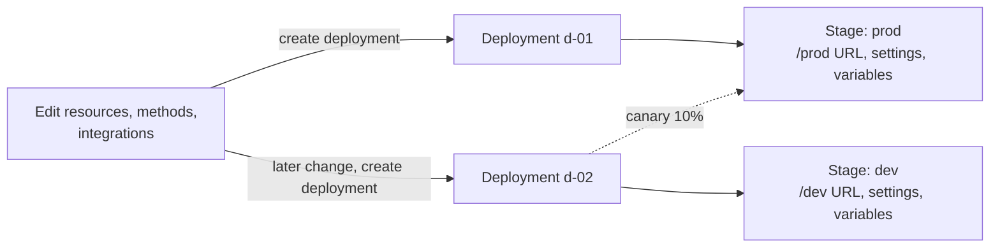
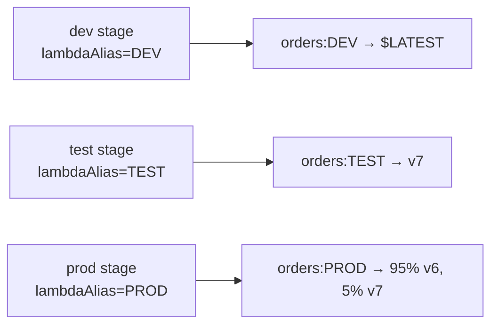
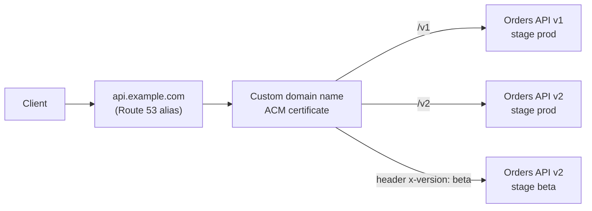

# 3.1.5 Configure API Gateway resources such as stages, endpoints, and stage-specific URLs

**Domain 3 · Task 3.1 · Skill 3.1.5** · [Task overview](README.md) · Previous: [3.1.4 Environment-specific configuration](3.1.4-environment-specific-configuration.md) · Next: [3.2.1 Testing with SAM, CDK, and CloudFormation](../task-3.2-test-applications/3.2.1-testing-with-sam-cdk-and-cloudformation.md)

## What the exam expects

Amazon API Gateway separates editing an API from publishing it. You change resources and methods, create a **deployment** (a snapshot), and publish it to a **stage** with its own URL and settings. This skill tests that lifecycle, stage-level configuration (stage variables, throttling, caching, logging, canaries), endpoint types, and custom domain names. Request and response transformation, validation, and authorizers belong to [1.1.4](../../domain-1-development-with-aws-services/task-1.1-build-application-code/1.1.4-apis-transformation-and-validation.md) and [1.2.4](../../domain-1-development-with-aws-services/task-1.2-develop-lambda-functions/1.2.4-lambda-service-integrations.md).

You must be able to:

- Explain why console changes are not live until you deploy, and roll a stage back to an earlier deployment.
- Build the stage-specific invoke URL for REST (representational state transfer), HTTP, and WebSocket APIs.
- Use stage variables to point each stage at a different Lambda alias or backend, including the Lambda permissions this needs.
- Configure stage settings: throttling, caching, logging, tracing, and canary releases.
- Choose edge-optimized, Regional, or private endpoints, and place the AWS Certificate Manager (ACM) certificate in the right Region.
- Map custom domain names to APIs and stages with base path mappings or routing rules.
- Define stages in infrastructure as code (IaC) so they are versioned with the code.

> **DVA-C02 vs DVA-C03.** API Gateway stages and custom domains sat in DVA-C02 Task 3.4. DVA-C03 moved them into Task 3.1, treating stage configuration as part of the deployable artifact.

## Key terms

| Term | Meaning |
|---|---|
| Resource and method | A path (`/orders`) and an HTTP verb (`GET`) on a REST API. |
| Deployment | An immutable snapshot of the API's resources, methods, and integrations. |
| Stage | A named, callable reference to one deployment (`dev`, `test`, `prod`, `v2`), with its own settings and URL. |
| Invoke URL | `https://{api-id}.execute-api.{region}.amazonaws.com/{stage}`, the default stage-specific URL. |
| Stage variable | Key-value pair defined on a stage and referenced as `${stageVariables.name}`. |
| Canary release | Stage setting that sends a percentage of the stage's traffic to a different deployment. |
| Endpoint type | Where the API is reachable from: edge-optimized, Regional, or private. |
| Custom domain name | Your own hostname (`api.example.com`) with an AWS Certificate Manager (ACM) certificate, mapped to API stages. |
| Base path mapping (API mapping) | Rule on a custom domain that sends `/v1` to one API stage and `/v2` to another. |

## Deployments and stages



- **Changes are not live until you deploy.** Editing a REST API in the console updates the working copy only. Clients keep getting the old behavior until you create a deployment and associate it with the stage. This is the most common API Gateway question in this skill.
- You can create **as many stages as you want** and name them freely. Each stage points to exactly one deployment at a time.
- Stages keep a **deployment history**. To roll back, point the stage at an earlier deployment.
- One API with `dev`, `test`, and `prod` stages is a common way to separate environments. Separate APIs (or separate accounts) give stronger isolation; see [3.2.4](../task-3.2-test-applications/3.2.4-isolated-test-environments.md).
- The console "Test" feature calls a method without deploying, which is covered in [3.2.3](../task-3.2-test-applications/3.2.3-test-events-and-payloads.md).

### Stage-specific URLs

| API type | Default URL |
|---|---|
| REST API | `https://{api-id}.execute-api.{region}.amazonaws.com/{stage}/{resource}` |
| HTTP API | Same format; the special **`$default`** stage is served at the base URL with no stage segment |
| WebSocket API | `wss://{api-id}.execute-api.{region}.amazonaws.com/{stage}` |

**HTTP APIs** can **auto-deploy**: every change to the API is deployed to the stage automatically, which suits `$default` and dev stages. REST APIs always need an explicit deployment.

### Versioning an API

| Approach | How | Fits |
|---|---|---|
| Separate stage per version | Deploy v2 to a `v2` stage; v1 clients keep `.../v1` | Small APIs, quick breaking changes |
| Base paths on a custom domain | `api.example.com/v1` → API A `prod`, `/v2` → API B `prod` | Public APIs that need stable hostnames |
| Separate APIs | One API per major version | Large changes, independent lifecycles |
| Header-based routing rules | Route on a header such as `x-version: beta` | Gradual migration without changing paths |

## Stage settings

| Setting | REST API | HTTP API | Notes |
|---|---|---|---|
| Stage variables | Yes | Yes | See below |
| Throttling (stage and per method) | Yes | Yes (route-level) | Below the account limit; `429 Too Many Requests` when exceeded |
| Caching | Yes | No | Defined per stage, overridable per method; default TTL 300 seconds (0 to 3,600); 0.5 GB to 237 GB |
| CloudWatch execution logs | Yes (ERROR or INFO, optional full request and response data) | No (access logs only) | Enabled per stage |
| Access logs | Yes | Yes | Custom format, one line per request |
| Detailed CloudWatch metrics | Yes | Yes | Per-method metrics |
| AWS X-Ray tracing | Yes | No | Per stage |
| AWS WAF web access control list (ACL) | Yes | No | Per stage |
| Client certificate for backend | Yes | No | API Gateway proves its identity to the HTTP backend |
| Canary settings | Yes | No | Percentage, stage variable overrides |
| Usage plans and API keys | Yes | No | Usage plans attach to API stages |

Throttling and caching tuning for performance are covered in [4.3.4 Caching for performance](../../domain-4-troubleshooting-and-optimization/task-4.3-optimize-applications/4.3.4-caching-for-performance.md). Logging and metrics for troubleshooting are in [4.1.2](../../domain-4-troubleshooting-and-optimization/task-4.1-root-cause-analysis/4.1.2-metrics-logs-and-traces.md).

## Stage variables

Stage variables act like environment variables for an API stage. You define them on the stage and reference them as **`${stageVariables.variableName}`** in:

- Lambda function Amazon Resource Names (ARNs) in integrations.
- HTTP integration endpoint URLs.
- Parameter mapping and body mapping templates.

They reach a Lambda function through the event: with a proxy integration, in the `stageVariables` field; with a non-proxy integration, through a mapping template that copies them into the payload. Some older material says the `context` object, which is wrong for current integrations.

Use cases:

- Point each stage at its own Lambda alias or HTTP backend.
- Pass stage-specific configuration (a table name, a feature setting) to the backend.

Stage variables are **not intended for sensitive data** such as credentials. Store those in Secrets Manager, or pass sensitive context from a Lambda authorizer.

### Stage variables with Lambda aliases



1. Set the integration's function to `arn:aws:lambda:us-east-1:123456789012:function:orders:${stageVariables.lambdaAlias}`.
2. On each stage, set `lambdaAlias` to `DEV`, `TEST`, or `PROD`.
3. Grant API Gateway permission to invoke **each alias**. API Gateway cannot add these automatically when the ARN contains a stage variable, so a missing permission shows up as an internal server error (500) on that stage.
4. Shift traffic by changing the alias (for example `PROD` = 95% v6, 5% v7). No API Gateway change is needed.

```bash
# One resource-based policy statement per alias
aws lambda add-permission \
  --function-name "arn:aws:lambda:us-east-1:123456789012:function:orders:PROD" \
  --statement-id apigw-prod \
  --action lambda:InvokeFunction \
  --principal apigateway.amazonaws.com \
  --source-arn "arn:aws:execute-api:us-east-1:123456789012:a1b2c3d4e5/*/GET/orders"
```

## Canary releases on a stage

A canary release sends a percentage of a stage's traffic to a new deployment while the rest stays on the current one. Clients keep the same stage URL.

- Settings: `percentTraffic`, `stageVariableOverrides` (for example point the canary at a different Lambda alias), and `useStageCache`.
- Canary requests have **separate CloudWatch metrics and logs**, which makes comparison easy.
- **Promote** the canary to make its deployment the stage's deployment, or **delete** the canary settings to roll back to 100% on the current deployment.
- Available on REST APIs.

> **Exam trigger:** "Send 5% of production API traffic to the new version, monitor it separately, then promote" → API Gateway canary release on the `prod` stage. Creating a `prod-canary` stage with its own URL pushes the traffic split onto clients.

How canaries compare with Lambda alias weights and CodeDeploy traffic shifting is in [3.3.6 Deployment strategies](../task-3.3-deploy-with-ci-cd/3.3.6-deployment-strategies.md).

## Endpoint types

| Type | For | How it works | ACM certificate for a custom domain |
|---|---|---|---|
| Edge-optimized (default for REST) | Geographically spread clients | Requests enter through CloudFront points of presence; the API still lives in one Region | Must be in **us-east-1** |
| Regional | Clients in the same Region, or you want your own CloudFront distribution in front | No API Gateway-managed CloudFront | In the **API's Region** |
| Private | Clients inside your virtual private clouds (VPCs) only | Reachable only through an interface VPC endpoint for `execute-api`; a **resource policy is required** | Private custom domain names are supported for private REST APIs |

HTTP APIs are Regional only. WebSocket APIs are Regional.

### Private APIs

- Create an interface VPC endpoint for `com.amazonaws.{region}.execute-api` in the client VPC.
- Attach a **resource policy** that allows `execute-api:Invoke` from that endpoint, usually with the `aws:SourceVpce` or `aws:SourceVpc` condition. A private API with no matching resource policy returns 403 even from inside the VPC.
- Call it through private Domain Name System (DNS) names (`https://{api-id}.execute-api.{region}.amazonaws.com/{stage}`) when private DNS is enabled on the endpoint, or through the endpoint-specific DNS name with a `Host` or `x-apigw-api-id` header.
- Enabling private DNS on the `execute-api` endpoint means clients in that VPC can no longer reach the default endpoints of **public** APIs. They must use custom domain names for those.
- VPC endpoints and AWS PrivateLink in general are covered in [2.3.2](../../domain-2-security/task-2.3-secure-ai-services/2.3.2-ai-data-privacy-and-private-connectivity.md).

## Custom domain names

- Map `api.example.com` to one or more API stages with an ACM certificate. Certificate placement follows the endpoint type: **us-east-1 for edge-optimized**, the **API's Region for Regional**. See [2.2.2 Certificate management](../../domain-2-security/task-2.2-encrypt-and-protect-sensitive-data/2.2.2-certificate-management.md).
- Create a Route 53 **alias** (or canonical name, CNAME) record to the domain's target: the CloudFront distribution name for edge-optimized, or the Regional domain name for Regional.
- **API mappings (base path mappings)** route paths to stages: `/v1` → API A stage `prod`, `/v2` → API B stage `prod`. An empty base path maps the root. API Gateway picks the longest matching path. Multi-level base paths such as `v1/orders` need a Regional domain with a Transport Layer Security (TLS) 1.2 security policy.
- **Routing rules** (2025) route on HTTP headers, base paths, or both, evaluated by priority before API mappings. They target REST APIs only.
- After moving clients to the custom domain, set **`disableExecuteApiEndpoint`** so callers cannot bypass it through the default `execute-api` URL (useful when the custom domain enforces mutual TLS or other controls).
- Regional custom domains support **mutual TLS** (mTLS) with a truststore in Amazon Simple Storage Service (S3).



## Stages as code

Defining stages in AWS Serverless Application Model (SAM), AWS Cloud Development Kit (CDK), or CloudFormation templates keeps throttling, variables, and logging versioned and reproducible, instead of clicked into the console after each deploy.

```yaml
# AWS SAM: one API, stage name and variables from a parameter per environment
Parameters:
  Env:
    Type: String
    AllowedValues: [dev, prod]
Resources:
  OrdersApi:
    Type: AWS::Serverless::Api
    Properties:
      StageName: !Ref Env
      EndpointConfiguration:
        Type: REGIONAL
      TracingEnabled: true
      Variables:
        lambdaAlias: !If [IsProd, PROD, DEV]
      MethodSettings:
        - ResourcePath: "/*"
          HttpMethod: "*"
          ThrottlingRateLimit: 100
          ThrottlingBurstLimit: 200
          LoggingLevel: ERROR
Conditions:
  IsProd: !Equals [!Ref Env, prod]
```

- In raw CloudFormation, an `AWS::ApiGateway::Deployment` resource does **not** create a new deployment when you change methods unless the deployment resource itself changes. Teams change its logical ID or description on each release. SAM handles this by generating a new deployment automatically when the API definition changes.
- An OpenAPI definition with API Gateway extensions can describe the whole API, including request validators, and can be imported or exported.

## Limits worth knowing

| Limit | Value |
|---|---|
| Integration timeout | **29 seconds by default** for REST APIs. Regional and private REST APIs can request an increase above 29 seconds through Service Quotas (it may require lowering the account throttle quota). Edge-optimized APIs cannot. A 504 means the integration timed out. Prefer asynchronous patterns for long work. |
| Account throttle | About 10,000 requests per second steady state per account and Region across all APIs (adjustable), plus a burst quota |
| Payload size | 10 MB |
| Cache TTL | 300 seconds default, 0 to 3,600 |

## Exam triggers

| Scenario clue | Answer | Why the alternatives are wrong |
|---|---|---|
| Changed the API in the console but clients still see old behavior | Create a deployment and deploy it to the stage | Clearing caches or redeploying Lambda does not publish API changes |
| Same API, different Lambda alias per environment | Stage variable in the integration ARN, plus `lambda:InvokeFunction` permission for each alias | Separate APIs duplicate the definition; one hardcoded alias cannot vary per stage |
| One stage returns 500 after switching to an alias stage variable | Add the missing Lambda permission for that alias | The integration ARN is fine; API Gateway lacks invoke permission |
| Test a new version on 10% of production traffic with separate metrics | Canary release on the `prod` stage | A second stage with its own URL makes clients split traffic |
| API reachable only from our VPC | Private API with an `execute-api` interface endpoint and a resource policy | A Regional API with a security group is not possible; API Gateway has no security groups |
| Private API returns 403 from inside the VPC | Resource policy must allow the VPC endpoint (`aws:SourceVpce`) | The private endpoint type alone does not grant access |
| Custom domain on an edge-optimized API fails with a certificate in eu-west-1 | Request or import the ACM certificate in us-east-1 | Regional certificates only work for Regional endpoints |
| Global clients, lowest latency, no CloudFront to manage | Edge-optimized endpoint | Regional serves best inside one Region unless you add CloudFront |
| Need full control over caching and distribution in front of the API | Regional endpoint with your own CloudFront distribution | Edge-optimized uses an API Gateway-managed distribution you cannot configure |
| `/v1` and `/v2` on one hostname served by different APIs | Custom domain with base path mappings | Stage names alone cannot map to different APIs |
| Route by a request header to a beta API | Custom domain routing rules | Base path mappings only match paths |
| Force all callers through the custom domain | Disable the default `execute-api` endpoint | Resource policies alone do not remove the default URL |
| Stage settings must be versioned, not clicked after each deploy | Define stages, variables, and method settings in SAM, CDK, or CloudFormation | Manual console steps drift between environments |
| Every change should go live automatically on an HTTP API | Enable auto-deploy on the stage | REST APIs do not support auto-deploy |
| Backend sometimes needs 40 seconds and clients get 504 | Make the work asynchronous, or request a higher integration timeout on a Regional or private REST API | Raising the Lambda timeout does not change API Gateway's integration timeout |

## Common traps

- Forgetting that REST API changes need a deployment to a stage.
- Assuming an edge-optimized custom domain can use a certificate from the API's Region. It needs us-east-1.
- Expecting API Gateway to add Lambda permissions automatically for ARNs that contain stage variables.
- Putting secrets in stage variables.
- Saying a stage variable reaches Lambda in the `context` object. It is in the event (`stageVariables`) or a mapping template.
- Calling the 29-second integration timeout unchangeable for every API. Regional and private REST APIs can request more; edge-optimized APIs cannot. Asynchronous design is still the preferred fix.
- Expecting HTTP APIs to have caching, canary releases, usage plans, X-Ray, or WAF at the stage. Those are REST API features.
- Forgetting that a private API without a resource policy cannot be invoked.
- Treating a CloudFormation update as a new API deployment when the `AWS::ApiGateway::Deployment` resource did not change.

## Quick recall

- Edit → **deployment** (snapshot) → **stage** (URL + settings). No deployment, no change.
- Invoke URL: `https://{api-id}.execute-api.{region}.amazonaws.com/{stage}`; HTTP API `$default` stage has no stage segment.
- HTTP APIs can auto-deploy; REST APIs cannot.
- Stage variables: `${stageVariables.name}` in Lambda ARNs, HTTP URLs, mapping templates; one Lambda permission per alias; not for secrets.
- Canary: `percentTraffic`, `stageVariableOverrides`, separate metrics and logs, promote or delete.
- Endpoint types: edge-optimized (cert in us-east-1), Regional (cert in the API's Region), private (VPC endpoint + resource policy).
- Custom domains: API mappings by path, routing rules by header or path, Route 53 alias, `disableExecuteApiEndpoint`.
- Caching per stage: TTL 300 s default, max 3,600 s, REST only.
- Integration timeout: 29 s default; Regional and private REST APIs can request more.

## Related skills

- [3.1.4 Environment-specific configuration](3.1.4-environment-specific-configuration.md): stage variables alongside AppConfig, Parameter Store, and Lambda settings.
- [3.2.2 Mock APIs](../task-3.2-test-applications/3.2.2-mock-apis.md): `MOCK` integrations deployed to a stage before the backend exists.
- [3.2.4 Isolated test environments](../task-3.2-test-applications/3.2.4-isolated-test-environments.md): stages and separate APIs as environments.
- [3.3.6 Deployment strategies](../task-3.3-deploy-with-ci-cd/3.3.6-deployment-strategies.md): stage canaries compared with alias weights and CodeDeploy.
- [1.1.4 APIs, transformation, and validation](../../domain-1-development-with-aws-services/task-1.1-build-application-code/1.1.4-apis-transformation-and-validation.md): methods, mapping templates, request validation.
- [1.2.4 Lambda service integrations](../../domain-1-development-with-aws-services/task-1.2-develop-lambda-functions/1.2.4-lambda-service-integrations.md): proxy integrations, authorizers, and resource-based policies.
- [2.2.2 Certificate management](../../domain-2-security/task-2.2-encrypt-and-protect-sensitive-data/2.2.2-certificate-management.md): ACM certificates for custom domains.

## Sources

- Merged from: `archive/dva-c03-study-notes/03-testing-deployment.md` (skill 3.1.5), `archive/aws-dva-notes/Markdown Files/20. Serverless - API Gateway.md` (sections 3 to 5, 8, 9, 12, 13, 16), `archive/dva-c03/domain-3-testing-deployment/MASTER-CHUNK.md` (section 16, API Gateway), `archive/aws-dva-notes/Markdown Files/28. Other Services.md` (ACM certificate Regions), `archive/dva-c03/exam-bank/bank-2.md` (canary and throttling traps), `00-foundations/exam-guide.md` (C02 to C03 move).
- AWS documentation: [Use stage variables for a REST API in API Gateway](https://docs.aws.amazon.com/apigateway/latest/developerguide/stage-variables.html)
- AWS documentation: [Using Amazon API Gateway stage variables](https://docs.aws.amazon.com/apigateway/latest/developerguide/amazon-api-gateway-using-stage-variables.html)
- AWS documentation: [Custom domain names for HTTP APIs in API Gateway](https://docs.aws.amazon.com/apigateway/latest/developerguide/http-api-custom-domain-names.html)
- AWS Compute blog: [Dynamically routing requests with Amazon API Gateway routing rules](https://aws.amazon.com/blogs/compute/dynamically-routing-requests-with-amazon-api-gateway-routing-rules/)
- AWS re:Post Knowledge Center: [Increase the API Gateway integration timeout limit](https://repost.aws/knowledge-center/api-gateway-timeout-limit)
